# 闲鱼“卖铲子”吸引创业粉，后端靠网站会员变现，日入1000+
作者：龙哥

我是龙哥，平时主做私域引流变现。今天不整虚的，直接说一套“看着不起眼、实际很能打”的闲鱼玩法。

这套模式简单、直接、有效，几乎人人都能上手。关键是执行力要到：每天抽20分钟，日入四位数并不难。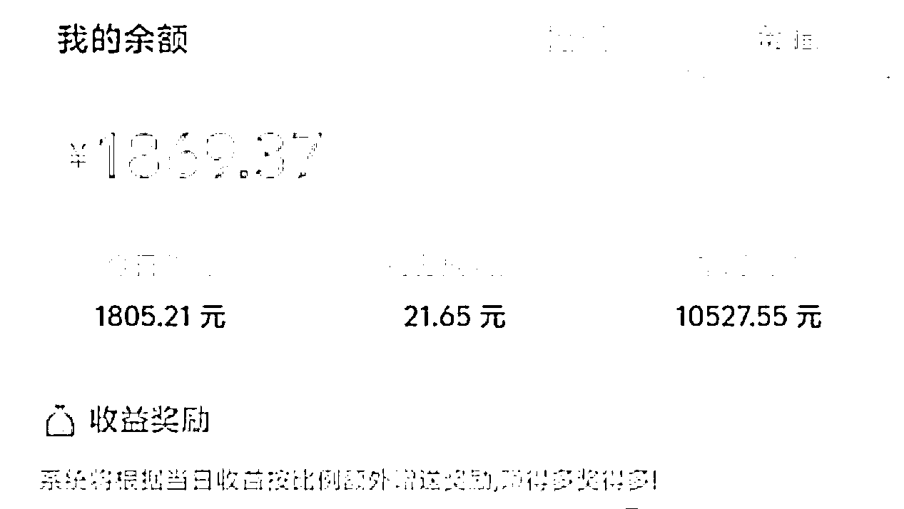

## 一、先准备闲鱼账号

闲鱼账号大家基本都有，一个实名身份最多开3个号。新手期别贪多，先认真运营一个账号；跑通之后，可以借用家人身份多开几个，做成矩阵操作。熟练以后，一个人同时养10个号也不是不行，经验都是慢慢攒出来的。

## 二、准备“铲子”资料

这次我们要吸引的是创业粉，所以准备的东西必须投其所好：赚钱信息差、项目教程、黑科技提效工具，都可以。

资料从哪里来？两个渠道：

**1. 同行那里直接买**  
在闲鱼搜索“副业”“赚钱”“无人”“挂 j”这类创业粉爱用的词，找到对标账号，挑对方卖得好的课程或软件拍一份，把里面的引流信息替换成自己的。有些卖家很实在，你拍一份，对方还会额外发一堆资源过来。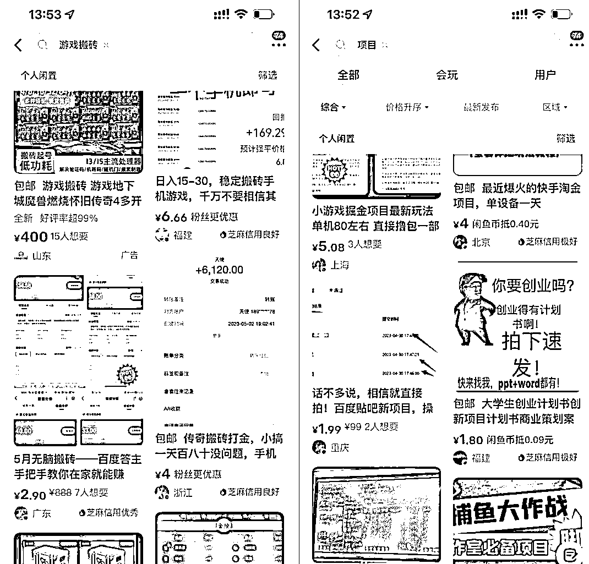

**2. 项目资源站下载**  
项目资源站每天都有大量新教程和工具更新，套路一样：买一份会员或资源，替换掉信息，就成了自己的东西。如果你还没有这种资源站，可以找我发你一个。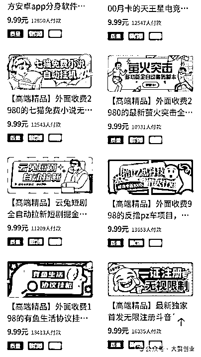

## 三、养号

账号从第一天就能上架商品，但养号动作也要同步做：

- 打开“我”下方的“互动权益”，开启“领闲鱼币”；
- 每天把闲鱼币领完，再把“赚经验”里的任务全部做掉，给小店升级。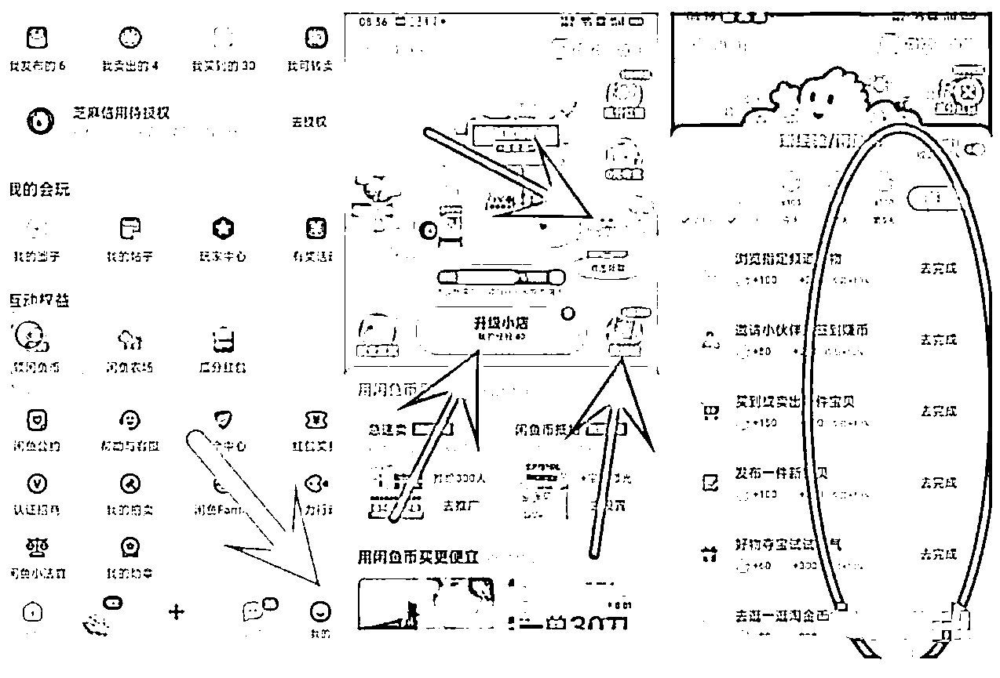
- 去主页搜“项目”或“赚钱”，然后每隔8小时操作一次：收藏5个、浏览20个、关注3个。这一步很关键，别省略。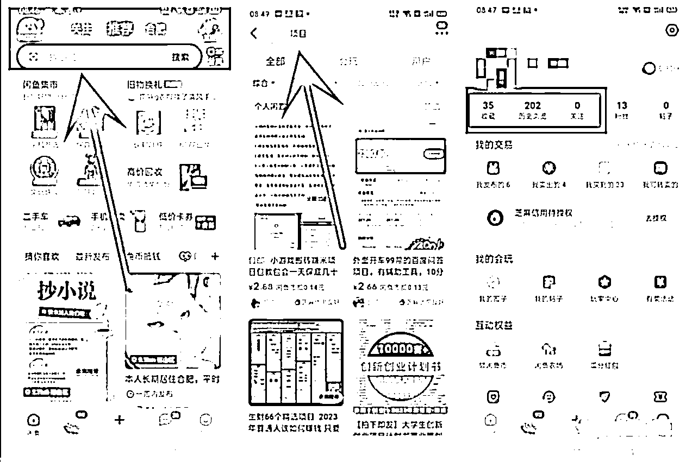

## 四、发布宝贝

**宝贝图片：** 不要直接下载同行的图片，下载下来的会带对方水印。正确做法是打开图片后截图。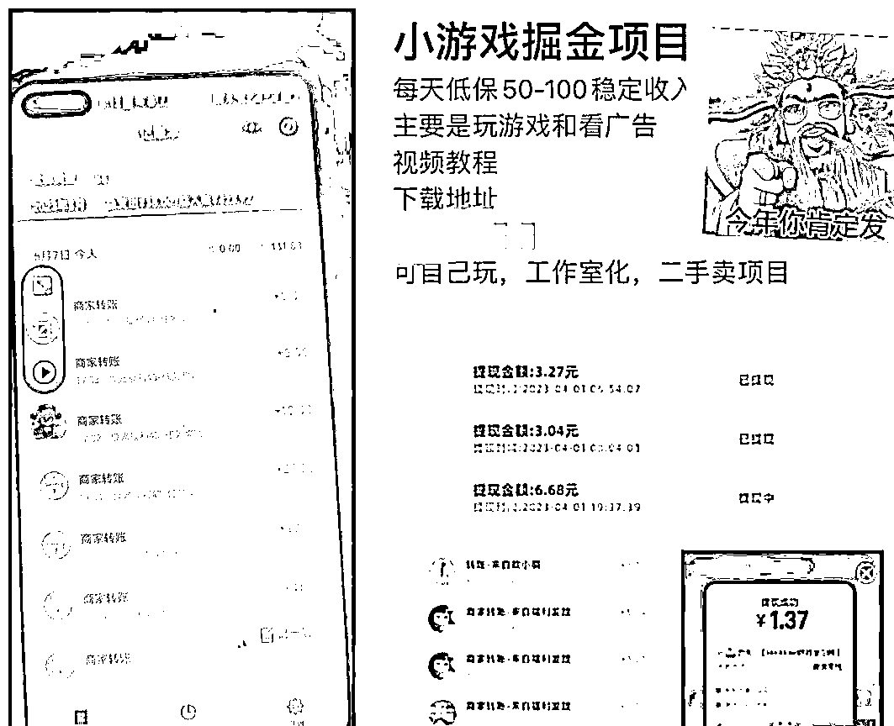 发布时选择“发布闲置”，上传截图，裁剪、加标签，再搭配贴纸就搞定。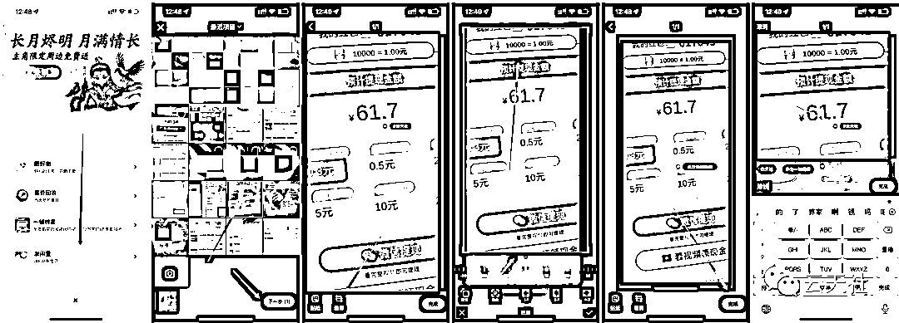

**宝贝文案：** 复制同行文案，粘贴后加上表情、删改部分文字，完成去重。担心违规的朋友可以用这个工具检测：https://uutool.cn/check-word/ 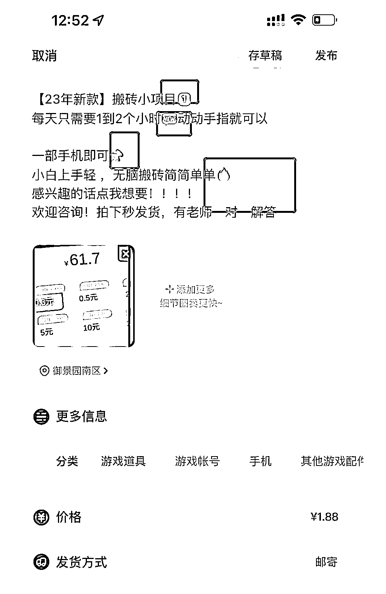

确定好要上架的项目后，持续铺量就行。第一天发5条，第二天开始每天8条以上。发布完记得开启“加曝光”和“闲鱼币抵扣”。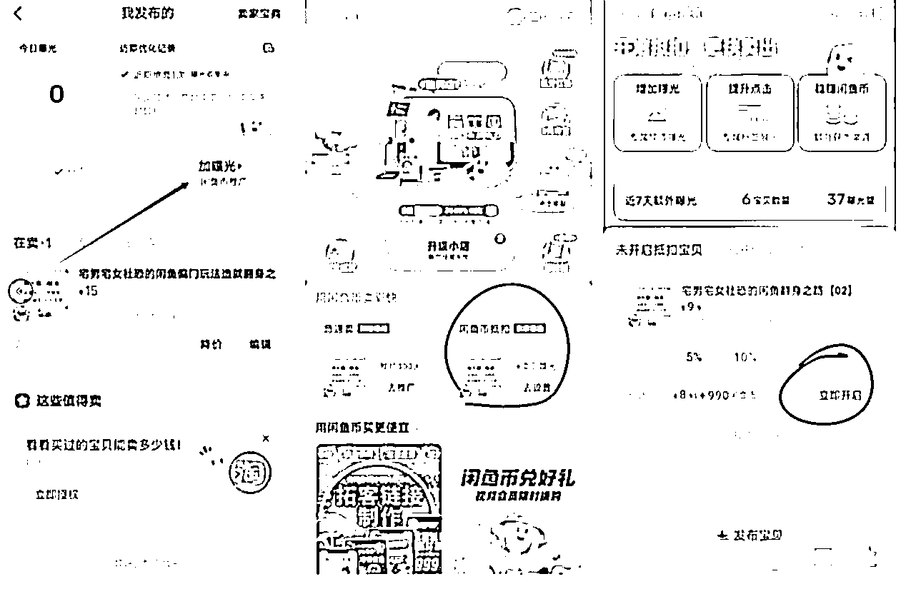

## 五、快速优化曝光

商品价格统一设置在5-10元之间。发布1小时后开始降价，每次降0.1元，一件商品一天最多降3次。

每天固定做这些事：签到、做闲鱼币任务；发布10个左右新宝贝；每个宝贝都做一遍降价；卖出后立刻补上架；开启闲鱼币抵扣和闲鱼币推广；每天擦亮宝贝，早上八九点操作就可以。

## 六、发货与私域引流

有人来咨询，不用聊太多，让他直接拍下即可。可以设置自动回复：“您好，标价就是实价，系统教程，拍下自动发货。”

客户下单后，不要直接甩项目资料，而是发一个🛰️卡片的链接。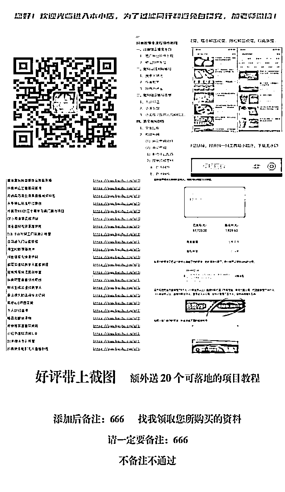

因为有些人拍下后不会主动加🛰️，所以要补一句：“文件太大，容易被系统和谐，添加后一定要备注来意，说明从哪里来、需要什么，我看到后会清楚。”只要对方加了🛰️，引流就算成功了。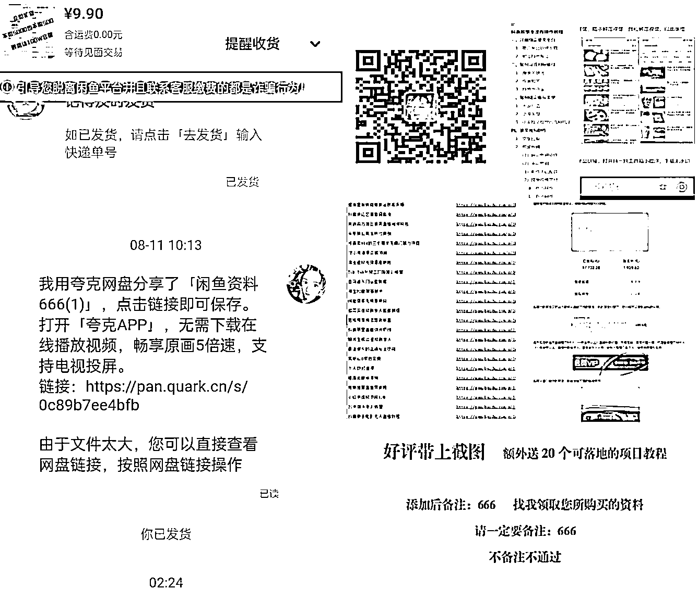

发货基本用夸克网盘，原因很简单：夸克有拉新收益，一个新用户能带来5-10元。夸克网盘拉新渠道授权流程在这里：[夸克网盘拉新项目渠道授权获取流程](http://mp.weixin.qq.com/s?__biz=Mzk0MjQxODQ4Mw==&mid=2247485618&idx=1&sn=9004b5dd9e15f546518a7bee7f459798&chksm=c2c237eef5b5bef81e13eefcb408c82d571f1938354a6176ac8d81a9e023049355ab5c13bcdf&scene=21#wechat_redirect)

## 七、后端变现：卖网站会员

闲鱼上卖资料只能赚个零头，单价就几毛几块，想靠这个日入四位数不现实。真正赚钱的是后端产品。

私域里沉淀下来的都是想找机会的创业粉，常规操作是卖课程、卖项目、卖社群做二次转化。但大多数人没有交付能力，所以最好的选择是卖零交付压力的产品，比如资源站会员。

资源站会员入口：[env-00jxgwdit0gt-static.normal.cloudstatic.cn/?id=4847](https://env-00jxgwdit0gt-static.normal.cloudstatic.cn/?id=4847)

具体玩法：先开通一个资源站分站合伙人，再把下级分站合伙人价格设为998元，接着每天发朋友圈做展示。朋友圈素材在平台后台就有现成的，下载下来直接发即可。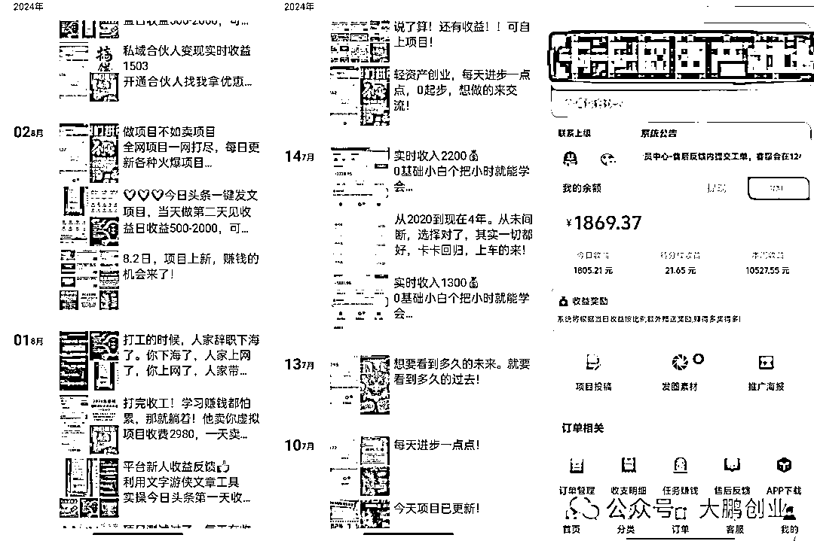

别人一旦开了分站，你这边直接进账900多；对方以后在站里卖东西，你还能继续抽成。一天能出两个分站，四位数就到手了，而且完全不用自己交付。

## 八、总结

这套玩法看起来小，但五脏俱全。引流、转化、产品三条线都齐了，私域变现闭环也能完整跑通。后续想放大，可以加账号、收徒、复制给更多人做。

把这条路跑通并持续深挖，赚大钱不容易，但解决生活开销问题不大。其实这个玩法👸号以前分享过，现在依然还能做，只是同行多了，效果肯定不如之前。大多数人思维固化，只会照着抄；如果你懂得变通，效果会比硬搬好得多。有机会再继续聊。

有朋友在评论区问“这个是不是以前看过”，作者回复说：闲鱼引流创业粉的方法都差不多，真正的差别在后端二次变现；有人把项目包装好，再回收学员手里的粉做闭环；有人直接卖项目；而今天这种方式更简单，不需要后端交付，适合新手。也有人问网站里的项目会不会有版权问题，底下有人直接点破：都是各个渠道收集来的盗版课程。