# 📕追热点，别再瞎蹭！这个“爆款公式”请收好
作者：龙哥

奥运会话题又刷屏了，各大平台的流量玩家们，谁不想趁热分一杯羹？但很多人追热点全凭感觉，结果数据惨淡。我之前给客户做内容，同样的笔记，加上热点之后直接多出3000多赞。亲测有效的方法，今天分享给你。

## 一、先选对热点，别踩坑

真不是随便哪个热点都能追。时政类、负面事件，尽量别碰。平台内容调性讲究积极向上，这是大环境决定的，做内容的人必须守住安全线。像那些容易引起争议或敏感的，直接绕道走。

那去哪找热点？推荐“今日热榜”，这个网站把各平台的热门榜单聚合在一起，明星、奥运等实时热点都能看到，非常方便。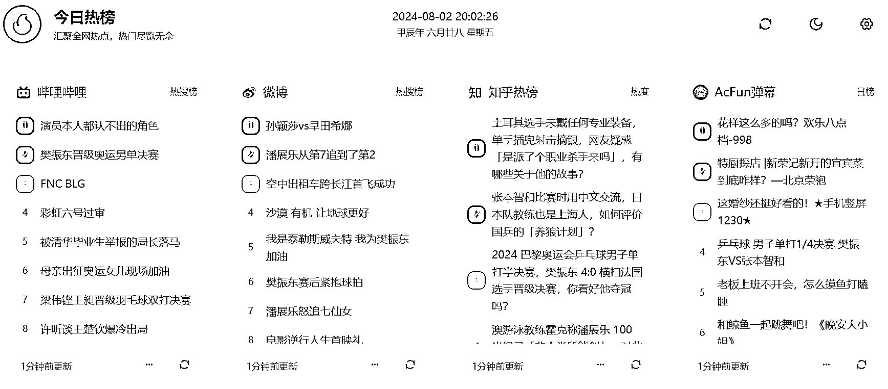

## 二、热点到底有什么用？

记住一个核心：热点不负责涨粉，只负责点击率。想让用户点进来，就要把热点人物或元素放封面、放标题，一眼抓住眼球。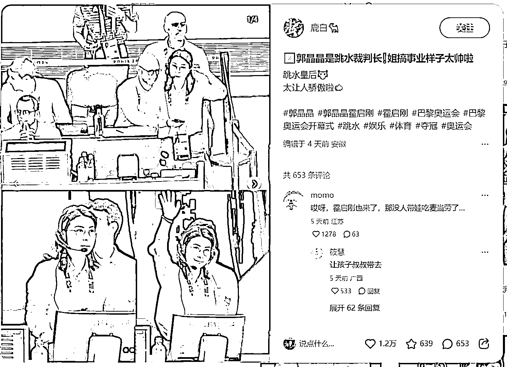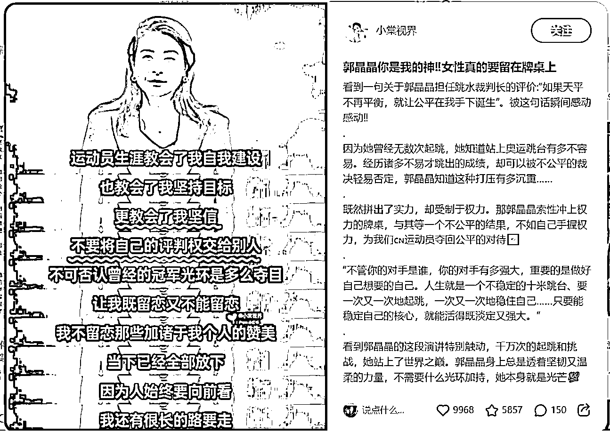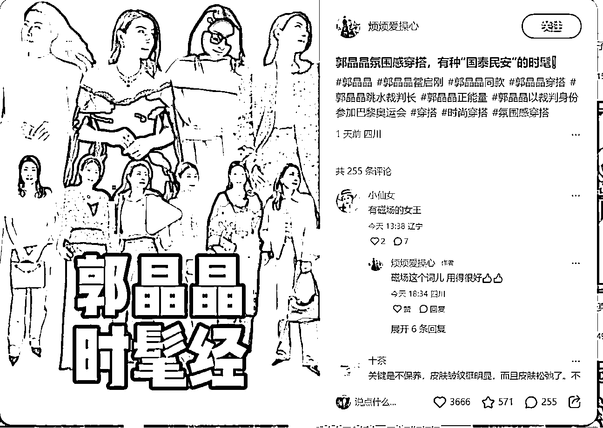

就拿最近的郭晶晶来说，热度一直不减。不同赛道都能找到切入点：

- 穿搭博主：扒她的衣品和造型；
- 女性成长：讲她从运动员到裁判，为女性争取公平的故事；
- 职场博主：鼓励女性大胆向前，做自己的“总裁”；
- 情感博主：聊聊她和霍启刚的相处之道；
- 育儿博主：分享她的教育理念。

热点本身不是话题，得把它变成跟定位垂直的话题，才能为你所用。

## 三、万能公式来了

“解析热点 + 你的思考 + 方法论 + 钩子” —— 这四个要素缺一不可。

热点不能只是八卦谈资，必须借它的势能输出自己的价值，否则用户看完就走，既不长粉也不转化。比如家居博主拆解明星的家，别只夸好看，要给出你对客厅设计的几个方案，让大家觉得你既有审美又有干货，才会关注你。

再举个很火的案例：《玫瑰的故事》里刘亦菲产后求职那段。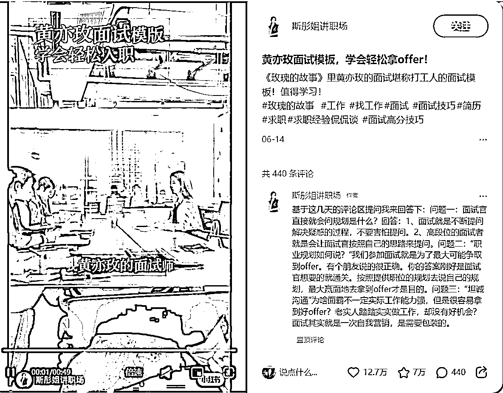 当时女性成长、职场、心理等赛道都在追。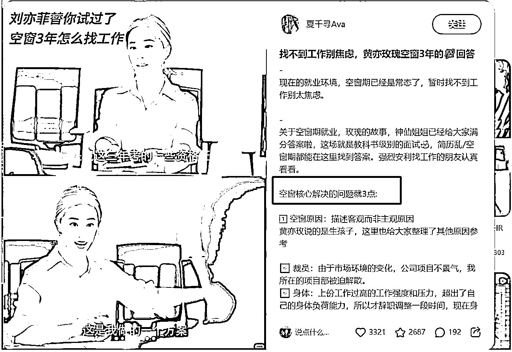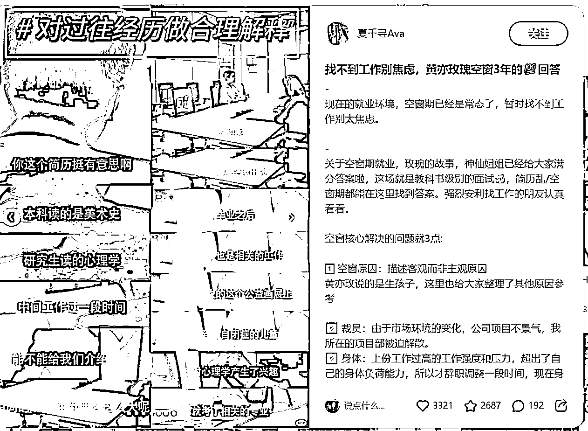 真正数据好的笔记，都是先把热点深度解析一遍，把人物处境、心理变化讲透，让用户看得停不下来。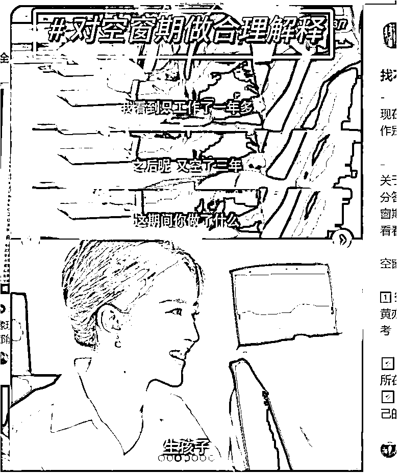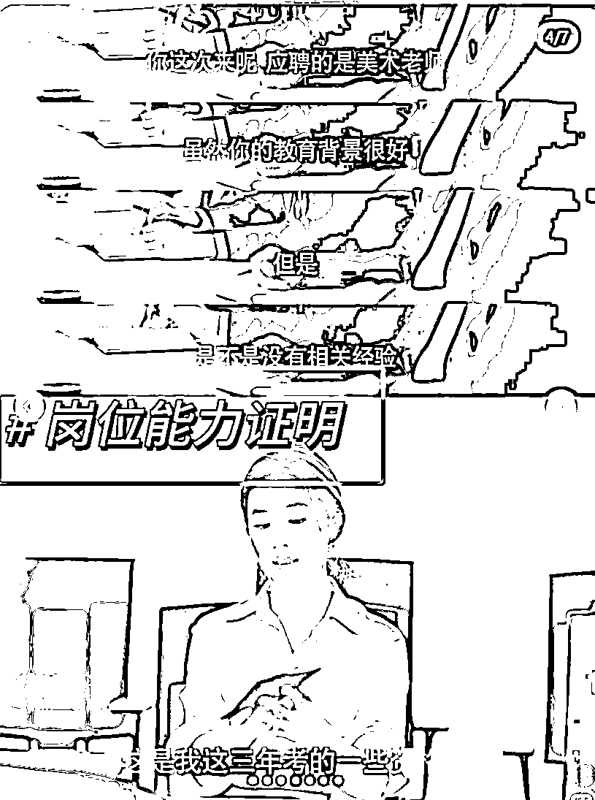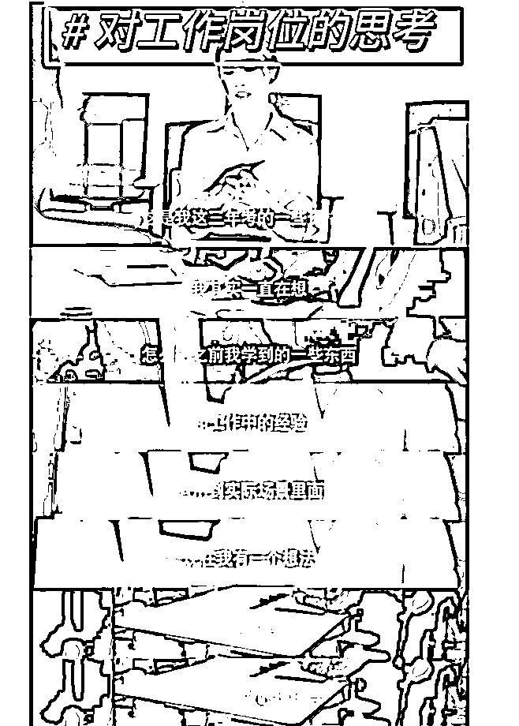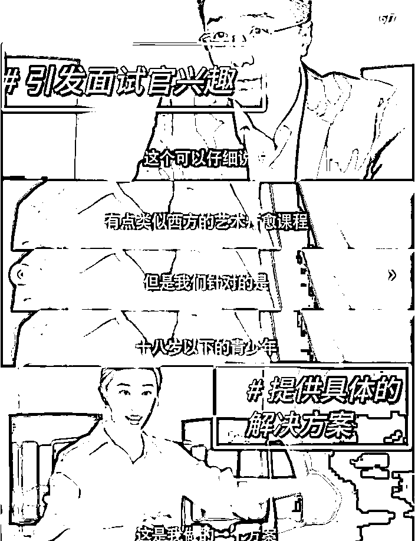 这种解析的价值在于，它能让用户愿意长时间停留。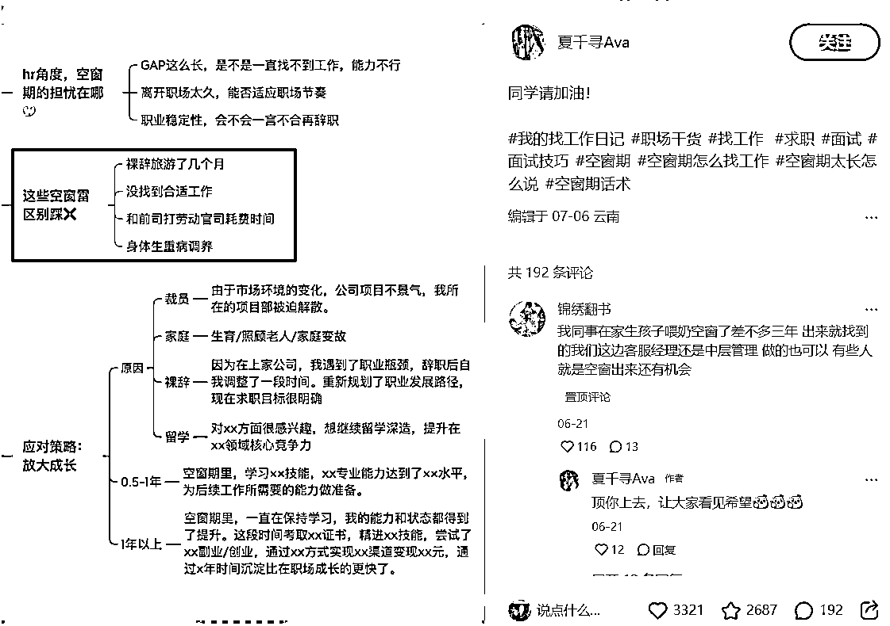

随后，再用表格或思维导图把知识结构化，让内容“看起来非常有用”。哪怕用户当下用不上，也会先收藏。收藏、互动就有了，数据自然好看。

不过这个案例也提醒我们：它少了“钩子”。评论区虽然热闹，各聊各的，但没有私信转化。好在笔记数据做起来了，账号权重抬升，也能带动其他内容。所以，想清楚：你的热点笔记为什么没人收藏？是不是缺少让人想保存的知识点？有点赞有收藏却没人私信？问问自己，钩子放了没？

## 写在最后

热点一定值得追，因为它是点击率的加速器。但千万别傻追，记住这条公式：**解析热点 + 你的思考 + 方法论 + 钩子**。用好了，流量和转化都会找上门。

我是乐乐，一起在📕搞流量，咱们下期见！

* * *

评论区：有圈友问怎么判断热点值不值得追，也有反馈说公式很实用。欢迎在评论区聊聊你的追热点经验～ 