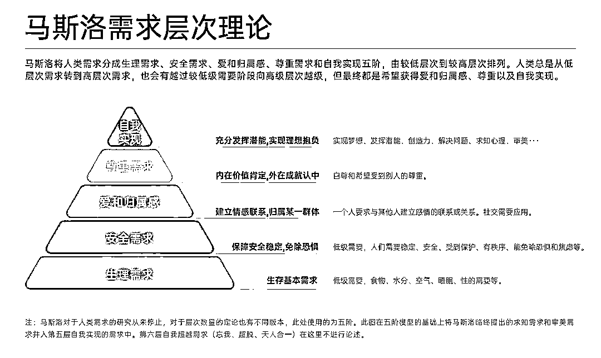

# 用人性做投放：广告营销心理实操方法论

原文：[`www.yuque.com/for_lazy/zhoubao/kkh884e3lyouy2gz`](https://www.yuque.com/for_lazy/zhoubao/kkh884e3lyouy2gz)

我们做投放的终点永远是成交产品、成交服务，而产品存在的意义就是去解决用户的具体难题，本质上是一套解决方案。**营销的本质是帮客户把问题解决掉，心理效应只是提速用的工具。**

先搞清楚用户到底缺什么，产品能不能真正补上这块缺口，能补得上才是好方案。广告就是在卖这套解决方案，用户为什么要选你而不是同行？同质方案太多了，你的稀缺性并不明显。这时候把心理学效应用起来，就能把用户被选中的概率拉高。

**心理效应背后都是人性在作祟，无论是优点还是弱点，它会让人在无意识中做出反应，完全不经过理性推敲。** 看懂了人性，你看世界就更透。很多人知道自己有毛病，却改了一辈子也改不掉。当一个毛病在很多人身上都存在，它就成了一个群体标签，比如占便宜心态。

**1、马斯诺需求理论**

非常经典的需求分层模型，告诉我们不同人群在不同阶段要的东西不一样，我们的投放打法也必须跟着变。

**2、投放心理的应用框架**

**2.1、镜像拆解路径**

**2.1.1、对标竞品拆解**

知己知彼。拿同行的广告素材对照心理学效应清单，看看人家用了哪些效应，分别起到了什么作用。

**2.1.2、自检素材拆解**

把自己做的素材过一遍，盘点用了哪些心理触发点。我见过完全没用心理效应的广告，效果可想而知。好坏不看感觉，看你捆绑了多少人性触发点。营销流量是买来的，不用担心营销过度没人看。

**2.2、从内容制作切入心理**

**2.2.1、把产品价值说透**

产品的核心卖点是什么？
能帮用户解决哪些具体问题？
有哪些可视化的效果图或视频可以展示？
技术上有什么优势？
价格有没有竞争力？
品牌背书够不够？

**2.2.2、把用户画像拎清**

做投放素材时，需求定位是第一步。可以从这些角度切入：

目标用户是谁？年龄、性别、职业、兴趣偏好？
当下最痛的点在哪？
为什么一定要用你的产品？
在马斯洛模型里，他处于哪一层需求？
是刚需还是弹性需求？

**2.2.3、把说服力做出来**

产品卖点和用户需求对齐后，就用心理效应去加杠杆。同样一个创意，用了人性触发和没用的，获客成本能差出好几倍。**人性就这样，我们只能顺势而为。**

一个效应可以用，多个效应也可以叠加，用得顺手就行，别硬套。

**自检方式：** 站在用户角度走一遍完整的服务链路，体验顺不顺，有没有卡顿和反感就算合格。反过来也可以故意设门槛，把不匹配的用户筛掉，这就是筛选链路。

**3、常用心理效应清单**

**3.1、影响力原理**

**3.1.1、承诺一致原理**

人会努力让自己的行为和之前的承诺保持一致。提前让客户做出小承诺，后续兑现的概率会大幅提升。比如用户预约了公开课，基本都会来听，这就是承诺在起作用。

例如：引导微承诺、正向反馈、一致性奖励

**3.1.2、对比原理**

没有对比就没有判断。决策权在你手里，你怎么摆对比，结果就在你可控范围内。

例如：效果前后对比、得失对比、参数对比、卖点对比

**3.1.3、社会认同原理**

不确定时，人会看别人怎么选。大家都是群体动物，想归属就得合群。

例如：圈层身份产品、同类人群都在用

**3.1.4、权威原则**

人信专家。专业度不够，用户就不会买单。

例如：专家讲解、权威背书、政策呼应

**3.1.5、稀缺心理**

物以稀为贵。少的东西才值钱。

例如：限量发售、限时抢购、限量赠品

**3.1.6、从众心理**

人怕错过主流。人多就代表安全。

例如：好评晒单、热销榜、趋势跟风、群体使用场景

**3.2、情感驱动心理**

**3.2.1、恐惧心理**

怕丢东西、怕错过，比想要更管用。

例如：风险提示、危机场景、不行动的后果

**3.2.2、自私心理**

人都先想自己。独享感能刺激决策。

例如：个人利益点、个性化方案、专属权益、限量私享

**3.2.3、好色心理**

对美和性的本能偏好，绕不开。

例如：颜值代言、人设包装、视觉美学

**3.2.4、懒惰心理**

越省事越好。流程越长，流失越大。

例如：一键搞定、自动化、免安装、傻瓜教程

**3.2.5、贪婪心理**

多多益善。先拿再说。

例如：买赠、折扣、拼团、积分回馈

**3.2.6、存在感心理**

渴望被看见、被认可。

例如：定制服务、互动参与、社群身份、VIP特权

**3.2.7、名片效应**

跟你像的人更容易被信任。

例如：相同背景、相同圈层、同学同乡人设

**3.3、行为驱动心理**

**3.3.1、猎奇心理**

对新鲜事物的本能好奇。

例如：悬念预告、黑科技展示、跨界联名

**3.3.2、即时反馈心理**

马上看到结果，爽感加倍。

例如：互动问答、即时优惠、进度条、即时评价

**3.3.3、成就感心理**

克服困难后的满足。

例如：目标设定、成长可视化、勋章等级

**3.3.4、攀比心理**

总想比别人强。

例如：地位象征、高端生活方式展示、明星背书

**3.3.5、慕强心理**

崇拜强者，愿意付费。

例如：头部品牌定位、成功案例、权威代言

**3.3.6、捷径心理**

想快点解决问题。

例如：标准方案、一键操作、代办服务

**3.4、决策心理**

**3.4.1、损失厌恶心理**

怕失去比想要得到更强烈。

例如：限时结束倒计时、名额即将售罄、试用期要结束

**4、认知偏差知识手册**

飞书出品的《认知偏差手册》反响很好，官方已公开电子版，值得系统阅读。

* * *

评论区：

暂无评论

* * *