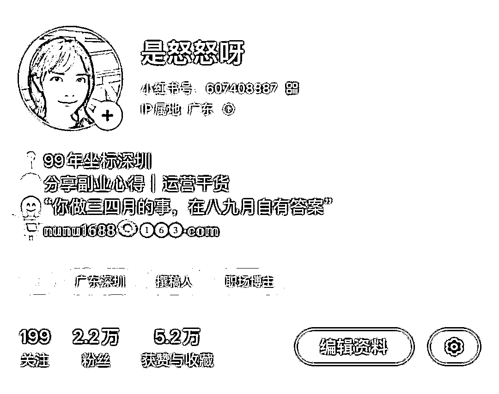
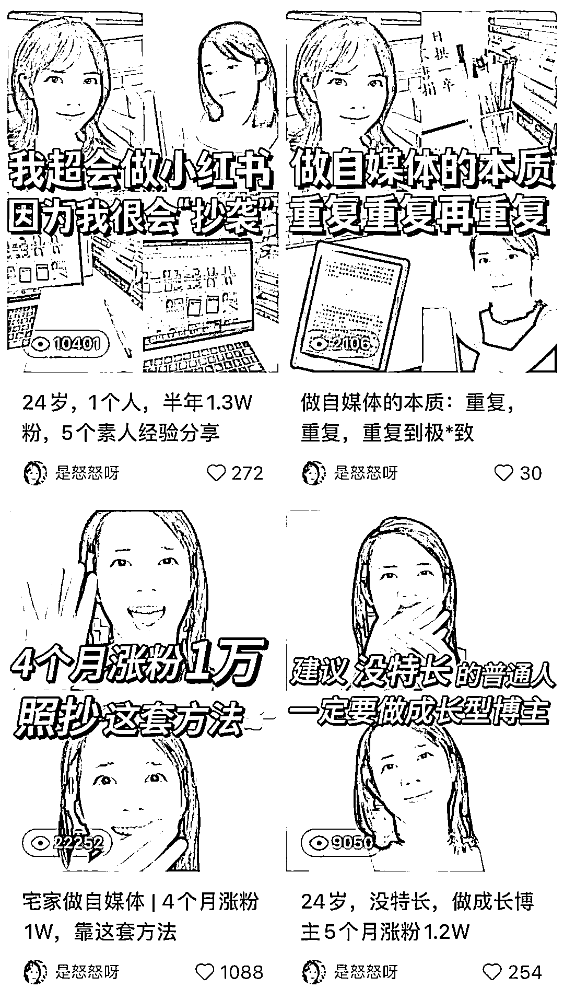
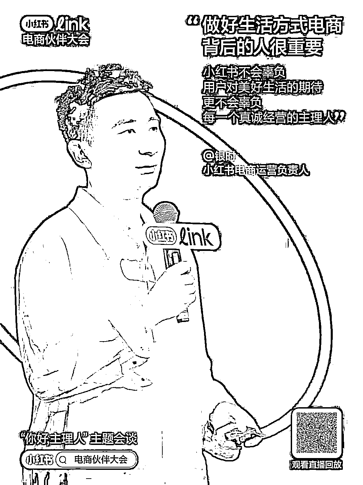
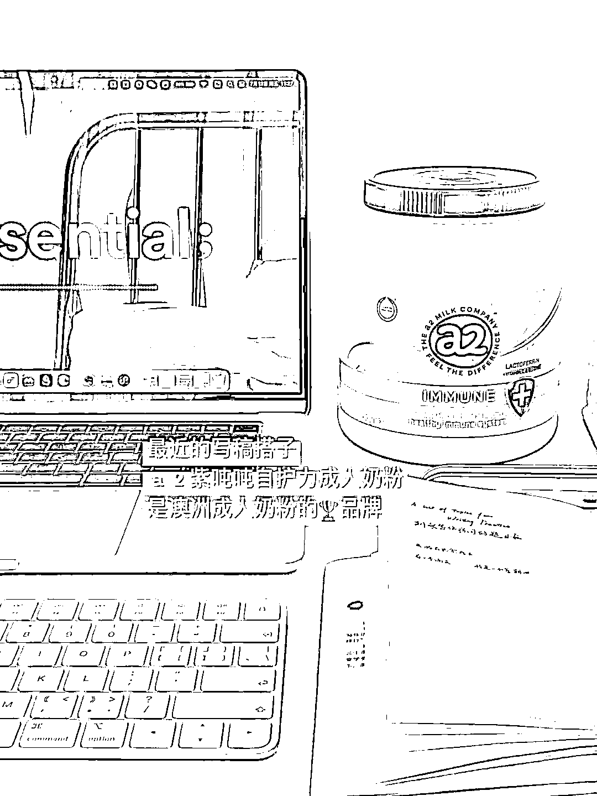
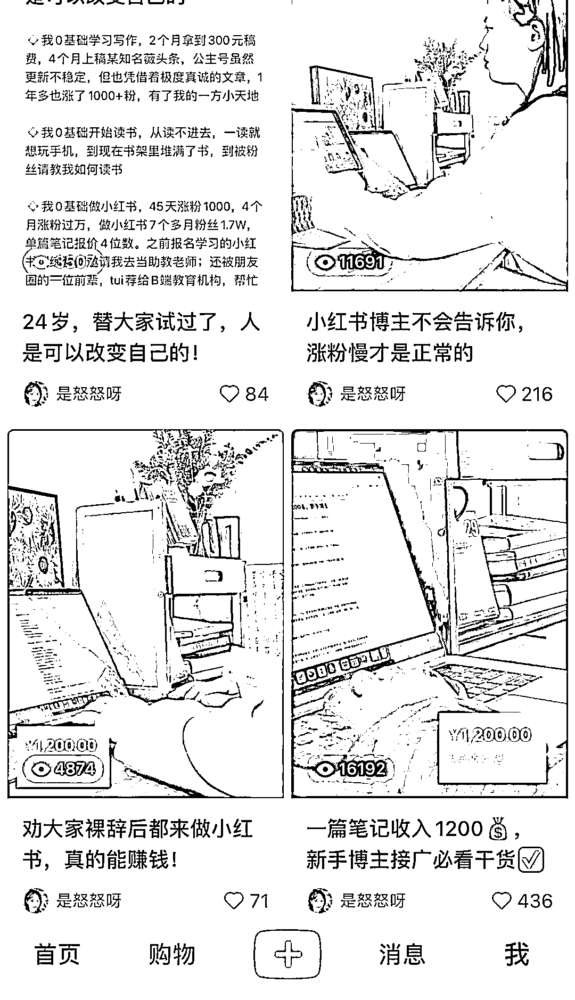
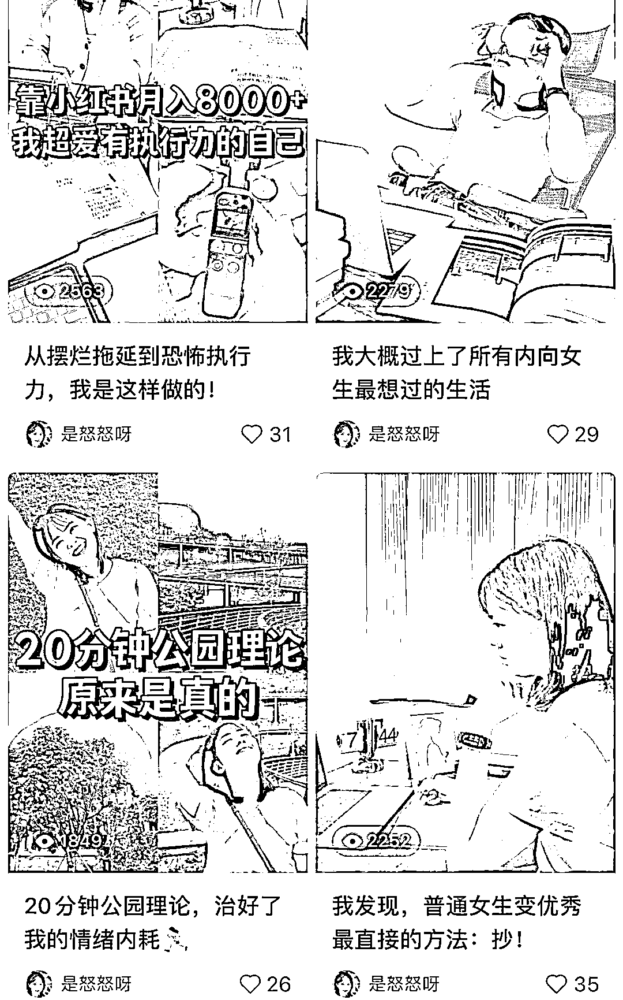

# 小红书 2W 粉了，靠接广变现 5 位数，给新手分享 6 个独家运营经验

小红书 2.2W 粉，接广变现 5 位数：新手博主值得看的 6 条私房经验

大家好，我是怒怒。

去年 6 月 14 日，我开始在小红书稳定发文。1 年 2 个月下来，累计发了 90 篇原创笔记，粉丝涨到 2.2W，广告变现 5 位数。

这个账号也给我带来了不少“意外收获”：被一位全网 30 万粉的博主邀请，去做小红书训练营助教，深度带过 10 多位新人；后来还进了百万大 V 的小红书实战营当助教。

作为从零开始的小白，这些成绩背后其实是无数弯路。今天想把这 1 年多的实战心得写出来，给所有打算靠接广变现的博主一些参考，希望大家能比我走得更顺。

## 01 更新这件事，必须雷打不动

如果只让我说一条最重要的经验，我的答案是：稳定的更新频率，是博主的基本功。

账号就像一家线下店铺，只有开门了才会有人进店，才会有生意。一旦关门停业，流量和广告自然都不找你。

我身边接广顺利的博主，基本都维持着较高频率更新。小红书是按单篇笔记分发的，发得越多，曝光入口就越多。想做接广号，周更 1 篇远远不够，至少要保证周更 2 篇。

笔记数量上来后，出爆款的概率也会变大。爆款能带动点赞、收藏、涨粉等整号数据，品牌方看到数据好，才会更愿意把广告投给你。

另外，长期稳定更新的博主，通常也更关注平台变化，会不断学习和迭代账号。这种创作能力，不是三天打鱼两天晒网的人能比的。

## 02 先定变现方式，再做账号

刚开始做号时，我根本没有认真想变现，脑子里只有“赶紧发笔记”。做好初步定位后，就盯着热门选题走，什么火做什么。运气确实不错，4 个月就做到了万粉。

但运气总有耗尽的时候。万粉之后，我最大的难题来了：很难变现。

因为起号阶段的内容全是小红书运营干货，粉丝涨得快，却没有给品牌留出广告位。在 PR 眼里，这更像一个“教别人做号”的账号，广告主自然不愿意投。

这也是很多新手容易踩的坑：只想着分享干货，把号做得像引流私域卖课的，反而不受品牌方待见。

“以终为始”的意思是：先想清楚靠什么赚钱，再倒推需要什么人设、发什么内容、图片怎么拍。如果你确定要靠接广告变现，那就去找广告多的账号做对标，研究他们的选题、文案结构和图片场景；如果对标了卖课账号，方向就全错了。

想查账号的接广情况，可以用蒲公英或灰豚数据，但要会员。闲鱼上买比官方渠道便宜，这笔钱值得花在找对标上。

## 03 广告位，本质上是一种种草

现在总有人说小红书接不到广告，劝大家去私域卖课。

但私域卖课门槛并不低：自己做课，需要长期的知识积累和大量交付时间；卖别人的课，又可能遇到交付质量不可控等隐形问题。对大多数想发展副业的打工人来说，接广其实是更合适的路。

我后来也发现，不少博主每月广告收入能达几千甚至几万，差别就在于内容质量。不是小红书没有广告接，而是很多账号还达不到接广标准，压根没有“广告位”。

那广告位到底是什么？简单说，就是“什么人，在什么时间，什么地点，做了什么事”。

这个理解，也和小红书官方直播里说的“生活方式电商”方向吻合。博主想更好变现，就要在账号里呈现生活方式和场景，让用户为你的生活买单。

比如，你白天是打工人，晚上做副业，那就围绕这个人设分享日常：穿什么、吃什么、买了什么。这些吃喝玩乐里自然会出现各种场景，场景里又会关联很多产品，产品就是广告位。

我现在的人设是自由职业者，经常在书桌前写稿。账号里反复出现书桌，桌上的电脑、键盘、iPad、书本，都可以成为品牌植入的载体。

前段时间我接过一个奶粉广告，场景是：“赶档期没空吃早餐时，我会喝一杯牛奶，快速进入工作状态。”配图就是书桌。这样奶粉不是孤立产品，而是一个具体的生活画面，更容易让人产生购买欲。

种草能力不是天生就会的。前期不会很正常，多去看看别的博主怎么接广告，学习他们如何软性植入，再套进自己的人设和场景里。写多了，这种感觉自然就出来了。

还有一点，新手前期不用太纠结单篇报价。把广告当成锻炼机会，倒逼自己提升商单创作能力，积累一批作品后，后续合作会主动找上门。

## 04 人设立得住，变现才走得更稳

人设不是为了秀优越，而是帮品牌方和用户快速知道你是谁。没有标签的账号，很难形成清晰的目标人群。

小红书用户靠关键词搜索，平台算法也靠关键词推荐。人设可以拆成四块：特质、身份、场景、道具。真诚、有梗、长得好看是特质；宝妈、打工人、985 学姐是身份；书房、客厅、草坪是场景；玩偶、特定穿搭是道具。从里面挑 2-3 个最适合自己的，组成核心人设。

而且，人很容易被“和自己相似”或“对自己有用”的内容吸引。比如一个“有点小钱的国企打工人”账号，既能吸引向往国企生活的人，也能吸引想了解小钱生活的人。

我自己想转行新媒体运营时，也会在小红书搜相关干货。如果看到一个同样转行、内容还不错的博主，大概率会关注，因为真的有用。

还有一点很重要：人设直接体现粉丝购买力。25 岁打工人号，通常比大学生号更受品牌方欢迎，因为前者消费能力更强。

## 05 转型不能急，一定要兼顾粉丝

今年我在账号转型上栽了个跟头：只想着换方向，没考虑粉丝能不能接受。

小红书运营干货这个赛道，起号和涨粉很快，但后期变现很麻烦。PR 容易把你归为“教人做号”的号，自己又没有广告位，接单情况一直不好。

当时有位博主建议我拓宽选题。正好我也写腻了干货，就发了一些和之前风格差距很大的内容，比如“普通女生变优秀的方法”“内向女生最向往的生活”。

再加上那阵子断更，账号数据明显下滑。对一直数据不错的我来说，这个落差真的很难接受。

吃了这个亏之后，我收获了两条教训：

（1）账号转型急不得。不能今天觉得老方向有瓶颈，明天就彻底换赛道。如果重来一次，我会在流量高峰时就开始布局转型。具体做法还是拓宽选题，但原有干货保持 70%，新方向占 30%。

而且要记住：一段时间只改变一件事。改封面风格，就不要动选题；换选题方向，就别碰封面。如果两件事同时变，粉丝认不出你，数据大概率会大幅波动，最后只会徒增焦虑。

（2）不要完全相信任何一个人，哪怕你很喜欢、很信任他。每个人说的话都基于自己的经验，立场、喜好、能力、预期都不一样，不能照搬。

付费咨询也一样。如果老师对你提的问题一知半解，就只能给你一知半解的答案，你盲目照做，很容易踩坑。遇到问题先自己研究、拆解，实在搞不定再付费，而且要选靠谱、有成果的人。

我当时想不透广告位的问题，就去找接广多的博主，逐个拆解他们的选题、文案、图片。实在解决不了的部分，又付费咨询了一位腰部博主。

## 06 做自媒体，就是一场学习修行

当小红书博主这一年多，我的最大感受是：这个职业真的很卷。更新不能停，学习也不能停。

最初要学定位、选题、拆解爆款；后期还要学调性、拍图、广告位设置、视频，以及平台新动向。有时候我也觉得一直学习挺累。

可认真想想，哪个职业不是一直在变化？博主作为互联网行业里的职业，变化只会更快。愿意拥抱变化、持续迭代的人，才能拿到更多机会。那些停止学习的人，最后也会反映在账号数据上：流量下跌，商单减少。

董宇辉说过：“顺境时多做事，逆境时多读书。”如果你也遇到瓶颈，不妨去读书、去拆解优质账号，然后把学到的东西迭代到自己的账号里。坚持下去，瓶颈迟早会突破。

## 写在最后

回看这一年多，做自媒体给我最大的收获，是让我看到了世界的丰富，看到了现实生活里遇不到的人生样本。

我也因此变得更豁达，格局大了不少；我更了解自己，也看见了自我价值；我有勇气去奔赴想要的未来，还认识了一群同频的伙伴。

做自媒体带来的可能性，远不止这些。就像杨天真说的：“自媒体是一把钥匙，既然是钥匙你就打开它，打开了才知道门后面有什么。”

祝每一个有野心的普通人，都能靠自媒体闯出自己的一片天地。我们山顶见。

