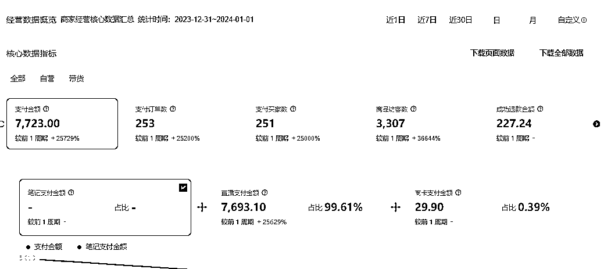
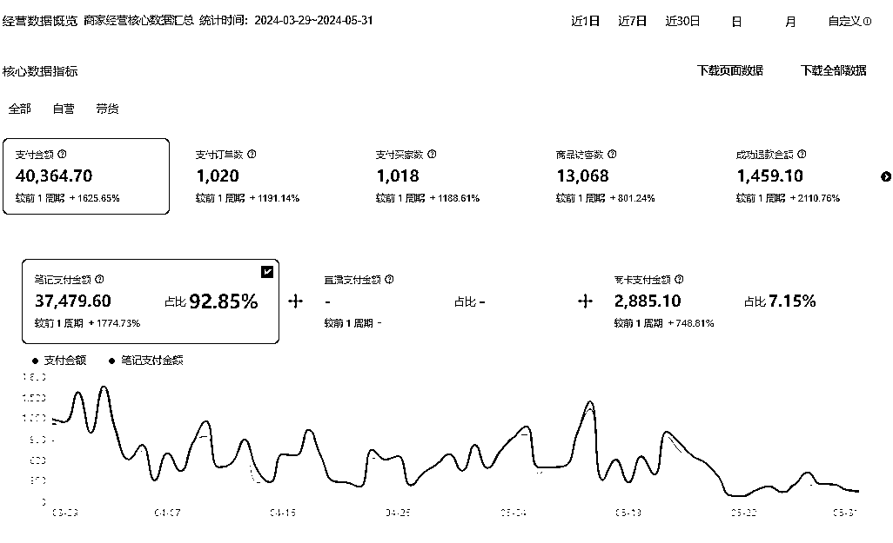

# 离开杭州楼市后，我在老家做起了小红书店铺：一年复盘

> 从房产中介到小红书电商，一个普通人的转型实录

大家好，我是衢州的大鑫。

大概谁也没想到，我在杭州卖了五年房子，最后会回到老家，靠一个小红书账号过日子。

2018年入行房产中介，正好踩中了杭州楼市最后那波红利。但到了2023年，行业明显往下走了——不管我多努力，都挡不住整体下坡的势头。思来想去，还是决定离开。杭州的生活成本太高，而我回衢州，起码有自己房子住，压力小很多，日子也舒坦。

走之前，我在互联网电商领域的经验几乎为零。真正下决心做这行，是靠着“副业”的航海计划，在小红书店铺上慢慢摸索出来的。

## 一、踩过的坑，和我怎么爬出来的

2023年9月，我开始做小红书笔记搬运混剪。运气不错，有个号养了半个月就出了2.2万的GMV。结果还没高兴多久，11月平台开始严打混剪二创，一大批账号直接没了。

后来我不死心，12月底又去试无人直播，选了百货赛道——退货低、客服压力小。虽然转化率一般，但那场直播还是到手3000多。

到了2024年1月，小红书对无人直播又开始收紧，很多号还没起量就被封了。说实话，那段时间挺煎熬的，干脆给自己放了个假，回家过年。

年后发现笔记混剪的管控松了不少。想想之前笔记带货确实给过正反馈，我就决定老老实实把这个方向做起来。

说来也奇怪，虽然我从没做过电商，但卖了几年房子的经验在这会儿居然用上了——小红书开店，本质上和实体门店没什么区别：笔记封面就是你的门头，选品就是你在卖的货，视频就是你的导购员。

## 二、关于选品，我的一些思考

有一个道理，是我自己摸出来的：**选品这个东西，就是生死线。**

好东西多的是，但卖不掉就不算好品。一个品行不行，得拿到市场上去检验。我自己选品有个笨办法——去小红书找那种销量过千、上架时间尽可能短的产品，这种品说明有人买单，而且市场反馈还热乎。

另外，小红书的用户画像大家应该都知道：女性占比极大，大多在24到35岁之间。这个群体普遍在意什么？爱美、想变得更好。所以跟着痛点走基本不会偏。比如夏天到了，防晒面罩、遮阳帽这类东西，需求是明摆着的。

## 三、封面，就是你的门面

老话说，货卖一张皮。封面不好看，用户连进店的想法都没有。

在这个环节，我的原则很简单：**抄**。既然你选的品已经被市场验证过了，那就一定有人帮你试过错。我当时专门请教过@书豪 教练，他教了我一招——去扒同品类里高点赞的笔记封面，然后放到美图秀秀里二次创作，加滤镜、贴纸，再把贴纸透明度调到1%，基本就能做掉查重。

再或者在搜索框里输产品的关键词，看看最近有没有同样卖这个品且数据不错的笔记，封面思路可以直接借鉴。

## 四、测品，别偷懒

人家卖得好，不代表你能卖得动。这事儿必须自己亲自测。

我的方式是“多脚本+多封面标题”组合着来，交叉跑测试。一个品，至少发10篇以上的笔记去验证，再到数据说话。

## 五、评论区与晒单，转化从这里要

评论区可太重要了。前期小号不够用的时候，我自己注册了几个号，在评论区发那种“我买了，姐妹们等反馈”“这个我买过，真的好用”之类的留言，确实能带动点击。

后来账号多了（现在有四个号），自己的小号完全不够用了，就找@书豪教练介绍了一些评论资源，专门来做这块。记住一件事：**评论区的存在，就是为了转化而服务的。**

还有一个刚上架时的小技巧：新品零销量，很多人不会下单。我一开始就会用小号或者找家人拍个十单，但实际发货可以只发一单，先把商品页的销量撑起来。等货到了，再顺手拍个晒单笔记，这样新来的用户看到销量和真实晒单，下单顾虑会小很多。

## 六、最后说点掏心窝的话

小红书和抖音的逻辑其实很不一样。

抖音讲效率，得多测品多起量；但小红书是个慢热的平台，更适合“单品单店”慢慢磨。我手头目前在做的这个号，是年后调整了个把月才开始出了第一条爆款笔记。但爆款一出，长尾流量能持续半个月甚至一个月。所以做小红书电商，耐心比什么都重要。

当一个品一旦卖起来了，就持续往这个链接上更新笔记，因为你的商品链接已经有了权重，哪怕你发的新笔记基础浏览量都会比新号高出一截。每天坚持更新，销量就能被持续带起来。

现在我靠这个号，一个月能有一两万的收入，在衢州这种三线城市养活自己绰绰有余。能有今天，真的得感谢“副业”这门“船票”，让我从一个完全没碰过电商的房产中介，跑通了从0到1。

也要感谢@书豪教练，在我最迷茫的时候，给我了选品和测品的具体方向。

最后想对这个时代里的各位说一句：行业再卷，也总有适合普通人的一席之地。关键是，你得敢换赛道，然后耐心走完最难的那段路。

