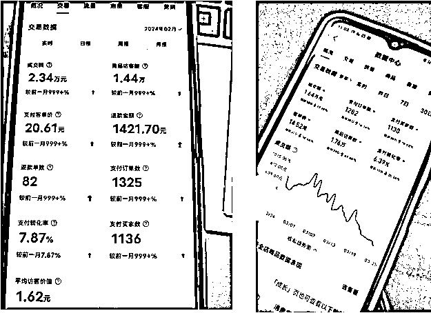
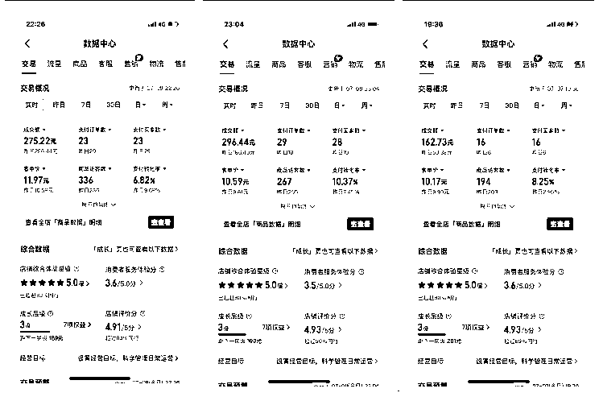
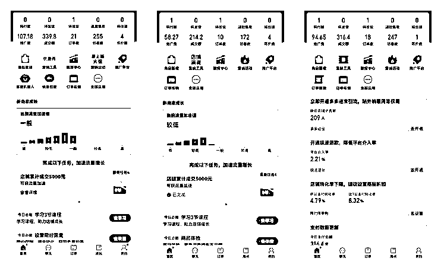
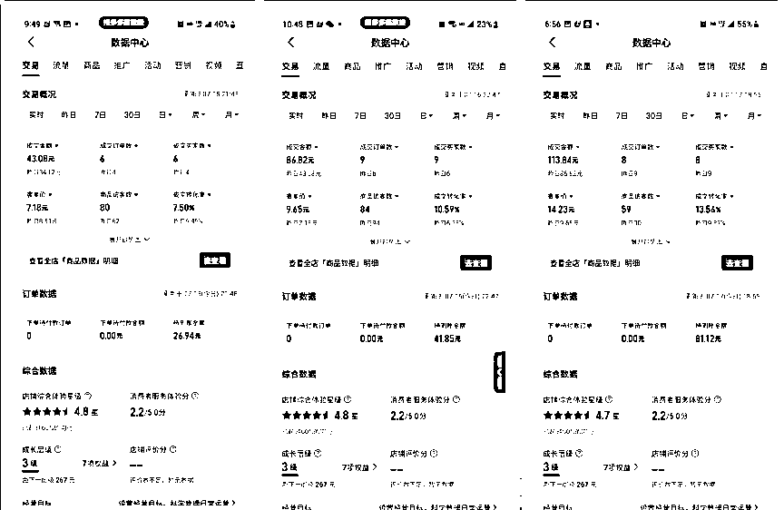
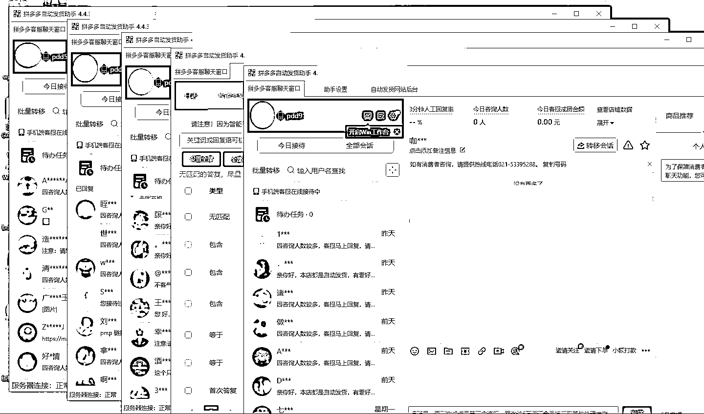

# 一个人带十几家店做拼多多虚拟，单店日赚百元是常态

## 单人操盘10+家拼多多虚拟店，稳定做到日均盈利100以上

作者：新侠
发布时间：2024-07-29

大家好，这里是新侠。

今年年初我把重心全部放在了虚拟类目上，先选的切口是拼多多平台的虚拟资料售卖。

前后5个月的时间里一共孵化了12家店铺，试错阶段有2家因为平台二级限制被迫退出，其余店铺现在都能稳定实现单店日利润100+的水准。

按照惯例，先上几张收益相对靠前的截图。

但先泼点冷水。

表现突出的那几家店存在一定的运气成分，**并不能等同于整体的普遍水平**。

其实大多数店铺的日常表现，大概就在单日盈利一百出头这个区间。

另外要说的是，拼多多做虚拟起号很快。

新店铺通常第三天就能出第一单，之后的日营业额会持续抬升。

下面这台云主机上挂着5家店铺，全部接入了自动发货系统。

[`articles.zsxq.com/id_njuxhjafxmt1.html`](https://articles.zsxq.com/id_njuxhjafxmt1.html)

算下来也差不多一年没写东西了，一直抽不出时间整理思路。这次就借这个机会，把拼多多虚拟店的打法系统性地聊一聊。

PS1：文中展示的收益图都是店铺稳定期后的日常数据，已经剔除了偶发的大额异常值。拼多多虚拟店的单店上限其实比较清晰，预期要合理。
PS2：正文之后不会再放收益截图了，放松心情看就行。
PS3：文章并非纯干货教程，部分细节不可能面面俱到，但我保证照着本文思路去做是完全可行的。
PS4：文章里有近半篇幅在讲底层逻辑，给条鱼不如授人以渔。
PS5：电商玩法都带时效性，具体操作还是要结合当下环境判断。

正文开始，祝阅读愉快。

* * *

评论区：

立夏 : 感谢分享[强][强]

大米 : 大佬怎么联系

* * *