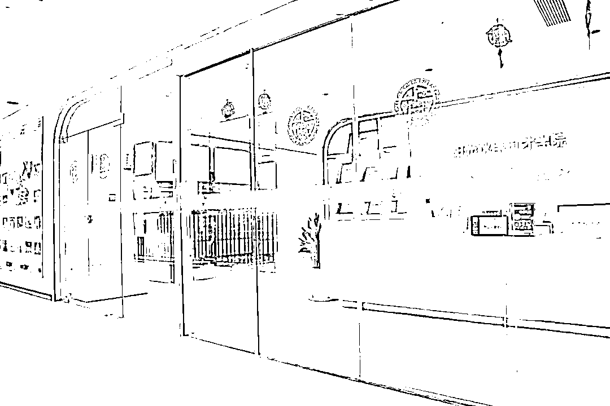
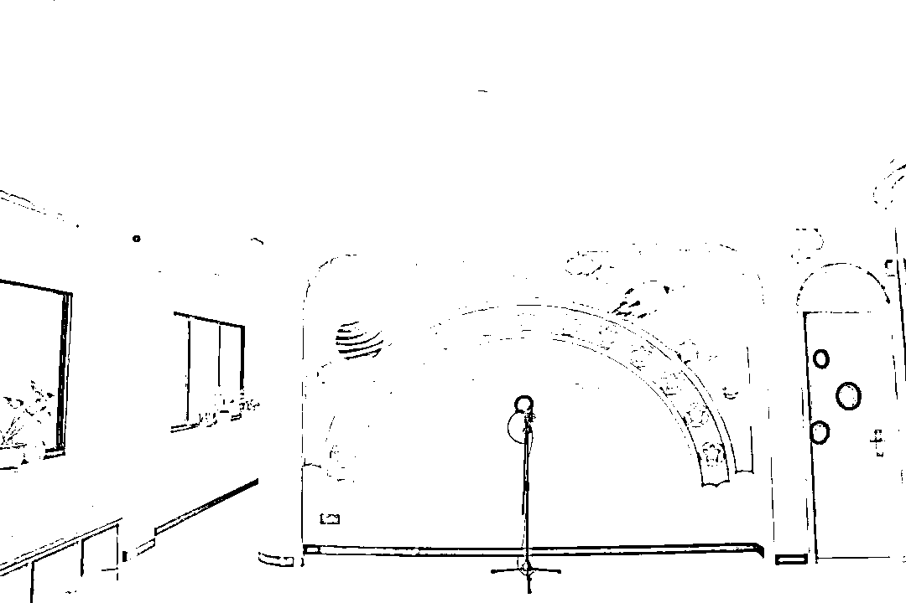
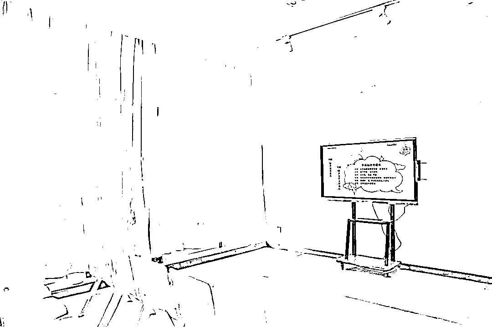
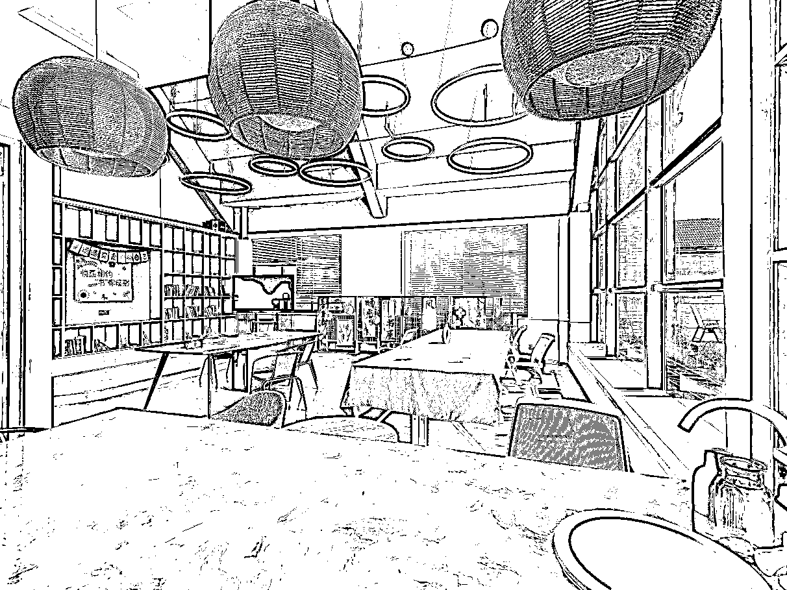
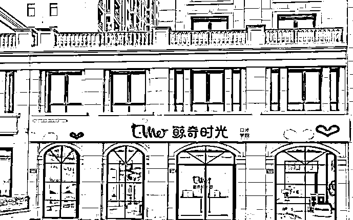
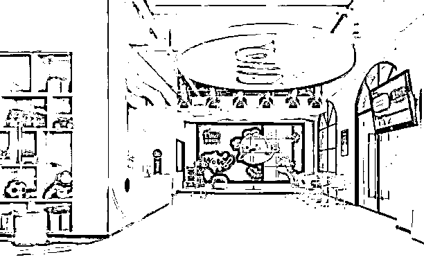
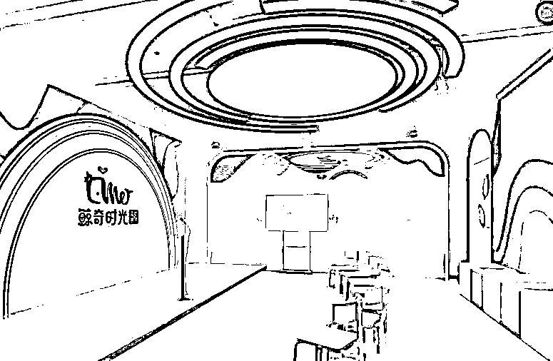
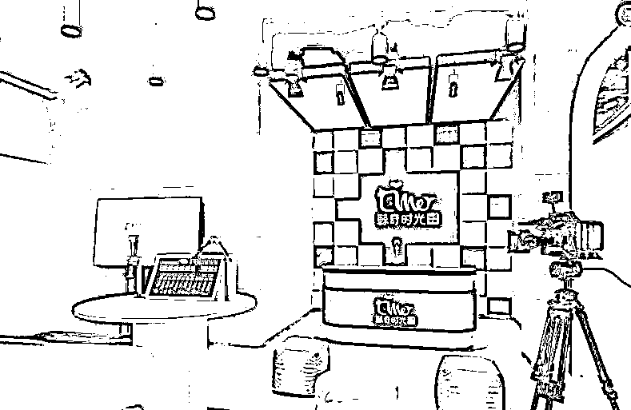
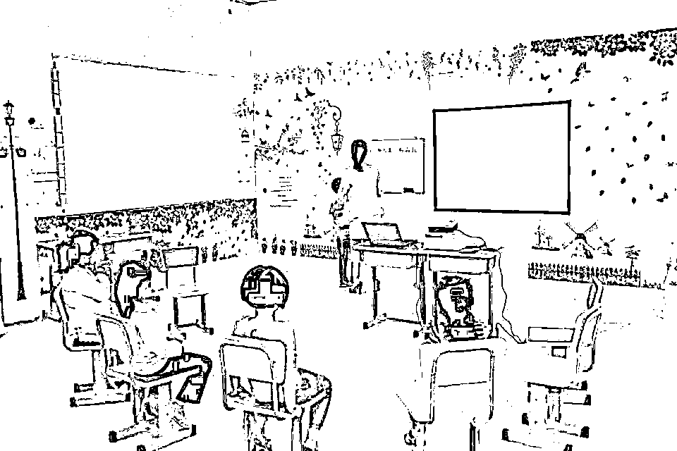
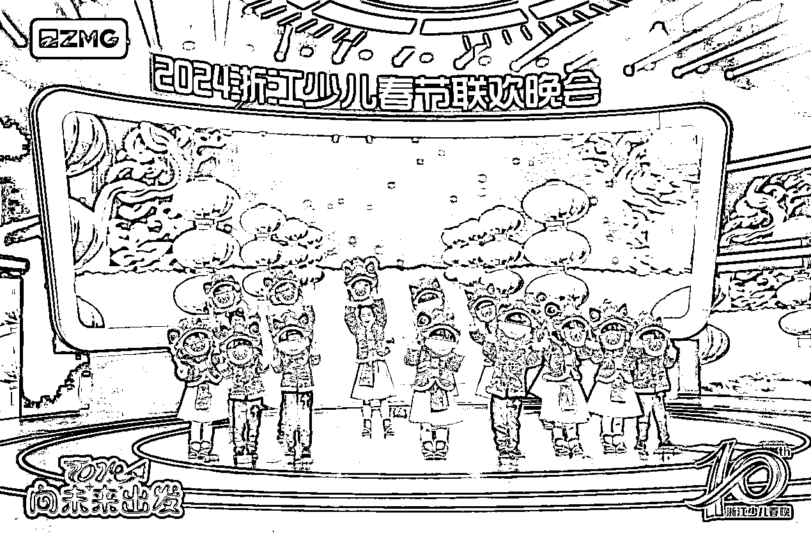

# 十年教培路，我把生意的命脉全交给了转介绍
作者：龙哥

## 十年只靠转介绍，少儿口才机构是怎么活下来的

作者： 小匠船长

日期：2024-08-01

教育这件事，需求一直都在。无论是一线城市还是三四线，只要赛道选对了，市场就不会差。

我的机构能撑到十年，踩过的坑不计其数，但结果还算体面，这就说明机会是真实存在的。更关键的是，我们几乎不靠投放，靠的几乎全是家长口口相传。

如果你也想入局，建议把公域获客和私域裂变结合起来，持续打磨课程专业度，让教学效果看得见，严控成本，用口碑做护城河。慢慢就能在当地站稳脚跟。

先做个自我介绍，我是龙哥，副业第七期成员。现下经营着一家少儿口才培训公司，同时还有一家内河航运公司。今天主要聊聊口才这块的实操经验，第一次写东西，表达有不足之处还请多包涵。

# 一、基本盘

项目落地在浙江一个常住人口约百万的四线城市。2015 年起做线下少儿口才，目前本地有两处校区，合计面积约 1800 平米，在读学员超 900 人，覆盖 4-12 岁年龄段。

经历 2021 年双减后，从 9 月起收费调整为 2980 元 / 15 节课，不再推年卡。如今年营收在 500 万左右。

校区环境，这个校区是电视台授权的品牌

这个校区是我们自主原创品牌

# 二、团队构成

是夫妻同创业。我负责日常运营、管理、对外部联络和赛事活动；我爱人负责教学教研和团队管理。核心班底之外，还有行政 3 人、教务 4 人、专职教师 13 人。

# 三、十年走过的三段路

**起步期：2015-2017**

当时还在国企上班，利用业余时间想做点副业。做完简单调研后锁定少儿口才。白天上班，下班和周末就跑场地。商场、临街门面、写字楼都看了一圈，最后看中了一处民办幼儿园旁的仓库，几十平米。

跟园方谈下来后，每季度 2000 元租金。自己添了空调、投影仪、几把椅子，亲戚帮忙刷墙铺地胶，一万块不到就开张了。

课程直接从网上找资料拼凑，再结合专业背景改编。第一批学员是从同事家孩子里找来的，先免费上 3 个月试听，通过朋友圈扩散最终来了 13 个孩子，三個月后付费留下 8 个，也算正式启动。

**积淀期：2017-2020**

有了两年经验后，市场开始加速。我们靠👸号就能带来稳定咨询。租了约 300 平的场地重新装修。到 2020 年学员规模突破 300 人。

这一阶段重点做了四件事：加盟市级电视台，拿到官方背书和展示平台；搬离小作坊，场地升级提升家长信任；组建团队，分工专业化；搭建可复制的教学体系。

**扩张期：2020 至今**

2020 年搬进繁华商圈的底商，2021 年再开新校区，找北京设计团队做品牌与空间全案。双减后及时调整收费模式，从年费改为期课。疫情和政策都扛过去后，如今已是本地口才培训规模最大的机构之一。

# 四、能活下来的关键逻辑

起步时的思路其实就是最小可行模型：投入要能承受，有真实需求，不影响主业，失败也不伤筋动骨。

小步快跑，不断试错，前几年才慢慢站稳。发展节奏不快，但一直往前走。那些当年做得很大的机构，现在很多都已消失。分享几个核心决策点。

**选址决定心态**

仓库月租 600 元，是我敢迈出第一步的原因。房租压力小，心态就稳。

它处在市中心，旁边是成熟小区，正对小学，还在幼儿园内部，自带人流。做线下一定要选居住氛围好的地方，临近好学校，租金可控。后续几次搬迁也坚持这个原则。

能让爷爷奶奶步行接送的店，续费率和转介绍率都会高很多。

商场店流量看着多，实际坑也多。租金高、公共区小、教室无窗，孩子多时上下课拥堵，家长体验极差。

另外一定要提前搞清楚消防二消的要求，按规范来，省得后期返工。

**产品才是长期壁垒**

熬过探索期后，我们把重心全放在课程质量上。

1、课程体系
会挑市场上优质的体系加盟，把精华整合进来，再结合本地家长需求迭代，沉淀成自己的系统。加盟本身也有区域保护，等于抬高了同行门槛。

2、师资
创始人是科班出身，学习迭代能力强。团队老师全是科班全职，无兼职。薪资比市场高 30% 以上，五险一金齐全，周一周二双休。

3、教学管控
每节课都经过教研打磨。每周集体教研后，老师 2-3 人一组试讲互评，再单独精练，全程填表并在飞书提交给教学校长。

校长会随机进班听课，现场给反馈。每堂主题课后录制孩子表现视频上传小程序，家长能直观看到进步。

4、官方赛事联动
长期与电视台合作，每年承办权威赛事。教学质量上去后，孩子获奖率高，本地比赛获奖者一半以上来自我们。比赛结束后总能迎来一波转介绍。

**口碑是底座**

道理大家都懂，但教育行业特别吃口碑。作为一个七岁娃的爸妈，我深知童年重要，家长买的不仅是课时，更是时间精力。

我们的理念是让孩子落落大方、出口成章。所有动作都围绕提升孩子水平。十年来，不少孩子从小班学到毕业，已有三届毕业生。他们既是稳定生源，也是转介绍的核心来源。

这次分享没讲流量和转化，不是藏私。说实话我们的公域获客能力很弱，也没有专业销售。绝大多数学员来自转介绍，这也是下一步要补强的方向。

# 五、前景判断

少儿口才、书画、舞蹈、编程等品类依然有空间。虽然生育率在降，但在三四线城市，百来个人的小而精机构完全能活。教育是刚需。

公域引流+私域裂变+专业课程+可视化效果+成本控制+口碑护城河，这套组合拳打好，就能在本地闯出自己的天地。

# 六、结语

借用爱人上周周报里的一段话，也是我们一直坚持的。

创业像在刀尖跳舞，先想失败再想成功。生意可以不做，信誉不能丢，必须踏踏实实做事。

做企业要做大家喜欢的东西，坚持下去要做自己喜欢的东西。工作里很多琐碎烦躁事，但都是通往目标的必经之路。

我希望能办一家真正为孩子成长着想的机构，让孩子在课堂上感受到快乐、被看见、被尊重、被欣赏，在陪伴中获得社会价值。

也希望自己能持续学习进步，把学到的东西分享给伙伴、家长和孩子。理论结合实践，这件事本身就很有满足感。

长期主义里没有大目标的冲刺，只有把一件件小事越做越精，就像匀速的慢跑。

* * *

评论区：

小余同学 : 善战者无智名无勇功，日益精进，匀速慢跑[强][强][强]

精灵 : 我也是教培，前后第 8 年。也是老带新转介绍多

小匠船长 : [强][强][强]

云珞 YunL : 太赞了，课程做的好，成本控制在自己承受范围内，考虑到爷爷奶奶接孩子的问题，孩子还多次上省电视台演出或参加赛，培养孩子落落大方

蒙蒙加 : 教培行业出身的我，看到这个分享，很感动。[爱心]

你们是在认真做教育，这是初心，并且一直在坚守，所以活得越来越好。[强]

东哥 : 在长期主义者的眼中，生活简单纯粹，没有雄心壮志的目标，有的只是日益精进的每一件小事，如同节奏稳建的匀速慢跑。[强][强]

小匠船长 : 有时候家长真的忙，接送孩子对于家长来说就是一个负担，这个年龄段的爷爷奶奶都还年轻，平时孩子的教育和接送都可以爷爷奶奶负责，那家长报班的负担就小很多了

小匠船长 : 大环境还是有影响。但认真做事，家长是能看得到的

* * *