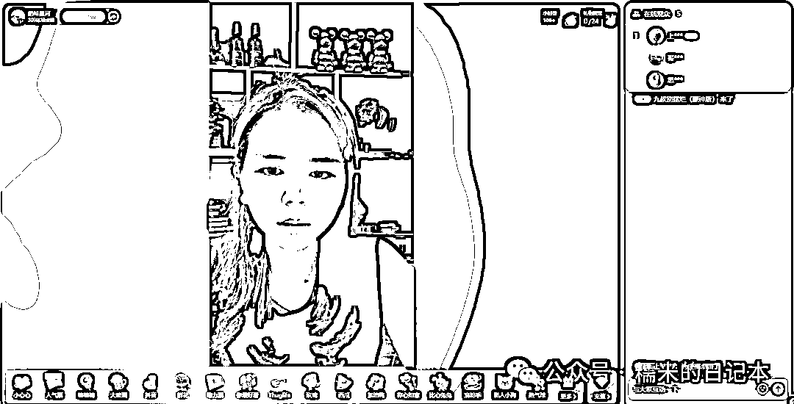
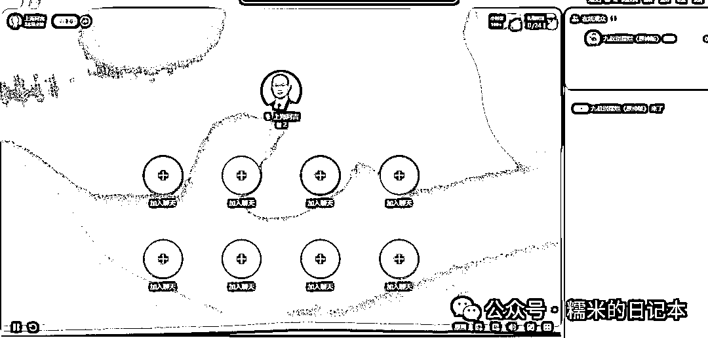
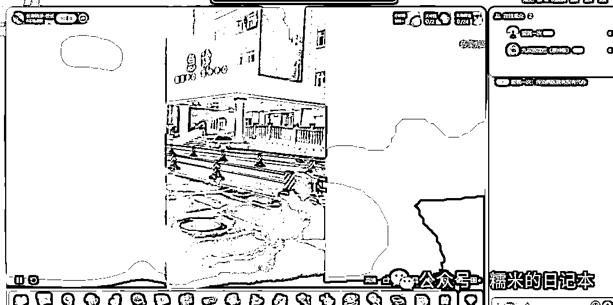
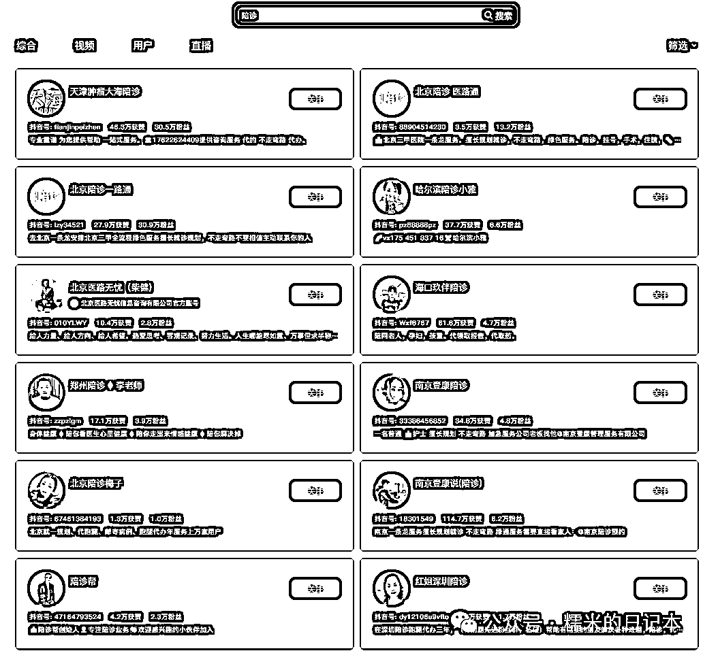
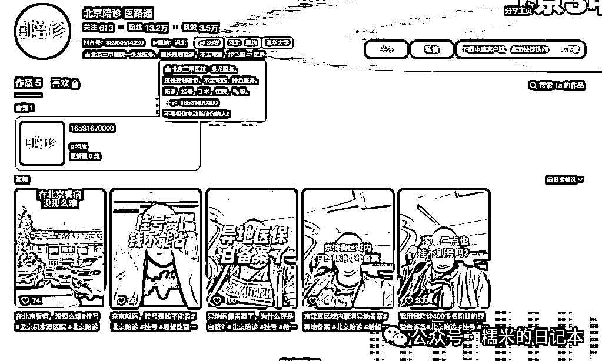
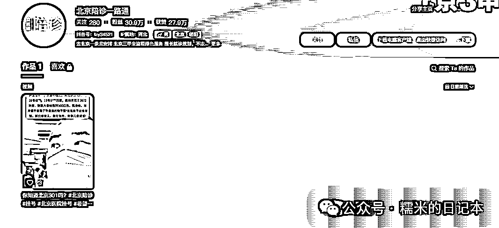
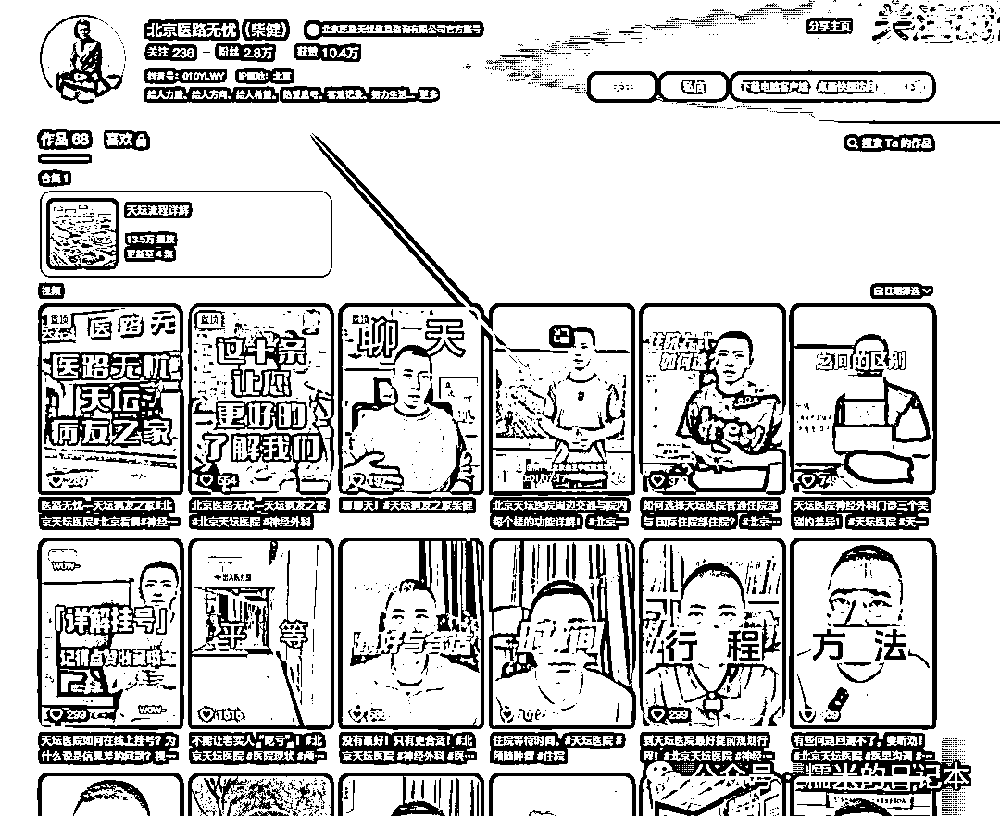

# 全平台自媒体陪诊账号观察笔记·抖音篇（4）
作者：龙哥

## 全自媒体平台，陪诊账号调研（4）

作者： 糯米

日期：2024-07-29

**糯米认为，作为陪诊行业的操盘手，一定要掌握最新的行业动向，其中就包含了陪诊自媒体获客，即**

陪诊行业，近期大家都是在怎么通过各种自媒体平台获客，获客做得怎么样，都在怎么玩耍？

🛰️生态的陪诊获客号梳理完之后，今天把目光放到抖音来。

先说结论，再展开细节，是老习惯。

在当下抖音的环境里，陪诊内容的打法已经趋于稳定，纯垂直的短视频赛道基本退场。现在能看到的几种主流形态是：以直播为主的垂直直播流，视频要么随便发要么不发，C端接单只是顺带，核心是往B端走卖课卖加盟；以陪诊老板本人为核心的商业口播IP流；完全不提陪诊但处处都在暗示的移花接木流；以及其他商业拆解类IP偶尔插播一期陪诊内容的夹带私货流。

只看粉丝体量，依然让人觉得有戏。能持续性地在前端积累流量，在当下的自媒体陪诊获客里已经算难得的好事了。

下面展开说说调研到的具体情况。

首先在主页检索的呈现是这样的

整体上能刷到的多是商业顾问类IP在输出陪诊赛道的干货，形式上多是粉丝问答、访谈这类。看得更仔细会发现，内容大都集中在2023年。

**值得留意的是置顶的分类词条里，出现了大量城市名字，大家可以看图**

糯米的理解是，陪诊相关内容在这些城市确实比较集中，所以被系统单独归类出来了。

就常识而言，上海、北京、南京、郑州、昆明这些地方的陪诊供给一直都比较多。

我也做了个小验证：

当搜索“烤鸭”时，词条分类就不再是地区，而是其他关键词，**这说明抖音并不是以地域为固定维度来设定筛选项**

继续往下看

各个城市的账号情况大同小异，垂直医院陪诊的纯视频流已经没人做了，大家基本都停留在去年的节奏上

在检索过程中，我筛出了几类比较另类的账号，也就是前面提到的移花接木流派，表面不谈陪诊，实则处处都在指向陪诊

比如这个号就很有意思，整体内容在做护工≈陪诊的类比，作者很会用人性话题和强观点选题来拉评论，玩得挺溜

另外还有新号注册后直接密集发图文的打法，下面这个就是6月12日一天硬发几十条图文的典型

再一种就是其他赛道IP偶尔蹭一期陪诊内容的夹带私货玩法，这个IP本身有自己的主营业务，陪诊只是顺带提及

接下来是直播流

目前来看大部分是素人直播，流量表现都很一般，直播状态辛苦

这个是我今晚实时看到的相对好一点的间，人货场搭建比大多数素人间要强一些

下面简单列几个粉丝量相对能看的直播间。判断标准主要是粉丝量，如果粉丝已经过千了但视频几乎没有，说明人家靠持续直播还是攒下了一些沉淀。我自己之前长期做过直播优化，也见过那种不做优化只靠堆时间的号，按那种玩法坚持半年大概能有一两千粉丝。

继续列举

继续列举

这位兄弟的坚持值得尊敬，两天后他还在播的话，就说明抖音对医院门口这种小直播间还是放任的，很不错。

说了这么多素人间，也确实有做得比较好的。

这个号是IP短视频加持过的，虽然账号以直播为主，但短视频的陪诊内容占比和发布节奏设计都很讲究，值得研究。

直播部分就聊到这里，下面看一下账号整体环境。

直接用词条搜“陪诊”，隐藏词条先不看。

账号名里明确带“陪诊”二字的其实不多，能数得过来。排在前面的大号粉丝量都很夸张，我推测多半是买来的号，视频要么极少要么被隐藏了，粉丝量和活跃度不成比例，也没见持续直播，如果直播效果真好，以账号体量早就该雇人轮班播了，不会放着空转。

翻他们主页，最新内容基本都停留在2023年，这个号停在2023年6月

这个号的最新视频是2023年9月

另一个同名账号虽然3周前更新过，但只有一条视频，参考价值不高

这个IP我很早就有关注了，公开说辞是做公益陪诊，我个人判断公益只是表象，变现路径肯定有，只是没摆在台面上。最新视频是2天前更新的，属于典型的IP流派，表面在做好事，一旦IP做大，任何动作的商业价值都会被放大。

当时第一次看到他说做公益，我就觉得此人格局不小，布局眼光很长。

糯米继续按粉丝量往下扒了一些账号

这个号同理，陪诊内容早就不更新了，但身份标签一直挂着，也试过暗示式的内容，比如这条

这条2018年转到2023年的视频，看完只想说：夹带私货的套路真的花样百出

总的来说，能跑出点流量的账号，基本都不直接讲陪诊，而是用暗示的方式在做

我个人猜测这类号有可能是买来的，后续和企业号做了联动，这也是挖掘过程中的一个隐藏彩蛋

这里还有一个很有意思的信息点，这个博主我一直有在追，他在图中箭头那条视频里提到**陪诊保险促进考证**，能读懂背后利益链条的人自然能懂，我就不展开了。

OK，到这里，本次对抖音平台的分析、拆解和调研就结束了，明天继续下一个平台。

* * *

评论区：

暂无评论

* * *