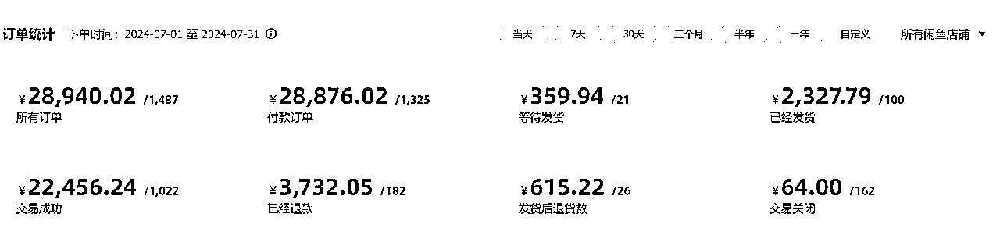
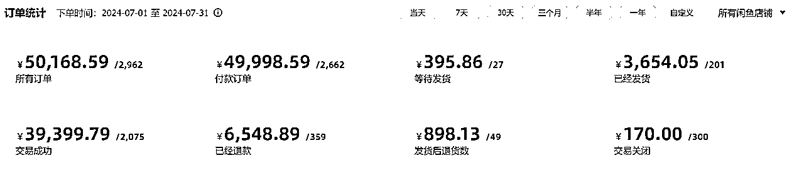
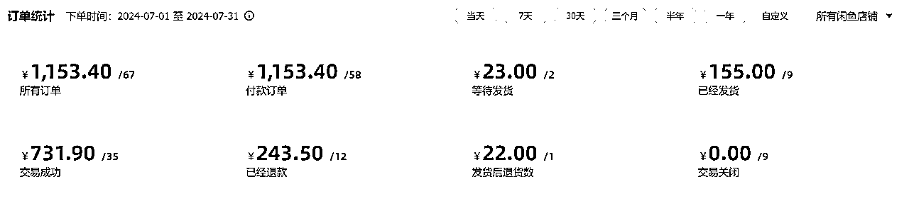
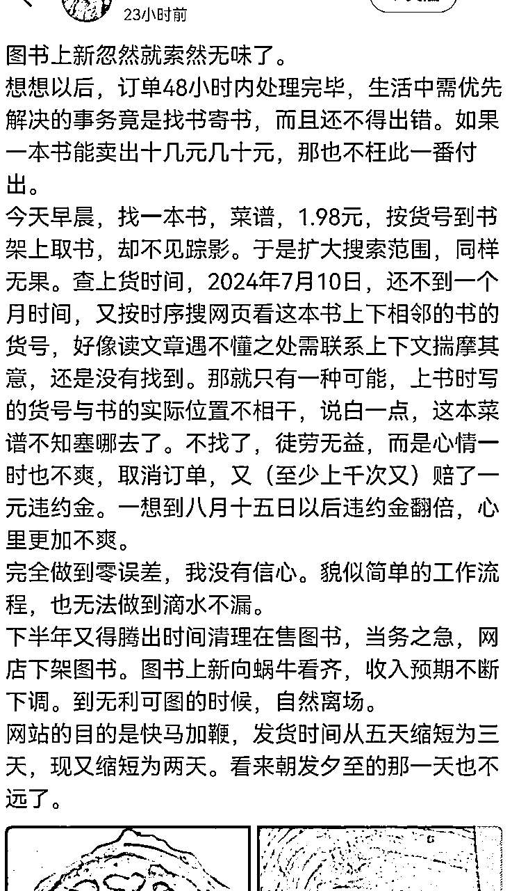

# 赚钱分享：作为新手，我是如何从1到10，做到月GMV8万的？

前两天看到一位圈友的复盘分享，挺受触动的。这位朋友去年底开始试水闲鱼二手书，起初用一周打通了首个交易闭环，但真正把规模做起来却折腾了整整半年。上个月他交出的成绩单是8万GMV、26%毛利、扣掉人工和售后赔付后净利约19%。团队5个人，15个账号在跑。他有一句话让我反复琢磨：0到1验证的是学习力，而从1到10拼的是对不确定性有多能扛，真正能赚到钱的阶段恰恰是后者。

先说0到1。很多人以为跑通闭环是最难的，但他说，闭环难在流程杂——证照、选品、运营、货源、客服、发货、售后、成本核算，每一环都要自己摸一遍。可跑通之后也尴尬：一个人守着四五个号，一天挣一两百块，丢之可惜，拿着又没劲。解法的核心就两个字：放大。他走的路子是组团队、做分工。单打独斗的上限大概五六个店，但两个人搭配好，流水线一样运转，常常能做出1+1大于2的成绩。

道理听起来不复杂，卡住人的永远是行动。自己掏钱发工资、利润忽上忽下，这些真金白银的风险会让人本能地退缩。他给的几条实操建议很实在：能不进全职就别急；按件计酬的工作就按量付薪；账上尽量留够现金，一旦现金流吃紧，心态会崩，动作也会走样。

关于兴趣和动力，他观察到一种很常见的迷失——被日复一日的琐事淹没。他自己也陷入过这种情绪：是不是余生都要耗在运营、客服和售后里？但他提醒，这里面藏着两个思维陷阱。第一，通常的认知是“有兴趣才能做好”，真相恰恰相反，是先把事做成了、得到外界认可，兴趣才慢慢长出来。第二，任何岗位能让人兴奋的部分都有限，可能连10%都不到，剩下全是重复性劳动。就像闲鱼这个行当，选品和盯同行算是最有意思的环节了，可一天也就花个把小时，其余七八个小时无非是上书、发货、回复、处理纠纷。他提到C罗也不爱泡健身房，黄仁勋同样不会天天享受工作。人和人拉开差距的，是在同样枯燥的循环里，有人原地打转，有人持续精进。

SOP这件事他前前后后调了二十多版。什么时候该动手改？他总结了几类信号：一是清单上的事项根本执行不完，说明这计划是给机器写的；二是某个动作做着做着发现不影响结果，果断砍掉——关键变量通常只有三五个，二八法则在这儿同样适用；三是同一个错误反复出现，那就需要加一道检查闸门，比如发货老出错，就在出库前多一个核对环节；四是有更便宜、更高效的做法时，立刻替换旧的。

还有一个心结很多人都有：中断即放弃。今天任务没清完、收到一条差评、流量莫名下滑，就觉得自己被针对了，干脆躺平。他反问了一句：你的同行难道不是人？他能做到全年无休、不生锈、不陪家人、不聚会、心态永远在线吗？换个算法，一个月头七天拼命冲，然后厌倦、自责、放弃；或者干一天歇一天，后者不仅扛下来了，累计投入反而更多。拉到一年、三年的时间维度去看，差异会非常吓人。雷军最忙的时候，还能带着团队开21天的马拉松式会议。你手头的事真的比雷军还多？他承认自己早期也极厌恶停顿，得失心重，对不确定性充满焦虑。最严重的一次，他整整一周没碰项目，客服不回、运营停滞、售后全部超时自动退款。等缓过劲再捡起来，发现天也没塌，不过是少赚了些钱。长期来看，该得到的都会在路上。

关于完美主义，他讲了一个管理上的坎：把熟手的活儿交出去后，怎么看别人干的都不顺眼。后来他算了一笔账：自己再拼命，效率也超不过一个团队。扩大规模的过程必然伴随笨拙和不完美，利润率可能被摊薄，但总利润在涨，这就值了。

他还有一个很反直觉的观点：主动放弃一些利益和效率，用来保护心力，完全划得来。业务一放大，幺蛾子必然找上门——封号、刁钻客户、内部摩擦。这些事情处理起来并不难，难的是它们对情绪的消耗。这时候认怂反而聪明：号没了别急着去闹去骂，注销开新号就是了；遇上赔本单子，与其纠缠不清，不如出点血了事；带团队吃顿饭唱个歌，看着像是耽误了当天进度，但换来的团队凝聚力和沟通顺畅度，长期看是一笔划算账。人不是机器，情绪和心态直接决定你还有没有意愿去解决问题。盯着当下账面谁都会，但能撑多久，看的是长期产能。

文章的结尾，他提到李笑来的《把时间当作朋友》，说这本书像一剂降温药。他记住了三句话：第一，速成是幻想，要用手里已有的时间、精力、头脑和金钱，去换取那些还没有的东西，现状也无法瞬间改变；第二，别等状态完美才开始，估好时间就动手，遇到难题别绕开；第三，记录每天的时间流向和金钱去向，再据此做靠谱的计划，用纸笔写下待办并逐项执行——半途而废，才是一事无成的根源。

他写到自己因为特朗普遇刺事件去翻了特朗普早年的书。特朗普搞房地产时，多次被土地产权纠纷和市政府反对拖住，有的项目硬生生推迟数年，甚至熬到换届才推进。特朗普的态度是：永远别松手，真正值得的事情从来都不轻松。连他都要接受事与愿违，普通人又凭什么奢望事事一蹴而就？

他在文末说，这篇总结花了一整晚写完，之前两次写到一两千字就搁浅了，这次铁了心要收尾。他说，长路漫漫，除了往前走别无他法。与你共勉。