# 抖音搜索流 2.0 实战拆解：7月新号30天破21万，零垫资零发券，净利10%-15%

大家好，我是千易。上个月初我给大家复盘过抖音搜索流直播带货 1.0 的玩法，反响挺大。最近两个月，券类直播间同质化严重，整体成交在走低。

不过我们团队在7月验证出了一套迭代版本——搜索流 2.0。这个版本不发券、不垫资、也不需要 LV1 权限，直接上链接带货，新号一个月销售额就冲到 20 万以上，利润区间在 10%-15%。对标的头部间甚至能做到上百万，相比券玩法上限更高，也适合多号矩阵化。

这套打法适合副业、兼职、全职个人，也适合团队矩阵化操作。单场建议至少播 4 小时，8 小时以上效果更稳。

## 它到底是什么

搜索流 2.0 是在券类搜索流 1.0 的基础上进化来的。如果你还没弄明白搜索流和券播的区别，可以先看之前的复盘。

相对 1.0，这次做了明显优化：去掉了发券和垫资环节，对单品佣金要求也更宽松，因此选品面大幅放宽。食品、百货、玩具、车载、园艺等品类都能切入，承载的玩家数量更多，矩阵化也更容易铺开。

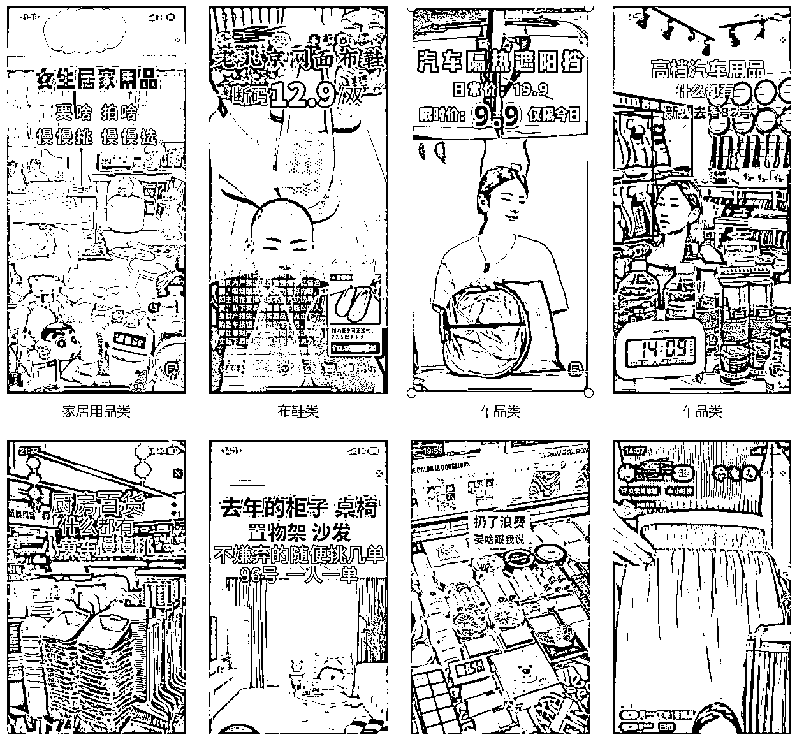

很多人做过半无人，会把这类间当成半无人来看。实际画面是像了，但流量构成和操盘逻辑完全不一样。

半无人 80% 以上靠信息流推荐；搜索流 1.0 80% 以上靠搜索承接；2.0 是推荐+搜索混合结构，搜索占比大概在 50% 左右。

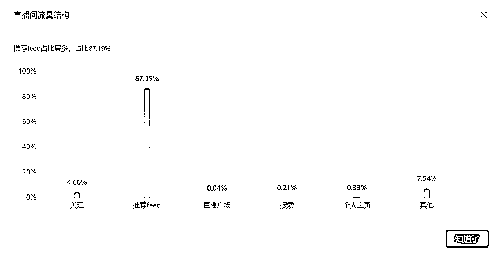

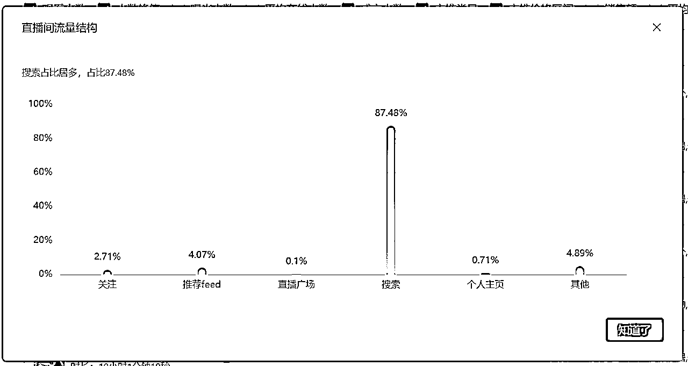

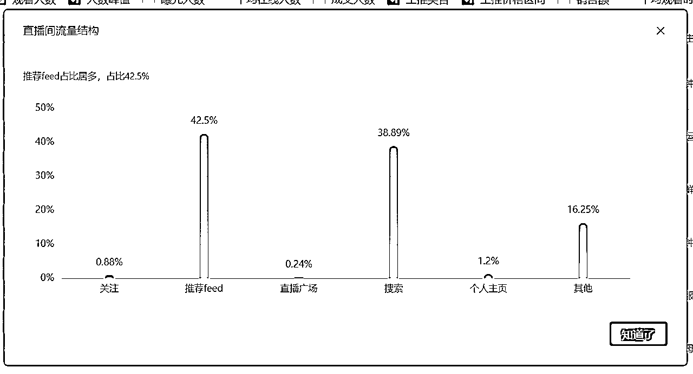

混合结构的好处很明显：搜索是精准承接，第一天开播就能有成交，属于保底盘；叠加推荐后，流量规模可以继续放大，整体收益天花板更高。

变现路径大概是这样：账号准备 → 选定对标 → 备选 200 个链接 → 间搭建 → 起号打标 → 稳定播出 → 放大矩阵。

## 7 月的实测数据

7 月用一个全新号跑了一整月，总成交 21.1 万，佣金收入 2.67 万，净利率约 12%，退货退款率控制在 10%-15% 之间，实际到手毛利约 2.3 万。

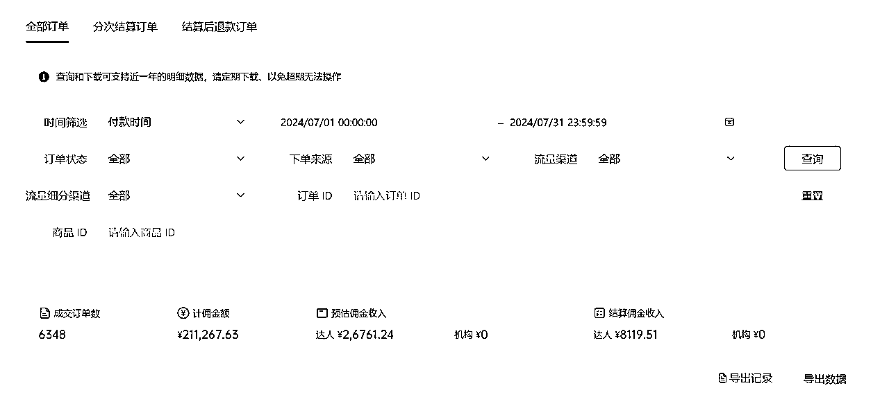

## 核心拆解：销售额=流量×转化

### 一、流量侧

流量来自两头：直播间推荐 + 搜索承接。

1. 搜索承接来自商品本身，所以直播间小黄车要保持 200 个链接满载，爆款自带搜索权重。
2. 推荐流量靠直播间停留、成交密度和 GPM 的持续抬升来破池，需要起号打标和破层操作。
3. 播时长越长，累计收益越高。

小结：流量侧的核心就是 200 个链接满载 + 起号打标 + 拉长播时。

### 二、转化侧

如何让进间的人下单，关键在内容搭建。

1. 消费者下单本质是性价比。1.0 靠券补贴，2.0 靠筛选极致性价比单品。现在精选联盟里大量低价高佣品，佣金 5%-15%，贴合平台价格力策略，能拿更多露出。
2. 搜索本身精准，只要把 200 个有搜索量的品选出来，话术承接住即可。
3. 起号期的推荐流量不精准，需要通过打标让流量变准，起号是关键期。200 个链接要分主次，利于自然流出单的品往前放。
4. 间氛围要做低价、清仓、批发、甩卖感，通过画面和主播表达来提升留存和成交。

小结：转化侧的核心是画面吸引、打标起号、话术承接、品组排位。若只做搜索承接，可跳过打标和排位环节。

收益测算：净利润≈单价×佣金比例×90%，90% 为技术服务抽成。

## 实操准备

这类间以绿幕真人讲解为主，也有非真人形态但流量弱一些，主流仍是真人。

### 一、间搭建

1. 手机：iPhone 7 以上或千元安卓机，能顺畅刷抖音即可，不用来推流。
2. 推流电脑：能正常运行直播伴侣即可，我们用的配置如下，比这个低一点也能用。
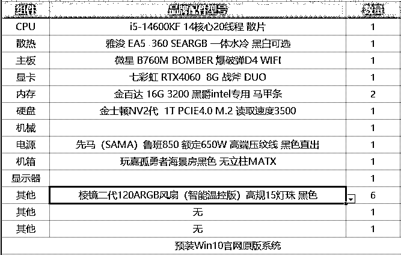
3. 背景：绿幕布一块。
4. 灯光：两盏圆形柔光灯，几百块的即可，我们用金贝。
5. 采集设备：罗技 C920e 或 C1000，配支架。
6. 样品：备几件待售的实物放在镜头前。
7. 收音：100 元左右的领夹麦，我们用好牧人。
8. 其它：一个小音箱放背景音乐，一个电子时钟防止系统判定录播。
9. 背景图按对标间进行制作，后面讲拆解方法。

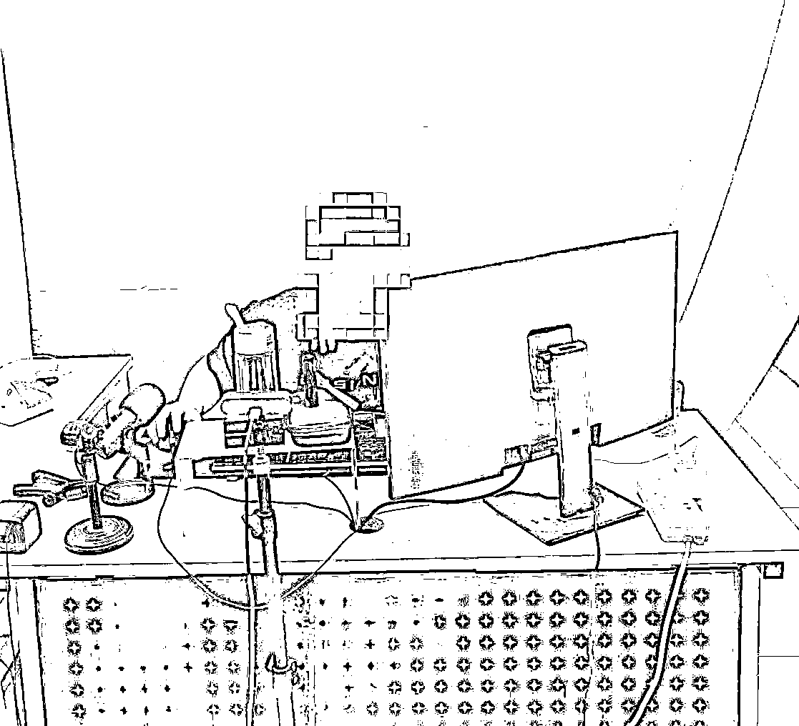

### 二、账号准备

1. 准备两个全新未播过的抖音号。老号扶持弱、标签乱。若不用推荐流可用老号。
2. 注册后养号 3 天左右。
3. 新号养到 1000 粉，实名、开通橱窗和直播伴侣。
4. 备好蝉妈妈/考古加等选品找标工具，蝉妈妈建议企业版。
5. 备一个小不点直播助手，用于自动弹幕讲解、评论话术、踢人等。
6. 用 OBS 推流 + 直播伴侣开播。

## 实操流程

大部分类目都有可复制的对标号，先找到合适的对标，判断竞争和起号概率，再按对标复刻背景、200 个链接和话术，快速上线。

### 一、类目挑选

大部分类目都能做，但女装男装童装退货高，不建议；美妆护肤、医疗保健付费玩家多，流量难拿；小众类目人群太小，搜索难出单。

下图框出的品类更友好，建议在大类目下挑细分，人群更集中，搜索更容易出单，推荐也更容易起号。

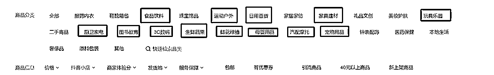

想做推荐流，单间必须垂直，人群单一。不能一间放多个品类，想做多品类就多开号。

### 二、蝉妈妈找标

用第三方数据平台能快速定位同类间。确定大类后进入二级细分，从二级里找标。具体步骤：

1. 打开蝉妈妈-商品榜，选择目标二级类目。
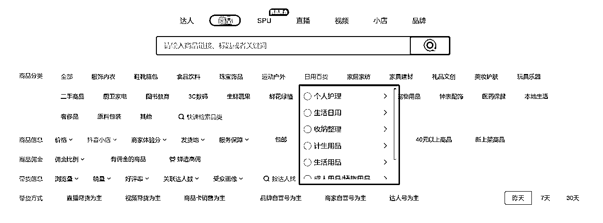
2. 限定近 30 天，查看商品链接。
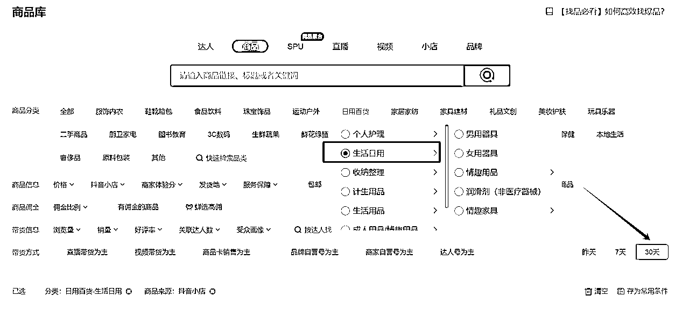
3. 看达人榜近 30 天表现，筛选出销量不错的直播达人。
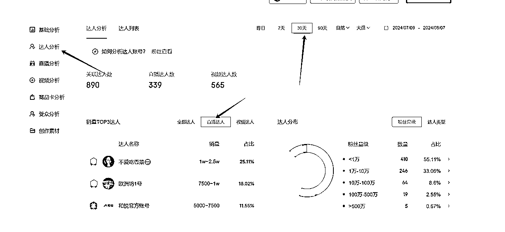
4. 看到批发、清仓、合集类账号就点进去。
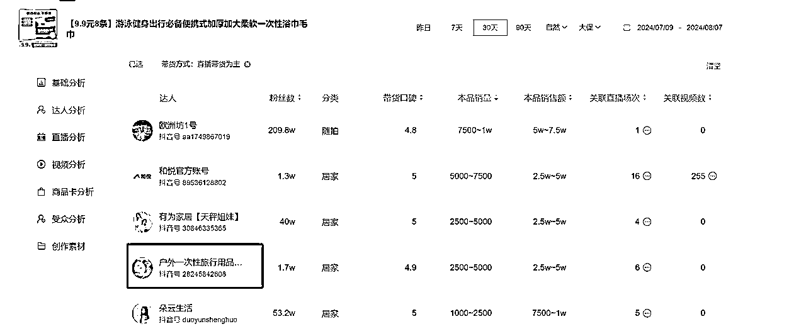
5. 直播间挂 200 个链接、单一品类、绿幕背景、真人讲解的，就是初步标号。
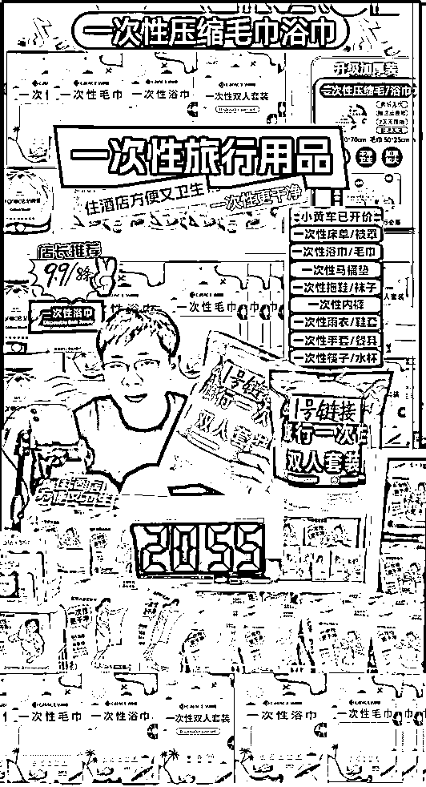
6. 确认品类可行后，用关键词如一次性、旅行用品、旅行用品批发等去拓展更多账号。
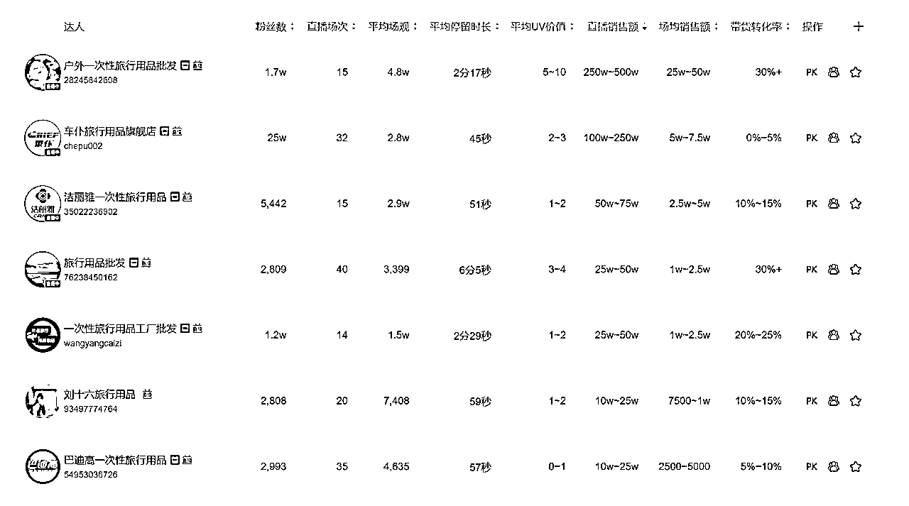
7. 校验流量构成，是以搜索、推荐还是付费为主。

【注意】品牌官方间、推荐占比超 80%、付费占比超 80% 的间，玩法不同，直接排除。

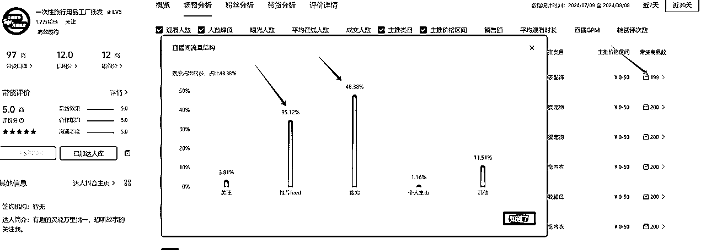

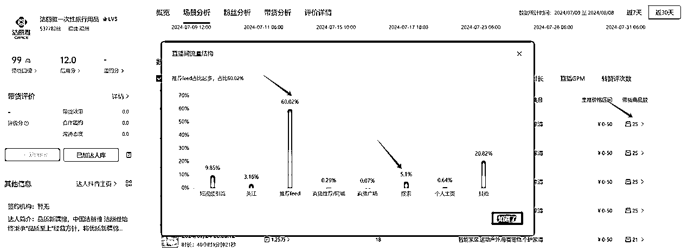

### 三、抖音内搜标

拿到关键词后，直接去抖音搜直播间，一批同类可同时浮现。

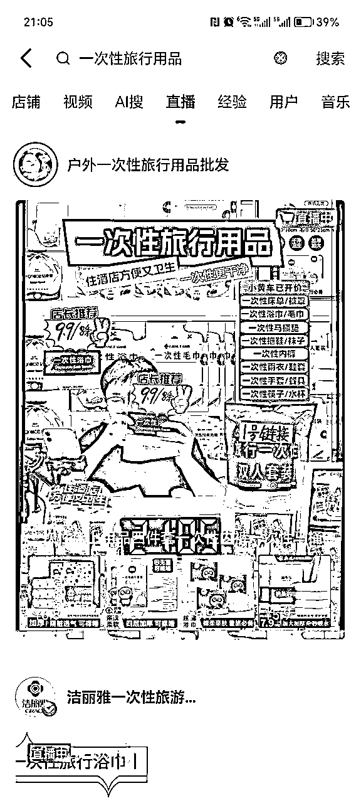

### 四、对标评估

把找到的标号数据整理成表，评估竞争程度：

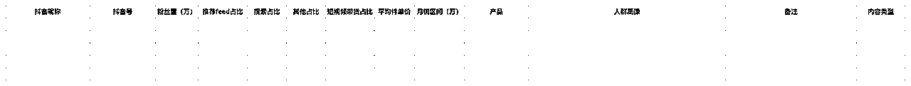
1. 该品类仅两三个号，粉量不足 1 万，播龄不超过 2 个月，但 GMV 尚可，优先入场。
2. 该品类有两三个老号，新号 GMV 仅老号三分之一，且主推品高度重合，说明竞争激烈，成功率低。
3. 老号存在，但新号也能跑出不错数据且主推品不重合，说明选品空间大，百货类适合快速测试。
4. 仅两三个号且播超 2 个月，近期无新号出现，概率不确定，可小范围试。
5. 老号表现好，播超 2 个月，新号超过三个但流量很差，主推品一样，直接放弃。
6. 表格里挑近一个月起号、播时可控、GMV 和收益符合预期的账号作为 1:1 复制对象。

小结：选一个竞争适中、有选品空间的细分，锁定 1-3 个标，就是本阶段任务。

### 五、上播准备

#### 1. 画面搭建
画面 1:1 复制标号。先拆解再复刻，拆解维度包括背景、前景、贴纸、主题文案、道具、人和样品位置。

用美图秀秀、PS 制作，背景图可在百度、图库、📕找高清大图，无需完全一致，整体配色协调即可，主题文字和重点贴纸突出。

OBS+直播伴侣使用方法自行搜索。

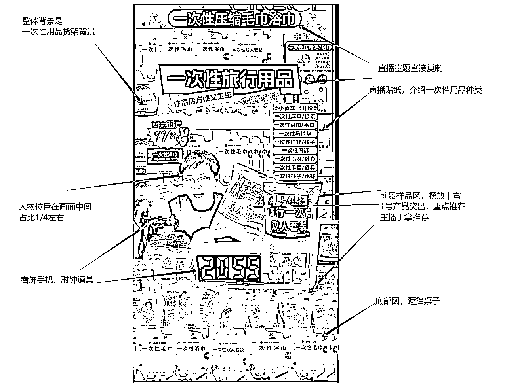

#### 2. 样品准备
看标号画面里常推的品，买几件回来。重点品必须有实物，前期 3-5 件样品够用，后续爆品再补。

注意：间里必须有实物摆放。起号期准备不足，可美团本地现买。

#### 3. 话术准备
话术直接参考标号后分类：产品讲解、引导评论、引导关注、人设身份、点对点成交。

示例分类：
1. 产品讲解：卖点、场景、人群、福利活动。
2. 引导评论：问旅游、带娃出行等需求，让用户打字。
3. 引导关注：工厂直播间，点关注不迷路，随时找得到，一件也是批发价。
4. 人设身份：16 年老工厂，之前做线下代工，刚上线，一件出厂价，包邮，资质齐全。
5. 点对点：欢迎进间，近期出游需要什么看下方小黄车，工厂直发。

#### 4. 链接准备
登录巨量百应-选品广场，用关键词挑链接加入选品车和橱窗。
1. 打开选品广场。
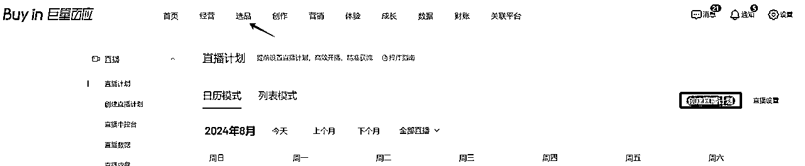
2. 搜索品类关键词。
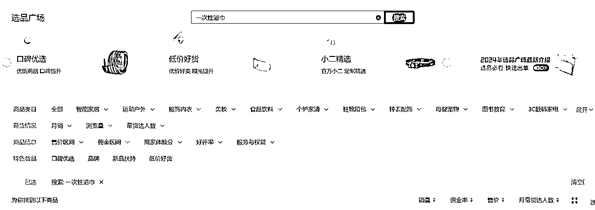
3. 查看销量、佣金、店铺 DSR，选择评分高、销量稳、佣金合理的品，加入选品车，可备 200-300 个。
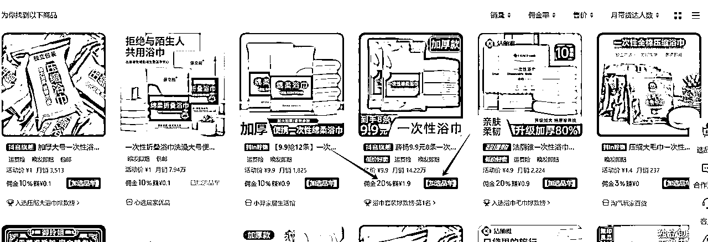
4. 进入详情页一并加橱窗，橱窗也能成交。
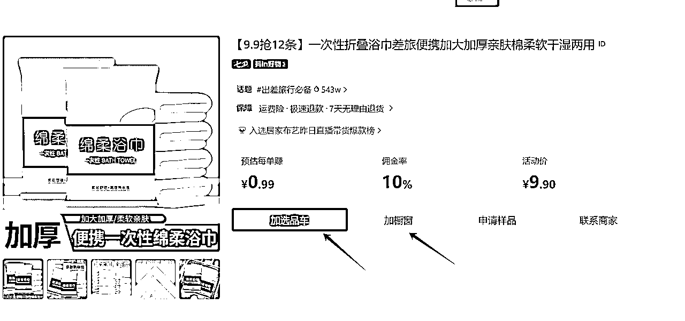
5. 开播前在直播中控台导入满 200 个即可上线。
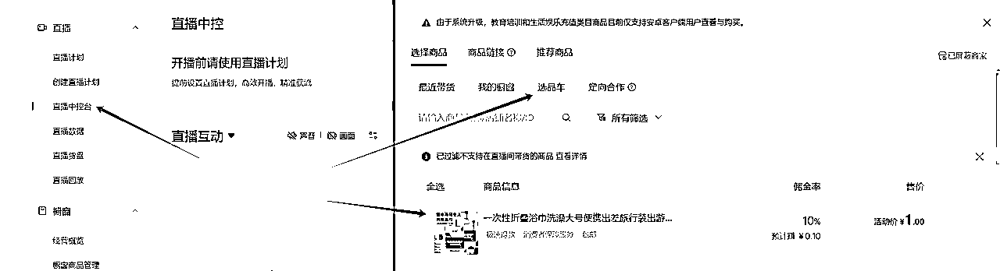

#### 5. 开播时间与时长
1. 时间：按自身作息固定，开播时间不宜频繁变动，会影响打标。整点竞争大，新号避开整点，可选 6:55、7:06、7:10 这类时间。参考标号，提前或延后 1 小时均可。
2. 时长：参考标号。若标号是长播，16 小时起步，需考虑 2-3 人轮班，话术简单可家人配合。

小结：本阶段就是 1:1 复刻间，细节到位，多备链接，时长拉满。

## 起号打法

准备就绪后即可上线。直播间从 0 到 1 最难的是推荐流打标拉流，开播前要明确起号思路。

### 一、搜索承接
搜索因产品本身驱动，用户主动搜索进间下单，无需额外拉流。

1. 小黄车保持 200 个链接满载，选近期有热度的低竞争链接。我们实测同一链接被三个间挂都能分流，最早挂的权重最高。
2. 链接可轮换，连续三场无单就换掉，核心是测品。
3. 话术循环讲解即可承接。

小结：只要测品持续循环、200 个爆品满载，第一天出单很轻松。

### 二、推荐拉流
推荐流量由系统标签和流量层级决定，打法需精细。

1. 底层逻辑：系统要解决流量准不准、多不多。准靠标签匹配，下单越多标签越准；多靠层级，层级靠订单密度提升。我们观察到的同类间在线多在百人左右，对应中层。
在线阈值：5、30、60、80、120、180、230、260、1000 人。
起号就是打标签、破阈值的过程。

2. 首场操作
满载 200 个链接上线后，用点对点方式打标。刚开始在线 0-5 人，进来就走不是目标，进来提问的才是目标，尽量成交。
首场流量走势：起步 0-5 人，成交几单后标签初步形成，在线升至 5-20 人，期间持续洗人提转化。

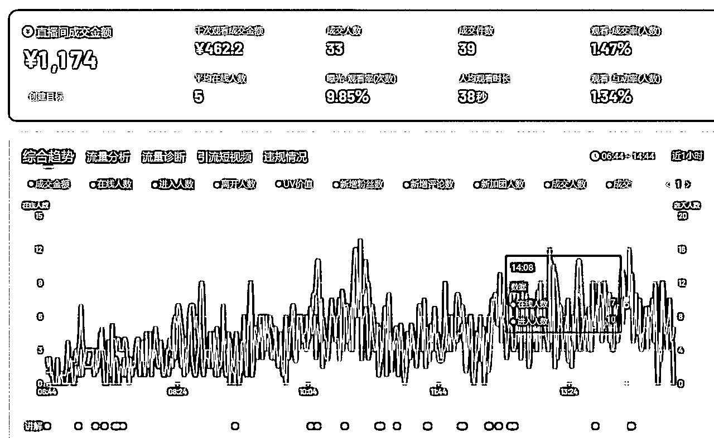

首场多为搜索先出单，推荐后出单。要区分渠道，若搜索大量出单推荐不出单，推荐难以拉起。

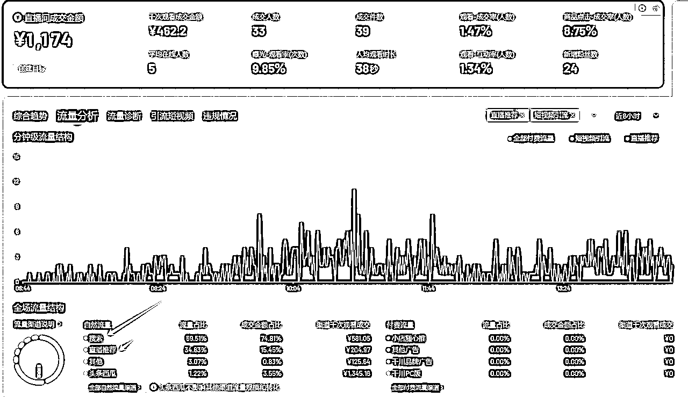

3. 第二场操作
延续首场打法，注意互动话术和关注引导。推荐需要互动和下单来抬层。第二场一般比首场高一个层级，在线 10-30 人，若出现中段高峰，说明前 1 小时数据好，系统开始加流破层。

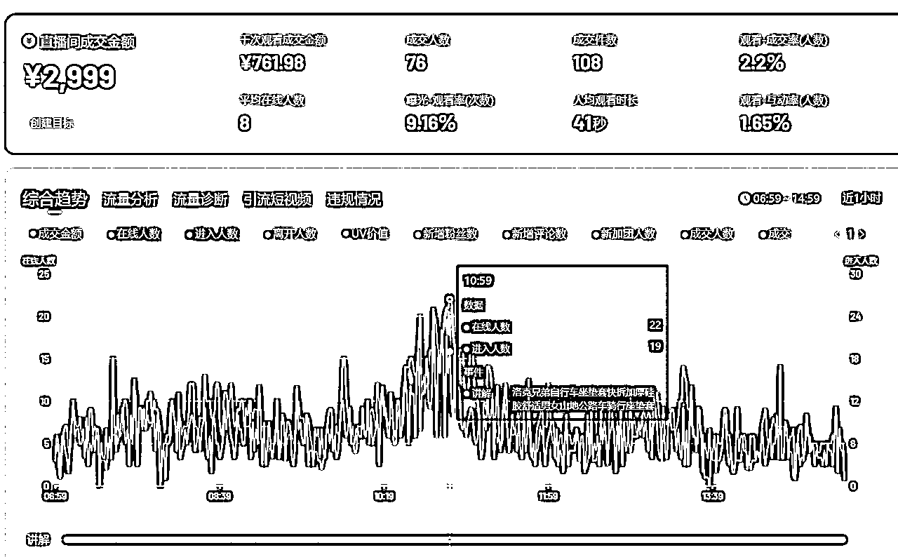

此时推荐占比可达 50% 左右，订单量和 GPM 均提升，订单密度增加。

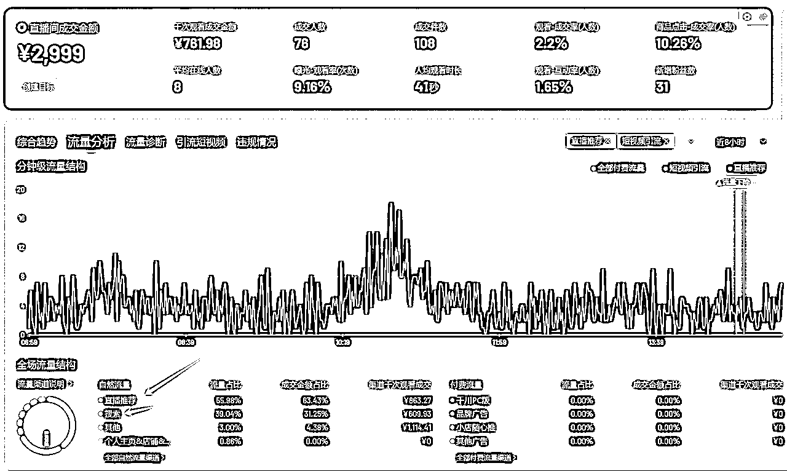

4. 第三场操作
数据若持续走高，保持打法；若停滞，先诊断是搜索或推荐问题。搜索问题换品补链接；推荐问题调整链接顺序和主播话术，再精细拆解标号。

正常第三场可破 30 人在线，说明标签基本完成，同样时长下单人数提升，GMV 和 GPM 稳定。

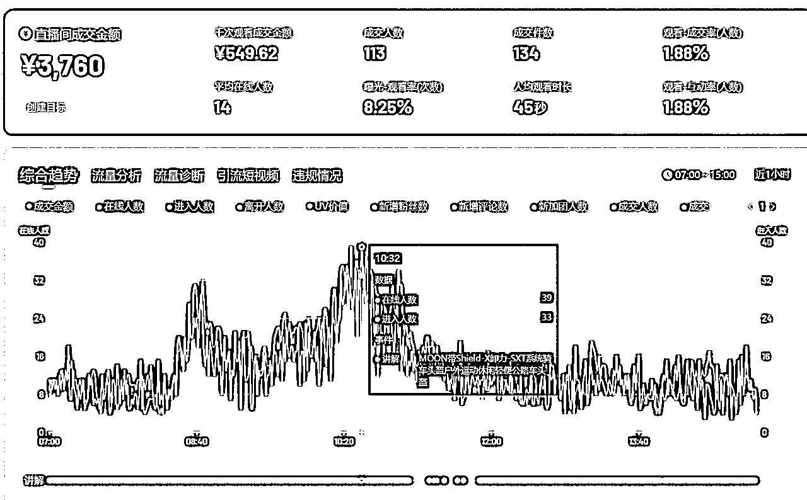

5. 第四场操作
继续递增则保持，若未递增，定位问题归属搜索或推荐，再针对性调整。

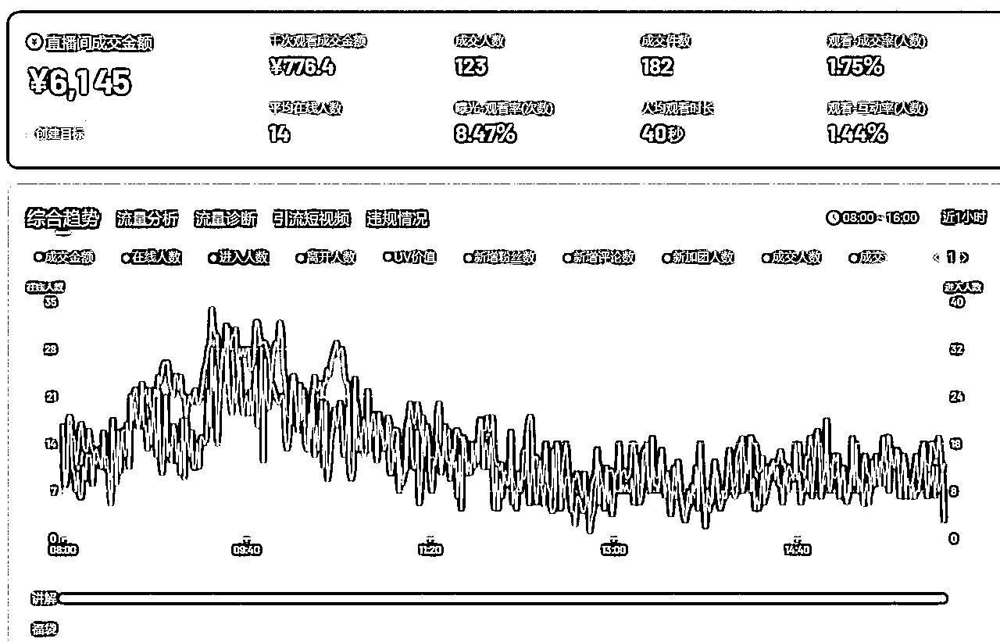

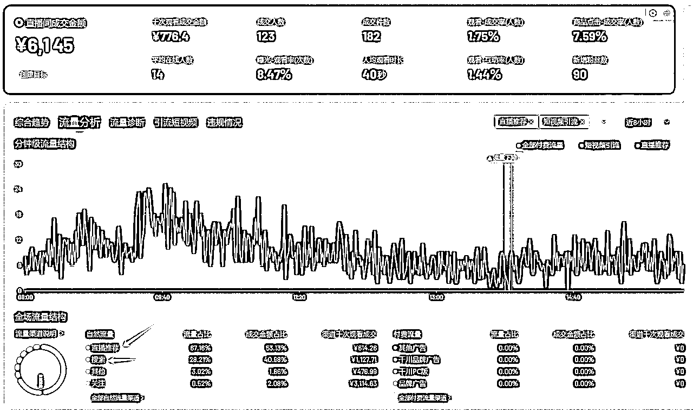

以上就是搜索流 2.0 的完整复盘，希望对你搭建增长曲线有帮助，祝播得顺利。

最近好多朋友在问直播间起号的事，我发现一个特别容易被带偏的点：大家太执着于“直播推荐流量”了。说实话，靠推荐流量起号真的很吃运营功力，而且不是说你必须第一场就爆。哪怕第二场数据一般，第三场延续第二场的操作继续调，也一样有机会。如果推荐流量始终拉不起来，真不用焦虑，把精力放到搜索流上，GMV照样不会差。这类直播间起号周期大概也就7到10天，要是超过10天推荐流量还没动静，那就干脆放平心态，别去死磕推荐流量了，专心把搜索流做好就行。有具体卡点的小伙伴，也欢迎随时来找我聊。

接下来聊聊这个项目的几个核心心得：

第一，这活儿特别适合一个人全职干，整体月收入大概在1万到5万之间，但代价是得拉时长，每天8到16个小时。要是夫妻俩一起干，搭配起来最舒服。我们实测单小时GMV大概在500到1000元，看了好几个类目的同行数据也差不多，单小时利润基本在50到100元。

第二，这个项目成功率挺高的，核心原因就是有搜索流兜底。搜索流本身就是保底流量，只要你把商品上满200个，再配合测品操作，一天卖几千块不是问题。

第三，搜索流2.0玩法里加入了直播推荐流量，确实有机会把盘子做得更大，但推荐流量波动也比较大。所以一旦流量做起来了，尽量每天固定时间、固定时长开播，千万别断，连续停播3天流量层级就会掉。

第四，2.0玩法把发优惠券这一步去掉了，基本不会亏钱，就是比较耗时间。

第五，尽量做真人出镜的直播间，千万别搞录播。平台最近对录播查得很严，一旦抓到直接扣12分、关橱窗，这个代价太大了。

第六，直播间背景画面最好用静态图片，这种图片类直播间存活时间更长。背景别做视频循环，很容易违规。

第七，除了多品模式，2.0玩法还有单品打爆模式，大家也可以多去研究一下对标的打法。

最后，如果想把这个当项目正经做，一定要做矩阵。多矩阵运营收益更稳，尤其是你所在城市人工成本比较低的话，用兼职主播模式去放大，效果会很好。

我是千易，9年自媒体人，6年电商人，17年开始创业做今日头条。头条、抖音、视频号、📕都玩过，连续三次用5万本金赚到100万，也操盘过不少项目。现在主要做大健康产业的直播间和短视频带货，多平台矩阵。有相关资源的伙伴，欢迎来链接！