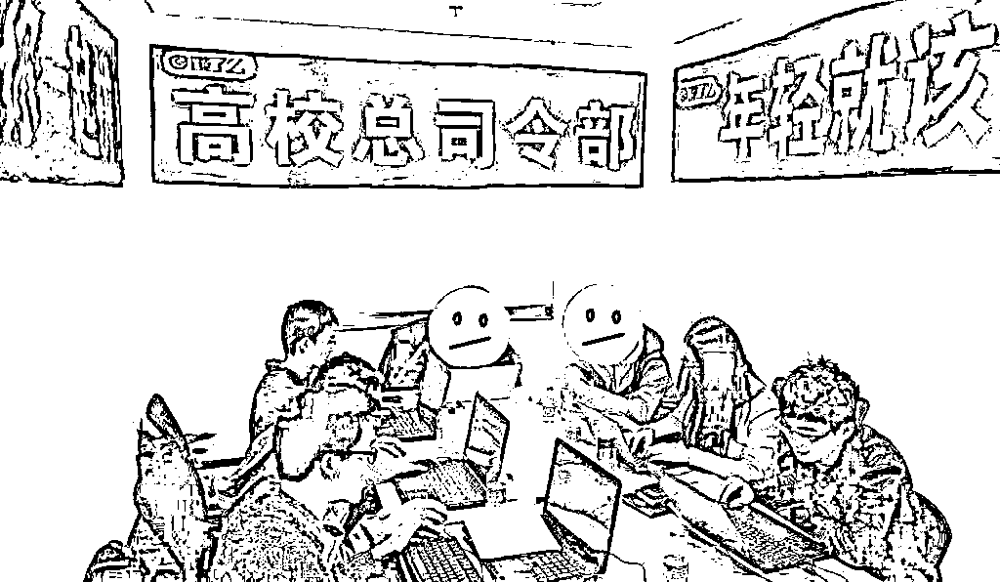
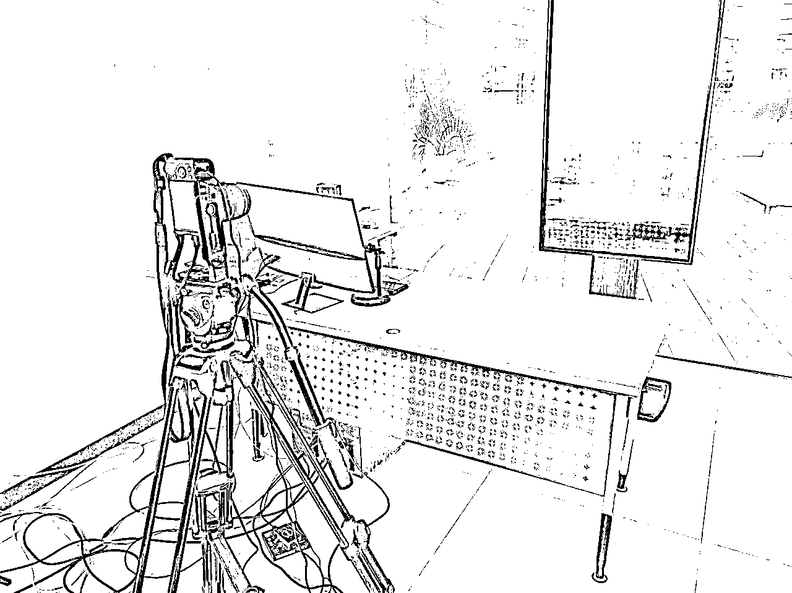
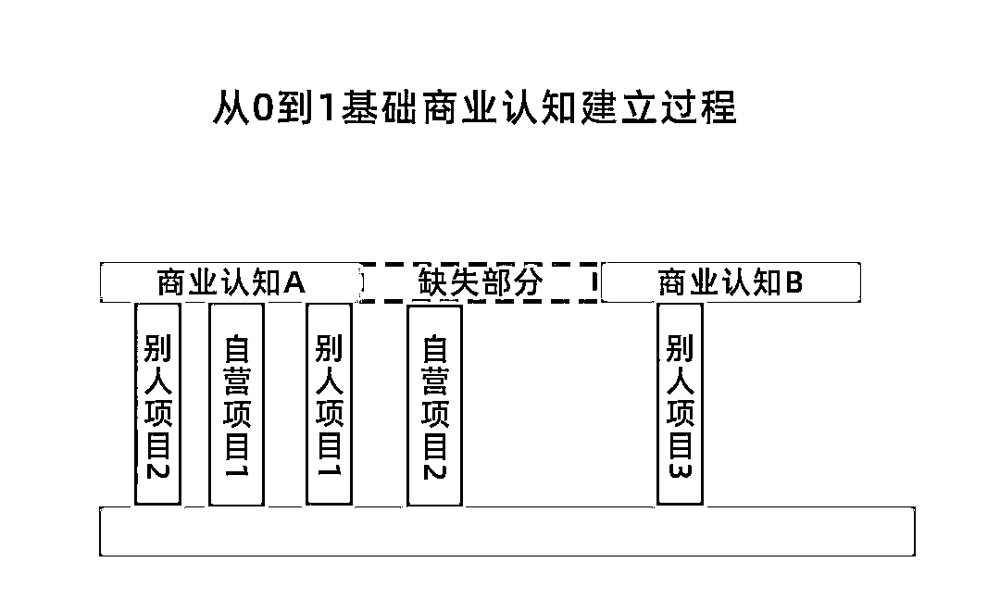
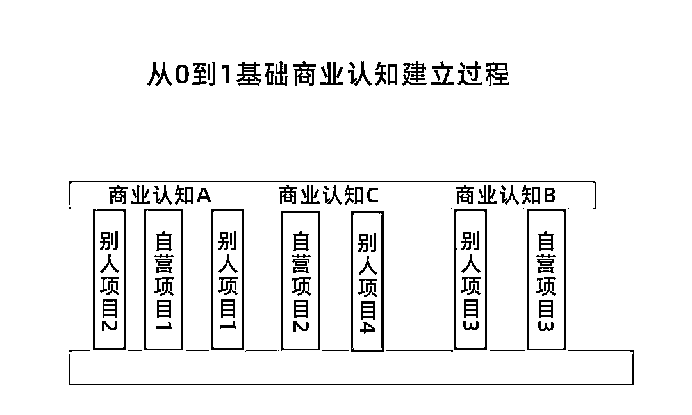
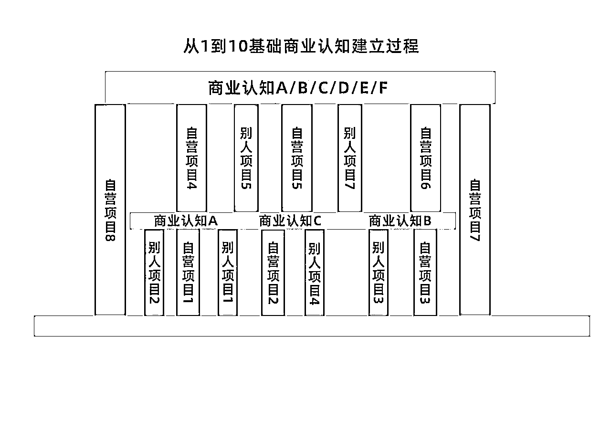
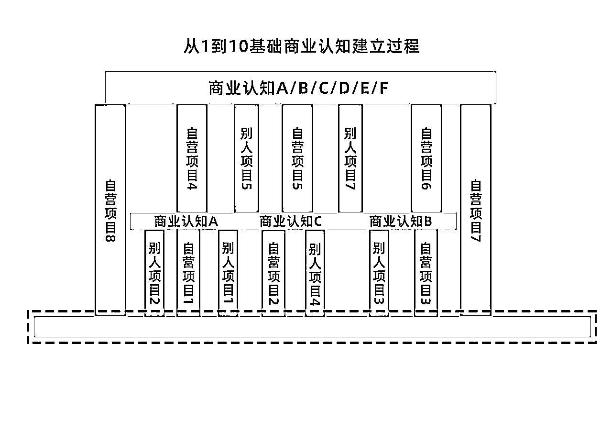

# 7年，几十个项目，从月薪4000到月变现百万，总结出个人商业认知成长图！
作者：龙哥

做了这么多年生意，我最大的感受是：风口没死，但“捡钱”时代确实过去了。

17年那会儿，一个信息差就能撑起一两个年的项目，等同行反应过来，你早赚完了。但从23年开始，同一个机会摆在面前，有人能吃肉，有人连汤都喝不上。项目能不能成，拼的是团队能力和项目要求的匹配度——你有赚10万的本事，就做10万的生意，硬做100万的盘子，大概率是赔个底朝天。

说白了，现在的生意场，拼的是综合维度：老板的商业认知、团队的执行力，以及项目本身有没有窗口期。机会永远留给有准备的人，那什么是准备？就是不断升级自己的认知，锻造团队的战斗力。

我自己，7年做了几十个项目，从月薪4000的打工仔，到如今月变现过百万。这条路怎么走过来的？今天把压箱底的思考都掏出来，和大家聊聊。

# 我的商业成长轨迹

毕业后的第一份工作是在饿了么跑市场，底薪4000加绩效，发传单、谈商家、跑商户，什么都干过。后来公司架构调整，跟着北京分公司的老大去了总部，进了政策研究办公室，一个老大加六个委员，管着全国高校外卖市场，底薪涨到6000。

在总部干了一年多，16年底回河北自己发展。当时还不知道做什么，就找份工作先干着，算是骑驴找马。16年底开始副业做今日头条，过年前一个月能有1万多的利润。我一看这是个机会，立刻租场地、注册公司，全职开干。

17年正式做头条，中间也踩了不少坑，最惨的时候一个月亏三四万。当时心一横：亏完拉倒，大不了重新回去上班。没想到调整了几轮，17年7月开始爆发，到18年7月赚到了人生第一个一百万。然后买房装修，积蓄又清零。后面平台收缩广告分成，项目利润大幅下滑，到18年底，一个员工刚够挣出自己的工资，老板反而亏损，只能关停。

19年到21年东试西试，抖音短视频、直播、微视、闲鱼无货源、淘宝店，折腾了个遍。中间做婴幼儿奶粉私域，做到一个月5-7万的利润，算是小有起色。

21年到23年深耕抖音直播带货，自然流、付费流都玩过，品类换了一大堆：染发膏、老花镜、零食、百货、铁锅、园艺，几十个号做下来，注销的抖音号也得好几百个。有的亏钱，有的就赚个一两万，有的跑通就很顺——园艺直播间做到了年利润100万。

包括现在的大健康内容型直播间，也是一点点试出来、调出来的，最后才做到月变现百万级。

这就是我这些年做项目的缩影。同一个我，为什么有时做5个项目都成不了一个，有时近一年出手的每一个都没亏过？差别到底在哪？这篇文章，就把我的商业认知、方法论和实操技能是怎么一步步攒下来的，全部分享给大家。

# 商业认知的积累：全靠实操+复盘

一个项目从收到信息、调研分析、立项、实操，到最终做起来或砍掉，整个过程其实就是三件事的统一：商业认知、项目方法论、实操技能。

我最初就是个纯小白，没经验、没阅历，对商业的理解也停留在表面。只能一边学一边干，在实操中一点点补齐认知。

但你会发现一个奇怪的现象：纸上谈兵觉得无懈可击，真正开干漏洞百出。看着别人做项目轻轻松松，轮到自己全是问题。为什么？就是因为认知不系统，分析不透彻，技能不配套，整个认知结构是碎片化的。

当你真正做过了几个项目，并且认真复盘过成败，你就会逐渐看到项目的全貌。等到这个时候，一个基本的商业认知就形成了——你拥有了做成一件事的基础能力。

现在的生意已经不是靠单点优势就能赢的了，得是商业认知、项目红利期、团队能力综合匹配，才能把项目跑出来。

但很多人听课听了很多，知识付费没少买，落不了地；实操经验也有，但匹配不上项目。问题出在哪？就是各个模块不匹配。

所以我的结论是：商业认知是在不断做项目的过程里逐渐累积出来的。多学、多做、多反思，认知和经验会一起涨。

先做一个能月入过万的项目养活自己，再研究月入十万的项目怎么做。越往上走，维度越丰富，需要从别人的经验和自己一次次测试总结中去提炼。

商业认知又分通用认知、行业认知、管理认知——这是“道”的层面。具体到项目的操作方法、运营细节——这是“术”的层面。

等这两层都上来了，你会发现很多以前觉得难的项目，其实也就那样，业务的体量慢慢就放大了。

# 道和术：一个靠悟，一个靠学

传统文化讲究阴阳，对立统一、相生相克。道和术也一样，相互依存、彼此成就。

但多做项目就一定有商业认知？有商业认知就一定有项目经验？

有句话说得好：有道无术，术尚可求；有术无道，止于术。

放在商业上，“道”是商业认知、通用方法论，讲趋势、讲机会、讲逻辑的都是；“术”是实操技能，大到直播间的完整运营，小到怎么快速涨粉。

我现在越来越觉得：商业认知到了能挣100万的水平，做一年挣几十万的业务，是挺轻松的事；认知到了能挣1000万的水平，做一年挣100万的业务，成功率也很高。老板的核心价值，就是道和术的结合。

那为什么“有道无术，术尚可求，有术无道，止于术”？

因为大多数人在职场里根本碰不到项目的全貌——我们只是其中一个环节。员工技能再精通，那也只是术，产生不了商业认知，也学不会怎么当老板、怎么做决策。

还有件很有意思的事：你们有没有发现，和同频的人聊商业问题，会聊得非常痛快，相见恨晚；但大佬和新人交流，往往鸡同鸭讲——大佬表达的是一个意思，接收的人解码成另一个意思。甚至很多小白是“不明觉厉”，每个字都听得懂，连起来不知道在说什么。

所以我有一个判断：道，不是“教”会的，是“悟”出来的。商业认知只能从经历和反思里提炼，你要在生活和工作中不断琢磨，某天突然顿悟：“哦，原来当年大佬说的那句话是这个意思。”

当然，如果你能从别人的经历中直接提炼有效信息，会省很多时间，这也是向上社交的意义。但最终一定要经过自己的思考，融会贯通，这件事靠的是悟性。

而术是可以学会的。很多帖子、课程，讲运营方法，你一听就能上手，实操一遍就懂了。但只有术，做不出业务。有术无道，止于术。

# 为什么有人能悟道？

做项目、总结认知，是一个漫长的过程，很多人中途就放弃了。最近两年大环境不好，不少人离职、被裁，找我交流、寻找方向。但大多数都是浅尝辄止——试了几次，不行，就撤了。

为什么有人能百折不挠？一次失败再试一次？我对比了做成的人和放弃的人，发现关键在于一个人的底层支撑。

说到底，是内驱力。是永不服输的劲头，是壮志凌云的志向，是“王侯将相宁有种乎”的气魄。有内驱力的人，不需要别人催，自己就会主动思考、主动学习，愿意咬紧牙关多次尝试，也才有机会在多次尝试后建立真正的商业认知。

没有内驱力的人，急于求成，又扛不住挫折，一两次失败就泄气了，还会给自己找各种台阶下。没有长期的坚持、没有多项目的磨砺，道是悟不出来的。

所以第一，做一个有内驱力的人。第二，管理好自己的现金流，让自己一直留在牌桌上。只要不下牌桌，多交流、多获取信息、多做项目、及时复盘总结，认知就一定会持续提高。认知到位了，具体项目再找有实操经验的人请教，技能这种东西，短时间就能学会。

有道无术，术尚可求；有术无道，止于术。

# 怎么检验自己进步了？

如何判断自己的商业认知、方法论和实操能力，确实在往前走？

我特别喜欢一个简单的检验方式：“傻X速率”。

很简单——你隔多久会觉得过去的自己是个傻X？

如果你觉得一年前的自己做的很多事很傻，那说明你用一年时间又进步了一个台阶。如果你觉得上个月的自己也很傻，那你的进化频率是按月算的。

我自己就经常回头审视：过去做决策的时候，自己是不是个傻X。

你上一次有这种感觉，是什么时候？

商业认知越全面，看项目就越清楚，想得越透彻，动作就越坚定，成功概率自然越高。没有人能赚到认知之外的钱。哪怕偶尔靠运气碰到一次机会，后面也会连本带利还回去。

认知，才是你真正能带上牌桌的筹码。