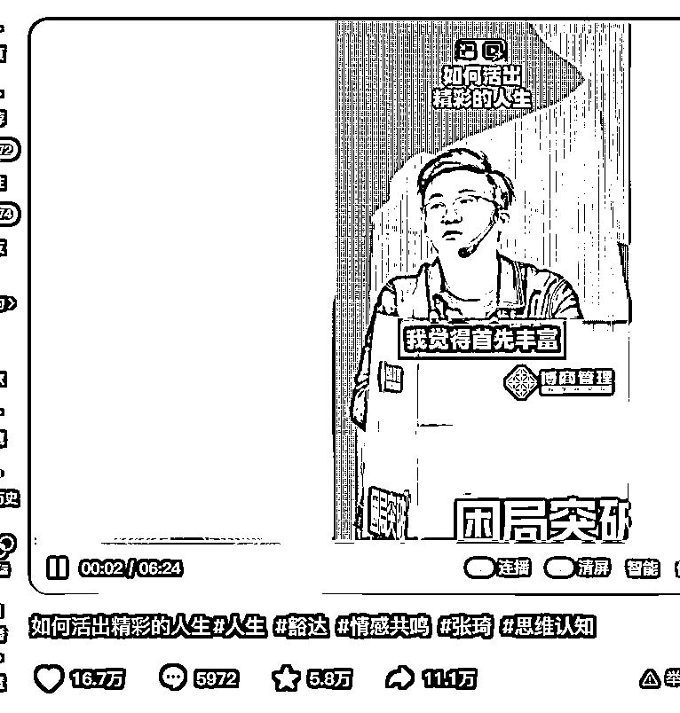
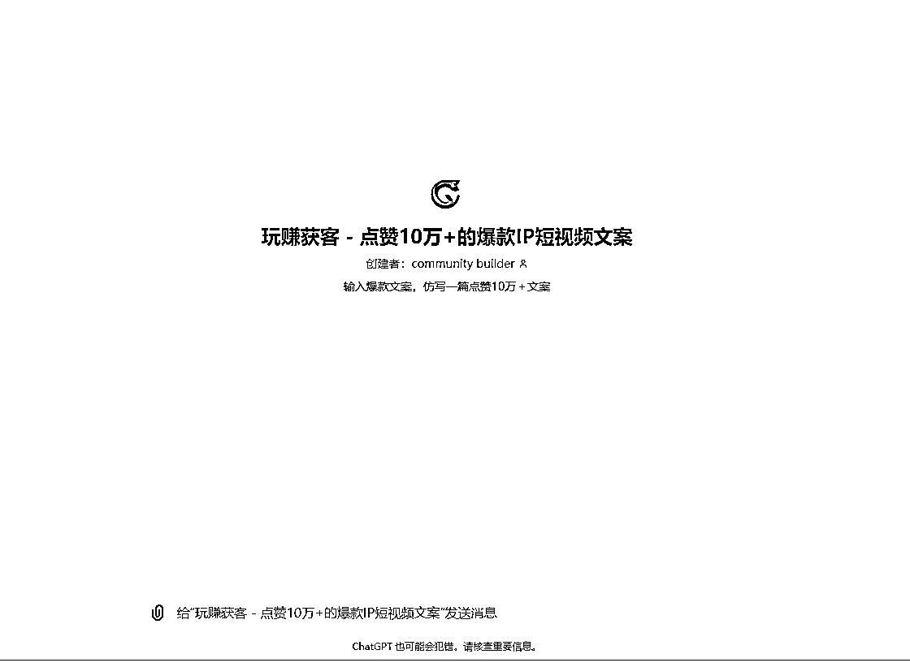

# 张琦老师密训IP打造方法论 结合AI只需30秒拆解1条点赞10万+的爆款短视频文案

在成都的一场个人品牌峰会上，张琦上台分享了一套此前极少对外细说的个人IP塑造打法。据说，这套内容连她所供职的博商机构里，都很少有人完整听过。

太多人做视频时，总在纠结选题、剪辑和文案措辞，却忽略了一件更关键的事：一条内容能火，背后的结构才是真正的胜负手。张琦的观点很直接——先拆懂爆款，再创造爆款。这条思路配合AI工具，能让拆解效率拉满：拿到一条高赞视频的链接后，30秒内便能给出完整分析。

以她现场拆解的一条视频为例：时长六分钟，获赞16.7万，评论接近六千条，真正令人惊讶的数字是分享次数：11.1万。这个数字意味着，视频触达的并非一个小圈子，而是千万量级的潜在人群。按投放成本折算，相当于省下了一笔极大的推广开销。

这条视频讲的是如何把日子过得更丰盈：婚恋选择、自我接纳、外界评价，甚至聊到格力那位女掌门人对女性成功的看法。乍看之下，内容更像生活哲学，与商业没有直接关系。但正是这种天然的传播力，让它在社交网络中迅速扩散。

张琦把这套逻辑拆得很清楚：一个内容要破圈，必须兼顾两个层次。第一层是大众议题，负责撬动观看量、引发共鸣与分享；第二层是专业向内容，负责在受众注意力最集中的位置植入品牌信息。只讲专业，内容会陷在小圈层里；只讲大众，又难以沉淀商业价值。把两者按恰当配比组合，就能形成持续的传播动能。

这套方法已经被固化成一款AI拆解产品：使用者只需把热门视频的地址粘贴进来，系统会自行提取文本、剖析结构、标出传播节点，再输出一份完整的拆解报告。整个过程不需要人工推测这条视频为何能火，算法会直接把答案摆出来。

对做个人IP的人来说，从这条路里能带走的最重要认知是：爆款不是灵感的偶然，而是结构的必然。与其每天纠缠拍什么、剪什么，不如先抽取一条高赞内容的骨架，再把它移植到自己的领域里。大众话题负责开道，专业内容负责转化，有了这套骨架，内容增长也就顺理成章了。