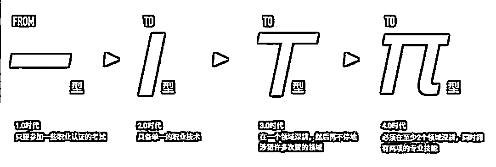
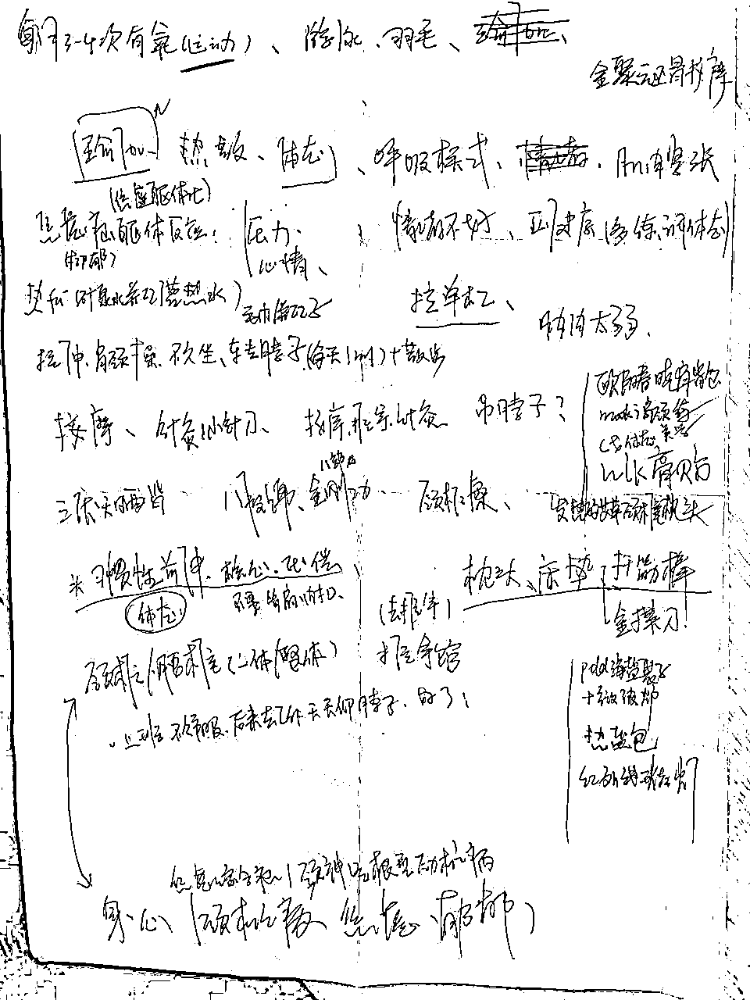
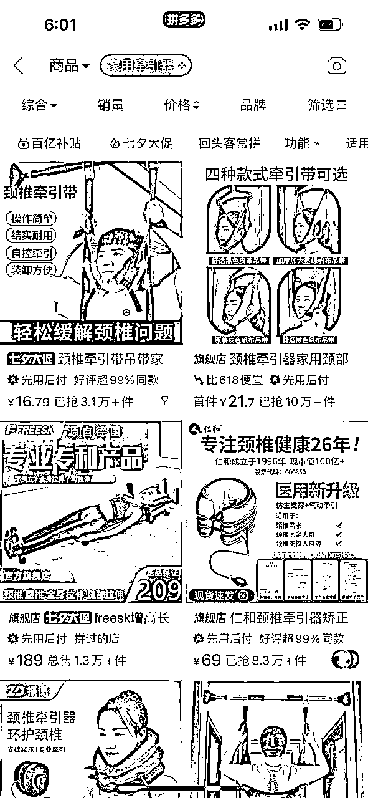
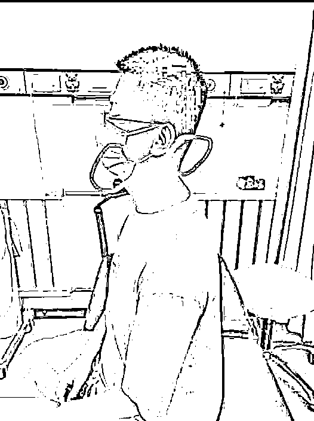

# 搞钱人的颈椎自救实录：别等脖子废了，才想起身体这根“赚钱之根”
作者：龙哥

各位圈内朋友，今天这篇聊聊我自己颈椎从出事到恢复的全过程，都是真金白银换来的教训。

如果你日常伏案、手机不离手，低头含胸、肩背发硬，脖子转起来咔咔响还带着疼，精力一到下午就掉线，呼吸总觉得吸不到底——那建议你花几分钟看完。

坦白讲，写这篇需要点勇气，毕竟把自己的狼狈摊开来看并不好受。之前读了明白老师的一篇文章，被触动得很深，于是问了自己一个问题：这段经历能不能帮到别人？答案是能。理由有这么几条：

第一，这是创业路上一个绕了不少远路的大坑，早点避开能省钱、省时间、少遭罪，还能防止更大的损失。

第二，康复的过程和跑项目的逻辑，本质上是一条路。

第三，赚钱的底层是身体扛得住。颈椎问题改善之后，精力比过去多了三分之一，干活效率自然上去了。

第四，多数人现在的状态是没症状或只有一点苗头，而恰恰是这个阶段出手干预，性价比最高。

第五，康复路上的坑是真多，而且有些坑大得离谱。第六，搞网络的，手机电脑比对象还亲，颈肩出问题的是大多数。

身体不垮才能持续搞钱——想明白这点，我就觉得这跟咱赚钱的路子也对上了，那没什么不好意思的，写吧。

## 前情提要：一顿饭暴露了真相

今年六月，我和山西赚钱的几位伙伴约饭，@胖大玲 @奇杰 @张集慧 @李司令，山哥、龙哥也来了，一共八个人。

聊到身体，话匣子就打开了：三哥腰椎做过手术；去年，我和司令也因为颈椎、腰椎的问题，各自在家躺了半年。饭后去慧姐公司喝茶，顺手捏了捏慧姐和杰哥的肩膀——又硬又厚，像背着块铁板。大玲是未婚小姑娘，不方便上手，就没摸。

一圈下来，七个人里，三个脊柱问题已经严重影响到工作生活，三个处于亚健康状态，只有一个情况不明。这比例，真挺吓人的。

那阵子我反复在想：创业到底图什么？多少人钱没挣到，身体先进了维修站；多少人正打算把摊子铺大，人先撑不住了；还有多少人钱是赚到了，却享受不了？

后来想明白了：对创业者来说，身体这东西得排在第一位。头三年可能没感觉，干到五年以上，尤其是天天久坐、电脑手机轮着用的人，颈椎腰椎躲不开。

## 背景故事（可跳过）

事情得从去年去杭州参加赚钱大会说起。

那会儿我第一次参加，慧姐和杰哥是分享嘉宾，我算个新人，见面还有点放不开。现在熟到勾肩搭背，时间确实能把人揉在一起。

到杭州的时候正下小雨，毛毛细雨，跟北方那种豆大的雨点完全两回事。空气湿润润的，吸一口带着点甜味，整个人都觉得舒服。

会场里碰见谱姐，算是对“小个子大能量”有了直观认识：她坐在前排，隔几秒抬一次头，手机里十几个拉新群消息闪个不停，朋友圈里已经发了两三条文案，还做成了几单；再一转眼的功夫，她又到陪伴群里做分享了，等我回过神来看她，她正专心听涛哥的分享。佩服，就这一个字。

听老大开场讲得人热血上头，想加入赚钱——结果发现已经在了，只能发个朋友圈表表心情。回家之后动员我老婆也加入，她一开始不情愿，后来真香了：去年靠航海资料做抖音直播变了几万块，门票钱翻着倍赚回来了。后来因为品的问题要晚上播，熬身体还得带娃，就停了。

那场会印象最深的是涛哥的四字赚钱咒语，一口气甩出几十个词，听得我连气都忘了喘。那口气要是去吹气球，怕是能吹个三四层楼高吧。文采好，肺活量也大，文武双全。

开完会跟打了鸡血似的，回来就准备冲刺。

回太原后，一心铺在做项目、铺矩阵、结识新朋友上。司令、大玲、虾总、新亮、小妖、船长、一休、正记录、龙哥……那段时间参加了不少线下聚会，日子肉眼可见地往上走，那是去年最亮的时光。

写这段就当给自己放个电影吧，各位权当背景了解。

# 康复的五个阶段

## 阶段一：忽视

某天早上，脖子一低头突然剧痛。当时没当回事——总觉得这就是一场普通的暴雨，总会过去的。

后来肩膀越来越僵，活动范围越来越小，低头这种动作直接做不了，但还是没放心上。

其实身体半年前就有信号了：一到下午五六点，精力就彻底用完，晚上七八点必须躺下。不像三十岁的人，像块用完的电池。后来才知道，那是脖子周围的肌肉长期紧张，压得供血供氧跟不上。之前我还一直怀疑是肾虚，算是不幸中的万幸了。

现在每天早六点起，中午补半小时觉，晚上还能造，三餐吃嘛嘛香。

当时不舒服，第一反应是随便找个按摩店按按——结果越按越严重。这里有个大误区：总觉得进医院是大病才需要的事，其实康复理疗和外面的按摩价格差不多，专业度和科学性却差远了。后来想想都后怕：脖子周围全是高位神经，稍微出点偏差，可能就是一辈子的事。

正规医院的理疗，手法都是轻轻按压穴位，还会教你怎么调整体态、练力量，纠正日常坏习惯。

以后约朋友，大概率就是约康复按摩而不是8号技师了。干掉足疗店的，可能根本不是同行。

## 阶段二：轻视

盲人按摩把我按进了医院，还是没太当回事。在家门口的中医院康复科做了十来天中频脉冲理疗，医生就一句：做完回去做做颈椎操。至于做什么操、怎么做，他也不知道。

回家就跟着网上各种博主瞎练，效果几乎为零。芷蓝姐当时劝我拍个核磁，去大医院找对口的医生做康复。我没听进去，觉得问题不大——这个判断让我多交了不少学费。

这期间学到一个教训：要多找几个大夫看，不同科室的视角完全不一样。骨科看了骨头没问题就说没事，中医讲得含糊其辞，就像芒格说的，手里拿着锤子的人看什么都像钉子。

他们让我回家做操，又说不清是哪套；让回家拉伸，又说不出动作要领。跨出自己专业半步，就基本靠猜了。

回家瞎练，运气好是白练，运气差就是拉伤。

后来有运动康复师带着练，才明白每个动作都得抠细节，该用什么姿势、怎么发力，都得有人盯。

正确的流程是：先松解肌肉，松到一定程度再拉伸，拉开之后再练力量。具体做什么动作，要看每个人肌肉的紧张程度、力量水平和体态问题来定，这个星期的方案和上个星期完全是两回事。

所以：网上拿不到真正适配你的方案，因为每个人的情况都不一样。

康复中心里我见过不少手术之后没跟上康复的人，最后走路瘸的、疼的、活动不了的，都有。医生当时就说一句回家多活动、多锻炼，病人哪知道怎么动？要么动不够，要么动过头，等真来康复了，往往已经过了最佳窗口。

这让我想通了一个道理：一个人不管在哪个行业，只要没在交叉学科上花过心思，认知就一定存在盲区。问题是整体的、系统的、互相牵连的，但多数大夫、教练、创业导师、心理咨询师，其实都只是从自己熟悉的那个角度去给方案——大部分人是单向度的。

所以真正好的大夫和教练格外稀缺。他得自己在专业领域足够深，还能理解别的领域的逻辑，至少要是个T型甚至π型的人。

## 阶段三：摆烂

治疗没什么起色，大夫还给了个很消极的信号：这病只能养着，得多躺。我彻底摆烂了，每天瘫在床上。那会儿是急性发作期，疼得头都转不了，焦虑、无助、晚上偷偷抹眼泪。

【内心独白：我才三十岁就成这样了，家里有快七十岁的老妈，孩子刚上幼儿园，还拖累老婆，我真没用……】那阵子人特别灰暗，觉得自己从物理层面就废了。

这段心理状态就不展开了，说点有价值的东西。最深的体会是：身体状态对人的心理影响太大了，身心是连着的。在医院待久了会发现，几乎每个身体有症状的人，情绪都或多或少带着抑郁的影子。反过来说，身体变好了，心情是不是也会跟着好？

心理学有句话叫“生命若海洋，躯体以为岸”。创业焦虑的时候，有个解法成本最低效果最好——把身体练好。运动疗法的性价比，谁试谁知道。

随着身体素质上来，激素水平开始逆转，坏情绪就好像有了出口，人会自然而然变得明朗。最近这种感觉越来越明显：脖子周围紧绷的状态消失了，精力一点点充沛起来，那种雄心壮志好像又回来了。天晴了雨停了，我好像又行了。怪不得老话讲身弱不担财，真不是开玩笑。

躺平那阵子，我天天在社交平台上翻各种康复帖子，把评论区里的方法一条条抄下来，密密麻麻记了两大页纸。

试到后面七七八八都来了一遍，怎么说呢——不能说完全没用，但有些方法差点把我送走。

比如吊单杠，拉了几天反而更严重，原因是当时肌肉太紧，失去弹性，压根不能直接拉。还有游泳，症状轻的时候姿势对才能游；羽毛球太剧烈，打完就废。严重期游完泳也会加重症状，当时还想硬扛过去，后来发现不是那么回事。晒背、八段锦、膏药……基本都试了一圈。

这些方法不能说错，有些人在某些阶段用了确实管用（一般是轻症），但没法照搬。每个人病因不同、严重程度不同，适合的方式也不同——彼之蜜糖，可能就是汝之砒霜。

那阶段最深的感悟是：不懂乱搞，不如不搞。没有正确认知，做再多尝试基本是原地踏步，甚至倒退。更吓人的是，我当时差点下单网上那种家用牵引器，总觉得哪里不对忍住了。后来才知道，操作不当是有可能瘫痪的——再回头看拼多多上那种简易牵引器的销量，真觉得有点可怕。

做项目不也一样吗？多少人上来就是一顿猛操作，最后欠一屁股债，凄凄惨惨戚戚。

雷军那句话该派上用场了：找个懂的人问问。但更难的课题是：在充斥着劣币的柠檬市场里，怎么才能找到真正懂行的人？这事本身就不容易。

## 阶段四：消极

后来老实去找针灸，遇到的大夫确实有两把刷子，六个疗程半个月下来，症状消了七八成，我差点以为彻底好了。

但接下来小半年的反复发作让我不得不面对现实：针灸压的是症状，祛不了根。坏习惯、坏体态都还在，问题不是消失了，是藏得更深了。

这位针灸师技术相当好，面瘫的、疼痛的找他，几次基本就搞定，但他对颈椎病的态度也是：主要靠自己恢复。给的方向倒是全：别熬夜、别受凉、注意情绪、注意姿势、锻炼、拉伸。

问题是——情绪怎么管？拉伸怎么做标准？体态怎么调？锻炼怎么选？这些没有人带着，自己根本做不好，做不好就容易伤。

所以很多地方会告诉你“你是什么问题”——认知问题、情绪问题、执行力问题、情商问题——然后你觉得“懂了就会了”，以为万事大吉。其实差距还远。这些话只有what没有how，属于正确的废话。

## 阶段五：积极

折腾一年，真受够了。下定决心要彻底把身体搞回来。

先去骨科做了核磁，结果显示突出、生理曲度变直，医生说问题不大，开了药让回家躺着养。对骨科来说，不手术就是不太严重吧。

我心里有底了：骨头没大事，那问题就是筋膜和肌肉层的事。

查到康复科对口，在手机上同时付费咨询了十来位医生（中医康复和运动康复方向都有），筛出三位能多角度看问题、能给出明确治疗路径的——毕竟我已经不是小白了，不好糊弄。

六月遇上了一位不错的运动康复师，诊断是颈型颈椎病。方案是：手法、牵引、理疗、康复训练，组合着来。

一开始我还在跟着网上的视频做拉伸，他直接叫停：现在肌肉太紧，不适合拉。

第一步先松解肌肉，用了五天；松得差不多开始练力量，先练颈部周围的肌肉；然后加拉伸；再往后加背部训练；最后上核心，我平板支撑撑不到三十秒，倒是把实习的小姑娘看愣住了。

五次大回血，十次获新生，真就恢复得这么快。

找对方法，选择确实大于努力。现在我坚持锻炼，跟正常人基本没什么两样。

# 总结：几条重要的经验

1. 养着等于拖着。
躺了一年得出的教训：躺着对康复毫无帮助，必须主动干预。很多术后病人被要求回家养，结果养着养着就终身受损了。回头找大夫，一句“你没养好”就把责任推干净了。所以得去魅：任何行业，大多数人都只懂自己那一亩三分地。乔布斯那句话说得对：世界就是一个巨大的草台班子。

2. 枕头不是越低越好。
为了这个脖子，我换了不下十个枕头，网上买，家里做，越睡越低，最后睡到毛巾上去了。民间一直流传枕头越低越好，连骨科大夫都这么建议。但问题的根源是姿势不对——头前伸、下巴往前翘，后脑勺自然就往后仰，时间长了枕后肌群就变短了，我就是萎缩到只能睡矮枕。后来肌肉松开，拉伸了十来天，现在正常高度的枕头也睡得稳稳的。

当时我坐着的样子就是那种错误姿势，可以找朋友帮忙拍张侧面照，看看自己是不是也这样。

3. 很多大夫是头疼医头、脚疼医脚。
还是那句，去魅。医生只是普通行业里的一员，里面也掺着不少水货。骨科大夫能判断骨头有没有问题，康复专家解决康复的问题，针灸专家缓解疼痛的问题。你要做的，是一个个排查，确定哪里没问题再去找下一个方向的专家。

4. 网上错误信息泛滥。
网上看病，不能说全是垃圾，我记的那两页纸上确实有些方案是对的。但只有一句话，没有前提、没有步骤、没有注意事项，根本落地不了。就像那些教拉伸、教力量训练的，内容本身可能没错，但适合你现在的阶段吗？该做几组几个？动作变形了怎么纠正？下一步衔接什么？这些都没有答案。更别提大部分内容根本是屎里淘金——十条里八条是错的，两条是对的，可你分不出是哪两条。

5. 掩盖问题还是解决问题？
要分清楚，这是治标还是治本。只处理症状，藏起来的问题迟早会以更大的代价爆发出来。我那半年多的针灸就是这样，每次都能缓解疼痛，但姿势习惯一个没改，病根一直在那，还会慢慢加重。

6. 让你舒服的不等于在变好。
低枕头睡着舒服，但枕头越低说明枕后肌群缩得越厉害。运动康复又累又枯燥，每天要做一堆动作，但身体确实一天天在变好。

7. 身体永远是第一位。
这次是真的看透了。身体归零，一切都归零。以后做任何决定，都要把健康这个前提放进去——当然，除非给得真的太多了。

8. 焦虑期少和病友交流。
别指望互相打气，实际效果就是互相吓唬。重症病友聊完，只会放大你的恐慌。古代有个说法叫“炸营”，就是情绪绷到极点了，群体性崩溃。一个人的时候其实还能扛，几个人一聊反而绷不住。

9. 治未病，康复科永远的神。
不管你现在有没有症状，都建议定期做运动康复理疗。把身体不平衡的地方提前纠偏，防患于未然。

10. 别一个人硬扛，要借朋友的力。
去年山西赚钱群刚建，群很活跃，线下聚会也多。除了最难受的那段，我基本每次都去。郊游、撸串、露营、台球、夜聊，那些时候真的是最好的药。

大家可以对照一下自己的状态。多数人现在应该还在轻症或无症状期，这正是介入的最佳时机，花很小的代价就能把健康拿回来。

到了后期，最重要的就是心态，要积极治。治疗务必选正规大医院，多跑几个科室、多看几位医生，不同问题找不同的专家和康复师带着做。

PS：以上纯属个人的一点经历总结，非常不专业、非常片面、非常主观，有情况请以医生和医院的判断为准！！！

# 结尾：一切才刚刚开始

跟呼吸有关，跟体态有关，跟康复、柔韧、力量有关。

康复大师卡尔·李维特说过：“呼吸不好的人，做什么都做不好。”

呼吸，是运动最基础的组成单位。刚出生时每个人都是腹式呼吸，长大后被各种刺激改造成了胸式呼吸，然后斜方肌开始代偿，胸部肌肉越来越紧，全身肌肉跟着发紧——很多颈肩腰腿疼的根源就在这。为什么你比别人容易累？可能就是在呼吸上欠了债。所以调整呼吸，要学。

体态，决定了我们走路、坐着、站立的一切姿势，身体结构还有没有维持最初的模样，有没有塌掉、散掉、错位。重新塑形，要学。

柔韧，古人说“筋长一寸，延寿十年”，《道德经》讲“生柔，死脆”——柔的才是活的，硬的已经接近死亡。小孩子的肉摸上去都是软的。所以瑜伽拉伸，要学。

力量，没有足够的力量撑住骨骼体重，所有姿势和运动都会变形。所以健身训练，也要学。

还有心理学——身心互相影响别忘了。所以心理学，也要学（流派还多着呢）。

正念、冥想、营养学……越了解越发现：

第一，康复是一门又复杂又庞大的学问。
第二，穷文富武是有道理的，想把身体这条路走通，确实需要花钱。

有一句话说得很好：“上帝为万物都标记了价格，得之太易的，必不会轻易珍惜。”刚出生的时候，人人都拥有最健康的状态。想“复归于婴儿”——《道德经》里的说法——就得付出相当的努力。第一次健康是天赐的，第二次要靠自己去挣。

感谢赚钱平台，也感谢在赚钱认识的每一位伙伴。

最后，祝我和大家都拥有：

婴儿般的呼吸和睡眠

婴儿般的体力和精力

婴儿般的生命力和勃勃生机

婴儿般永不停歇的好奇心、想象力和求知欲

如果说我们每个人都有一棵赚钱之树——

方法、技巧、思维，是树上的枝和叶；

而睡眠、精力、好奇心、想象力，才是这棵树的根。

共勉。

* * *

其他精华文章：

最近做📕的朋友都在聊一个共识：涨粉靠内容，赚钱靠套路。这里整理了三篇实打实的实战笔记，每一篇都是别人跑通后总结出来的经验，值得反复琢磨。

第一篇讲的是“废号流”玩法——不靠烧钱投流，用极低的成本把账号盘活，做到日增百粉。这套打法的思路和普通运营很不一样，核心是把账号的价值吃透，适合预算少但想快速起量的人。

第二篇是一个真实案例复盘。有人用一周时间涨粉六千多，同时变现三万块。这篇复盘最难得的是把过程拆得很细，从选题到内容再到转化，每一步都能看到操作痕迹，而不是泛泛而谈“做好内容就行”。

第三篇是一套爆文结构模板，分享者说套用之后引流效果直接翻了十倍。里面包含标题设计、内容排布、互动引导等关键细节，几乎是把爆款笔记的骨架抽出来给你看，拿来就能用。

三篇内容都整理好了，链接放在下面，按需自取，建议先收藏再慢慢看：

日产百粉·📕低成本获客废号流玩法：https://t.zsxq.com/AQjAv  
一周涨粉6000+ 变现3w 复盘：https://t.zsxq.com/xcvhN  
引流效果暴增10倍的爆款笔记框架：https://t.zsxq.com/wV0I7