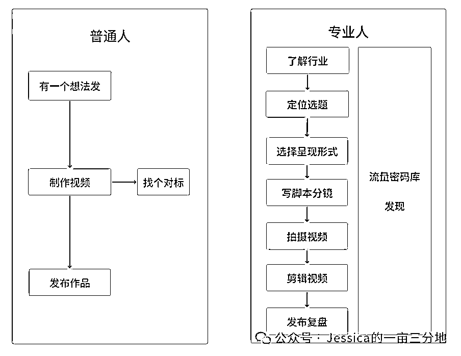
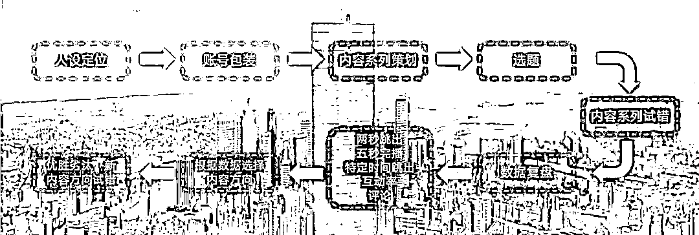
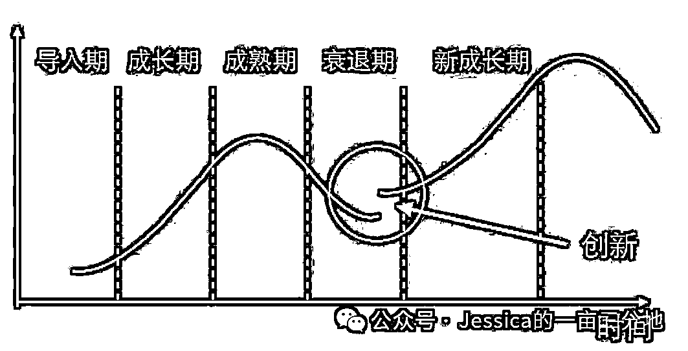

# 少了这根主线，学再多 IP 打法也只是瞎忙

大家好，我是 龙哥，一路在 IP 孵化里滚爬过来的。做了 9 年 MCN 相关工作，待过垂类头部 MCN 的管理层、头部数字营销公司的直播电商负责人，也和合伙人一起创过两家 MCN。手上带起来的直播电商头部号不少，孵化过百位达人。

在赚钱里潜水一年多，最近抽空把年初许的愿兑现一下。

今天聊聊我接触到的个人创作者里，八成都会卡住的一个坑，先帮大家避雷。

跟着周鸿祎、雷军这些人出圈，个人 IP 和老板 IP 这个话题被炒得火热，仿佛人人都能开讲。现在的热度，有点像当年直播带货的 21 年、AI 的 23 年。

为了摸清当下教学市场，我大概听了二十多位做号老师的课。确实有一部分人在讲实操里真正在用的东西，听完能落地。但更多是包装得很漂亮、听起来很爽的速成心法。如果想分辨哪些课值得听，可以私信我帮你筛一筛。

很多新手创作者就这样，东拼西凑学点技巧，看上别人的个案觉得能复制，幻想一夜翻红。醒醒吧，这本质上是概率游戏。一千个人去买，总有人歪打正着。你真能照搬成功，人家早靠复制孵化达人赚钱了。沉迷这种幻想，不只是浪费时间，更会扭曲你对做号这件事的认知，慢慢磨掉斗志，错过真正的窗口期。

我手上刚好有个案例。教培行业的老手，过去靠私域就吃得很饱。去年私域获客见顶，不得不往公域探路。个人 IP 于是成了必修课。

起初他对短视频很上头，买了不少速成笔记，方法论堆了一抽屉。到自己开拍还是原地打转。

“我的选题是照着网上有流量的取的，钩子也下了，标题也按教程写的，内容还搬了同行的爆款，为什么人家有反馈我没有？”他很崩溃，开始怀疑自己不适合做 IP，又觉得不做 IP 没别的路可选。内耗拉满。

我先问他：“做 IP 的终点是什么？想要什么样客户？一个月需要多少转化？为了这个目标，你在 IP 的整体路径里到底做了哪些具体动作？”

他说：“想要一个月转 3、5 个就够了。客户就是对这件事感兴趣的人呗。我就拍视频呀，公域不就是拍视频直播嘛，可能我拍得不够好。”

很明显，对公域流量他的认知还停在表层。我再追问：“你打算拍什么？拍这种内容最核心的判断是什么？”

他回：“想拍自己的专业干货，但没流量。有人让我对标去抄爆款。大家都说视频要会下钩子留人，我钩子总下不好。”

对内容本质的理解也显单薄。我继续问：“你抄的是什么？人家视频为什么点赞多，你能拆解出来吗？”

他说了不少从各路大师那里背来的话，说得头头是道，听起来跟老师差不多。但问到什么是好内容、为什么好，他答不上来。没有源头理解，抄来也只是换皮。

对内容没建立起自己的生产主线、只停留在零散技巧上的人，太多了。

给你换个视角。专业的编导团队做一个新 IP，脑子里都有套通用的启动系统。

拿创始人 IP 从零启动来说，常用的一套就是深度访谈。这个系统的目的并不是立刻出爆款，而是先把镜头感练出来，同时把这个人 360 度拆解清楚。

拆解的意义，是把他身上自带流量的点找出来，测试不同的呈现方式和玩法，最终沉淀成一条属于他自己的、可持续的内容生产线。生产线跑通后，再围绕用户痛点做选题，爆款就只是时间问题。

这套拆解的清单可以直接拿去用：

*   个人经历：成长环境、学业、职业轨迹；
*   性格画像：特质、爱好、核心价值观与信念；
*   专业能力：擅长的技能、做事方法；
*   人际网络：朋友圈、合作经历、关系模式；
*   生活方式：作息、健康、消费观；
*   关键经历：影响深远的成败事件；
*   外部评价等；

能感觉到区别了吗？新手真正要找的不是散点技巧，而是一条贯穿始终的主线，并找到支撑这条线最合适的要素。

当然一条主线不可能一直吃香。我们会盯数据判断它的生命周期，过了峰值就在原线上迭代升级，或者提前布局第二条曲线。

到这一步你以为拿到流量密码了？还不够，还容易掉进“学了像没学”的怪圈。系统逻辑必须落地，两个环节是关键：一是识别什么内容有“量”的能力；二是把线上每一个环节拆到位的方法。

识别能力是核心。很多人做内容像盲人摸象，先要弄清楚你要做的东西到底是什么样、应该长什么样。

抄同行爆款这件事，说对也不全对。抄的方式决定价值。起步阶段认知不足时，抄是快速建立内容体感的捷径。但抄是为了建立认知，不是为了照搬结构、套用制作方式。

如果你只是在做换皮式模仿，那意义不大。如果你是去拆解人家为什么能成，提炼出关键因子，再思考怎么结合到自己身上，这种抄才有用。

实操环节的细节把控也很重要。系统里的每个点都需要精细化打磨，这里涉及大量执行层知识点，这期先不展开，后续有需要我再单独开一期讲。

最后说个圈内的小习惯。专业做内容的人看视频，从来不只是看内容。他们在拆元素：选题、文案、人设、人物表现、画面、剪辑……把一支视频拆成可复用的零件，这才是很多“大师”方法论的来源。

用系统化的思路去找适合你的组合点，一旦形成固定打法，产出效率和流量稳定性都会上来。这个过程并不复杂：正确的系统方法 + 足够的实操 + 快速复盘。

祝你在 IP 的路上越走越顺。