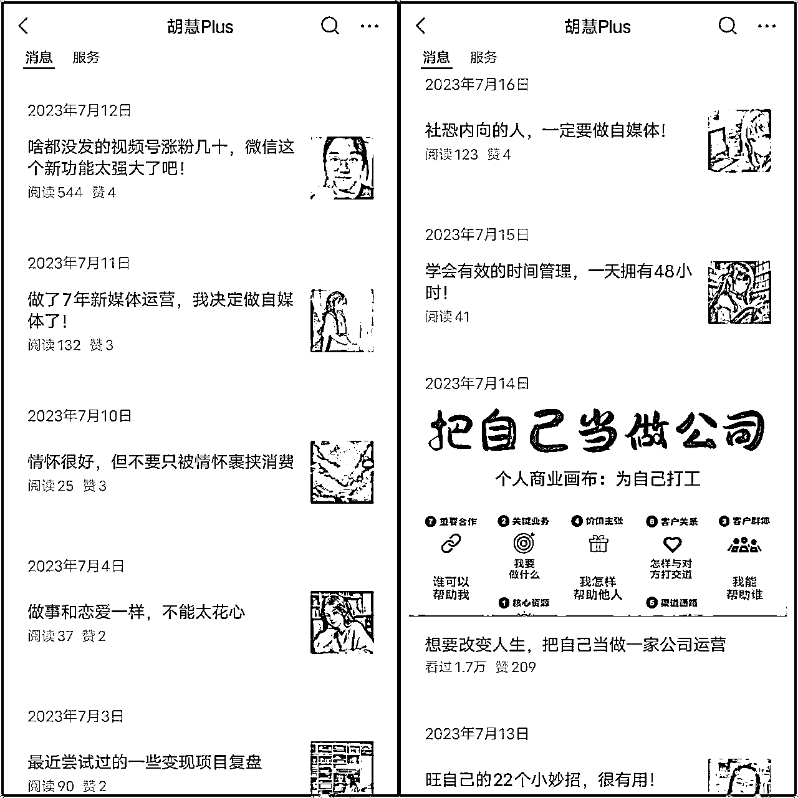
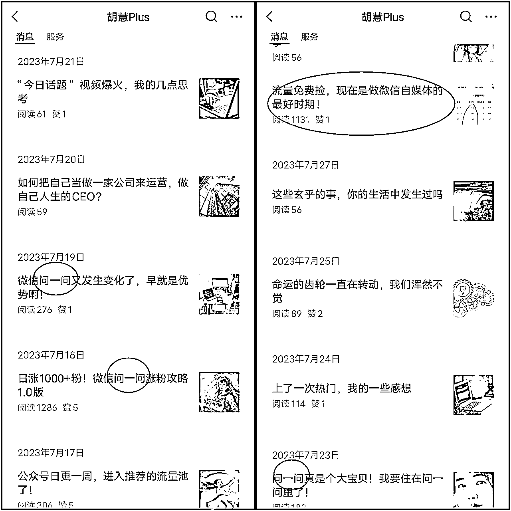
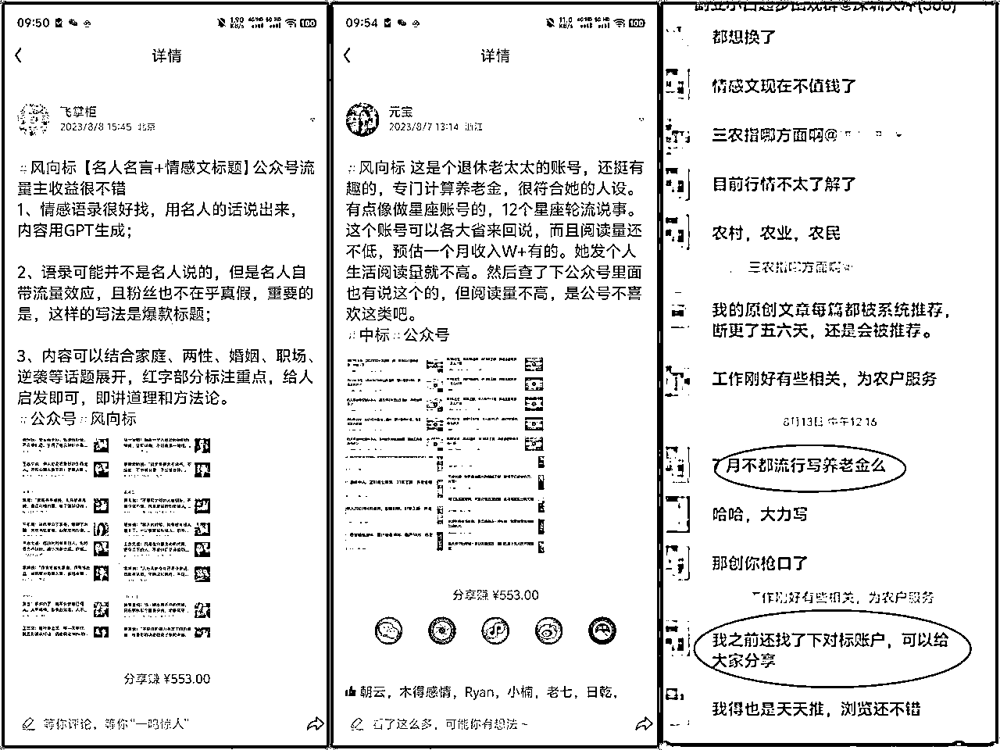
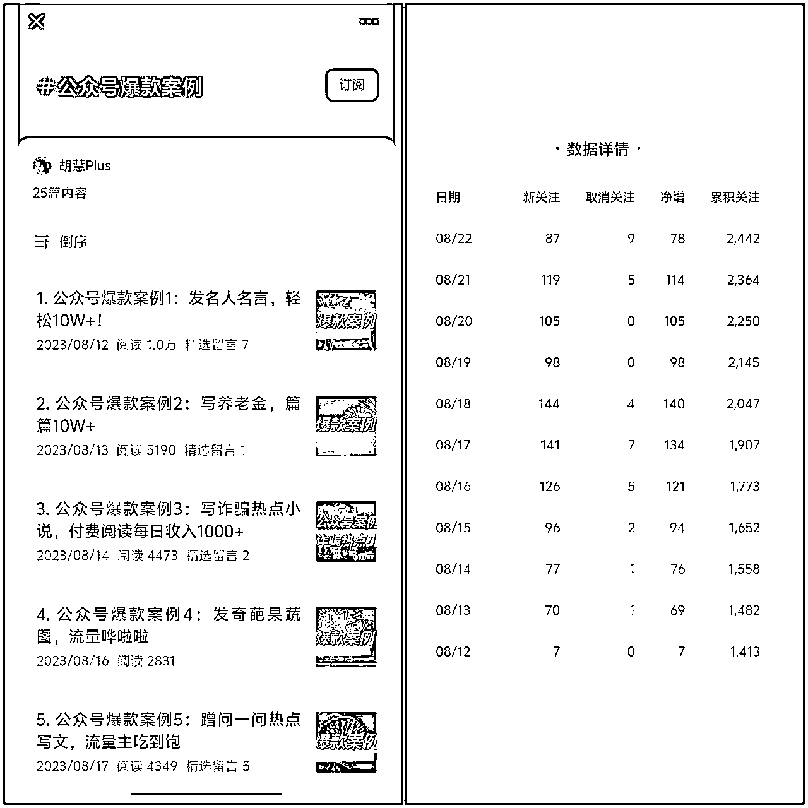
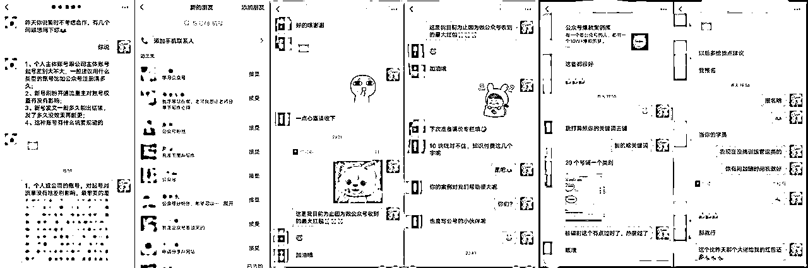
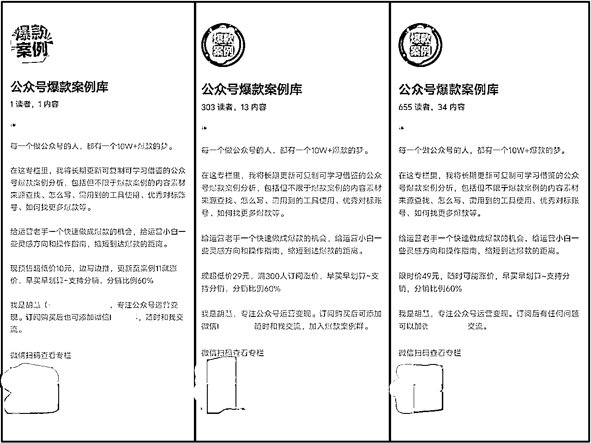
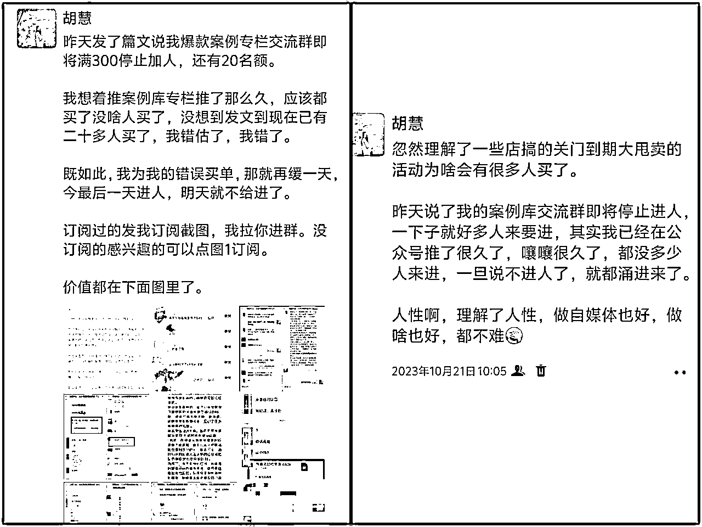
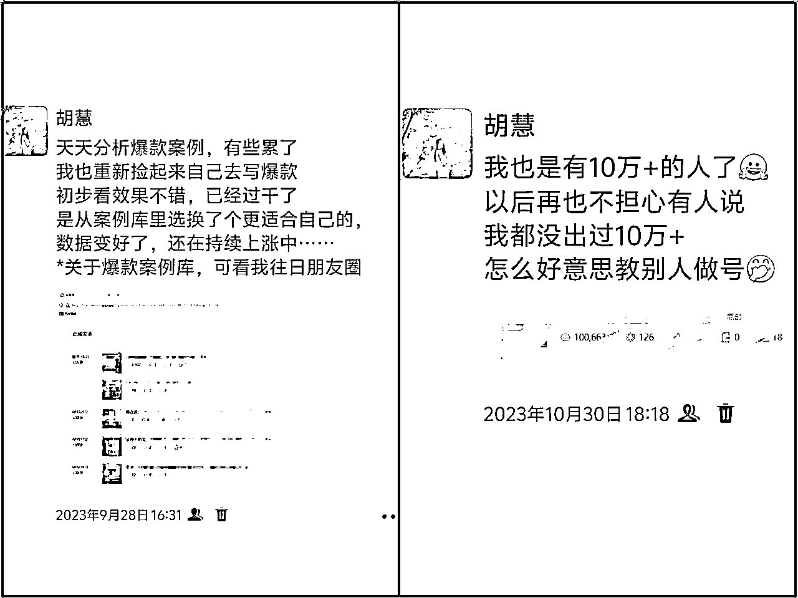
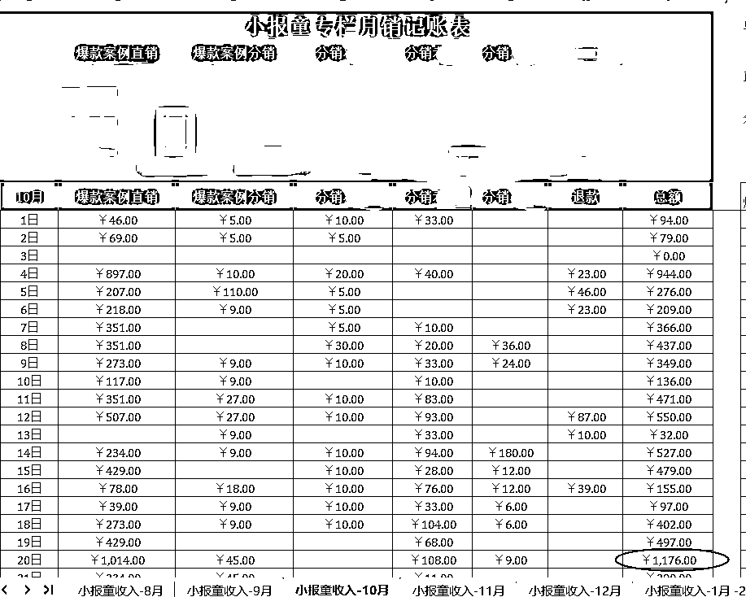

# 当全网都在冲爆文时，我选择做分析师：靠拆解案例把图文账号做成稳定现金流

> 来源：[https://xmstzq7itd.feishu.cn/docx/CZ8odN5lvoQTHcxyRioco8jvnSc](https://xmstzq7itd.feishu.cn/docx/CZ8odN5lvoQTHcxyRioco8jvnSc)

各位生财的朋友大家好，我是胡慧。职场那几年我在几家公司负责过微信公号、微博、抖音等平台的内容运营。2023年转做全职创作者后，因为更擅长图文，便把精力集中在图文变现上。当时平台的推荐分发很强，追10万+、做爆文成了圈内主流打法。

我也曾跟随大流去尝试。重回图文运营后，确实刷出过10万+，但到手收益寥寥。真正让我实现弯道超车的是换个位置：不亲自上场写爆文，而是做爆文拆解、整理案例合集，用“卖工具”的思路吃到更长久的流量与收入。

跟那些靠爆文年入几百万上千万的头部玩家相比，我的体量只是几万元级别。但这套轻量切入、踩坑填坑的路径，对想低成本试水的人或许有参考价值。下面以我个人微信公号的起步、转向与商业化过程做一次复盘。

自2021年加入生财社区，我基本在潜水看帖，偶尔丢几个风向标。这次第一次写长篇复盘，也算给自己一次突破。欢迎交流指正。

# 1、试探阶段：借热点先把账号跑起来

看到爆文火热，我最初也想直接写。但大量翻阅资料与热门赛道后，发现自己兴趣与能力都匹配度不高。于是换方向，先做个人视角的账号。

我把内容锚定在两个并行主题：个人成长感悟 + 新媒体实操心得。2023年7月开始更新时，主要是生活随笔、杂学笔记以及泛化的自媒体方法论，并不垂直。

后来注意到微信问一问的热度起来，多个社群在讨论新鲜动态。我也开始持续跟踪，并把观察与心得搬到公号里。

效果远超预期。平时几十阅读的稿子，聊问一问能做到几百到上千。热点的新鲜感叠加涨粉属性，拉力很明显。

我于是加大投入，每天去答题、收集社群里关于问一问的讨论，再整理成更新。这波热点给了起号的第一桶势能，也验证了选题驱动的重要性。

# 2、聚焦阶段：用数据把内容拧成一股劲

有一次刷到IDO老徐在做关于问一问的小报童付费专栏。出于学习我买了并加入分销群。起初只是想更快获取信息，没想到群里经常有人晒成交。

我也尝试分销，把海报放在文章结尾后，确有人付费订阅。在连更一个多月后的8月中下旬，我吃到第一笔变现。

这让我意识到账号需要聚焦。于是调整方向：砍掉个人成长感悟，全部聚焦于微信公号运营相关的内容输出。这个赛道的数据更好，变现接口也更多。

# 3、爆发阶段：案例拆解成为核心栏目

八月以后，生财、星球里常提到某些细分号在集中爆发10万+，比如名人名言、养老金相关。

我有一个小号本想亲自实操。先试名人名言，阅读长期在个位数，流量主一天就几块钱，很快放弃。

但在看一看里总能刷到名人名言类10万+的样本。我突然改变思路：不去写爆文，去拆解爆文。

动机有三：我对这个垂直不擅长，拆解出来别人可能做好；拆解本身符合我账号“运营经验分享”的定位；还能借行业热度吸流。

我先去检索，发现微信生态里几乎没有人在做公号层面的案例拆解，更多集中在抖音、小红书。隐约觉得是个小缝隙。

8月12日晚，我发了第一篇名人名言案例拆解，当天就有几百阅读。第二天紧跟养老金拆解，第一篇阅读还在攀升，粉丝从个位数涨到三位数。

▲10天涨粉1000

之后我大量搜集案例，星球、推荐流、灵感触发的关键词检索全用上。多数文章的数据都远高于此前均值，带动了整号表现和粉丝增速，每天涨几十到上百。

爆也有麻烦。很快出现模仿抄袭，有人公开骂我误导、水平差、案例不可复现；也有被点名的号主来要求删稿。于是从第二批开始对账号名和关键标题做马赛克处理。这反而成了后续做付费专栏的一个诱因。

好事常有反面，反面也能转化为新机会，关键在于转化方式。

# 4、商业化阶段：把免费拆解做成付费合集

账号数据起来后，我不想只吃免费流量。此前分销老徐的问一问小报童效果不错，还冲上过分销榜首，这给了我信心：微信公号上卖小报童是可行的。

我纠结很久做什么付费。考虑过做运营教程，但同质化严重。最终选择把公号里已发布的爆款案例进一步深化，做成【公号爆款案例库】小报童。

9月初上线，起初定价10元，后提到49元。从第一位订阅者到600多人，90%都是自推。

专栏里会把案例拆得更细：怎么操作、哪些工具网站、如何找素材找对标，并且不打码提供参考账号。公号发新案例时顺带挂海报，其他类型文章也会引流。起初一周只卖几十份，朋友圈加推后才慢慢起量。

转折点是有人买后问我要交流群。我原本觉得专栏写得够细不需要群，也不想维护。但需求摆在那里，建群后转化直接翻倍，很快破200份，后续涨价预告又带来一波。

这件事让我明白，不能只看自己觉得够不够，要顺着用户想要的来。

# 5、坑位阶段：社群管理与口碑维护

群人数上来后，问题来了。明令禁止广告，但软广更难处理。有人天天在群里“热心解答+分享干货”，顺便植入自己的账号和产品，我提醒无效。

我犹豫过，直到有群友私信吐槽我为何放任。于是直接踢人，并处理了后续小号。这件事让我学会社群管理要果断，原则问题不心软。

随后我宣布群满300停止拉新，想控制风险。结果人数冲得太快，有些读者晚几个小时才看到公告，想进群却进不了，直接退订小报童，陷入信誉和流失的矛盾。

冷静后我改成裂变进群：由群内成员自荐个人介绍，我放到公号文章里，感兴趣的人自买自进。参与的人不多，但也缓解了矛盾。

另外还遇到内容被搬运到小报童售卖、简介封面照搬、甚至挂羊头卖狗肉卖课的事。我在公号发声后被对方举报名誉侵权，申诉后才恢复可见。从此我学乖了：公开场合点人一律用代号、拼音，避免无意义冲突。

# 6、遗憾：高峰期没吃到更大的肉

复盘最大的遗憾是变现节奏慢。起号时没想好产品，先写再说，结果案例系列发了十来篇才想起做付费专栏，错过了最佳窗口期。

我也知道很多大佬用小报童引流到私域，再做训练营、陪跑、星球、私教。我当时没敢。因为没带过课，也没有亲自写出过10万+爆文，觉得没底气。合作这条路也想过，但对标项目太多，不确定靠不靠谱，最终没下手。

直到9月底到10月，我在旧号上写生僻字内容意外爆了10万+，才算有了实操背书。但那时案例库已经走上正轨，发篇文就能变现几百上千，比带课更省心，于是没有立刻把经验产品化。等到2024年4月再次整理生僻字方法做活动时，赛道已冷，招了二十多人，带出成绩的凤毛麟角。时机晚了半年，代价不小。

# 7、其他变现与总结

除了自有专栏，我一直做分销变现。写作、AI、公号运营类小报童都推过，有几次冲到分销榜前列，也因此拿到过星球社群的嘉宾邀请，进一步带来用户和转化。

我把小报童收入做了月度记录，10月是峰值，日收入过千，当月变现五位数。

当自身交付能力不足时，帮别人卖好产品也是条路。

后来也有人来找我做小合作，比如年度陪伴群、公号卡点群等，基本都转化不错。这印证了一点：账号做起来了，资源会自己找上门。没资源时你去求别人，基本没回应。

最后梳理一下我的路径：

先用兴趣方向起号测试 → 用热点拿到第一波流量并初步变现 → 用爆款案例拆解带来大爆发 → 在流量高峰期上线案例库小报童变现 → 多产品分销+小规模合作补充

小结几条体感：

流量好时别犹豫变现；停止某个计划前要留好缓冲和预估；别因个别负面情绪砍掉正在赚钱的项目；不要因怕出错就放弃尝试，行动比完美重要。

以上就是我的“卖工具”经历，希望能给还在摸索的你一些启发。

做内容、做项目，本质上是在跟信息差赛跑。

第一，永远把自己放在信息最前线。泡群、进圈、盯热搜，把行业里最新的动向、玩法和机会点都攒在手里。看到有人在变现，就扒一扒路径，结合自己的能力去复刻；看到空白市场，就敢当第一个试水的人。预算可控的情况下去试，成了是方法，败了也是沉淀。

第二，模仿只是起点，照抄就是死路。别人爆了的案例可以学，但必须根据自己的资源、风格、用户群体做本地化改造。我当年复盘爆款笔记时就发现，完全无脑复制的人，最后基本都看不到了。成活下来的，都是改过来的。

第三，流量来了别只卖一个小玩意。瞬间起量的时候，就是变现窗口期。要立刻把这波关注度拆成多个产品形态去承接、去分化、去测试。拖着不做，等热度散了、被别人截胡了，这波红利就彻底凉了。

第四，这条路没有一直顺的。坑、拉黑、封号、内容踩雷、变现拉胯，都会轮番上阵。别被情绪带跑，气馁和放弃是最亏的。把每个问题当成一关来破，遇神杀神遇鬼打鬼，问题解决多了，路自然就越走越宽。