# 解锁TikTok广告的成功秘诀，这八个关键技巧，你必须要收下！

你是不是也发现，刷TikTok的时候越来越多人对硬广无感了？不少用户已经开始践行“低消费核心”——只入手真正实用、值得买的东西。他们选品最看重的就是性价比和实际价值，而不是广告轰炸出来的存在感。这股风潮，正在悄悄改变TikTok上的广告生态。

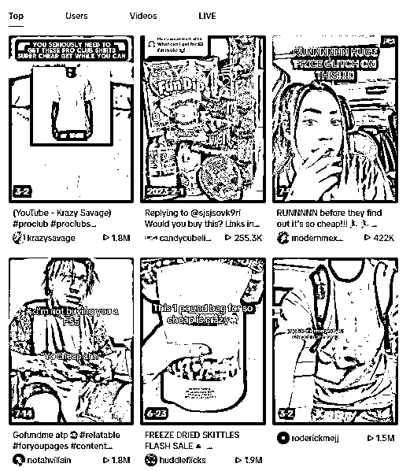

我们之前借助PipiAds仔细扒了扒TikTok上那些跑得好的爆款广告，发现一个共同点：真正赢麻了的视频，根本不靠炫技，而是靠那股“原生感”。就是说，它们看起来不像广告，更像朋友随手拍的生活碎片。也正是因为这样，用户才愿意停下来点赞、评论、下单。那么问题来了——怎么让你的视频也自带这种气质？

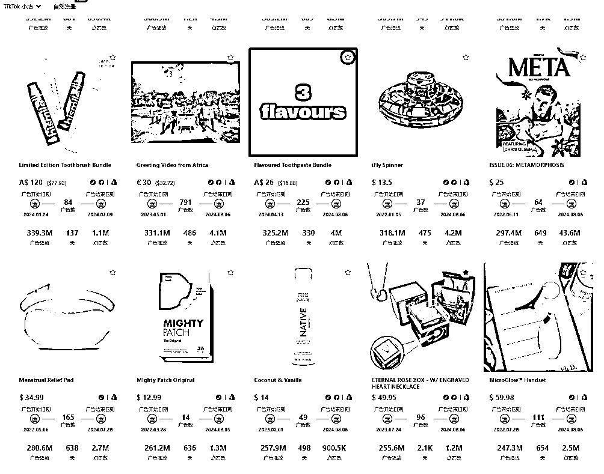

相信不少人都有过这种体验：辛辛苦苦拍了一周素材，播放量永远卡在200到300。观众划走时毫不留情，别说互动，连个关注都不给。投出去的广告素材，试了一堆也带不动销量，偏偏想破头都搞不懂到底哪儿出了问题。如果你也卡在这儿，那问题多半不在拍摄时长，而在视频的“原生感”。这篇文章就为你拆解8个提升创意原生感的关键细节，让你不出家门也能拍出让人舍不得划走的TikTok短片。

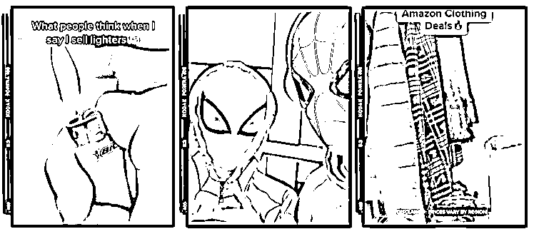

那到底什么才算创意原生感？说白了，就是观众刷到你的视频时，会不会觉得“这画面我熟”。如果内容能融入他们的日常，信任感和亲切感自然就上来了。你完全不用英语说得多流利，也不用非得有海外生活经历，只要掌握几个实用技巧，在家就能拍出那股地道的原生味道。

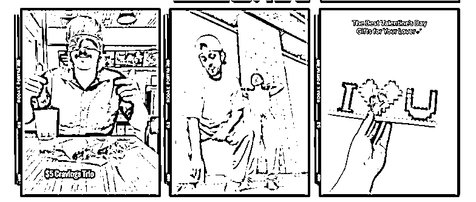

想没想过，为什么你的营销素材总是效果平平？说到底，还是营销思路没理顺。营销的本质从来不是把产品硬塞给用户，而是想清楚他们真正需要什么，然后去创造并传递对应的价值。真正有效的做法，是让用户觉得“你给的正是我想要的”。营销的核心，就是和用户建立一种连接，用内容传递有意义的信息，顺其自然地激起他们的兴趣和购买欲。

先说第一个技巧：家居风格要统一。你有没有注意过，那些播放量炸裂的TikTok视频，背景总是透着一股精心布置的生活感？英美风格的家居，要么是干净利落的北欧风——白色或浅色墙面，花瓶和相框都走简约路线；要么是自然色调的美式风——红棕色桌椅，配上美拉德色系的靠垫地毯。你要是没条件复制一整间屋子，也没关系，把拍摄范围缩小，用背景板搭出一个小小的产品展示角，氛围瞬间就到位了。

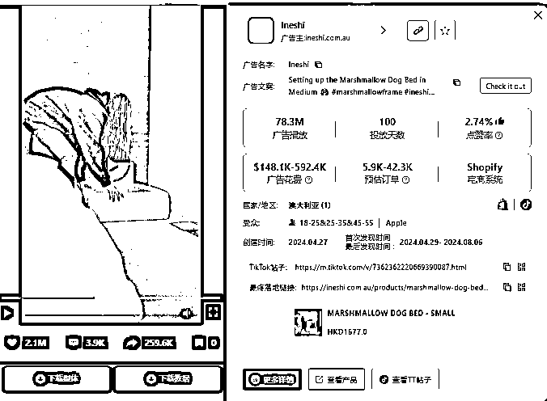

第二点是色调统一。为什么有的视频一眼就让人心情舒畅？往往是色调在发力。欧美用户对颜色的包容度很高，美拉德色系、多巴胺色系、莫兰迪色系都有人爱。不过要注意，色调统一不止单支视频内部要协调，整个账号的视觉风格也得保持一致。单支视频色调统一，看着更舒服；整个账号色调统一，算法就更容易把你的内容推荐给喜欢这类颜色的人。

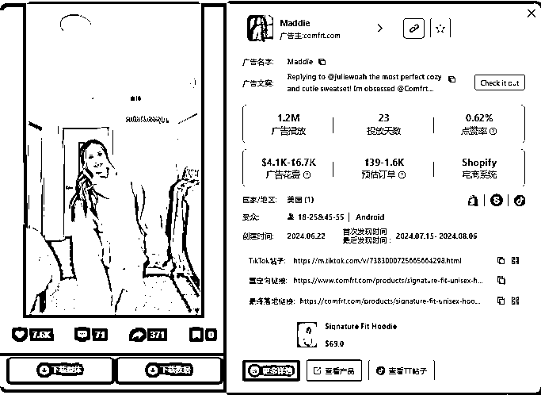

第三个技巧，多利用自然光。试想一个洒满阳光的房间，桌面被照得亮亮的，谁看了不说一句舒服？国外用户特别吃“自然光”这一套——明媚的日光、柔和的家居光、卧室里暖暖的氛围灯，都很讨喜。你不需要搞一堆复杂的灯光设备，尽量用自然光源，把画面拍得柔和、干净，就赢了。

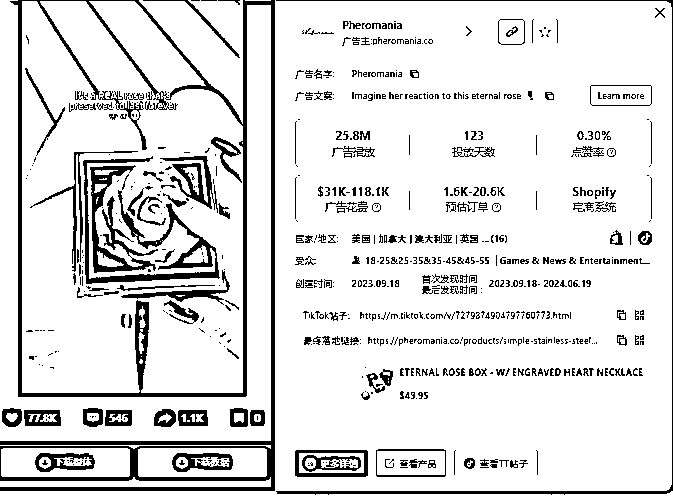

第四，构图要克制。为什么有的视频看着特别舒服，有的却让人心烦？差别就在构图。国内拍摄习惯用各种小物件把画面塞满，结果观众的视线不知道该往哪儿放，看一会儿就累了。国外用户更喜欢简洁、有层次的画面，视觉焦点集中，沉浸感自然更强。拍之前记得打开手机相机的九宫格，研究一下怎么布图，给画面做减法，干干净净才高级。

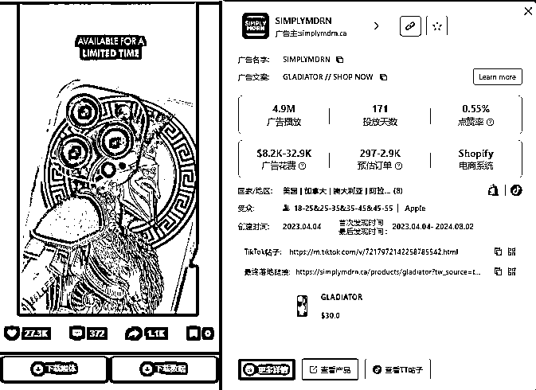

第五，节奏感是关键。你有没有发现，卡点卡得好的视频总是更容易让人上瘾？快速切换镜头是留住观众注意力的有效方式。TikTok本来就适合短平快的内容，每2到3秒换一个镜头，观众的注意力就容易被牵着走。再配合音乐节奏来切换场景，画面更有动感，趣味性一下就拉满了。

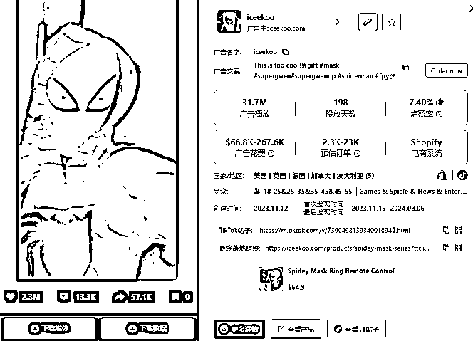

第六个技巧，选对音乐。音乐可以说是视频的灵魂。一首好歌，能让你的内容直接从人群中跳出来。在TikTok上，音乐不只是背景，它本身就是吸引人的钩子。尽量选现在外网流行的热门音乐，别用国内音乐，避免版权问题和文化水土不服。同时，画面切换要尽量卡在节拍上，观众看着看着就入迷了。

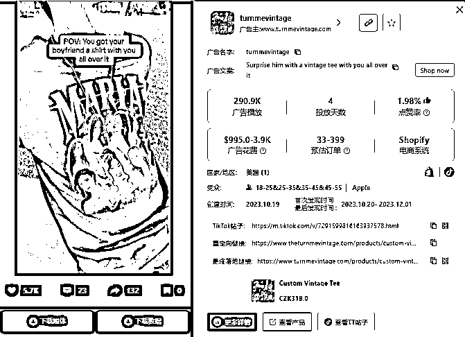

第七，视角不要老变。你是不是也看过那种切来切去、看到头晕的视频？频繁换视角，其实是让观众流失的隐形杀手。固定一个角度去拍，叙述会更有连贯性。信息也能交代得更清楚，观众不用费劲去追镜头，自然就不会错过关键细节。

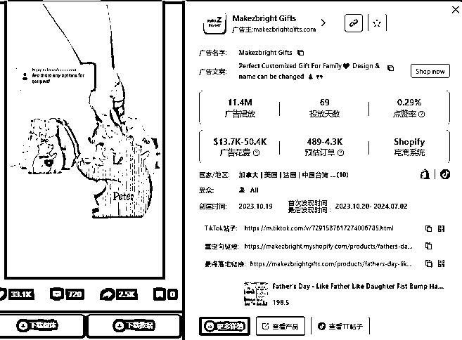

第八，机位越简单越好。有时候拍视频多了反而乱。多机位来回切，会打断视频的连贯性和节奏。尽量只用一到两个机位，画面干净又完整。每段视频的机位和视角保持一致，观众看得不累，整体质感也更统一。

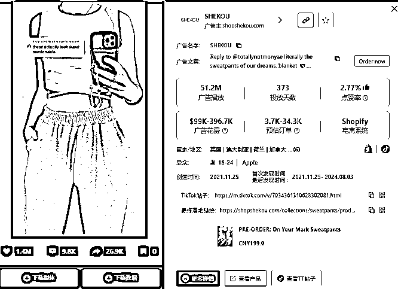

说到底，做TikTok拼的还是内容。一个真正专业的团队，最核心的能力就是能持续输出优质素材创意，然后用内容快速抢到流量。而有了PiPiADS，你可以随时浏览来自全球各地的广告创意，站在无数成功者的肩膀上，找到属于自己的爆款方向。