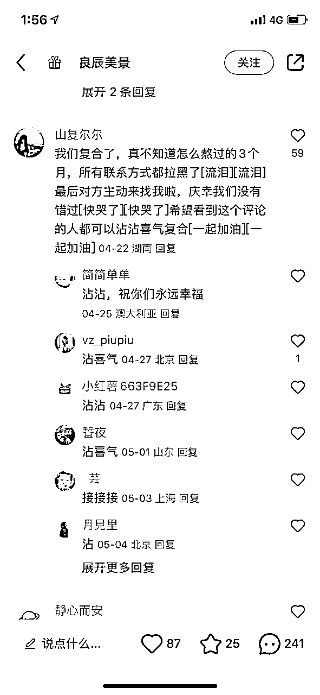

# 24小时内在📕刷出1000篇笔记的实操思路

大家好，我是鹏哥。

最近不少朋友来问我同样一个问题：想在📕上大规模做内容投放，但自己账号资源有限，也不想搞复杂矩阵，有没有办法又快又省事地把笔记铺出去为产品导流。

这篇文章就是把我们团队反复验证过的方法整理出来，零基础也能照着上手。

一篇文章能带来2个客户，那1000篇文章是不是等于2000个客户？关键是怎么让这1000篇在短时间内真正发得出去。

答案其实很简单：用素人代发的方式做规模化分发。

我们自己内部累计做过上万条📕代发，实际拉了2万多位🛰️好友，也承接过抖音、视频号的分发业务。今天就把这套打法的底层逻辑和可复制的SOP拆开讲清楚。

代发模式可以通用于多个平台，但并非所有赛道都合适。目前主要分为两种目标：一种是做种草曝光，一种是做直接获客。种草相对粗放，铺出去就算完成任务。获客则链路更长，因为牵涉到引流环节，而引流恰恰是成败的关键。

# 一、先判断值不值得做分发，这几个前提必须对齐

第一，目标人群的需求是否足够明确且刚性。分发账号本质是素人号，只有用户愿意听素人分享、场景匹配度高的时候，引流转化才有意义。

第二，内容模板是否已经跑通。代发从一开始就是付费行为，相当于私域投放。没有验证过的爆款脚本就直接放大，成本会失控。先自己小范围测出能转的脚本，再交给兼职去量产，单价才可控。

第三，引流路径是否顺畅。账号不在你手里，掌控力天然弱。兼职往往是一锤子买卖，发完拿钱就走，链接随时可能被删。

因此做分发前必须解决的核心问题是：
内容能否批量生产？
能不能持续批量招到愿意发的兼职？
在别人账号上，引流模式能不能跑通？
是走A种B收，还是付费激励兼职直接引流？
如何延长笔记存活时间，降低被删带来的损耗？

# 二、落地执行的标准流程

首先准备好已验证的爆款脚本。内容生产有两种打法：一种是给兼职素材大纲让他们自己创作发布，另一种是主号把内容做完，兼职只负责一键搬运。

我们更推荐第二种，把创作和发布拆开。这样质量更好控，也避免兼职水平参差不齐。

现在借助AI做内容已经很高效了，多跑几次提示词调出合适的风格，后续批量出稿非常顺畅。

内容准备好后放到共享文档里排序。提前和兼职约定好规则：一个人领一份素材，在表格里标记已领取，发布后把笔记链接填回同一列，并同步在群里报备，同时在文档里留下自己的🛰️方便对接。

标准闭环是：素材→文档领取→发布回链→核对→结算。

逻辑不复杂，执行细节决定成败。我们也在内部开发兼职分发管理系统，涵盖作品检测、人员管理、自动结算，成熟后会同步给大家。

# 三、怎么让笔记链接活得更久

实话说，很多兼职结算后就会删笔记，这很正常。几块钱的交易，叮嘱再多也挡不住。

所以不要去赌100%留存，要做概率管理，通过小额激励把存活周期拉长。举例来说，可以设置曝光阶梯奖励：达到多少浏览、多少点赞收藏就额外加5元、10元，引流到一个精准客资再额外奖励，奖励区间根据项目成本自行设定。

我们曾按播放量阶梯加钱，两个月内90%的链接仍在线。对投放者而言，核心永远是算账。

# 四、执行中容易被忽略的关键点

SOP、话术、核查频次、结算节奏都要提前设计好。和兼职第一次沟通就要讲清：你是谁、做什么、对方需要做什么、能赚多少钱。信息不透明会严重拉低转化。

结算务必即时。几块钱别拖几天甚至一周，否则没人愿意长期配合。

流程要极简。兼职是为了赚小钱而来，别让他们动脑子，只要手指点点就行。

# 五、兼职号从哪里来

有两种思路：自己打粉，或者直接买。

自建粉池常见渠道有📕评论区截流、Boss直聘邀约、大学生社群渗透。我们最高纪录一条评论截流近500人，Boss一天能发出800多条招呼，转化400多人，但号损耗快。Soul等平台也能导流，偏年轻化。

直接采购的话，市场价基本在2-5元/个。📕上这类兼职需求非常多。

总的来说，招兼职本质是废号流玩法，账号封了就换，算清楚ROI即可。具体的引流打法后续再整理成SOP分享。

# 六、最难啃的骨头：引流

获客型铺量最大的痛点就是引流。投入再大，笔记发再多，流量没进到私域都白搭。

兼职发一条只赚几块钱，很难有动力帮你做深度引流，哪怕给到3、5、10元/单，效果也有限。

因此主流做法是A种B收。A负责发帖，B用非原作者账号在评论区做引流，再由CDEFG等号在评论区配合控场。

具体手法是：帖子刚发出来只有两三条评论时，就用引流号先上钩子评论，然后用小号点赞、叠加评论，把这条钩子通过热度顶到第一位。平台的置顶逻辑看的是热度而非时间。

同时用小号在钩子评论下留言求推荐、要资料、要链接，营造真实的互动氛围，让追热度、从众心理的用户更容易跟进。

就拿情感赛道举例，评论区营造出来的真实求助感，普通用户很难分辨是真实场景还是搭建的局。

只要做过截流或铺稿引流的人，看到这种评论第一反应是套路，但普通用户基本分辨不清，这就是引流要利用的心理。

总结下来，A发内容，B放钩子，CDEFG带节奏，形成完整闭环。

有人会问号不够怎么办？可以直接让兼职顺带做评论，一条0.5-1元也能完成。

* * *

以上就是我们这套📕快速铺量的完整思路。逻辑清楚的话，小白也能直接上手操作。

有问题可以加V：w0222168，一起交流。