# ('AI出海营销;百万访问量AI产品偷偷投TikTok广告', (2, 29))

中国AI企业正以前所未有的速度冲向全球市场，与其说是“出海”，不如说是全面融入全球化的浪潮。这波AI出海，光靠产品力还不够，真正让世界看到你、用上你，才是关键。

看几个数字就明白了：HeyGen用一年时间把年收入从100万美元做到3500万美元；PopAI海外上线9个月，用户接近千万，年营收预计过亿。这些增长曲线，是AI技术潜力的最好证明，也说明全球市场对AI工具的需求到底有多猛。

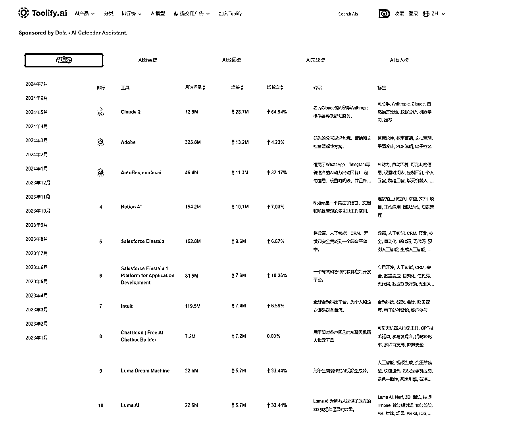

全球AI排行月榜上，中国产品的身影越来越密集。再比如MiniMax的Talkie，上线半年总收入超84万美元，月均流水百万人民币；CrushOn连续数月霸榜AI产品前列，单月流水6万美元；Fotor凭1.5亿新粉丝，早早跨过盈利线。

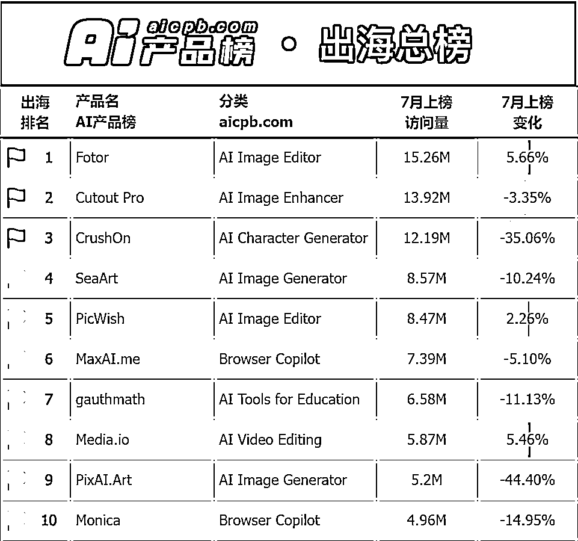

这些爆发背后，没一个靠运气。产品定位、用户洞察、广告投放，每一步都踩得很准。这些团队把全球社交媒体的玩法摸得透透的，知道怎么借平台的算法让产品“出圈”。说白了，出海这门生意，拼的就是更多流量、更好技术、更快盈利。

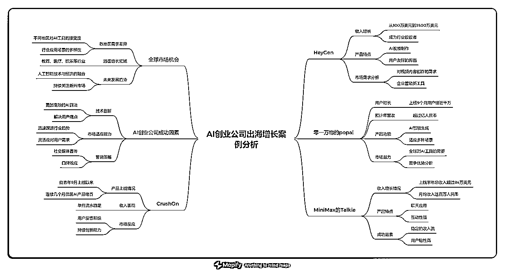

当然，机遇与挑战也始终并存。2023年之后，AI出海赛道冒出一大批娱乐向应用：AI角色扮演、虚拟女友、AI剧本杀……这些产品吃到了国外更宽松的内容监管红利，互动体验更“开放”，需求旺盛，很多上线一个季度就能盈利。

另一边，早先做图像处理的出海产品也踩上了风口。背景更换、去水印、换脸这些工具本来就有海外用户基础，生成式AI一来，它们迅速转型，全面拥抱AI，还搭上了会员订阅制。Fotor就是典型，团队不到10人，月收入百万美元，效率极高。

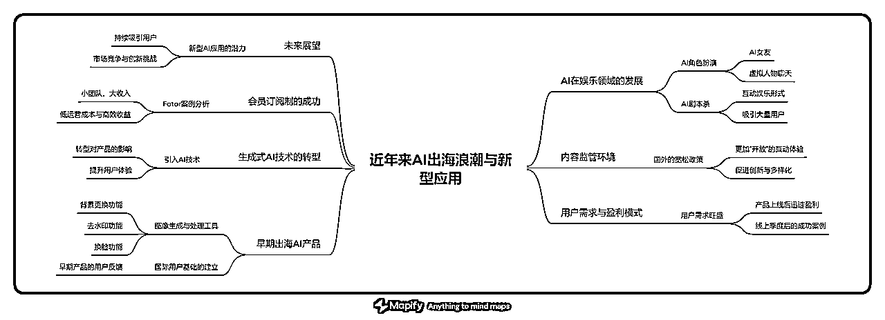

产品做出来了，怎么推广曝光就成了所有开发者的头号难题。目前主流渠道就这几条：社交媒体靠Twitter、LinkedIn、Facebook、TikTok做精准投放和内容营销；移动端主战场是App Store和Google Play，排名、评论、关键词都影响获客；谷歌SEO和内容营销用高质量博客、教程、白皮书抓精准流量；邮件营销负责激活老用户、转化潜在用户；还有toolify导航站、Product Hunt、科技博主这类合作联盟，也能带来海量曝光。

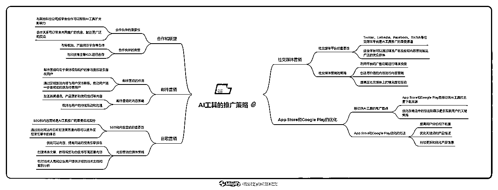

在所有社媒渠道里，TikTok的投放尤为值得研究。PiPiADS的广告数据显示，不少百万访问量级的AI产品都在TikTok上砸出了声量：Fotor曝光量过亿，7月访问量15.26M；Gauth曝光量3亿+，访问量6.58M；Talkie曝光量4000万+，访问量2.96M。这三款产品，几乎是把TikTok当成了出圈的跳板。

先看Fotor。它类似Canva，是个多功能设计平台，海报、传单、封面都能做，后来又加了AI图片生成、AI照片特效、AI脸部生成、AI艺术生成等功能。用户传图或者输入文字就能生成AI图片，复杂的设计和图像处理瞬间变得简单，新手和设计师都能用。

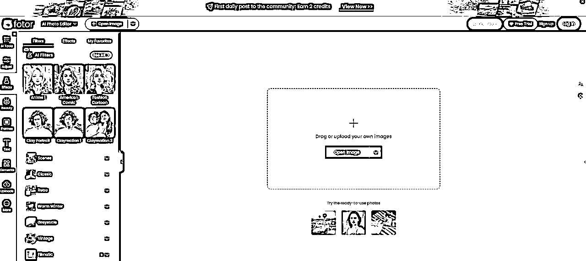

PiPiADS显示，Fotor在TikTok上有一条1250万播放的广告素材。引导语是“Let's see how AI can make you look in your LinkedIn photos”，文案是“Generate Professional Headshots & Photos with Fotorama AI”。视频用AI把普通照片变成专业LinkedIn头像，人物看到成片后一脸惊喜。

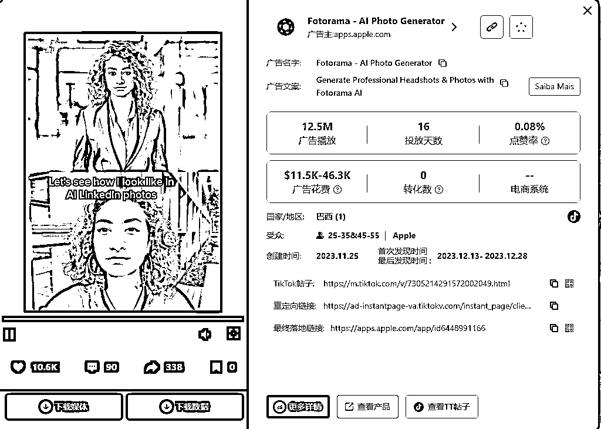

这条广告之所以能爆，胜在结构：先给观众看一张真实的普通照片，自然光、真实背景，瞬间拉近距离；然后用AI生成的专业头像做对比，反差巨大，价值一目了然；接着直接展示效果，没有复杂操作，让人觉得傻瓜式就能搞定；最后在情绪最高点亮出品牌标识和“AI Photo Generator”标签，让人记住产品。节奏干净利落。

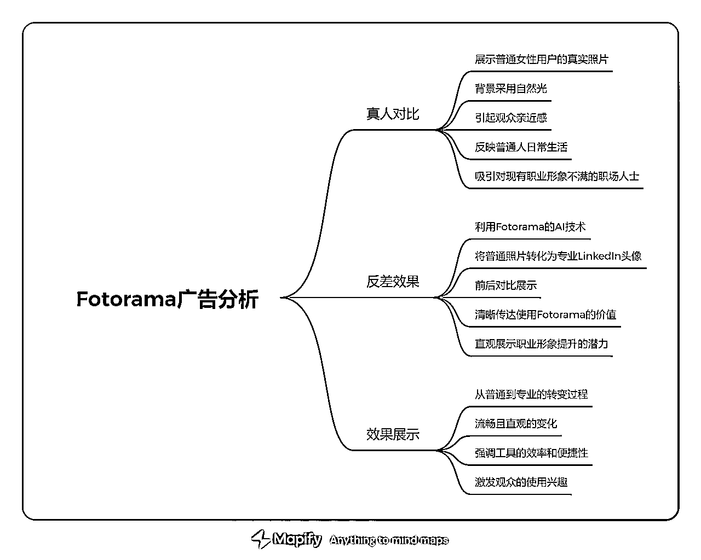

翻看Fotor的跑量素材，几乎都是主打商务照。

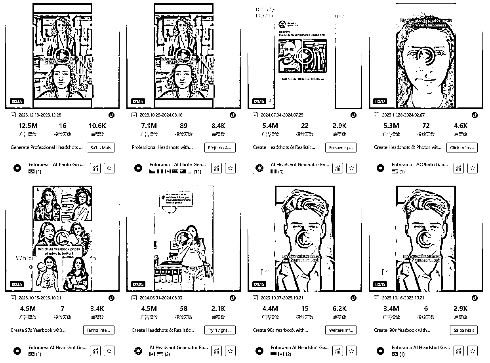

为什么盯着这个人群？因为职场人士，尤其是LinkedIn用户，付费能力强，愿意为职业形象花钱；他们想在职场上脱颖而出，一张专业头像可能就意味着更多机会；而且他们没时间学复杂设计软件，Fotorama这种工具正好满足高效刚需。

再来看Gauth。它原本是字节跳动旗下的拍照搜题应用，2020年刚出海时并不出挑，国外早有PhotoMath、Brainly、Chegg、StudyX等老玩家。但2023年Gauth重新定位，接入大模型技术，瞬间成为市场黑马。

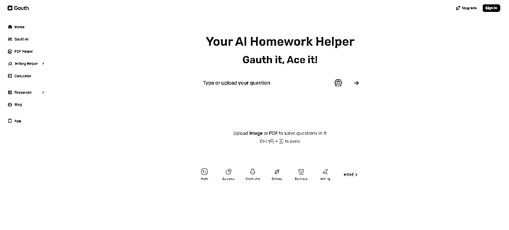

今年Gauth频繁冲进应用榜单，截至8月排在App Store教育免费榜第六。和过去不同，它现在不只给答案，还提供详细解题步骤，堪称数学界的“贴心小棉袄”。

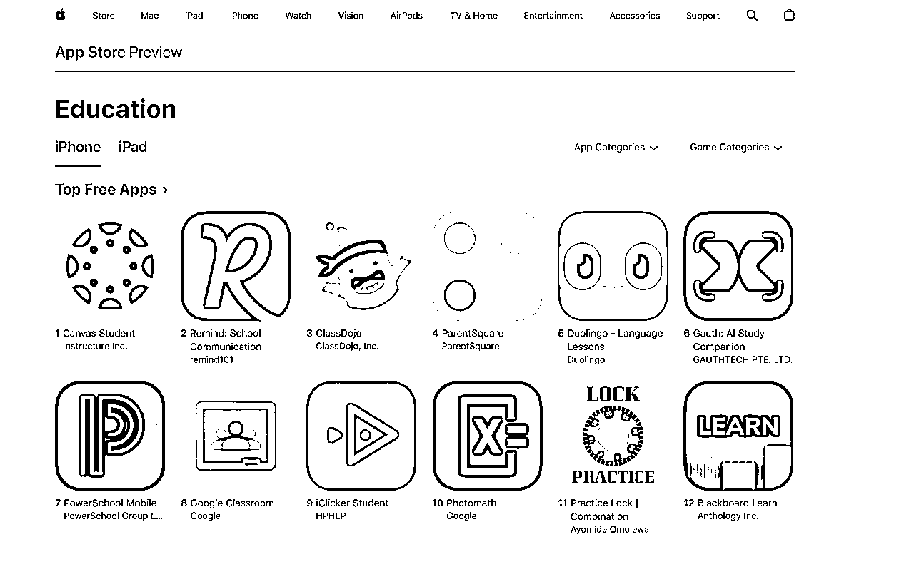

PiPiADS显示，Gauth有一条2990万播放的TikTok素材。引导语是“My grades being good”，文案是“Gauth helps foster an all-rounded you!😎”。素材拍摄质量不算精致，但核心信息传达得非常直接。

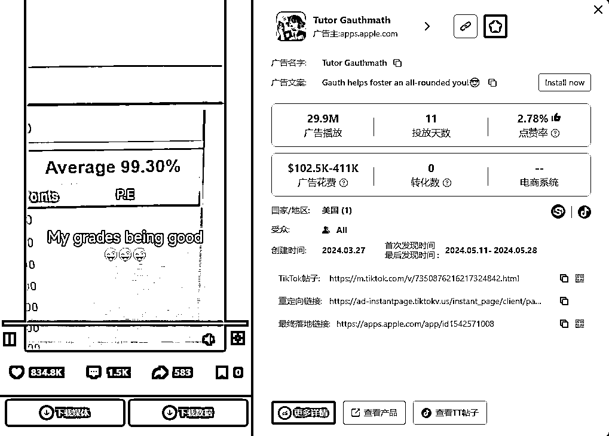

这条视频的妙处在于：先亮出一串高分成绩单，体育、科学、历史，让人产生“我也能这么棒”的成就感；然后切到数学这类老大难科目，用Gauth快速解题形成反差，突出实用性；接着展示拍照解题、生成步骤等功能，覆盖物理、化学，强化全能辅导形象；整个过程中“@Gauth”标识不断出现，品牌记忆点牢牢扎根；再配上“我的成绩真棒”和搞怪表情，年轻用户看得会心一笑。

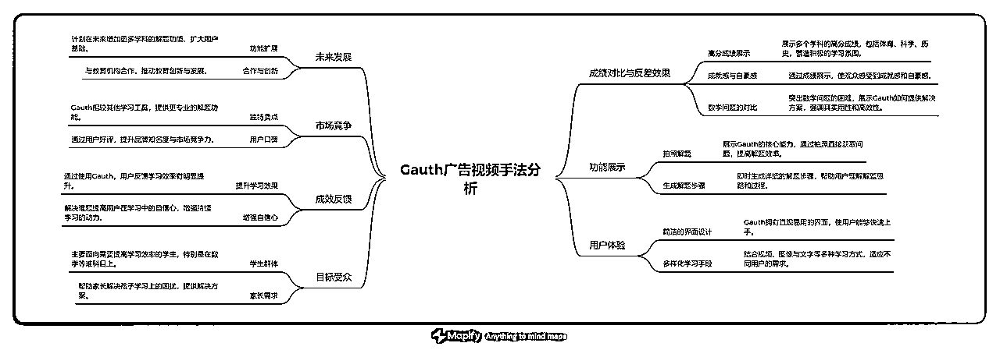

广告精髓就三个词：冲动、痛点、行动。

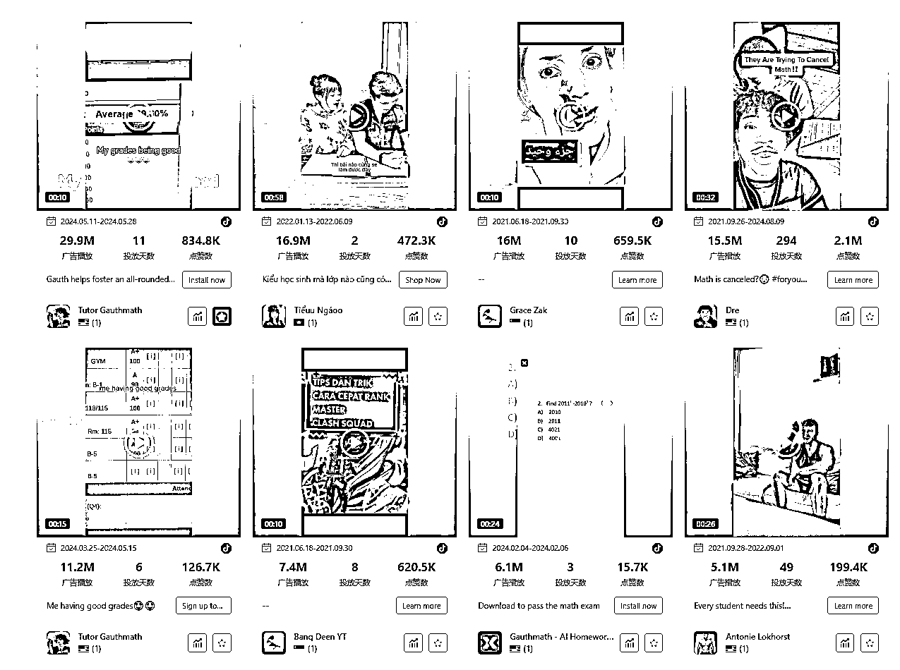

先用高分成绩激发“我也可以”的冲动，再用数学痛点制造“我需要这个工具”的暗示，最后用一步步的功能演示引导用户马上下载。

最后说Talkie。这是一款AI聊天应用，滑动一下就能和各种虚拟角色互动，有名人类数字分身，比如马斯克、詹姆斯，也有《哈利·波特》里的虚构角色，甚至能自定义专属的浪漫伴侣。它的创新性和娱乐性，让它成了美国市场的现象级产品。

Talkie现在月活跃用户有1100万，超一半在美国，菲律宾、英国、加拿大也热度很高。截至8月，它排在App Store娱乐免费榜第36名。

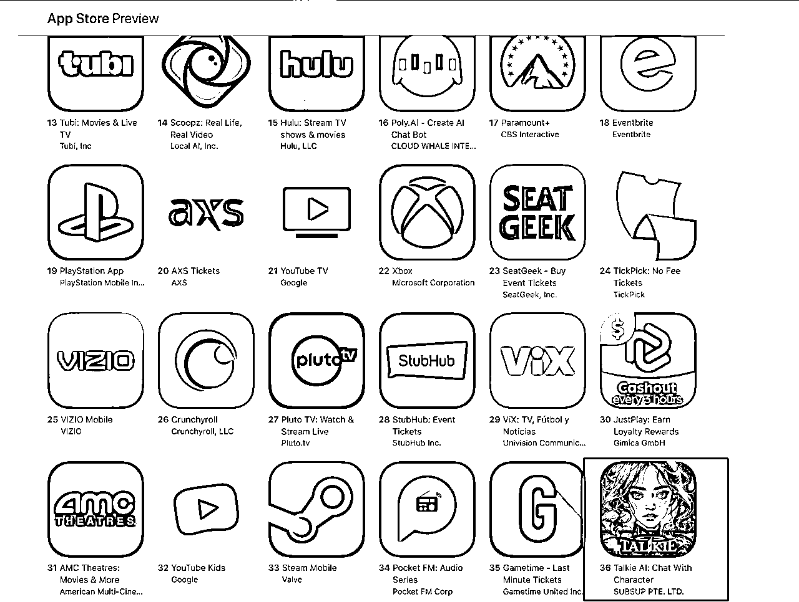

PiPiADS里有一条450万播放的广告：引导语“I sneak into the bathroom late at night to chat with my AI boyfriend named Ethannn”，文案“Chat with your AI soulmates!”。视频里，一个女生深夜偷偷躲进浴室和AI男友聊天，因为现实男友给她的关注是零。

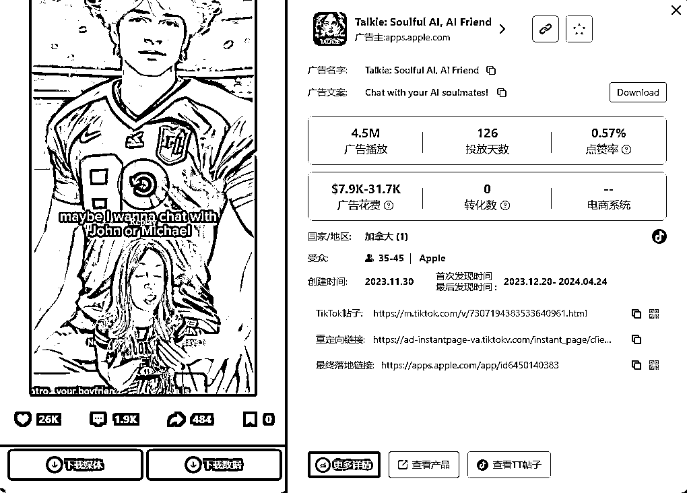

这条广告的代入感极强：它用幽默又真实的场景放大了孤独感和情感缺失，让许多观众直呼“这就是我”；随后展示用户可以自定义AI男友的颜值、声音和性格，满足“创造完美伴侣”的幻想；再通过“都爱吃Mac and Cheese”这样的小细节，让虚拟关系显得真实而温暖；最后直接喊话“去找个AI男友吧”，推动行动。

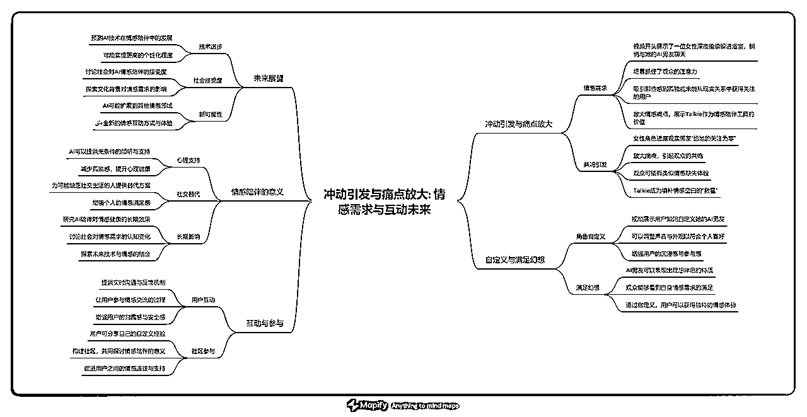

广告的底层精髓，就是共鸣感加替代满足。

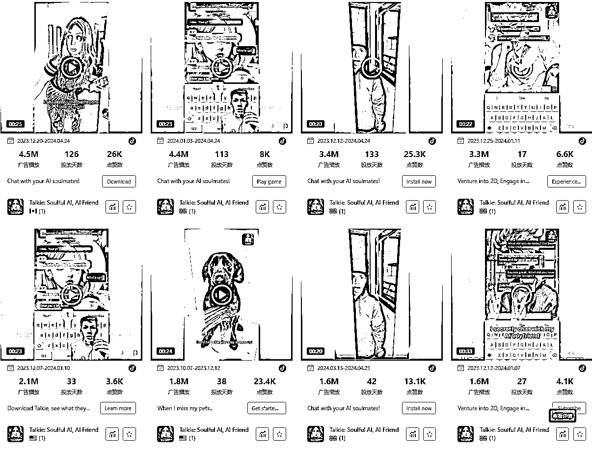

幽默与反差让人忍不住看完，个性化定制凸显产品独特卖点，替代式互动满足现实中被忽略的情感需求，一句简单的行动号召完成转化。Talkie就是用这种方式，让用户从刷到广告到下载应用，只隔了一个视频的距离。

从这三个案例能看出，TikTok广告没有万能公式，但底层逻辑是相通的：找到目标人群真正的痛点，用最直观的方式展示产品怎么解决它，把品牌记忆点埋进情绪高点，再给一个清晰的行动指令。中国AI出海，缺的从来不是技术和产品，而是这种“用流量换增长”的推广思维。全球化浪潮里，谁能把产品推到更多人面前，谁就能站得更稳。

航程才走到序章。

就目前来看，中国AI企业走出去的步伐，恐怕还只是拉开了序幕。这场属于AI的全球化远征，参与者正越来越多，随着更多队伍加入这场“大航海”，属于中国制造的品牌与产品，将在世界舞台上出现得更频繁、更醒目。

别急着下结论说热闹已经到顶了。真正的惊喜还在路上，下一个可能席卷全球的爆款产品，很大概率会来自你现在还叫不上名字的中国AI新势力。