# 视频号+抖音 全域自热引流实操拆解
作者：龙哥

自热的本质从来不是跟平台硬刚，而是精准击穿用户的心理防线。

# 一、自热底层逻辑

自热的核心，在于反抗的是用户习惯，而不是平台规则。

# 二、自热启动的四项基础条件

想做自热，先把基础盘搭好。设备、IP、账号、模板，这四点缺一不可。

## 设备要干净

起步先从机器本身讲起。安卓机记住一句话：必须干净。实现方式就两种，刷机或者改串。
刷机包可以去 https://onfix.cn/rom 这个站找，对应机型直接下载按教程操作。苹果机可以用爱思助手来处理。
改串相对更省事，直接在淘宝、闲鱼找对应机型的改串包，或者线下门店代做也可以解决，设备问题也可以咨询我。

## 网络IP

IP环境建议只用全国跳+纯净IP。提醒一下，全国跳在部分地区会跳不动，买之前一定要先问清楚情况，也可以联系 w0222168。

## 账号选择

优先用营业厅直接办理的电话卡自注册，其次才是拿老号备份来用。

## 模板打法

自热模板已经迭代更新，覆盖四十多个赛道的精细SOP。授人以鱼不如授人以渔，重点是让你吃透引流的思路和方法，而不是死记硬套去无脑复制。

# 三、各平台实战打法

## 1、抖音

### 模板拆解思路

1. 能自己原创就原创
2. 原创不了就去买素材，找靠谱服务商拿
3. 还可以找代拍团队

**案例参考：**

a. 教培赛道 b.小国赛道

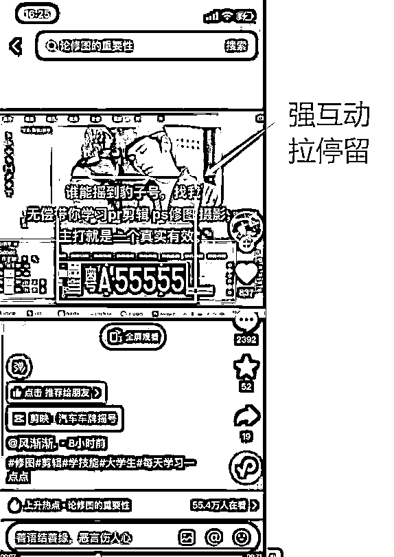

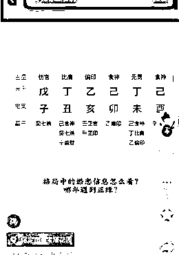

c.nk赛道

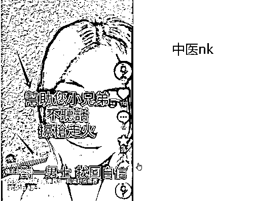

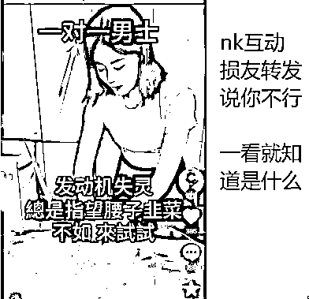

打同行异业联动：nk中医 <=== 同城spa

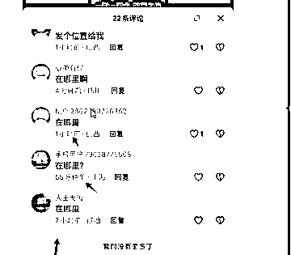

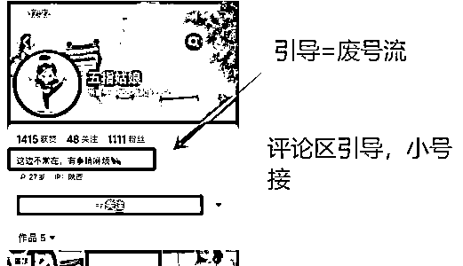

d.S粉 e.情感粉

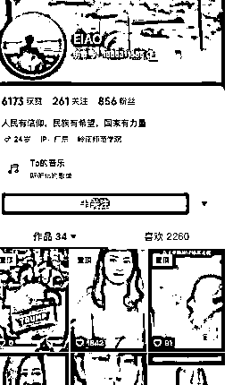

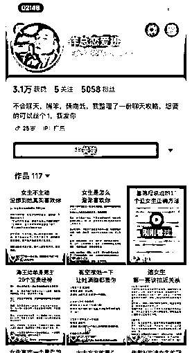

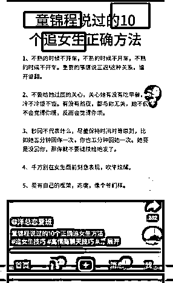

## 2、视频号

强烈建议现在入场视频号，平台正处于红利完善期。小国、K12、情感、旅游等赛道都很容易起量，最大的优势是留钩子非常直接，导流几乎没有阻力。

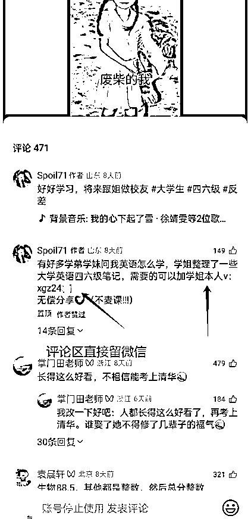

### 视频号需要养号吗

从兼职那里拿来的视频号，先检查一下是否出现提示信息，有提示的基本别用，流量推不起来。

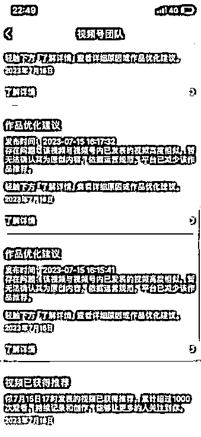

如果是全新干净号，起量非常快，随时都能吃肉。

### 模板拆解

a.复合粉：

视频号常用模板是图文形式，用好听的音乐提升停留，壁纸配图做赋能，评论区做引导。

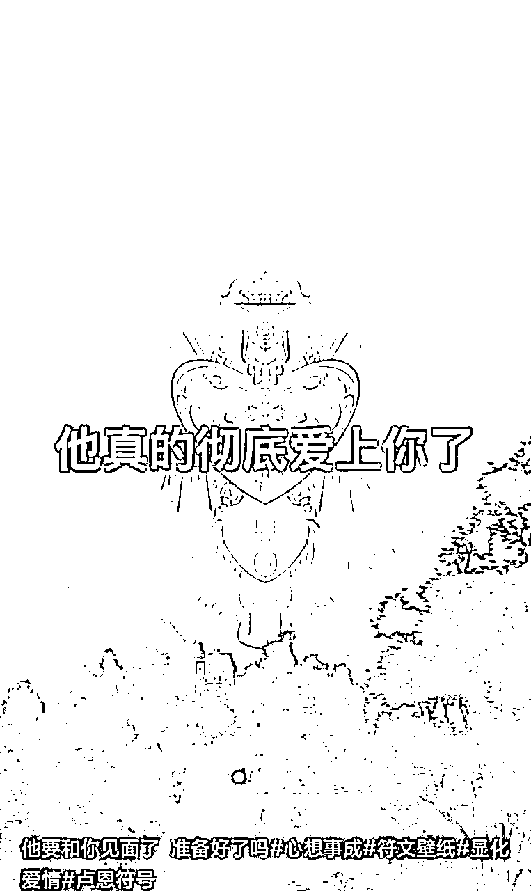

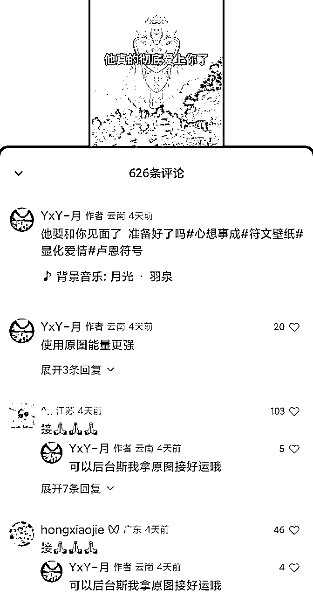

b.教培赛道，同样用好听的音乐拉长停留

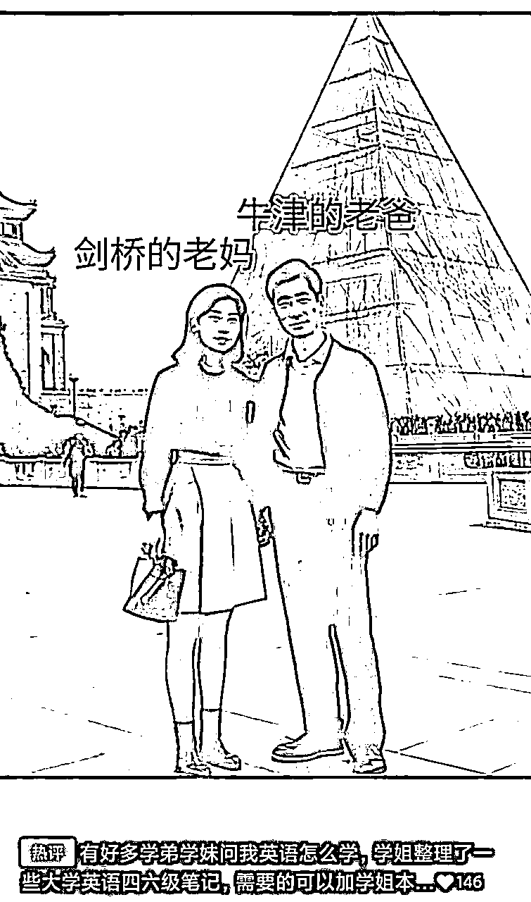

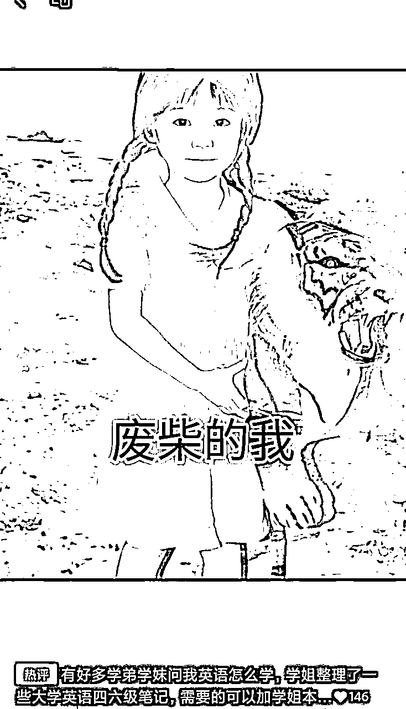

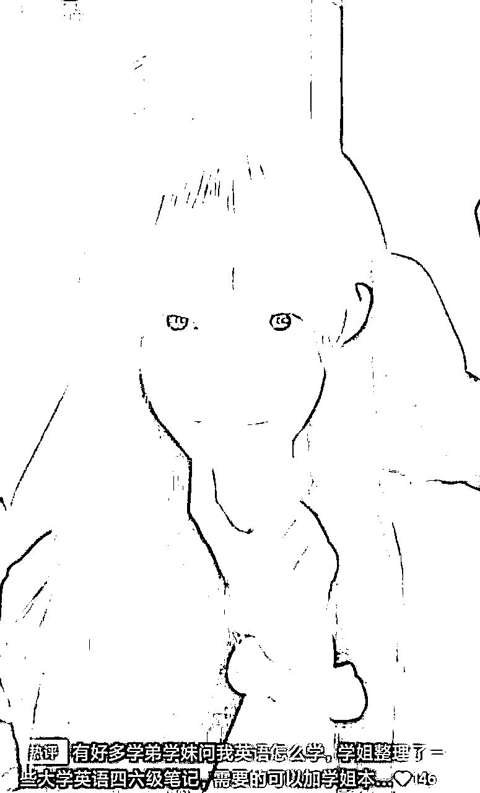

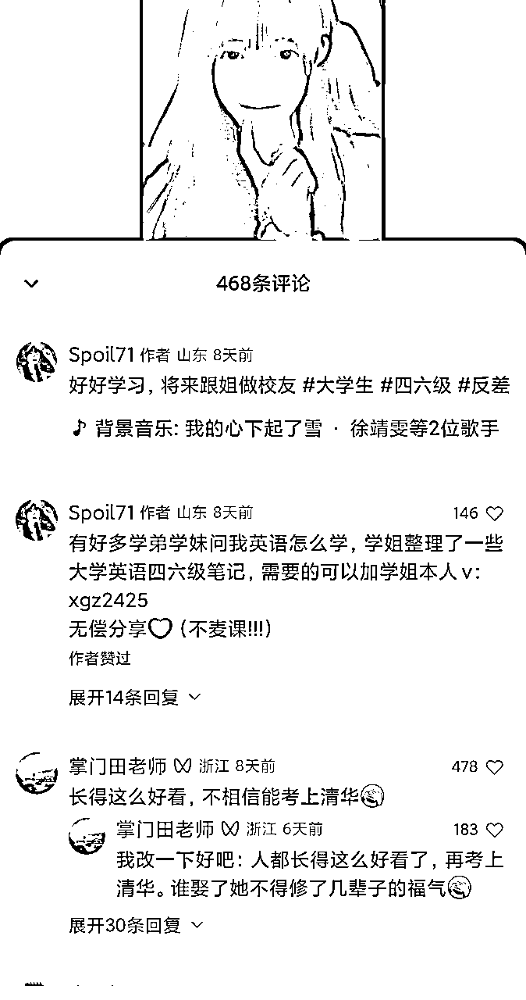

c.情感复合

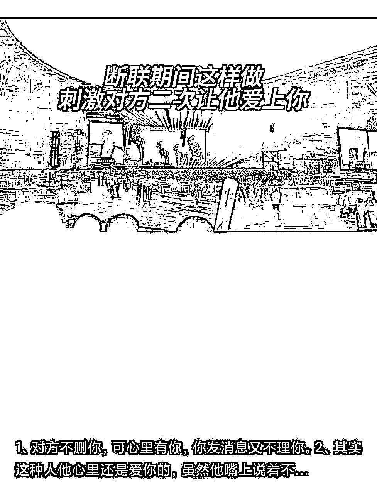

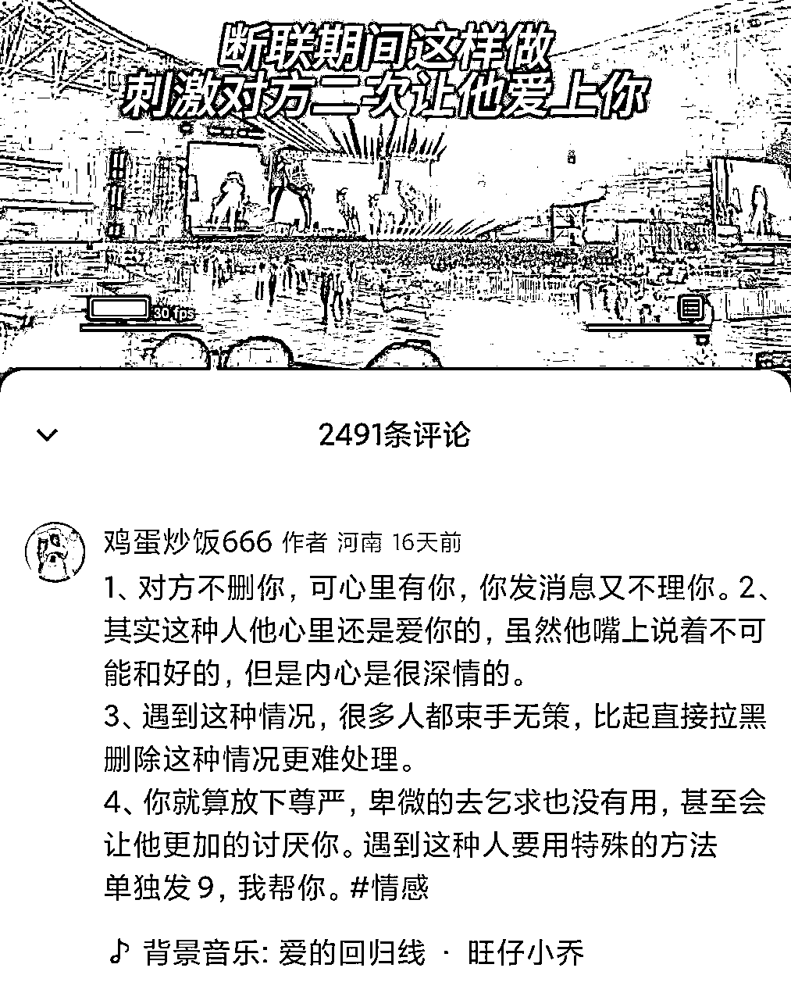

d.对比拍摄，引发学习差人群共鸣，展示别人羡慕的生活让观众代入，最后亮出收入数字，让用户觉得自己也能做到

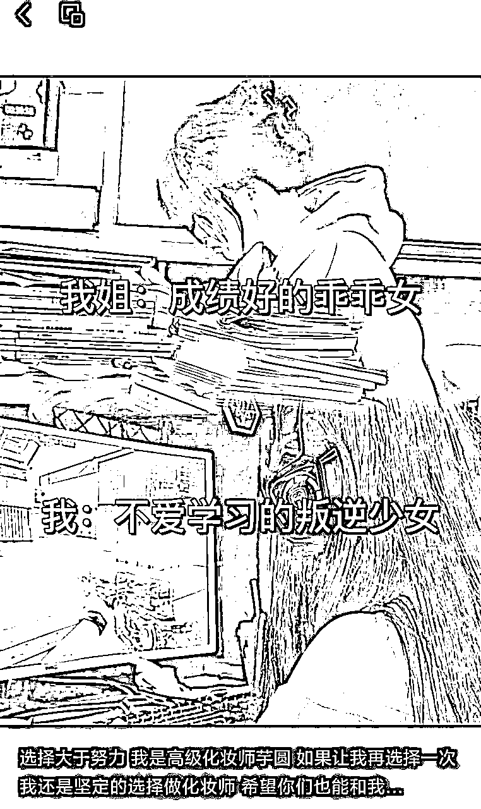

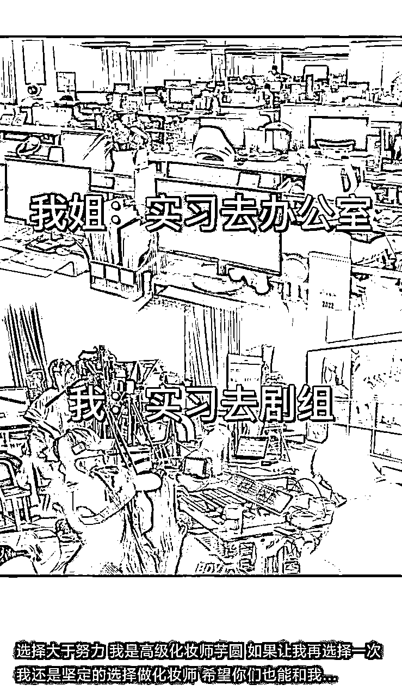

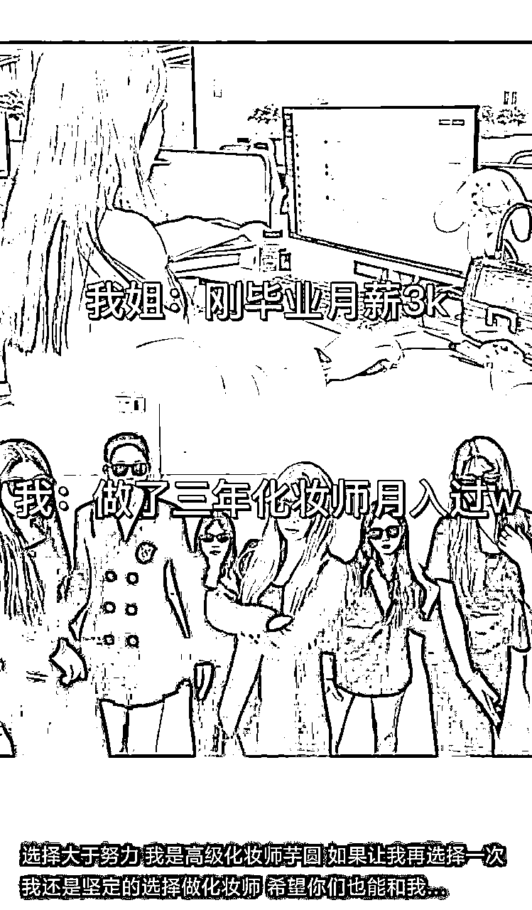

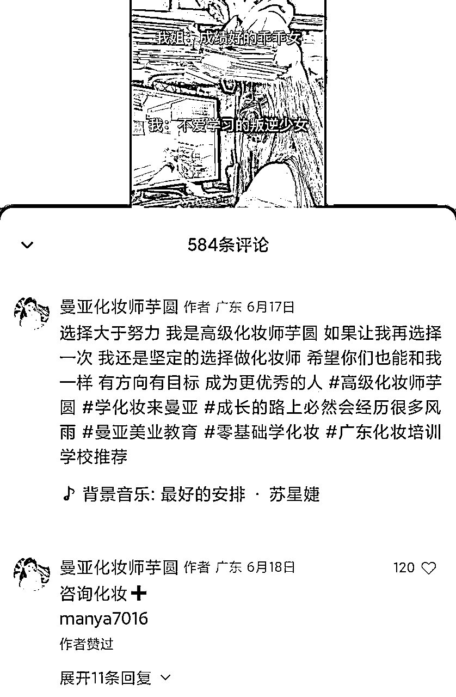

## 3、封面停留的原理是什么

因为是图文内容，用户看不懂图，只能看标题。标题钩子够强就会引导评论，评论区一旦有互动，停留自然就上来了，再引导私信到V号完成转化。

## 4、代发方案

账号问题可以靠代发解决。目前正在对接代发系统开发，后续可以统一管理代发资源，对接兼职人员发笔记，从根源上解决没账号、没权重、设备不干净的痛点。

敬请期待..