# 节日营销怎么玩？七夕一天收入四位数，摄影师变现复盘拆解

怀着一点忐忑启动这次七夕写真项目，算是我一次新的合作尝试。过程中踩了坑也拿到了结果，今天把完整的思考和操作方法整理出来，希望能给同样在做个人变现的朋友一些参考。

主题就一个：怎么用节日营销的思路，让七夕做到日入四位数。

我把复盘分为三部分来讲：

【1】节日营销为什么值得做
【2】一场节日活动的完整执行链路
【3】能稳定变现的四个底层思维

# 【1】节日营销为什么值得做

01 给下单制造一个正当理由
节日本质上就是一个营销锚点，和双11、618是一个逻辑。借势做活动，客户更容易说服自己“现在买正合适”。

02 集中收割存量与增量用户
我大概每三个月会集中做一次这种中型campaign，目的就是批量成交。平时我更偏向做内容做自然获客，活动期冲一波，日常就佛系维护。这样精力分配更高效。

03 用活动做裂变蓄水
成交只是结果，裂变才是复利。这次我设计了一个抽奖写真机制，让成交客户去撬动他的社交圈，为下一次活动提前囤种子用户。

# 【2】节日营销的实操流程怎么做

### 1）活动前准备

##### 1-文案储备
先把能用的话术和场景写好，特别是产品使用场景和情绪价值的描述。

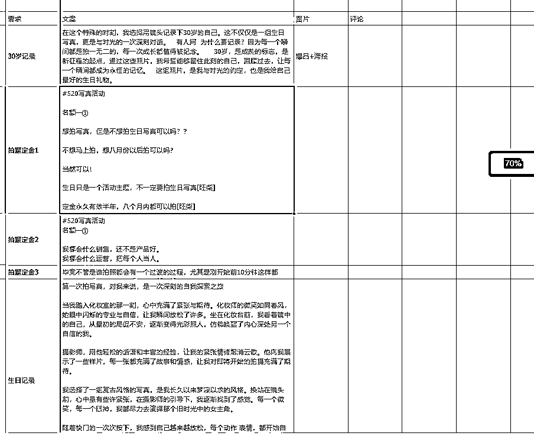

##### 2-朋友圈素材包
卖摄影其实就是在卖一张图，视觉说服力第一。素材包要包含：

前后对比：
让用户直观看到“做了之后能变成什么样”。购买决策很大程度上是被视觉冲击驱动的，前后差异越明显，下单欲望越强。

用户反馈：
消费者更信身边人而不是商家广告。把真实客户的评价、感受晒出来，信任感会直线上升。

你的背书：
大牌找明星代言的本质是借势背书。同样，我会定期拍摄百万级博主，既提升品牌调性，也给潜在客户一个心理暗示：这么多人选择，品质应该没问题。

个人故事：
人是情绪化的动物。把自己的真实经历透明化，客户的了解度越高，转化率越高。我以前对麦当劳无感，后来看了《大创业家》这部电影，瞬间对品牌产生好感，后面就成了优先选择。这种由故事带来的偏好，就是品牌力。

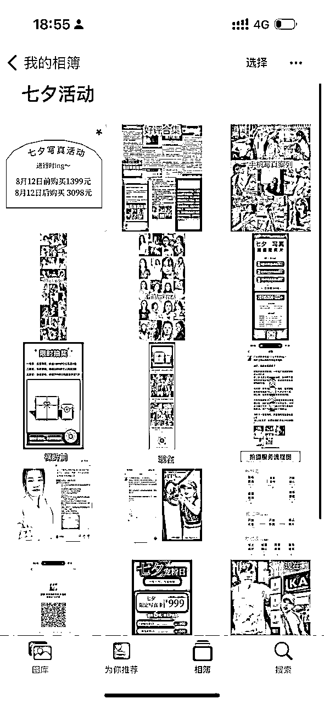

##### 3-私信话术分层
销售要精细化，老客和新客的话术必须分开。

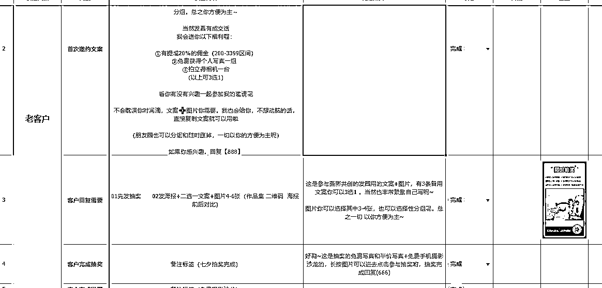
比如对老客/信任不足/消费力一般的客户，我的核心目标是引导裂变。

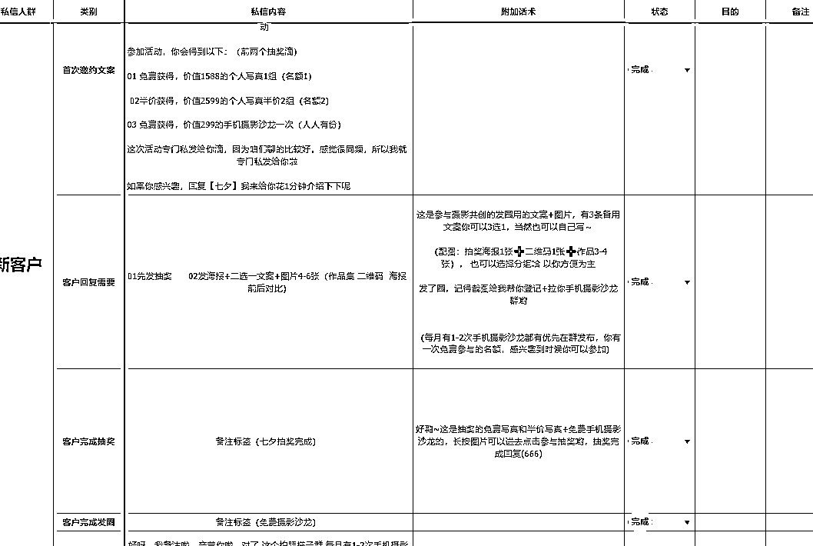
比如对新客，我的核心目标是引导成交。

##### 4-抽奖机制设计
这次活动的双目标是裂变+成交，所以必须有一个诱饵。我设置的诱饵是：免费写真+半价写真+免费手机摄影沙龙。只要参与发圈，人人有份。

1）免费写真名额x1
主要用来引流。参与方式很简单，发一条朋友圈。不动声色就能每天带来10-20个新增好友。

2）半价写真x2
这是产品转化入口。中奖后引导到半价购买，价格优势明显，下单率很高。所以平时价格可以留有活动空间。

3）免费手机摄影沙龙参与发圈就有份
给到参与者即时获得感。5个人来和20个人来成本几乎一样，我把它打包进活动，参与门槛更低。

抽奖流程搭建：
第一，目的明确+用户需要付出什么

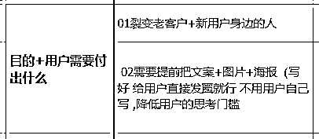

第二，用户能得到什么

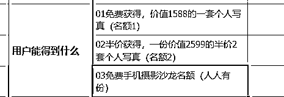

第三，抽奖注意事项

根据奖品类型自行拟定即可

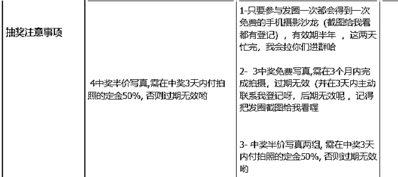

第四，建立抽奖群
01群公告：把规则写清楚，用户进群就能自助了解，减少售后沟通成本

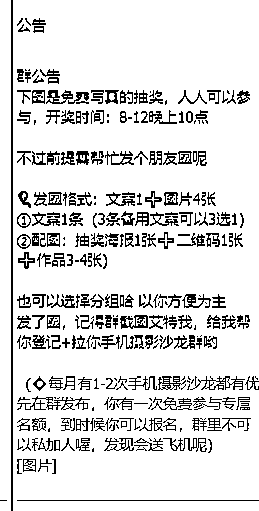

02发圈素材包：文案1条+配图4张
①文案1条，备选3条自选
②配图：抽奖海报1张+二维码1张+作品3-4张
全部准备好直接交付给用户转发即可

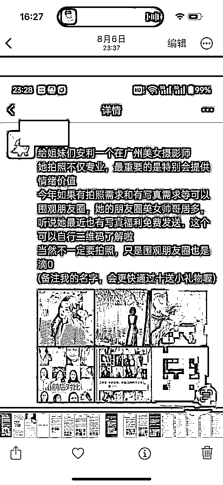

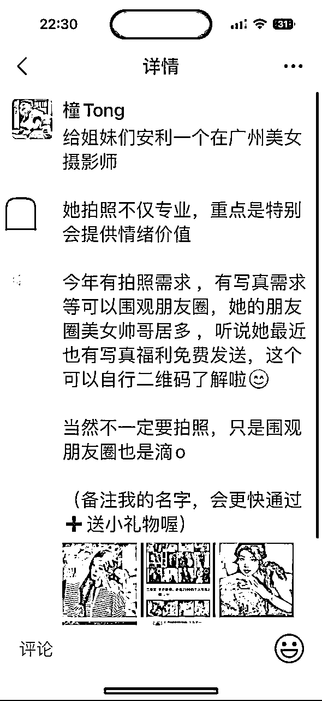

##### 5-营销海报
卖产品就是卖海报。海报要极简，优惠力度、用户收益、流程保障必须一目了然。信息越少，犹豫越少。

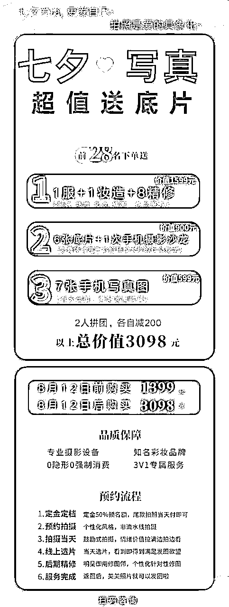
准备工作到位后，后续就是复制粘贴发圈，省心又省力。

### 2）活动中执行节奏

##### 1-整体路线
预告——正式发布——收单——素材轮播——倒计时收官

前3天每天发3条朋友圈左右，稳定预热。
后4-7天可适当提高到4-7条，建议发布2小时后再设为仅自己可见，避免骚扰感。

预告：

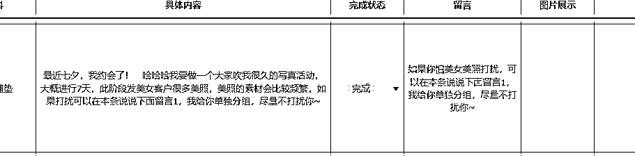

正式发布：

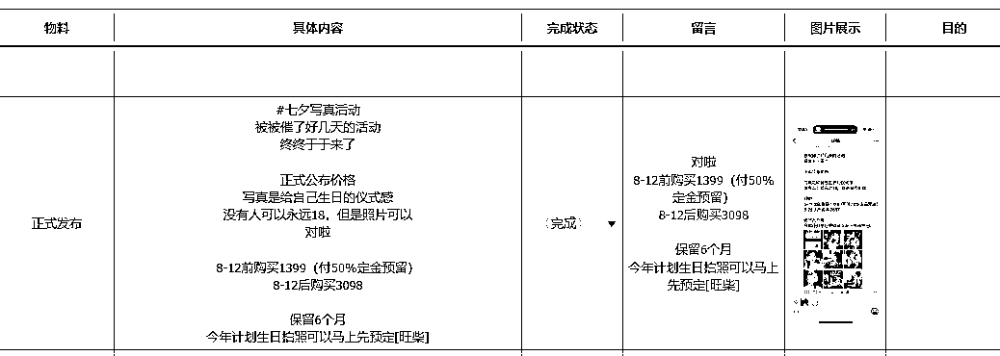

收钱+素材轮播：

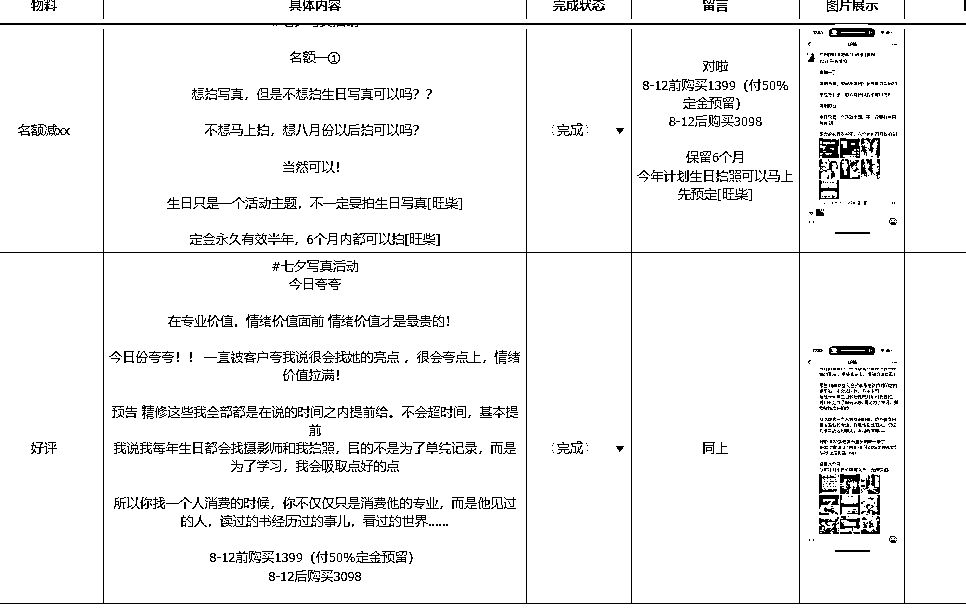

倒计时收官：

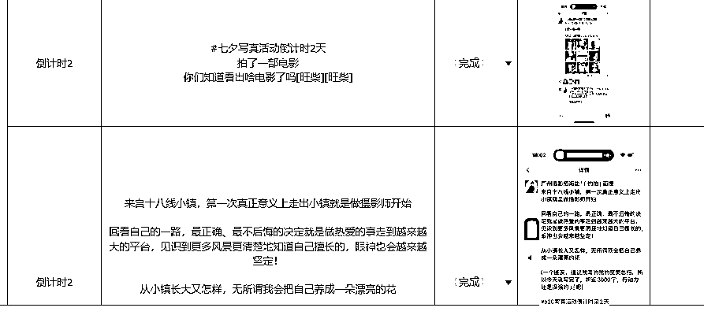

##### 2-时间窗口
6-8天是最佳周期。太短声量起不来，太长用户容易疲劳。

### 3)活动后沉淀

##### 1-素材沉淀
这次从想法到落地只用了1-2天，就是因为有上次活动的SOP沉淀。短视频、朋友圈的开头、中间、结尾、音乐、音效，这些框架复用后，下一次直接从60分开始做。

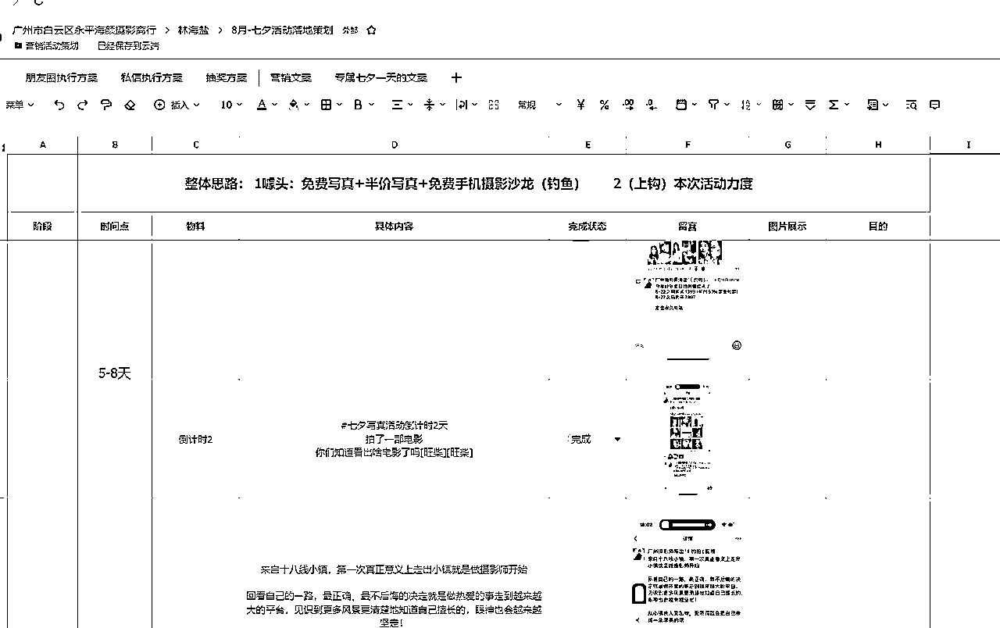

##### 2-复盘沉淀
时间管理的本质是做成一对多的事。这次活动结束后，我把复盘整理后发到3k+人的会员群，再同步到付费星球，瞬间触达上万人群。一鱼多吃，复利最大化。

# 【3】日入四位数，我用到的四个思维

#### 1-学会合作，格局就打开
这次我担心自己坚持不下来，就在赚钱找到一位朋友一起复盘合作。起初只是聊聊需要什么帮助、提成怎么算，很快就达成了配合。

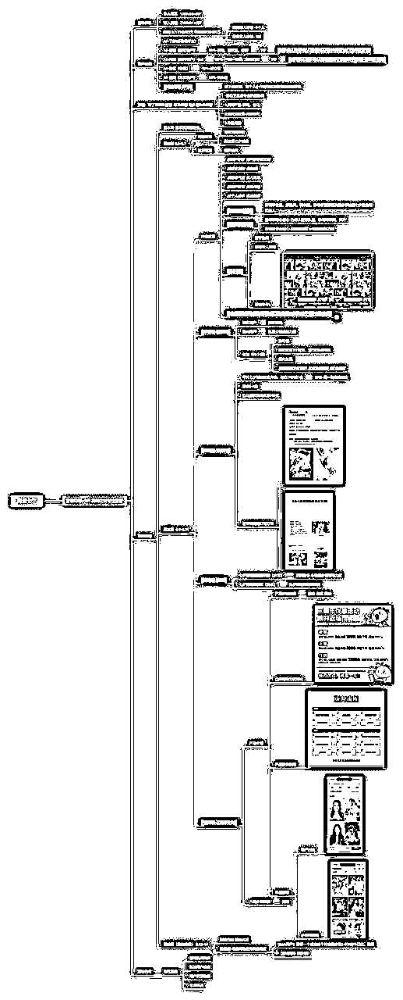
对方帮我做了完整的思维导图，拆解特别细。收获两点：
第一，有人监督就不会躺平，尤其我没有团队时，外界的推动很重要。
第二，用数据看结果，不靠感觉判断。

他给我的复盘框架，让我能清楚看到问题点和增长点，针对性优化。

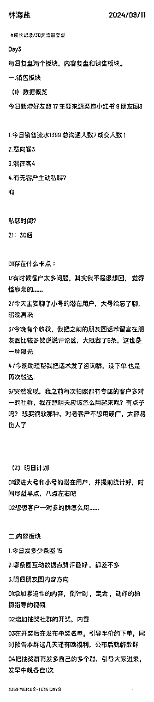

#### 2-用标签做精细化运营
活动需要群发，标签没做好就会发错人群，造成反感。所以我开始重视🛰️好友的精细化管理，后面整理了批量打标签的方法。

【批量做标签的教程】
4.33 复制打开抖音，看看【鲁修修的作品】怎么给🛰️好友分组？🛰️好友怎么打标签？ 6000... https://v.douyin.com/irhG79Kc/ d@A.tr 04/23 oQK:/

个人建议：不推荐用工具批量清理，容易泄露客户信息导致客户被骚扰。手动批量删除更稳妥。

#### 3-谈单万用模板
意向客户咨询→挖掘需求→明确痛点→给解决方案+过往案例。屡试不爽。

#### 4-后置重流量，前置找专业做转化
活动本身做得很顺，但我的核心瓶颈是用户量不够。下半年我打算借助玩赚合伙人的群发售形式来做转化，我专注做流量，专业的人做成交，单位时间效率更高。

#### 5-培养种子用户，降低转化成本
平时我主要做一对一风格诊断，这次活动我尝试做免费的一对多诊断群，比如穿搭、发型、写真角度等美学相关的内容，主要作用是蓄水养粉。

下面是变美社群的框架

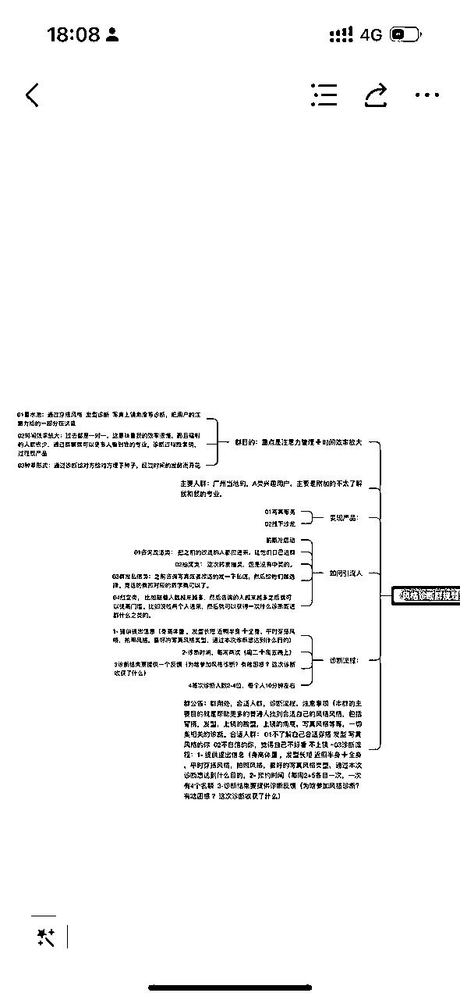

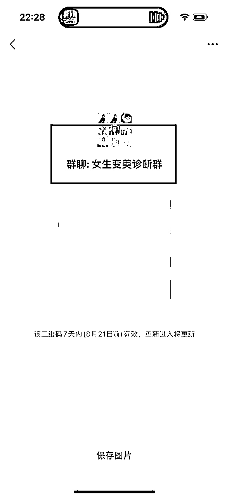

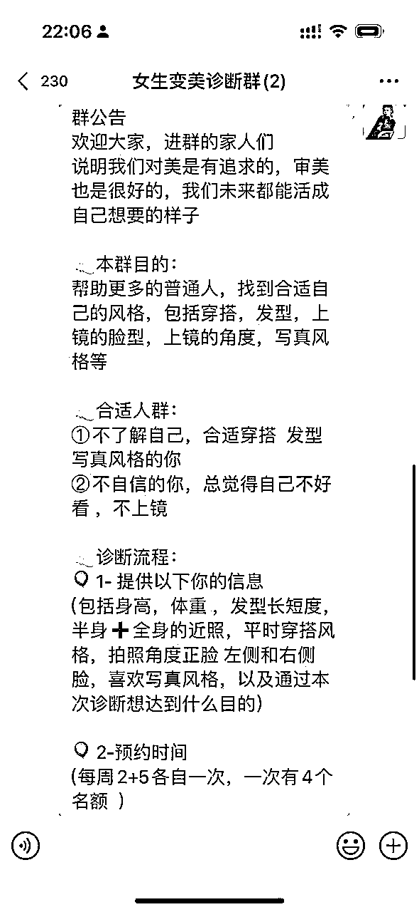

以上就是这次七夕变现的完整拆解。

希望大家都能实现品牌自由、时间自由。

欢迎加我朋友圈，一起交流审美与变现。