# 视频号赛道风向标：洞察行业动态，深扒账号背后爆火变现原因

7天拆了110条视频号风向标，我整理出这些关于变现的真相

我是龙哥，刚从为期7天的视频号风向标挖掘营结营。下面这份内容，是我把郭晓文老师在直播里点评优秀拆解的逐字稿，重新梳理后的版本。主要包括：视频号现在还行不行、拆解作业的三个关键问题、不同类型账号的赚钱逻辑，以及晓文老师给我们的几句寄语。

这一期圈友们一共提交了110条风向标，其中30条被评为优秀，4条被精选命中，优秀率约27%。很多伙伴正在学着拓宽视野，站到更高的视角去全面收集信息，挖出一个账号能爆火变现的原因、哪些点可以复制、哪些地方值得对标——这本身就值得点赞。希望这份整理也能帮到做视频号的朋友，谢谢大家。

## 现在做视频号，还行吗？

先别急着下结论：你没看到，不代表它不存在。

- 拆解视频号风向标有个天然优势：你亲自动眼去看，这一步就已经跑赢了不少人。
- 赛道还没定下来的时候，找对标会很难。与其焦虑，不如把时间花在“开天眼”上，把能看到的视野都铺开；这个技能练得越熟，你想看到更多东西的难度就会越低。
- 等你的方向慢慢垂直下来，视野范围也能跟着收窄，集中在一小块内容里，就不再需要长期花大量时间找对标。

## 拆解作业，关键回答三组问题

第一组：我要怎么跟？——具体要做什么事？难度怎么样？我要付出什么代价？

第二组：我要不要跟？——我靠什么赢？如果感觉对方也挺一般的，我有没有机会赢过他？另外，有些需求就算我自己不喜欢，只要它真实存在、有人愿意付费，也值得纳入考虑。

第三组：我该怎么跟同行竞争？——如果我跟不上、赢不了，或者不想用他那种方式，我能不能另开一条路？真正下场之后，会不会有一些我之前没注意到的细节，其实是致命的？

这里要说清楚：任何拆解，再专业、再细致，都不可能做到绝对完整准确。没被选上，不一定是你拆得不好，也可能是拆得晚了。

晓文老师还有几句寄语：

- 不要学会拆解之后，非要等“拆得非常细”才肯动手。
- 永远没有准备好的那一天。你不可能站在岸上，就把水底的礁石、困难，以及要花多少时间全部看清楚，然后确定自己一定能赢。
- 拆解的意义是提高准确率和成功率，不是保证绝对胜利。要接受仍然可能失败的概率，多试错，才能找到真正适合自己的赛道，心理上要有底。
- 如果你现在对视频号还没有清晰认知，也拿不准自己该做哪个板块，那么建议去打卡群里，把每位圈友的对标都好好看一看。

## 美食号拆解

标了💪🏻的，是晓文老师精选出的账号。

### 楠哥美食记（拆解人：คิดถึง李ྉ洪ྉ树ྉ）

账号橱窗累计销量2.3万件，客单价9.9到19.9元；最近直播有出单，两天橱窗销量差额100多单。开通橱窗2年，一共只发了29条视频，第一条发布于2023年10月29日，每天更新0到1条。

引流主要靠直播，内容是直播做菜并讲解做法，满足的是用户“不知道每天吃什么、不会做菜、想提升厨艺”的需求。转化路径是直播间挂车，用调味料、现成的食材和厨具来承接“厨艺不精、做菜不好吃”的人。

同类账号可参考：沈小厨教做菜、王二教做菜、李哥教做菜、美食探寻家、川妹子教做菜。

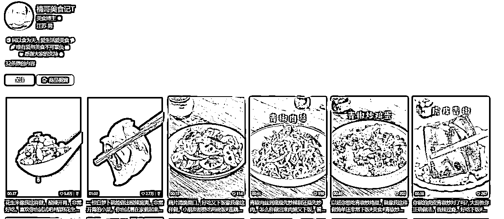

**晓文老师点评：** 这个号前期是公司摆拍，最近重新开始更新，把菜谱和带货内容结合起来。视频有的挂车、有的不挂车，核心提供的价值是教做菜，但没有立起人设，更像纯菜谱。短视频流量很高，大多是为直播赋能，直播后续还需要继续观察。

思考分析：

1. 它提供的价值是什么？——满足日常做饭的需求。
2. 账号凭什么吸引人？——持续输出干货，给到大家解法。
3. 变现效率可能并不高，具体能赚多少，要蹲直播间看数据。

大家可以通过直播热卖数据，估算单场变现，同时评估几个问题：拍摄成本怎么样？我能不能做出这么好的饭菜？我能不能拍出同样好的效果？实现这件事我的成本是多少？如果和厨师合作，成本又是多少？

然后算两笔账：一场直播大概播几个小时？根据热卖数据能卖多少钱、赚多少钱？商品橱窗每天的增长数据是多少？扣掉直播带来的部分，就能看出短视频自然流量每天能卖多少货，进而估算账号的利润。

如果不赚钱，说明转化率低、免费看的人多。但这不代表赛道本身不好，还可以继续观察。拆解账号时一定要多找几个同类对比：为什么有的变现好、有的变现差？为什么画面看起来都差不多的账号，流量却一个高一个低？这些问题是值得大家去想的。

### 星星偷走睡意984（拆解人：追风少年02）

橱窗总销量3635件，开通橱窗才3天；发了8条视频，第一条发布于2024年8月10日，每天发3条。引流路径是短视频把流量引到直播间，再开播带货。视频用炒虾的画面吸引平时做饭的人，真人模拟酒店大厨身份，用色香味俱全的画面呈现菜色和味道，解决“自己做的白灼虾和炒虾味道一般”的问题。等视频跑出流量后，就开直播挂购物车成交，卖的是避风塘调味料包。

同类账号：甜甜的家常菜（带货2年108天，销量2万）；可可乐乐7969（开店113天，销量368）；粒粒吖123（开店4天，销量636）；开心果幺幺灵（开店12天，销量285）；小花食谱（带货191天，销量47件）。

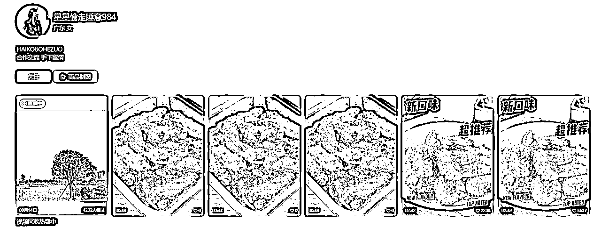

### 西施美食记（拆解人：小白）

橱窗开放了73天，带货11万件，按客单价19.9元估算，不到3个月GMV约200万；最近两天橱窗销量差额5000单左右。账号共发85条视频，第一条是2024年4月26日，每天更新1条。引流方式是短视频带货，完全不开直播。

它吸引人的点在于“在家就能做的应季美食”，满足的是“有颜值又好吃的菜怎么做”的需求。开头用成品美食的画面冲击力拉高3秒完播，用原材料采购价格做互动，让目标用户下意识比价，制作过程中还会用1到2次固定话术引导互动。转化靠短视频挂车，用低价和对美食的冲动促单，产品就是不同应季菜品的制作。

同类账号里，林先生爱美食、雪梨爱美食、津津有味爱美食、依依美食厨房、梅子美食记，都是同一家公司做的。

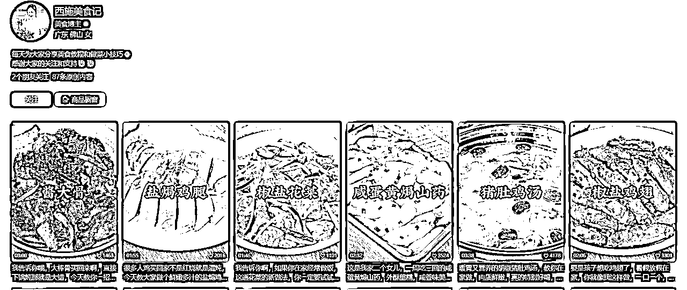

**晓文老师点评：** 有人觉得抖音能火，视频号就能照搬成功——这个还真不一定。西施美食记这个号，反而很有意思。

思考分析：

这个账号和前一个账号的区别，在于它会结合当下的生活场景，比如“暑假千万不要让小朋友吃外面乱七八糟的烤肠”，一句话就把人群圈定了。之前的账号只提供信息，有人把做饭视频当解压视频看，但对创作者来说，这种泛流量没有变现价值。它更进一步：先告诉你“孩子在外面吃不健康，所以你要自己做”，或者“现在到什么节气了，所以你应该怎样”，一开始就用内容筛选出精准用户。

真人出镜本身也在传递信息，比如“大棒骨买回来直接下锅炖，那就是大错”，用这种反常识的说法吸引你对比收看。同样是有人做菜，但多了表达、多了更丰富的信息和价值，转化率提升的就远不止一点。所以这个账号值得持续关注。

### 杨家美食记（拆解人：风雨）

橱窗跟买9671件，累计接近1万件，客单价在29.8元到9.79元之间；最近两天销量从9671涨到9754，等于一天卖了83单。开通橱窗200多天，发了197条视频，第一条发布于2023年11月9日。前期每天1条，最近每天3到5条。

引流靠短视频录制做菜过程，目标人群是家庭主妇和家里做饭的人。内容满足的是“普通食材、简单步骤，也能做出好看又好吃的家常菜”的需求，配合文字字幕、轻快音乐和操作步骤，不会刻意往橱窗引流。转化主要靠橱窗成交，简介里写了一句“视频同款产品在下方商品橱窗”，卖的是蒜泥蓉酱、豆豉、凉拌汁、剁椒酱等调味品。

同类账号：雪梨爱美食、萌妈爱美食、津津有味爱美食、小默爱美食、苏酥美食。

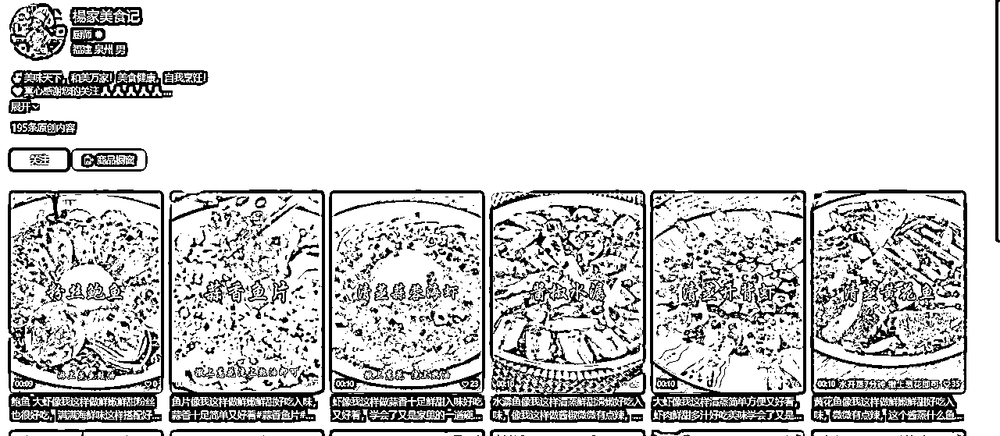

### 💪🏻孩儿他姥姥A（拆解人：悟风）

这个号被晓文老师精选出来。橱窗累计销量31.2万，客单价20元；8月7日短视频排行榜第4，热力值7780。橱窗开放了1年60天，发了417条视频，第一条发布于2023年5月31日，每天更新1条。

引流方式是短视频挂车加橱窗。吸引人的点在于手巧的姥姥在镜头前做美食，解决的是家长不知道每天给孩子做什么菜的问题。它给出的菜不仅卖相好、味道好，还很看重营养，而且学起来不费劲。这个需求背后，是很多家庭做菜太单调、孩子不爱吃。转化路径是短视频挂车和橱窗成交，卖海带、红糖、牛肋条、调料包等，核心卖点是：用这些产品做出来的菜好吃又有营养，孩子能补充营养，父母做起来也省事。

同类账号可以看：母女美食记（带货214天，销量818）、雪吖超爱吃（带货1年37天，销量19.5万）、乐乐美食&教做家常菜（带货159天，销量3091）、佳味美食厨房（带货234天，销量5.8万）、木子爱美食&每天教做家常菜（带货45天，销量5202）、豆爸的饭和菜（带货3年116天，销量4.7万）。

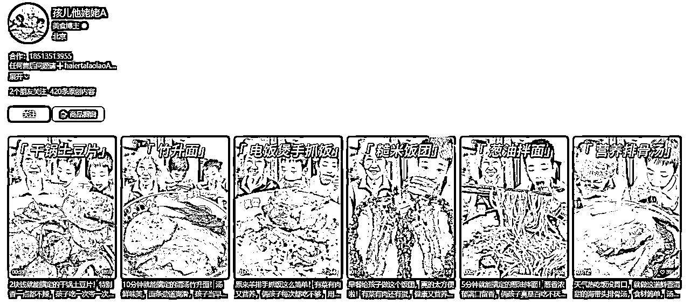

**晓文老师点评：** 封面丰富、人设强。视频是女儿拍的，主角是姥姥，对象是孙子，转化率很高。

思考分析：

场场都爆，有没有诀窍？其实就是内容有竞争力。只要视频足够好，大概率能爆；文案就算不是自己写的，只要找对了方向，表现力也可以碾压市面上其他用同款文案的人，大概率持续自然流爆。想常常爆，就多花心思琢磨内容。

这个账号和前面账号的区别是什么？前面的妈妈只出镜，没有人设；这个账号的姥姥也出镜，但形象非常立体——很会做饭，很疼小孙子，从举手投足、和孙子的互动，以及和女儿的平等关系里，你能看到这个人的人品和价值观。这是典型的人设+干货驱动。

前面妈妈号没有人设，开播时不一定有多少人愿意进去看；姥姥号一旦开播，进去的人是不是会更多？西施美食记和小燕有话说在某种程度上都是演员，只是把知识表达出来；而孩儿他姥姥A是把“人”的部分放大，属于人带货，观众容易相信她，能带的货类型也会更多。

晓文老师还把美食号分了三个层次：

1. 纯输出菜谱的类型，转化低、没有粘性，比如楠哥美食记，2年带货3.8万。
2. 真人出镜、普及干货知识，除了菜谱还告诉你必要性，把具体场景套给你，吸引的人群更精准、转化率更高，比如西施美食记，77天带货11.7万。
3. 立人设，让人喜欢和羡慕一家人生活方式，把自己好的生活状态放大，甚至有一定粉丝加工成分，但核心是她本身就是这样，带的货更广，转化率也更高，比如孩儿他姥姥A，1年63天带货31.6万。

## 三农特产号拆解

### 白菜GG（拆解人：薄荷Heidi）

橱窗累计销量105.6万件，客单价59.9元；8月6日短视频排行榜第11，热力值7328。橱窗开放了1年111天，发了266条视频，第一条发布于2021年1月8日，每2到7天更新一条。

引流方式包括短视频挂车和企业🛰️。吸引人的点在于市场摆摊、接地气的产品，以及那种亲和力——“别人家有文化的农村孩子”。满足的是用户对新鲜、原生态、纯手工、熬制、配料干净、止咳润肺等产品痛点的需求。内容上，开头用挑战式钩子，比如“用多少钱买到什么，再摆摊卖出去”，制造悬念；封面用“相信99%的人都没有……”“你见过/知道什么吗”这类句式勾起好奇心；瘦弱白净的女生挑担子的画面有亲和力；她还善于和人打交道，去山里收农产品、助力农品、带动村里老人工作，这些细节激发了利他和慕强心理。个人IP标签也很清晰：干净有亲和力的笑容、95后大学生、乡村守护人。

转化路径覆盖流量主、短视频挂车、直播挂车、橱窗和私域；卖的是村里农产品，包括枇杷膏、童年味道麦芽糖、本地干货。

同类账号：

- 福哥三农：三农科普，拍自制枇杷膏全过程，点赞531，带货销量1.4万，同一款枇杷膏产品250g/4罐69.9元。
- 客家茶香：手作科普，拍自制枇杷膏全过程，点赞3.5万，带货销量76.6万，同一款枇杷膏产品133g/5盒19.9元。
- 厦门阿波：旅游助农，拍源头产地枇杷膏制作，点赞5000+，带货销量112.9万，同一款枇杷膏产品250g/4罐69.9元。
- 天健美食坊：美食科普，拍自制枇杷膏全程，点赞8000+，带货销量8604，同一款枇杷膏产品300g/1罐19.9元。
- 李福贵11：摆摊VLOG，拍“挑战多少钱批发再卖出去”的过程，带货销量2537，带货99天，同样选题“三农摆摊”。
- 小芳海鲜原产地：摆摊自营，带货销量22.4万，开店147天，同样选题“三农摆摊”，内容关键词涉及摆摊、美食、生活、三农、新农人。

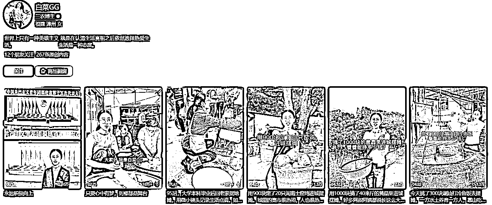

**晓文老师点评：** 这是一个大V，对大多数小伙伴来说参考价值不高。但如果你对这种形式感兴趣，还是可以做的，因为三农是国家非常鼓励的方向。

思考分析：

- 凭什么吸引人？用挑战性的内容抓眼球，比如“挑战用20元给小孩做一份很好的两菜一汤”，然后拍摄整个过程。设定一个目标，留下一个悬念。
- 凭什么成交？在完成目标的过程中，她完成了对人设的营销，包括真诚待人。这份真诚非常吓人，比任何专业技能都更打动用户，以后可以带很多类型的货。
- 如果你的老家在县城、又有拿得出手的特产，那这类玩法很适合下定决心的人去试，当然要根据自身条件来。

### 牧飒小店（拆解人：hhk）

橱窗开放了301天，累计带货1.3万件；销量最高的单品卖出9000多件，销售额70万元；昨天短视频排行榜第6。账号只发34条视频，第一条发布于2024年4月30日，每天更新1条。

引流方式是短视频带货加👸号。短视频主打地方特产，比如宁夏枸杞，满足养生类需求；人设走实在路线，强调原产地直发。转化路径是短视频挂车和👸号二维码引私域，核心卖点是产地直发、保证产品品质，让用户买得放心、不需要过多验证；产品就是当地特产，比如枸杞。

同类账号：那个阿源ya（带货307天，销量422）、厦门芬兰（带货2年84天，销量4.3万）、羊羊羊新疆干果（带货341天，销量7732）、福建大乔（带货2年，销量2.2万）、小魏枸杞（带货1年317天，销量6767）。

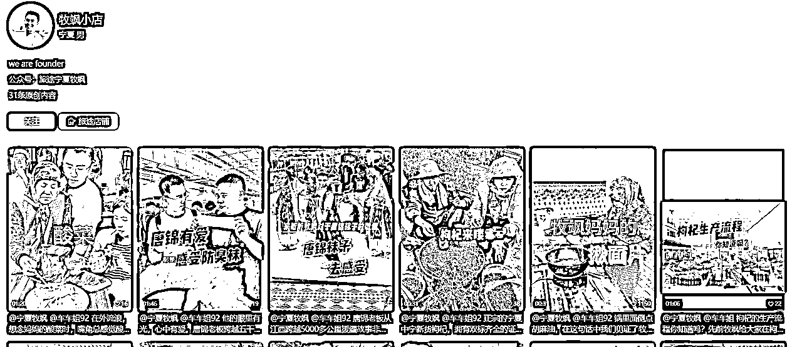

点评

最近在梳理视频号的带货案例，发现不同品类几乎是两套打法。同一类特产可以反复深挖做出销量；把情绪价值加进普通干果也能卖出情怀；还有人抓住军训窗口期，一条腰带就能破百单。下面把几个典型账号的思路拆开讲，干货型内容记得收好。

先看特产的复盘逻辑——围绕“他家土特产”持续做内容。

以枸杞为例。先从种植、晾晒、分拣的全流程入手，教用户怎么挑好货；再讲食用场景，八宝茶里为什么要放好的枸杞。需求感自然就有了。接着在不同吃法、不同组合上不断延伸，反复拍，单品累计1.3万单。

拆开来看：
1、产品到底强在何处？凭什么在我这买更划算？——工厂直发、原产地操盘人设，我更懂行。
2、枸杞能怎么用？——能入菜能冲饮。
3、具体怎么用？——我手把手教。
4、用在什么场景？八宝粥适合什么人群？——需求被搭建出来，购买理由也就成立了。

安吉白茶也是同款打法。视频号用户吃原产地叙事，吃专业科普。

再看小崔呀168。

橱窗开通171天，累计销量4.5万，葡萄干单价15至40。已发52条，日更1-3条，全员挂车。定位是返乡创业大学生，开头放悬念，主打新疆产地直发、健康安全绿色。核心需求是吃得安心。

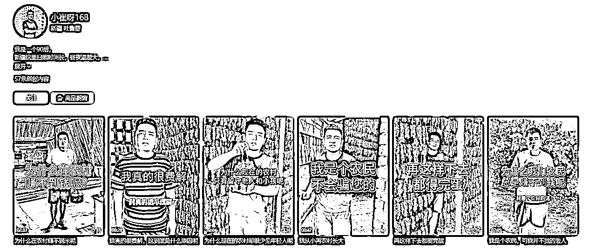

点评：半年4.6万单，除了产品本身，还叠加了情怀。靠情绪去撬动——比如“质量输给了价格”、“我们农村人万万没想到的还是”，再输出“勤劳致富”的价值观。有卖惨也有煽动，很多人为情绪买单。

思考分析：
1、葡萄干为什么要靠情绪推动，枸杞却不需要？枸杞在中老年群体里是常识性刚需，关键在于说服“为什么选我”。葡萄干不是日常刚需，需要唤醒共鸣点，情绪是最直接的杠杆。
说服用户接受一个新品类，就像知识付费一样，钱不是最大阻碍，是用户不习惯为内容付费，所以转化难度大，对信任要求极高。

2、为什么知识付费类内容都要做情绪？因为要先制造焦虑，再在情绪上做功。没有焦虑就没有购买冲动。市场上多数知识付费并不在干货深度上竞争，而是在焦虑制造上竞争，这才是最有效的。
卖大米就不需要情绪，只用强调产品本身，用户已有认知。

接下来是古时.技艺。

橱窗销量8330，客单价40，开通420天，发210条。用稀奇古方做钩子，以年长者演示土方制作和使用流程，满足中老年对传统偏方的好奇和养生诉求。转化是橱窗+引流私域，私域对接免费养生课，筑信任后引导下单。

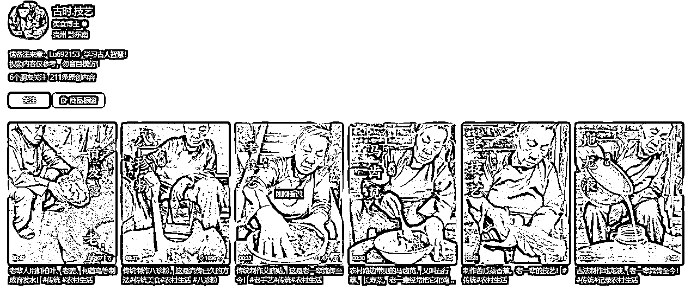

点评：在传播传统文化的同时顺带成交，赛道偏传统，可作参考。

再拆育儿赛道小燕有话说。

橱窗销量2.4万，客单价30左右，最近一周三条进榜，热力值约7000。用街头采访形式真人出镜，解决孩子提分、人情世故等痛点，科普中挂车学生类图书和经典读物。

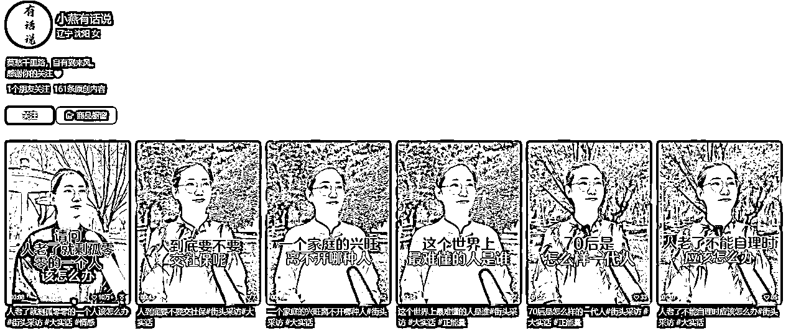

点评：街头采访为主，内容以科普为主，科普里顺带成交，基本节奏是2-3条吸量视频配1条成交视频。

思考分析：
1、对口播型创作者有借鉴意义：找一个表达力足够的人，再匹配文案。
文案怎么来？
①去抖音快手找已爆款文案
②用更强的演绎能力碾压
要么开新战场，要么演绎碾压，占住其一就能赢。

2、类似账号很多，情感、育儿方向都可以用街采形式。关键是把背后需求挖掘出来，用这个表达形式去承接即可。

3、做品有两条路：
①科普涨粉涨权重，爆发后用高风险品+强营销文案快速收割，号也会丢，持续养号。
②安全文案起号+安全品长期变现。

黑马案例初高家长圈。

橱窗才开两周，发44条，从7月17日启动，销量已到3.5万，客单价9.9至49.9。精准卡位孩子军训场景：口播科普军训准备清单，短视频+直播带弹力腰带、芦荟胶、防晒喷雾、鞋垫。博主形象偏教官，早上八点开播连播到晚，产品可视化强。

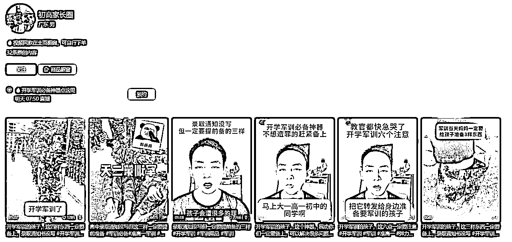

点评：先把人群圈定、权重養起来，再在这批人喜欢的品类上做科普，顺带成交。20天前转向此方向，单场军训腰带就卖600多单。

思考分析：
1、账号内核是什么？——当下热品+精准人群文案。
①先圈人、養权重，再选一个当下最火的刚需点——开学军训，所有内容围绕军训展开：为什么要准备？要注意什么？需要什么？
②单场腰带600单，说明踩中热点。

2、运营逻辑：特定人群的特定需求我来满足。需要产品解决就卖货，不需要就纯科普筑信。
该号就是纯品类内容运营，也被验证可行。

3、同品类是否拥挤？如果弹力腰带没有被专职深耕，就有入局机会。
①拍摄成本低
②教官人设好立
可当风向标参考。

投放型案例一生文学9527。

橱窗开8天，发11条，销售额40万，客单价39.8。开头用名人提问“一个优秀父母的最高境界，就是这招能征服孩子”做钩子，3分左右切入《49天成为教育高手》，覆盖孩子沉迷游戏、写作业拖沓等典型问题。成交靠短视频挂车+橱窗。

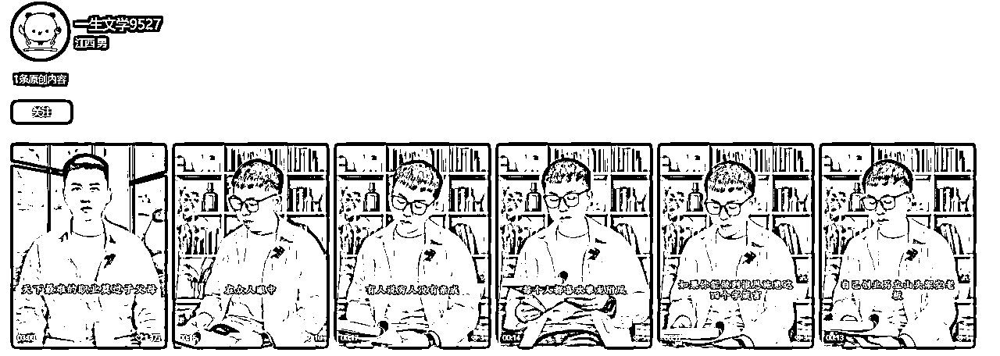

点评：大概率在投放，供投放玩家参考。

思考分析：
1、投放玩法：用爆款开头满足完播，但视频号要原创，所以中间会插入转化素材或真人出镜，真人出镜多放后段，只为提升原创度。
2、怎么判断投放？试投🛰️豆，若秒过且无需二次审核，多半之前已投，加投素材不会重复审核；若进入审核或秒拒，多半无投放。
3、类似楠哥美食记，不直播，视频成本低，干货带货结合，批量生产，200多天卖2万单。频繁带货夹干货不掉权，挂车转化可观。

低成本运动品小淇爱运动吖。

橱窗33天，发64条，销量1382，客单价138-349，预计GMV30万。孩子在家玩跳舞毯、音乐拳击靶，快节奏音乐+文案“爷爷奶奶/外公外婆送礼物”，解决沉迷手机问题。出镜即产品，评论区+直播引导。

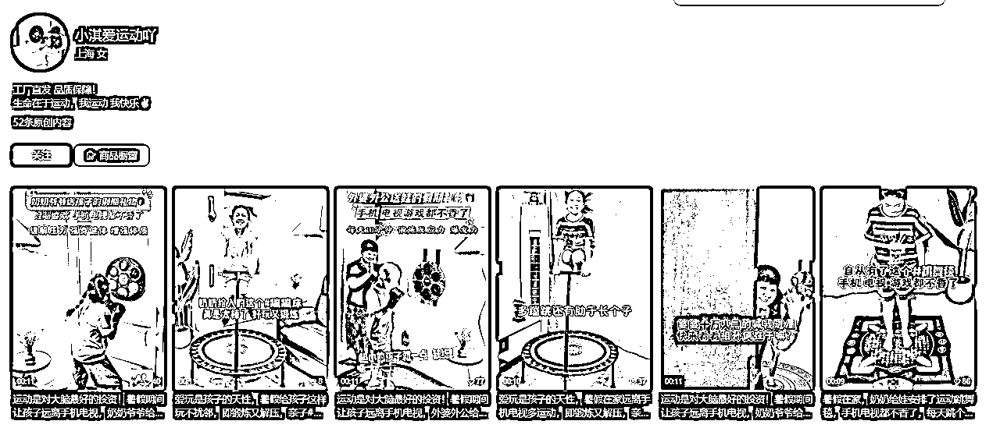

点评：面向让孩子多运动的家长，单品千单左右，拍摄成本极低——展示使用即可，通过不同文案刺激不同送礼人群，如“假期礼物”“手机电视游戏不香了”。围绕少数SKU持续输出，类似羽毛球类也吃“爱运动”心智。

思考分析：
内容尽量别做反人性的事。拍摄成本高，比如一周去一次现场，预期高但很难稳定打磨，坚持不下去。
小孩在家就能一晚拍几十条。三农也一样，场景就在身边，素材随手收。
所以要选适合自己的场景。别固定一个地点反复拍，要多换场景避开同质化。

有IP属性的千宝爱学习。

橱窗269天，发191条，销量3.5万，客单价25-200。母女对话形式，女儿抛学习卡点，妈妈用教材演示解决方法。覆盖小学初中各科，如《初中满分作文》《半小时晚读》。转化靠挂车、橱窗、评论区。

该号日常数据平平，但“虎妈”人设+真实互动很有看点。展示我的育儿方式，如果刚好能卖就卖，不能卖就当干货送。满足偷窥欲——大家都爱看别人家怎么教。

思考分析：
1、有IP的账号都和生活强相关。IP的雷点在于“演”。演出来的生活一旦被识破就塌房。
2、当下更吃朴素IP——把真实生活轻度美化放大上网。
3、为什么有人看？因为我在某个角色上做得比别人更好。育儿上我更有方法，关爱老人上我更上心，痛点抓得更准，方案更具体，天然就有吸引力。
别死磕百岁老人、适老化产品。做IP的本质是，你在现实里就活成了IP，真正持续关注一群人的需求，并在某个角色上做到比同行更好。

[PRE*]注意：文中...是素材中保留的标志，这里全部保留，没有遗漏。希望对你有启发。

视频号的变现窗口已经完全打开，并且呈现出非常清晰的规律：用短视频做种草、用直播做成交、用低价高频产品做信任搭建，再用私域把价值做大。以下案例拆解就是验证。

**英语音标课 — 家庭教育空白的补位者**

账号用9个月时间，累计投放248条视频，首条发布于2023年7月14日，日均更新保持在1条左右。沉淀下来的橱窗带货总量达到9733单，其中单价89.9元的音标课程就卖出8269单，累计收益预计约74.3万元。5月底至今不到80天，销量又新增近4700单，销售额约42.3万。

引流上是短视频+日常直播的组合，核心卖点是把音标讲得大白话。解决的是三个痛点：学校几乎不教音标却很重要、普通家长没有英语基础难以辅导、不到百元就能系统学习。博主本身是名校英语专业出身，每天稳定直播建立信任，真诚教学推动转化。转化路径是短视频引流到直播间成交，靠高性价比课程和完整体系打动家长。可参考的同类型账号有英语雪梨老师、鲸鱼说英语、英语十七老师、谐音英语学习、MrYang杨家成唯一。

点评是典型的单点需求下沉，音标这一个小而确定的刚需卖出9000多单，基本无退货，纯知识付费很稳。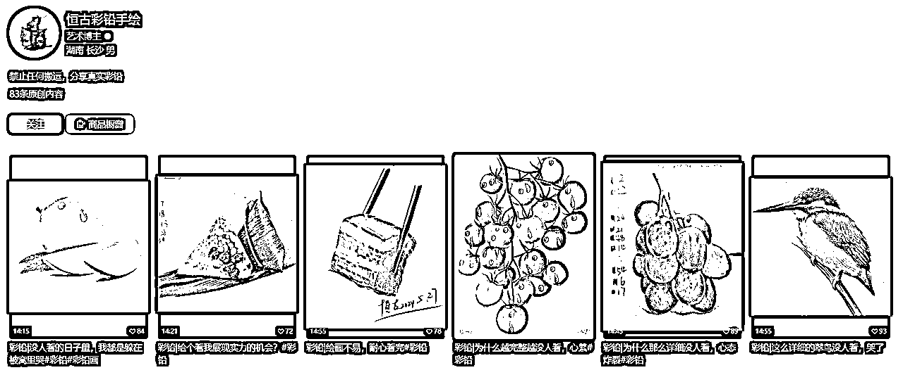

**彩铅手绘 — 1元体验课做客资盘活**

账号恒古彩铅手绘，橱窗开通1年288天，共发135条视频，2022年7月14日开更，平均一周更一条。跟买人数2.1万，体验课客单价1元，累计销量1.4万单。近期直播每小时能卖百十来单。

引流依赖直播+回放，用1元15天15节课的钩子，额外告知用笔和技法，前20名加送3天。满足的是想学画画、提升技巧的人群，承诺关注即学到精髓。转化在直播间挂车，不满意可退，定位自己是伯乐而非赚钱。后续把低价体验课的客资导向高价课程，公司多以几十到两百的人头费回收客资。类似账号包括凌锋彩铅手绘、彩铅技法教程、博洋绘画特训营、彩铅素素手绘、画笔随心小陈老师枍林。

点评：店铺2.1万单的体验课本质是获客工具，后续升单才是利润点。知识付费的声量大跌不必全信，用眼睛看数据更重要。

**中老年运动健康 — 痛点直给+低价装备**

王教练谈中老年运动，账号橱窗49天，发布53条视频，2024年6月22日首更，日更1条。整体带货1.3万单，客单19.9-29.9元，直播20多分钟阻力圈从241涨到259单。

引流靠短视频+直播，短视频用健身教练形象对着老年人说膝盖受损下楼梯腿抖的问题，用橱窗里的阻力圈演示改善。找到中老年人下楼梯不便的真实焦虑，也让子女共情。转化在直播间由小姐姐口播，强调3点半发货、售后保障，话术偏循环但成交稳定。同类账号如甜姐专注锻炼、先贝爱生活、潜潜爱运动、喜哥运动健身、王教练中老年锻炼。

点评，账号流量主要来自短视频而非直播。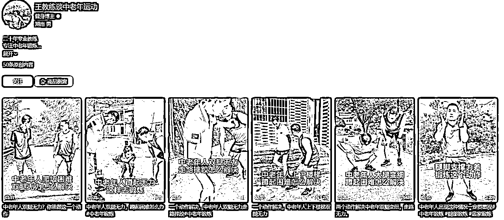 短视频的核心是把痛点和误区直接摆出来，拍摄成本低，受众基数大。不卖高价康复课，而是卖抗阻训练必用的低价用品。做这一赛道要做得比搬运更懂表达，掌握技能才能长期赚钱，合作思维也很重要。

**十三姨爱运动888 — 中年女性减脂场景化**

账号2024年7月19日开通橱窗，26天内橱窗销量5765单，客单价33.9元，累计约19.5万。共发275条视频，2024年7月8日首更，日更10条。

引流用短视频+直播，核心文案围绕爷爷奶奶买的、每天20分钟拒绝赘肉、被丈夫嫌弃、40岁退休大妈。满足的是中年女性减肥需求，用水桶腰、大肚腩、被嫌弃的现实引发焦虑，再给出20分钟暴汗、室内一人就能完成的方案。转化路径是短视频引流到直播收银台，突出简单快速容易。可参考大号王小羽羽毛球、腿腿羽毛球，新号可可妈爱运动等。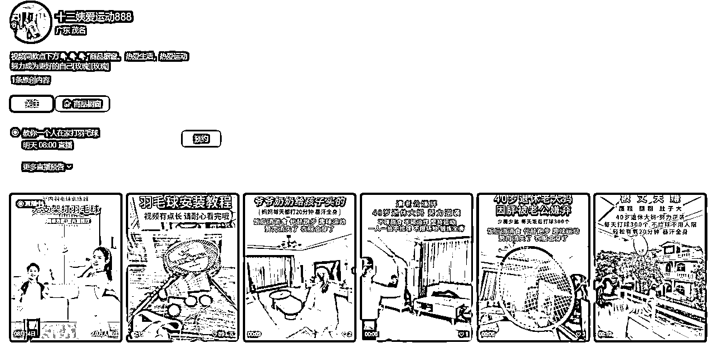

**读书账号 — 反差信息快速成交**

文丘ALlen，橱窗开通88天，变现约27万，跟买人数8300，带货销量9168单，单价25元起，佣金25%起。发102条视频，2024年4月19日首更，日更2条。引流靠短视频讲解书籍，抓历史社科类常识反差点塑品。转化靠短视频挂车，用户在好奇后直接下单购买书籍、付费咨询或课程。同类有新知书库、秋雨爱读书、李一季、文墨居.、子曰东鹤。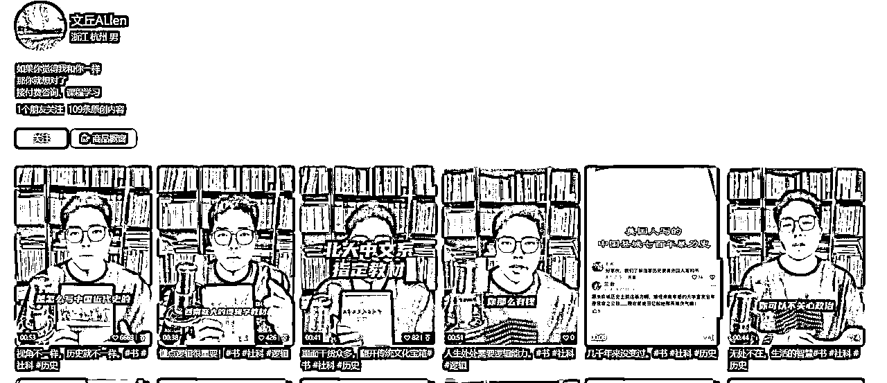

读书吧阿葱，橱窗开通347天，橱窗销量2.5万。发420条视频，418条原创，2023年9月2日首更，由最初2-3天一更到现在日更3条。未出镜，实拍书籍+解说，让读者直观感受到内容和质感，解说简练留有余味。转化以橱窗+短视频挂车为主。可参考思想者书单、木子多看书、听久读书、爱读书的阿峰、寒轩在读书、北海读书。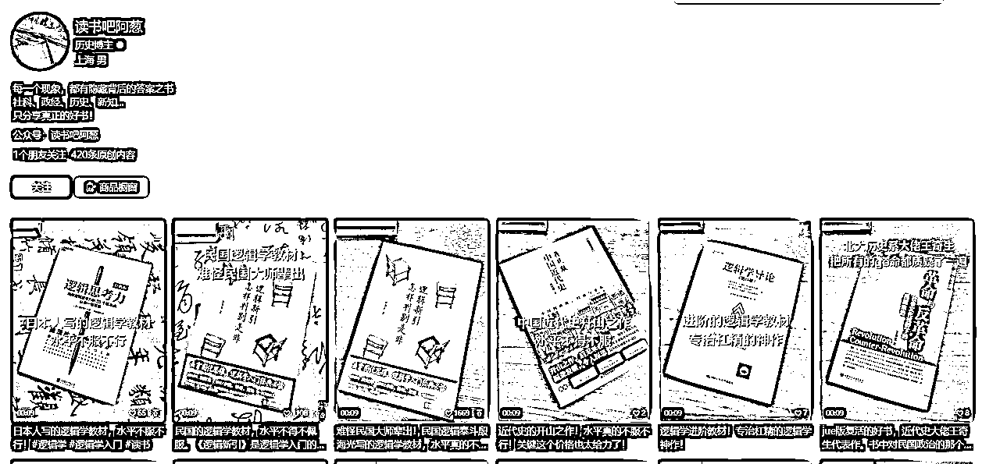

点评：文丘ALlen三个月卖近万单，变现可观。口播稳住权重打标签，切片带货快速转化。账号不一定要口播到底，混剪也可以表达信息，关键是不断测试形式，找到最能转化的模板。

**人物志类 — 故事钩子导流书籍**

九星人物志，橱窗开通111天，带货3373单，客单36元。发22条视频，2024年3月30日首更，日均不足1条。直播场观1万，约成交580单。用短视频+直播引流，以“他才是中国真正的顶级豪门”等黄金三秒讲伟人富豪故事，满足用户对传奇人物、伟人外传的好奇。转化靠短视频挂车+直播挂车+橱窗，产品是书籍。同类矩阵号有清风人物记、笔尖人物记、名家说、浅忆人物、千风人物记。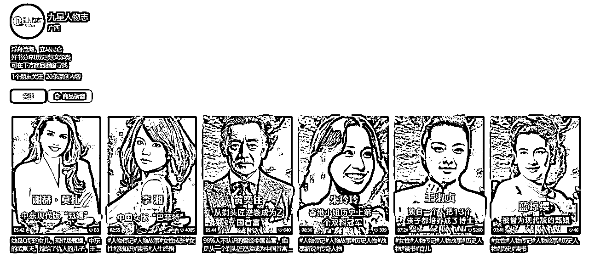

**宠物账号 — 焦虑开头给解决方案**

豆包的可爱卷，橱窗开通64天，客单29.9-49.9元，累计约1万单。发92条视频，5月1日至7月4日间发了10天，7月4日起日更1-2条。引流靠短视频，围绕养宠人群做护理和驱虫内容，用开头制造焦虑联想到自家宠物，再给方案。转化靠视频挂车，解决预防生病、突发问题。可参考柯基小毛豆、汪大头与爸爸快乐时光、边牧见见、一公子和大饼子、豆包和卷卷。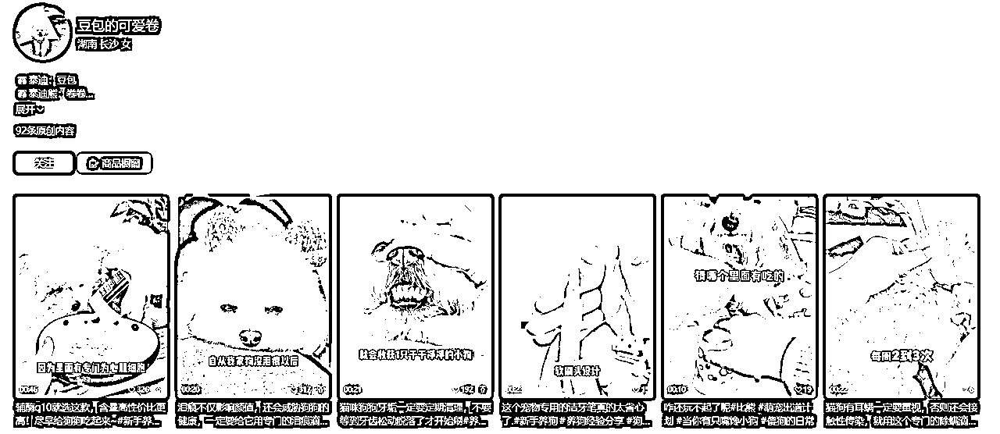

李老师-宠物指南，橱窗开通90天，变现11.76万，跟买人数2.2万，带货销量2.4万单，单价9.8元起，佣金50%。发340条视频，2024年5月8日首更，日更3条。用养狗经验做短视频，输出防虫喷雾等喂养解决方案，转化靠短视频挂车和橱窗。同类有宠物专家-刘院长、科学爱宠小百科、李孟老师宠物科普、宠物营养师王蕾、张老师-宠物指南。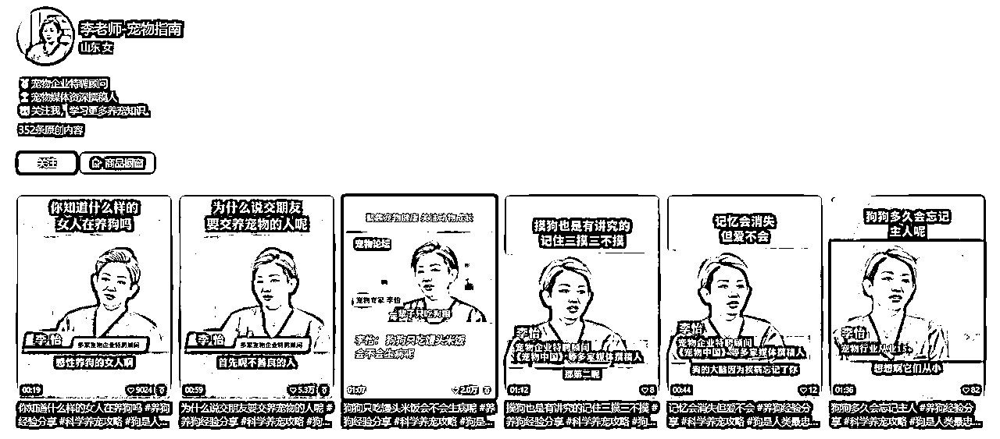

总体来看，视频号知识付费和带货是可行的，并且在向服务化、全域化演进。短视频做触达、直播做信任、价格做门槛、私域做复利，这套组合在不同细分赛道反复得到验证。

很多人问：这类账号到底是有“人设”，还是真在做人？说实话，演员属性大于IP属性。哪怕给自己叠了一堆人设，本质也只是信息传播者。再说到变现，想靠账号出单，多数人走的都是功效品、擦边内容，靠刺激痛点+过度营销促成成交。可这种打法极易违规，要么做好违规封号和矩阵账号的准备，要么就走扎实的IP路线。

下面拆几个视频号正在赚钱的账号，看看他们怎么操作。

一、情感口播：梦秋的秋

梦秋的秋，橱窗开了96天，发了227条视频，2023年12月25日开更，几乎每天1到3条。橱窗总销量2210单，客单价平均30，销售额6.63万。内容主打情感疗愈和关系处理，用温柔的口吻讲情感困惑、心理疗愈，吸引那些心里有结、需要被开解的人。变现路径很清晰：短视频里穿插带货，橱窗成交，个人简介里放情感咨询和商务合作。卖的东西主要是人物书籍、养生品和护肤品。同类账号可以关注：乐语讲情感、鱼书-雁信、情感大帅哥、元哥如是说365、星愿之语。

点评：情感需求在中老年女性里非常旺盛，她们也真的愿意为情绪价值付费。口播不必非得正襟危坐，办公室、车里、户外都可以拍，关键是找到能让你松弛、又适合你的场景，多试几次。情感是个泛需求，后端可以接咨询、课程变现，但前端其实也能卖衣服、首饰、口红——女性要活得漂亮，要把日子过成自己想要的样子。每个赛道都值得深度验证，但如果验证后还是持续不起量，就要果断换表达方式，别一条道走到黑。

二、故事认知：娇总认知 & 贾老师讲事儿

先看娇总认知。变现20万+，橱窗开了53天，发了279条视频，2024年6月17日开更，每天1到3条。跟买人数1.9万，带货销量1.9万，单价19.8到49.9，佣金率50%起。玩法是短视频起流量，直播间承接带货。真人出镜，穿得正式考究，天然增加信任感；内容用简单易懂的小故事讲人生智慧，故事还和卖的书籍强相关。转化靠短视频挂车、持续直播，评论区也会挂车提醒下单。同类账号：智慧人生之光1、童童亲子日记、亚总生意经、見山书苑、诸葛-智慧人生、石老师有话说、老李说国学、岩哥讲底层、天天朗读、处事锦囊。

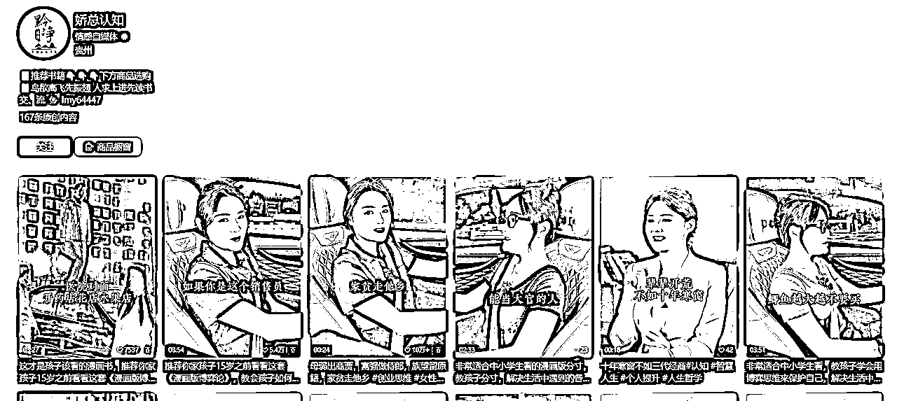
再看贾老师讲事儿。橱窗开通50天，跟买人数8889，商品销量过万但具体数据难跟踪，所以用跟买人数佐证变现能力。账号共有136条视频，原创12条，3月6日发第一条，每天更新4条。内容围绕潜规则、商业逻辑、为人处世，用故事教人赚钱和做人。人们爱听故事，又有提升社会经验的需求，他用故事类视频吸粉固粉，再间接插入带货。转化路径包括短视频挂车、橱窗成交、评论区贴商品。套路是先讲一个需要情商的故事，分析人物，再引到书本身，说这本书能提高处事能力，卖得自然而然。商品以情商类、计谋类书籍为主。同类参考：墨香书院、智慧锦囊、聪聪书语、强者智慧宝典、小龙哥有话要说。

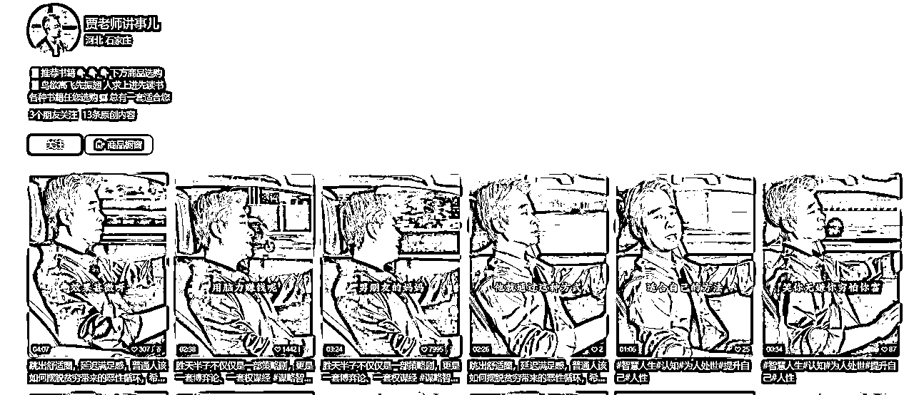
点评：娇总认知和贾老师讲事儿，和采访号本质一样，核心还是演员。关键在于文案选对，人群找对，需求明确，再决定用哪种呈现形式。你以为的户外真实场景，很多都不是真的，可能就是在车窗户上贴块绿幕。这类账号卖育儿类产品，瞄准的是慕强的女性用户。

三、老人服饰：金六指服饰

金六指服饰，橱窗开通363天，发了897条视频，2023年2月3日开更，最近每天3条。橱窗出单39.3万，客单价19.9到59.9，近期单日10到30单。引流靠短视频+直播，内容直接喊出中老年穿衣需求，风格也符合视频号中老年用户审美。转化方式是批量发视频+直播促单。产品优势很直白：价格便宜，颜色鲜艳又不俗气，正好打中用户心理。

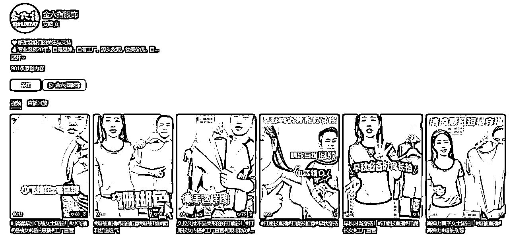
点评：视频号退货率没那么高，这号聪明在全选不过时的标准品，反复做、反复拍、反复直播，直播内容再切片复用，这套路很有参考价值。生产成本低，中老年需求在视频号是巨大的。

四、其他账号：雏菊1355、扬清激浊伊主任、二哥有点暖

先看雏菊1355。橱窗开了85天，只发了12条视频，2024年8月7日开更，每天4到5条。橱窗销量3.7万，客单价9.9到29.9，平均佣金约25%，按19.9计算佣金约18.4万。直播间看过1302人，热卖203件。卖的是开学姓名贴，精准解决孩子东西拿错的问题。短视频引流到直播间转化。这是标准的打品玩法，这里不细拆。搜索“校服经常拿错”，还能看到一堆同品类账号，比如火火呀er、游惊龙6、田老弟玩具仓、金金19980、田家甄选、告白手工。

再看看扬清激浊伊主任。这是一个退保法律服务矩阵，60多个号联动，经常出爆款，评论超500，转发超2000，评论区全是精准客户。客单价几千到几万不等，需要线下电销+网销团队转化，好在客户留资精准，转化率很高。最近两三个月效果明显，线下还扩了团队。账号没有橱窗，全矩阵每天产出100多条视频，年初开号，单个号每天更新2到4条。引流靠短视频和直播。需求很明确——退保。普通用户自己退保会被百般刁难、退赔率低，他们有专业法务团队做针对性调解。转化路径是视频号留资，线下电销+网销跟进，法务团队做交付。可以说，卖的是律师垂直团队。🛰️搜“退保”，视频号前几的账号基本都是他们家的，例如法律援助老王等。

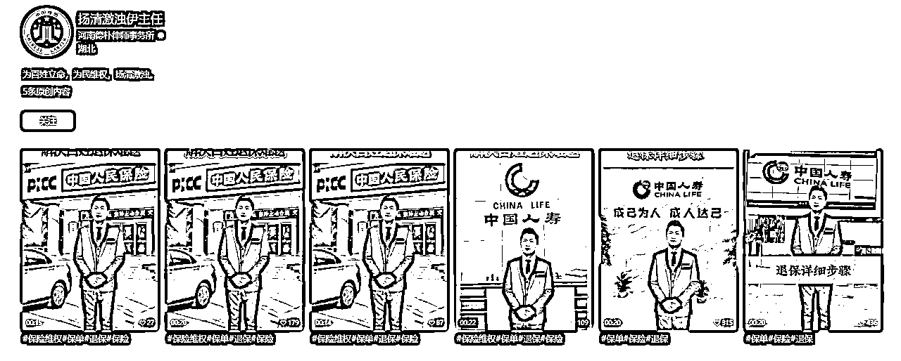
点评：数字人玩法，多用于引流，这里不细说。

最后看二哥有点暖。橱窗+直播，总带货销量97.6万，客单价40左右，GMV约3900万。8月12日那场直播，观看人数超5万，客单价低于100，卖家具日用品、小食品为主，直播第一名酱牛肉单价69.9元，累计卖了6104件。橱窗开了1年24天，215条视频，2023年7月20日开更，每天1条。引流靠短视频和直播。内容是宠妻人设，全是日常生活场景、夫妻对话，很多视频点赞10万+。满足的是女性对另一半的期待，等于给所有老公立了一个模板。表达以男主口述为主，传达爱老婆爱家。转化靠橱窗、直播、短视频挂车。同类账号还有纹子和奔儿总，是女老总和软饭男的人设，但没开橱窗，貌似只接商务。

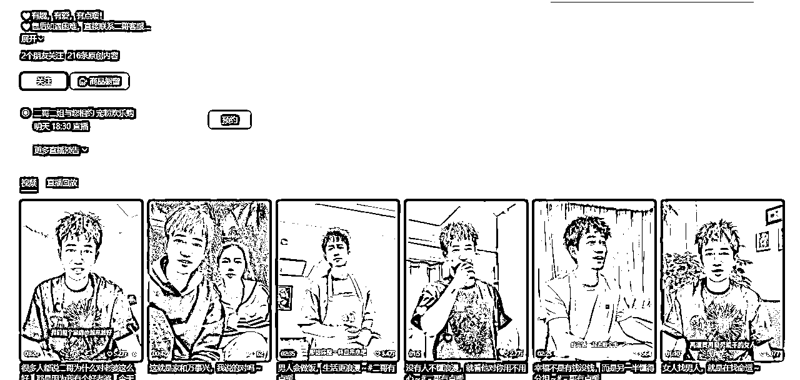
点评：这是宠妻个人IP账号，不是机构孵化的，就是自己做起来的。怎么做更好的老公？本质上是因为接住了别人对另一半、对儿子、对老公、对老婆这些角色的期待。只要满足期待，就能吸引人，然后借着这份信任带货。

写在最后，晓文老师有几句话送给大家：每天自己留意一下中标风向标，不用花太多时间，也能持续获得“视频号上谁在赚钱”的体感。继续找，继续看，把眼界打开，此刻没看见不代表它不存在。视频号潜力很大，我非常看好，接下来会全力投入视频号。欢迎大家加入我们，一起执行、抱团，把这波机会抓在手里。