# 月销三千万的草根裂变：一个普通团队如何带出上千接班人，登顶微信视频带货榜单

各位生财圈友，我是孟_MENG。2023年9月，我们几个人刚开始做微信短视频带货时，干的还是剪辑搬运的杂活，万万没想到后来会一头扎进素人真人出镜卖货的方向，一路把月销售额做到了数千万元，孵化出超过1000位出镜卖货人，还在微信视频带货团长的排名榜上坐上了头把交椅。

不少朋友读过我之前分享的《视频号口播带货爆单14w像素级拆解》，也顺势进入了这个赛道，有人已经拿到了不错的结果，有人直接成了我们的合作主播。说句心里话，能走到今天这个规模，真正离不开生财有术这个大环境和各位圈友的信任加持。

今天这篇内容，我打算从一个普通创业者的视角，聊一聊我对微信视频生态机会的判断、团队作战模式如何被验证，以及我们怎么从零起步、实现十倍跃升、最终做到月销售额数千万。同时也会打开天窗说亮话，把这个项目现在遇到的瓶颈、以及我们从未在人前讲过的软肋，一并摊开说清楚。欢迎各位拍砖探讨。

## 先把成绩摆上桌

空口无凭，先用一组数据说话——下面讲到的每个字，都是我们从泥土里一步步踩出来的，不是纸上谈兵的蓝图。

- 微信视频真人出镜卖货的头部团队：现已培育出1000多位出镜带货人，其中卖得最猛的一位，光是一个月的佣金就拿到了235万。

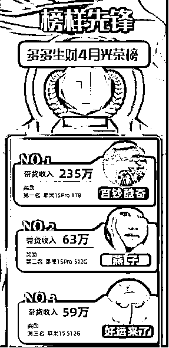

- 在微信视频带货团长的排行榜上，我们高峰期的月销售额突破3000万。进入7月后勉强维持在2000万上下——红利确实在肉眼可见地消退，这部分后面细聊。

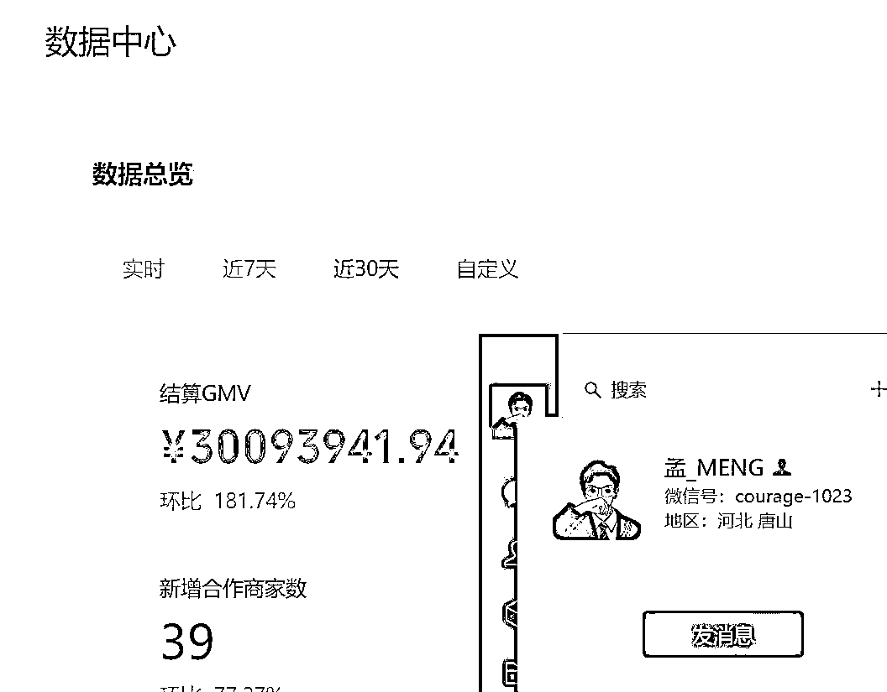

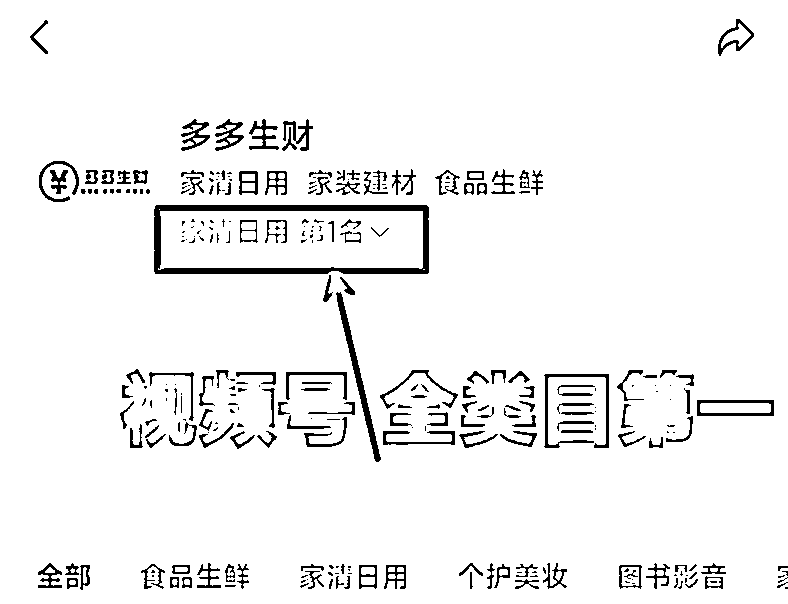

- 为了接住日销破百万的流量，我们每天要同时启动1000多个账号直播，为此养了一支轻量又高效的代播队伍，兼职主播人数超过2000位。

## 复盘：我们到底做对了什么？

如果非要用一句话总结，那就是：在对的时间、对的地点，用一套对的组织方式，把一群对的人聚到了一起。

拆开说其实是三步：

1. 选定一个还在爆发期的平台，押注深耕
2. 用最低成本跑通模式，再靠带教快速放大
3. 复制出二级梯队，把业绩推上数千万的台阶

下面我依次展开聊。

# 一、选平台：站在有红利的沃土里

坦白讲，今天这个结果并不是因为我们比别人高明多少，唯一的优势是进场早，在平台出现“异常值”的时候，快准狠地抓住了那一波流量红利。

眼下做微信视频真人出镜卖货，有几个非常鲜明的信号：

## 1）平台真金白银地给流量

视频号还处于野蛮生长的拓荒期，平台需要一批敢想敢干的先遣队去冲数据、打标签，帮用户建立起电商消费的认知，把商业化的地基打好，给后来进场的正规部队铺路。这个阶段冲进去，平台给的流量倾斜是实打实的。

## 2）新手入局的门槛出奇低

普通人只要愿意出镜照着稿子念，不需要多专业的镜头表现力，就有机会跑出爆单。就算连实拍能力都没有，拿别人的出镜素材也能快速走通0到1。不会开播、没时间守播，还可以通过连麦的方式找代播顶上。这里的容错率，比很多想象中要高得多。

## 3）用户天然买账

真人出镜的视频，天然就带着一股“活人味儿”，比冷冰冰的图文更拉近距离。一张真实的面孔出现在屏幕里，用户的亲近感和信任感会不自觉地升上来，互动率和下单转化率自然就被带动了。

查理·芒格有句话，大意是要想容易钓到鱼，就得去鱼多的地方。

赚钱的逻辑如出一辙：想赚大钱，就要往有红利、有水草的平台扎。创业者出来是拿结果、做增量的，不是来给自己设置难度、故意找罪受的。方向选对了，后面的一切才可能顺势展开。

# 二、从0到1：素人出镜卖货的五步走

想跑通这个模式，其实只需要搞定五个环节，就能看到钱进来的影子：

1. 货源怎么挑
2. 脚本怎么写
3. 素材怎么拍
4. 视频怎么剪
5. 直播怎么做

具体执行的细节，我上一篇帖子拆得很透了，星球里也有不少圈友做过分享，今天不重复讲，重点说说放大之路以及一些关键方法上的心得。

## 1）货源怎么挑？

爆品不是拍脑袋想出来的，是市场用透明硬币投票投出来的。

我入行以来一直信奉一个原则：同行就是最好的教科书，同行验证过能爆的东西，我拿过来照样能爆。我们内部会把同行分为两类：一类是外部同行，像抖音、快手、淘宝、拼多多这些平台上的爆款制造者；另一类是内部同行，就是视频号广场上正在起量的直播卖家。

拿外部同行里的拼多多视频举例：我们通过定人群、定需求、测试产品的方式，发现效果出奇地好。我在多多视频这条线上做过上千万的盘子，拆解下来发现，多多视频和视频号的人群画像高度相似——都有大量中老年用户，都对新奇特的东西情有独钟。于是，我养成了一个习惯：每天打开拼多多首页，挨个翻对应类目的热销排行榜，专门捡那些让人眼前一亮的新奇物件。

团队内部更偏爱家清百货，原因很直接：佣金空间大、需求量够宽、下单转化率也高。

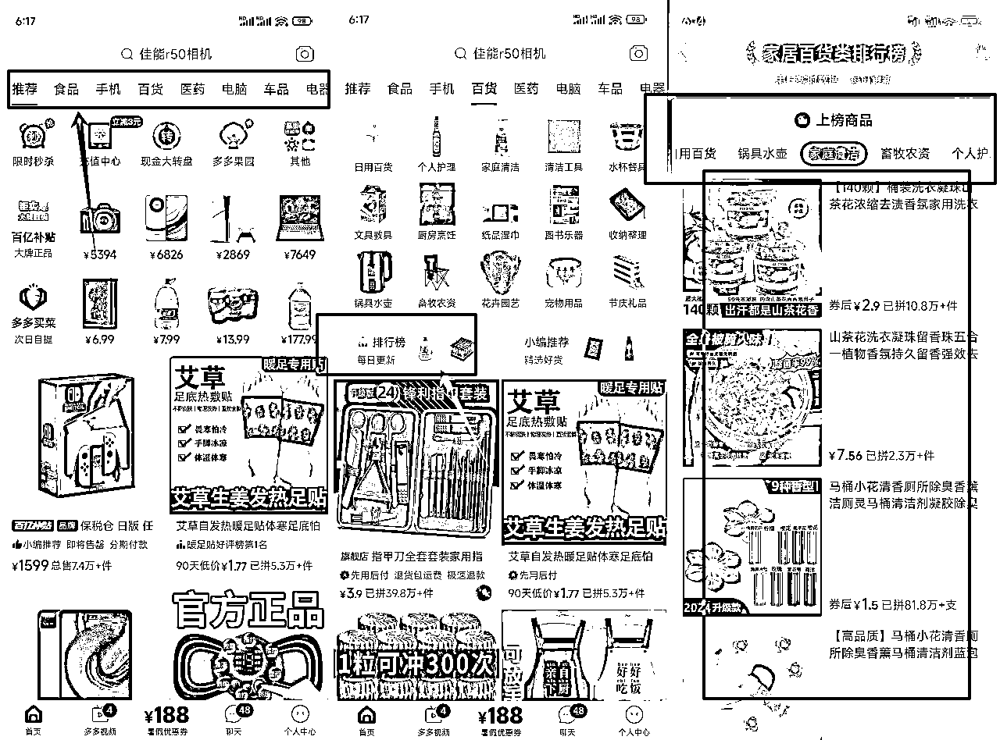

比如冬天我们打爆的一款羽绒服干洗剂，就是从拼多多排行榜里捞出来的新奇特产品。以前大家换季要洗羽绒服，只能往干洗店送，一件就要花几十甚至上百块；但买了这个东西，在家自己动手就能洗，十几块钱解决全家的羽绒服。抓住了用户省钱、省事的心理，又直击干洗店收费贵的痛点，一上架就止不住地出货。

更有趣的是，这个干洗剂在拼多多只卖几块钱，搬到视频号我们定到19.9，照样卖得动。视频号的用户没有被传统电商平台反复洗过，对价格不敏感，我们拿到的佣金空间自然也更厚实。

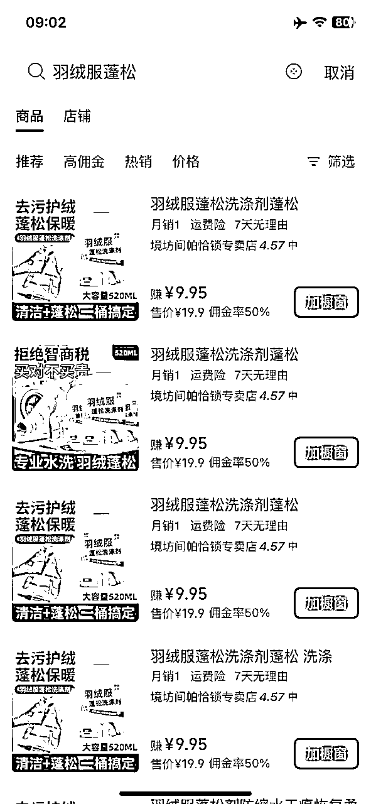

第二类同行，就是视频号内部正在爆单的直播卖家。平时多刷广场，看哪些直播间在疯狂出货，再琢磨这个品能不能用真人出镜的形式重新演绎一遍。

所以选品的宗旨归根到底一句话：数据只能告诉你什么在卖，真正要看的还是这个品有没有解决用户解决不了、又非解决不可的问题。

## 2）口播脚本怎么出？

我们的方法三板斧：借、换、移。

先说借。刷到同行的爆款视频，把视频下载下来，用微信小程序里的语音转文字功能把稿子提取出来，然后照着拍。同行已经把市场验证过了，直接拿过来用是最快的方式。

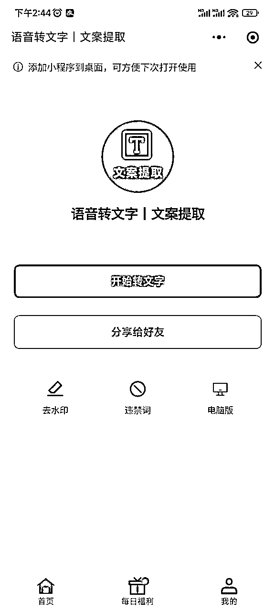

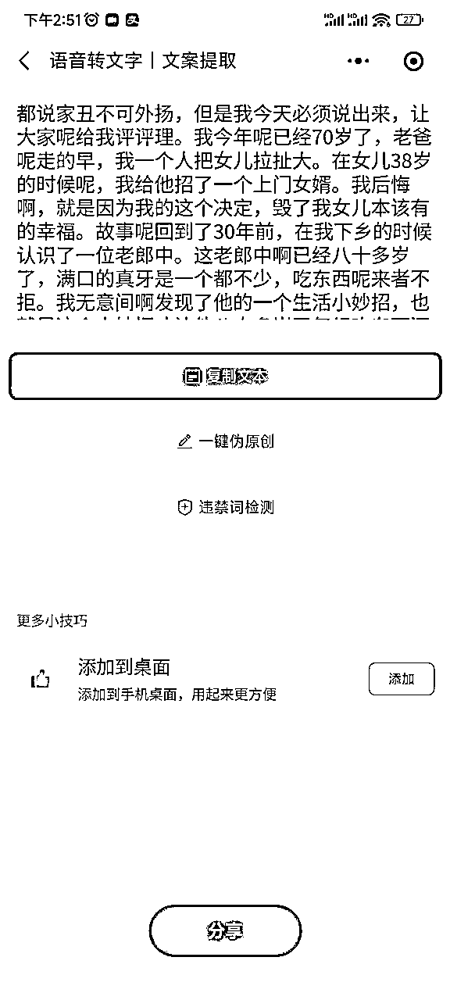

再说换。借来的稿子，用自己的话重新讲一遍，加入一些口头禅和气口，达到去重的目的。一边熟悉稿子，一边代入人设，一边训练对文案的感觉。具体有几个小技巧：换称呼，张师傅改成王师傅，黄叔叔改成周伯伯；换同义词，年龄、月份、量词全部可以替换；调换顺序，比如“这款羽绒服干洗剂是我在干洗店用了三十年”，改成“我在干洗店待了三十年，用的就是这款羽绒服干洗剂”。

最后说移。新手前期就老老实实借，借得够多了，手里沉淀出一批自己的文案弹药库，再拆解这些爆款稿子里的爆点，把爆点重新组装，就能把A产品的稿子移植到B产品上。比如同是洗衣服的功效型产品，衣物漂白剂和羽绒服干洗剂的稿子就能互相借用、互相融合。

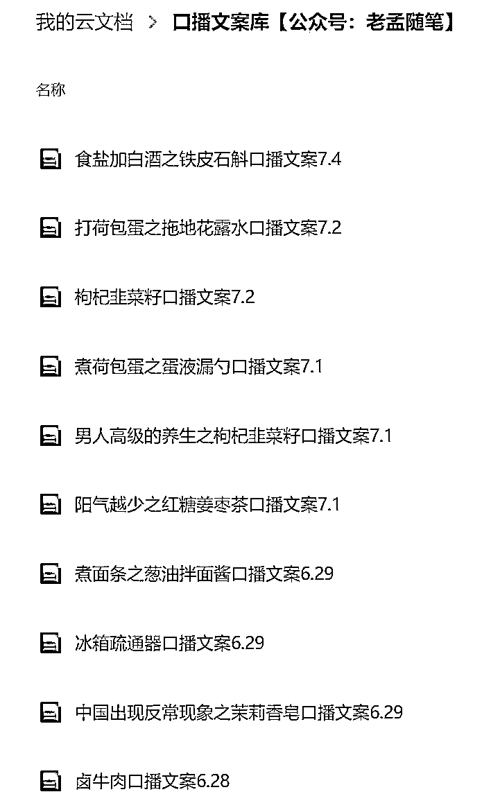

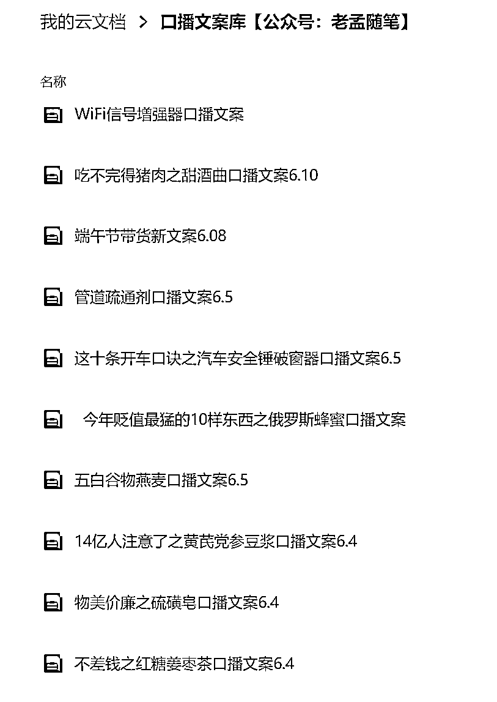

## 3）素材怎么拍？

先说设备。做真人出镜卖货，最重要的一步是动手拍起来，而不是纠结画质和器材。前期一部日常使用的手机、一个支架，就完全够用了。不建议上来就买昂贵或专业的设备，弄起来繁琐，还不如手机拍得顺手。牢记一句朴素的道理：先完成，再完美。

拿我们团队一位70后宝妈达人为例，她就是用一部手机对着脸直接开拍，没有任何专业设备。大家猜她卖了多少钱？

揭晓答案：那条素材成交额破了7万，最高单条实拍播放量653万，经过反复去重发布，总播放量达到1000万——带的就是前面提到的羽绒服干洗剂，按60%的佣金折算，到手4万多。

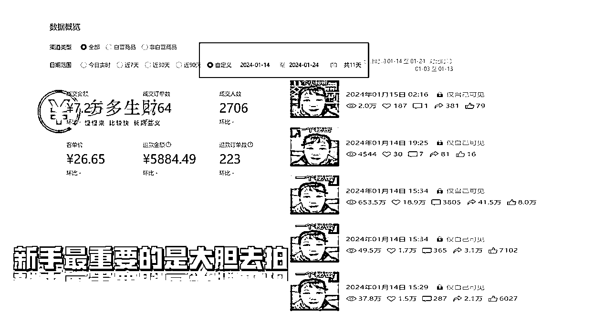

再说服化道。服装要根据品来配，卖厨房油烟机清洗剂就穿厨师服、系围裙，推荐的人和推荐的产品气质相符，用户信任感倍增，爆单概率自然上来。妆容没有硬性要求，素人只要做到仪态大方、直视镜头，像跟邻居聊天一样自如就行。道具和场景尽量找跟品关联的真实环境：厨房产品就在厨房拍，洗衣机产品就蹲在洗衣机旁边，讲羽绒服就手里拎着一件羽绒服。实在找不到场景，光线充足的户外也好过室内，最后才考虑绿幕抠像后期合成。

关于心态，新手一开始面对镜头多少有些恐惧、不自然。很多人可能期待我讲什么高深技巧——其实没有，就是多拍。人在事上练，拍多了、练多了，自然就松弛了。平时再多看优秀作品，拆解爆点，多看加多拍，慢慢就能找到自己的表达节奏。

## 4）剪辑有什么要点？

简单得很。拍好的素材放进剪映，识别出字幕，开头配一句黄金三秒的钩子，中间根据用户痛点、使用场景、产品实拍等位置插入对应的镜头，就够了。

现阶段做真人出镜卖货真不需要抠那么多细节，更不需要堆砌浮夸的特效，视频做到60分就够用。要的就是与视频号上那些大爷大娘亲切感，像街坊邻里唠家常、说闲话，太精致反而有距离感。

## 5）直播怎么做？

视频发布后，一般跑到1000播放量、每分钟能有2个点赞，就可以直接开播。不需要请专业主播，找兼职主播通过连麦代播的方式就能承接。

比如账号本人在广东，我在直播间发起连麦，主播在山东、杭州都无所谓，接入我的连麦后，画面切到主播那边，由对方替我直播讲解、挂我账号的链接带货。

# 三、从1到100：怎么把业绩做到月销三千万？

以上五个环节跑通，算是完成了素人出镜卖货的0到1。下面重点聊聊我如何把这个盘子十倍放大，从1走到100。

谈到扩大收益，多数人第一反应是要么扩大自营，要么靠招生培训来滚雪球。

但扩大自营，意味着人员、场地、设备、账号、管理等一系列成本逐级加码，还要面对平台规则变化、玩法升级等未知风险——这条路我们团队并不擅长，于是果断选了招生带教。招进来的成员，全部来打我们已经测出来的爆品。

其实这里面还有一个小小的私心：每次我的视频爆了，总有一堆同行跑来搬运、抄袭、跟品。我当时就想：既然辛苦测出来的爆品和素材注定要被人抄，与其便宜了外面那些不相干的人，不如招一批自己人，我干脆自抄，让学员变成我的打品先锋，批量分发我的爆款素材，大家一起挣钱。

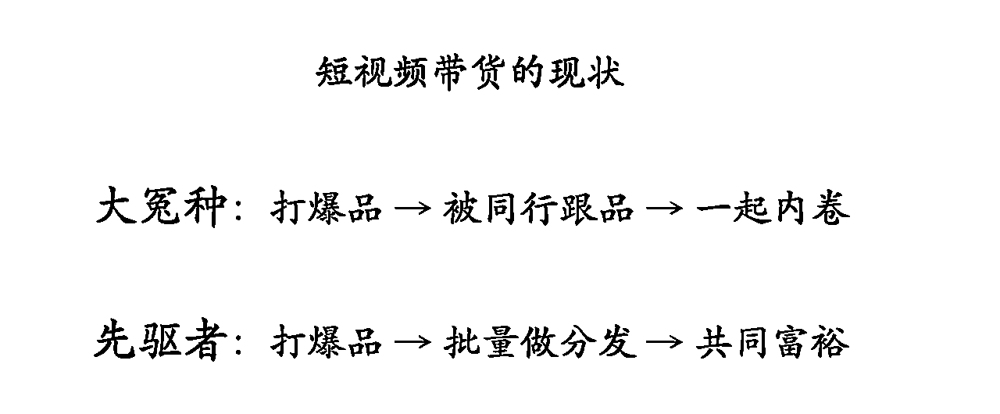

这也是我做带教的初衷——肥水不流外人田，而不是单纯靠教学收费来割韭菜。

当然，市面上打着视频号培训旗号的人不少，但真正把盘子做大的并不多。我们跟他们的区别，在于下面的思考维度。

## 1）靠学费赚钱，还是靠后端分润？

为什么大家一听到“培训”两个字就皱眉头？因为确实有一批人，只想着收割一次性学费，对学员能不能出成绩根本不关心，更谈不上后端收益。

我们想做的是把自己测出来的爆品利润放到最大，让学员用我们提供的货源体系，我们赚取供应链的服务费返点。所以，我们比学员自己更在乎他们能不能成才、能不能变现——学员赚到钱，后端收益才会源源不断进来。

为了跟学员深度绑定，走得长远，我们特意把收益的重头压在后端供应链上：靠扩大团队规模和GMV总量，去跟上游争取更高的带货佣金加额外返点，而不是靠抬高学费或者压榨达人的分成来获利。

所以，对我们来说，把学费压低、把学员人数做大、把成才率提上来，才是收益增长的核心公式。市场上视频号口播带货的带教费，3980、6980的比比皆是，我们却定了一个中下水平的价格——2980。用一个不过分高的门槛，筛出真正有执行力、愿意下场实干的人，跟着我们一起打品。

## 2）怎么优化带教和分工，把人效提上来？

低门槛加上让学员快速拿到结果，我们很快聚拢了1000多名成员。但人一多，水平必然参差不齐。怎么保证爆品一出来，所有人都能第一时间跟上？答案就是优化带教方式、重新设计分工协作。

多数做带教的同行，默认都走“独立闭环”的路子：让学员一个人学会找供应链、做商务沟通、选品、写文案、拍摄、剪辑、直播……十八般武艺样样通。这样确实能把个人能力磨得很全面，但代价是效率低、难度大、成才率低。等学员真的把每一环都打通、赚到钱，平台的窗口期早就过去了。这个时间的损耗，我承受不起。

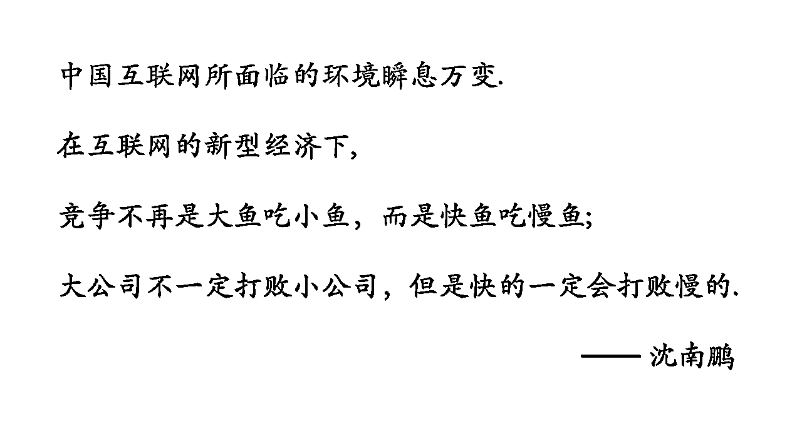

投资圈有位大佬说过：互联网新经济下，环境瞬息万变，竞争不再是大的吃小的，而是快的吃慢的。一家大公司未必打得过小公司，但反应快的一定会干翻反应慢的。

所以我们的解法是：让每个人只做自己最擅长的那一块，靠分工协作提升整体效率。

具体怎么做的呢？

1. 团队作为中台，负责帮大家对接供应链、拿样品、谈高佣、测试爆品；
2. 开发出一套监测机制，盯住市场上的爆品和爆款视频，一有苗头立刻同步给学员，让大家第一时间跟品、翻拍；
3. 跑通0到1的学员，可以进阶为实拍达人，团队提供文案，由他们专注拍摄；
4. 实拍达人自己的视频爆了，可以共享给团队内部，让所有学员一起打这条素材，出镜的达人拿一定的分润比例。

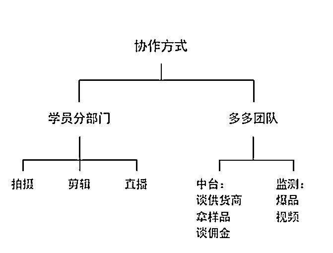

发展到现在，这个模式已经迭代到2.0版本：

团队作为中台负责选品和写稿；有出镜能力的达人专注拍素材、测爆品；还不具备出镜条件的学员，直接拿团队爆款素材去剪辑发布，挂上高佣链接，既给出镜人分润，团队赚供应链返点；有出镜潜力的学员，一步步培育成垂直达人号方向，成为真正的素人带货IP；有矩阵打品能力的学员，则鼓励他们组建线下小工作室，找身边同学分工合作，做成抗风险能力更强的带货工作室。

这样一来，整个团队1000多人形成紧密咬合的闭环：各司其职、各担成本、共摊风险，团队的效率和氛围都有了质的提升。哪怕偶尔遇到平台规则变动，也能快速升级到新玩法，稳稳穿越项目周期。

出镜达人、打品达人、团队三方共赢，这是我最想看到的局面。

## 3）搭建二级团队，靠裂变实现指数增长

再讲一个我们踩过的大坑。因为我们的视频全靠自然流量，内容上就得想办法变着法儿抢平台的推荐，文案难免有点“擦边”，所以账号的存活周期不长，大爆之后很容易违规、被封。光靠1000名学员自己开号，根本没办法源源不断地供给新账号。

可是让学员自己去买号、租号，又是一笔不小的成本，沟通起来也浪费精力，效率非常低。当时我算了一笔账：如果一名学员通过亲戚朋友能凑出10个账号，那我们要是有2000个、3000个学员呢？团队的账号池是不是就彻底盘活了？

但创始团队自身精力有限，直接去招大量学员，又怕交付跟不上。为了拿到源源不断的账号供给，我们选择了搭建二级团队这条路：从1000位达人里筛出有运营能力的一批人，把我们的培训资料授权给他们，让他们自己再去带学员，成为我们的二级梯队。

只要手里的达人数量足够多、走的是团队的供应链，那么哪怕给到达人的佣金高一些、我们抽的服务费薄一些，也完全没关系。因为当团队月GMV干到大几千万的量级时，哪怕只从供应链上赚几个点的返点，单月收益也极为可观了。

靠二级团队的裂变机制，我们很快将每天开播的账号从500个拉到了1000个以上，日销从50万冲到百万，整体业绩直接翻番。飞轮也随之转起来：团队规模越大，拿到的佣金越高；佣金越高，自然吸引更多外部达人和学员加入；人越多，规模更大，优势更明显。

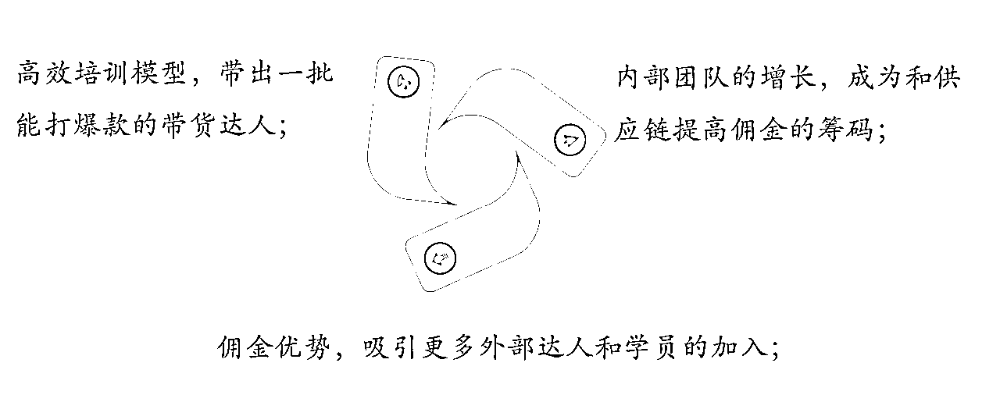

至于二级团队自己去收培训费，还是找KOL合作、免费培训后端再抽佣，我们完全不干预，也不用额外花精力去管交付。我们的目标只有一个：把规模做起来，吸引更多素人进来，从中筛选出一批有执行力、敢想敢拼的人才，带着他们不断穿越项目周期，在视频号立稳脚跟。然后再从这群人里挑出有潜力的出镜脸孔，孵化成垂直细分赛道的小IP。

我本身就是草根出身，在互联网上摸爬滚打这几年，最深的一个体感是：互联网的尽头是电商，电商的尽头是品牌或IP。可普通人想长成大IP，谈何容易。与其做那个遥不可及的梦，不如选一个有红利的平台深耕下去，带着手下这批兄弟姐妹不断打怪升级，再顺路孵出更多垂直赛道里的小IP。

张小龙有句话说得极好：“再小的个体，都会有自己的品牌。”

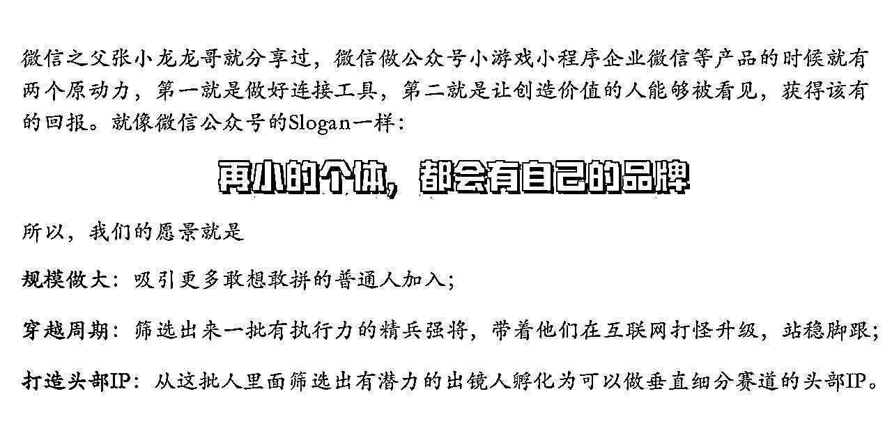

所以我一直坚信：在微信生态里做素人IP，普通人跑出来的概率，会比别处更大。

一条视频突然爆了，流量哗哗来，可真人没空播、不擅播，或好几个号同时爆，根本顾不过来——这种滋味经历过的都懂。我们现在的做法，是养一支专门“接流量”的远程代播队伍。只讲起号方法的帖子很多，今天说一说这支2000多人的后备力量是怎么练成的。

接得住流量，不只要有好内容，还得在视频爆的时候立刻有人上线卖货。幸好这个平台眼下支持远程连麦开播，我们不用租线下场地，也不用雇全职员工，直接线上招募兼职播主就行。中间的试错不提了，直接讲已经跑通的玩法。

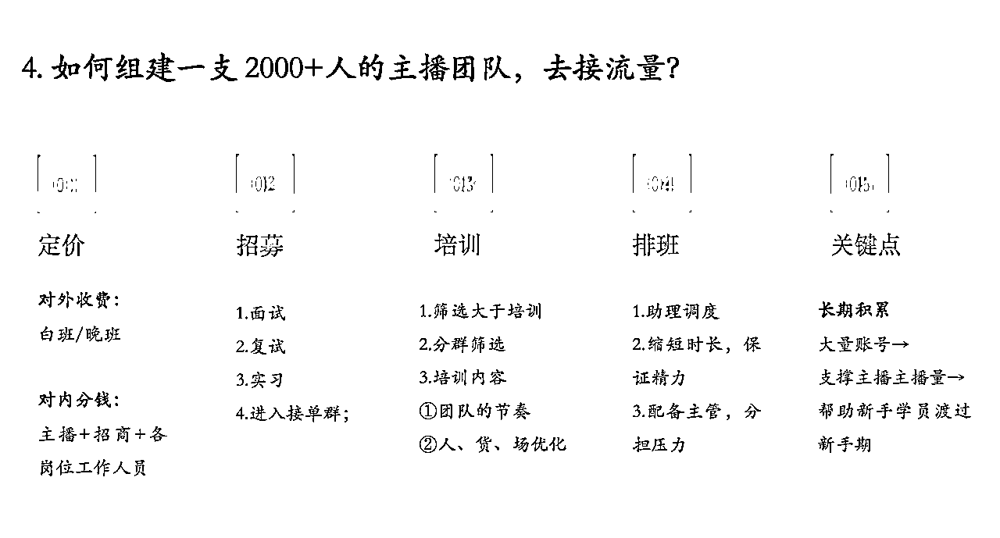

**定价：怎么收、怎么分**

对外报价：白天35元/小时，凌晨后45元/小时。分给播主的是20到30元/小时。表面上每小时有十几块毛利，但背后还养着十几位调度助理和各种岗位，到手的净利其实不多。我们看重的是那1000位创作者和2000位播主组成的体量，那是以后做内容迭代、测试新玩法、筛选垂类IP的底仓。

**招募：兼职播主怎么进来**

路径很简单：面试—复试—实习—进派单群。复试要带3到5件真样品，话术必须脱稿。不少新人到这里就紧张、退缩，所以招募期我们只能不停给她们打气，推着她们往前走。

**培训：先筛选，再培养**

成年人很难被改变，选对人比教对人重要。前期不收任何费用，也不提供培训，只丢资料和教程，让她们自己背话术，自己过面试。能靠自觉闯过来的，才是我们要的人。等进了派单群，再由团队集中培训，省心又高效。

进群不等于能一直躺着。我们按表现分档：干得好的上一档，出了问题的降到下一档，反复循环。前两档的质量越筛越高，最后那档想回来得重新复试。

日常培训主要抓两块：一个是节奏——上下播规则清楚，和调度助理配合顺滑，不搞内耗，出错就事论事，这种氛围要反复强调；另一个是人和货以及场景——画面干净舒服，话术有层次，比如怎么热场、人多怎么聊、人少怎么聊、下单多欠款多怎么处理、各种问题怎么回应。这套方法迭代了好几个版本：

1.0版：能说会道就行，样品打印也能接受；
2.0版：必须真样品，画面要好看；
3.0版：要会带氛围，还能让消费者买得更贵；
4.0版：连麦管控趋严，逐步换成电脑开播。

我们的播主大多是从当年多多电商的创作者中裂变来的，很多住在县城，是带娃的宝妈。她们在家抽空赚点零花就很开心，我们解决缺人的问题，她们不再手心向上，也算一种相互成全。

**排班：24小时不断档**

代播订单随时会来，必须全天候衔接。目前调度组有4位助理，每人盯6小时，2位主管每人盯12小时，确保任何时段都有两人在线，既能对接打品创作者，又能安排播主上播。服务水平就是这样一场场磨出来的。

**为什么能撑起这两千人**

核心就一条：赶上了平台早期宽松扩张的好时候，让创作者快速看到钱。早期一条爆量内容，稍微去重发上去基本就能出单，播一次就能挣几千块。尝过甜头的人，即使后来规则不断变化，也愿意跟着我们继续铺号。号越多，远程代播订单就越多。

但要留住这么多兼职播主，得让她们天天有活干。如果账号不够多，接单量不稳定，人就会流失；人一走，视频爆的时候没人开播，生意就断了。所以我们在线的号至少1000个，每天都有大量播间在跑。窗口期靠老手带新手（剪辑团队持续给爆量内容），让新人在最短时间内赚到点钱，哪怕几十块，也能让人定下心来。这批创作者黏性极强，平均一天能播一场，都是长线干活的。

你要是只拉500人，最后留下几十个，根本喂不饱这支代播队伍。老手带新手的价值，就是帮新人熬过最脆弱的起步期。而在本地养兼职更不明智，就算一个号有10万播放，不能及时开播也是白搭。

**总结：做大的底牌**

讲到这里，最想说的其实就一句：赚钱这件事，最简单的法则往往最有用。

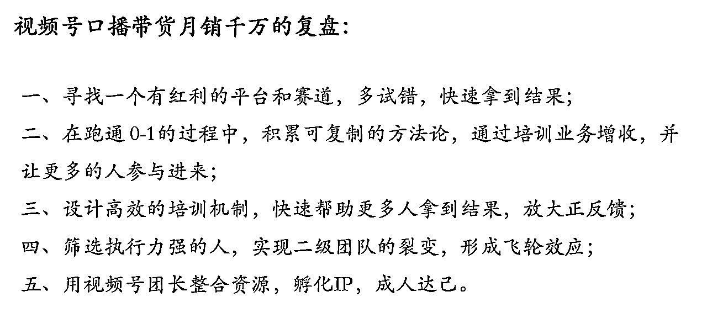

方向对，方法对，拿大结果是迟早的。

**我们自己的短板**

利润很薄，这是最大的现实。市场一卷再卷，佣金不能压，还得想办法多给学员分，所以我们只留下不到3%的运营成本，在同行里低得有点寒酸。听说有人能收30%的抽成，但对方也不是全拿走，而是把一部分用在高阶学员的深度服务上，这种做法值得参考。

管理和用人也是短板。我们没做过线下自营打品工作室，对招聘、合同、薪酬、激励这套不熟，遇到风口项目没法快速复制自营矩阵，很多细活需要当面教，我们做不到。另外，几个核心成员24小时被项目绑住，没时间想未来，这非常要命。所以我们需要擅长做交付的人，把我们从事务里替出来。

**我对卖货生态的观察**

先看大盘：这个赛道今年很值得押。过去两年，三大内容平台里，只有它还在高位增长。对个人来说大盘太远，那就说个近的：微信的电商团队400人被遣散，张小龙亲自出来重组。

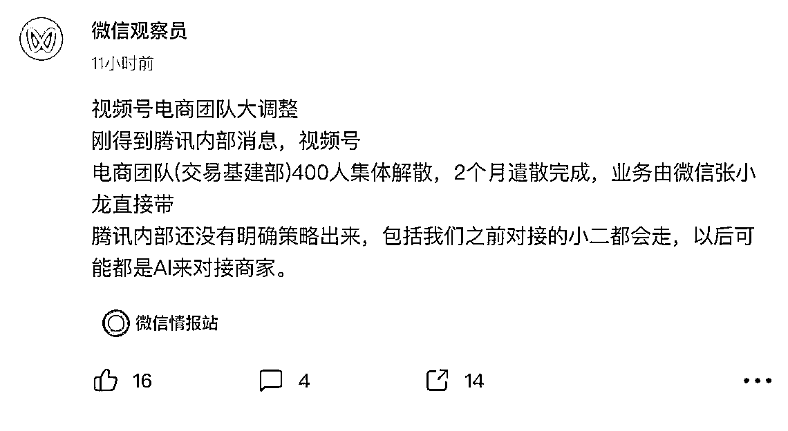

组织架构没定，反而是草根进场的好窗口。等人事落定、规则清晰，专业玩家进场，草根就没什么戏了。

模式上，抖音有一支队伍和我们打法类似：靠招素人做培训、孵化创作者当团长，月GMV做到三个亿，拥有10万+创作者，是抖音的头部机构。这个赛道也有同样的可能，市场够大，所以我不介意把模式讲出来。不怕同行来卷，反倒希望更多人一起把蛋糕做大。

平台的变化，我注意到三点：

一，同行大量涌入后，平台开始压创作方向。从空号开始直接卖货的玩法越来越容易违规，账号的爆量周期很难超过半个月。

二，平台开始限制同一个人重复出镜、批量铺矩阵。同一张脸出现在很多账号上，会触发真人验证，基本过不去。从整个微信的产品逻辑看，平台要的是平权普惠，让创造价值的人被看见，而不是让矩阵号把个体的空间挤没。这也是抖音很火的授权切片玩法在这里做不起来的原因。

三，垂类账号正在起来。我看到一个案例：素人做传统文化生肖两个月，几乎零收益，后来一条内容跑到130万播放，拿到80万佣金。玩法已经变了：先发几十条垂类内容攒权重，再发商品视频，变现周期更长，但也更稳。

**现在进场晚不晚**

规则确实调整了，新人起步更难，但另一方面，大玩家想靠矩阵碾压小个体也没那么容易了。

能真人出镜的，要做垂类账号，老老实实养权重，把内容做得更专业；不能出镜的，只剪别人的东西越来越行不通，验证过不去，矩阵串不起来，违规率还高。但反过来看，流水线式的工作室会被清出去，能给出真实价值的个体反而有更大空间，未来有机会做成细分领域里的个人IP。

已经有出镜能力的朋友，尽早多开几个号，一部分做垂类，一部分直接变现。也可以来找我们，我们正在孵化这个生态的垂类IP，已经有些眉目了。

这个赛道仍是眼下机会最大的地方，今天也还是草根进场的好时候。抓住现在，说不定你就是下一个“小杨哥”。

**最后说几句**

我叫孟_MENG，一个“短期项目长期做”的00后。我这点成绩，在圈内大佬面前不值一提，但我相信天道酬勤，一步一个脚印，等一阵风来。

无论是当初多多电商卖货，还是现在出镜推荐产品，能走到今天，最要紧的是发心正。我们做培训，从来没想过靠收智商税赚钱，而是死磕学员的成才率，和学员牢牢绑在一起，真真切切帮人赚到钱。财富就是社会给你的价值打款。你帮到了多少人，才能赚到多少钱。种什么因，得什么果，发心对了，结局才对。亦仁老大在周年信里那句话我一直记着：“这个世界的规律是，当你推动很多人取得成功时，很多人会希望你成功，利他最终利了自己。”这里的信念很简单：大大方方谈钱，实实在在利他，帮别人也是在成就自己。

我初中没毕业，家里欠过一百万，在生财有术找到搭档（待续、徐子浅、乐天、萍姐、大麦、郭姐都是圈友），找到好项目，带着信任我的人往前闯。写这篇东西，一是反哺，把我们的经验给想放大项目的圈友参考；二是让行业里的前辈看到这里的机会，加入我们一起做大，也算一点私心。

来钱快的项目我做过太多，太懂没资源的人反复从0起步的苦。但这个赛道不太一样，它发展得“慢”，容得下没什么背景的人试错，也适合普通个体从1做到100。如果你也厌倦了一直归零的循环，那就一起深耕，赚长期主义的钱。

这篇文章但凡有一段能启发你，都是在这里奋斗的伙伴，我就很荣幸了。