# 在本地生活摸爬滚打20个月，我把这些底层逻辑一次讲透

大家好，我是龙哥。2022年底入局本地生活，2023年春节后团队all in车后市场，一路做到洗美top1，2024年单月成交额冲到6500万，如今盘子基本稳定。之前分享过两篇实操内容，一篇讲3个人如何做到一天1300条视频、打造车后云连锁top1，一篇是单月6500万的万字拆解。今天想换个角度，把这20个月踩过的坑、想明白的事，集中聊一聊。

先说环境变化。这段时间，美团和抖音的边界越来越清晰：高频刚需的餐饮外卖，美团基本锁死；低频非刚需，是抖音的主场。抖音的内容分发逻辑对中小商家并不友好，目前本地生活门店覆盖率只有30%左右，中小商家想持续经营，内容成本和流量不确定性都是拦路虎。NKA和CKA已经成了抖音的重要支柱。云连锁作为一种新运营模式，被低频非刚需品类广泛采用，虽然官方门槛一直在抬高，但它靠高效的流量运营方式，规模反而越滚越大。

下面我从平台、品牌、流量三个层面展开说。

## 一、平台业务模型：这些规律要先看明白

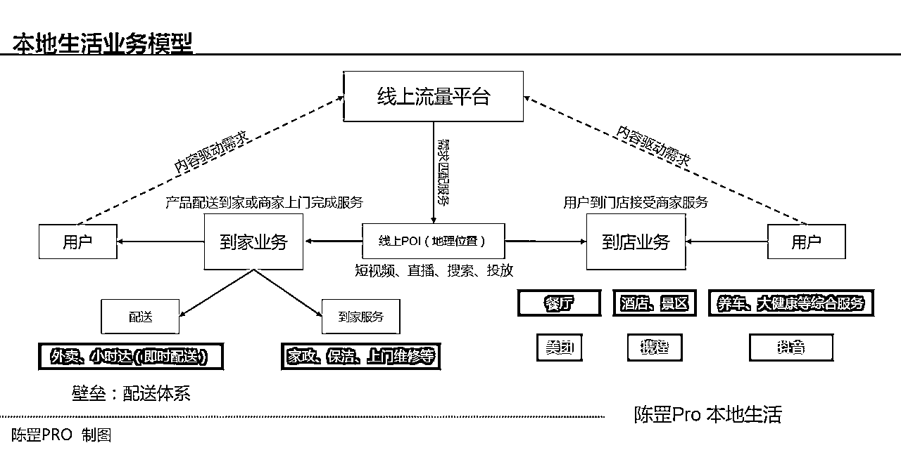

本地生活分成到家和到店。到店包括酒旅、餐饮、综合——养车、大健康、美业都属于综合；到家包括家政、保洁、上门维修，以及外卖、小时达这类即时配送。

最反常识的一点是：本地生活没有规模效应。订单从1000笔涨到1万笔，履约团队也得跟着涨，边际成本不会下降。但内容端不一样，一条视频覆盖10家门店和覆盖1000家门店，成本差不多，门店越多，单店内容成本越低。

所以品牌要在线上把单店模型、区域模型、品牌模型都想清楚。要敢于承认阶段性亏损，但得提前算好每个地区的类目天花板，以及做到多大规模才能盈利。如果沙盘上推演都不赚钱，线下执行大概率更亏。

搜索和内容驱动是两套完全不同的逻辑：搜索是用户有明确需求后才来找，精准、时效强、核销率高；内容是激发潜在需求，爆发力强但时效弱，核销率自然偏低。这正是美团和抖音底层逻辑的差别。

美团的护城河是供给+可控配送+数字化系统。今年立秋，美团外卖干了9000万单，离1亿就差一步，光奶茶就贡献了2000多万单。抖音外卖则在持续收缩，从生活服务部门划到电商部门，到菜单也在缩减。不是抖音不想做，而是内容推荐体系下做外卖真的很两难。

每个平台都有自己的边界。抖音做不好外卖，但内容驱动的综合类目做得不错；美团做不好内容驱动，但刚需的餐饮到店和外卖是护城河。抖音在综合类目的核销率低到吓人，有些还不到1%。千万别迷信抖音，有些事抖音自己都没想明白，你很可能只是它试错路上的耗材。

本地生活现在只有美团和抖音，没有第三家。未来唯一变数，就是抖音到底认不认这个结果。

## 二、高频、低频决定平台边界

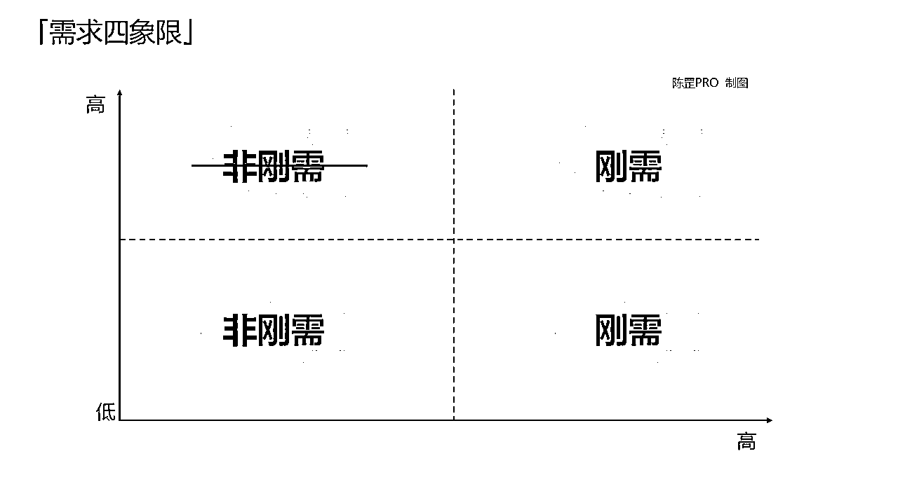

结论很直接：高频刚需去美团，低频非刚需去抖音。搜索逻辑和内容推荐逻辑，是两边的根本差异。品牌要根据自家品类选主战场，其他平台放次要位置。

高频刚需看重复购，低频非刚需看重拉新。高频刚需供给多、竞争卷；低频拉新则是不断消耗存量，拉新效率会一点点降低。而且高频带不动低频，或者带动力很弱。记住，需求与供给的动态不平衡才能长出平台，别跟商业规律对着干。

## 三、品牌业务模型和获客演变

### （一）业务半径

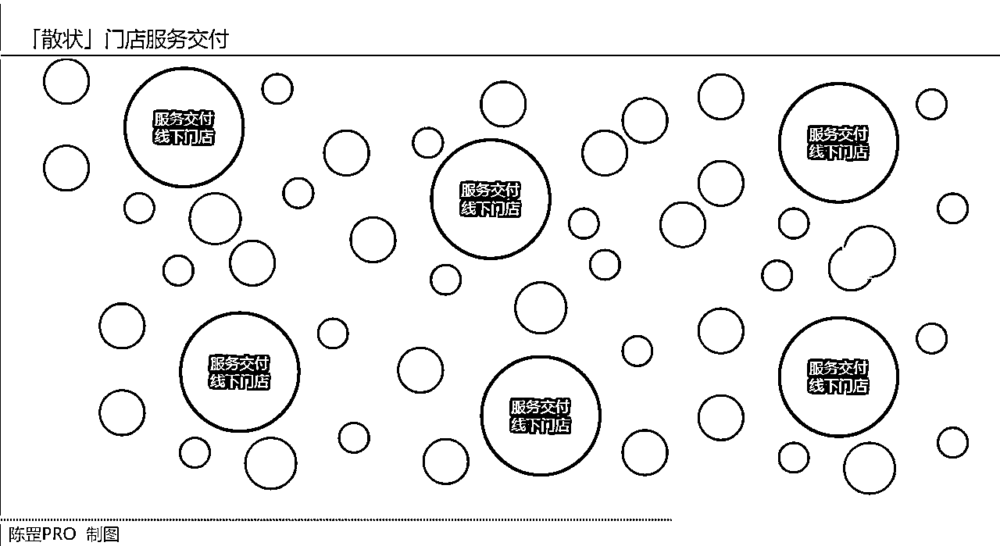

实体门店天然有服务半径。频次越高，半径越短。想扩大半径，要么靠配送延伸覆盖，要么让自己变成移动服务点——比如餐饮门店用小推车去人流密集处。

低频非刚需的覆盖半径大，但要做决策：社区店还是商场店？我的建议是，能做社区店就别做商场店。社区店人群结构稳定，商场店吃的是流动人口，而且门店盈利和商场整体情况强绑定。

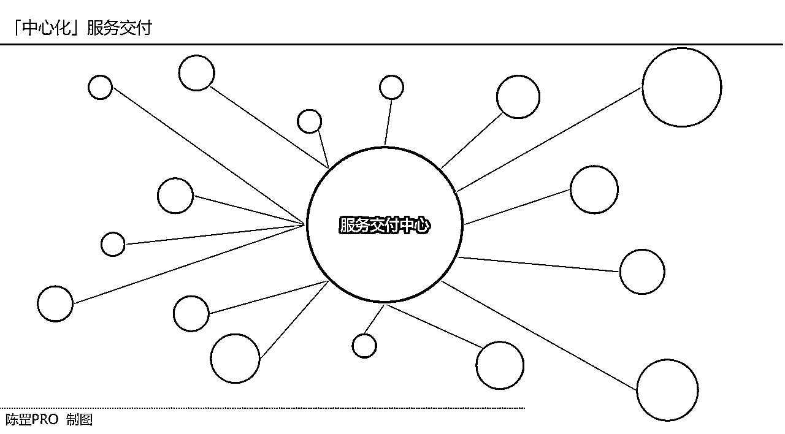

中心化交付是另一条路。借助快递物流体系覆盖，省人力、省房租，但必须解决平台合规问题。像浣洗这样的洗衣洗鞋品牌，盈利模型其实没问题，就是在合规上被平台治理了。到家业务和到店业务逻辑不一样，到家偏电商属性，更容易突破门店天花板，体量甚至可能超过到店。小时达代表是朴朴、叮咚，外卖就是美团、饿了么。

### （二）获客方式怎么变

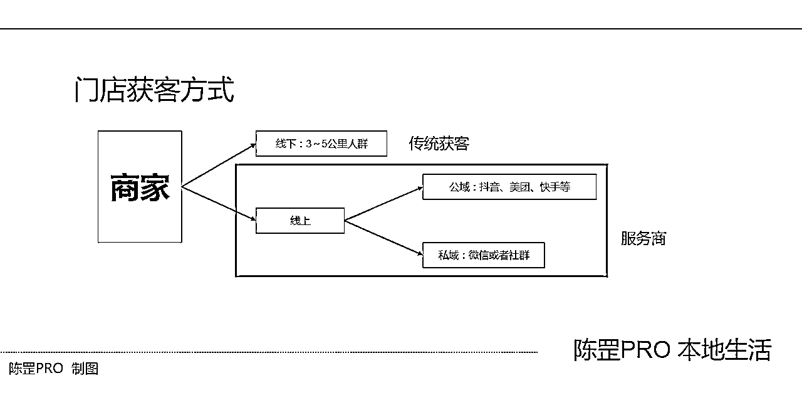

获客大致有三种：传统线下、线上公域、以及把公域流量拉进私域做复购。私域是资产，中心化分发和散点分发各有价值，一个服务品牌，一个服务门店。

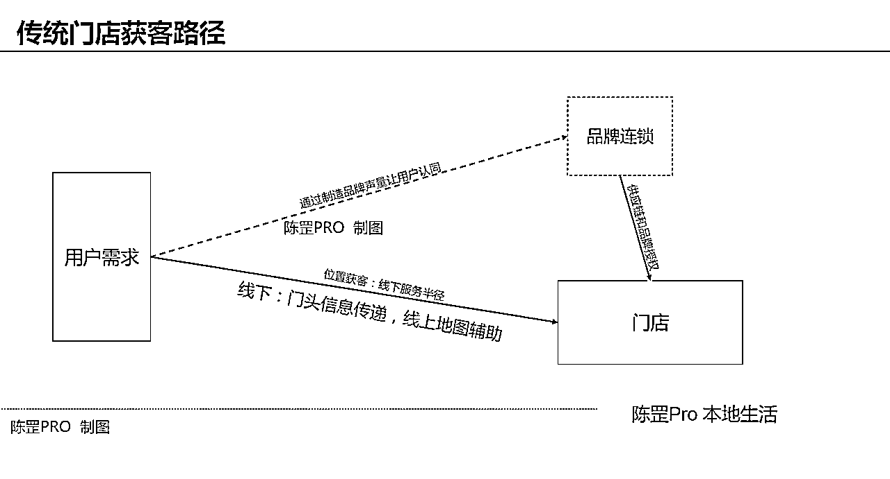

传统时代，门店靠招牌和口碑吃饭，信息流动极慢。品牌主要干两件事：供应链支撑，以及打广告在用户心里种草，降低决策成本。本质上，品牌是用高效信息传播来提升门店交易效率，但很难直接参与门店获客。

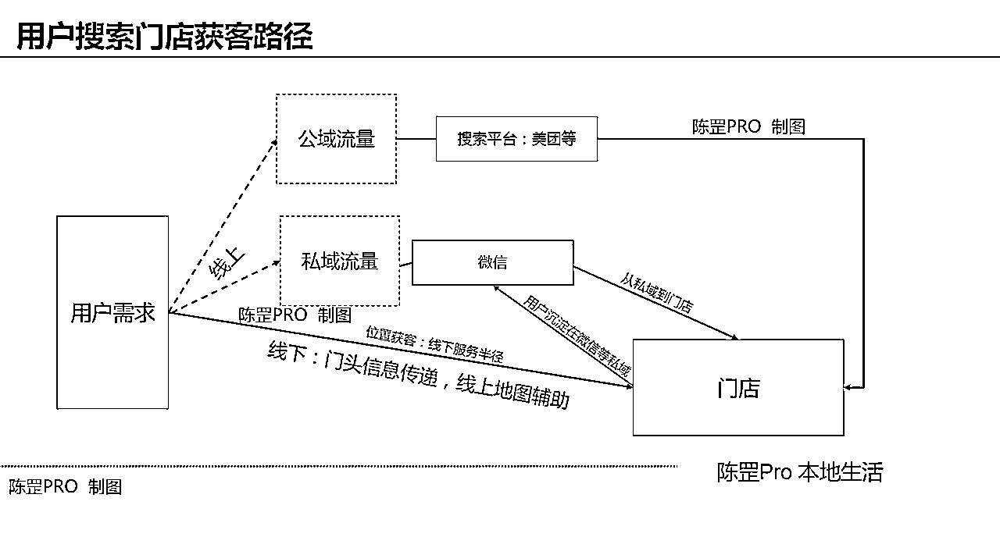

移动互联网来了，信息效率大幅提升，🛰️和美团诞生。🛰️靠人，围绕社交；美团靠“货+人”，围绕地域做团购。用户可选择的信息渠道变多，门店也多了线上团购这个新展位。人还是那批人，店还是那批店，改变的是信息传输路径，成交效率因此提高。公域获客沉淀到私域，私域再反哺门店稳定客流。这个阶段品牌发力空间依然有限。美团以搜索为主，主动权在用户手里，商家只能做好供给，靠投放和优惠券拉曝光。

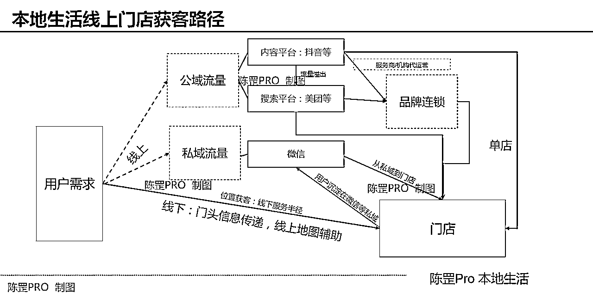

信息流动的三个时代，每个时代商业撮合方式都会被改写。内容时代对传统行业的重塑力最强。搜索是消化存量需求，内容推送是激发增量需求。在内容平台，品牌可以批量用内容给门店导流，门店越多，内容边际成本越低。

### （三）本地生活商家构成

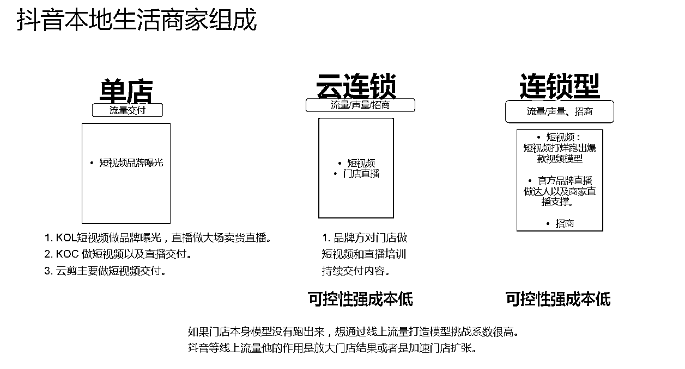

抖音加速了连锁品牌的成长，招商加盟、招工体系都被重新塑造。0到1跑通后，抖音能帮你快速放大。但跑得快不等于跑得好，很多问题都被速度掩盖。等速度慢下来，品牌就得回头补体系课，低频业务后面特别容易踩这个坑。

品牌快速扩张的常见手法是翻存量门店：要么翻招牌改造，要么做店中店。每个品类都有门店天花板，做到一定体量，如果不想增加新品类，还想沿单一品类继续扩，就需要做子品牌。一来分散风险，二来进攻是最好的防守——先吃掉存量，别的品牌就没机会圈店了。

### （四）云连锁的本质

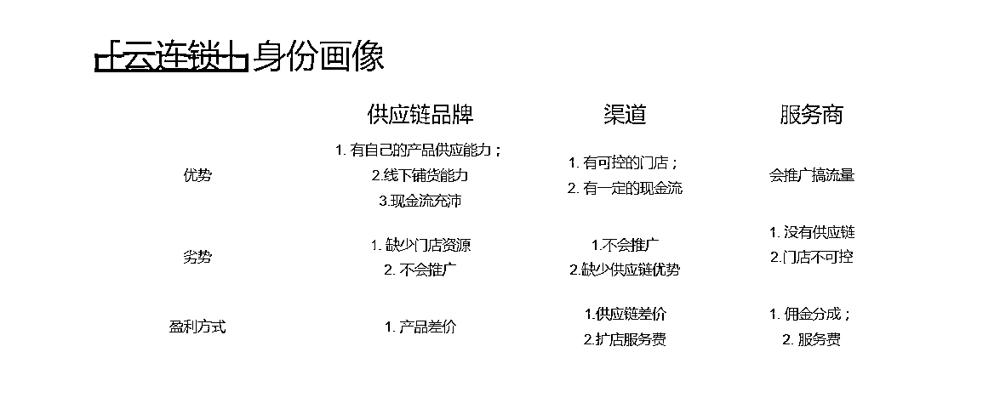

只有低频非刚需才有云连锁的土壤。高频需求供应链绑定太深，云连锁插不进去。云连锁必须建立在单店模型之上，如果连单店、区域、品牌模型都没有，就急着做云连锁，迟早要补课。定位也要想清楚，别既要又要。有些品类，比如教培云连锁，从一开始就只能赚一道钱；有些品类能靠流量效率反向建设供应链，才能走长远。

凡是做资源撮合的低频业务，都能尝试云连锁。关键是要能管控员工和门店，自己管不了就找区域服务商。云连锁的身份有三种：供应链品牌、自带门店的渠道商、流量服务商。三者优劣势各不相同。记住，云连锁是商业路径，不是商业本质，定位错了就是战略误判。

## 四、抖音流量分发、搜索与参与角色

### （一）流量分发逻辑

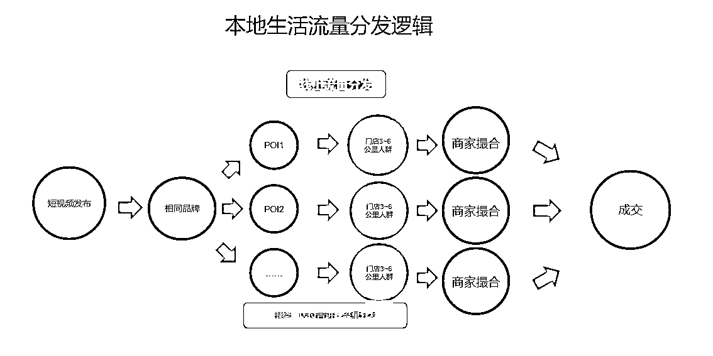

做流量分发，拉通品是核心。通品设置要考虑门店所在区域的店租、人力成本，品牌要有配套政策：成本高的区域给补贴，成本低的就多提成，去补贴高成本门店，具体品类具体分析。通品是流量分发口，其他产品做流量外溢。但外溢大多在通品类内，很难跨品类。比如车后有洗美、小保养、贴膜，用户有普洗需求，可能外溢到精洗、抛光打蜡，但很难外溢到小保养或贴膜。线上产品设计要和线下升单逻辑区分开。线下是三维空间，用户会因为环境和对你服务的信任，复购其他项目；线上很难构建综合场景。

### （二）流量模型拆解

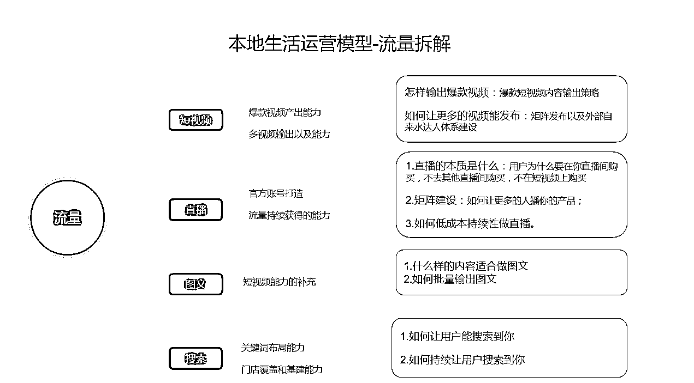

流量分公域、私域、商域，三者并行且互相流动。质量是不确定的，数量是确定的，要用确定性去冲击不确定性。成熟品牌都有自己那套确定性流量获取模型。公域有四类：达人、职人、品牌直播、达人直播，能力要搭配着用。但别拿其他品牌的成熟模型去套0到1的项目，容易水土不服。

### （三）搜索逻辑

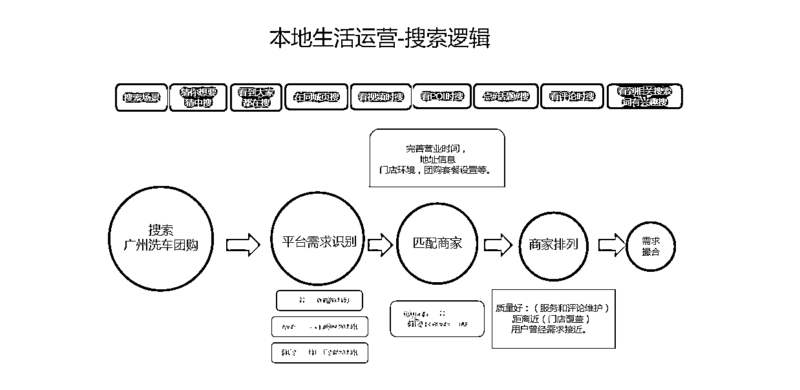

本地生活有物理半径，所以一定存在搜索。你要想清楚：用户为什么搜索你？搜什么？怎么搜？用户搜索心智会越来越强，算法推荐也会越来越准，今年百万曝光到成交的转化效率比去年大概提升了4到5倍。如果你的数据没涨，就该复盘原因了。注意，品类天花板决定内容曝光天花板，瑞幸的视频曝光上限和洗车视频曝光上限根本不是一回事。你看到的是曝光，看不到的是算法背后的货币化率。

### （四）参与角色

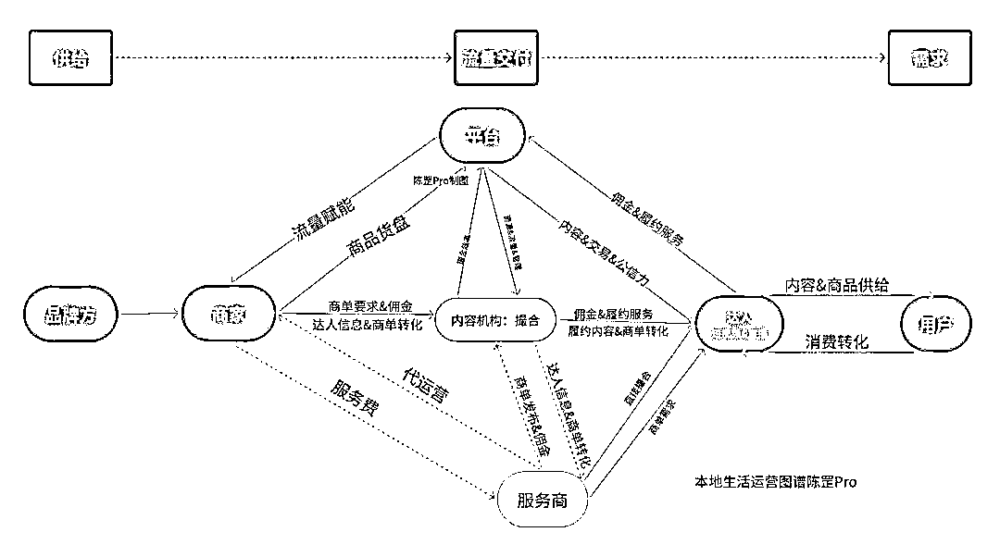

供给、履约、渠道，是本地生活绕不开的三个词。服务商和代运营机构在成熟商业逻辑里其实没有位置，因为用户付的钱只该由商家和平台分。凡是不能提升效率的中间节点，都会被干掉。服务商分两类：垂类服务商和县域综合类服务商。垂类服务商今年会很难。

### （五）成交模型

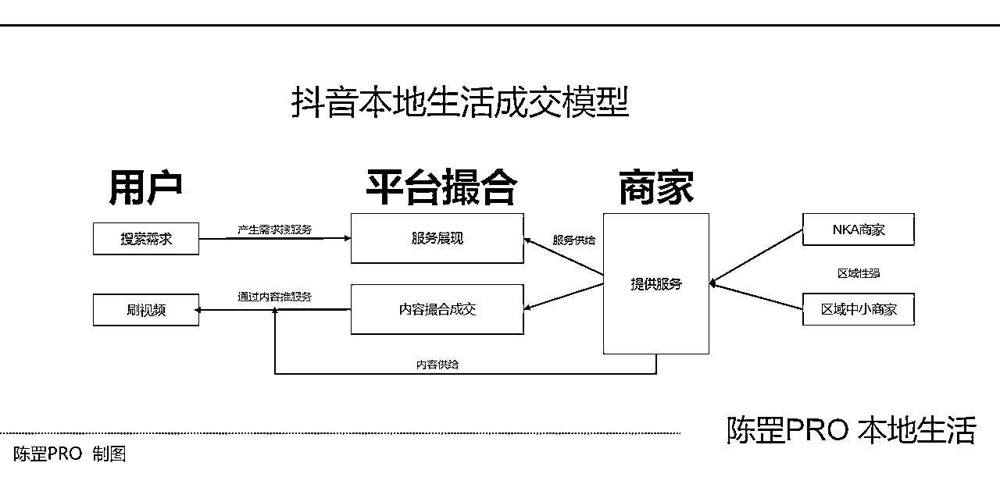

内容激发需求，搜索做确定性支撑。抖音的内容门槛注定了中小商家难以持续获客，所以平台把希望寄托在头部连锁和区域连锁身上。

### （六）流量参与方

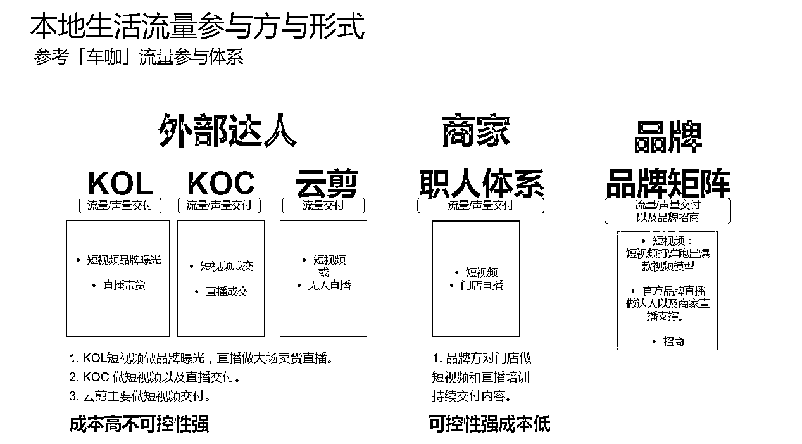（角色关系如图）

### （七）资源流动

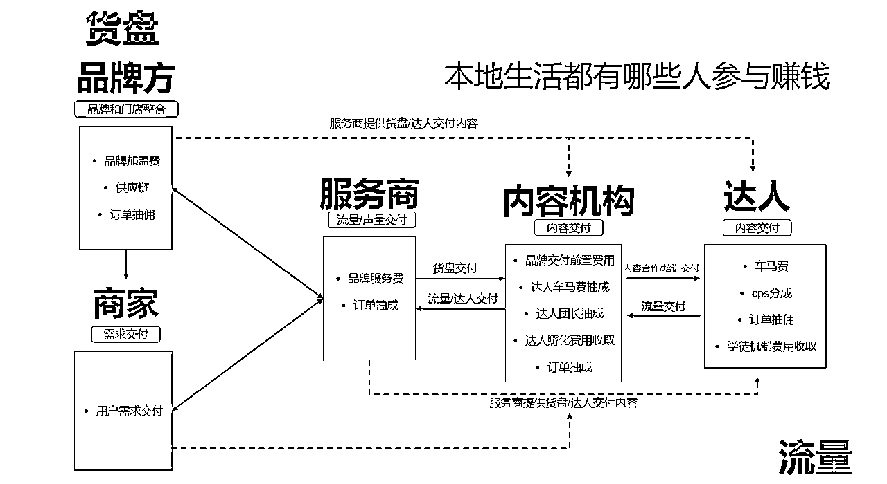（看图理解资源流转方向）

## 五、品牌的核心能力是什么

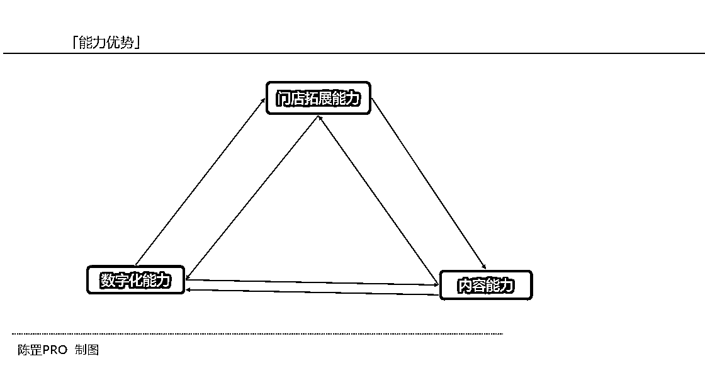

这图虽然潦草，但这是我们从晚上11点头脑风暴到凌晨5点的成果。最想强调一点：不要用流量思维做本地生活，要站在实体角度想。单个门店覆盖有限，所以必须铺更多门店。抖音就是一道数据题，所有东西都能用数字反馈：哪个区域成交高，要不要补门店；哪个区域成交少，是不是有飞单。数字化能力有两方面：对商家的数字化管理，对内容的数字化分析处理，两条腿走路。

## 六、本地生活推广业务逻辑

很多品牌做不好抖音本地生活，根本原因不是预算不够，而是没搞懂逻辑，以为多花钱就能解决流量问题。我们先看成交链路。

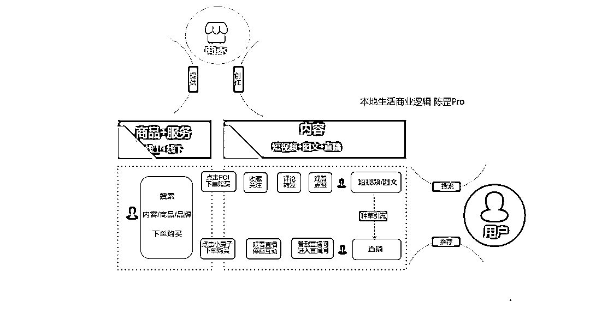

用户要么搜索，要么刷短视频/直播，看到你的门店和产品，然后下单。这背后有三个问题：怎么让更多人买？为什么买你的？会不会复购？

经典公式：销售收入=客单价×流量×转化率×复购率。

**客单价**：理想状态下，客单价越高核销率越高，因为用户接受高价是因为你的服务独一无二。但在充分竞争市场，价格会被市场压到合理区间。定高了用户流失，定低了扛不住成本。

**流量**：可以理解为有多少人看见你，取决于服务类型和门店数量。快餐店通常覆盖两三公里，特色菜能覆盖十公里。同一家洗美店，洗车覆盖3公里，机油能到5公里，贴膜能到10公里。门店少，覆盖就少；开到100家、1000家，覆盖面自然上去了。所以流量的基础是门店数量。

**转化率**：100个人看了，10个人买，转化率就是10%。靠的是服务和产品力。

**复购**：第一次买了，第二次还来不来？看服务，也看门店环境，比如好不好停车，都会影响复购。

在抖音做本地生活，还要加一个核销率，因为用户必须到店核销，才算完整商业行为，才是门店实打实的收入。所以：**核销额=客单价×流量×转化率×复购率×核销率**。

重点说说流量、转化、核销率。

**流量**：获取更多流量的基础，一是业务覆盖人群，二是门店数量。比如一个门店覆盖3公里、5万人，你有10家店，理论覆盖就是50万人。但这只是“理论上可触达”，还得靠一条条视频、一场场直播反复触达，让用户每天都能看到你。所以门店数就是流量地基。顺带提醒：大场直播的本质是把未来需求前置，不是为了做而做，要搞清楚目的。

**转化**：门店多、覆盖广只是基础。用户看了你的视频，凭什么买你的服务？因为你做得好。在线上，就是要把POI页面做透：好评度4.8以上、套餐销量10万+、用户评价高。做到这个程度，平台都会主动推你，因为平台也缺这种好产品。

**核销率**：用户线上购买后，为什么有些人不去核销？关键是用户心智。是本来就有需求，搜索后购买；还是本来没需求，刷到视频被种草？这两种逻辑完全不同。搜索来的核销率，一定大于内容推荐来的核销率。

最后想说的是，本地生活是一场长跑。别总盯着眼前流量，多想想两三年后，你的业务能沉淀下什么。今天就聊到这里，希望对你有启发。

这就是为什么我始终建议每个品牌和卖家，必须把搜索这件事重视起来。

如果你连这套底层逻辑都没弄明白，想在线上拿到长期稳定的成绩，几乎不太可能。

最后想送你一句我一直放在电脑屏保上的话，每天都要看几遍：

先去做，

再把它做对，

然后把它做得更好。

共勉。