# 把情感伦理冲突做成短内容流水线：最近有人用单号日赚两百的实操拆解
作者：龙哥

先交代背景。

近期团队在测试的一个轻副业方向，聚焦在两性关系中的越界议题。整体逻辑很直白：在平台上找到已经跑出数据的短篇，截取开头钩子，再用大模型补齐成500到1000字左右的完整叙事，最后回流到头条的短文栏目做分成。听起来像老题材，但最近半个月的反馈比预期更稳，所以整理出来做参考。赛道可以横向迁移，核心是找情绪浓度高的细分，避免同质化内卷。

提到这类题材，很多人会担心限流。只要操盘得当，平台对情绪饱满的内容依然会给分发。婚内越界、第三者、婚姻破裂、家暴、反校园欺凌等关键词自带讨论欲，读者既爱看也爱争吵，评论区一旦活跃，停留与互动都会拉升，收益自然跟上。

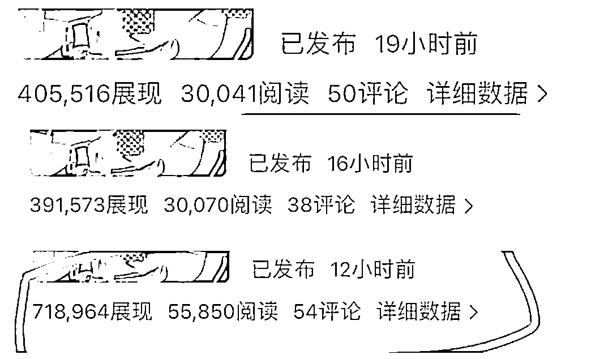

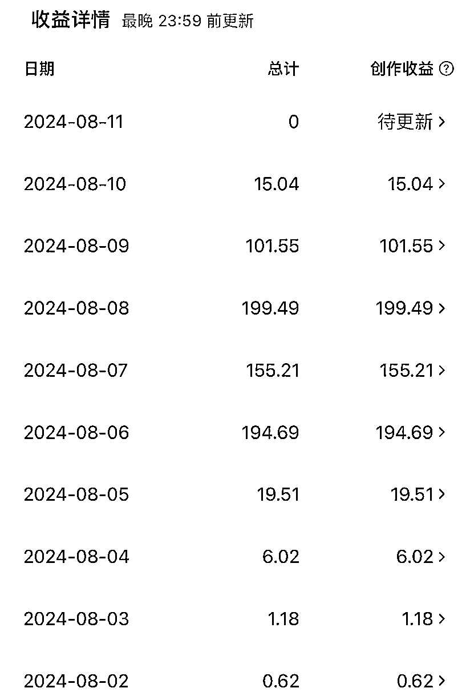

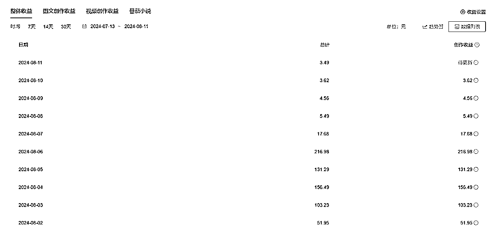

说明：6号到11号期间停止更新，但7号之后的收益仍在靠存量阅读缓慢累加。

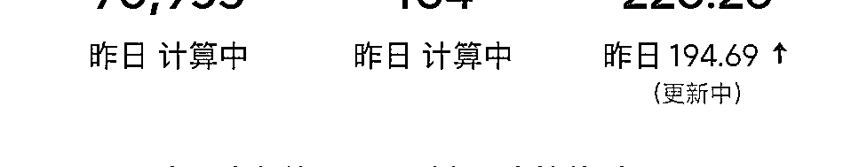

基调需要先定好。这类叙事不是为了煽动对立，也不是对当事人进行人身攻击。我们倾向用更人性化的视角呈现——第三者行为不被鼓励，但她同样是现实中要谋生的个体。有些人之所以走到这一步，背后往往是长期困境的叠加。我们不美化行为，但保留理解的空间，让内容保持建设性。虽然口吻克制，但发布后评论区依旧容易出现激烈争执，这正说明选题打到了痛点。

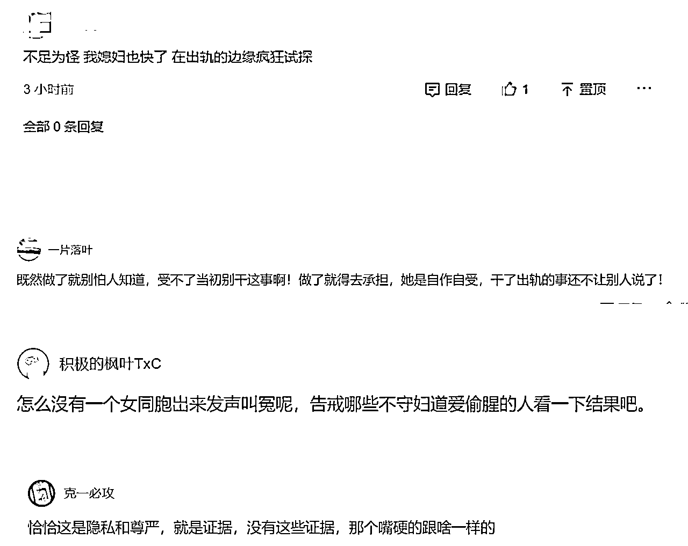

如果此前没接触过这个栏目，可以先做了解。今日头条旗下有一个轻量短文模块，功能类似🧣动态、🐧空间、百家号快讯，作者可在2000字内发布短篇。零粉丝即可开通分成入口。虽然当前红利期已过，单价有所下探，但规则仍在迭代，只要持续研究玩法，换赛道依旧能做。

下面说说我们现在在跑的细分打法。

起步阶段先做号。移动端直接在应用商店装客户端，用手机号开通；PC端打开官网登录即可，注册受阻时切回移动端操作。实名认证建议等到提现时再做，减少账号浪费。若手头有历史号，优先启用老号，权重和单价通常更友好。

操作框架分几块。

第一块是素材库搭建。我们采用“以爆养爆”的思路：只找已有数据验证的对标短文，提取其开头作为创作种子。筛选标准以曝光和互动为准，曝光尽量选在五十万以上，点赞优先千赞以上，至少三百赞起。阅读量不可见，点赞数就是判断潜力的替代指标。

第二块是词库扩充。基础词根围绕越界、第三者、离婚、家暴展开，向外延展出：有染、婚内出轨、捉奸、婚外情、外遇、扶持小三等。养成持续积累同类用语的习惯，后续检索会更高效。

第三块是素材抓取。直接在客户端搜索词根进行人工翻找，或使用第三方抓取工具批量导出表格。易撰网提供微头条抓取功能，输入词根后可导出清单。咸鱼上也有相关账号交易，自取即可。抓到一篇优质内容后，建议顺藤摸瓜进入作者主页，把该作者的过往作品一并收录，收藏到浏览器书签，后续创作时直接调用。

第四块是养号。推送前先养两三天，每天分早中晚刷相关话题，点赞评论收藏，保持垂直标签。正式发布后也要保持日更与养号同步，让账号始终停留在同一领域。

第五块是大模型补写。核心动作只有找开头、喂指令、生成、复核四个环节。

找开头时注意避坑：避免使用真实人物姓名、带有公职身份标签的案例、战争政治、造谣抹黑等敏感内容，信息陈旧的也不建议复用。

补写指令示例：

用通俗易懂的笔触续写这段故事，保持震惊感、伦理冲突、戏剧张力与争议性，强化情绪共鸣，结尾回归正能量，加入道德解读与人性批判，约一千字：“爆文首段”

让模型围绕中国法律视角展开续写，对人性缺陷做批判，约千字：“爆文首段”

用自然口吻续写给30-60岁读者阅读，兼顾正反观点与质疑声，约千字：“爆文首段”

写作基调始终保持建设性：点出问题本质，明确错误边界。第三者行为不被提倡，但我们承认其背后的人性复杂，不压制、不嘲讽，而是引导向良性反思。

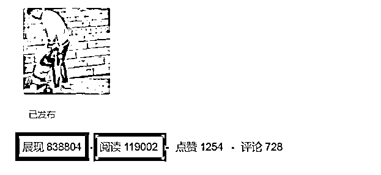

示范工具我们主要用豆包，生成效果稳定。

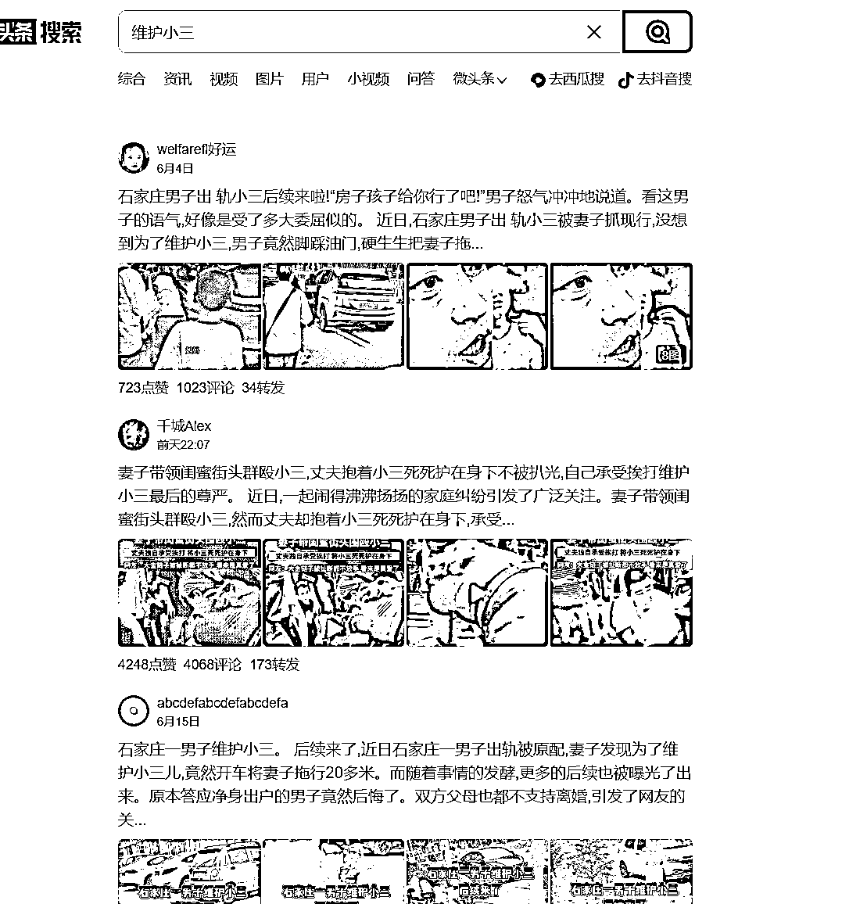

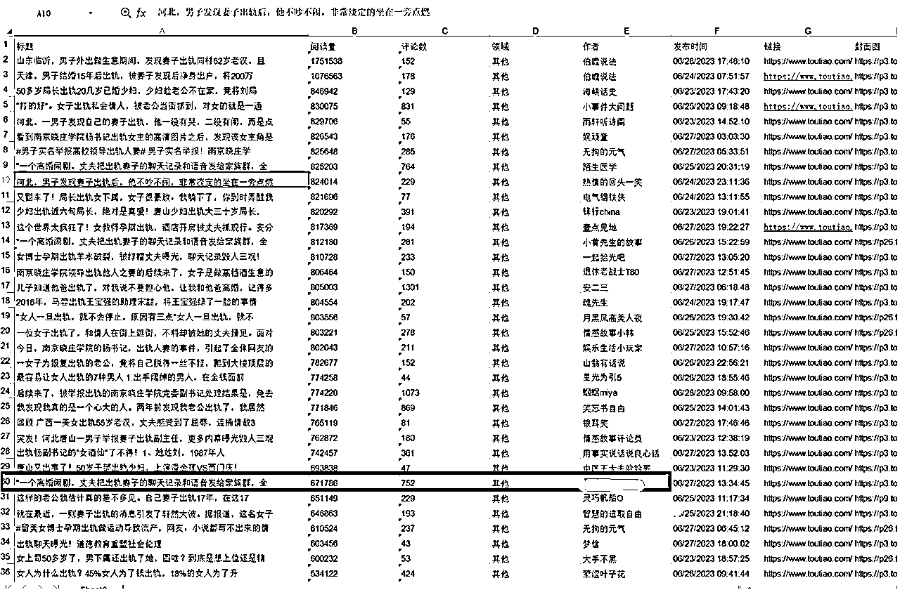

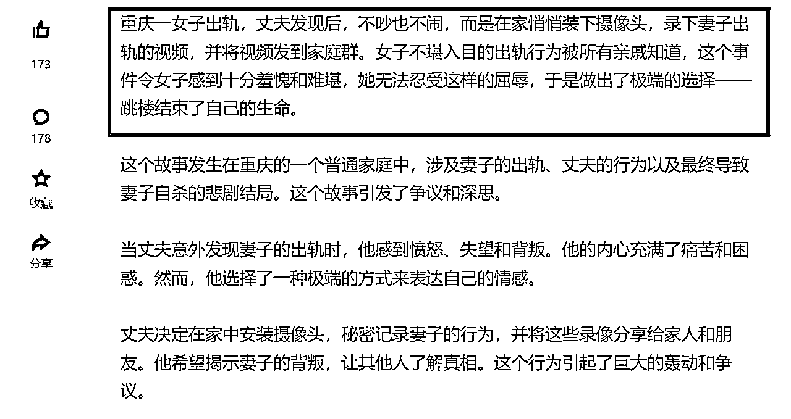

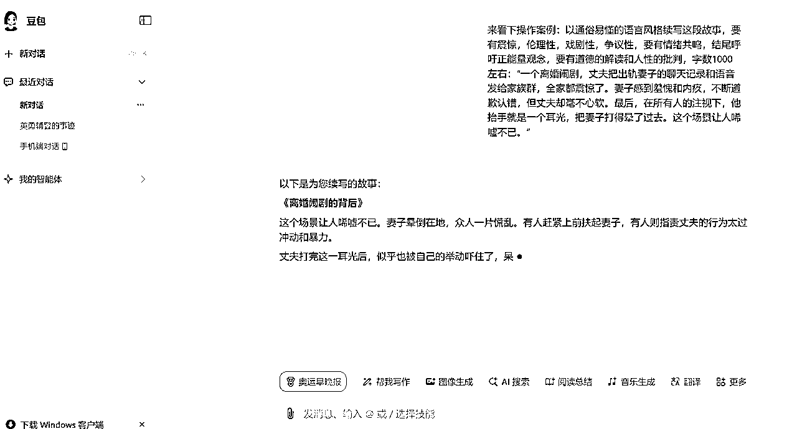

同一次开头可以产出多版不同视角的文章，爆了一篇后可继续沿用该开头多笔生产，提高连续爆发的概率。

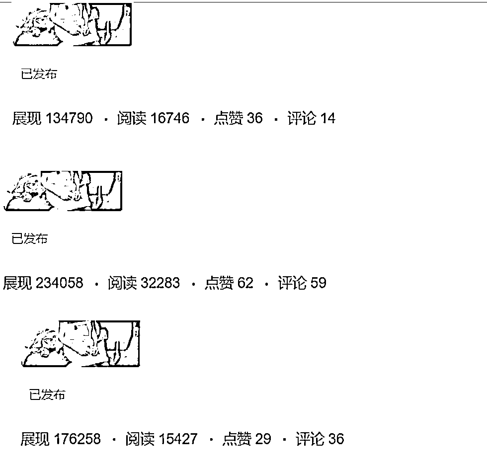

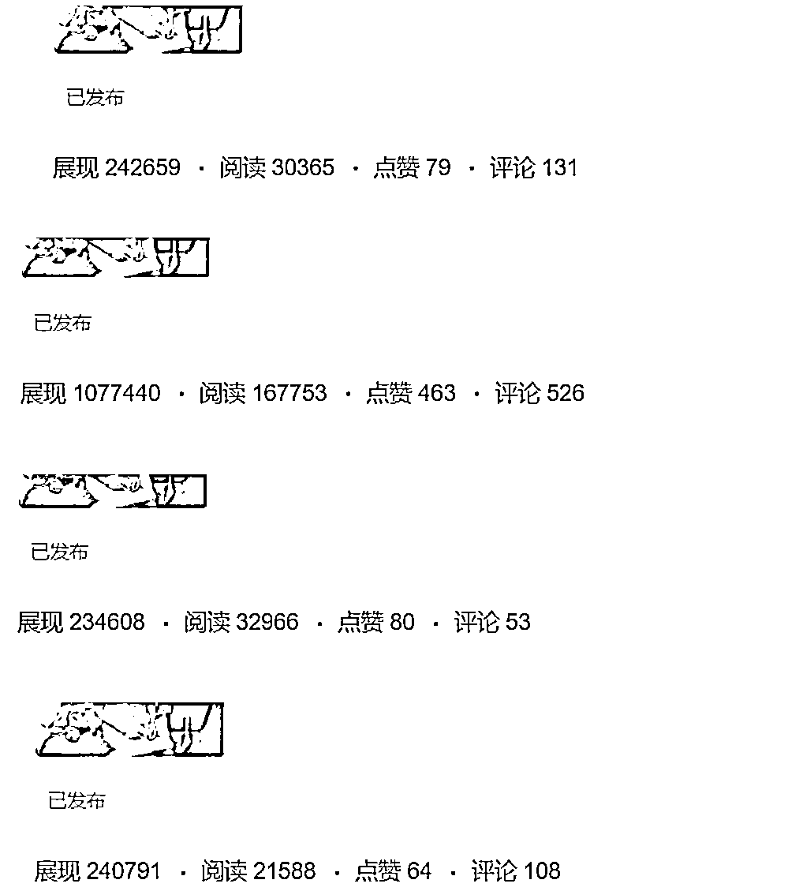

配图建议直接截取对标原文的配图并去除水印，注意尺度：避免血腥、色情、清晰人脸。真实人脸易引发投诉，眼睛部分不要简单打马赛克，用表情贴覆盖更安全。

发布节奏上，复制首段+模型正文+话题标签+配图，完成一次推送。建议日更十条左右，保持稳定输出。若发现某条阅读快速抬升，可在同开头下连发五到十条，冲击连续热度。但需注意频率过高易被判定为旧闻，出现限流或扣分。

整体来看，这个玩法更适合做短期快速变现，长期深耕难度较大。但方法本身可迁移，在情感大盘下持续挖掘新分支，依然有空间。经验会随实操积累，有问题可以私信交流。