新手必看！宽基指数基金到底怎么选？

大家好，我是泽泽，欢迎来看这篇文章～

上一期我们聊过指数基金，今天把目光聚焦到宽基指数基金上。

指数基金大致可以分成两大类：一类是宽基指数，覆盖多个行业的众多公司；另一类是行业指数，资金全部集中在某个特定行业里。

接下来，我们一个个认识常见的宽基指数。

先说上证50指数。它由上交所里最具代表性的50只股票组成，反映的是沪市优质大盘公司的整体状况。这个指数的特征很明显：以大盘股为主，能代表大盘走势；成分股有严格的筛选要求——上市不满一个季度的不选，暂停上市的不选，财务有问题的也不选，连续亏损的更不选。

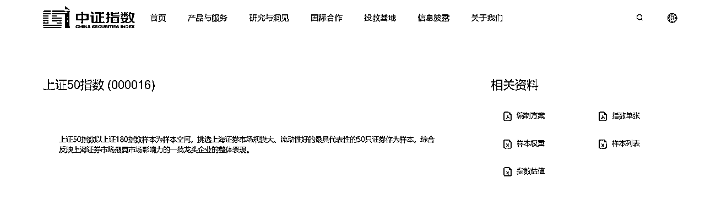

如果你想知道具体怎么查指数，可以翻翻我之前写的那篇文章。

十大权重股长这样：

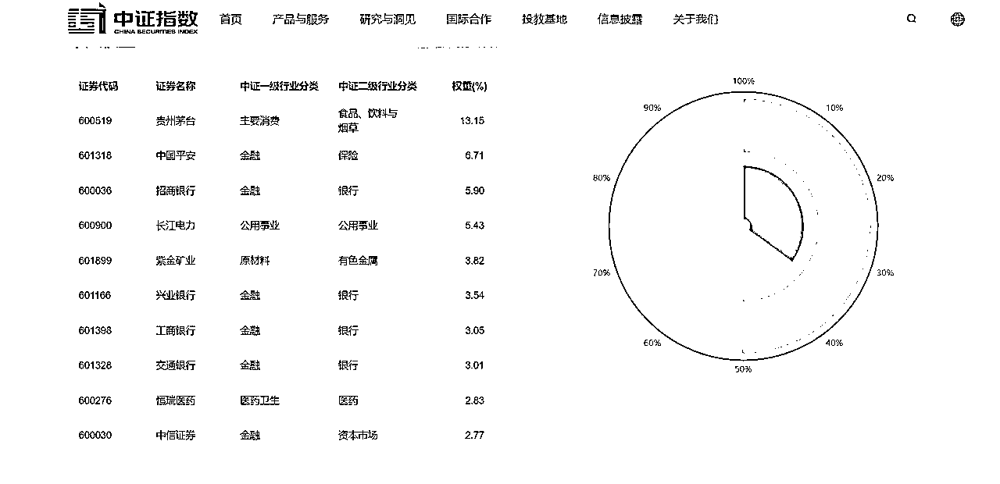

想找对应的基金产品，直接去天天基金网搜：https://www.1234567.com.cn/

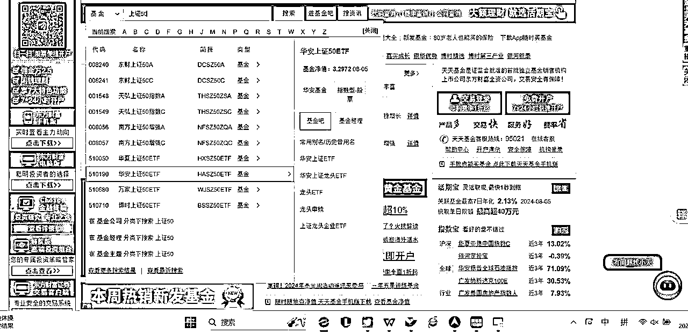

第二个是沪深300。它由沪深市场里规模大、流动性好的300只证券组成，发布日期是2005年4月8日，用来反映沪深上市公司证券的整体表现。说白了，就是上交所和深交所里综合实力最强、交易最活跃的300家公司，基本全是大型企业，总市值能占到A股全部市值的60%以上，可以说是国内股市最具代表性的指数了。

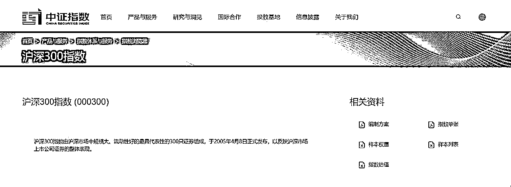

它的十大权重股如下：

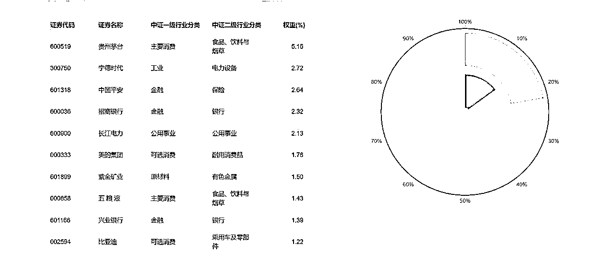

再来看中证500。编制方法是这样的：先把沪深300的样本剔除，再把过去一年日均总市值排名前300的股票也剔除，接着按过去一年日均成交金额从高到低排序，去掉后20%的股票，剩下的按日均总市值排，取前500名作为样本。所以中证500反映的是A股里一批中小市值公司的股价表现。

如果用一句话总结三大指数：上证50对应上交所大型企业，沪深300对应沪深两市大型企业，中证500对应沪深两市中型企业。中证500的代码是000905和399905。

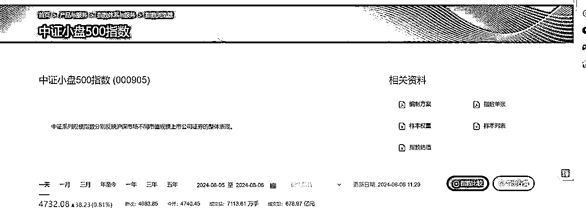

十大权重股在这里：

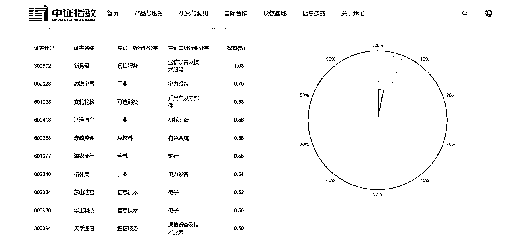

接下来聊聊创业板指。

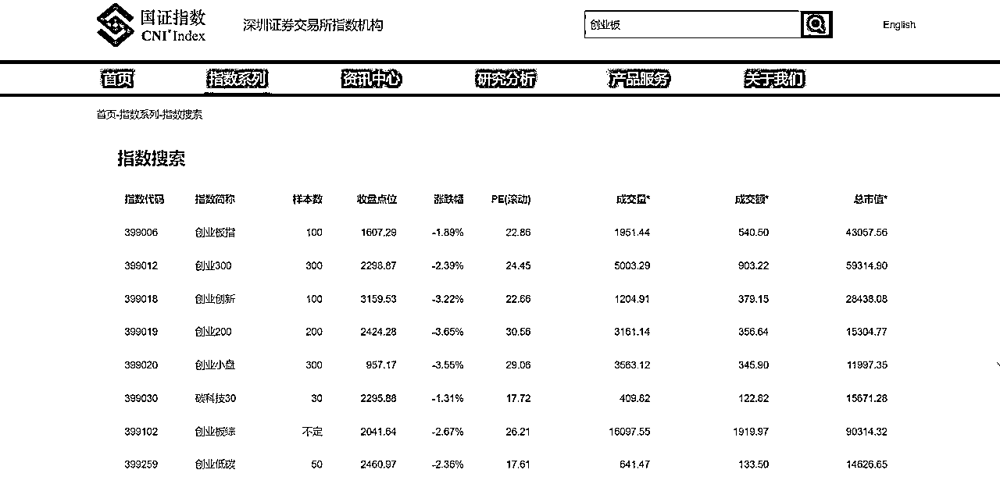

先说说什么叫主板。主板对公司的营业期限、股本大小、盈利水平、最低市值等要求都比较高，能在主板上市的多是大型成熟企业，资本规模大，盈利能力也稳定。主板上市的条件有：最近3个会计年度净利润为正，且累计超过3000万元；最近3个会计年度经营活动产生的现金流量净额累计超过5000万元；或者最近3个会计年度营业收入累计超过3亿元。

对应的基金产品（搜索原理和前面一样）：

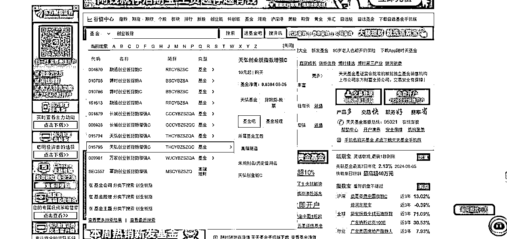

最后是实操环节，具体怎么做？

第一步：在手机应用商店下载“天天基金”App。

第二步：打开App，找到“指数宝”。

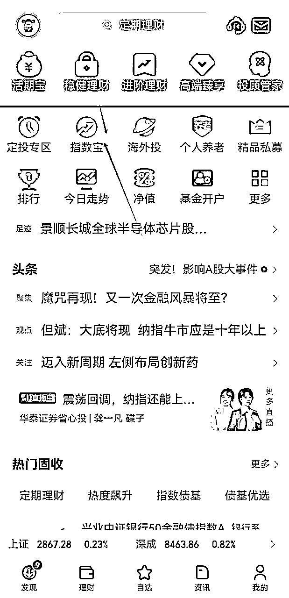

第三步：点进去，找到“更多宽基指数”。

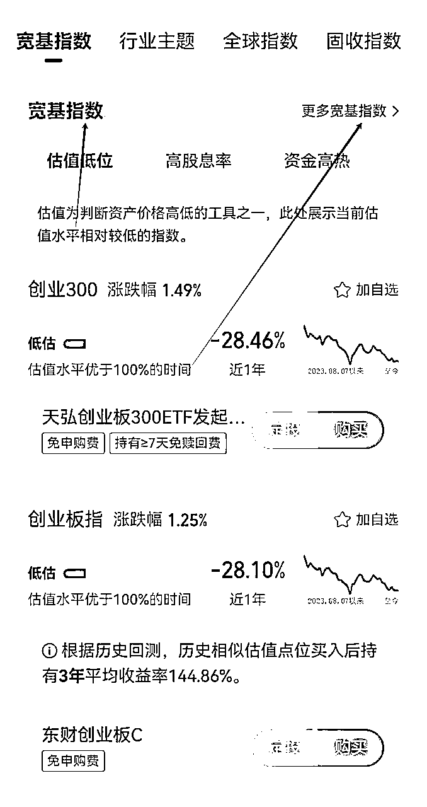

第四步：找到我们刚才说的中证500，今天就拿它举例。

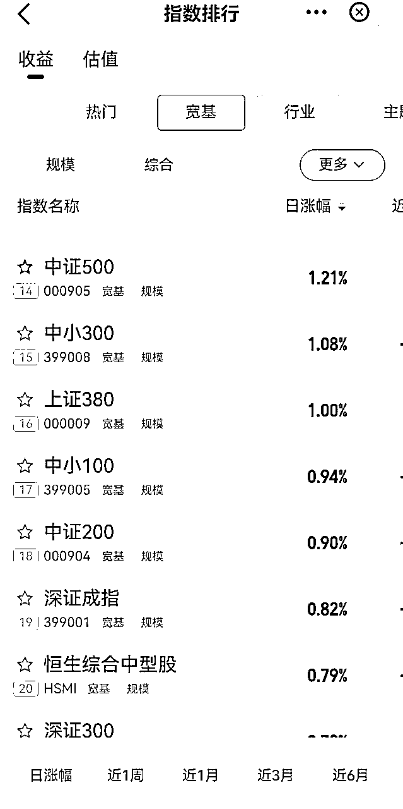

第五步：点击“跟踪基金”，就能看到对应的基金产品了。

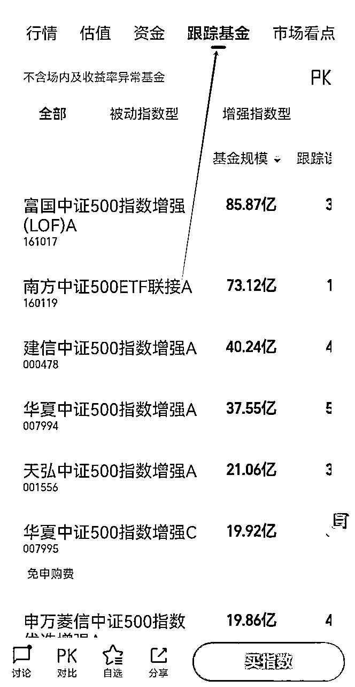

第六步：在“估值”页面可以看到PE百分位，如果它处于低估位置，那就可以重点关注。

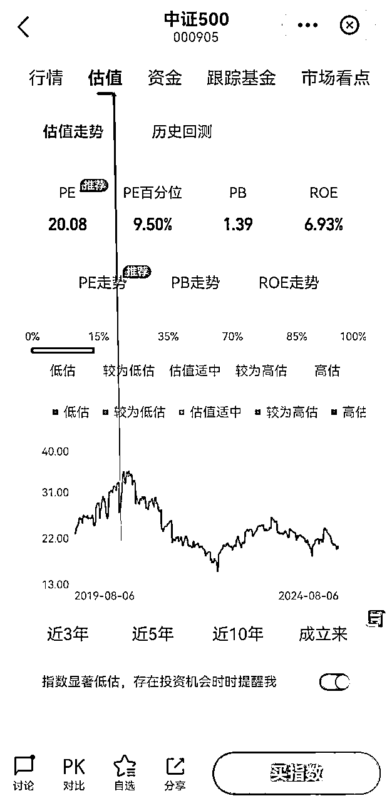

总结一下操作步骤：

第一步，确定你想买的指数。

第二步，找到这个指数，点击“跟踪基金”，挑选靠谱基金公司对应的产品。

第三步，结合基金的规模、成立年限、费率和跟踪误差，最终锁定合适的指数基金。

具体怎么筛选，可以看看我之前的文章。

风险提示：以上图片都只是参考案例，不构成任何投资建议。市场有风险，投资需谨慎。做任何投资决策前，建议你咨询专业人士，并结合自己的实际情况谨慎判断。在任何情况下，本文信息或观点都不构成对任何人的投资建议。文中内容仅反映作者在出具日的看法，投资者应独立评估，同时考虑自己的投资目标、财务状况和特定需求。依据或使用本文内容造成的一切后果，本公司及关联人员均不承担法律责任。

好啦，今天的分享就到这里～