# 超级个体流量矩阵、转化与升单实操全流程

# 一、前言

大家好，我是小俊，这是我在龙哥盟的第二次分享。上次的帖子没能拿到精华，但依然帮到不少圈友。时隔两个多月，我把这段时间跑通的玩法再梳理一遍。

不少人私信说按上次的方法引流效果不错，但转化难、剪辑矩阵耗时严重。对超级个体来说，人力天花板摆在那里，靠自己扛不动。所以这次我拆解的，是如何用低成本兼职矩阵去做内容分发，再把流量承接到私域做转化升单。

上一篇文章：
内容很长干货很多，请圈友耐心阅读。

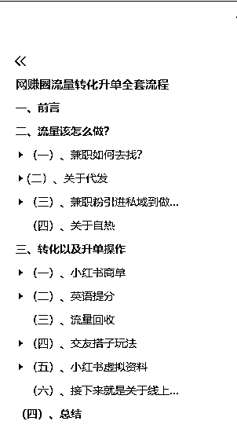

在进入细节前，先感谢龙哥盟这个圈子，也感谢圈友们的灵感输出。优秀的圈子真的能改变人，出水不忘挖井人，今天我把最近的整套打法毫无保留分享出来。

# 二、流量怎么打

我给出的思路是兼职代发模式。这个模式圈内不算新，但我把从拉新到变现的完整链路串起来了。

看过上篇的同学会问，为什么上篇没分享？因为当时模式刚跑通还不稳定，没敢贸然发出来。方法不一定适合所有人，但能帮到一部分人就是价值。

## 一、兼职从哪找

剪辑最耗精力，完全可以外包给兼职。廉价兼职最集中在校园。

大学生愿意用时间换钱，而且执行力强。比如食堂干一天6小时50元，时薪8元左右。剪一条1分钟工具号视频只要半小时，项目拆解10分钟内搞定。1小时能出2条工具号或6条拆解。

线下全职剪辑月薪起步5k，日均167元。按一天10条算，单条成本16.7元。用17元找大学生，相当于能拿到3条工具号+1条拆解视频。降本是第一步，没必要为个体去配一个线下剪辑。

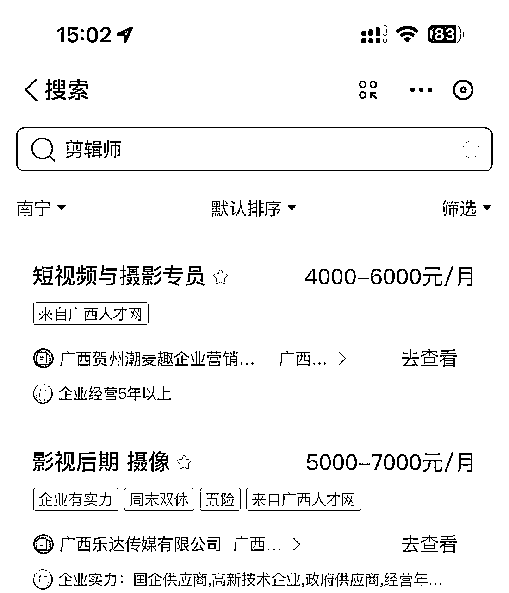

找大学生兼职的方法：

### 第一步

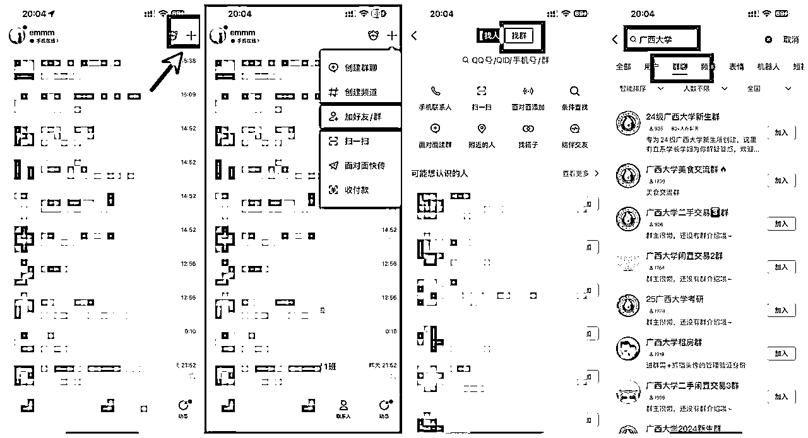
先在🐧加群。建议搜二三线城市的本科院校。校园认知普遍不高，对社会和互联网玩法不敏感，正好利用信息差。我工作室就在大学城旁，隔壁高校的学生经常被宰，说明可操作空间大。他们对剪辑代发的市场价也不清楚，知道价的直接过滤。

### 第二步

进群后别一上来就发招剪辑一单一结，会被当成诈骗。先聊天、拉近距离、建立信任。熟络后秀肌肉，秀车、秀流水都可以。大学生吃这套，有年少有为的梦想，人都是慕强的。

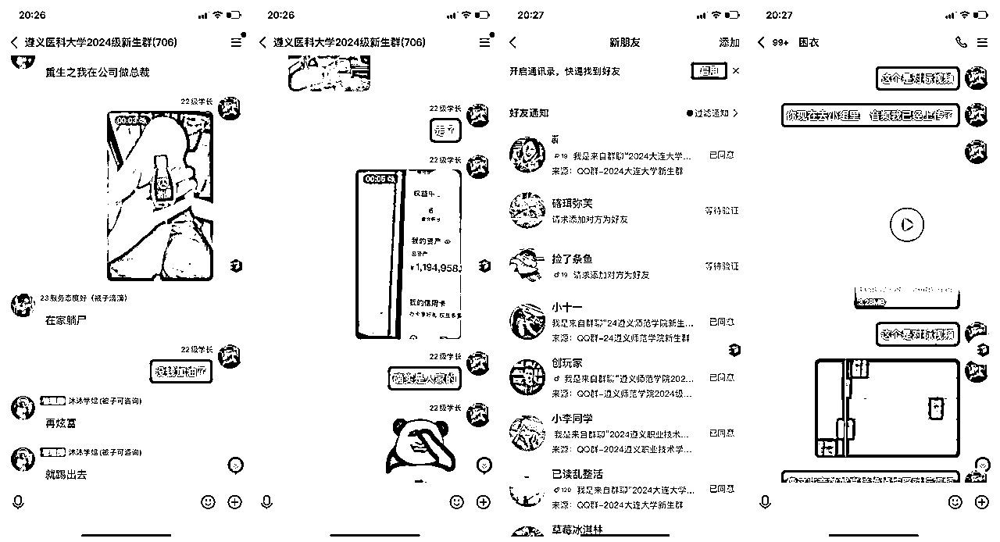

## 二、代发兼职的搭建

### 1.第二种引兼职粉的方法

把📕昵称设置成对标模板，可打任何粉。

然后去刷对标账号，需要什么粉就刷什么，比如要兼职粉就刷兼职/副业图文。

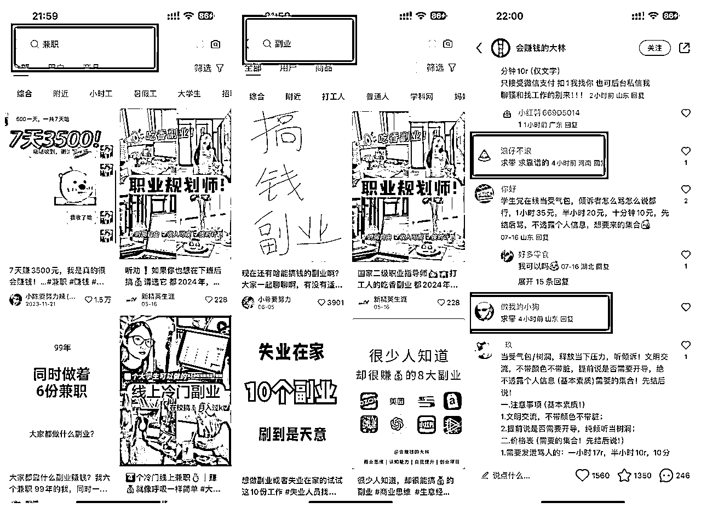
重点截流最近爆款笔记，找5小时内评论的用户，活跃度最高。关注后基本会回关。

### 2.实操

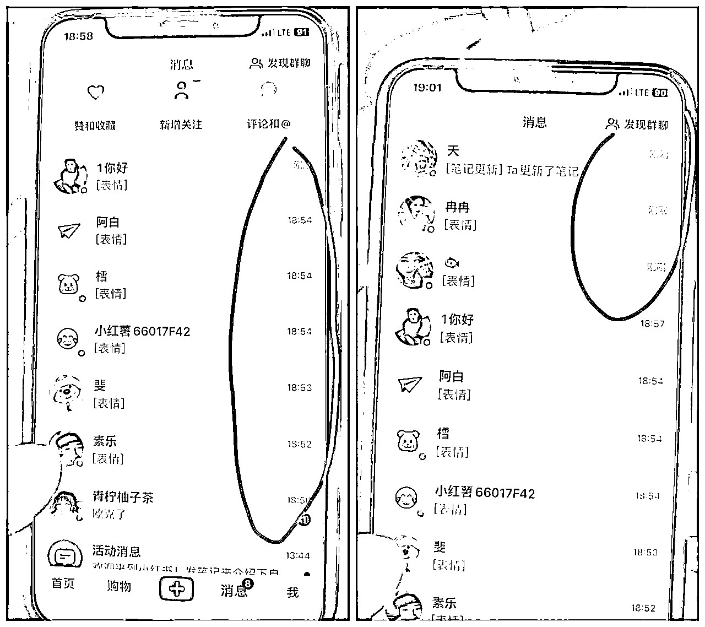

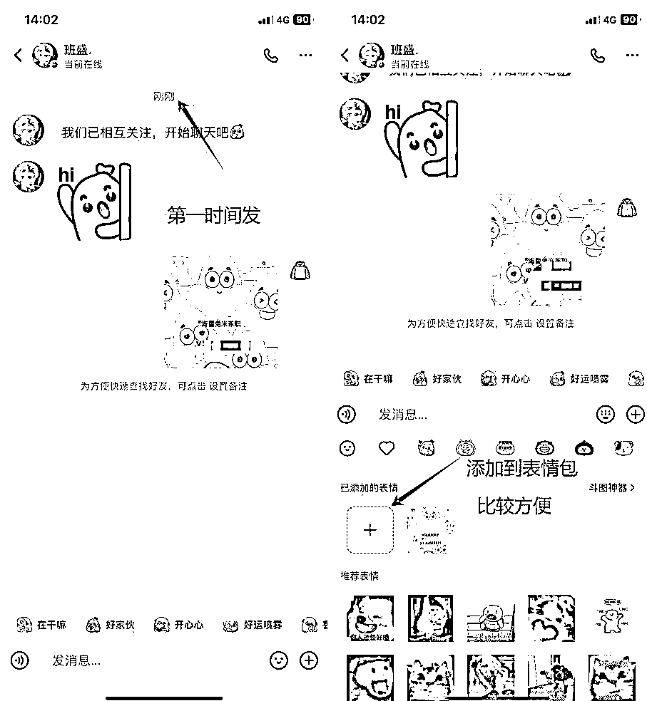
用户回关后，用美图秀秀做一张图直接发过去。

坐等上人。一定要用不同号承接兼职粉和副业粉，这批粉用完还能转卖。

加过来后做留存，话术统一：做兼职副业的朋友看我朋友圈置顶。

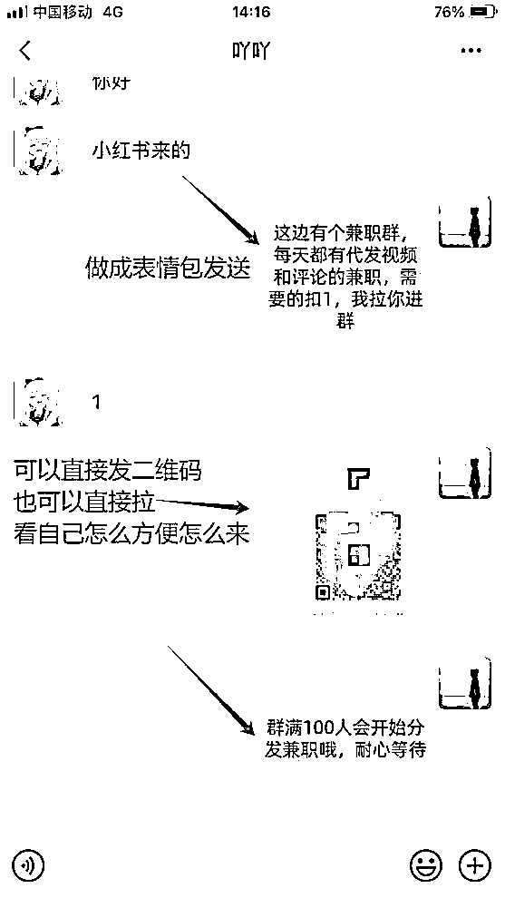
朋友圈置顶一个兼职副业社群二维码。社群只是任务发布地，有任务就@全体：现在要任务的私信我。

参考报价：代发图文/视频1元/条，评论区截流0.5元/条，截流到一人加1元。

### 3.截流培训

可以让兼职去📕/抖音评论区截流，但别教回关法。回关法是留给付费学员用的，兼职是付工资的，学员是付费的，本质不同。

比如抖音评论区有很多求带、求兼职，安排截流粉去回复或私信带她。废号是常态，记住那不是你的号。

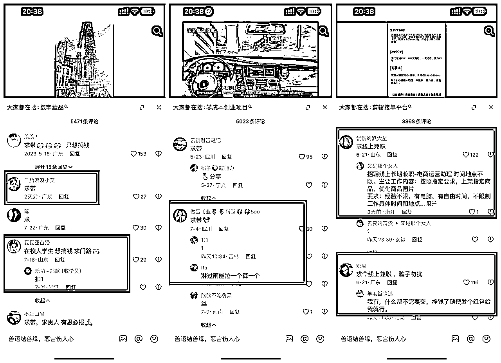

### 4.记粉和SOP

用专门的🛰️承接兼职粉，进粉验证要求扣111或666，才算有效。

给代发兼职粉的标准话术模板：

* 工作内容：每天花2分钟发一篇图文/视频
* 纯绿色不封号，可长期兼职
* 每天几分钟，月入几百很容易

发帖奖金：
抖音播放＜1000 1元/条，≥1000 3元/条，日结
📕播放＜700 1元/条，≥700 5元/条，日结

账号月度奖金：
粉丝500-1000 月奖100元
粉丝200-499 月奖50元
粉丝1-199 月奖20元
单条破20万 +10元，50万+30元，100万+60元，累计计算
要求日更≥1篇，合作不满1月无月度奖

每天21点结账

抖音可发高楼大厦配赚钱文案，2元/条+播放量心情结算。评论区截流0.5元/条，日发20条，引流一人提成1元，见效最快。

模型跑通后，可用兼职粉裂变兼职粉、创业粉，逐步把重心转到内容引流。素人分发体系就此搭建，后续持续更新模板和截流玩法。

### 5.剪辑教学

剪辑方法可参考上次的工具号、项目拆解、图文教程。提供参考视频，养号期可看推荐页找对标。

剪辑要点：直接发对标视频给他，不教方法。他能复刻出来说明有可塑性，再教进阶。做不出预期直接pass，大学生不缺。

价格参考：工具号5元/条，项目拆解2元/条，仅供参考，按当地定价。

第一次达标后培训，课程链接可直接发：
链接: https://pan.baidu.com/s/1g-hiPf2kHp9Bcc7-3y731g?pwd=8888 提取码: 8888
链接: https://pan.baidu.com/s/1KWOErp2YZodZEggo_-BjTw?pwd=8888 提取码: 8888

还要补细节：关键帧、音效、画中画、特效、滤镜、文字模板、文字动画。播放量核心看5秒完播和2秒跳出，开头画面+配音必须抓人。可用梗开头。

爆款文案可反复用，前面钩子不变，中间二创，结尾留钩子。

文章结尾引导点赞收藏评论666，促进互动和推流。

选题跟热点，今天热点全自动剪辑神器，就找同类爆款对标。

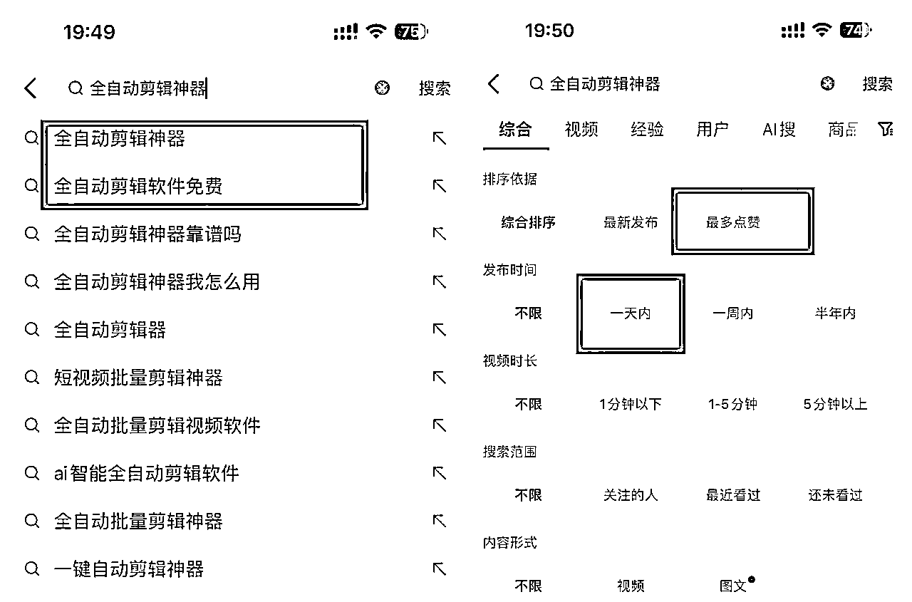
音效配音参考：
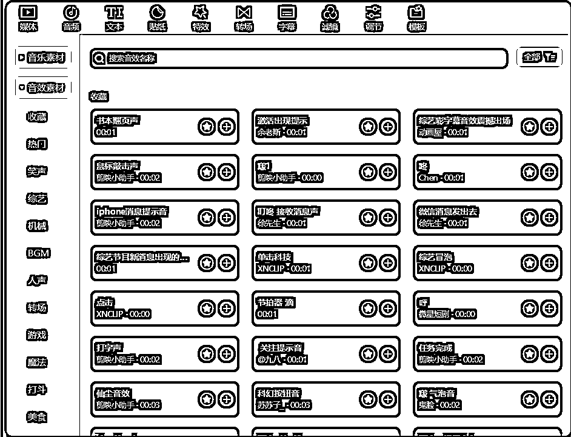
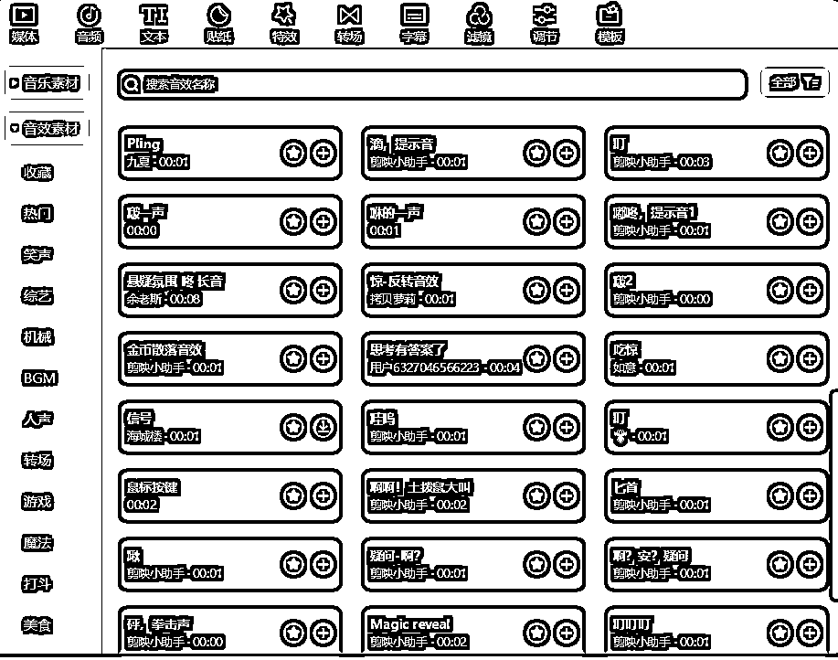
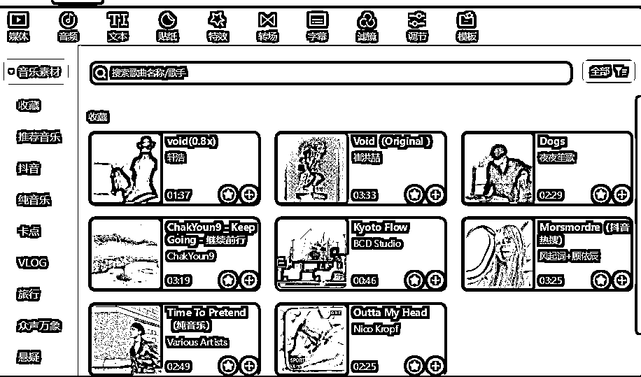
音效需按素材和文案匹配。

导流方式：群头像设🛰️号，名字设🛰️号。抖音群聊开启方法同上，📕同理。

关于粉的价值，工作室取名回关带你做项目，很多都是冲项目来的，可直接卖项目，朋友圈可洗。

人员配置：我个人配4台手机、3个🛰️号，4台设备跑关注截流，1小时一台30-50关注，进粉率7-10个，客资沉淀2小时左右，一天6轮，一台日均进30粉。纯手动，科技粉不精准。

三个🛰️分工：一个承接兼职粉，一个对接兼职粉分发任务，一个承接兼职粉分发内容带来的创业粉。

### 6.为什么剪辑和代发要分开

剪辑懂了视频制作，再做代发就能反推出整条链路。所以剪辑做代发7元/条，分开各做也7元，还是分开好。招大学生剪辑，📕招兼职粉，中间隔开形成信息壁垒。

## 三、兼职粉进私域到成交全流程

### 第一步

兼职是敏感词，别用承接号直接分发任务。前面建的通知群就是用来发任务的。

通知群或一对一分发，建议一对一更稳。

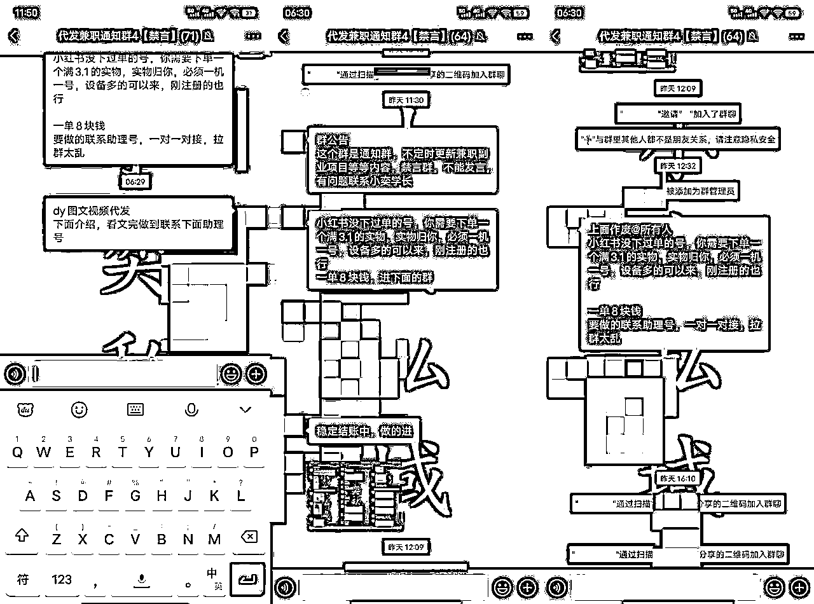

### 第二步

兼职要任务先测素材是否正常，1小时没破播放就换素材。

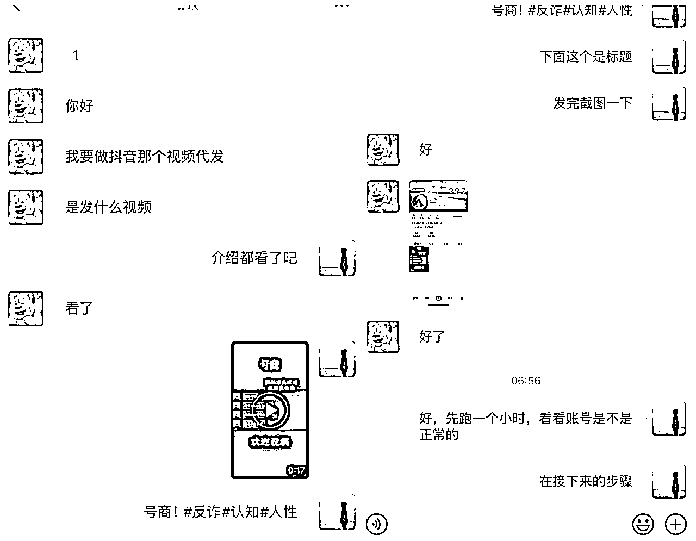

### 第三步

看视频能否投流，不行就换素材。

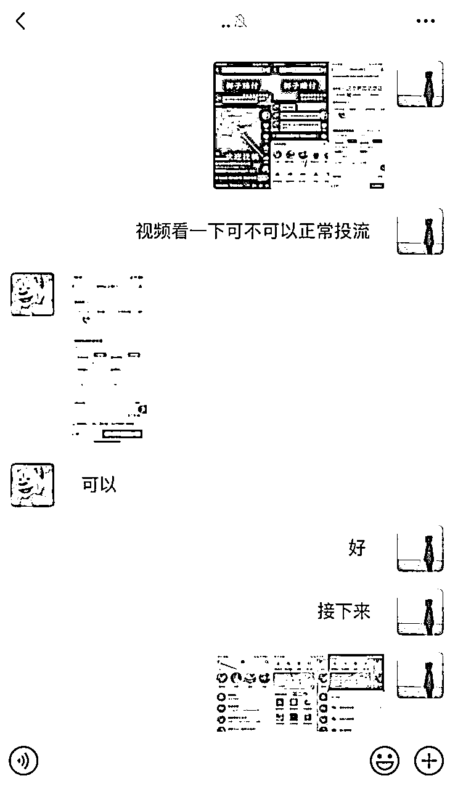
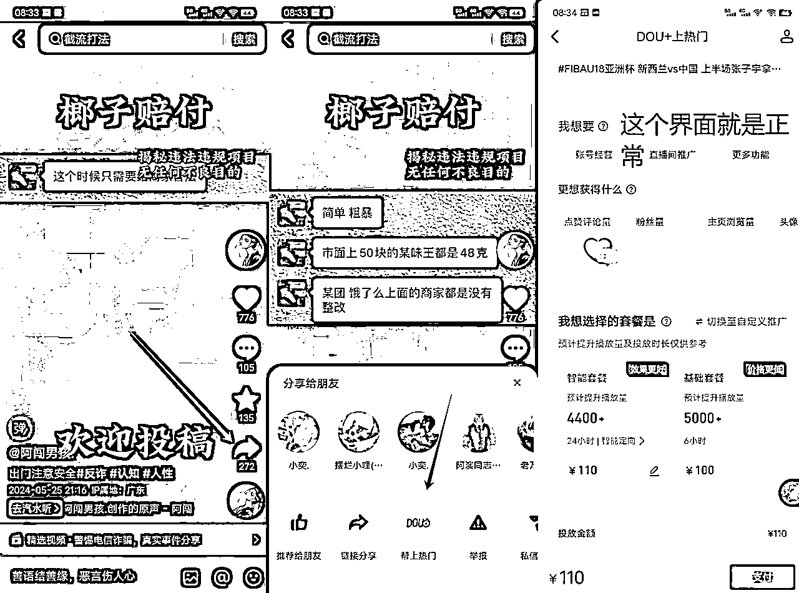
导流仍用群头像🛰️号。

### 第四步

每天把剪好的视频发给兼职，并结账。

## 四、关于自热

1.A种B收：A发作品，B去评论区截流

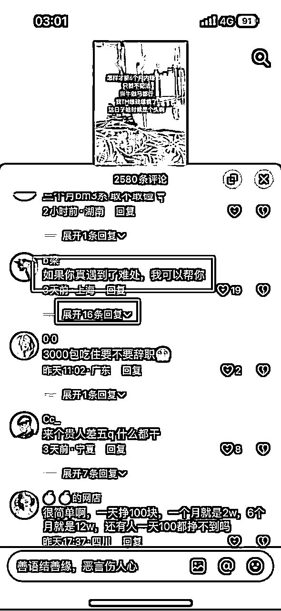

2.A种B问C收：A发作品 B提问 C收割，3号都是自己的。B的话术带关键词，付费意愿更高

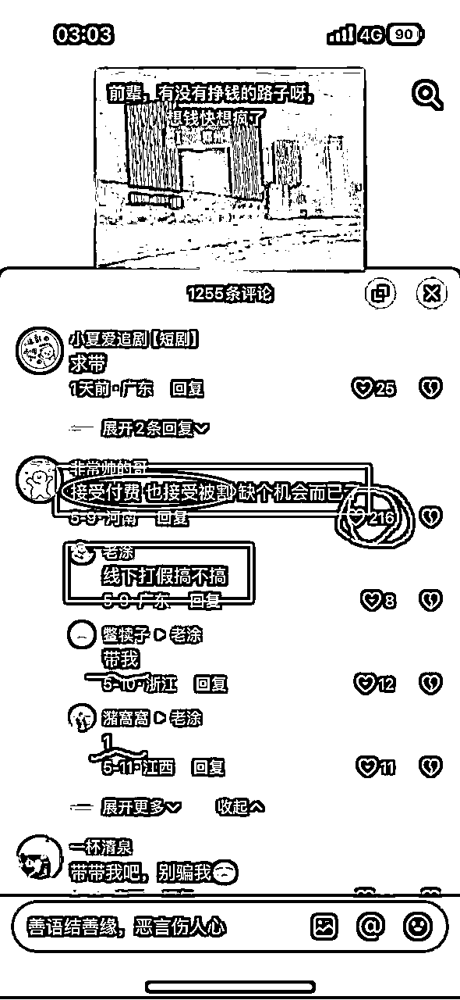

3.评论区删评论，清理负面

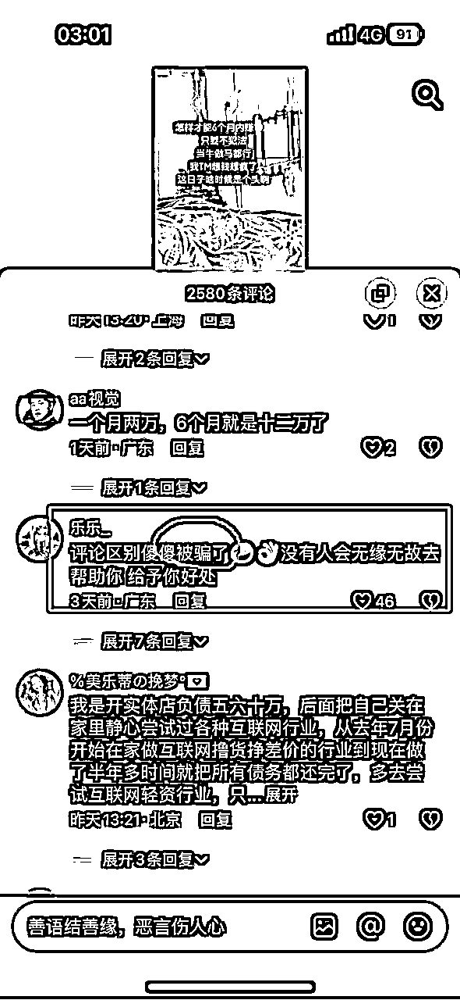
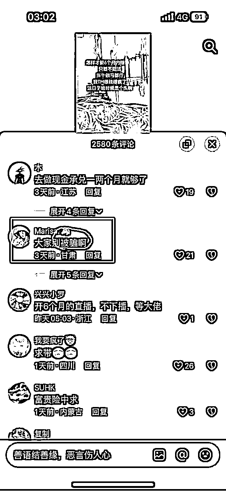
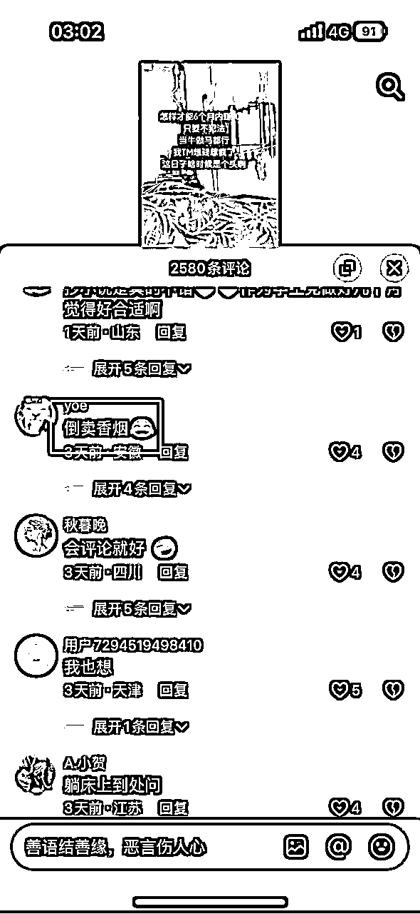
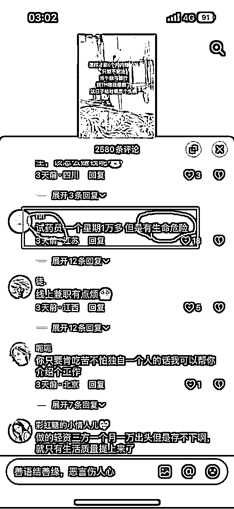

这就是兼职+代发的完整链路，不懂可私信。

# 三、转化与升单操作

转化难主要因为后端客单价高。解决方案是做低客单价产品。人设高低不重要，赚钱才是硬道理。

我设计的阶梯产品：
一转99📕商单项目群
二转199英语提分项目群
三转888流量回收
四转1280交友搭子项目
五转1980📕虚拟资料项目
六转2580线上合伙人
七转6980线下合伙人

价格仅供参考。项目必须能赚钱，才能做下一步升单。

兼职代发来的粉，可用承接创业粉的🛰️直接承接。先发📕商单项目介绍问是否上车。因为兼职工资需自己结，要提高转化直接筛选，转不了的也能用朋友圈持续营销。

项目玩法可照搬，需安排专人交付，一个项目一人负责。

## 一、📕商单

📕商单有3个快速涨粉方法：

### 1.星球动画赛道

今天把整套实操经验从头到尾梳理了一遍，涉及📕商单、英语提分、流量回收、交友搭子和虚拟资料这几个方向，每一步都尽量拆开讲清楚。内容有点长，但每个细节都可能直接影响账号能不能做起来，建议大家先收藏再慢慢看，照着一步步执行。

先说📕商单。

注册账号的时候，尽量用手机流量操作，别连Wi-Fi。账号需要完成实名认证并绑定手机号，这里有个小细节：实名信息和绑定的手机号可以不是同一个人，完全没问题。

接下来就是账号的培养阶段。

第一天，像普通用户一样打开📕正常刷内容，刷到的每个视频都尽量完整看完，不要刷到一半就划走。时间上建议拆成早、中、晚三个时间段，每段刷大概半小时就够了。这个阶段系统推什么你就先不用管，保持正常刷就行。当然也可以主动在搜索框里输入咱们做的类目关键词，比如“星球动画”“星球视频”“星球”“二次元动画”“二次元”，搜到之后点进去看完，尽量不要中途退出，否则系统容易误以为是机器在模拟人工操作。

第二天，继续在搜索框里找同行的对标内容，给自己打上领域标签。具体来说，搜索“星球动画、星球视频、二次元、二次元动漫、星球”这些词，刷到的作品需要适当点赞、收藏、评论，也顺手关注几个账号。互动频率要有节制，基本上每五个或者六个视频做一次点赞评论收藏的动作就够了。

第三天，基本延续第二天的操作，正常点赞关注。如果推荐页里出现了符合你赛道的视频，同样可以进行评论、转发这些动作。评论不用太频繁，大约五个赞配一个评论。评论内容最省事的来源，就是从同行那边找热评——那种火热度高、回复多、点赞量高的评论，直接复制粘贴过来就行。

这里有一个判断标准：当你的发现页里，至少50%到70%的内容都是你这个赛道的，就说明账号养得差不多了。如果这个比例还不到40%，那就继续养，别急着发内容。

关于怎么搜、搜什么，也很有讲究。用关键词搜索你所在赛道的笔记，优先找点赞量超过1000的作品，认真浏览、点赞、评论，再挑几个账号关注一下。举例来说，做星球动画的话，就在📕搜“星球动画、星球视频、二次元、二次元动漫、星球”这些词，把能找到的同行动态都认真看完，整个过程中最重要的就是把自己当成一个真实用户去操作。

这里有个核心逻辑你要明白：平台是根据你平时喜欢什么来决定给你推荐什么的。你喜欢这类内容，系统就不断推同类内容给你；反过来，你发布这类内容，系统也会把它推荐给同样关注这个领域的用户。所以每天大约花一到两个小时在📕上面浏览和互动，把账号活跃度慢慢拉起来，让平台觉得你是一个活跃的真实用户，后续给的流量才会更多。

给对标视频评论的时候有一点要注意：别去写“很好”“感谢分享”这类没什么营养的套话，一定要用正常人的口吻去评论，越真实越好。

持续养号三天之后，就可以开始发笔记了。养号期间也要多关注📕的官方账号，比如“薯管家”“📕成长笔记”“创作者小助手”等等。正常情况下，只要账号没出什么问题，视频质量也能达到对标账号的水准，发到十条左右，大概率会出现一条爆款。

账号养好之后，就进入实操剪辑的环节。背景图和素材你可以去抖音、快手这些平台下载无水印的版本，但要注意两点：第一，不要直接搬运别人的内容；第二，绝对不要想着盗用素材，一旦触发查重，账号就会被限流。

发布作品前，自己一定要先把视频完整看一遍，重点检查里面有没有别人的水印，不然会影响视频流量，甚至导致限流。

发布作品的时候，不要直接点加号就发出去，要按下面的流程来操作。

随便挑一个热度比较高的创作灵感，跟着灵感去发布。

发布条数方面：千粉之前每天发3到5条；千粉之后每天缩到1到2条；中间千万不能断更，否则会直接影响账号流量。

发布时间也有讲究：早上8点到9点属于小黄金时间段，中午12点到14点属于中黄金时间段，下午15点到16点又是一个小黄金时间段，晚上18点到21点则是中到大黄金时间段。当然这只是通用时间，更细分的可以直接在📕搜“动画发布时间段”“娱乐类发布时间段”之类的关键词。

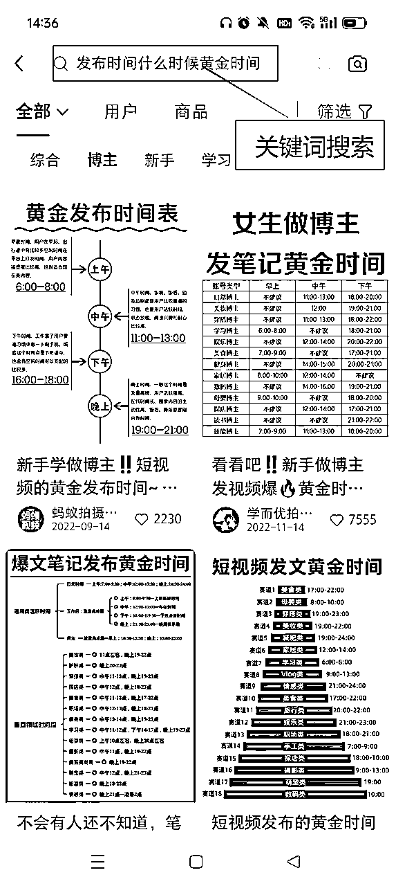

发布时还有几个注意事项。

一是封面，不能省掉，可以单独做一张，也可以直接从作品里截取某一帧。二是标题，指的是自己在发布界面额外起的那个吸引人的标题，不是视频里显示的标题。标题里不能有引导性的词，负面、违禁、擦边的表述也一律不行。三是标题下面要加话题，话题可以参考对标账号都加了哪些，照着加就行。

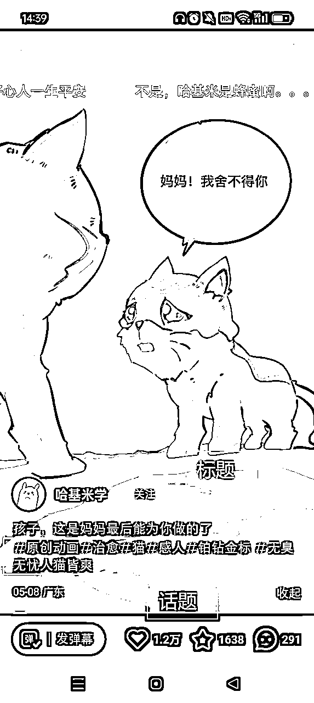

作品发完之后也别就当甩手掌柜。先点分享，然后给自己点个赞、收藏一下，自己评论两句也可以，但注意千万不要引导大家关注。如果作品发布两天了都没什么流量，比如浏览量连200都不到，那一定要花时间排查一下账号问题。反过来，如果发布的作品流量大多数都能跑到500以上，就说明这个模板可行，继续照着这个模式发就行了。

另外，还要学会自己检查视频是否违规。如果账号收到“原创度低”的提示甚至被限流，可以试试下面这套解除限流的办法。如果这套办法用不了，又不想注销重新做，那就再养一段时间，期间只发原创度高或者去重度高的作品，养五天后自检一次，看看账号有没有恢复正常。

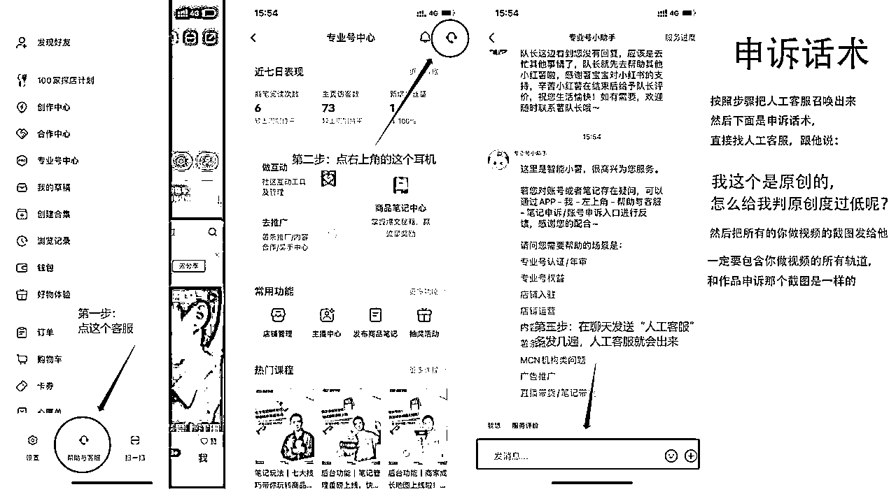

关于怎么查专业号、怎么判断账号是否正常，也有对应的操作路径。

至于简笔画视频和泥巴短剧这两类内容，养号、打标签的逻辑和上面完全一致，就不重复展开了，差别主要在于剪辑模板，大家按各自的模板操作就好。

素材这块，可以去建议页面找，也可以直接复制📕的链接去下载无水印版本。

为什么这个项目叫“📕商单”？核心原因就是：新号达到千粉后开通蒲公英，马上就能看到收益。因为一个新号一旦过千粉，很快就有机构主动找博主接商单广告，单价大约在150到200之间。

接下来聊第二个项目：英语提分。

先说一下为什么做这个方向。现在国家在推行减负政策，课外的补习机构不再允许开设。但按照中国家长一贯的惯性，他们大概率不会让孩子整个假期都在家闲着。教育K12赛道其实有点类似于📕虚拟资料项目，只不过客单价偏高。在双减政策落地之前，这个类目养活了一大批年营收上亿的上市公司，大家熟悉的新东方就是典型的代表，后来在双减的冲击之下转型去做直播带货了。巨头落幕了，但教育需求始终都在，家长的诉求就摆在那里，这块大蛋糕就看谁能切得动。

不过这个项目做流量是有一定门槛的：至少需要六个🛰️、五个视频号、一台电脑，再加一个业务🛰️。每个手机号注册绑定一个🛰️视频号，还要空出一个手机号备用。电脑是用来打开网页拍素材用的，业务🛰️号则专门承接引流过来的流量。

🛰️的头像和背景可以参照下面的感觉来设置。

素材制作其实特别简单：要么用EV录屏录制一段学习英语的过程，要么找个人拿手机在旁边对着电脑拍学习画面，十几秒一条就够，比如这种形式。

剪辑的时候，比例设为9:16，把素材放在画面最中间，上下区域填上和同类视频类似的内容，再配上画面特效、滤镜、贴纸、音效、背景音乐等等，一条全新的素材就诞生了。这个方法跟视频号素材混剪的做法差不多。

发布之后同样不能不管不顾，要一直盯着视频号的私信和评论，一旦有人咨询，直接把联系方式发过去就行。比如说：“家长您好，请加🛰️：xxxxxx，暑假快速提升英语。”或者说：“家长您好，因咨询量大，请加🛰️：xxxxxx，暑假快速提升英语。”

视频号本来就是腾讯旗下的平台，所以这个操作可以放心大胆去做，没什么问题。

导流到私域之后怎么成交，话术参考下面这些。

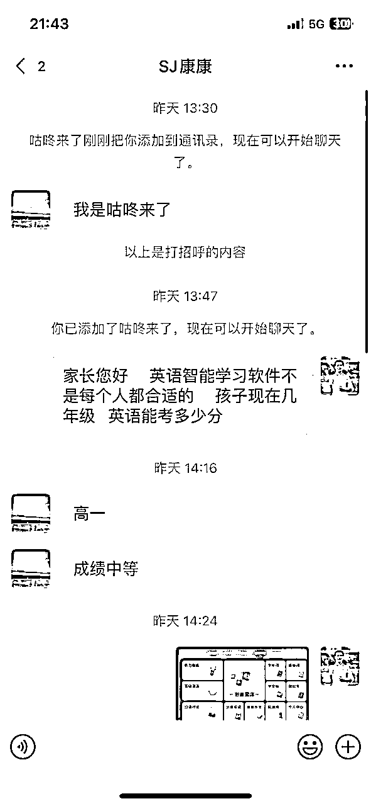

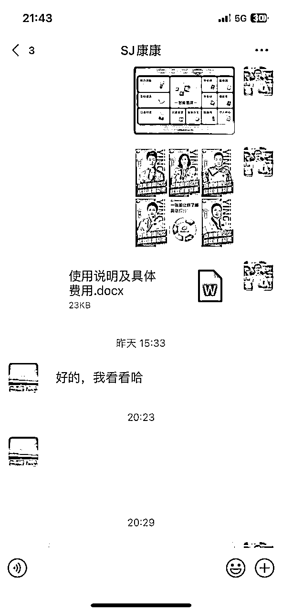

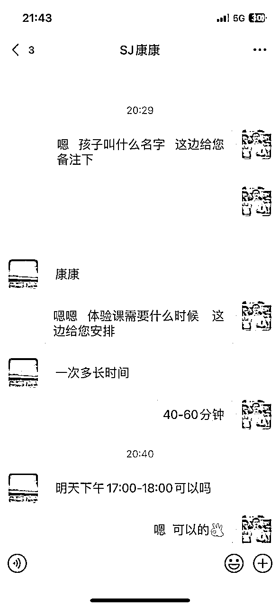

核心逻辑就是先推一个39.9的体验课，用这个低门槛产品做跳板，为成交高客单铺路，本质上是一个提转化和升单的动作。聊天记录里提到的DOCX文档没法在这里直接展示，有需要的可以联系我。

如果学员没法满足六个🛰️这个硬性条件，可以换成其他项目，或者干脆不推这个，直接做下一个项目的升单也行。大家有什么不明白的，随时来问我。

第三个项目，流量回收。

流量回收的玩法多种多样，龙哥盟星球上的圈友分享过很多版本，这里就不细说了。

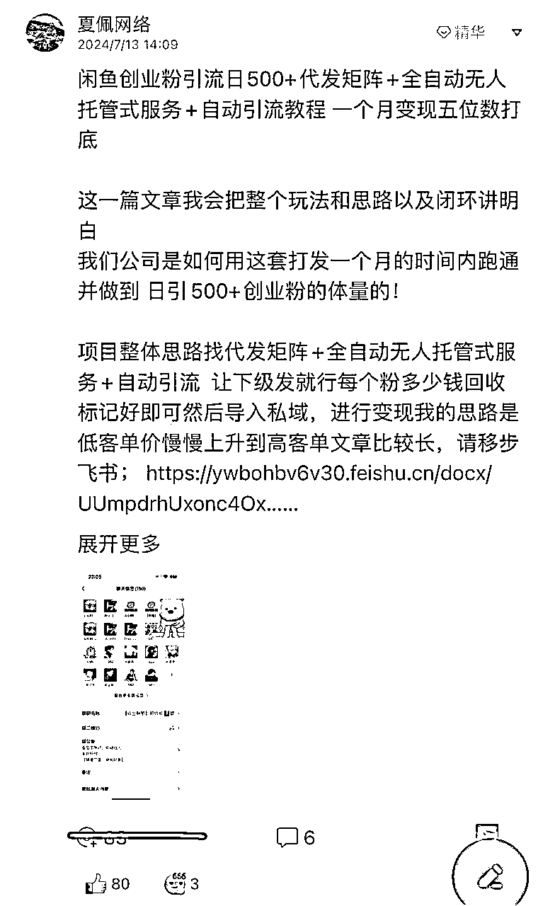

完全可以教他们去做📕的截流、工具号、项目拆解号这类玩法，也就是前面开头讲的那一套。参考价是一块钱一个粉。

操作上，先准备一个专门承接兼职打粉的🛰️号。粉丝加过来的时候要看验证信息，让兼职的人安排那些粉扣“111”或者“666”，这样才算一个有效进粉。

把剪辑代发那边来的粉，再加上流量回收过来的粉，流量基本上就不愁了。流量来了之后再重复同样的操作，一个完整的闭环就转起来了。

做流量的方法其实非常多样，像📕截流、👸号、视频号、抖音、闲鱼、Soul这些平台都可以玩，需要什么粉就让他们打什么粉。要是手里没这些资源，可以私信我，我来提供。

第四个项目，交友搭子玩法。

一开始要搞懂平台的基本玩法：先拥有属于自己的后台，然后把推广链接复制出去做推广。

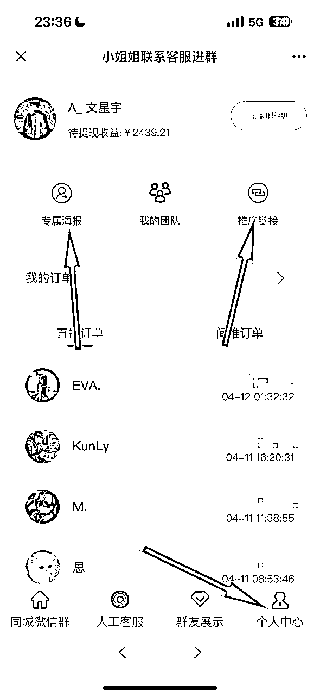

用户通过你的专属海报或者链接付费进群，后台就会同步显示收益。

接下来是三种付费进群引流的变现模式。

第一种是抖音快手截流🐧群玩法。第一步，做一个好看的二维码。

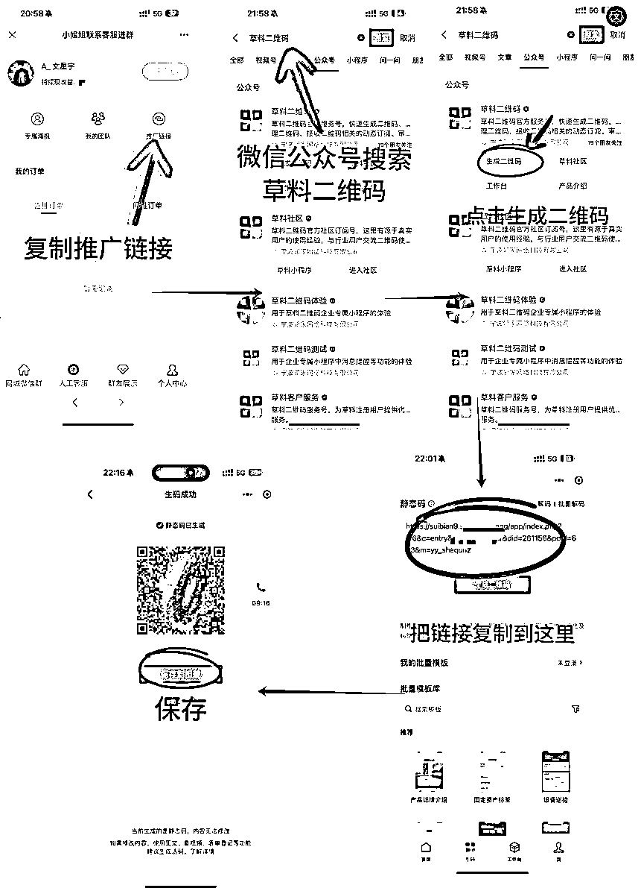

我这边提供一个现成的模板，你可以自己制作然后覆盖上去。

覆盖操作也很简单，参考下面的方法就行。

第二步，完成🐧群的设置和文案发布。为什么用🐧群来承接流量而不用🛰️？因为🐧群可以设置全员禁言、开启群号搜索、默认新用户可见聊天记录，能够做到无限承接流量、全自动变现。🛰️有加人限制，没办法实现这种效果。

先创建一个🐧群聊，把群名改成“同城搭子xxx群”，头像换成美女照片。

第一，设置里打开“可通过群号搜索”：

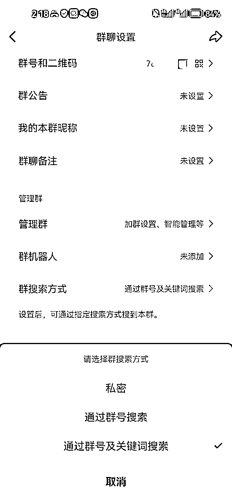

第二，设置里打开全员禁言：

第三，设置允许任何人进群：

第四，在管理群的“功能权限”中，打开“加群用户默认可见聊天记录”：

第三步，在群里发布文案和图片的组合。文案加图片能有效提高转化效率，比如这样的文案：

“说明一下做了聊天同城bt聊天群，里面有很多你想象不到的丰富搭子有门槛直（扫码就可以了）扫描不了保存到vx里面有你喜欢的搭子筛选出低质量人群），群内基本上都是90后00后禁止未成年进入，看上哪个直接加好友去私聊大家都玩得很开认识一群玩得开的小哥哥小姐姐你不觉着值嘛？都是一起玩的圈子（也可以配一些图片）”

注意一定要加上“保存到🛰️扫码”这句话，因为在🐧里是没有办法付款的。

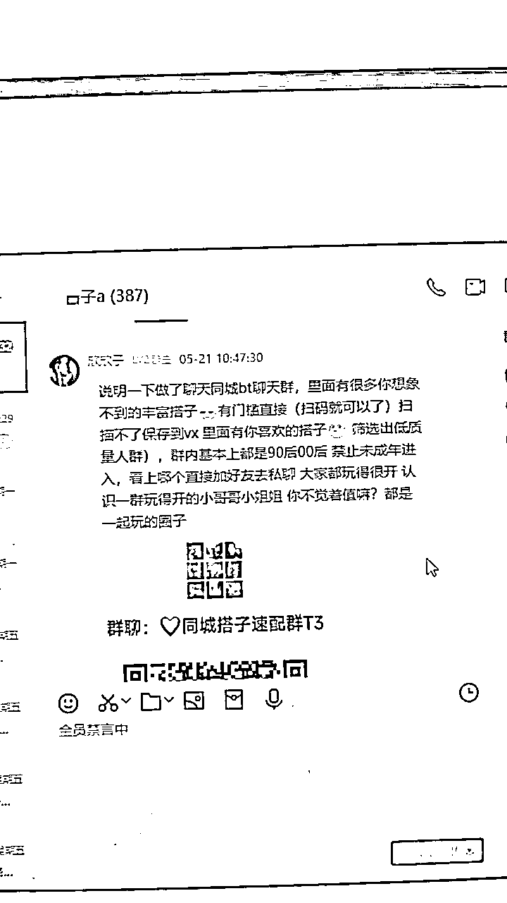

接着是抖音截流玩法。所谓截流，就是跑到有流量的精准视频下面，在评论区把精准客户圈过来。通常评论区引流有两种方式，一种是评论引流，另一种是点赞关注引流。

整个项目的底层逻辑是：通过抖音把目标人群引到你主页，主页上留好🐧群号，用户进群之后，看到群里发的付费群二维码，扫码完成变现。

养号方面，新号和旧号不一样。

新号注册抖音的第一天就可以直接改头像和名字，然后多刷视频，至少刷1到2小时。第二天去搜索对标的抖音账号，刷半小时他们的视频，偶尔点点赞、收收藏，刷完差不多一小时就可以把🐧群号填写上去了。第三天，再刷半小时左右就可以开始引流。

老号就是平时一直在刷视频的抖音号，一定得是老号。第一天直接修改头像和名字，但不要去做评论、点赞、关注这些动作，正常刷视频，然后去搜索我发给你的那些抖音号，偶尔给那些视频点赞收藏。这样持续一段时间，你的老号就会频繁刷到同类视频。当老号能稳定刷到这些内容，号就算养成了，可以开始引流。

在主页留🐧群号也有不同玩法。点赞关注玩法的留法示例如下：

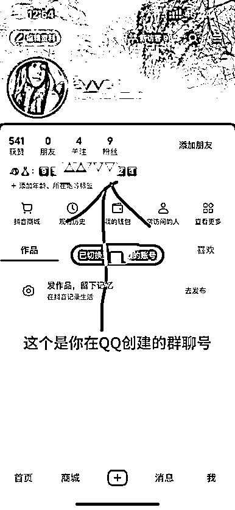

评论引流的留法更简单：随便发一条美女视频，然后去抖音搜索“抖音视频如何添加合集”，把合集名改成“qun：你的🐧群号”。如果还搞不明白，可以去搜这几个账号：90193469868、hao2709888、20513795175、MKK5529、175102605、63429109984。

引流方法上，点赞关注截流法效果很好而且可复制。刷到你抖音主页里的那种找搭子视频，去评论区看，会发现很多女生的评论，这些评论又会吸引大量男粉。你给这些评论一个接一个地点赞加关注，优先选刚发出来不久的评论效果更好。被点赞关注的人会自动看你的主页，然后顺着🐧群号加进来。一个抖音号一天可以点两百个左右的关注，这个方法的效率相当可观。

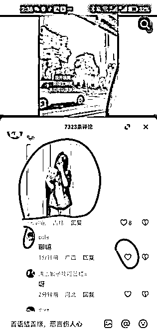

以上就是抖音引流的完整思路。抖音引流的目的，就是让这些找搭子的人加入你的🐧群，进群之后看到付费二维码，扫码进同城群就能变现。另外还有盲盒抽纸条，抽到的基本等于女生的🛰️。这个项目属于长期收益，价值空间很大，懂的人自然懂。如果你手里有好几个抖音号，可以把多种玩法叠加使用，进人的速度会明显更快。

接下来是快手截流玩法。第一步仍然是养号，但快手平台规则没抖音那么严格，不容易违规，不需要像抖音那样精细养号。账号拿来直接刷美女视频就行。

然后在主页留下🐧群号。

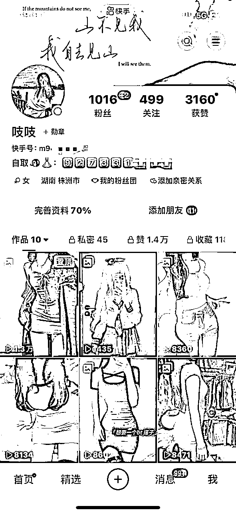

把🐧群号挂在主页就好。有空可以适当发一些女生日常作品，这样转化率更高。快手截流的玩法和抖音差不多，主要区别在于点赞引流法——我们只需要给目标对象点赞就行。原理很简单：你点赞了这些精准客户，他们会因为好奇点进你的主页，引流目的就达成了。

评论引流更简单，不用专门学。刷快手的时候，评论区里那些引流同行就是最好的老师，看别人怎么留的就照着做，注意不要触碰色情引流。

以上就是交友搭子的全套玩法和教程，不懂的地方随时来问。

最后是第五个项目：📕虚拟资料。

这个项目龙哥大佬也在星球上开过实战。为什么放在第四位？因为我们团队实测下来，它的复购率非常高。英语提分项目虽然也有复购，但要等孩子上初中或者高中才会发生，周期拉得太长。虚拟资料这个项目，本质上就是发布无版权的虚拟资料，然后引流到私域进行销售，主流赛道还是集中在K12、论文、考研、APP安装包这些方向。

养号部分和📕商单完全一致：用流量注册账号，每个视频必须完播，早中晚三个时间段各刷半小时。第二天继续养号刷视频，同时在搜索框里搜对标视频，适当点赞、评论、收藏，再关注所造赛道的博主。第三天完善账号信息，其他操作保持不变。

区别在于人设和经历。📕商单不需要写简介，但虚拟资料项目一定要写。简介里要把你的身份、背景、所做赛道以及相关经历交代清楚，这样才能拉近和用户之间的距离。头像同样要应景：做K12赛道就用老师相关头像，做健身赛道就用肌肉猛男头像，其他赛道依此类推。

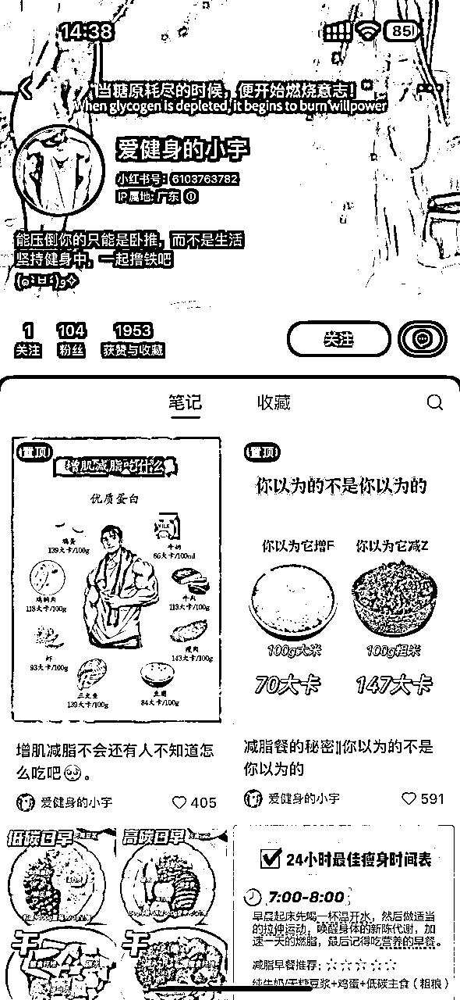

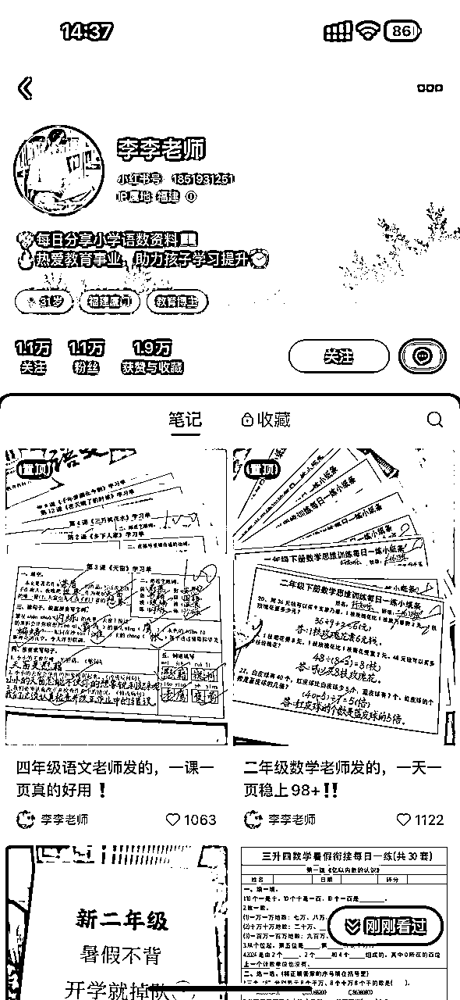

对标账号怎么找？直接在搜索框搜你那个赛道的关键词，比如做教辅资料的话就是：

这类笔记就是你的对标账号，尤其是爆款，要格外重视。记住一句话：同样的爆款，爆过一次之后，之后照样有上热门的潜力。所以我们要做的，就是拆解他们的内容，搞清楚它成为爆款的真实原因。

笔记内容建议用3:4的比例，这也是大多数爆款笔记通用的比例。前期不知道该做什么内容，就去看已经上热门的同行，照着模仿就行。模仿同行，成为同行，超越同行。但千万不要直接抄，一定要在参考的过程中想清楚对方为什么能爆，这样以后你才有能力自己做出爆款。

封面部分，参考下面的内容。

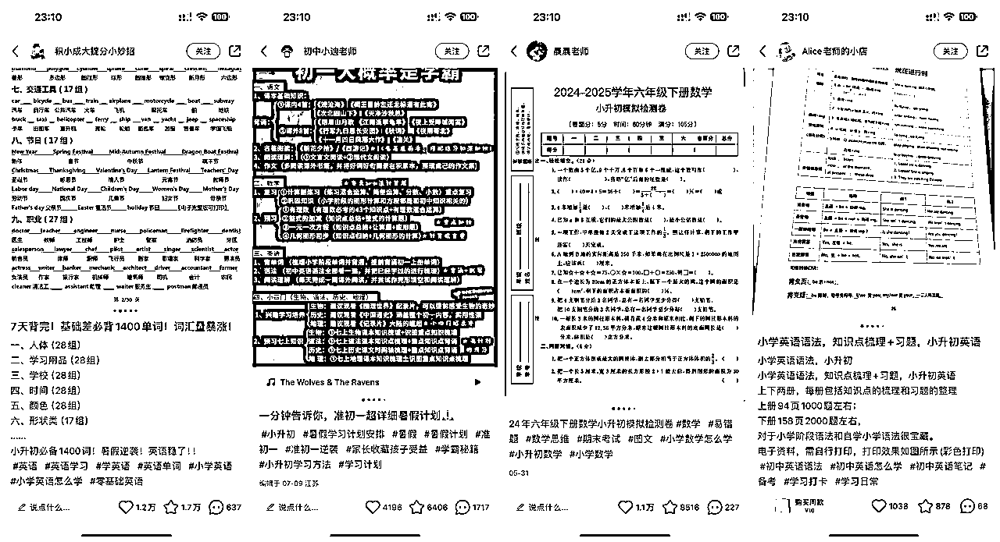

做📕图文，第一眼拼的就是封面。一个好的封面，能让你省下一大半推广力气。看那些健身类的爆款笔记就明白了：封面无一例外都特别抓眼球，基本都是健身男女的实拍图，让人瞬间有点进去的欲望。

### 封面和内容制作工具

推荐几个我常用的：

1. 醒图  
2. 美图秀秀：https://pc.meitu.com/  
3. 稿定设计：https://www.gaoding.com/  
4. 创客帖：https://www.chuangkit.com/  

### 标题怎么起

封面决定用户停不停止滑动，标题则决定用户愿不愿意点开。这里给大家推荐一个工具：后羿采集器，官网链接：https://www.houyicaiji.com/

使用方法如下：  
  
先复制目标链接，然后直接粘贴到后羿采集器里  
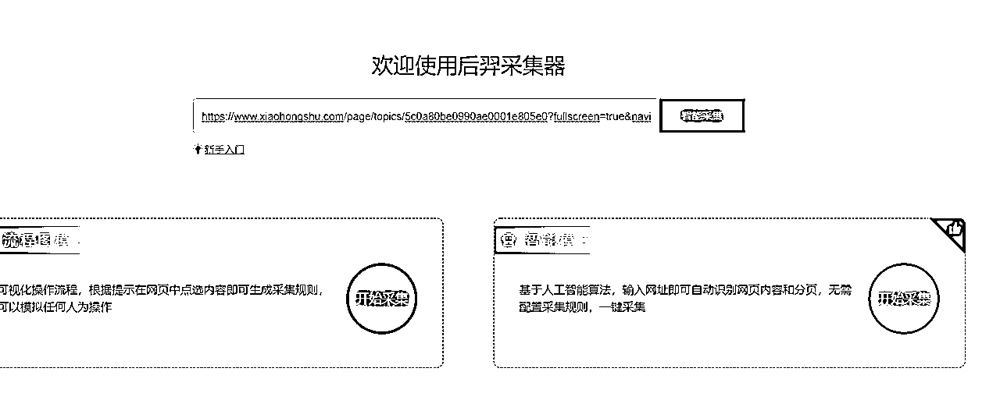  
接着点采集就行  
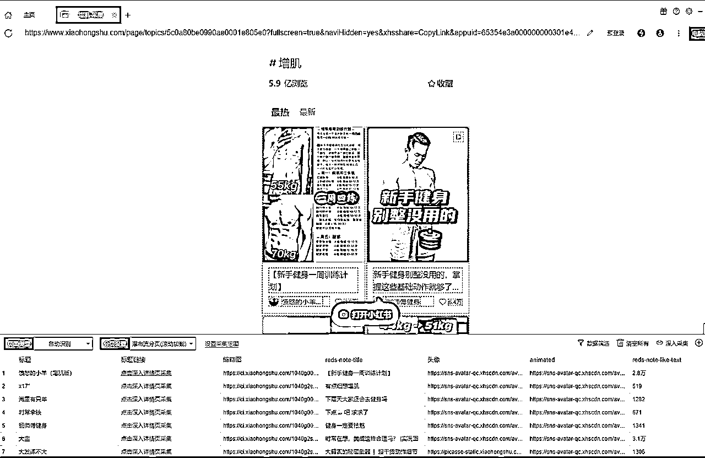  
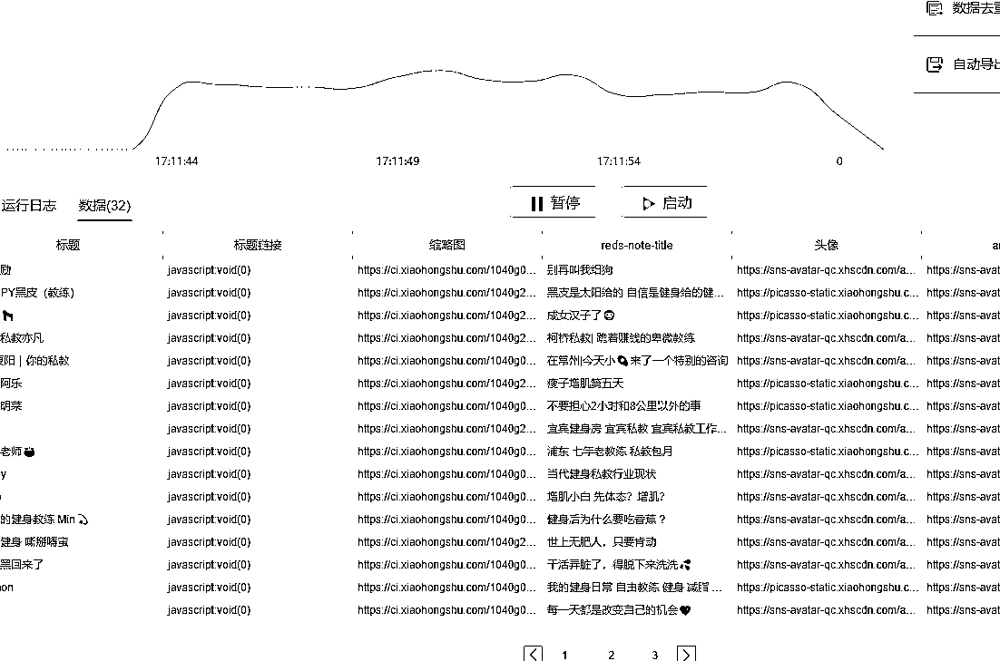  
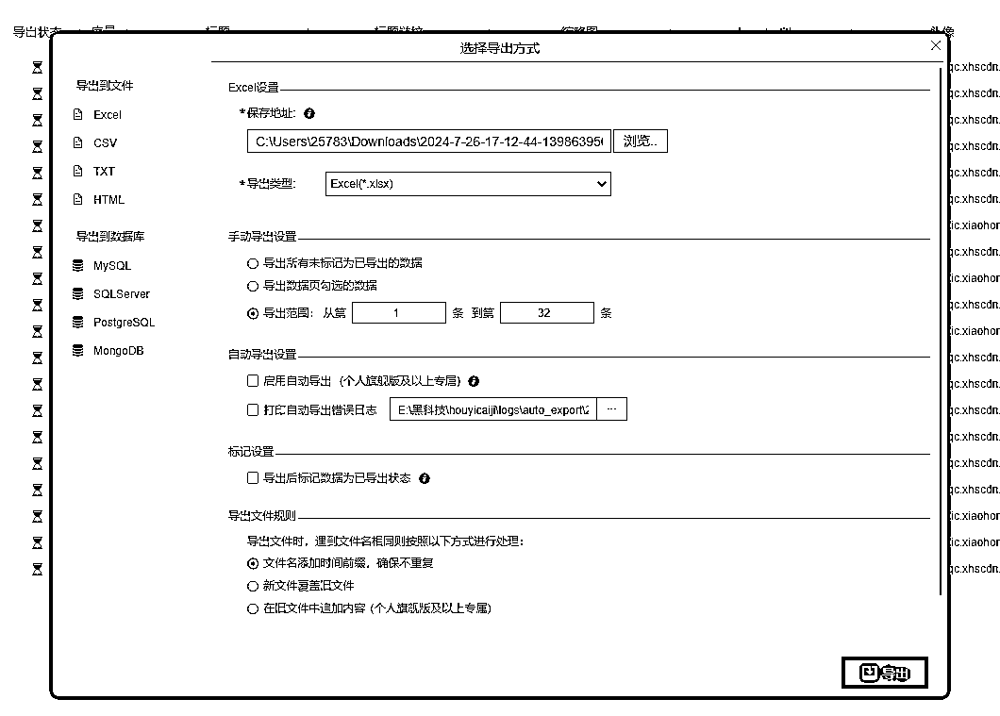  
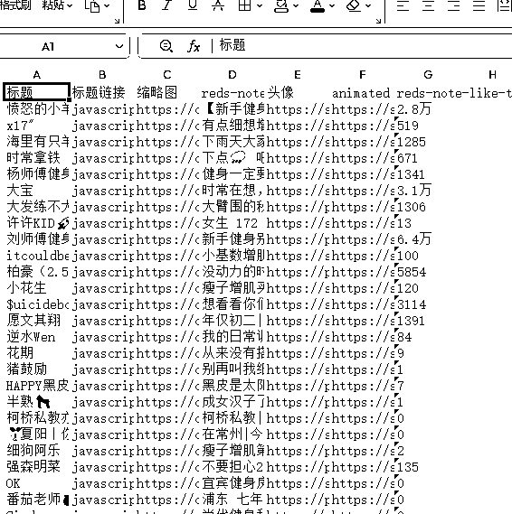  

把采集出来的关键词重新组合一下，一个全新的爆款标题就诞生了。

### 内容怎么写

内容可以直接参考对标同行，把他的文案“搬”下来，再丢给 AI 做二创。二创之后别急着发，手动润色一遍，否则 AI 味儿太重，不够接地气。

推荐两个 AI 工具：  
豆包：https://www.doubao.com/chat/?channel=baidu_pz&source=db_baidu_pz_01&keywordid=weizhi13  
火山写作：https://writingo.net/document?docId=1  

另外，笔记末尾一定要埋钩子，比如“评论区留言 1，送价值多少的资料”或者“私信 666，送价值多少的资料”。

话题也很关键。发布前记得把热度高的话题都加上，📕不像抖音限制那么多，只要相关都可以堆上去。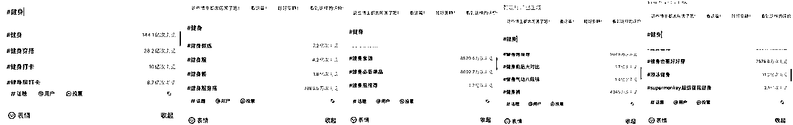  
比如“健身”这个主题，衍生出来的话题里有不少浏览量已经过亿，全部添上对流量很有帮助。

### 引流怎么做

笔记发完，接下来就等流量找上门。但📕现在对引流管得严，大家还是用“拉群”的模式比较稳妥。重点是：发导流图片的号别用主号，用小号去发，小号万一被封了也不心疼。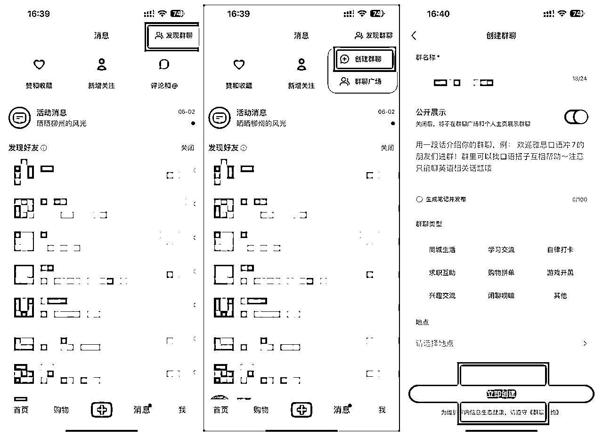

### 成交环节

我们靠“免费送资料”把人引到私域，对方加过来后，先把答应的资料发过去，信任感就建立起来了。等他再次来找你要资料的时候，比如这样：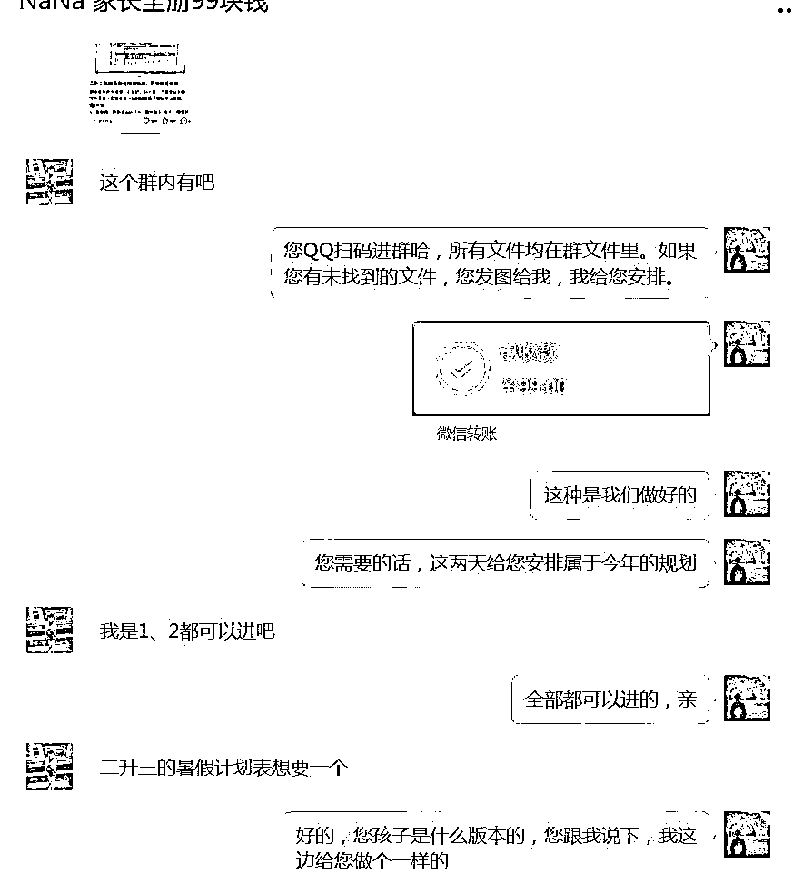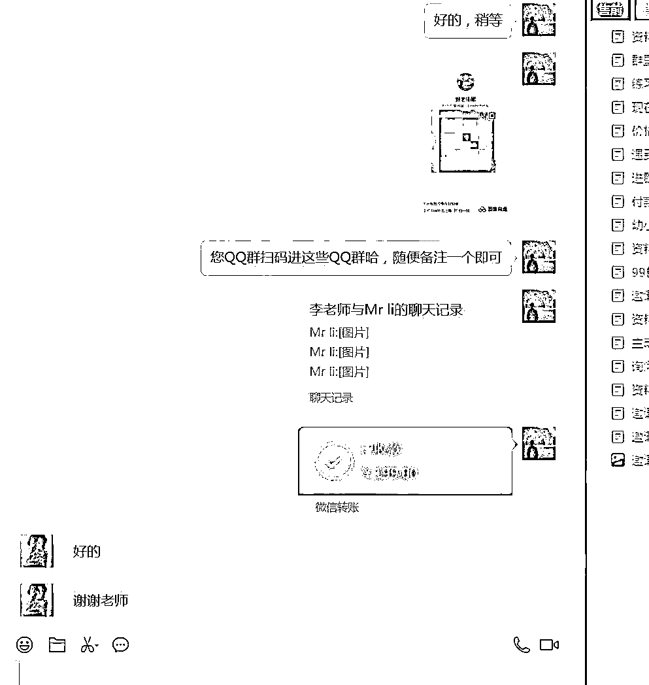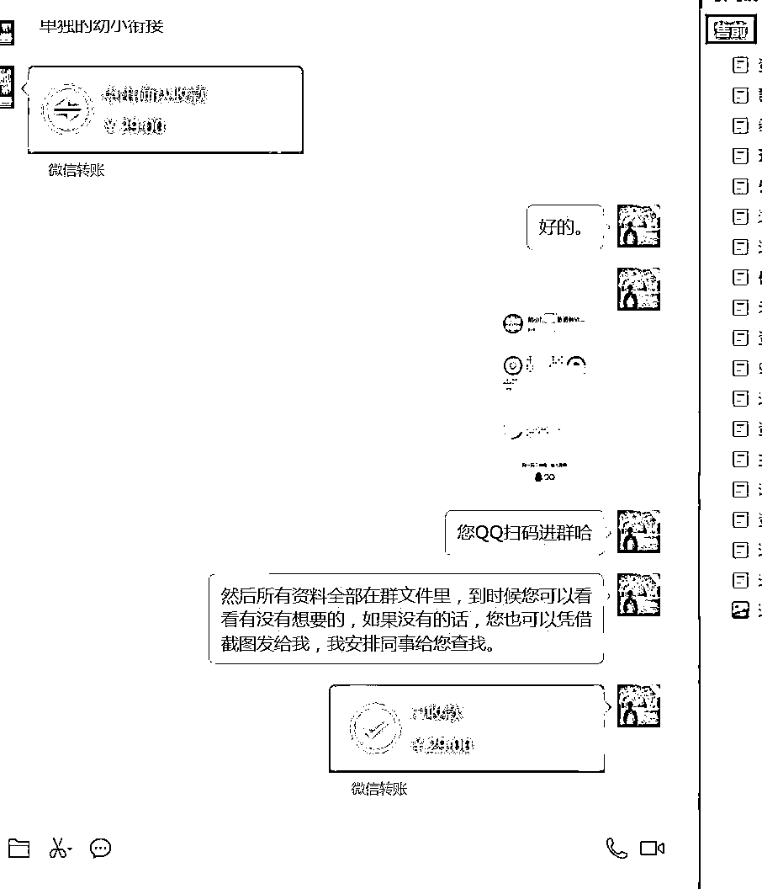  
这时就不能再白送了，可以配合话术：

“您好，这个资料不能再免费送你了，整理起来挺不容易的，如果确实需要，可以付费购买。”

用户听你这么一说，心里也认同，单子自然就来了。

如果你自己手上没有现成资料，可以用我的：  
初高中资料：https://pan.baidu.com/s/1TWALdmcLlApv7uSppAyjXA?pwd=8888  提取码：8888  
考研资料：https://pan.baidu.com/s/1dhSMyU1nljPFz3rUSj04mQ?pwd=8888  提取码：8888  

想换别的赛道，去拼多多或者淘宝买一份就行，也就几块钱。

### 关于合伙人

当你靠一次次交付把信任度攒起来，粉丝粘性会非常高，几乎变成你的“小迷弟”或“小迷妹”，因为你带他赚到钱了。之后你再推新项目，只要他预算充足，基本都会直接上车，根本不用多费口舌。  
合伙人这块就不展开讲了，想了解的看我上一篇帖子。

### 总结

这个玩法真正繁琐的地方在于后端产品和人员。每个项目都要配一个专门陪跑的导师，交付做不好，前面全白费。如果你没有自己的产品，直接照抄我的玩法就行，每一环我都写清楚了。

从封面到标题，从内容到引流，再到达成交付，这就是一个完整闭环，环环相扣。方法已经摆在这，接下来考验的就是执行力。

我一直相信：越努力，越幸运。很多事情只有你迈出第一步，才会发现原来没有想象中复杂。

很高兴加入龙哥盟，感谢龙哥大佬搭了这么好的圈子，也谢谢带我的首负大佬。加入之后，无论方法、项目还是资源，都收获特别多。如果你也在研究创业粉，可以直接找我：NIARJUN，知无不言，言无不尽。

最后，祝大家龙哥盟，一起变富！