# 从校园到百万存款：一个00后毕业生的0到1财富复盘

各位朋友好，我是书虫。刚走出校园的00后，靠在大学期间瞎折腾各种项目，攒下了人生第一桶金100万。2023年AI浪潮起来后，我加入了知识星球的一堆付费社群，刷赚钱的帖子不断涨认知，基本就一直在潜水。最近在个人👸号随手写了篇关于毕业后如何做到百万存款的随笔，评论区不少人来问具体怎么一步步实现的。萌生了把这段经历整理出来的想法，分享我怎样从一个再普通不过的大学生走到今天。现在想创业赚钱的00后越来越多，希望我的踩坑路能给你们一点灵感

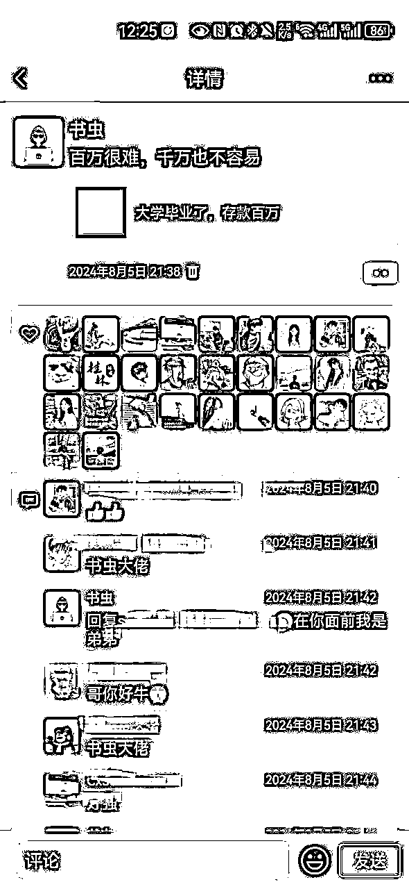

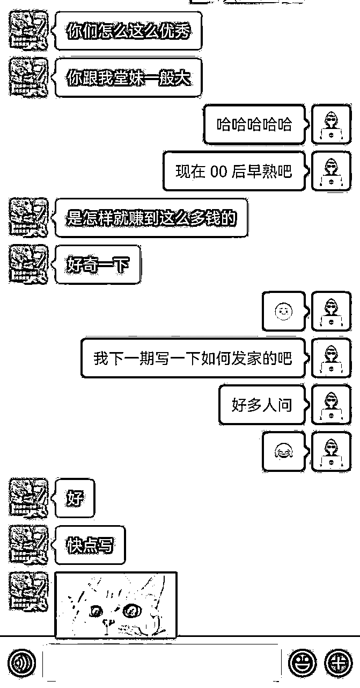

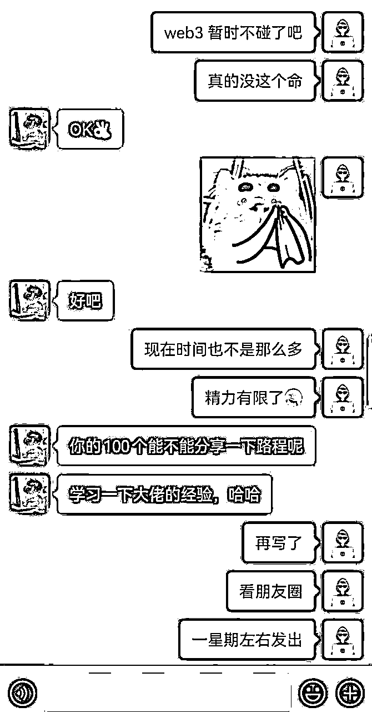

# 先上结果，别空口说白话

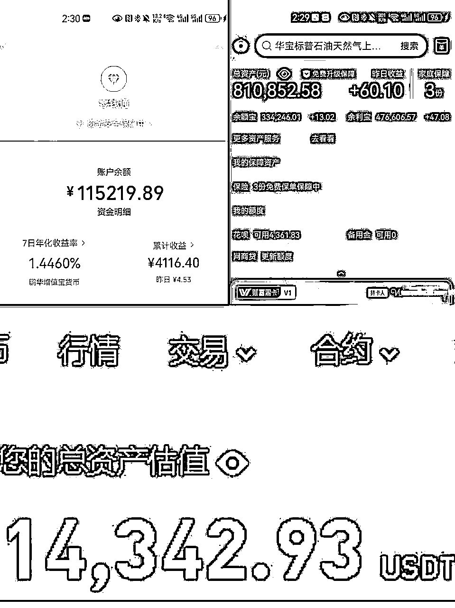

币安账户是U，和美元锚定的，有兴趣的可以按实时汇率换算。上面三个账户加起来早已破百万，并不是标题党在吹牛

# 2020年，微信👸号的野蛮生长期

起步的灵感来自高中时期。我就见过有人在做，还从人家👸号买过课。高考结束放假那会儿，我就自己也搭了个同类型的👸号。原因很简单：我觉得我也能做，市场需求明显，还能变现

👸号做的是盗版网课，主要是高中名师的盗版资料，涵盖作业帮、猿辅导、高途课堂、腾讯课堂这些。刚开始我手里没资源，直接搬运别人的，别人一更新我立刻跟更。读者们不用太有心理负担，到了24年，做虚拟资料的逻辑依旧如此。同行拿到一份，你就能开卖，只要你有精准人群和引流能力，就能成交

我当时一穷二白，引流是怎么搞的？

一共用了三个渠道：B站、高考倒计时、Timing

## 1. B站引流打法

2020年的B站引流审核很松，直接上传就行，不用去重也不用剪辑，发的时候别标原创。核心就是让作品被搜到，钩子放在评论区或签名里，感兴趣的人自然会按图索骥来👸号领全套。账号封了就换一个，当时接码平台一个号成本一毛钱，封号成本极低

简单SOP：

① 百度网盘下载视频到本地

② 直接传B站，不标原创

③ 发完记得在评论区或签名留钩子

④ 封号就去接码平台领新号接着干

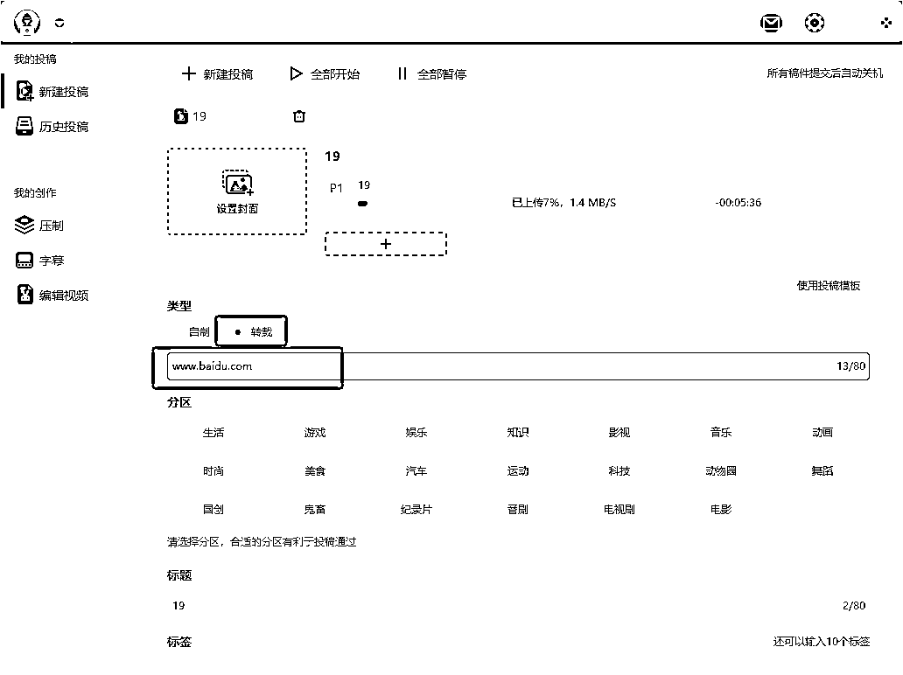

那段时间我也悟出了矩阵思维。通过关键词搜索能搜到自己的视频时，我就想：要是多开几个号，是不是所有搜索结果都是我的号？无论点进哪个，最后都能导到私域。后来我去搜了一下，还真能搜到，当时大概攒了40多个号，妥妥的封号斗罗。封号心态崩过很多次，刚起势就被封，但这就是必经之路。后来我听过一句狠话：封不到100个号，说明你根本没入行

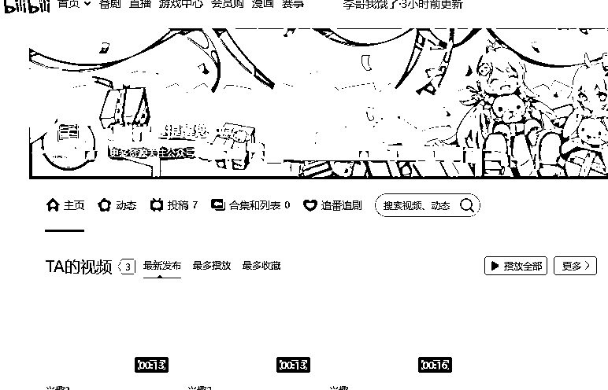

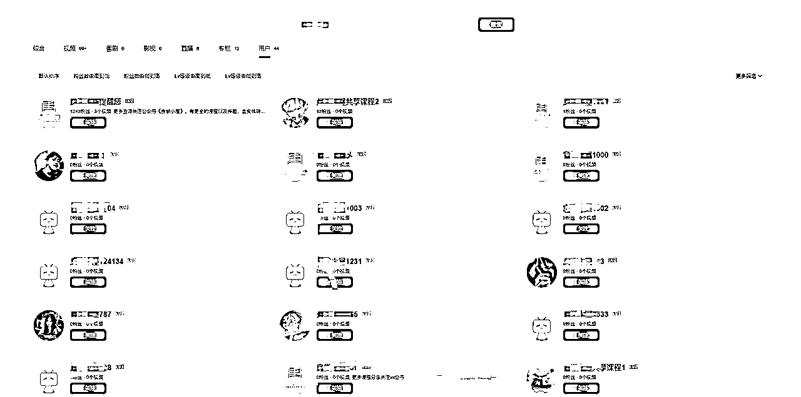

## 2. Timing引流打法

Timing是当年高中生用的App，群聊基本都是公开可进，和B站思路一样，靠买号刷群。每天晚上我会把所有群里一轮广告全刷一遍，第二天早上起来关注量就涨几十上百。这个平台后面改版后乱七八糟了，群功能没了，没法展示图片了

SOP很粗暴：

① 接码平台拿新号

② 进群直接发广告，当时群里还不支持撤回

这个玩法大概撑了两个月，平台限制不大，我每天机械重复。后来我上大一了，为了省每月49块的校园网费，我没办校园网，只靠手机流量操作，发一轮广告要2G流量，电话卡也不够用，短期看不到钱。没多久平台直接砍掉了群聊入口，引流方式就断了

## 3. 高考倒计时App打法

这个App有广场功能，全站可见。我当时写了个很简单的脚本，B站上随便学了基础课程就能写，主要用到点击事件、输入事件、循环事件三个功能，类似现在的影刀RPA。2020年影刀刚出来，还没火，我就用自制脚本24小时自动刷广场广告

刚开始两天挺爽，进来上百流量。结果平台开始反制：新用户只能发8条，后来6条，再到4条，最后新用户一周内不能发。跟平台对着干终究没好下场，规则在人家手里。但风控松的时候薅一波流量确实香。两天循环下来进了百来个粉。那时的我啥资源都没有，只能不断试错，Timing这种松的能做起来，高考倒计时这种严的就只能放弃

## 抓住疫情红利，起飞

那段时间正好是疫情期间，大家基本都困在家里。虽然很多人被割，但我也吃到了芝麻大的红利。做起来后，同路人也不少，我们基本都是1万多粉的号。几个👸号互相推一波，我的号直接冲到2.6万粉，算是这个赛道头部了。互推就是互相写软文引流，粉丝量涨得很快，基本都是同类人群，后来大家都接广告变现，互相扶持一起起来了

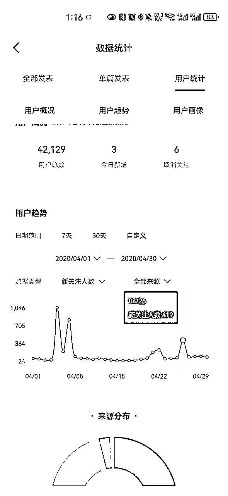

### 像素级模仿变现

起步时我就想好了变现路径：抄对标号的打法

直接在👸号菜单栏留商务合作微信，有广告主看到需求就找上门

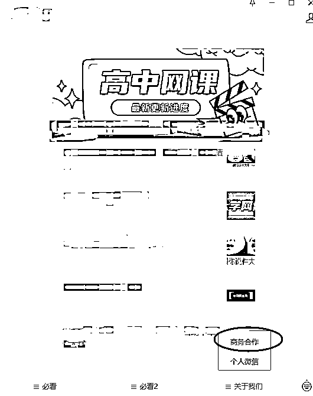

最离谱的是，这些广告主卖的正是我们分享的课程，他们居然能找到我，还付费让我帮他们打广告，我当时也挺懵，但钱是真的到账了

### 第一次正反馈

K12还处在风口期，广告主很多。一个平台一个月能接2-3单，不同平台可以同时接，一个月大概能接10条，月入7000块。对当时的我来说已经不少了

第一次收到广告款，当时激动到坐着拍手。长期努力终于有回报。后来2021年K12被政策打压，广告业务就停了

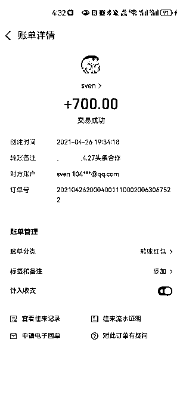

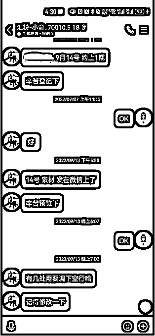

注：时间有点久，截图找不全，时间线可能对不上，大差不差就是这样

### 传给弟弟运营

到现在这个👸号还在给我带来收益，只是变现方式变了，现在是卖课程。内容是原本免费的课程做了增值服务，对接了第一手课源。运营已经全权交给弟弟了，我实在忙不过来

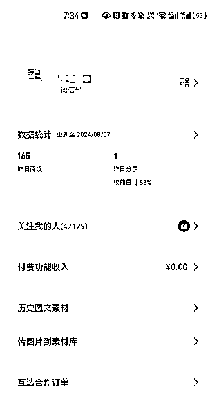

那段经历给我攒了第一桶小钱，也给我留下一个几万粉的电子资产。第一阶段我学会了引流、承接、转化、运营、矩阵。第一次完整跑通互联网项目，也让我对后续尝试更有信心

# 2021年，乘上头条号中视频风口

## 遇见贵人铲哥

那时我沉迷做截流的黑科技，各种高中QQ群全加，监控群聊动态。认识作者唐易后，他给了我一套工具去测试，通过这个又认识了铲哥，于是有了第二个爆款项目

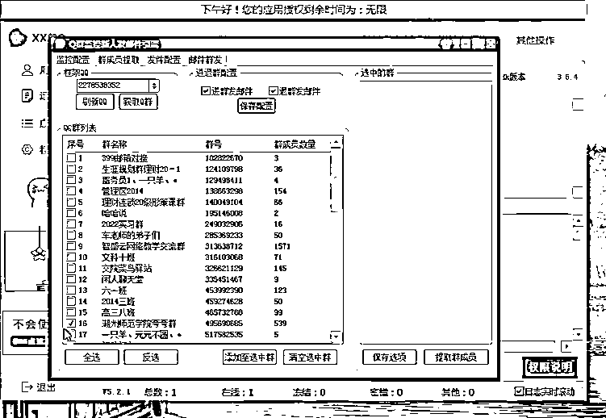

师傅领进门，修行靠自己。铲哥的项目怎么做，我是怎么做的？

项目是基于头条号发视频，2021年5月起步，要求视频时长1小时以上，1000播放大概能有10块钱。6月份西瓜视频中视频上线，能申请通过，1000播放提升到20-30块

内容就是风景视频加纯音乐。把别人的视频下载下来，用混剪工具无限裂变，换音乐、分割重组，避免重复

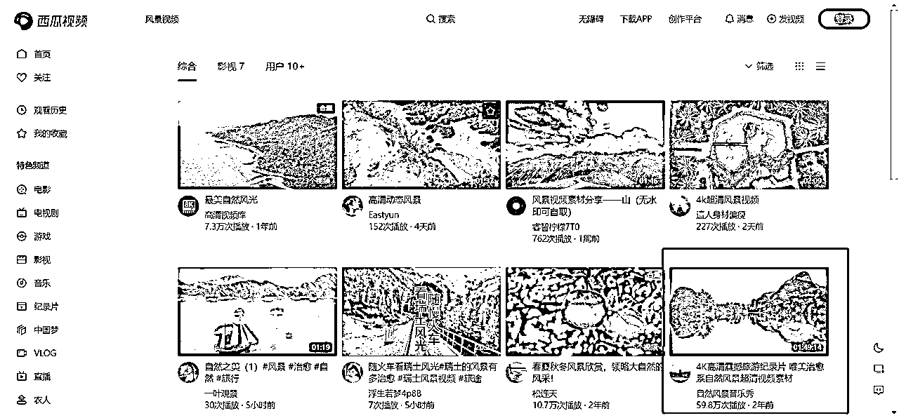

### 跟着铲哥抄作业

认识铲哥后进了个大佬群，才知道里面基本都是有副业👸号或社群的老手。后来我也进了他们的付费社群，当时我对副业还是小白。他们的变现就是复制铲哥的带课模式，有群友一天收30个学员，赚10多万。当时我就感慨，卖铲子才是真赚钱

## 我的资源是什么？

同学朋友、微信👸号，就是全部了

## 团结能团结的人

我先找舍友、隔壁宿舍试水，有效果后，又动用社团部长身份在社团里推广，还让关系好的朋友帮忙。我不收他们费用，收益分成，我负责提供视频和提现，他们只用上传和周四提现就行

## 扩张中的问题

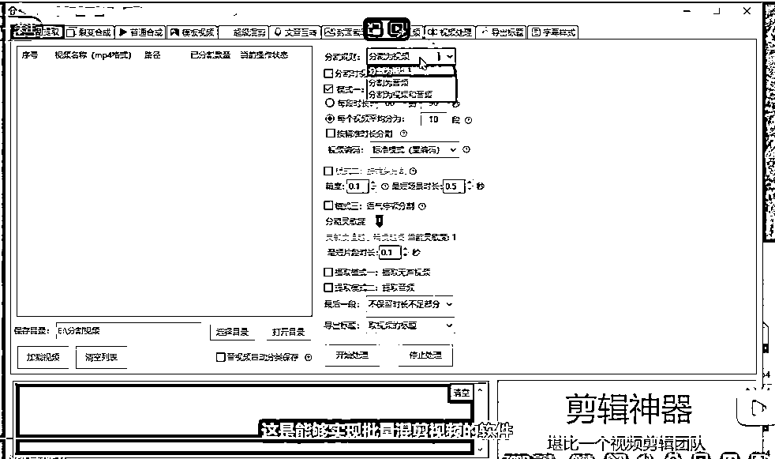

放大过程中问题不断。生产工具长这样，每个视频都超过一小时，分割合成能靠GPU加速，但我只有两台电脑，一台家里的台式机，一台学校的1660super，搬来搬去麻烦，生产速度很慢。上传速度也是瓶颈，产出后还要分发到各号，还开了十几个百度网盘超级会员。网盘会员限制10台设备，9个人共用一个，下载速度堪比蜗牛

## 怎么解决的？

买电脑不现实，当时利润还不高，一台电脑成本太高，网线费也不确定能不能持续。于是我在淘宝找店家，需求是显卡好+上传带宽足。筛选后找了几家靠谱的代发，上传问题解决

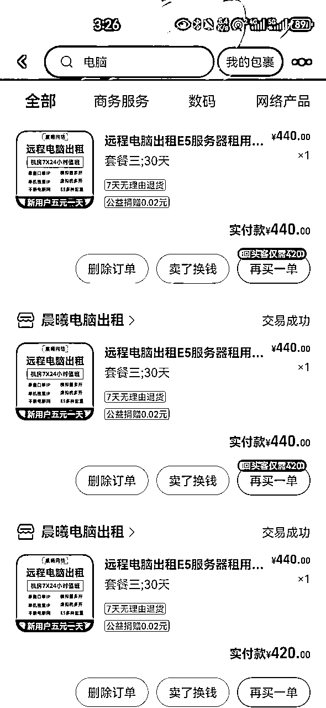

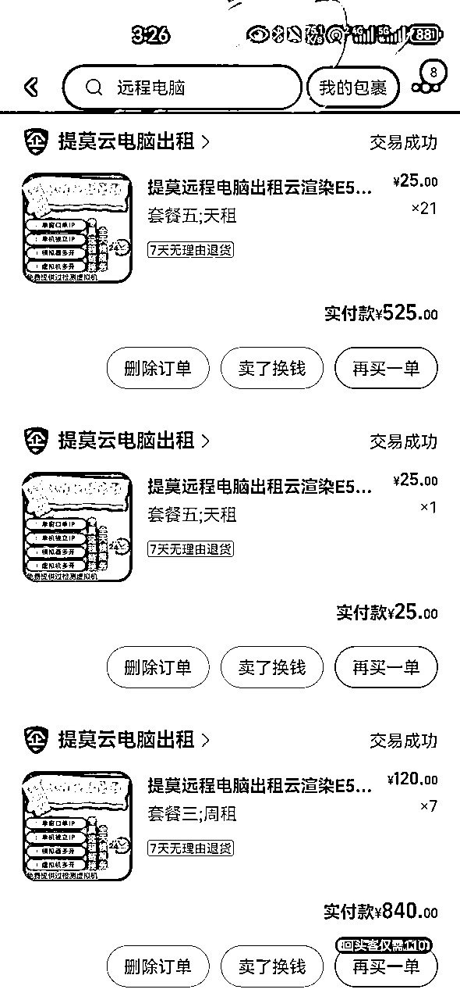

下载问题迎来转机。2021年阿里云盘上线，当时下载不限速，免费，还解决了大难题。后来我全部迁移到阿里云盘，为后续扩到400-600人打下了基础

流程跑通后野心变大，我这批高中毕业生上了大一，也可以搞。我分批拉人带人，后来一个人管不过来，我找了四个信得过的朋友帮我管理上传人群

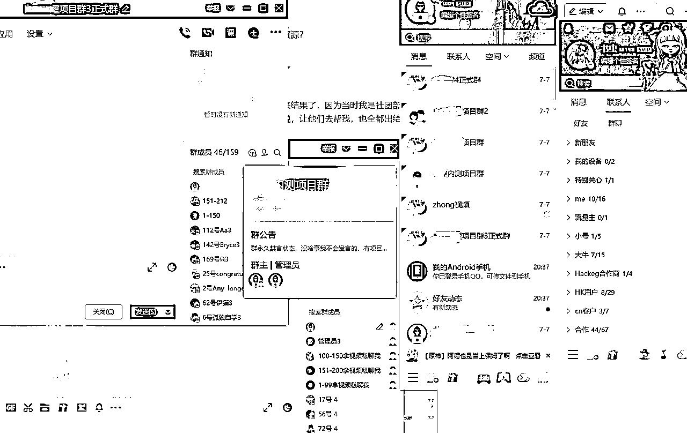

这是之前保留的收益截图，发过👸号就没删

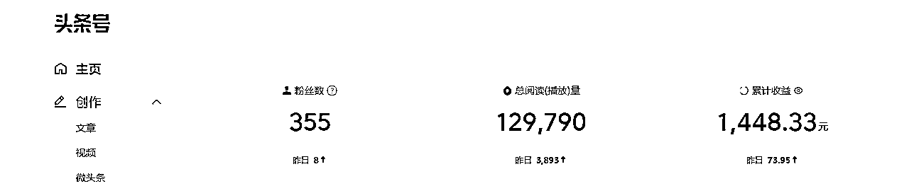

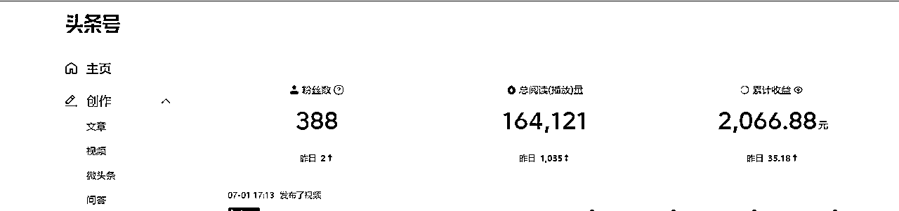

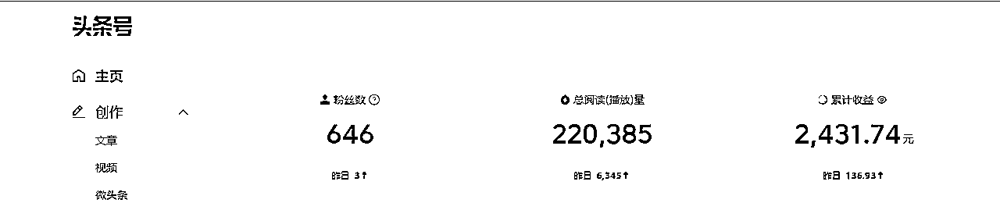

## 稳中求进的遗憾

当时流程全部打通，最遗憾的是经验不足，太保守放大太慢。10-11月开始限流，12月项目基本凉了，也就撑了半年左右

那段时间我基本不像在工作，像在印钞。早八的课7点就起床，把睡觉时生成的视频上传到各个阿里云盘。周四是期待日，头条提现日，每周都能收到稳定到账。这辈子没想过赚钱能这么轻松

这是我的第二个阶段，学会了用有限资源无限放大，以及让利分工。当你赚不到大钱时，必须加杠杆。杠杆有两种：钱和人。我当时没钱，就用人的杠杆，去调动更多可支配的劳动力

# 2022年，慢下来思考人生

钱赚了一些后，我开始想人生意义。活着到底为了什么，最后不都得死吗？为什么要那么拼？我在B站刷到一条视频，标题一下子打开了我，那几个月我都陷在那种情绪里

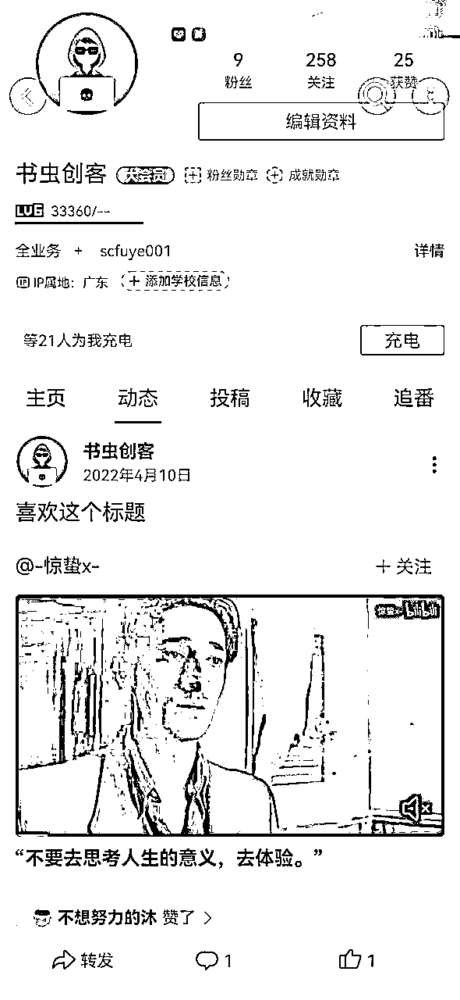

## 1.开始减肥

大一时170斤，和脂肪搏斗很久，最后花了几个月减到理想体重。也谈了恋爱。这是我的私人空间头像。23年底到24年上半年压力暴涨，每天睡5小时，天生爱吃，一天吃四五顿，又胖回来了。现在重新开始健身房打卡

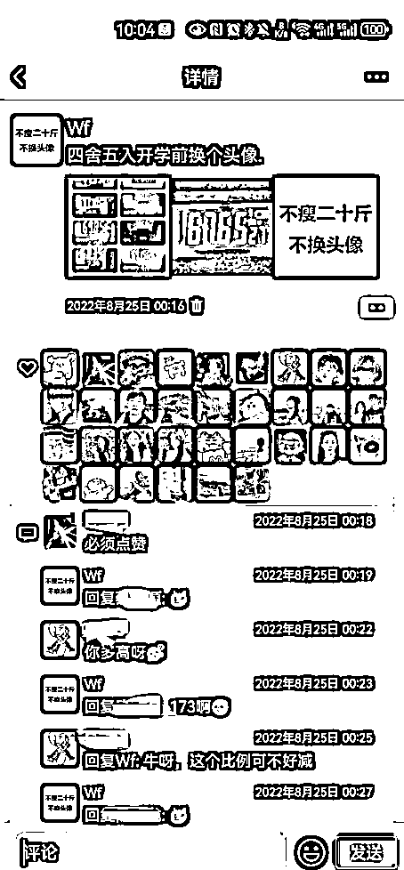

## 2.开始阅读

我本不是爱看书的人，但2022年一年看了50多本，于是有了书虫这个称号。聚会自我介绍大家都问我是不是书虫，嗯，那段时间确实是。大量看不同类型书，同时补了大量电影，弥补少年时没电脑只能玩游戏的空缺

回头看，那年看的鸡汤不少，但我几乎没看过书，什么都看，看完都会总结。电影也是看完就思考表达了什么。那年养成的阅读习惯，后来做项目、看帖子、个人成长都受益很大

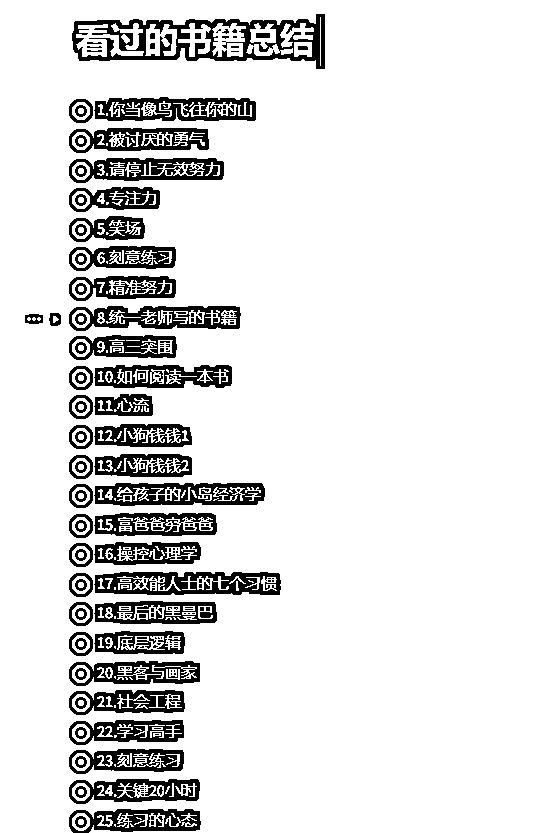

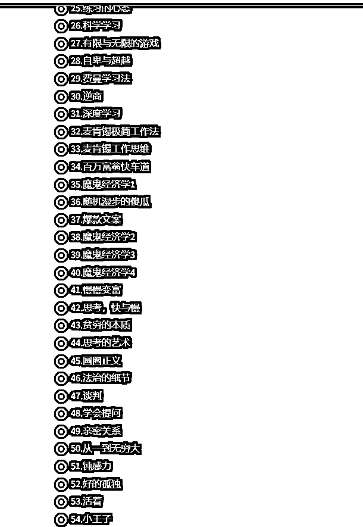

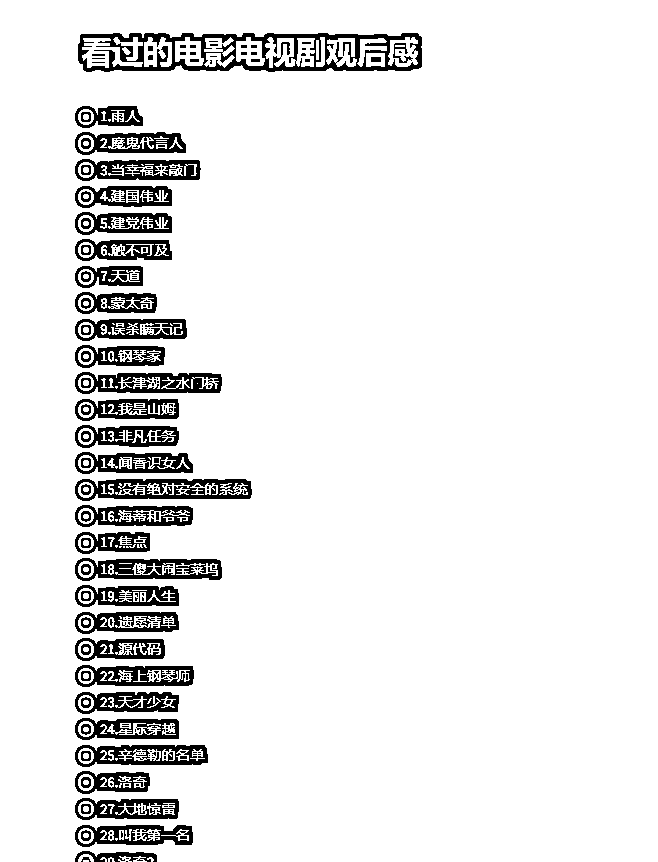

2022年基本没怎么碰钱，没什么收入

第三阶段，我没再拼命赚钱，而是回归生活，让自己全面成长。生命不只有金钱，有很多值得体验的事。见过太多有钱人只会赚不会花，失去了赚钱的意义。20岁想要的东西，30岁拥有也没了感觉。合适的年纪，赚到合适的钱，才是最幸福的吧

# 2023年，AI元年入场

我2022年12月第一次碰到ChatGPT，用了几天就放下了，觉得有点用但没想象中猛

2023年2月，流量突然炸了，朋友圈到处在发GPT改变世界。我观察到身边圈子里培训卖课很火，于是开始认真了解。在这之前我知道知识星球却没用过，后来陆续开始订阅各种AI星球，获取一手信息

2022年整整一年没怎么碰这块东西，网感明显掉线。彼时对AI的认知和信息储备都还很薄弱，就先搭了个小社群练手，给里面的人做点基础教学。

主要讲怎么上手、怎么用对、哪些提示词更顺手。定价也很谨慎，19.9起步，后面提到29.9、39.9，封顶49.9。拖到2023年6月，累计也就六百多人进群。后来全网资料铺开，社群的价值就被稀释了。

## 1. 怎么拿到信息

我先从免费渠道啃起，自媒体能搜到的都看，知识星球里刀姐的AI风向标也常看。免费的信息吃不饱后，就开始买单进一些有门槛的付费星球和社群。里面聚集了不少实践者，他们会第一时间分享新玩法、新机会，我再从这些噪音里挑出能变现的点子。

说白了这就是个大草台班子，东西刚出来大家认知差不多，但高手吸取新知的速度快，大佬的渠道也更宽。信息差一出来，就有了教学的空间。

## 2. AI写作这段遗憾

那段时间我很清楚工具能干嘛，刚好接到一批百家号这类平台的写作单，价格不厚道但至少能动起来。同时我也知道它能做的远不止写东西。于是2023年3月底开始逛淘宝店询价，想到的打法是：把单子全接过来赚差价，再免费教别人做。

聊完才发现能接的活儿很窄，当时商业模式也不成熟，基本都被拒，说不能AI做或没需求。那会儿没人可参考，能想到的只有论W写作。后来看着AI写作做得越来越专业的团队出现，才发现自己视野窄了，认知把自己框在了论W里。

现在回头看可以做的方向很多：学生作业、职场文档、商务稿件、英文内容、公文、职场文、自媒体文案、测评、商业策划、PPT、代码、平面设计，类型其实非常多。

当时没做成，也反思是不是太早了，AI4.0都还没出来，也反思运气和认知差距。那时我觉得写作只有论W需要，文科水的人能做，理科要数据的做不了，也清楚它会胡编乱造，论W还有周期性，放假就没活儿。想明白后就撤了。

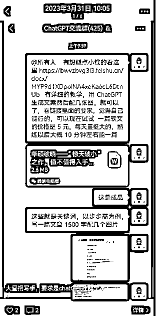

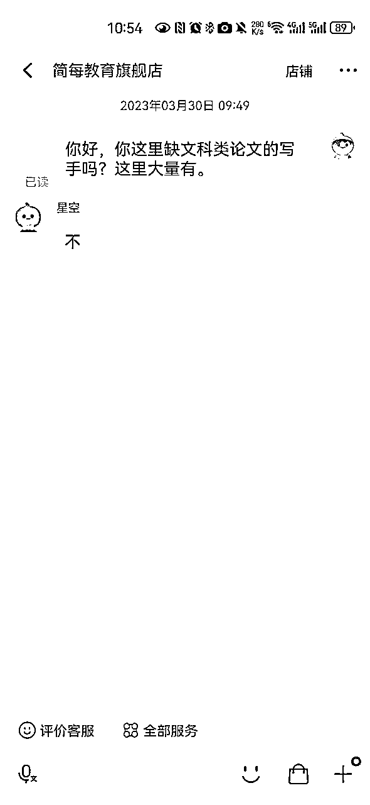

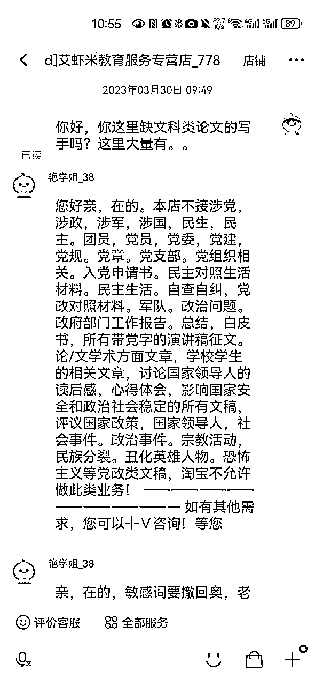

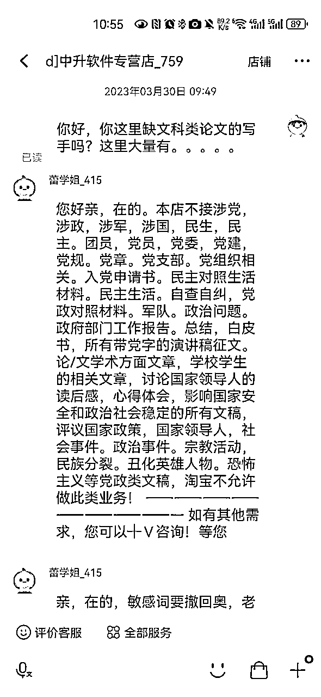

AI写作爆发期也有朋友多次找我合作，我都推了。主要有三点：当时自己在做的AI业务盘子已经很大，没精力；我清楚AI写作的局限，怕做不起来，重蹈覆辙；而且我当时给不少人供AI4.0账号，他们做得越好我分红越多。

现实给了我一巴掌。他们现在做得风生水起，我看着很羡慕，也后悔当年没跟上。这确实有点缘分在里头，有的项目你能成别人成不了，反过来也一样。

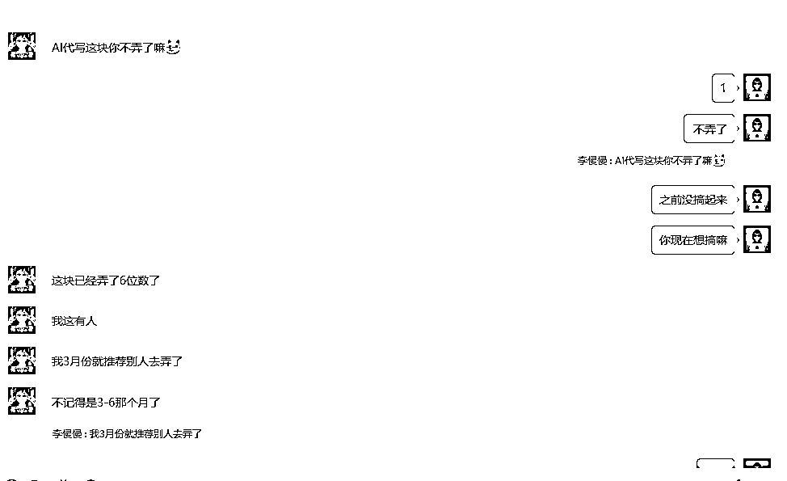

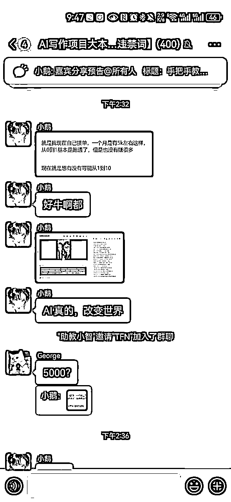

## 3. AI4.0来了，我能做什么

这波开始兴起倒买倒卖的玩法，我也入场了。起初在B站和📕引流，用的是最直接的截流方式。

### 1. 一直往前走

之后在星球里对接资源，一边给做培训的供号，一边承接给企业员工配号的单子，也有个人用户。后来发现API很赚钱，就专门做API客户，给公司训练模型或内部写作用。为了合规也去办了执照，公对公开票，还第一次跑去税务局问不懂的问题。

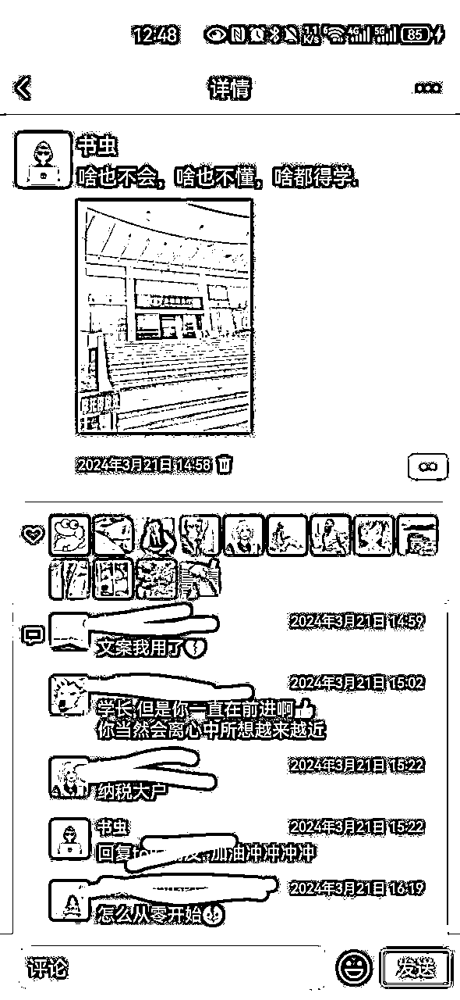

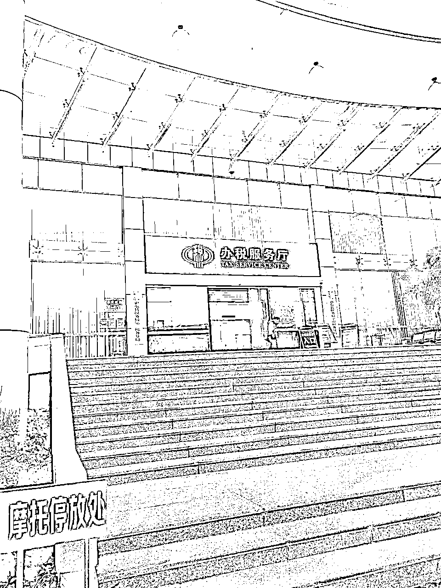

### 2. 同行的信息差

参加赚钱线下聚会，碰到一个线上做同类项目的老友。聊完才知道我的API业务只是小打小闹，真正吃肉的都是对接大厂的。缺人脉、缺信用背书，我根本联系不上那种客户，手里有货也消耗不掉。有资源的人一个月几万美金是常态。

这40多万美金是五个月的消耗，月均8万美金，每天开Plus的数量一般在一两百，周末少点，高峰时一天300个。API是我三月份刚接上客户，月底规则一改，缘分就断了，短暂尝甜头后就没了。

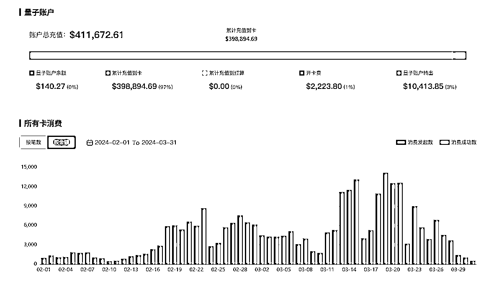

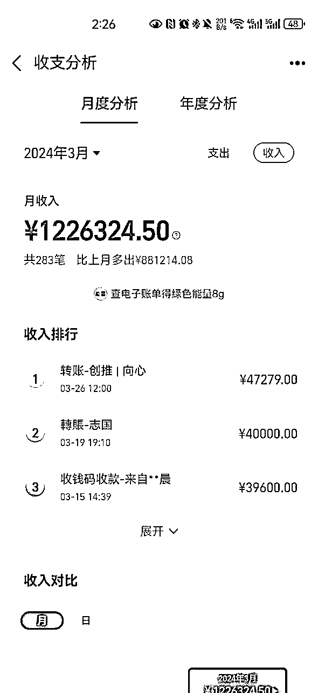

本质上没什么高深操作，就是各平台引流、星球丢资源链接，拉到微信成交。做久了口碑起来，销量自然大。

### 3. 售后换来信任

我在圈内售后口碑还算不错。23年大面积封号潮就很严重，24年3月27日那次尤其凶残，一千个号是保底线。封了的按天退，或直接补号继续用。那天我连发了四条朋友圈，信息量太大消息回不过来，还有人语音问是不是跑路。这一波封号持续三天左右，至少亏了好几万，官方不退，损失全自己扛。

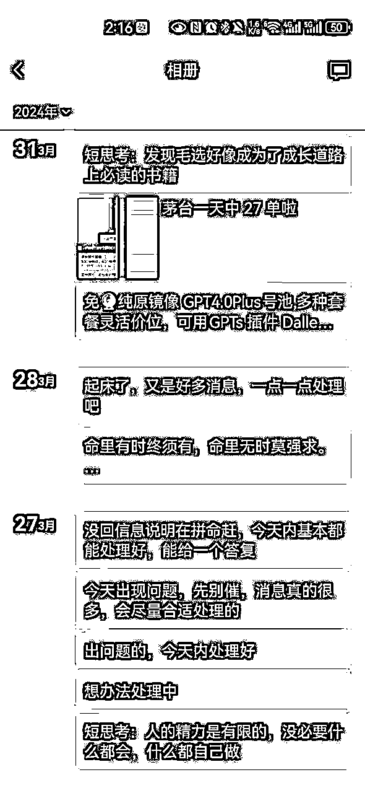

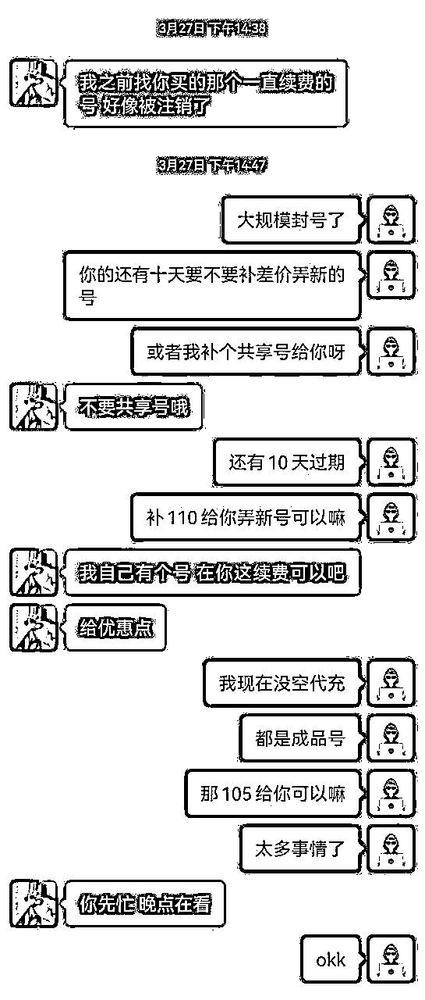

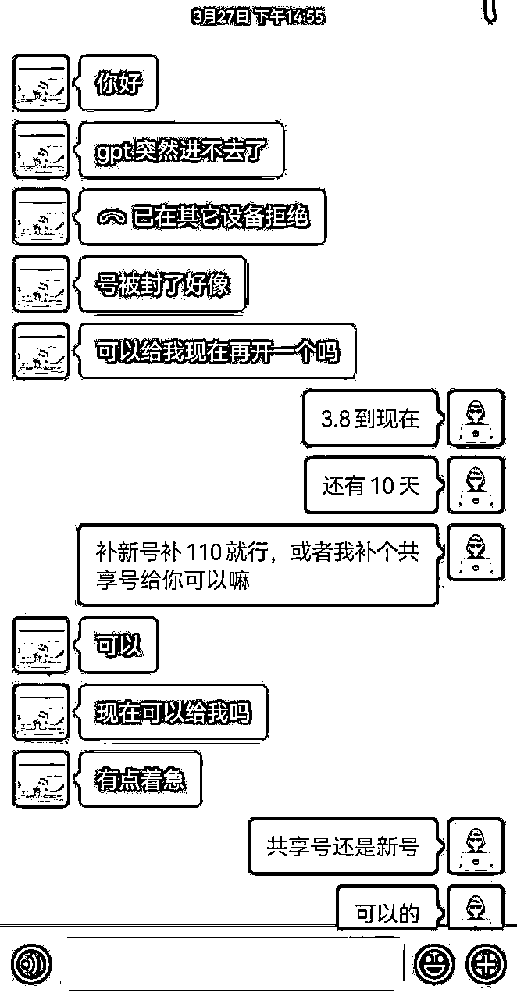

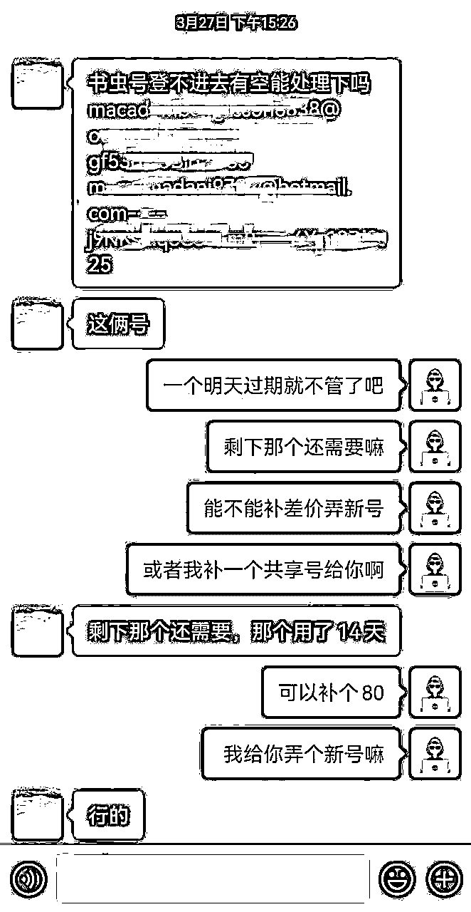

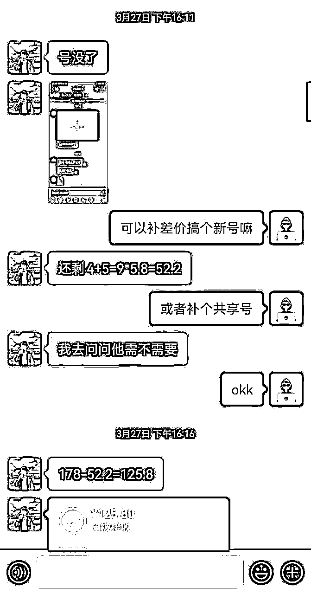

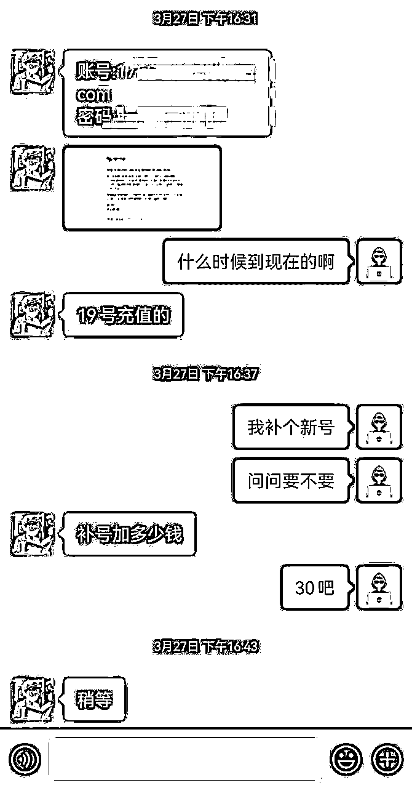

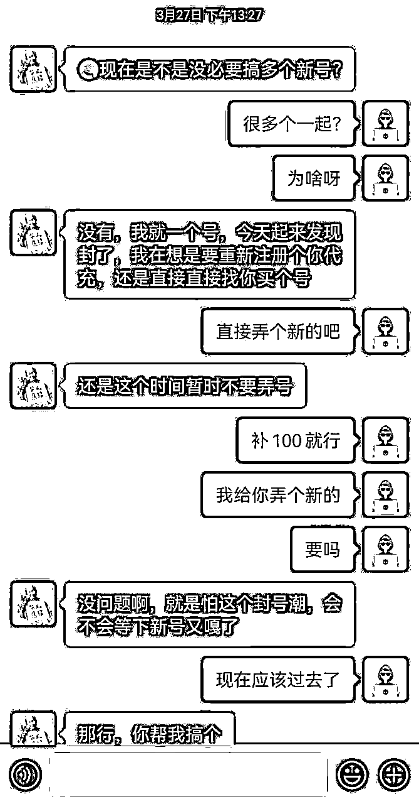

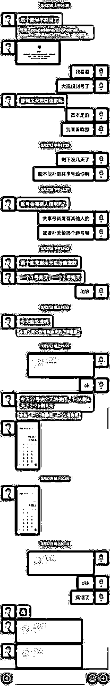

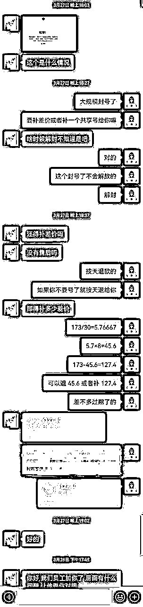

有人问我为什么不跑路。圈里其他人基本都是无售后，我却全扛了。做这行不兜底就待不下去，信誉崩了就再也建不起来。好信誉像大厦，盖很久，倒在一瞬间。

之后4月份改了模式，做了一套镜像1:1复刻，至今还能带来稳定现金流，现在基本不推广，都是老用户和转介绍在续。

# 24年毕业，想做长期主义

2024年6月，我正式从大学毕业，离开校园。

这几年换过太多项目，年年换赛道很累。认知提升了，看的东西多了，就在想有没有一种东西可以持续复利。研究下来，最靠谱的就是扩大影响力，打造自己的个人IP。龙哥、盗坤、刀姐的路径给了我启发。

现在各平台都很成熟，真正的创新很少，2024年看项目整体在降温。过去几年风口上起飞的，大多是做内容创作做得好的人。普通人跃迁的机会就在这。抖音小杨哥一开始拍娱乐视频就出圈了，B站何同学靠拍片积累大量关注，虽然近期风评有争议，但成绩摆在那里。

我笃定未来这会更重要。在下一个风口来临前，这是最稳妥的路。内容能帮到人，别人点赞认可，也能填补内心的虚荣和空虚，让我有动力持续做一件有价值的事。

3月底心态崩了，4月到7月中旬基本在休息。7月中在家待不住了，搬到深圳。不到一个月参加了好几场赚钱线下聚会，换环境换人聊，心情也好了不少，动力回来了。

7月开始写微信👸号，继续跑线下交流，想把这篇文章也发到知识星球。

到了第四阶段，成长速度是最快的。眼界被打开，见到很多厉害的人，也认识了不少同频的伙伴。加入龙哥盟星球一年多，信息喂饱了我的知识库。不像以前只能单打独斗，现在有了人脉、资源、认知和一点资金。试错成本上来了，合适的项目能更快放大，做不了的就找朋友合作。

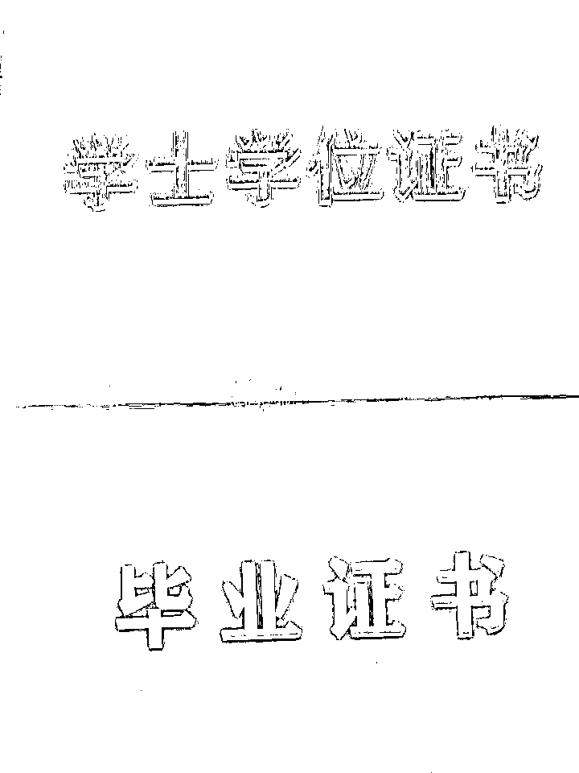

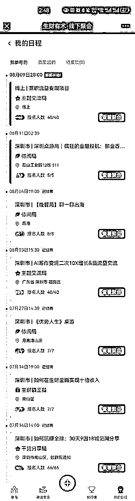

# 复盘与感谢

## 1. 小步快跑快速迭代

我不是一试一个准，是试了十来个，才成那么几个。平均一年试10个项目，7个跑不通，2个能赚点小钱，1个很赚钱。运气差一点，可能一个大爆的也没有。

## 2. 不要负债

我从不借钱。以前穷的时候就该舍的舍，该省的省。开始赚钱后，最值钱的就是时间，用时间去试错，不需要启动资金。

回看自己走过的阶段：2020年靠👸号积累关注和第一桶金；2021年一个项目让学生时代不敢想的存款有了；2022年在赚钱之外个人成长很快，接触了以前没碰过的领域；2023年重新回到赚钱的轨道，一直到现在。

## 3. 心态要好

2020、2021年特别难，身边没有同频的人，想聊没人懂。项目跑通前几乎都是我一个人试错，靠对钱的渴望和一点点正反馈硬扛下来。

竞争期每天睡五六个小时，遇到不靠谱的合作、不懂感恩的人都有。久了也就麻木。写作算是相对轻松的输出方式，文字堆起来确实不少了。

困难和折磨都是存在的，但都一笔带过。想成功就必须硬一点，别一点挫折就怨天尤人。看这篇文章的人可能处在不同阶段，如果你在0到1，我的经历多少能有点帮助。项目会过时，但从零到一的思路和困难是相似的。

上山路很多，路上遇到的坎却大同小异。做人做事难免磕绊，需要你一个个跨过去。

## 4. 感谢

铲哥

2021年遇到铲哥，进入互联网。至今他是我很好的导师，遇到问题隔几个月就会找他聊几句，他是实干派，几句话就能点破困惑。

小郭、大明、凉介

来深圳不到一个月认识的三个小伙伴，他们说我👸号文章写得太低调了，应该更自信一点。他们也刚毕业，很努力。

胖大魔

吃完宵夜我去问他能不能写这些，他说可以，还半夜陪我聊到很晚，给了很多建议。

辛亥

写作经验不足，多谢辛亥帮忙修改语言和细节。他是03年的圈友，进赚钱三年，经验丰富很乐于助人。

小鹅

👸号发了后被转发，很感谢小鹅的推荐，也感谢00后群的鼓舞。

最后感谢所有看完的人。也在各大星球里学到很多，龙哥盟是我主要的信息源，2023年4月加入，过去一年多收获很多，同频的人让我很有趣。

写这篇文章是回顾几年经历，给刚入行的朋友一点帮助，也想破圈认识更多大佬和同频的人，看看有没有机会一起搞点事。

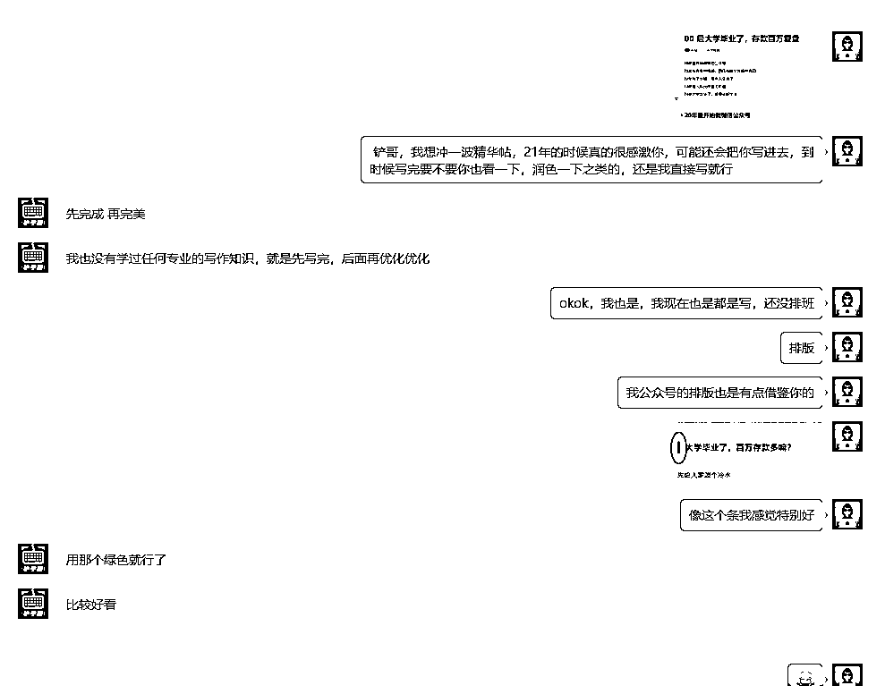

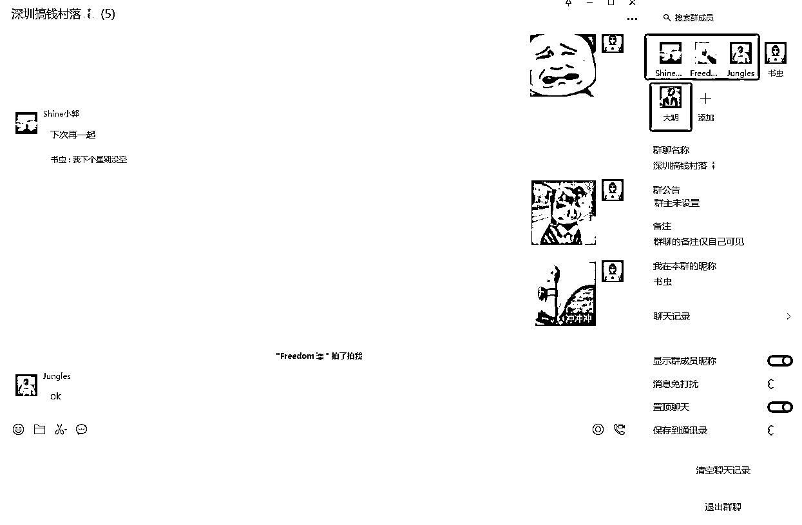

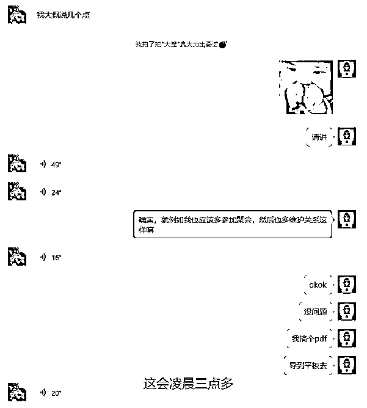

