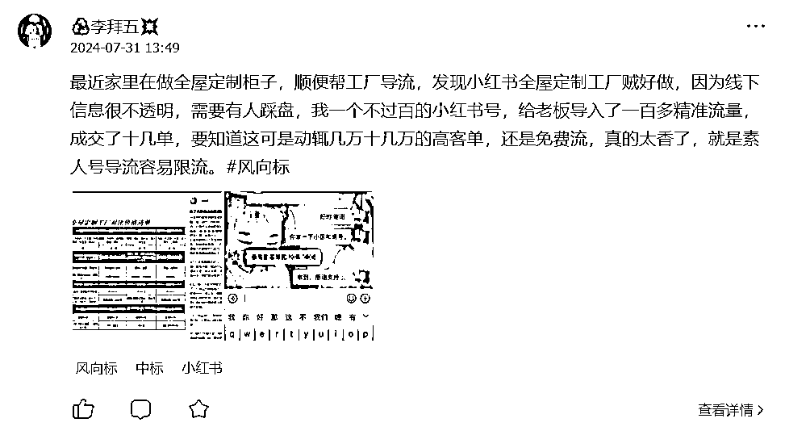
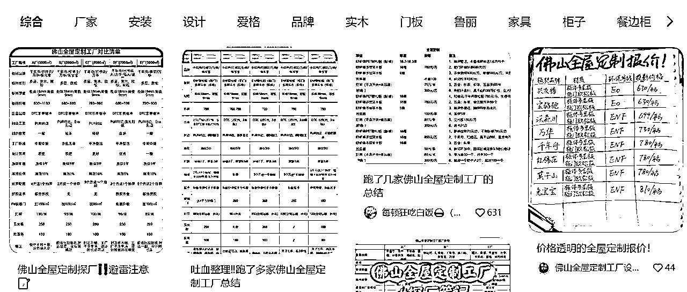
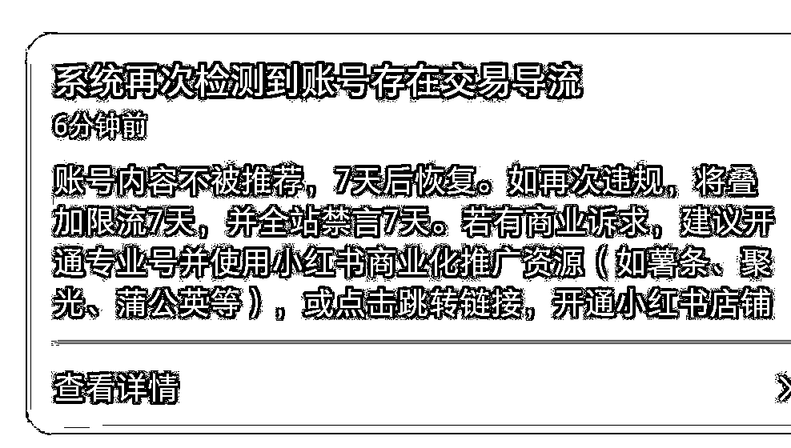
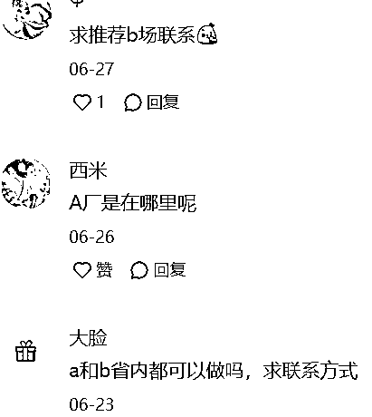
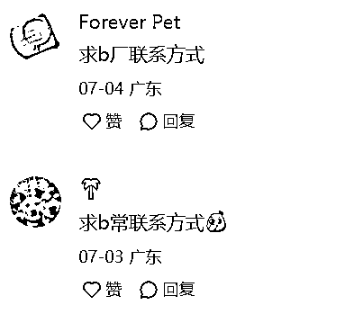
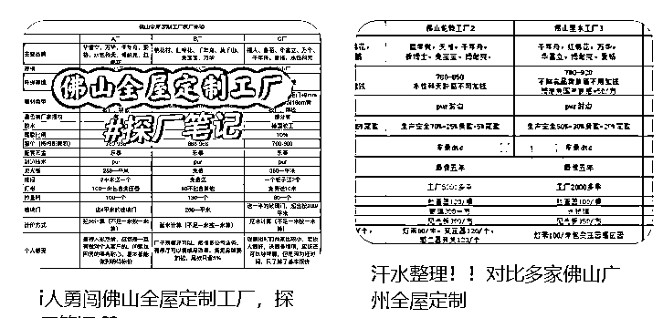

# 用小粉号撬动高客单，同城📕精准导流实战复盘
作者：龙哥

# 一、先做个自我介绍

大家好，我是李拜五 Ray。过去在📕发过一篇被收录的干货，靠它孵化了好几个从0到1的小项目，回报大概是门票的20倍左右。但从1到10这一步，一直卡着走不出去。很久没出来写复盘了，最近确实在跌跌撞撞里试错。

前两天我放出了一篇关于全屋定制工厂引流的风向笔记，没想到反响出奇地好。今天就把我这套📕本地化高客单引流的方法，拆开来说一说。如果手上有资源的朋友，完全可以考虑做矩阵放大。

我之前的一些成长期笔记链接也都留在这，有兴趣的可以去翻翻。也在📕做引流获客的同行，欢迎来私聊交流~

第七期课程还没开，我已经靠在赚钱上白嫖方法论，赚到了第一张入场券

# 二、这个思路是怎么来的

## 1. 误打误撞发现的空档

两年前我在佛山买了房，交房在即就开始找定制柜子。这一找才发现，全屋定制跟买家具、灯具、家电完全不一样。那些品类早就线上透明化了，有电商平台兜底。而全屋定制，线上做再多功课，线下照样套路满满，踩坑案例太多。

我就开始在各大平台搜攻略，📕上的内容质量明显拔尖。更关键的是，像踩盘、避坑这种形式的分享，几乎全是素人自发在写，商家根本没怎么占领，这就是一个很明显的蓝海。

## 2. 目前的实际效果

我先线上联系了几十家定制工厂，线下实地看了七八家，最后锁定了一家口碑相对稳的。老板也愿意给到成交返点。

到现在我只给这家工厂写了两篇笔记，完全靠自然流量，一个月就带来了将近一百个咨询。发笔记的小号粉丝还没破百，点赞也才几十上百，但评论区全是来要联系方式的精准用户。就是典型的低粉丝高转化，后来还因为引流太猛，被平台限流了一次。

# 三、到底是在做一个怎样的生意

先给没接触过装修的朋友简单科普下：

在整个软装链条里，全屋定制往往是花钱最多的环节之一，而且行业信息不对称严重，坑位也多。

## 用户一般有两条路可选：

## 1、去品牌连锁门店做

比如索菲亚、欧派这类头部品牌。品牌溢价非常高，同样是颗粒板，品牌店报价通常要 1000+ 一方，而找加工厂直接做，可能只要几百一方。套餐价看着诱人，最后实际结算往往远超预期。

## 2、直接找定制工厂

绕开品牌找工厂，成本优势立刻出来。同样的配置和工艺，工厂的价格通常更有竞争力。整体下来能省一大笔，前提是你得花时间精力去甄别靠谱的工厂。

了解完逻辑，其实打法很直白：为全屋定制工厂做客源输送。因为工厂本身没有精力去接散单，也基本不懂📕怎么玩。

这就形成了双向需求：工厂缺客户，业主在找靠谱的工厂推荐。做一个中间桥，打通两端，吃差价。这套玩法后来我才知道圈内叫打粉。

# 四、普通人能不能做起来

## 1. 本地化，竞争门槛低

正如一位圈友说的：同城是普通人能抓到的大流量洼地。本地赛道的对手就那么几个，只要把对手压下去，就能拿下城市的核心位置。

而且我们是用互联网内容去竞争传统工厂线下生意，本身就是降维打击。

## 2. 单价高，回报可观

一套全屋定制柜子的花费普遍在数万到数十万不等。

我现在的推荐量还不大，后续议价空间很大。现阶段老板给我的结算方式是：

柜子面积 30 平米以内 —— 800 元 / 套

柜子面积 30 平米以上 —— 1000 元 / 套

据老板说，如果量上来，还可以谈到 5% 的抽成。

## 3. 只负责引流，不负责成交

我的定位就是素人推荐官。只要把有需求的用户拉到🛰️，后续的看样、报价、签约、收定金全部由工厂老板接手。

笔记下有人留言，我就把🛰️推过去转给工厂。客户拿到地址后线下去看厂，满意就直接付定金。因为这家工厂是我亲自筛选过的，综合对比下来是优选，用户最后多数会选他。

## 4. 流量极度精准，复刻成本低

跟我以前做过的那些点赞高但转化低的项目不一样，这个玩法根本不看点赞收藏，只盯评论私信。来的都是带着地域关键词的搜索用户，比如搜「佛山全屋定制工厂」的。

评论区全是直接要资源推荐的，导流到🛰️的成功率非常高。典型评论长这样：

# 五、具体引流操作细节

## 1. 账号昵称

要让人一眼识别你的身份，最好加上「xxx 在装修中」这类标签，素人感越强越好。

## 2. 账号简介

把基本信息补全，增强真实感。比如：

佛山套内 76㎡ 三房两卫 🏠

装修小白进行中 🔧

不定期更新装修日记 📔

## 3. 笔记封面

汇总型攻略的封面点击率最高。选定一家长期主推的工厂，其他备选工厂可以轮换，表格样式也可以不断变化，能产出大量同类笔记。

## 4. 置顶笔记

还没做但很有必要。可以参考境外游博主的置顶逻辑。高客单的成交一定建立在信任上，尤其是陌生平台来的用户。置顶的核心目的就是强化真诚感和真实人设。

## 5. 瞬间

🛰️号直接放简介容易被判定违规。可以放进瞬间里，然后在评论区引导用户看瞬间，间接规避风险。

## 6. 私人群组

也是一个防限流的手段。先引导进群，再在群里引导看瞬间加🛰️。这样既能降低被限流概率，也能沉淀自己的私域用户池。