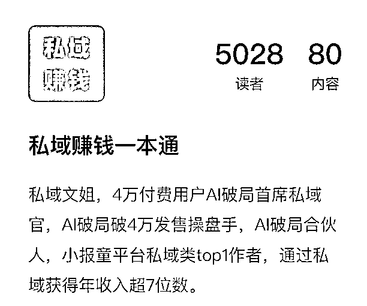

# 小报童发售超5000，其他小报童2天推广超1000单经验分享
作者：龙哥

两天冲榜1000+单，自己的小报童卖了5000+，私域文姐把玩法拆给你听

我是龙哥，平时做私域教练，特别擅长帮i人实现“不销而销”。今天不聊虚的，直接拆解两个我跑过的实战：第一，帮一个小报童主理人打榜，两天干了1000+单，还拿了榜单第一；第二，自己的小报童累计卖了5000+份，总GMV 5万，在平台综合订阅榜能排进前十，私域类目第一。

先聊第一段经历：两天推广破1000单。

为什么我愿意花这么多精力去冲榜？原因有三：
- 主理人给出的奖励很有诱惑力，我算过投入产出，值得出手。
- 冲榜本质上是为主理人站台，对方当然希望发售数据越漂亮越好，这也是建立关系的好机会。
- 打榜能放大自己的影响力，让大家快速看到你的销售实力和背后的流量资源，对个人品牌是很好的背书。

那怎么才能快速冲到1000单？说实话，单靠我自己是不可能完成的，必须有团队。一开始我和文胜军组合先冲到500单，当时觉得这个成绩差不多能稳住第一。但没想到第二名冲得特别猛，500单根本守不住。我又做不到天天盯榜，所以决定快速把力量集结起来。我在几个KOL群里发了一条消息，没想到很快就有人响应，不少KOL直接拿我的推广码去自己的社群里推，不到一天时间，1000单就搞定了。

这些KOL为什么愿意帮我？一方面是平时我也没少帮他们，彼此互助；另一方面我也准备了奖励，不过是他们帮我冲完之后才发的。

想要低成本冲到第一，核心就一招——从开始就占住第一名的位置，果断拉开与第二名的差距，并且公开告诉所有人：我这次就是冲第一来的。这样很多人会主动放弃和你争。

再说第二段经历：我自己的小报童卖到5000+。

这次发售，我自己只推了600多单，最后有437人参与推广，靠纯私域裂变产生近4400单，还新增了3000多位私域好友。复盘下来，有六个经验值得分享。

1. 内容量要足够扎实
能卖到3000单以上的小册，基本都有50篇以上内容。如果内容撑不起来，后面推广再猛也很难持久。

2. 定位、标题、目录都要打磨
我的小册在定位上动过一次，标题前后调整了四回。第一次的设计原本只围绕“不销而销的秘诀”展开，后来胜哥一句话点醒我——这个切口太窄，很难卖出量，于是我把范围放大到整个私域。第二次洋哥指出标题门槛太高，我又调整了一轮。第三四次改名字，纯粹是为了好懂，比如把“变现”直接换成“赚钱”，所有人都知道你在说什么，不用动脑子。

3. 奖励机制要设计到位
对KOC来说，奖励是最直接的动力。现在小报童赛道已经非常拥挤，产品能卖爆就看两点：产品本身好卖，激励机制够强。市面上的选择那么多，大家凭什么帮你卖？基本就是这两点。

4. 抓二八原则，多链接KOL
这次437个推广者里，前30名就推广了3000多单。所以平时一定要重视和KOL的关系积累，能付费就付费，能帮忙就帮忙，等你有需要时，他们才愿意为你出力。

5. 发售周期控制在2到3周
这样最合适。时间太短，朋友还没来得及推；时间太长，后面大家都没劲了，发售氛围反而拖垮。

6. 主动经营群氛围
发售期间每天都要主动跟进：先在群里提醒大家发朋友圈，再一对一私聊KOL请他们出手，千万别太佛系。同时要把社群气氛带起来，轻松一点、欢快一点，大家才会更愿意配合。

以上就是我两次小报童推广和发售沉淀下来的心得。如果你也在做小报童，希望这些细节能给你一些启发。记住：打榜要借力，发售要用心，两者都需要提前布局和持续维护关系。