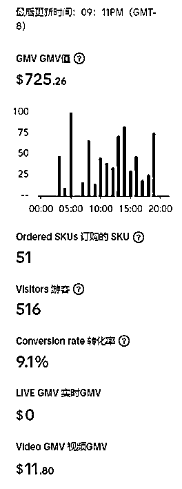
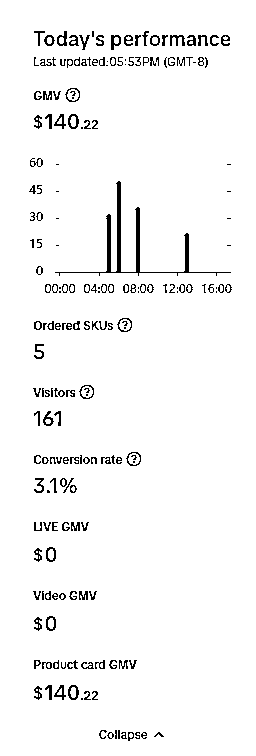
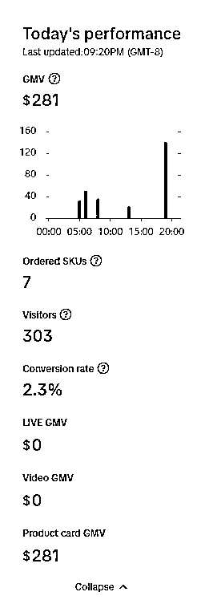
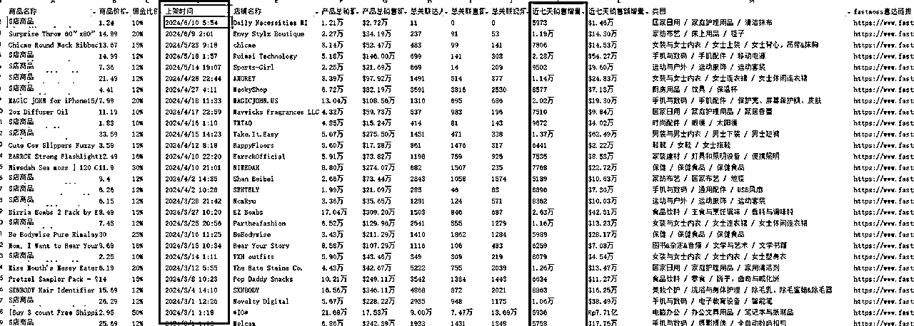
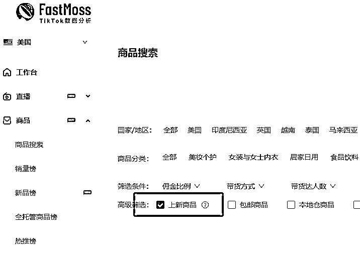
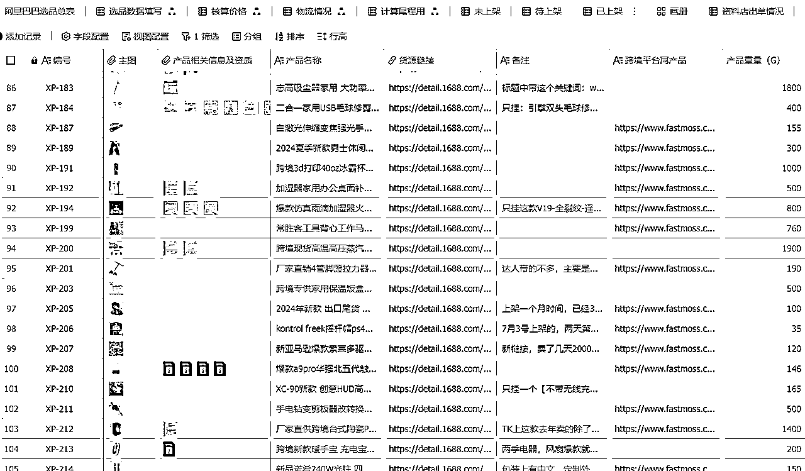

# 用漏斗模型做 TikTok 美区跟卖，资料类店铺累计出单 8000 美元
作者：龙哥

# 前言

大家好，我是龙哥，操作 TikTok 美国市场已经满一年了。先说明一下我的测品店是不囤货不发货的，唯一作用就是用自然流量去验证产品是否值得跟进，8000 美金是多个测试店铺累计的成交，不是单一店铺。接下来分享的是我用漏斗思路做跟品筛品的实操框架。

在研究选品时发现市面上大部分教程讲得都偏虚，落地性很差。因为要把货放到海外仓，试错成本很高，所以我需要一套更科学、可复用的选品打法。

我的做法是把所有能想到的选品方式全部放进第一层漏斗，把这些方法筛选出来的商品先统一拉进选品池，自动核算成本后直接上架到测品店，通过逐层过滤来做筛选。

就这样形成了下面的漏斗模型。

这样做的优势是跟的都是市场已验证的爆款，风险被大幅压缩，本质上是截流别人的热度。缺点是节奏偏慢，还需要不断打磨关键词、链接细节才能拿到更多曝光。

希望这套思路能对你有启发。

# 一、漏斗第一层：选品

*   用数据找品：借助 Fastmoss、特看等工具追踪市场动向，重点盯销量增速快、上架时间短的新品。能快速锁定适合跟卖的潜力款。
*   跨平台巡查：把亚马逊、抖音、TikTok、TEMU、阿里巴巴国际站等多个渠道的爆品一起纳入观察范围。

## 1.1 用影刀 RPA 批量抓取

抓完数据后我会先做粗筛，比如过滤掉 S 店商品，按上架时间倒序排列，限定自己擅长的类目，或者把近七日销量低于 500 的直接淘汰，就能快速留下一批可跟的候选品。

通过影刀 RPA 从 Fastmoss 导出上架日期和近七天销量，筛选出刚上线没多久但销量已经起来的产品。判断这波销量是靠自然流量还是达人带货，如果是自然流量为主，就有很大概率跟上也能动销。实操中不少品上架后一周就出了上百单，确认质量没问题后我就会先下样品，OK 再备到海外仓。

## 1.2 Fastmoss 直接筛选

现在 Fastmoss 已经支持直接勾选近期上架新品。以前没有这个功能时，我会导出近七天的销售数据，对比总销量和近七天销量，差值越小说明启动越靠前，越有可能是近期才起来的新品，机会更大。

# 二、漏斗第二层：合规性

*   合规与可售卖性核查：确认产品能合法上架，有齐全的认证证书，没有专利或版权风险。

这一层主要是把不能卖的品剔除，比如被独家包销、缺少证书、平台禁止的品。

专利和版权的问题不会马上导致下架，通常是卖一段时间后才爆雷，很坑。所以我会观察同款是否有多家店铺在卖，铺量越大相对安全。也可用卖家精灵这类工具查外观专利相似度，相似度过高基本直接放弃。

# 三、漏斗第三层：链接优化

*   主图差异化：做或选与竞品不同的首图，提升点击率。
*   价格设计：用较低的展示价吸引点击，运费部分可做适当调节来平衡成本。
*   促销玩法：限时折扣、秒杀、优惠券等刺激成交。
*   SEO 优化：优化标题和关键词，提升搜索曝光。
*   社交背书：通过前期动销累积评价和评分，增强信任。

有曝光后链接必须做优化。因为测品靠自然流，核心就是商品卡，用户在卡片外看到的只有主图、价格、标题、活动、已售、评价数和评分。

想要提升点击就要在这几个点上做差异。同一款产品我会复制多个链接，改标题、换主图。一个关键词只有一个链接就只有一次曝光机会，三个链接就是三次曝光，用数量对冲算法的不确定性，自然流测品效率会高很多。

## 3.1 主图

主图要在视觉上和同行拉开差距，全网同图基本没有吸引力。TikTok 目前白底图为主，找一张不一样的首图是关键。

可以叠加文字卖点，或者做 AB 测试，找到点击率更高的版本。

## 3.2 价格

测品阶段价格要尽量压低，在不亏损的前提下比竞品更便宜，这是核心优势。如果别人卖得比我的成本还低，就直接放弃。

*   可以设置一个 0 库存的低价 SKU，让用户在外部看到的是最低价。
*   也可把部分成本转移到运费上，比如商品标价 4.99 美元，运费 4.99 美元，合计 9.98 美元到手。用户看到的是 4.99 更容易点进去，而且部分用户有包邮券，实际支付更低。

## 3.3 活动

秒杀、打折、优惠券都能促进成交。

秒杀制造紧迫感，打折用高原价再降价营造划算感。官方活动能报就报，正规店铺运营也一样。

## 3.4 产品标题

标题决定能不能被搜到，关键词布局很重要。

*   最省事的方法是抄同款爆款的标题再改写。
*   标题开头可加品牌名、2024 NEW、最后一天、限时抢购等吸睛词，让搜索结果页一眼能被看到。
*   结合亚马逊、Google Trends 或第三方关键词工具，找到上升期热词，植入到标题里。

## 3.5 评价数

评价需要先动销。常规做法是先刷几单破零，然后慢慢养链接。用户选品时天然倾向销量高的链接，零销量的很难被信任。

## 3.6 商品评分

初期没有销量评分自然也是空的，必须先靠优势动销起来。选品时也会看同款的评分和评价，评分过低的品直接不碰，后期售后麻烦。

# 四、漏斗第四层：转化与下样

*   转化分析：对出现转化的产品做竞品拆解，结合利润空间判断是否值得备货。
*   内容评估：判断是否适合做短视频或直播带货，进一步放大吸引力。

自然流跑出来的品，后续找达人推或自己做内容投放会更容易，因为产品本身已经被市场验证，用户不需要教育。

如果团队偏投流，也会额外看合规性、是否好拍素材、是否适合投放等维度，再通过投放数据验证点击率和转化率。

# 五、漏斗第五层：备货销售

*   海外仓备货：验证通过且样品质量 OK 的产品，直接备到海外仓正式售卖。

确认自然流稳定、有潜力，且样品体验没问题后就启动备货。时效性强的品用快递快发，长线品用海运压成本，海运和空运的价差很大，能带来明显利润优势。

# 碎碎念

选品这件事我思考了很久，也踩过不少坑。现在这套自然流漏斗是我迭代出来的实操流程，依然在持续优化。

找到规律、提高命中率的那一刻最有成就感。虽然方法有局限，但梳理思路的过程本身就很有价值，迭代下去会越来越稳。