# 新手玩家公众号如何1个月赚到10w+

公众号新手月入10w+，我的第一手复盘

大家好，我是字母哥，真名IIXX，名字不太好念，大家习惯这么叫就行。

先上结论。这是我的单账号一个月收益图：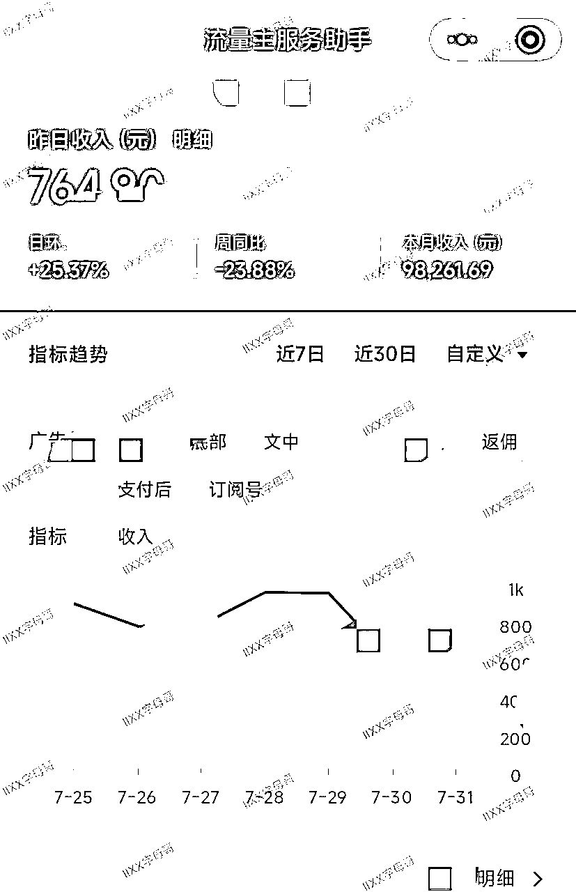

这是代运营部分子账号的数据：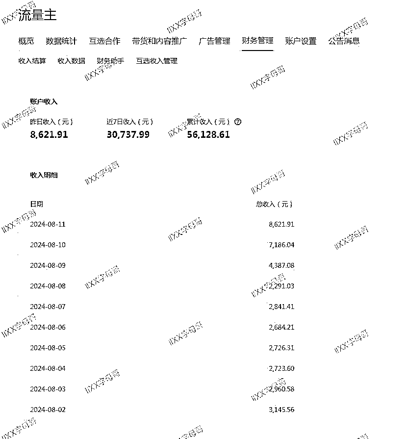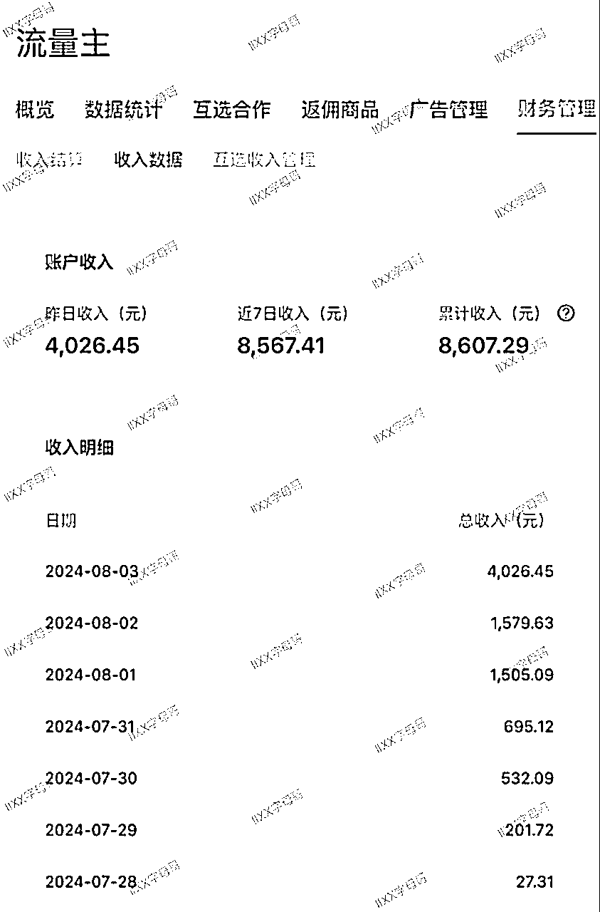

这是绝大多数账号的真实样子——发了一个月，可能只有10块钱：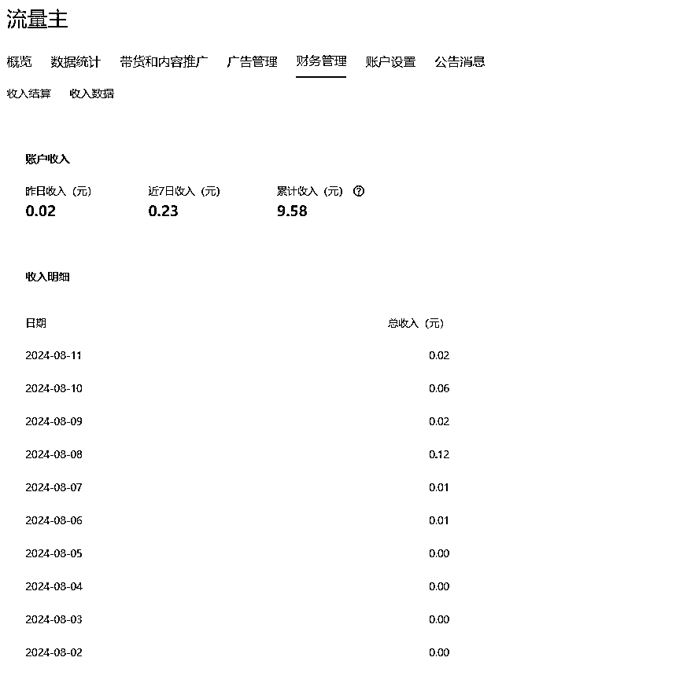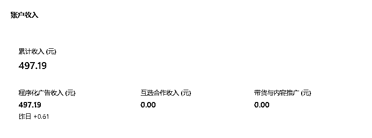

下面进入正文。

一、月入9.8w的单号，我到底做了啥？

我主业是程序员，副业一直在折腾。最早做视频号，后来太卷，就交给家里人做实拍，我腾出手来琢磨新方向。6月底在赚钱看到猫哥、兔子鱼、易生他们说公众号流量有动静，加上高考热度正盛，我就选了教育赛道。

以前跟着赚钱航海做过几次公众号，但那是随缘更新，三个月才100多块。这次不一样，我找到了自动化产文的路子，每天花10分钟发布就够了。自动化怎么搭？航海手册最后一部分和猫哥的直播讲得很清楚，直接去抄作业就行。等某个号真的跑起来了，我再考虑自己写原创；前期就用最低成本的方式测试。

选标题时，我用次幂数据和易撰去筛近3天、7天的爆款文章，直接拿爆款标题来用。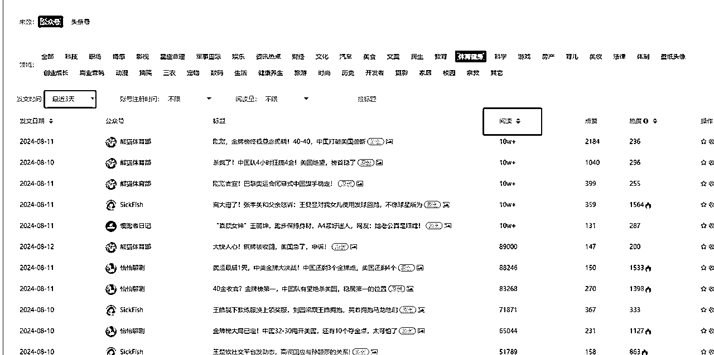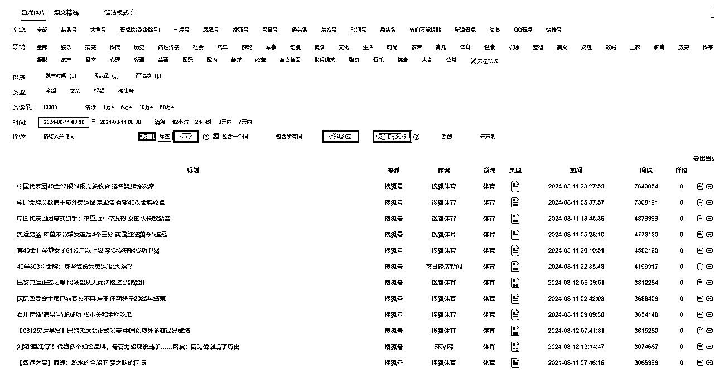 我没去刷对标，因为嫌麻烦；这种数据筛选的方式更适合我。当然你也可以按自己的喜好来，但后来我发现，选题的重要性可能没有选号高，这点后面再讲。

产出的内容直接发到公众号，不纠结排版，不找图，先发出去再说。别掉进“我要把文章打磨一下”的坑里。当然，公众号和视频一样，前3秒很重要，标题、封面、开头都要抓人，但这属于加分项，不是决定性因素。排版和插图重要吗？重要，但在我爆的那个号以及后来代运营的一批号上，它们真的没帮上什么忙。

自媒体项目，爆不爆是你控制不了的；你能控制的，是每天发几篇、用几个号测。我的做法就是自己拆步骤：选赛道、选标题、发文章，剩下的交给概率。

本来想多弄几个号，但有人提醒说超过3个号需要做IP隔离，我嫌麻烦，只注册了3个。现在回头看，幸好只选了3个，不然可能因为流程复杂直接放弃了。

测试一周后，一个号爆了——3天500万阅读；第二个号很平稳，每天几万阅读；第三个号几乎没流量，一天就几个阅读。同样的赛道、同样的标题，命运完全不同。所以这真的是概率游戏。要赢，只能多开号、多发，用数量去拼。

爆的那个号，单月跑了9.8万，其中大头7.5万集中在7月1日到15日。这里提醒一句：账号收益一旦超过1w，立刻去办对公账户收款，越早越好。我当时晚提交了两天，7万5被扣税扣掉1万7，真的心疼。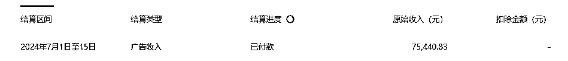

另外有个号属于“单篇入池”：两三篇冲到10w+，后面再发文就变冷，只有几十几百阅读，一般三四天就断流，推荐流量越来越少。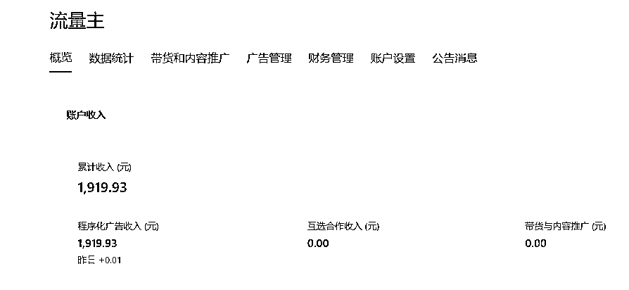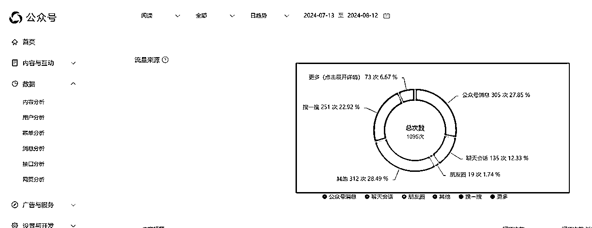 这种号最磨人，希望给了又收回去，心态差一点就崩了。所以为什么要多号？这就是答案。我也试过用小绿书、换领域、断更几天去救这种号，效果都不明显，可能时间太短。实在不行，最后只能注销重来。如果你们有更好的养号办法，欢迎来交流，我甚至愿意付费请教。

最后一个号更真实，跑了一个月，收入9块多。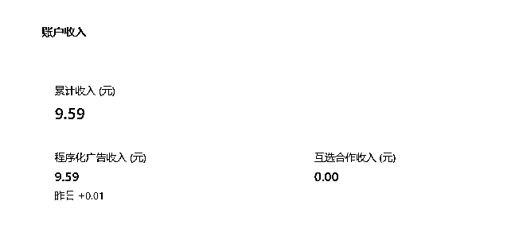 你看，三个号正好对应了后来代运营遇见的三种情况：爆款、半死不活、彻底沉寂。

二、放大：测号，比测品更重要

做了一段时间，我有个强烈的感觉：现在公众号很像早期视频号——平台在放量，但不是所有号都能吃到量；一旦测出来哪个号有量，就拼了命地怼内容，它会爆得很彻底。于是我决定放大。

自己没那么多号，新号又要刷粉开流量主，来不及。所以我选择了代运营分成。在朋友圈招了大概100个号来测试。

先说结果：一个月下来，破万的号只有7个，破千的15个左右，其余大部分只有几十块。这才是大多数人的真实结局。

有人来合作，我会先把流程发过去：分成比例、发文方式，外加一句“不保证收益，可能一个月只有几块钱”。对方如果还死盯着收益、问一堆细节、纠结来纠结去，我基本就不收了。我只愿意和能接受现实、能坚持的人一起玩。

账号数量上，我建议至少3个号起步，因为一个号太难测出结果。老号重启更好。测号测品，其实就是看两个东西：账号有没有推流体质，领域对不对路。有些号在这个领域跑不动，换个赛道却能直接起飞。

具体策略是这样的：

如果是老号重启，先发最近热门领域的内容，比如当时的奥运。如果流量不错，就继续怼同赛道，每隔1~2小时补一篇，每天最多16篇。如果流量不行，就换赛道，但别太心急：一个号、一个赛道，每天发3条，连发5天，没起色再换。流程一旦量化，人就不会乱。

如果是新号，同样先发不同赛道内容测试。运气好，测到有流量的就一直发；但新号往往只能猛几天，很容易出池。如果当前赛道没量，可以3天一换。换了好几个赛道还是不行，就开始养号。

养号方法我参考的是视频号那套：内容不行就全删，发10条原创，去申诉，让平台觉得你还在认真创作。但这类玩法不能说得太细，说细了很快就卷死。最早发风景视频就行，后来要怼脸特效自拍，再后来要怼脸读古诗，玩法一直在被更多人逼着升级。反正核心原则是：养号内容可以很随意，哪怕是流水账，但原创度一定要高，不能有原创违规。最好选一些小众赛道来养。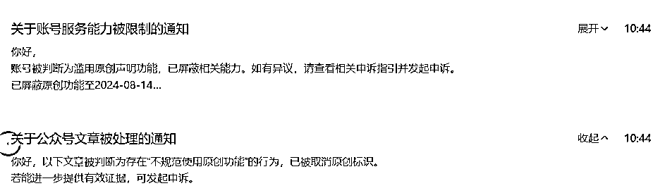

这样做有没有用？我不能保证，只能说在视频号上验证过，公众号也沿用了同样的思路。

一个月的测试下来，我的结论是：号比内容重要。号好，发什么领域都能爆；号不行，发什么都没用。所以公众号放量期，别纠结，一个号不行就换下一个，直到测出那个“天选之号”。

三、跟着周期走，别跟平台较劲

我做项目一向看周期。从22年5月开始碰视频号，到现在两年多，我并没有一直在做，而是周期来了就冲一波，吃完红利就歇着，等下一个机会。

22年5月，老中医类内容很火，单条视频我能做到千万播放，那时候真是发什么都爆，根本不用谈技巧，加号就行；6月教辅又来一波；后面核废水、抢盐、艾条、甘草汤，也都踩中了。最难忘的是去年口播文案抠像分发，拿视频换个静态背景直接发，还能多号一起爆。后来平台严了，静态背景不够，要换动态视频，再多套几层蒙版，去重手段一路升级，爆的概率越来越低，因为入场的人多了，开始卷原创口播、卷数字人。数字人其实也是降成本的好路子。所以去年我的策略就是加号、多抠像、多吃红利；等卷起来后，我就少做一点，多研究新玩法。

一句话：在正确的周期做正确的事。公众号也一样：有量的周期里，多号、怼量、测号，把能吃到的收益都吃到；等平台开始收紧，再慢慢补排版、发帖时间、起号技巧这些细节，也来得及。

四、心态：别拿别人的爆款惩罚自己

最后聊聊心态。看到别人爆了，谁都会焦虑，但真没必要。每朵花有自己的花期，我们也有自己的节奏。像公众号、短视频这种爆发型内容，爆不爆真的看运气。你能做的，是多测、多发，把概率拉高。别人爆不爆，跟你没关系；你过得好不好，只跟你自己有关系。焦虑解决不了任何问题，累了就歇几天，别当成任务。做项目是长跑，开心才容易坚持。

多发文章，经验会累积，网感会累积，账号权重也会累积，爆发自然越来越近。干就完了！