# AI 口播全自动生产链路

# 一、抓取抖音创作者视频

抖音官网本身有反爬机制，所以没法直接在 Coze 上做插件拉取数据。

这套做法是用浏览器插件来提取网页元素，再手动筛选出目标视频区域。用 GPT 也可以生成插件代码，这里我已经整理好了可以直接拿来用。

#### 完整插件包

#### 抓取实测效果

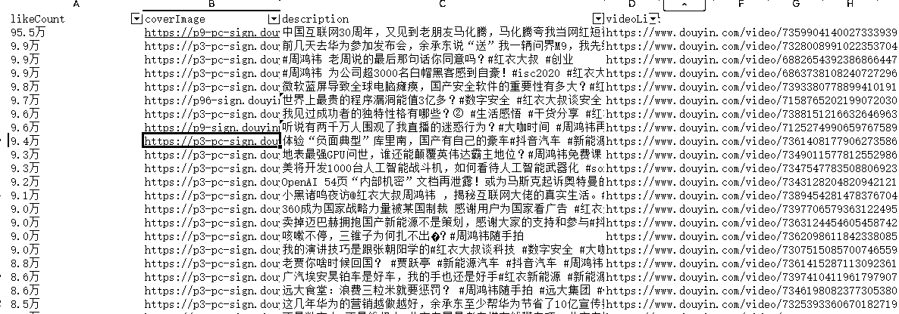

#### 操作步骤

把创作者主页链接从手机分享出来，复制到浏览器中打开后启动插件进行提取即可。

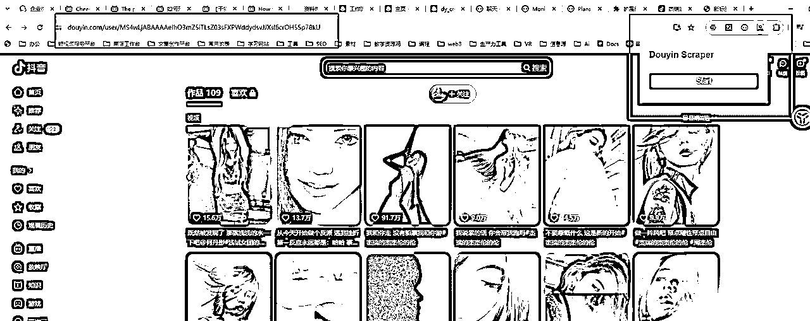

# 二、视频文案的批量抽取

#### 整体工作流

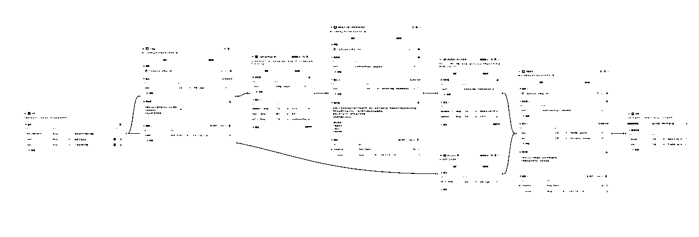

#### 1. 输入数据清洗

爬到的原始数据是文本形态，实际使用时只需要视频链接这一个字段。因此第一步先让大模型把链接挑出来，并整理成 Array 数组格式输出。后面要做批量处理，必须是数组才能被识别。

留意模型返回必须是 Array<string> 的结构，否则后面的批处理节点无法接收这批链接。

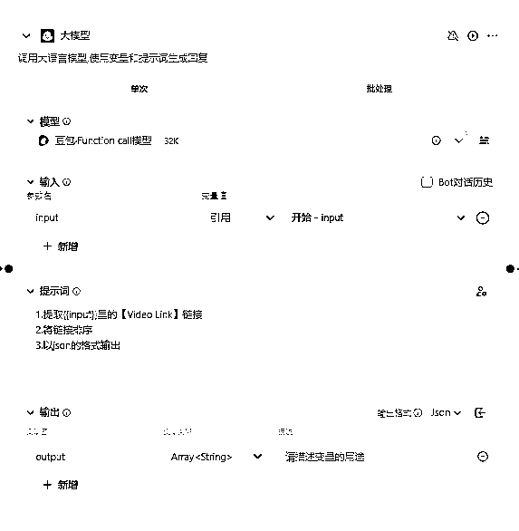

#### 2. 批量提取文案

链接数量一多，就需要对每条视频分别执行文案抓取。这一步依赖批处理功能，把上一步输出的链接数组作为输入源。插件的 url 参数要引用当前批次的数据，因为插件会循环执行，比如 10 个链接就会自动跑 10 次。

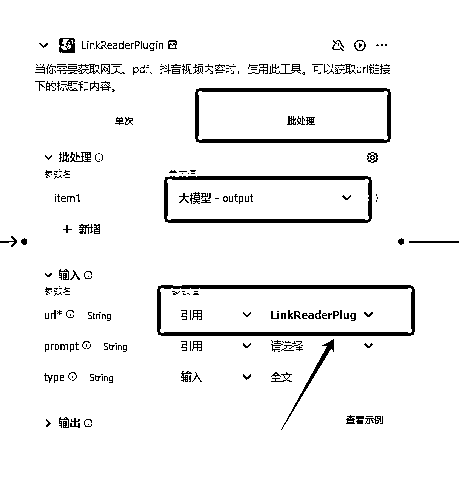

#### 3. 文案纠错与润色

直接提取出来的稿子经常出现错别字、语句不通的情况，需要再用大模型做一次校对补全。为方便对照使用，可以让模型同时给出修改前和修改后的版本。

这一步同样要走批处理，和上一步的逻辑一致。要注意的是，部分长视频的文案很长，容易超出模型上下文限制导致报错，建议选用上下文窗口更大的模型，比如 Kimi 的 128K 版本，处理稳定性会好很多。

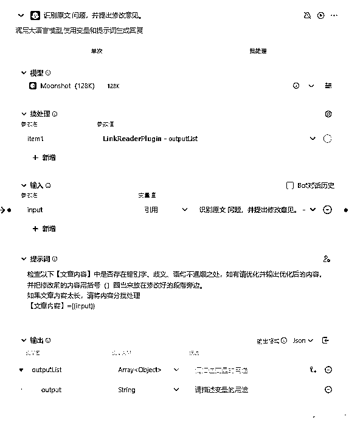

#### 4. 推送到飞书云文档

最后把整理好的结果分批写入飞书多维表格/云文档，方便后续查阅和复用。

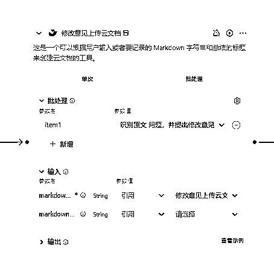

# 三、文案风格重写

### 1. 学你自己的表达习惯

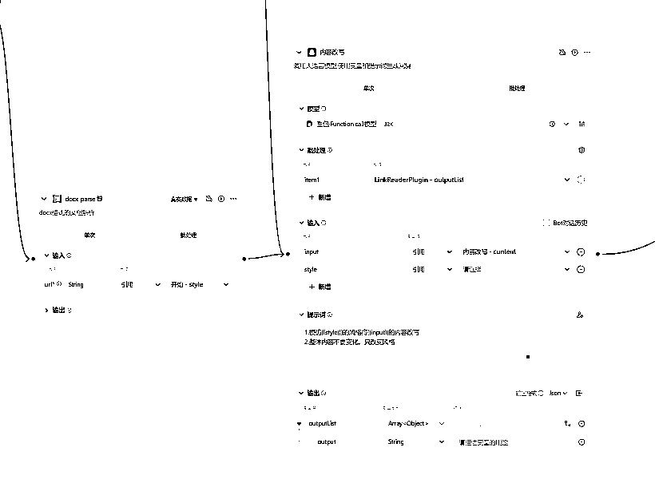

把你过往的代表性文案集中放到一个文档里，让大模型先学习你的用词和节奏，再进行改写。

### 2. 学某位头部主播的风格

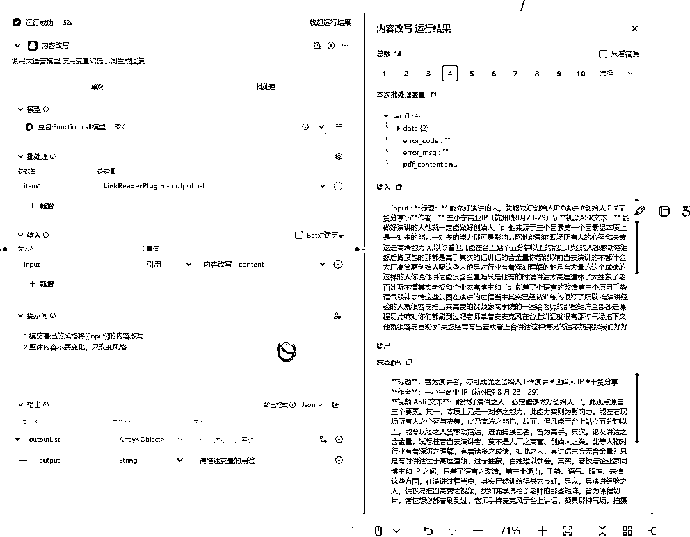

# 四、数字人分身搭建

下面以飞影数字人为例演示，其他同类产品同理，本人无商业合作。

1. 数字人素材制作

先录一段自己的实拍视频，面部表情和肢体动作尽量自然饱满，背景可按需求自定义。

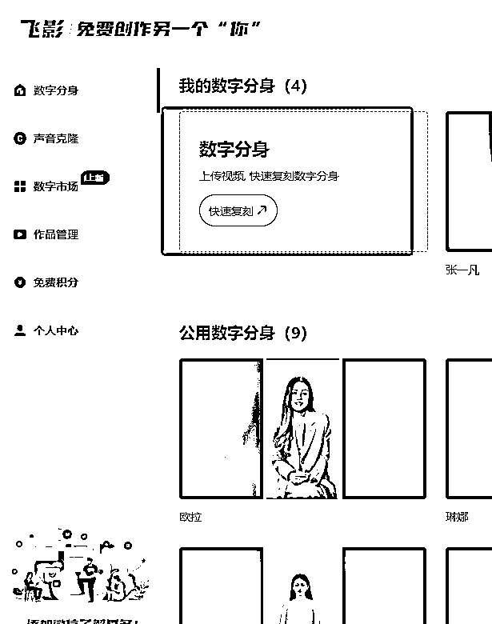

2. 声音克隆

3. 内容生成

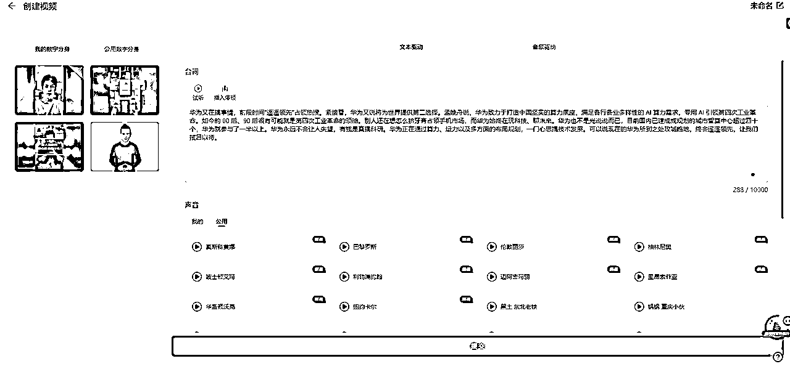

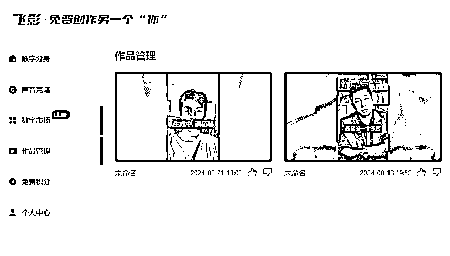

4. 短视频成片

把生成的数字人视频导出，再导入剪辑软件加上字幕等包装。效果对比如下，目前口型停顿需要手动调整。

提示：现在各环节是割裂运行的，借助 RPA 工具可以把整条链路串联成一键自动化流程。