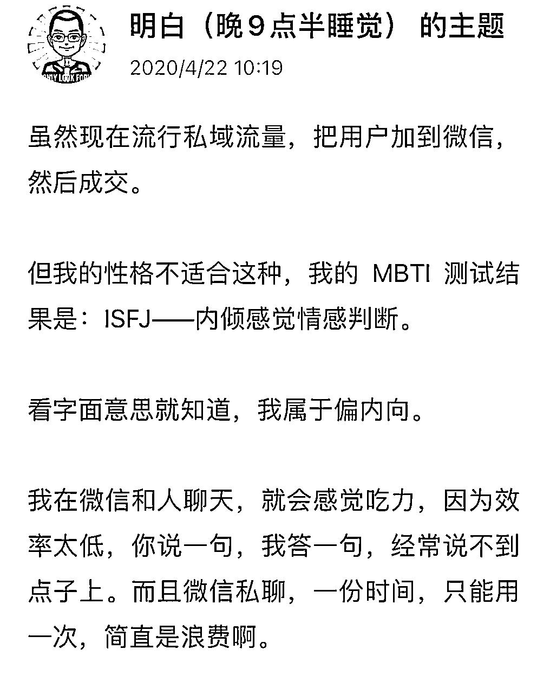
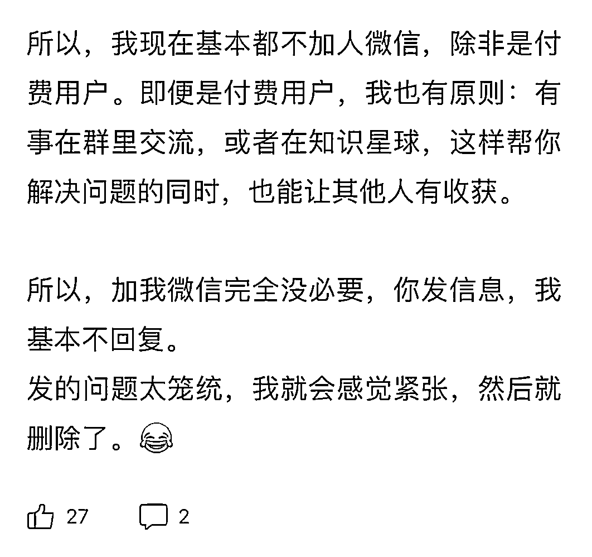

# 别再找“天赋”了，赚钱的真相只有一个：刻意练习
作者：龙哥

我是龙哥，今天想聊一个比“天赋”更硬的变量：刻意练习。

很多人把赚钱卡在“找不到热爱”上。他们总以为，一定要先确认“我喜欢”“我适合”，才能安心开始。于是做一个项目，觉得没感觉，换；再做一个，觉得不对味，再换。循环了一圈又一圈，时间全花在“寻找”上，事情却从未真正开始。

可你有没有冷静想过：一个人把副业做成、真赚到钱，到底是不是因为“喜欢”？

我们不妨把这件事拆开看：

1. “喜欢”真的是“赚到钱”的原因吗？
2. 就算是，它是唯一原因吗？
3. 如果不是，那还缺什么？
4. 如果它连最重要的原因都算不上，最重要的原因到底是什么？

任何一个项目，只要愿意这样深度推演一遍，你会发现，很多“理所当然”的直觉，根本经不住追问。

先说说我自己。我曾经是极其内向的人，几乎不参加线下聚会，也不知道怎样跟人闲聊。我保持日更的那一千天，文章阅读量常常有三四千，但我始终不放🛰️二维码。为啥？就因为一想到有人加我、要跟我说话，我就紧张，干脆从源头把这件事掐灭。

上面说的是 2020 年的我。但如果你现在跟我聊过天，你大概会觉得：这人也太健谈了吧？聊天体验还挺愉快。

如果照着“优势天赋论”的逻辑，我以前是程序员，应该擅长写作和逻辑思考，不擅长人际沟通。那结论就是：我不适合沟通，别在这上面浪费时间。表面看，这像是简洁的因果推理：因为我内向、没天赋，所以做不好，所以练了也白练。可这种线性思维，并没有真正帮助我成长。

后来我才慢慢想明白：性格、天赋、擅长，跟“能否把一件事做好”之间，从来不是因果关系。真正决定结果的只有一个——你在这件事上，刻意练习了多少回。

我是程序员出身，过去也以为自己只会写代码，注定是直男思维，不可能做到站在用户视角写文章、做课程、解答问题。但后来，这些事我都做到了，而且做得并不差。原因特别朴素：我在这件事上花了足够多的功夫，一遍又一遍地学，一遍又一遍地练。

有一本经典书叫《刻意练习》，它讲得很清楚：任何人都有机会从新手走向高手，前提是方法正确，并且重复的次数足够多。

你可以回忆一下自己刚毕业时的样子：做事磕磕绊绊，能力一塌糊涂。可工作几年后，你对那摊事早就驾轻就熟，甚至还会觉得自己天生适合干这个。那到底是“因为有天赋所以做得好”，还是“因为重复练习足够多，才把这件事硬生生练成了天赋”？

这其实是一个价值观选择。

选择第一种人生态度：碰到有难度的事，第一反应是“我没天赋，做不好，换一个吧”。换到下一件事，又遇到困难，又说没天赋，又逃。结果一辈子都在找那个“天生适合自己”的事情。

选择第二种人生态度：遇到困难但值得做的事，就算现在不擅长，也愿意认真去学、拼命去练，用足够多的时间把这件事变成自己的“天赋”。人生会因此越过越顺，你对生活也会越来越有掌控感。

我选择的是第二种。

写作不擅长，练多了，就成了我的“天赋”；做课不擅长，练多了，也能做好；沟通、情绪管理、销售、营销，都是一样的道理。天赋不是天生注定的，它完全可以通过刻意练习被创造出来。

再从赚钱的功利角度看。真正能抬升收入的底层能力，无非就是这几项：写作带来的影响力、逻辑思考带来的执行力、学习能力、沟通销售能力、网感、用户视角，以及遇到问题不逃避、勇于解决的特质。

课程、社群、个人IP、社群团购、抖音、📕、淘宝，不管表面是哪一种商业模式，底层全都长在刚才那些能力上。如果你因为“没天赋”就不学、不碰，那你走的路只会越来越窄。

所以，要不要练习这些底层能力，根本不是一个“我喜不喜欢”的问题，而是：不练，你大概率走不通赚钱的闭环。就像一个人说要减肥，却拒绝运动；运动是减肥里不可缺的一环，少了它，目标就很难达成。

还有人以为，只要找到天赋，一切就会变得轻松。先不说能不能找到，就算找到了，任何技能想真正落地，还是要靠大量练习。那些真正赚到钱的人，哪一个没经历过没日没夜、死磕一个点的阶段？那本身就是刻意练习。

所以，当你纠结要不要做一个项目、学一个技能时，真正该问的不是“我有没有天赋”，而是：“这件事能让我变得更好吗？能让我能力更强、赚得更多、关系更好、情绪更稳定吗？”

如果能，那就别啰嗦，认真学、认真练，投入足够的时间，把困难一个个干掉。这是唯一的路。

最后讲讲我自己。看这篇文字的绝大多数人，客观条件都比我好十倍。我有强直性脊柱炎，是一种慢性病，身体几乎每天都在疼；人一旦难受，就没什么能量静下来思考和学习。2016年到2019年，我从程序员转型，学写作、做课、营销、产品，每天都是在这种状态里熬过来的。我能投入的时间和精力，比你们任何人都少。

我都能从零开始，把一个陌生领域学会，把事情做成并拿到结果，你就更没理由不行。

只要完整做成过一件从0到1的事，你内心就会长出一种底气，不是自信，而是“120%相信自己”。你会笃定：这世上，只要有人能做到，我也一定能做到。

赚钱这件事，只要多一分耐心、多一分勤奋、多一分认真，真的没什么做不成。

希望这篇文章能给你一点思考，也给你一点力量。祝我们都能亲手创造出自己的“天赋、热爱、优势、适合”，而不是一辈子等着它们从天而降。