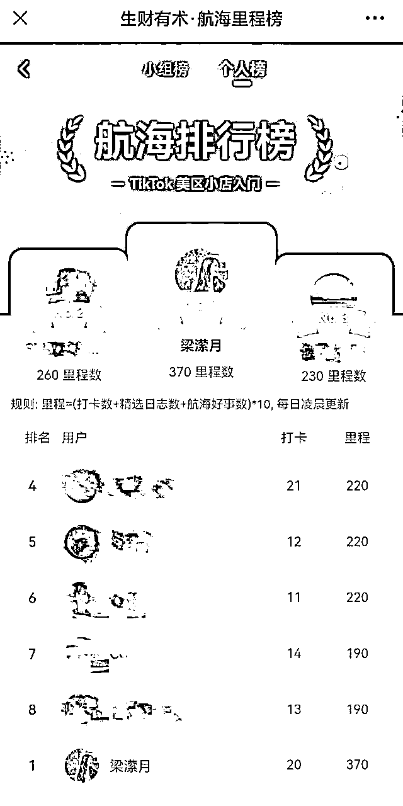
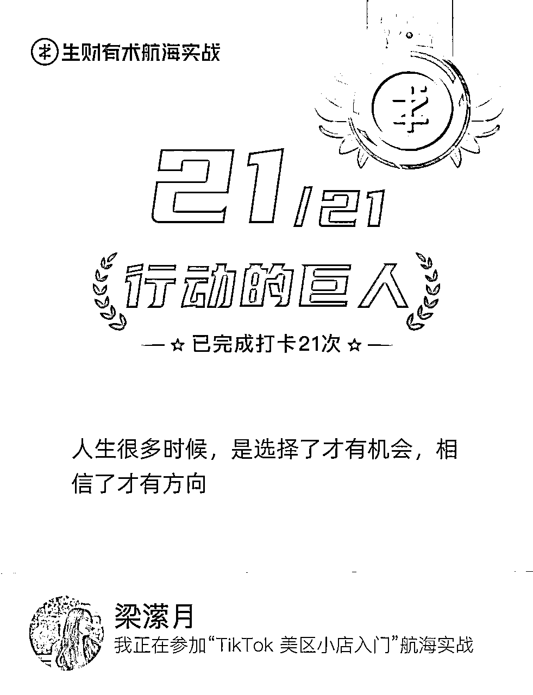
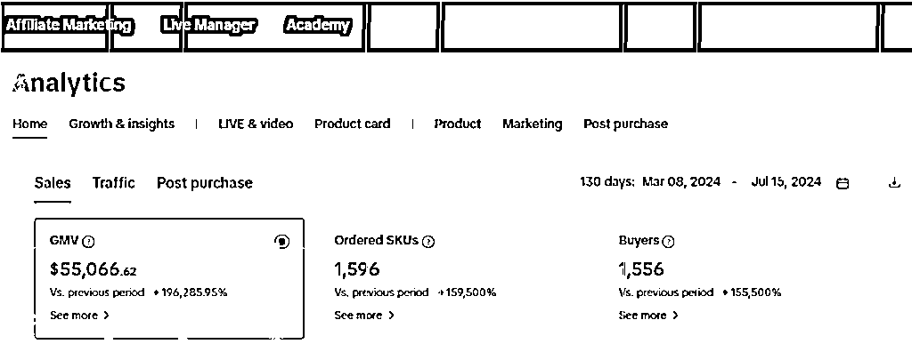
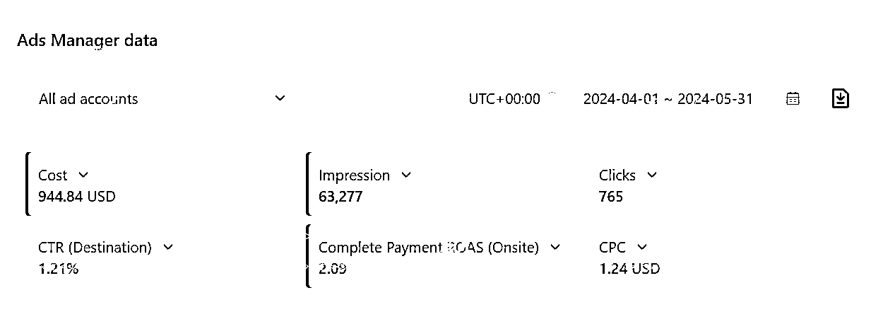
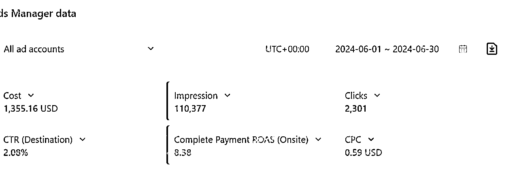
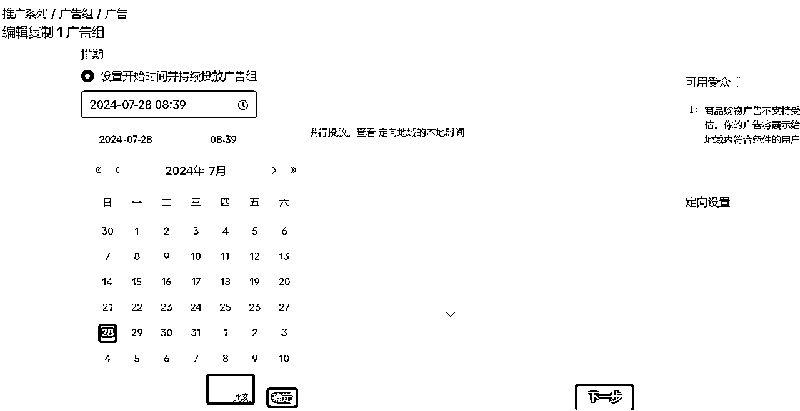
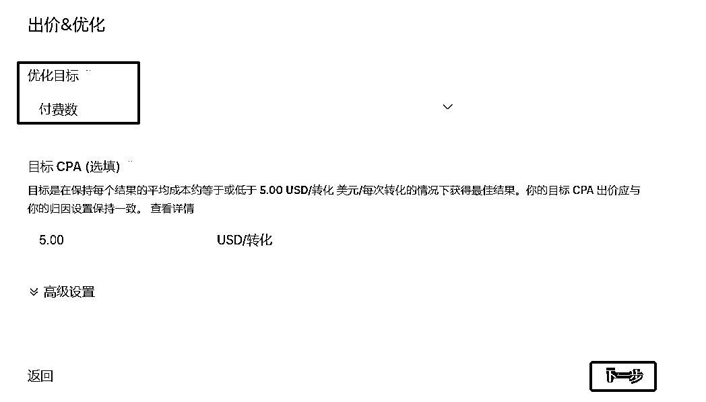

# 三个月出单1500+：我在TikTok美区小店的实战运营复盘分享

三个月在TikTok美区小店跑出1500+单，这波经历我想认真复盘一下。

先简单介绍自己：我是梁潆月，广西人在深圳，主业做TikTok运营，副业搞健康管理。大学去黑龙江读了日语专业，和同学一起做过日语公众号，大四还接过小红书代写的活儿。2021年毕业后，我成了微博百万大V的助理，一个人从零开始做抖音。当时连剪辑都不会，全靠着边学边试，第一个视频就涨了三千多粉，两个月做到四万粉。这段经历让我攒下不少硬技能，也为后来做TikTok打下了底子。

2022年中，我离开那位老板，面试两个月后彻底迷茫了。国内太卷，我就想着换个赛道，于是进了跨境电商公司。最开始负责东南亚市场，一个人管四个店铺——一个跨境店加马来西亚、菲律宾、泰国三个本土店。在泰国遇到一位很牛的达人，一条视频就带来上千单，当时真的被TikTok的爆发力震住了。

2023年9月开始摸美国市场，主要负责红人合作。2024年3月加入现在的公司，独立操盘TK美国小店。当时跟着赚钱的TK航海计划每天打卡，作为参加过十几次航海的老船员，真没想过自己能冲上榜1，特别感谢航海的组织者，给了我不断突破自己的机会。

说说成绩吧：航海第一个21天出了85单，第二个月100多单，第三个月直接冲到800多单，其中一位达人单独贡献了400多单。我们主推的是小众赛道产品，客单价在40美金左右。

在店铺初期，最核心的就是大量建联达人。第一个月订单里九成来自达人视频。最开始合作的4个达人都很配合，收到样品就拍，其中3个出单，有2个前后各出了五六十单。说实话运气也不错，遇到的达人都比较垂直，后来爆单的那位同样垂直。

建联达人之前，准备工作一定要做足，最好列成表格：
- 确定主推产品：前期先选3个主推款，逐个打爆。如果公司原本有亚马逊业务，可以直接挑亚马逊卖得好的款，同时自己也要持续选品。
- 提前写出主推产品的中英文卖点。
- 明确合作视频的内容要求、达人类目范围，心里要有顾客画像。
- 整理好开发信模板，能一键复制粘贴的那种，航海手册里有参考。
- 多刷同类目的爆款视频，可以借助ChatGPT写脚本给达人参考。
- 我当时在圈友推荐下试用了kolodata，重点研究同类目的爆款视频，还能把脚本和视频下载下来翻译着看，省了不少脑细胞。

总结一条公式：开头一两句抓眼球的话（配音字幕）+产品卖点+结尾引导下单。很多爆款视频都验证了这个逻辑，尤其是开头展示痛点，然后呈现产品外观和样式，接着展示使用过程，最后突出效果。

选品方面，我除了推公司的产品，也会不断看适合自己的品类。测品时买了资料店，上架了一些看好的品。真正决定在店铺卖的品，是我在刷TikTok时刷到的一个爆款视频——对方没有在TK开店，只做独立站，卖四五十美金一个。我去1688一查，成本只要30多块。当时心里就有数了，赶紧找供应商备货发到海外仓，上架没几天，还没找达人推广，自然流加商品卡就把库存清完了。这个方法是我之前跟文哥做视频号时学到的：多刷TK，看到流量好的品就跟上去。

这次也有个教训：一开始备货太少。断货期间，我刷到的那个账号迅速开了TK本土店，一个视频卖了几百单，还私信让我下架，说要告我侵权。我们查了供应商和美国专利，才发现对方只是吓唬人。

达人合作上，强烈建议用批量建联工具，前期广撒网，等有回复了再筛选。如果合作的达人也做直播，可以顺便让他们在直播时带一带产品。但记住，粉丝量真的不是最重要。优先选平均播放量至少300的达人——我刚开始大量建联时，很多回复我的达人播放量只有两三百，合作效果很差，有些还不履约。另外要看达人的30天GMV和GPM，GPM在10以上的更靠谱。还要翻翻达人的爆款视频，只有大量流量才能给达人打标签，判断粉丝画像是否匹配。最后，视频画面要清晰，封面风格统一，这种达人通常更专业，合作效果也更好。

投流这块我也是从零摸索，花了两个月把ROAS从2做到9（最好时），看到数据的那一刻还是很开心的。

2024年上半年主要靠短视频加投流，素材特别关键，也有运气成分。我的做法是：只投已经出单的达人视频，一个广告系列放3-5个广告组，每个广告组放1-3个广告。广告系列预算设50美金，投三天，跑不动的组直接关掉。如果达人视频确实拍得完整、卖点清晰，我会专门给他开新系列新广告组再测。已经出单的广告，可以复制到新系列继续跑，往往也会同时出单。每天盯新上线的视频，自然流过千的尽快拿到AD Code去投流。

广告效果的核心因素就是：eCPM = 预估点击率 × 预估转化率 × 出价 × 1000。点击率和转化率主要由创意和受众决定。后来我也尝试投PSA商品卡，虽然放不了量，但能带来一些订单。商品卡投放门槛不高：先确认人群，再确认出价方式和预算，最后确认商品。我建议等体验分和评论都做好再投商品卡。如果是新链接，可以设低一点的出价，算好成本，优化目标选付费数，能带来动销。投放时间选“此刻”，一开始每天预算10美金就够了。原本已经出单、没有差评的链接，推荐投商品卡。

以上，就是我的TikTok美区小店运营全复盘。感谢赚钱，感谢航海期间的教练和志愿者们，也感谢SKY老思的日常分享。希望能给大家带来一点启发，欢迎随时交流，一起在TikTok的路上越走越顺，龙哥盟！