# 00后大学生靠📕做境外高端游，2个月12单 gmv32w+ 纯利3w+，我的实操复盘
作者：龙哥

大家好，我是龙哥。00后在校大学生，2023年4月加入赚钱，潜水一年多。今天把我做高端境外游跑通的过程摊开说，2个月出了12单，gmv32w+，净赚3w+，到底是怎么做的。

现在头像已经换了

出单截图放这里：

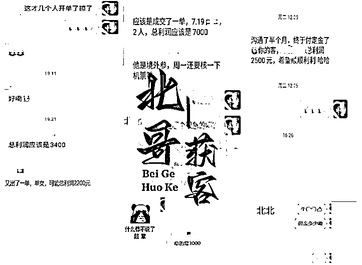

# 先做个自我介绍

00后大学生，秉持真诚利他的做事方式。现在主要在打磨流量截流、私域沉淀、付费投放这三大闭环。

手上在同步推进的项目有：📕高端旅游、AI代写、百度SEO、淘宝虚拟。每个项目月收益都在万元级。

下一步的重点是把后端产品做扎实，形成自己的护城河。

【我能提供的东西】

1、0到1项目跑通辅导，帮新手快速建立信心，赚到人生第一笔钱
2、全平台引流养粉SOP、自热模板
3、📕矩阵号运营：一人可控百号
4、📕引流话术钩子，设置好当天就能见效
5、抖音私信截流：无限私信、精准采集、自动加粉、不愁流量
6、视频号精准私信截流，可直接导🛰️
7、境外高端游相关培训资料
8、可以对接获客渠道，也能自己打
9、自动化引流工具，欢迎老板交流沟通，跑通没跑通都算兄弟，小白问问题我知无不言
10、项目专用手机提供，非工作室机，寄出前会帮你测能不能用

【我想要的资源】

1、优质私域社群、创业社群，可付费，能获取最新信息，关键是认识靠谱的人
2、长期交流、资源互换。想解决公域获客难题、想学习引流黑科技的老板、超级个体、流量团队
3、真诚靠谱、懂得感恩、执行力强的人

先发张老照片，跟大家打个招呼。

为什么突然想写这篇文章？我想吃私域的红利。现在大环境不理想，知识付费疲软，各路大佬都在喊难。我跟七小哥深度聊过一轮，越是这样越要提前布局私域沉淀。先布局的先吃肉。

观察那些年入百万、千万，且持续增长的玩家，绝大多数都是表达型选手。

这个时代，表达力=现金流。

稳定进流+清晰人设=无敌

## 我是怎么入圈的

## 1.大一放手试水

20年那会我跟着黄岛主花1980学淘宝虚拟。目标很简单：每天赚点饭钱，几十块就行。带着这个小目标开始学开店、选品。没赚大钱，但这是我第一步网赚经历。

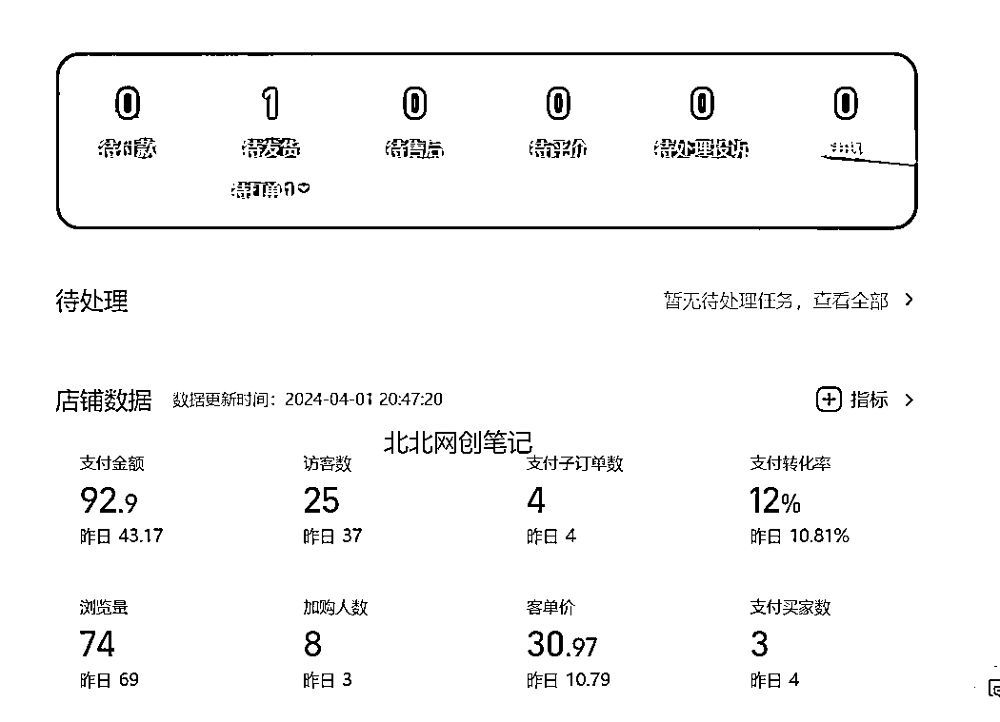

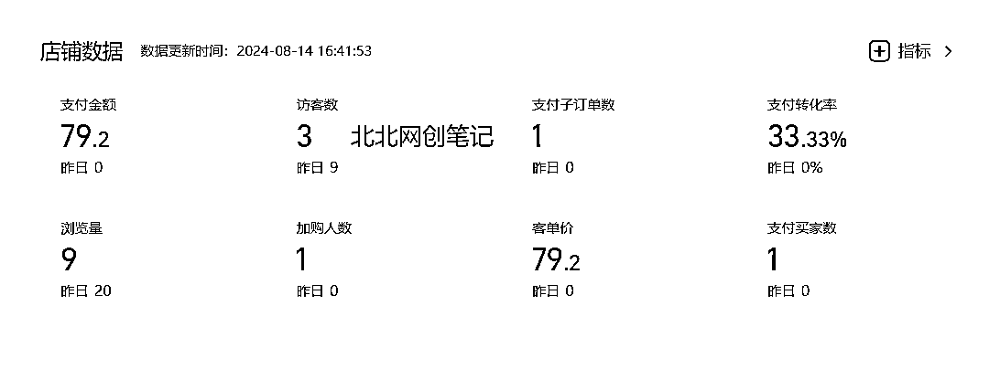

附上最近的收益图

## 2.闲鱼无货源跑通了

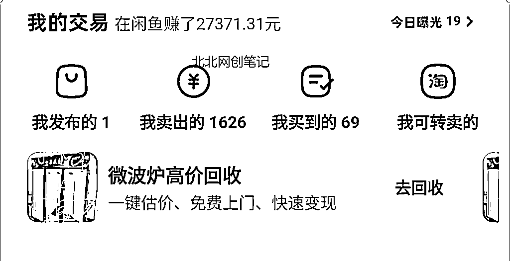

这个项目让我学会了基础的卖货文案，也搞懂了变现逻辑。看起来销售额很高，其实是百货，最后净利也就几千块。自己选品、上架、售后全包，太累了，后面直接放弃。

## 3.📕学科虚拟

这个项目曾让我月入2w+。当时吃的是平台红利，单号就能做这么多，客单价才三四十，主要是量大。后来被封号结束。那段时间单天稳定进流100+，持续了半个月。那个时候爆款咨询也就三四十人，现在竞争大得多。

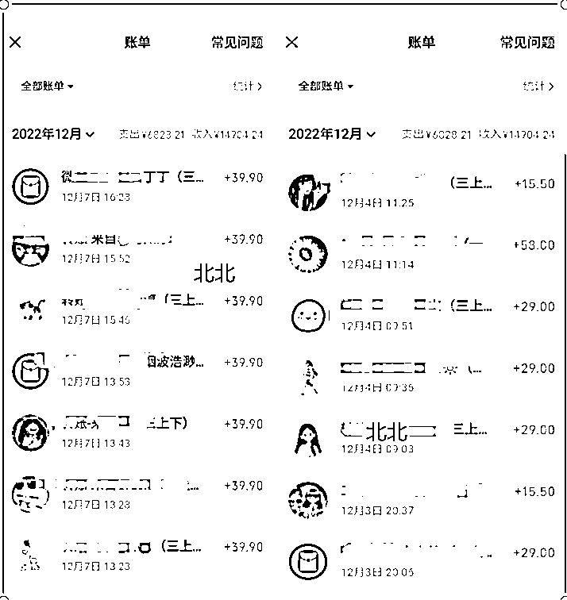

那时规则松，套个模板就能吃一波。后期一个人扛不住，也放弃了。

其他经历以后再补，今天回到正题。

# 高端旅游我是这样做的

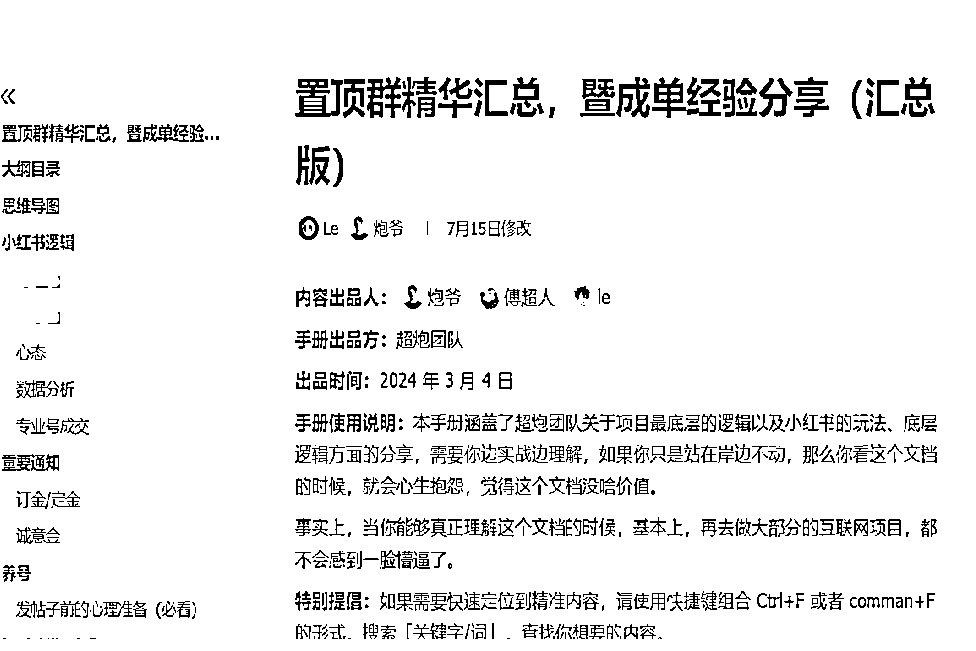

## 第一步是把SOP啃透

炮爷超人分享的万字📕旅游精华SOP

我从头到尾看了四五遍，还是懵。很多新手拿到项目都会焦虑，看着一堆资料不知从何下手，甚至会哭。但谁刚开始不是这样？学会和自己和解，想在这个赛道做出成绩，就硬着头皮啃。

1、做事前先想清楚自己要什么结果。比如我大三时，上大学的目标在我这就是为了赚钱。无聊的课能不去就不去，把时间用来提升自己、花钱找大佬链接。

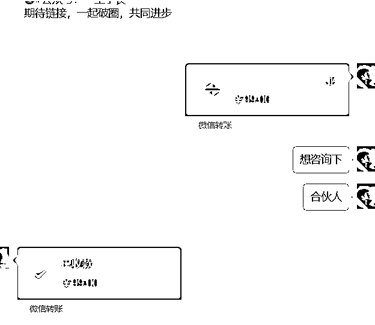

没能进一尘大佬的合伙人，但电话聊了十几分钟也收获很大。我跟他说在考虑，如果确定会补尾款，不确定就当付费咨询。

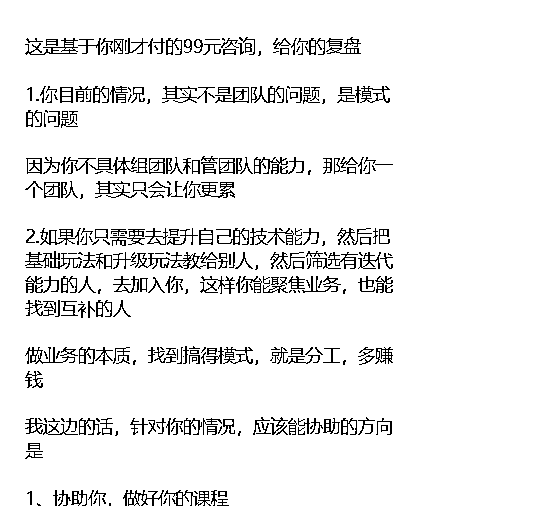

大佬也指出了我的问题，给了我精准复盘。之后我就明白，大佬也是人，不怕打扰，红包开路。哪怕再小白的问题，通常也能得到200%的回复。

## 爆款是怎么来的？核心是“抄”

抄也要讲究方法，动作对了结果才对。

SOP里的文案骨架是四块：
1、自我情况
2、攻略干货
3、为什么选这个团
4、互动引导

拆解一下：
自我情况 -> 流量筛选
攻略 -> 收藏价值
为什么选这个团 -> 流量筛选+跟团理由
互动引导 -> 留钩子+讨论

“自我情况”不能生搬硬套。要先想清楚这个产品对应的人群痛点，为何他们会选跟团而不是自由行。

境外游客单高，买家画像是有钱、付款爽快、不想做攻略、懒、怕麻烦的人。文案里就要击中这些点。

超人强调“代入角色”。写不准就模拟一下，假装自己要去旅行，用用户视角去体验。

收藏价值的本质是“这篇笔记解决了用户问题”。

举个例子

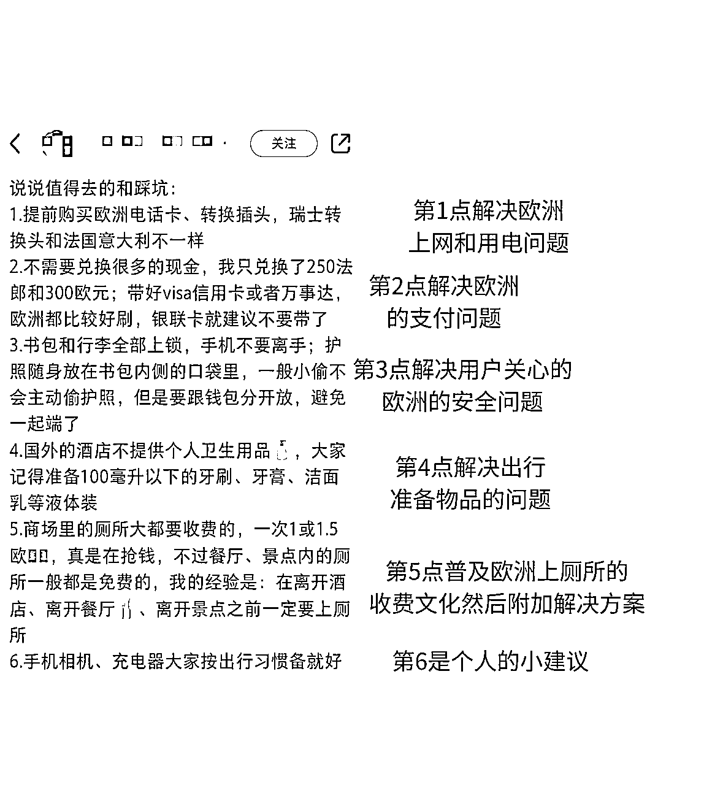

写这种干货真的费时间，我现在也还差点火候。

我更推荐的做法：建一个爆款SOP素材库，直接抄。

文案骨架有四块：
1、自己的情况
2、攻略
3、为什么选这个团
4、引导互动

所以你只需要找最近50个爆款，把四部分拆出来存成素材库。

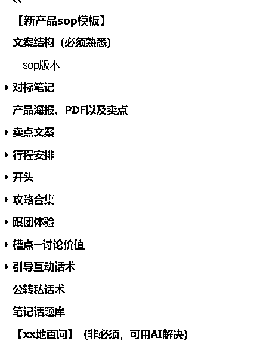

建表记录对标博主信息，如下图

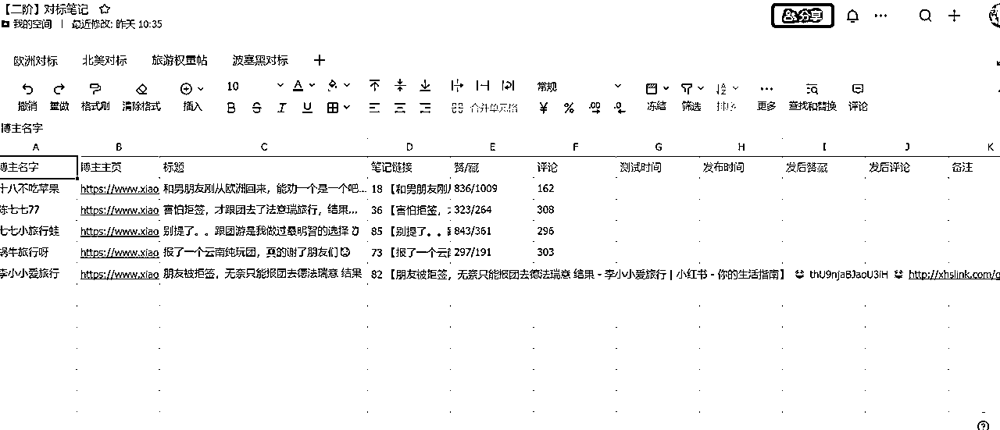

回家慢慢把一篇文案按四个模块归类，以后直接拼接、润色、发布就行。

## 发了没流量怎么办？

1、自查是否高度重复同行。标题是不是照搬的？前期记住：千万别原创。一定要借鉴成功案例。
一定不要原创
一定不要原创
一定不要原创

2、📕封面要精致、要美。文案再烂，封面是美女/大图，推流也好。

3、检测是否限流、敏感词。http://www.ju1.cn/ 我常用这个，后期熟练就不用了。

我总结的一个判断：发出去0流量，三天小眼睛不过200，大概率是和同行重复。换封面隐藏重发就行，亲测有效。

## 持续测试出长尾爆款【可吃2-3个月】

测试时我的心态问题是不敢发。怕没做好、怕被骂。事实上想多了。敢发敢测，干就完了。号在自己手里，被骂了隐藏重发就好。

测爆款的方法：
1、先找点赞收藏100+的50条笔记，直接抄标题。前期只改地区，后期可融合2-3个爆款标题创作。
* 话说难听！但这就是川西现状😓
* 法意瑞跟团回来，打破了我的一些幻想…
* 和男朋友刚从欧洲回来，能劝一个是一个吧…
* 大理很好，但是不想再来了
* 北京现状。。有些话不能乱说哦
* 泰国平安回来了，能救一个是一个（听劝）

2、内容按上面的SOP素材库打造
3、标签基本参考同行即可，影响不大
4、附一张我8.19号的数据图，基本每天2-5个精准咨询，长尾很香。单号轻松产出1w+，我这个号出了六七单。

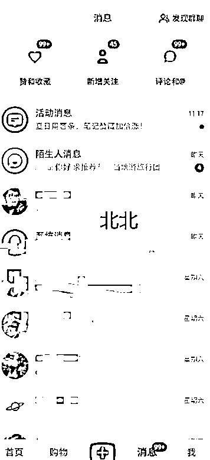

# 新手如何度过迷茫期

1、先耐心把SOP看一遍，做到哪看哪，别贪快。听话照做最关键。
2、保姆级教程摆眼前，饭喂到嘴边，你还在瞎搞，没反馈就抱怨发负能量，没人喜欢。
3、调整心态，戒骄戒躁。反复实操验证，和自己比。每个人的基础和执行力不同，持续进步就行。
4、降低预期，先跑通0到1。别上来就想赚10w、100w。先把最小MVP跑起来：发第一篇笔记、做出第一个千赞藏爆款、第一个私信、第一个🛰️转化。

# 从1到10如何放大

项目跑通0到1后，下一步是放大。我跟超人聊过，一个月多赚一万或五千对我区别不大，我需要的是复制能力和带人能力，这只能靠刻意练习。

那时候我在👸号招助理，招了十个人，结果基本全军覆没。时间成本、沟通成本很高，项目没增长。

最后明白：不要免费带人，没付费就没有执行力。尊重他人命运，放下助人情怀，能干就干。项目要不断放大渠道、筛选对的人，而不是把小白从0分带到60分。要把60分带到80分。

延迟满足，不要拉低质量的人，不给白嫖党、心态差的人机会。认知不够、不执行，自己不想做，就别浪费彼此时间。

你看他乱写也能引流5个人还成交一单，只能说天选之子、欧皇附体。我自己成交基本是测到百粉级别才稳定出单。

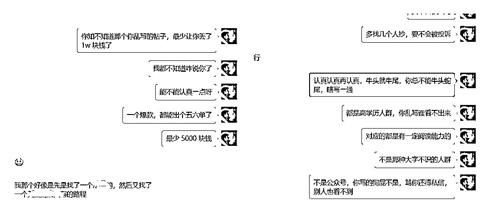

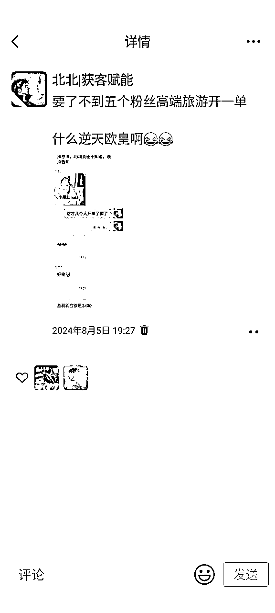

# 踩过的坑

1、能赚钱时别小富即安，要all in，不然错过会拍大腿。
2、别赚穷人的钱，要赚有钱人的钱。高端旅游就是向高净值人群靠拢，而不是和低价人群扯皮一块两块。以前做淘宝闲鱼，什么奇葩都有，交付完秒差评。后来接触高端人群，这类恶心的操作少很多。当然也不能一棍子打死，比如一个富婆姐姐随口问问题，回个红包奶茶钱就到了。

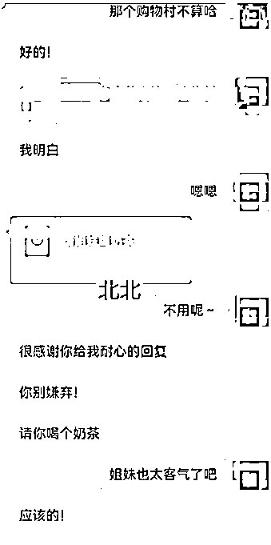

复盘一下我的成长路径：
1、打开认知，把龙哥盟里感兴趣的板块精华都看一遍，多学习大佬文章
2、抓住跟大佬交流机会，先看朋友圈👸号，再红包开道交流。大佬也是人，渴望被认可。结合自身优势，如写文章剪视频，找到适合自己的项目扎进去。小白选成本低、正反馈快的，先赚第一块钱
3、日拱一卒的执行力+反思复盘
4、0到1跑通后思考规模化：花钱提效、招人做机械活、流程化成SOP。SOP就是大象进冰箱三步：打开冰箱、放进去、关上
5、把本项目经验复用到下一个项目

最后，每一步100人加入，认真做好的可能只有1人。最好的办法是做好筛选，不合适直接pass。

把简单事做好就不简单，把平凡事做好就不平凡。

# 我在互联网赚钱的核心总结

1、听话照做！
听话照做！
听话照做！
前期都是这样。28定律，有人天命之子一发就爆，有人半个月一个月都爆不了，很正常。

2、做项目或创业，新手期都得熬。没正反馈时坚持是胜利，负反馈也是为了避坑。

3、调整心态，拉长战线，做穿越周期的事。有人拿着保姆级教程饭喂到嘴边还在瞎搞，没反馈就散播负能量，谁会理你。戒骄戒躁，钱自然来。先从赚第一块钱开始，别好高骛远。

4、今天的成功来自过去做对了一些事，未来的成功来自今天做对一些事。