# 知识付费总翻车，交付怎么才能不作死？
作者：龙哥

先介绍下我自己：我是龙哥。从大学起就闲不住，实体、👸号、私域变现、知识付费都折腾过。做知识付费三年，千元及以上客单的学员累计超过3000人，百元客单的也过了万；带出过300位网创老师；现在和18位网创博主在线下联合办公，团队里九成以上是00后。写这篇东西，不是想教育谁，只是希望那些真心想做交付、又不知道从哪下手的人，能少走点弯路。

## 先把行业现状看清楚

不基于市场数据的判断，基本等于耍流氓。

知识付费天天暴雷，表面原因其实很多：产品和用户需求不匹配、话术承诺太满、监管在收紧、平台也在严查。但这些都不是根源。真正的根子，还是经济问题。收入预期一变差，大家手里钱紧，花钱自然谨慎，知识付费这种非刚需消费最先受影响。

我观察到的几个趋势尤其明显：

- 头部团队抗风险能力较强，中腰部和尾部被冲刷得最厉害。竞争一加剧，市场会自动淘汰那些没有壁垒的团队。
- 中低客单价产品越来越难收，高客单价反而稳定。因为能承接高客单的团队，目标客户大多是高净值人群，他们的决策逻辑和普通用户不太一样。
- 灰色玩法被搬上台面。以前只敢在私域或小圈子聊的东西，现在群里、评论区到处都是。这既是乌烟瘴气，也说明正经行业门槛确实变高了。
- 线上线下加速融合，越来越多博主开始开线下课。线上聊千遍，不如线下见一面。这波趋势又把没有线下交付能力的团队筛掉了一批。
- 小团队开始抱团取暖。以前从搭人设、搞流量、做销售转化到交付，一个人就能全链路搞定。现在会搞流量的人很多，但背后未必有好产品；会做产品的人也不少，却又搞不来流量。环境变难以后，大家只好各取所长、互相补位。
- 镰刀比韭菜还多。卖项目看起来比做项目更赚钱，于是认真做研发、做交付的人越来越少，恶意竞争、虚假宣传、价格战却越来越常见。这么循环下去，行业只会更糟。

## 用户到底在为谁买单？

很多人以为用户买课是为了知识，但真实情况恰恰相反：大多数人最终买的是情绪价值。

他们用“花钱学习”来缓解焦虑，甚至掩盖自己的懒惰，顺带寻找一点归属感和认同感。知识付费对他们来说不只是学习工具，更是一种心理安慰。

所以卖课的本质，很多时候就是卖海报、卖图文。很多小白用户没什么判断力，看到一张高级感十足的海报就付款了。镰刀手也正是利用这一点，一边做视觉包装来拉高成交率，一边贩卖焦虑、贩卖梦想。

这件事是双刃剑，关键要看持刀的人是谁。

也正是因此，行业的主要矛盾越来越突出：用户对实质性成长的需求越来越强烈，而镰刀们的交付能力却始终跟不上、满足不了。这种“不平衡不充分”，才是当下知识付费最要命的地方。

更无奈的是，被割过的人大概率还会再被割。背后的根源是贪念。贪念只有骗子能满足，所以有些人哪怕再次上当，也不愿意承认，反而编出各种理由说服自己。维权团队一批批出现，用户下单的决策成本也被越推越高。

我自己的心态是这样的：行情差反而可能是弯道超车的机会；消费者心理短期改不了，那就去精准找需求点和痛点；无论市场怎么变，把交付做实做透，永远是王道。

## 先把“交付”这件事说清楚

纯割就是诈骗。

一切没有交付的知识付费，本质上都是骗钱。像“AI图文带货”“老年剪辑课”“无门槛0元学”这类东西，说白了就是马扁。

同时还要分清两件事：交付水平和交付感。

交付水平是硬实力，是内容质量是否过关、学习支持是否有效、交付标准是否清晰。交付感是软实力，是用户在具体体验中感受到的温度，比如开营仪式、结业证书、欢迎进群的仪式感。

但这些仪式感永远只是锦上添花，前提是交付水平真的达标。如果内容本身是空壳，仪式搞得再热闹，也只是自我感动。纯小白也许吃这一套，稍微有点经验的人一眼就能看穿。最好的状态，是交付水平和交付感都到位。

记住这个公式：交付超高水平=交付质量高+交付感强+超预期交付。

## 做不好交付的，其实只有两种人

### 第一种：只会教干货，不会做服务

就像一位厨艺很好的师傅，却从不肯亲自下厨让食客尝尝。怎么办？三个思路。

第一，把姿态放低。别用高高在上的口气跟用户说话，像朋友一样聊就很好。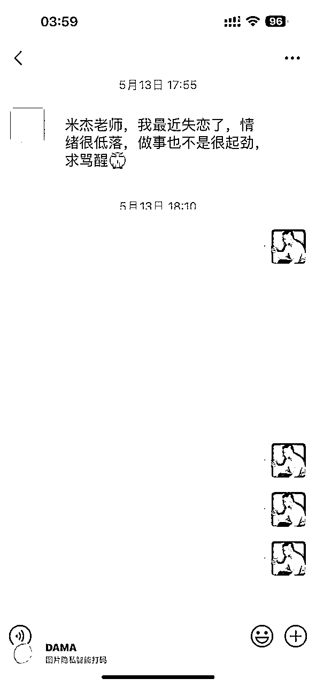。成为朋友以后，学员不仅会问学习问题，连失恋这种事也会找你聊。比如我有个学员失恋后半夜找我，她真的需要我解决问题吗？并不是。她早就有了答案，只是想在我这里拿一份支持和鼓励。

第二，知识是需要包装的，要避免“知识诅咒”。所谓知识诅咒，就是你一旦掌握了某个知识，就很难想象不懂的人为什么不懂。所以教学要学会老带新，从用户已经知道的东西开始，逐步把他们带到新知识面前。比如教一个不熟悉电脑的人用办公软件，可以先从一次简单的文档编辑切入，再拿“做PPT就像准备一次演讲”来做类比，最后让他自己动手，遇到卡点再帮一把。最好的办法，就是把自己当成一个纯小白，把每一步拆到足够细，颗粒度拉满。

第三，情绪价值给到位。学员付完费，最渴望的就是被认可。我答疑的时候，习惯先夸对方：做得好的地方先夸一遍，哪怕只是“主动提问”这件事，也值得肯定。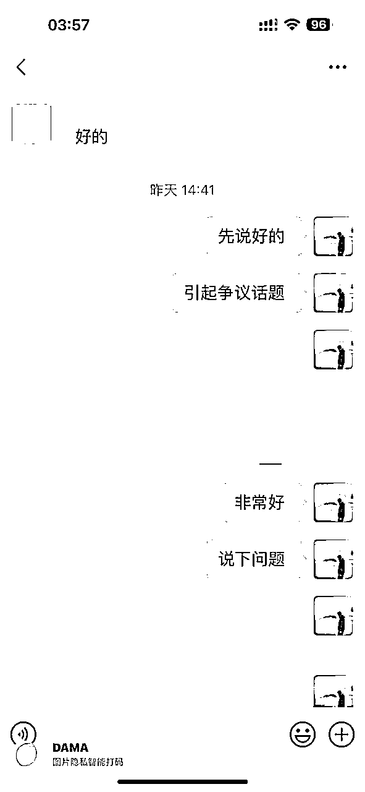。就像面对一个正在大哭的人，不管原因是什么，先给个拥抱再说。你给的小小鼓励，也许就是他坚持下去的最大理由。

### 第二种：只有服务，没有干货

菜本身不好吃，盘子摆得再米其林也没用，不如踏踏实实走大排档路线。同样三个思路。

第一，别做知识付费界的海底捞，要做黄埔军校。恋爱中当舔狗，舔到最后一无所有；教学也一样。如果自己已经有成果，就一定要坚定立场。学员可以提意见、可以有不同观点，但如果执行错了、观点偏激了、态度傲慢了，也要直接指出来，别因为对方付了费就当大爷伺候。真正该做的，是培养有实力的学员，输出专业、严谨、有深度的内容。

第二，拿捏好干货比，最好别低于30%。我自己的评判标准很简单：每一个教学视频、每一份教学资料，让用户看完忍不住感叹一句“wc，这个老师有点东西”。

第三，讲一百句道理，不如把一二三说清楚。实操项目教学不能只讲理论。你把平台历史讲得再精彩，用户一上手还是懵。所以步骤必须具体到“第一步打开冰箱门，第二步把大象塞进去，第三步关上冰箱门”。

## 提升交付水平的六个技巧

一，合作。自己搞不定交付，就找靠谱的交付团队合作，前提是对方已经把整个闭环跑通过。但一定要线下考察，亲眼看项目真实情况；考察合作案例；把细节敲定并签好合同；再算清交付成本。副业培训市场里，交付成本一般30%左右，厉害些的团队能压到10%。

二，做出让人看得舒服、听得舒服的课程。不用电影级音质画质，但至少不能太劝退。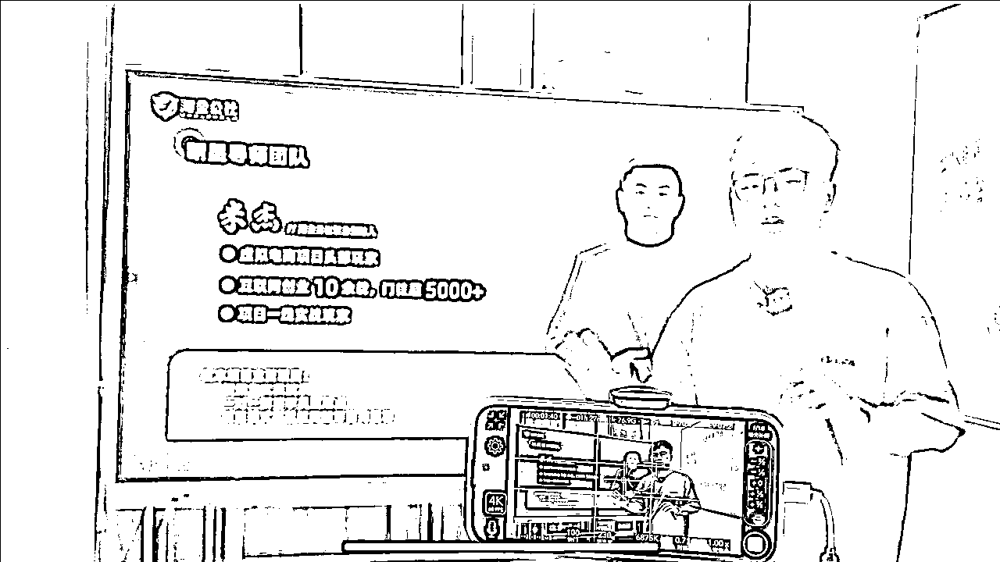。手机推荐苹果13以上；麦克风可以选罗德、大疆；预算充足的话，场景、提词器、单反、收音麦克风、灯光道具都可以安排上。。

三，先讲Why，再讲How。周老师的演讲技巧同样适合做课：先讲清楚为什么做，再讲怎么做，整个课程会更有条理。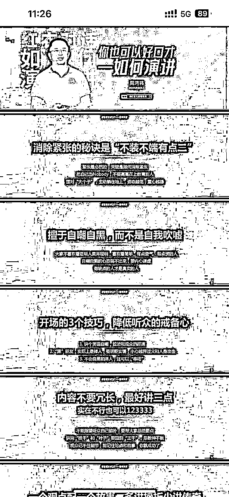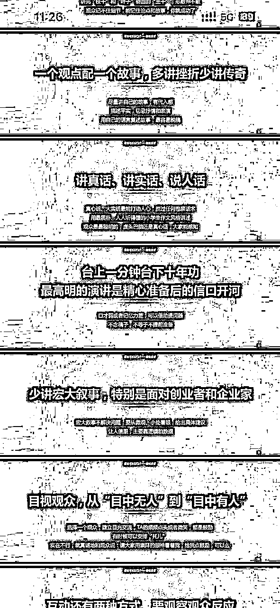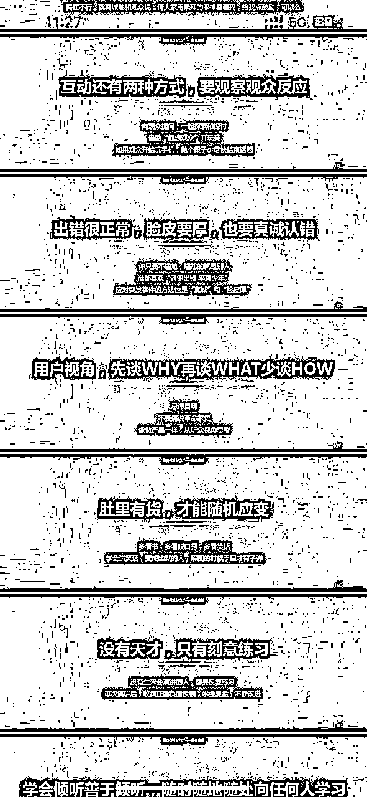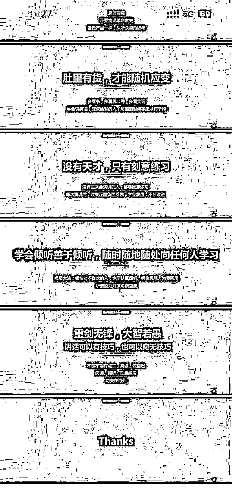。

四，控制信息传递效率。能用视频讲清楚，就别用图片；能用图片讲清楚，就别用文字。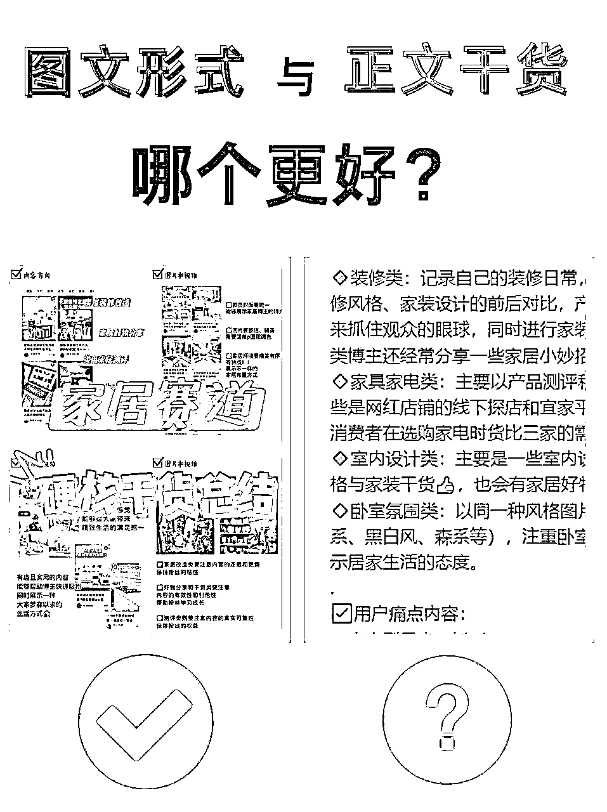。

五，多给可感知素材，少堆概念。比如讲📕运营，你只说“内容创作和用户互动是关键”就是概念包裹。但如果你讲自己从几百个粉丝开始，如何因为回了一条私信而做出一篇搭配帖，又如何每天花一小时回评论、根据反馈不断调整内容，最后做到一万粉丝，这才是可感知素材。有场景、有细节、有变化，用户才会被打动。

六，一课一重点。别恨不得一节课塞满所有干货，那样学员根本消化不了。每个小节集中解决一个重点，既有足够时间吸收，也能保住学习动机，进度反而更快。

## 提升交付感的五个技巧

记住这句话：同行没做的是服务，同行做过的是义务。

第一，排版要整洁干净。现在很多人直接用飞书文档装资料，观感就比Word/PPT好一截。封面选好看点，哪怕用动图也行；无边框高亮块配合分栏，分区会很清爽；标题前加emoji再加空格，能减轻长文阅读疲劳；关键地方用行内代码代替加粗，会更显眼。配色不用懂太多理论，同一篇文档别超过三种颜色；高亮块的边框和填充尽量用同一色系，实在纠结就点随机。高亮块里的标题不会出现在左侧目录，但纯圆块头可以当强调字号来用。如果还是用PPT授课，又没有专门美工，那就记住四个字：简约大气。

另外，常见的知识付费产品形态也越来越多元，知识星球、小报童、FlowUs订阅中心、1咖啡这些平台分别切入社群连接、创作付费、订阅内容和小额赞赏等不同场景。整体趋势是平民IP崛起、行业越来越细分、知识服务加速转型；同质化严重、运营模式单一、内容质量参差不齐，则是要避开的坑。

第二，建立回访机制。学员付完费，最怕被遗忘。定期回访、让学员主动报备学习进度，信任感会快速提升。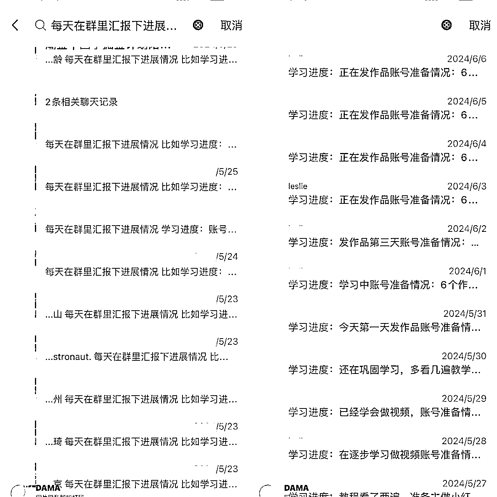。

第三，建立学员学习档案。比如做副业培训，可以把项目步骤量化出来，让学员按进度如实填写。一方面督促他们真正去实践，另一方面你也能及时掌握进度、及时督促进度。我教📕运营时，就是把完整流程拆成一步步。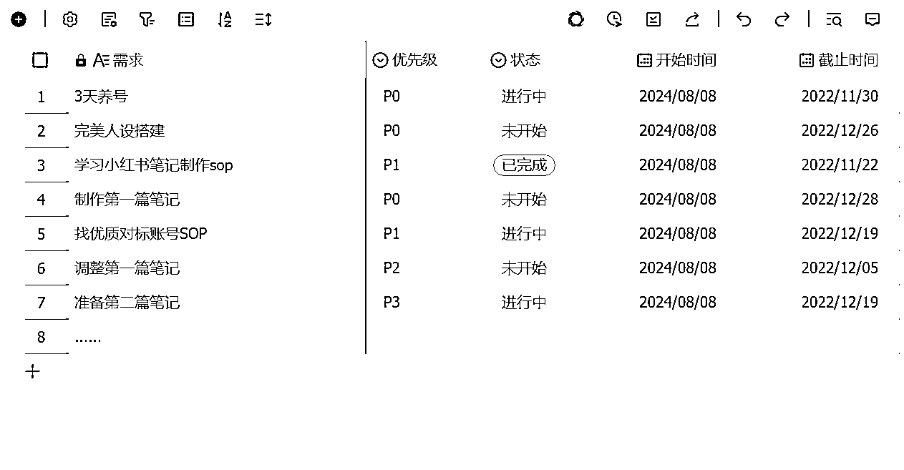。

第四，展示更新动态。产品更新，本身就是对用户负责的表现。这件事不难，但愿意做的同行很少。我在虚拟电商教学里，每次更新教学手册后都会整理更新记录展示出来。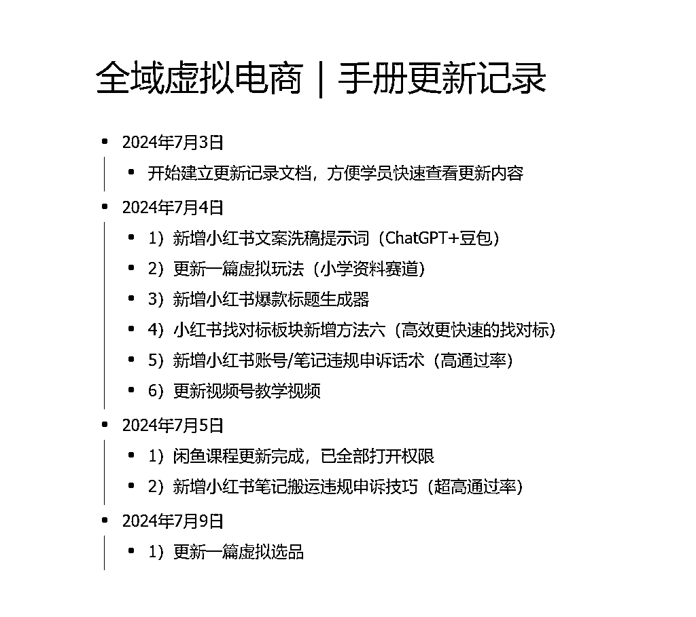。

第五，超预期交付。平淡的学习过程需要一点惊喜。请行业大咖赋能、请优秀学员分享、搞直播答疑、给一对一指导、组织线下沙龙、送纸质版书籍，这些都是非常好的动作。实操里，我组织过优秀学员聚餐交流，也送过配套实体书，还定期给学员做一对一交流，这些动作都会极大拉满交付感。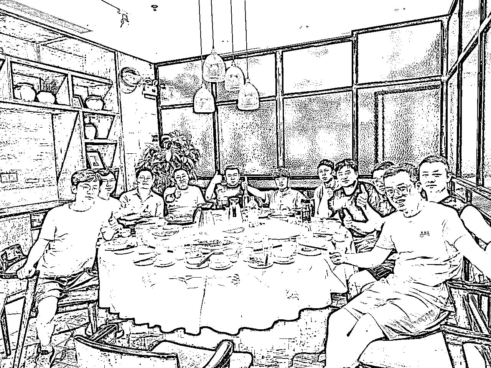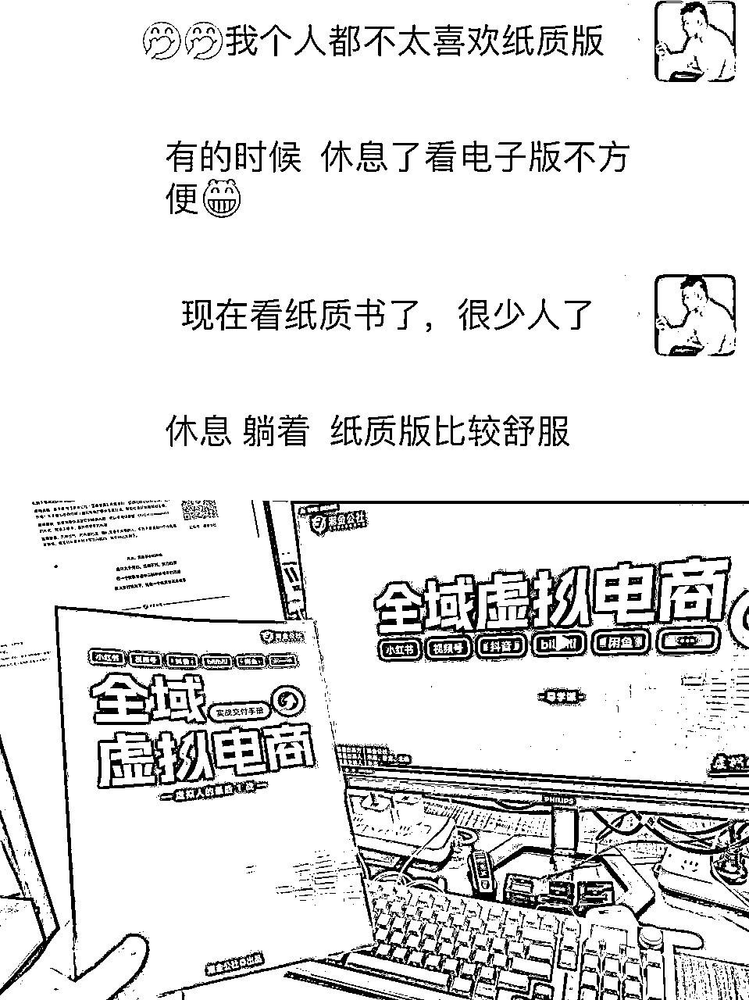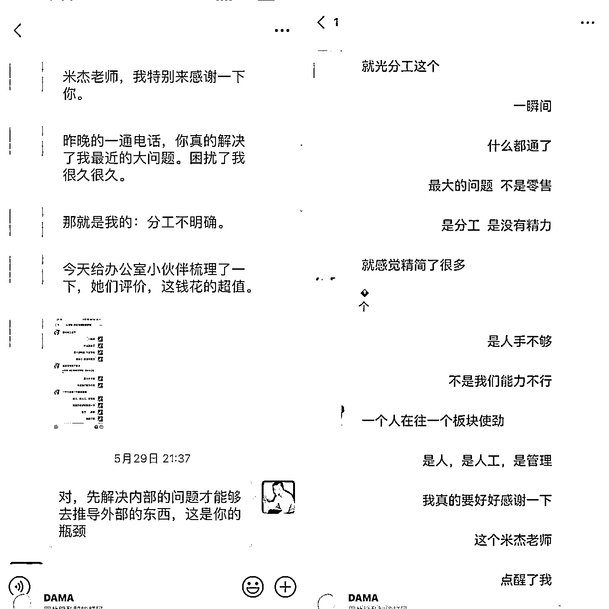。

## 别忘了符合人性的健康机制

打卡21天全额退款，就是很典型的设计。群聊机制也一样，一群人一起跑，永远比一个人闷头走更容易坚持。

知识付费这条路，从来都没有捷径。风口上的时候，谁都能飞；风停了，还能把产品和服务真正做扎实的人，才能走得更远。希望这篇文章，能帮到那些还在认真对待交付的人。

当一个团队真正具备交付实力时，最好的选择就是去建一个大型交付群组，这样消息传达会更快，也更容易让学员产生强烈的信任感。

交付的推进方式，我建议用分段任务制来做。把整门课程拆成若干个学习阶段，每个阶段对应一套明确的作业要求。学员只有把当前阶段的任务完成达标，才能获得进入下一个阶段的学习权限。这种节奏感能帮助他们循序渐进地吃透知识。

为了让大家更愿意持续参与，可以加入积分激励体系。完成课程观看、每日打卡、积极互动、完成作业等行为，都能累积积分。攒够积分后可以用来抵扣课程、兑换折扣券，或者换取实物周边奖励。

另外，社交上的正向推动也非常重要。定期在课程社区里置顶展示优秀学员的成果作品、学习心得和成长复盘，用真实的案例去带动其他学员，形成“看见 - 模仿 - 超越”的学习氛围，让参与度自然提升。

# 七、做课必备工具大全 —— 这就是超值交付

## 1. 课程设计
Xmind：https://xmind.cn/
帮你快速搭出吸睛的课程骨架

幕布：mubu.com
随时随地把课程大纲整理出来

Processon：https://www.processon.com
零成本梳理做课流程的轻工具

## 2. 详情页制作
创客贴：https://www.chuangkit.com/
打造精美课程落地页和招生海报

稿定设计：https://www.gaoding.com/
拖拽式操作，轻松完成配图设计

快设计：https://sheji.tuchong.com/official
傻瓜式详情页生成器，模板海量可套

Fotor懒设计：https://www.fotor.com.cn/
在线图片制作热门工具，做课利器

## 3. 课件模板
Officeplus：https://www.officeplus.cn/
海量微课模板，一分钟就能排出一节课

Hippter：http://hippter.com/
PPT视觉设计利器，正版课程模板免费用

## 4. 课件素材
设计师网址导航：https://hao.uisdc.com/
汇集海量设计资源，解决做课配图与字体需求

ISlide：www.islide.cc
一键插入PPT素材，省去找图的时间成本

## 5. 录课工具
Camtasia Studio：https://luping.mairuan.com/
专业屏幕录制与视频剪辑软件，上手快

OBS：https://obsproject.com/
功能强悍免费无广告，适合直播与录屏

EV录屏：https://www.ieway.cn/evcapture.html
小白友好、免费无水印的入门录课神器

## 6. 课程剪辑
剪映：https://lv.ulikecam.com/
免费好用功能全，一分钟就能完成出片

快剪辑：https://lv.ulikecam.com/
新手后期首选，自带素材、字幕和转场模板

小丸工具箱：https://maruko.appinn.me/
音视频处理工具，让视频压缩更轻松

## 7. 字幕处理
讯飞听见：https://www.iflyrec.com/
提供自动字幕生成，满足录课配字需求

ArcTime：https://arctime.org/
专业字幕制作软件，导入视频即可自动识别

我是米杰，今天的干货分享就到这里啦~

秋分已过，下半年正是旺季，祝大家下半年一切顺利，订单不断，财源广进。

如果你觉得这篇内容对你有用，帮忙点个赞吧，你的每一次支持都是我持续输出的动力。