# 闲鱼虚拟店做起来了：单日净赚两百多，自动发货躺着也能收钱

有人说这个标题太直白不够吸睛，我偏要试试效果。

# 一、我跑了两个月的数据实录

前阵子终于创了新高，单日营业额冲到了204块。

此前的峰值是146块。

从6月15号启动，到7月15号刚好破百，现在已经稳定往上走。

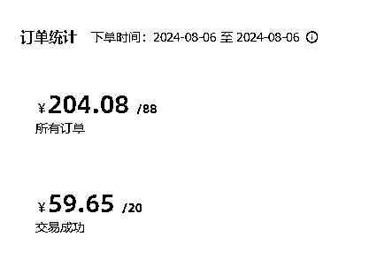

之前发的几篇复盘有兴趣可以翻回去看。

这次用的是老号起步，前期出单并不顺畅。全部上架的都是弱版权或无版权类目，所以增速比较平缓：

我带了几个朋友一起小规模测试，换成新号启动会快很多，最快当天就能接几单。

玩法本身门槛不高，找到同行的爆款搬到自己店铺就行。

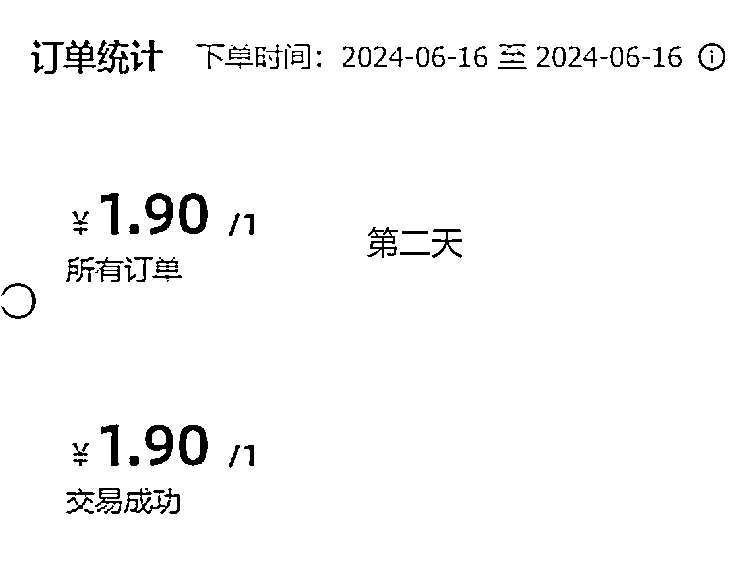

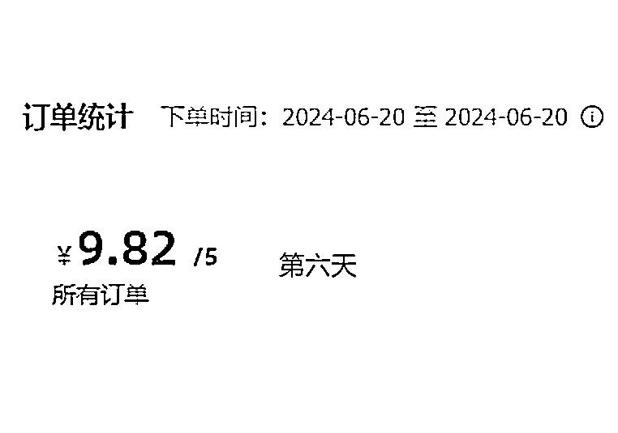

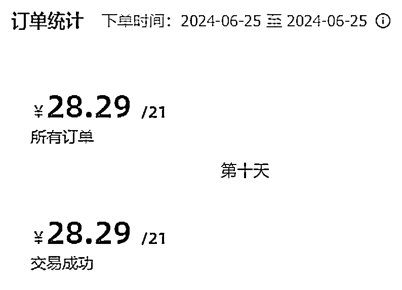

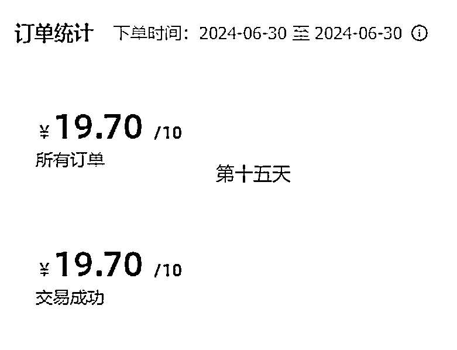

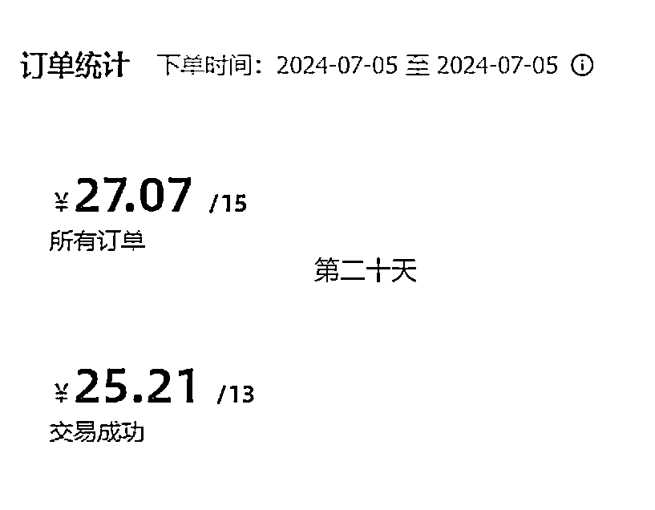

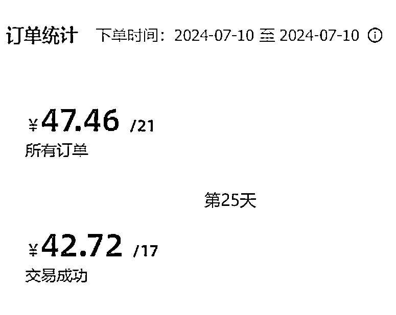

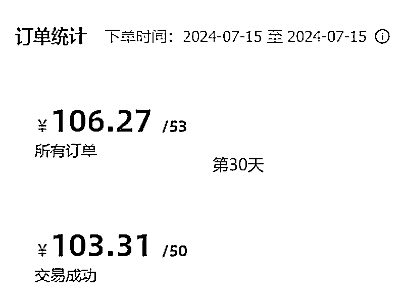

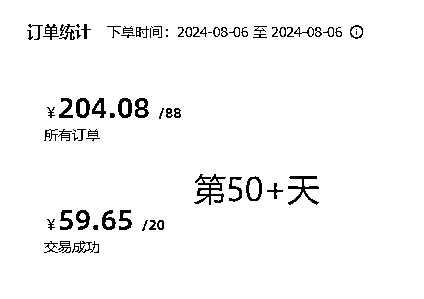

从曲线上看确实爬得慢。

我选品比较保守，坚持做弱版权或无版权的长期类目，每天投入1-2小时，回报率我觉得还能接受。

有朋友直接冲强版权，单日营业额很快就破百了，但账号也很快被封。

这种路子不建议碰。

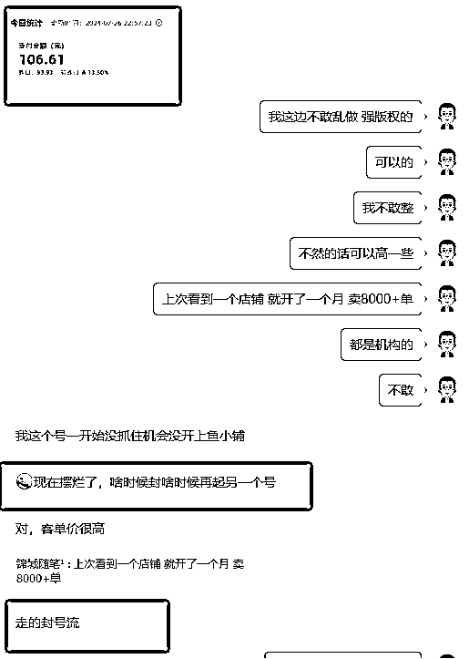

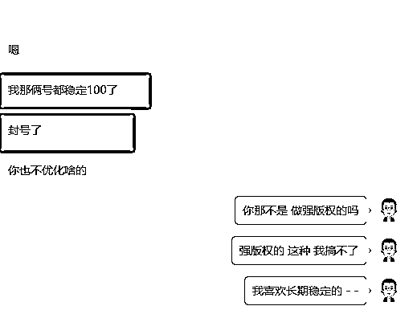

我的建议是走稳健路线，账号安全最重要，封号一次心态直接崩掉。

# 二、闲鱼虚拟店铺的实操方法

## 1. 账号配置

虚拟类目对账号有要求，最好一机一卡一IP。单号很难起量，我前期就开了两个号运营。

实际跑下来，八成订单都集中在一个号上。所以想看到效果，至少准备2-3个号。

每个人可以用三个支付宝分别绑定闲鱼号，手机卡优先三大运营商。

## 2. 选品逻辑

选品思路可以参考我之前的文章，我基本也是按那个方法来的，会结合影刀脚本做自动采集，比纯手工省力。

选品是电商的命脉，这步一定要花心思，多去搜索同行，多对比。

## 3. 养号动作

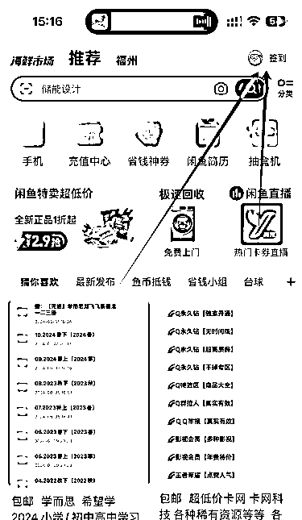

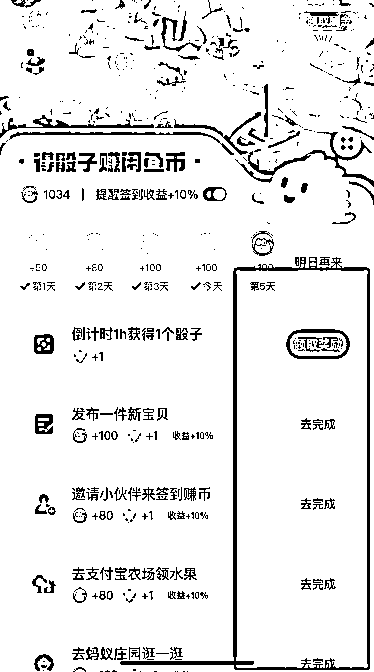

养号很简单，每天把签到、赚骰子、扔骰子这些任务做了，能攒闲鱼币就用来推广。

另外每天批量降价1-2次也能提升曝光，这个动作可以用脚本搞定，不然手累。

具体降价玩法可以看我之前的干货。

## 4. 优化技巧

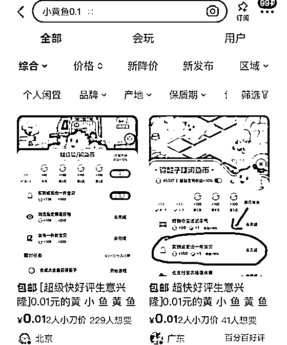

早期如果出现小爆款，可以搜闲鱼里的 小黄鱼0.01，去找人互刷一两单做基础。

我前期有做，后期就停了。操作很直观，大家自己搜一下就能明白。

## 5. 最核心的坚持

虚拟店的核心就是持续上新。单个账号每天上20-30个新品，分批上，每次10个。

头一两周就是重复上品，每天先把素材采集好再上传。有脚本的话，1-2小时就能搞定。

坚持上新基本1-2天就能看到成交。闲鱼可做的品类很多，比如多多助理、卡券会员、影视会员等，我没去碰主要是没找到有价格优势的渠道。

我目前主要做的是素材、模板、教程、软件、数据这几类。

做法是用AI生成细分领域的关键词，再用脚本去自动抓取，最后人工筛选20个以上再上架。

核心就一个字：坚持。别因为一两天没单就停，优化动作每天做。坚持一个月，日入100+问题不大。

# 三、做虚拟店的几个小窍门

### 一、淘宝比价找差价
1.部分资料在淘宝能0.01或0.1元拿下，闲鱼却能卖到一块多。

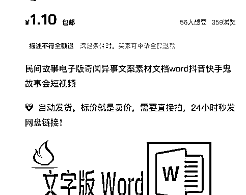

### 二、白嫖搜一搜资源
2.🛰️搜一搜经常能搜到免费资料，直接发给买家就能用。

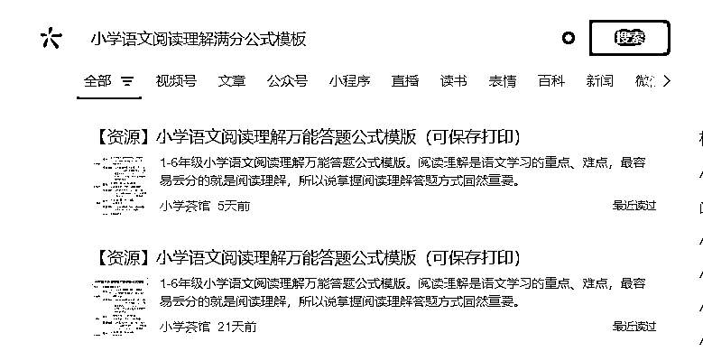

### 三、网盘搜软件资源
3.软件类商品不用去同行处进货，搜一搜吾爱破解或百度就能找到，还能卖个好价钱。

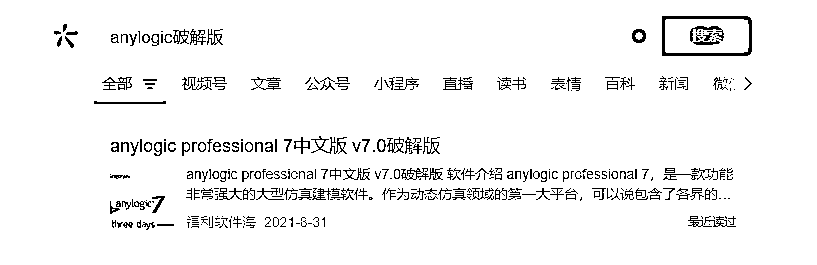

### 四、把退款变成好评
4.客户要求退款，直接转给他，让他帮忙给个好评。反正钱也要退回，还能换来店铺数据。

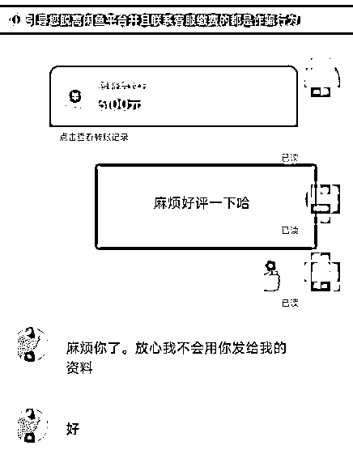

### 五、叠加网盘拉新
5.虚拟资源可以配合网盘拉新，转存就有几毛钱，新用户还有几块到十几块的佣金，都是额外收入。

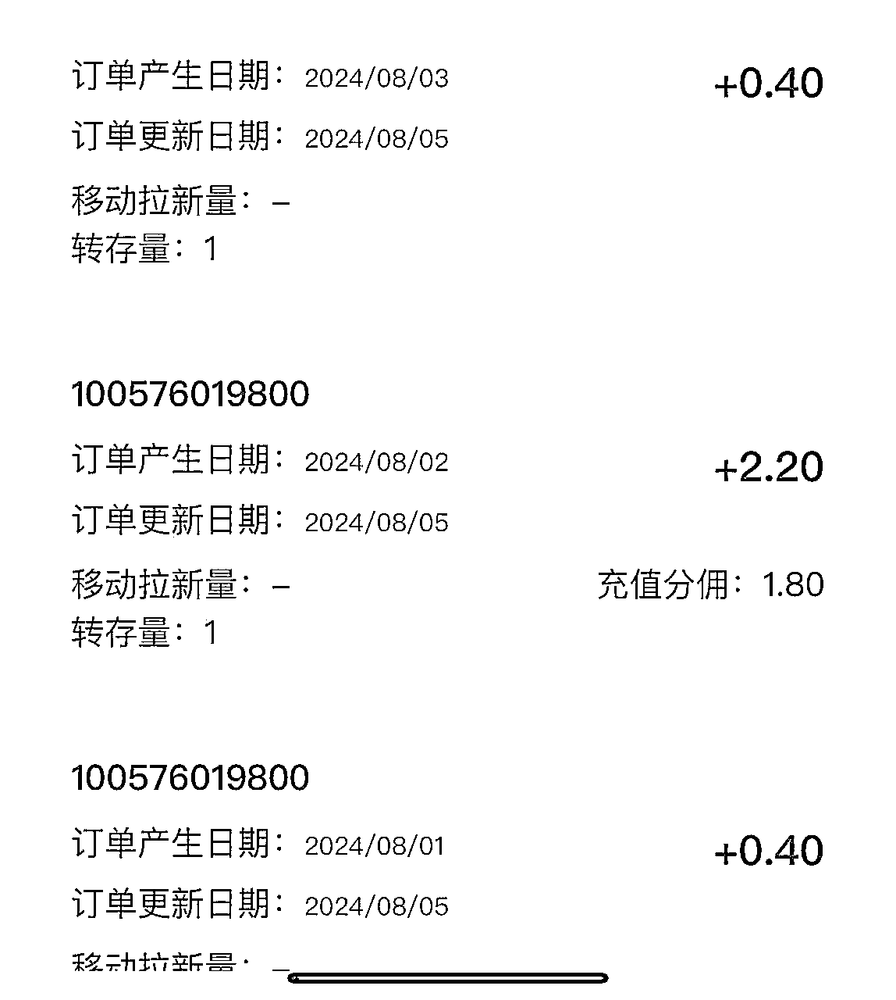

### 六、规避版权风险
6.坚决不上强版权商品，短期虽然赚钱，封号风险极高。现在闲鱼对虚拟资料的容忍度已经很高了。

### 七、选品永远是第一生产力
7.脚本只是工具，选品靠人工+AI大数据结合，才能发挥最大效率。

### 八、学会影刀RPA解放双手
8.强烈推荐学一下影刀RPA，对新手很友好。学一个月基本就能写出我上面提到的那些脚本。

# 四、最后最重要的点【必看】

找到更优质的商品才是核心，至于手动还是脚本无所谓，能拿到好货就行。

价格不是决定因素，有些商品比同行贵照样出单。

不要参与恶意价格战，要踏实把该做的事做完：该上架的上架，该下架的下架，该降价的降价。

把简单事重复做，大部分人知道却做不到。

我一天赚几块钱的时候也坚持下来了。

现在一天一两百不算多，但每天只花一小时维护，剩下的时间可以去做更有价值的事，这就是睡后收入的意义。

## 一、学员实操截图：

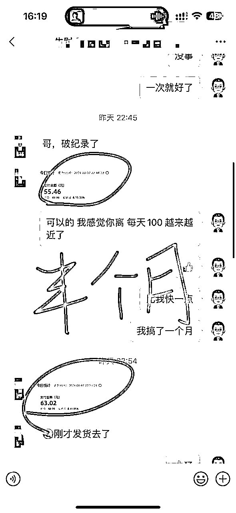

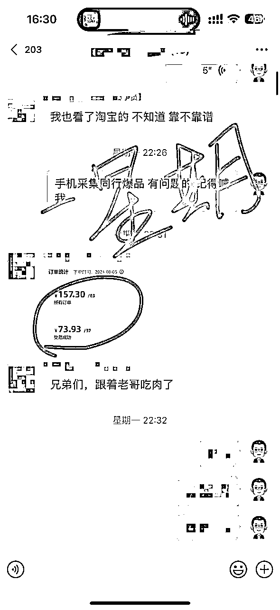

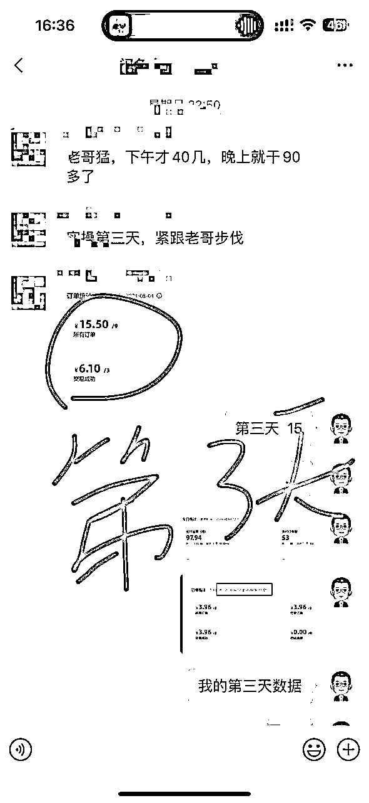

## 二、学员日常交流记录：

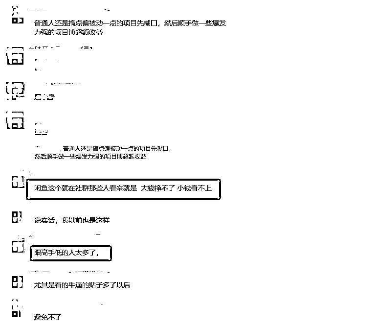

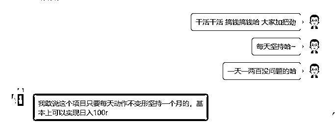

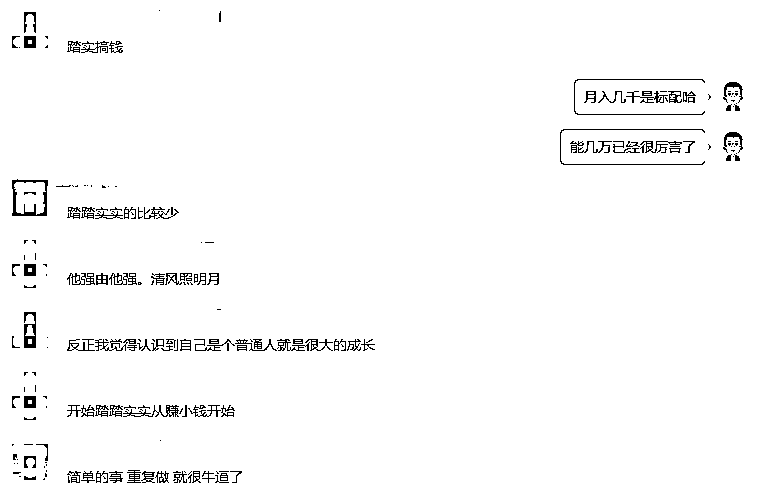