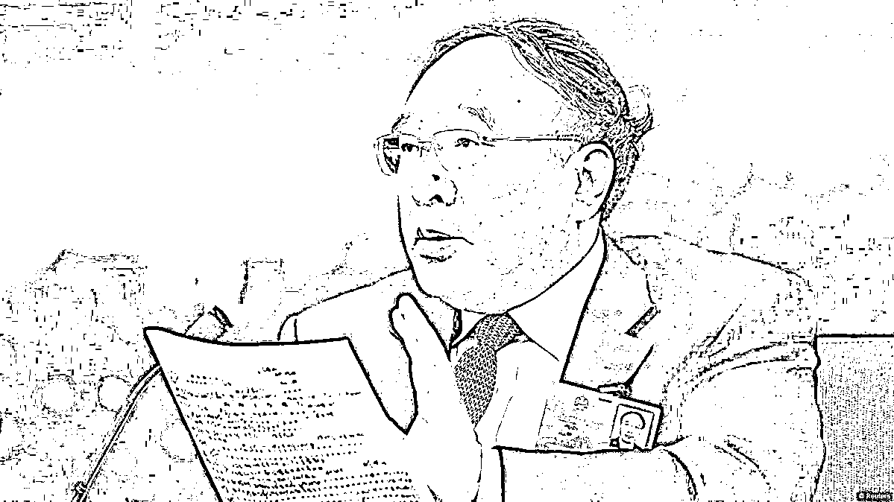
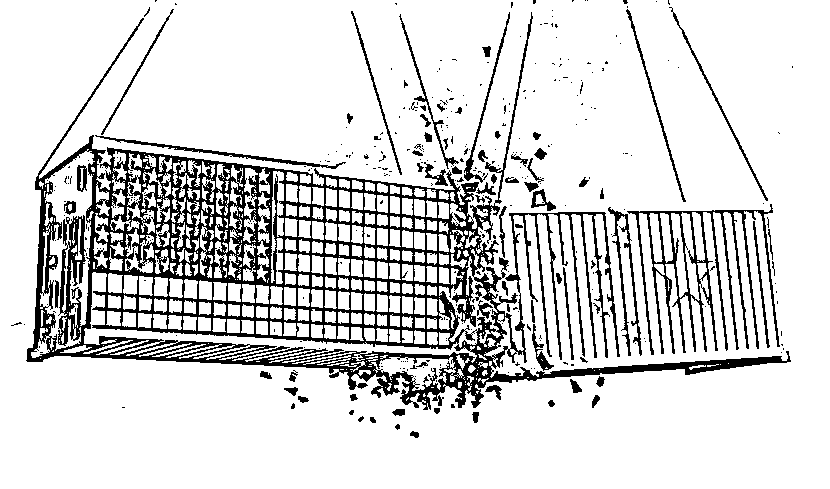

# 黄奇帆3万字演讲背后，普通人的新质生产力红利被我整理好了

黄奇帆在广东省委党校那场演讲，我反复看了很久，心里很受触动。

“新质生产力”是当下热度很高的词。但很多人觉得国家层面的战略离自己很远，看不懂，也不想研究。可现实是，大环境的变化总会渗透到个人身上。互联网反垄断、双减政策落地，已经让许多人的职业轨迹被改写。个人努力当然重要，但时代进程才是更大的变量。

我学新闻出身，在腾讯新闻做了6年记者，常年接触宏观经济、政策周期，对高层讲话和政策信号比较敏感。所以，先把大家最关心的几个问题放前面：

一、新质生产力背景下，普通人怎么选行业、公司、岗位？
二、文科生的切入点有哪些？
三、没技术、没资金、没团队，轻创业怎么结合新质生产力？要注意什么误区？
四、这场演讲让我涨了哪些知识、纠正了哪些误区？
五、关于“大厂转型人强哥”

这3万字我读了几遍，把和普通人相关的机会都梳理了一遍，希望对你有所帮助。

## 一、新质生产力时代，普通人怎么选择赛道、公司和岗位？

先看岗位。多往科研创新、数字化和生产性服务业的方向靠，比如研发设计、检验检测、物流配送、金融服务、数字化赋能，还有大数据、云计算、人工智能相关岗位。离新质生产力越近，职业空间越大。

再看公司。选那些有创新能力、舍得投入研发的公司，尤其是产业链上的“链头”企业、能掌握生产性服务业的企业，或者深度参与产业互联网的公司。这类公司更容易在新一轮竞争里卡住位置。

最后看行业。重点盯住新能源、新材料、数字智能技术、生物医药、高端装备制造五大板块。它们是新质生产力的主战场，也是未来潜力最大的方向。

## 二、文科生怎么找到切入点？

核心心法：硬科技做不了，软技能照样能打。

运营类值得优先看。用户运营、私域运营、短视频运营、直播运营，都算。短视频和直播已经改变了用户习惯，基本成为企业标配。雷军的短视频运营团队能做到高频更新、随时和网友互动；蔚来的用户运营也很有代表性，哪怕你在青藏高原车抛锚，附近也会有人出动支援。

品牌推广类同样有机会。市场、品牌、公关、商务BD，科技公司也需要被大众理解。余承东开一场发布会，背后就需要不少品牌向文科生做支撑。

支撑类也少不了。人力、财务、法务（包括知识产权和专利管理）、行政、客服、数据分析，都是企业刚需。

我还用AIGC拆过一轮岗位类型，完整版放在飞书文档里，有兴趣的可以去翻。

## 三、没技术、没资金、没团队，轻创业怎么搭上新质生产力？

可以试五个方向。

1. 在电商平台开个店，卖智能小家居、环保小工具这类小产品，再用社交媒体做推广，营销成本能压得很低。
2. 做个性化服务。比如你擅长摄影，可以做智能摄影服务，借助智能设备和软件拍照，再靠后期处理交付作品。
3. 接众包项目。数据标注、文案撰写这些任务，很多公司会放出来，普通人通过平台就能参与。
4. 开发简单的小程序或APP。有点编程能力，可以做一个智能健康管理工具，帮用户记录运动和饮食数据，再给出健康建议。
5. 做内容创作。在新质生产力相关领域写科普文章、拍短视频，通过知识付费平台变现。

同时要避开几个误区：别贪大求全，轻创业要从一个小切口慢慢做起；别忽视自己的优势，做能力匹配的事更容易成；别乱花钱，资金有限时成本控制就是生命线；别停止学习，新质生产力变化快，要及时调整方向。

有人已经跑通了。小张对智能设备感兴趣，在电商平台卖智能插座、智能灯泡，靠社交媒体引流，成本不高收益还不错；小李擅长写作，接科技公司的产品说明文档众包项目，把优势变成了收入；小王懂点健康管理，开发了智能健康小程序，跟健康机构合作，慢慢积累起用户。

轻创业和新质生产力结合，不是硬追风口，而是从自身实际出发，选一条能走长路的方向。

## 四、这场演讲让我涨了知识，也纠正了几个误区

### 1、为什么现在必须提新质生产力？

过去拉动经济增长有几种传统路径。

一是拼投入。资源、资金、劳动力一起上，就像盖房子不断加人加料。短期能增加产出，但资源浪费和环境问题会越来越严重。1980年中国GDP只有2000亿美元，人均GDP 200美元；2023年GDP涨到126万亿人民币，但一年烧掉了全球各种资源量的50%。我们以全球20%-30%的产出规模，消耗了全球地下资源的50%，再按这个方式走，资源根本撑不住。同时劳动力也在减少，1950年到1980年人口增长快，现在出生率下降、老龄化加剧，人口优势减弱。

二是靠外贸和投资。但国际环境变了，外循环占GDP比重从2006年的71%降到了2023年的38%，这条路越走越窄。

三是侵略和掠夺。这不道德，也不可能做。

四是提高全要素生产率，靠技术进步和资源配置优化来增长。中国的全要素生产率增速目前只有美欧发达国家的四到六成，还有很大的追赶空间。

所以，发展新质生产力不是口号，而是必须的选择。新能源汽车就是例子，既环保又能带动产业链技术升级，这正是高质量发展需要的增长方式。

### 2、新质生产力到底包含什么？

它落在五个方向。

能源板块：过去烧煤发电，现在转向太阳能、风能等清洁能源，家里装个太阳能热水器就是缩影。
材料板块：从石器时代的石料，到集成电路里的硅材料、石墨烯，科技一直在材料上迭代。手机芯片就是硅材料做的，让手机越来越小、越来越智能。
数字智能技术板块：智能手机、智能家电、自动驾驶汽车，背后都是人工智能和大数据。
生物医药板块：创新药和新冠疫苗，能治疗疾病、预防疫情、延长寿命。
高端装备制造板块：宇宙飞船发动机、飞机发动机、高端数控装备，决定了制造业的效率上限。

### 3、为什么生产性服务业是重点？

判断生产性服务业发展程度，一般看五个宏观指标，其中一个是它在GDP里的占比：美国约50%，欧盟约40%，中国去年服务业增加值占GDP的54.6%，但生产性服务业占比只有27%左右。差距不小，而这正是利润分配权较量之处。

苹果是最能说明问题的例子。它每年在中国产1.7亿部手机，销售额1700亿美元，但利润分配极不均衡：中国制造环节只分到170亿美元，苹果靠十大生产性服务业拿走了大约75%的份额。

这十大类包括：产业链科研创新、检验检测、物流配送、金融、生态环保、数字化赋能、贸易批发零售、品牌专利保护和推广营销、服务外包、售后服务。每一项都能从苹果身上看到具体作用：用研发迭代iPhone；用检测守住零部件质量；用物流把产品送到全球；用金融运作支撑公司；用环保降低环境足迹；用数字化提高运营效率；用全球销售网络铺货；用品牌和专利建立护城河；把非核心业务外包给专业公司；用售后提高用户满意度。

生产性服务业就像新质生产力的助推器，谁把这张网织得越密，谁就掌握更大的价值分配权。

## 五、关于3万字演讲和两本推荐书

这场演讲的完整版有3万字，如果不想直接啃长文，可以先从黄奇帆的两本书读起。

《结构性改革》：把中国经济面临的结构性问题讲得很透，改革思路和政策建议都很务实。核心是强调供给侧结构性改革，用优化经济结构、推动创新、改善制度环境来换取高质量发展。黄奇帆的实践经验和洞察力，能让读者看清经济现象背后的逻辑。

《分析与思考：黄奇帆的复旦经济课》：把复杂的经济问题讲得深入浅出，用案例说话，覆盖宏观经济、金融、贸易等领域，适合想建立经济全景视角的人。

两本都是大部头，京东和微信读书上都有。想理解国家大政方针，需要反复读、慢慢琢磨。

## 六、写在最后：关于 @大厂转型人强哥

我是“大厂转型人强哥”，公众号可以找到我，聊职场转型和AI红利。现在在做选择力新职业教育，帮职场人0经验转行，负责内容与增长、产品运营、用户运营，也待过腾讯和字节。

我平时重点关注AIGC机会、AI大模型和应用团队，重点研究“文科生如何抓住AI红利”。欢迎优秀团队加V交流，期待合作机会。有任何问题可以评论区留言。

过往精华文章：
- 9000字深度解析：AI重构搜索会走多远，谷歌百度会不会被颠覆？
- 8000字深度解析：文科生怎么抓AIGC机会？新职业红利和避坑指南都在这。
- 3000字干货：30岁+文科生，我是怎么用AI提效和赚钱的？
- 干货帖：用ChatGPT/谷歌Gemini快速了解一个行业和公司。