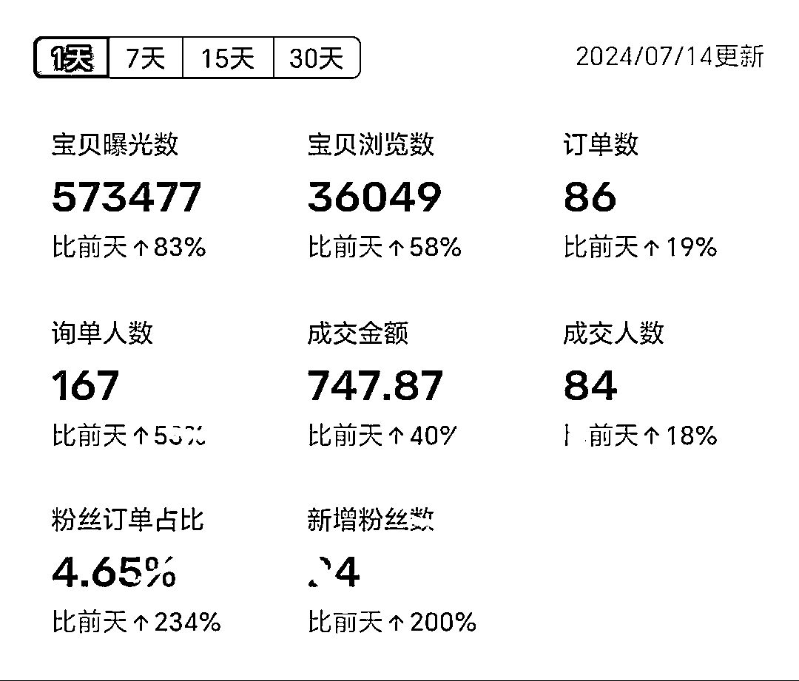
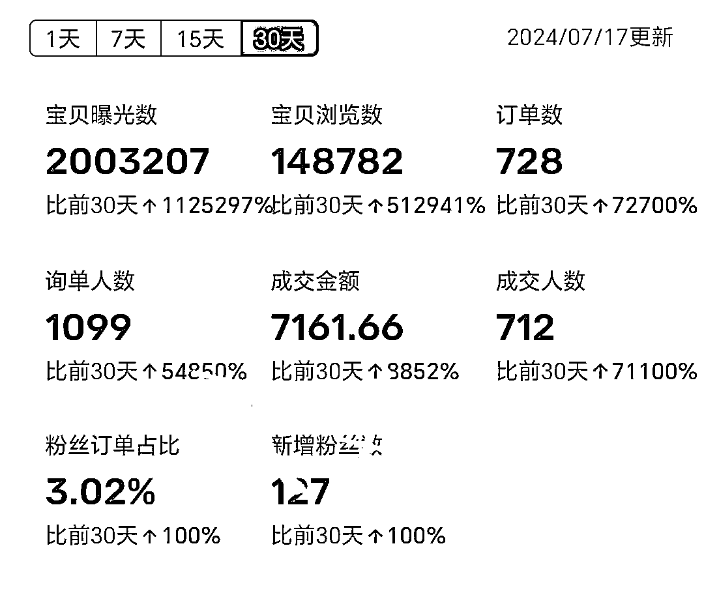
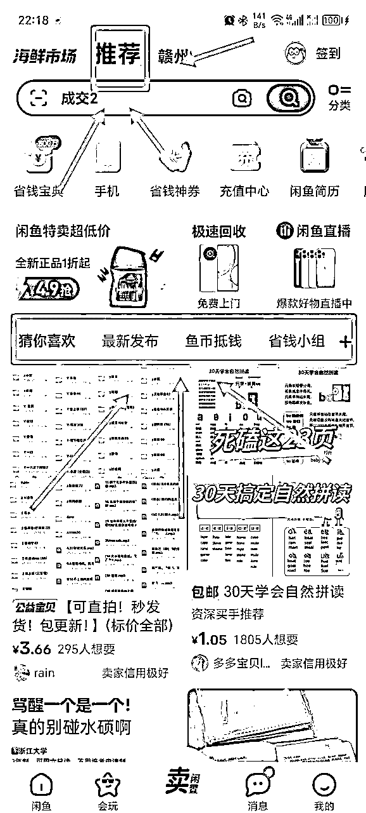
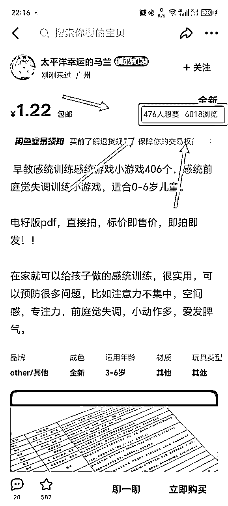
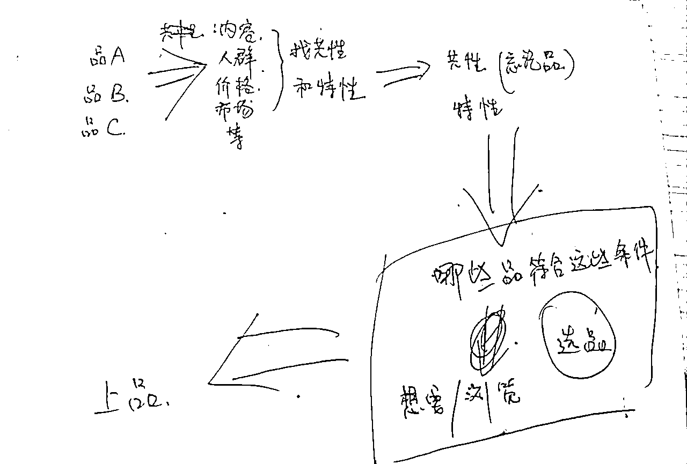
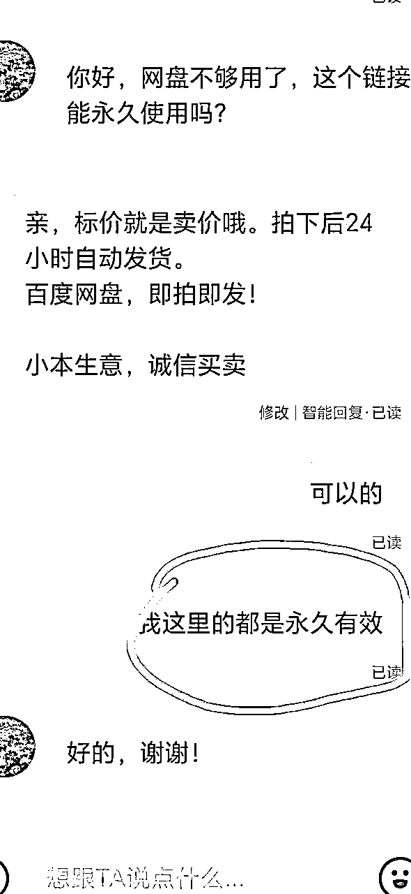
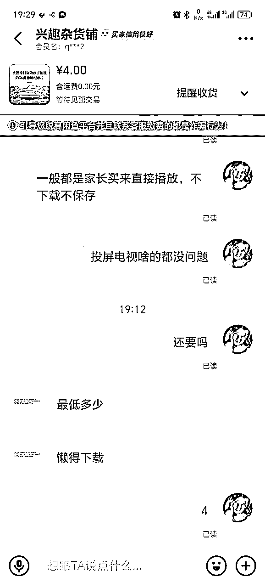

# 别急着搞矩阵，我靠闲鱼虚拟资料，一样把单个账号的收入放大了5倍

> 先亮个成绩单吧，不然你们以为我在空谈。

## 一、为什么闲鱼虚拟资料值得做？

老实说，这个项目的优点很直白：

- 谁都能上手，没什么门槛
- 挂上去没多久就能开张
- 全程自动发货，根本不用盯着
- 进货成本几乎为零，第一单买一次，后面反复卖
- 不靠投流，光吃自然流量就能稳稳出单，还能一人多号（一张身份证能开三个闲鱼号）小批量跑起来

## 二、到底怎么操作？

核心就一个字：搬。

1. 先去找对标账号，把它的标题、描述、主图一样样抄过来
1. 等自己出了单，复制标题，去搜同款里最便宜的，买下来，然后转手发给你的买家
1. 接着继续上架链接，再出单时，直接把已经买好的网盘链接发出去就行

## 三、选品到底看什么？

我的选品方式很朴素：

- ① 没用什么选品工具，也没靠第三方平台，就是天天刷闲鱼自身展示的数据，比如系统推荐、想要数、浏览数。从中就能挖到不少灵感。

- ② 挑自己熟悉的领域做，这样你对内容质量心里有数，也更容易搭配出相关的衍生品。

选品逻辑是这样的：

很简单，先挑出A、B、C三个品，把它们的买家画像挨个分析一遍，找到共性、特性，列成表格。然后暂时忘掉A、B、C，去看这些共性和特性到底和出单有没有关系。如果有关系，再去找哪些品具备这些特征，回到闲鱼上刷品，盯着想要和浏览数，顺便看看同一个品在不同店铺的表现。手写思路图在下面。

## 四、一个号收入放大5倍的秘诀

为什么要做高客单价？

原因也很现实：只要出单，就比卖低价舒服得多。小爆一下大概每天200块左右入账，大爆直接500+。

手法不复杂：

1. 别人都在搞劣币驱逐良币，哪怕品再好也卖1块，我却敢卖5-10块甚至更高。
1. 别人都在拼命铺货，我却一个个钻研别人的爆款和店铺是怎么做起来的。
1. 别人出了100单赚了200块就高兴得不行，我琢磨的是怎么把单价卖上去。

## 五、客服话术，两个真实案例

案例一：

这个品原本描述里写了56个内容，我回复的时候主动讲了100多个（其实手里有200+个内容）。要是我不提这茬，这单很可能就黄了。

成交之前，对方以为只有56个，实际上有200个。你主动告诉他，就等于在说：快来捡便宜，过了我这家，下一家可没这么实惠。所以，说与不说，差距真的很大。

案例二：

遇到买家砍价，不管他找什么理由，你只降那么一丁点儿就够了。能成就成，成不了拉倒。要是第一次就降太多，对方铁定还想再砍一刀。（案例里的品原价才5.5）

## 六、除了单卖，还有哪些额外收入？

1. 全店会员：开通后全店资源免费下载。基本用一次就明白了，跟办健身卡似的。
1. 把买家引流到🛰️：注意，优先引那些主动下单的人，转化率最高。
1. 网盘拉新：这个可以当个副带任务去做，注册一下、拉新有收益就行，别投入太多精力，到时间就把收益提出来。

## 最后

祝大家永远不要内耗，每天动起来，吃什么都香！