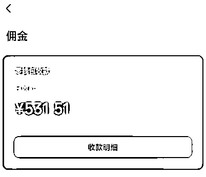

# 从零起步到摸到爆款门道：我的视频号口播航海全记录

赚钱今年连续开了三期长线航海，我全程跟上了。

第一期是5月的视频号口播带货，第二期是6月的视频号带货，第三期是7月的视频号口播带货。这三轮下来，成绩有起伏，心得却越发清晰。今天把这段从懵懂到上手的心路整理出来，给正在犹豫的你一点参考。

### 第一站上船

5月16日，我正式踏上视频号口播带货这条线。当时正研究郭晓文老师的口播体系，恰好刷到赚钱的航海招新，老师亲自带队，999元押金就交了，算是正式启航。

### 能力被逼出来了

前半个月几乎是手忙脚乱，一条口播要耗掉一整天，写稿、录制、剪辑全靠自己硬扛。好在我之前做过职场IP，镜头感还算有基础。随着航海推进，节奏被彻底拉满，最快时一天能录剪发7、8条。熟人屏蔽的焦虑也消失了，从最开始视频号只能发给陌生人，到后来抖音老号也能直接发给身边人看。

流程的熟练度变化更明显。起初剪辑全靠SOP一步步对照，生怕漏掉环节，到后面完全脱手，闭着眼都能完成。心理建设和操作熟练度，是同步长上去的。

### 赛道试错，找到感觉

起步阶段我严格按手册走产品库，录过厨师系列、卖过小炒酱、卖过包饺子料汁，偶尔能开单，但体量很小。后来我换了思路，开始推书。

一换赛道就对上了。讲书的时候我投入的情绪更多，语气里能带出共鸣。慢慢锁定书籍这个方向，因为它允许我用真情实感去讲，而不是干巴巴的卖点堆砌。

### 第一次小爆发

专注推书三天后，运气来了。《朝鲜战争-未曾透露的真相》这本在五个号上同时打响，其中两个号各自贡献了500元左右的收入，加起来破千。最火那条播放冲到20万+。这条成绩的背后，是连续试错、反复录制的结果，也是我从抗拒镜头到麻木接受的过程。

### 航海结束后还在自驱

第一期航海结束并没停下，为了保持团队感我又上了第二期视频号带货航海。看完手册才发现，这期和口播带货几乎不是一个玩法，主推混剪。我就把混剪学了过来，把原本口播的素材拆成一条变三条，同时继续保持口播输出。这期间打卡不断，一共发了100多条视频。

第三期口播航海开船时我直接再上。这次我通过航海伙伴进了几个素材群，里面全是所谓的高爆文案和产品。试了十来天，结果7个号集体被限流进小黑屋，其中2个号是直接被原作者举报了文案，导致永久封禁，连注销都做不了。

那次打击让我彻底明白：账号是稀缺资源，10个以内绝对别碰高风险搬运。明明有对标、有录制能力，却因为没号发，等于钱在脚下捡不起来。

#### 给后来人的避坑清单

高风险文案一定要自己会判断，尤其是那种IP感强、绑定创作者独家产品的稿子，最好别抄。实在想参考，也要重写。我的两个号就是因为抄了人家减肥酸奶和燕麦的文案，被作者私信求证后第二天直接没了。

这件事也让我认识到，口播是极度依赖账号存量的玩法。7个号里，除开《朝鲜战争》那波1000元，后续累计也就赚了不到500元，都是塔木德、肥皂、卡包这类零星爆品，并没有真正做大。

手册里常说要有情景感，我的理解是：优先做自己真心感兴趣、能真情流露的内容。情绪会从眼神、动作、表情里跑出来。爆的那条朝鲜战争视频，我讲到战争里的人物时真的带了悲悯和悲壮，表情和语气就上去了。

最近我又试了本爱国主题的书，小爆了1万+播放，却没转化。可能是情绪对了，商品契合度还不够。

声音也在调整。之前我像播音员一样抬调讲新闻+带货，听感很正但太硬。书籍需要温度，我把音调慢慢放低，声音变柔，情绪的穿透力反而更好了。

### 现在的规划

我很享受口播这件事，显眼包也没什么不好，愿意继续露脸做下去。下一步就是把选品眼光打磨好，同时提升改编和原创文案的能力，先把自己做成一个小IP。

三个月的航海，我算是给自己垫好了第一块砖。路还在继续，期待在视频号口播这条线走得更远。

以上是我这段时间的实操复盘，不一定全对，大家取用就好。