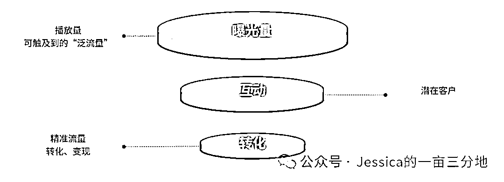
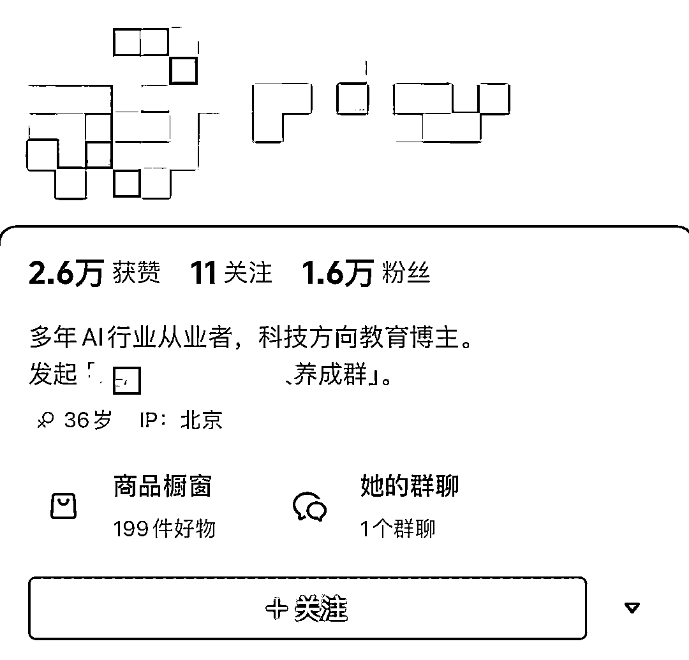
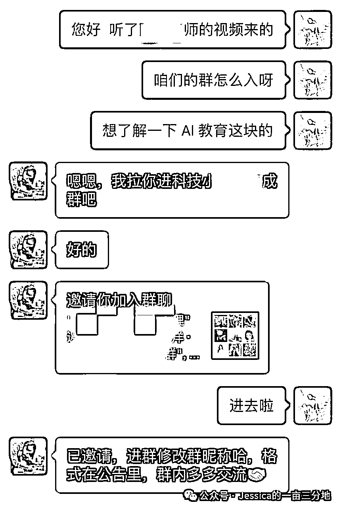
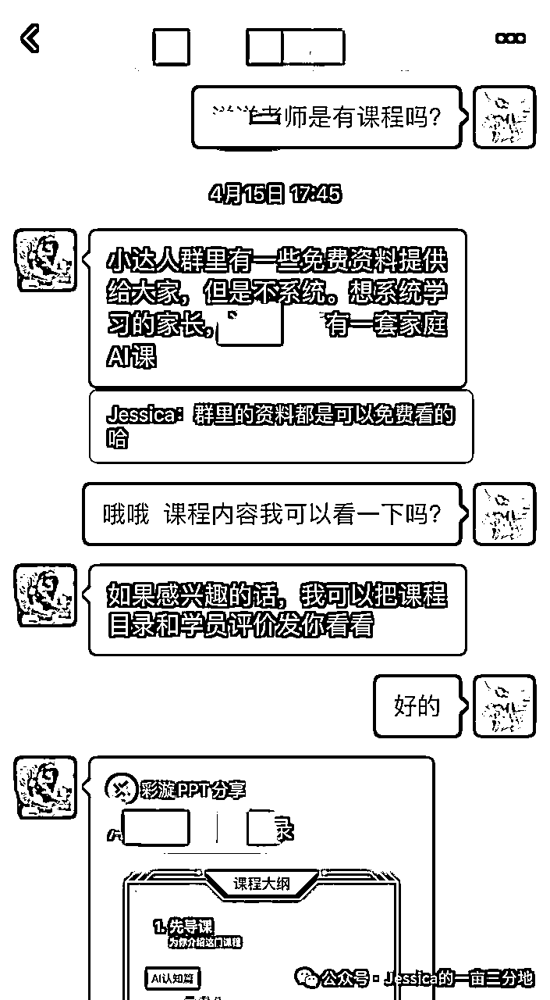

# 怎么做一个赚钱的 IP ！我花了 9 年的总结，拿走不谢！

上次说过，做账号要有一套系统逻辑，很多人追着问系统里到底有什么，今天就把这套系统展开讲讲。我在IP孵化这行摸爬滚打了9年，孵化过100多个达人，操盘过多个直播电商头部账号，在某细分垂类Top1 MCN和头部数字营销公司都做过高管，也是两家MCN的创始合伙人。话不多说，内容有点长，耐心看完，收获肯定超预期。

先问你一句：你想做IP，到底图什么？为影响力还是为变现？目的不同，打法完全不同。既然刷到这篇，咱们就锁死“变现”这个目标。

关于泛流量和精准流量，你可能听过一种说法：泛流量没用，精准流量才能变现。很多“大师”做不出有量的内容，就拿这句话当挡箭牌，把“精准流量”当成万能遮羞布。结果“精准流量”慢慢成了低质内容的代名词。我见过一个创始人IP社群的主理人，一边说内容要垂直、做泛流量没用，一边又劝老板要接地气、轻营销、讲故事来破圈。台下学员直接问：那到底做精准还是泛流量？他给了一堆“比例分配”的建议，却没解释底层逻辑。其实答案很简单：这两个不是对立面，而是上下游。

所有人都想直接捞到目标用户，可前提是得让人先看见你。泛流量就是入口，是那个池子。池子越大，你筛出精准用户的数量才可能越多。所以，一个能赚钱的IP，本质上就是围绕你“怎么赚钱”这件事，拼命做大泛流量池，并用内容让对的人一眼认出你。高手还能更进一步——用内容“造出”新的目标客户。

想落地，拆成三步。

第一步，想清楚赚钱方式。商业变现定位决定了IP的生死和天花板。常见的路子有卖产品、引流获客、电商带货、卖课、接广告、收打赏。很多人说MCN擅长做泛流量但变现差，这话看着对，根子不在泛流量，而在变现路径。以前只要粉丝量大，广告主就排队送钱，打赏也能砸出百万千万收入；但22年之后，广告主要转化率，老板们也不冲动了，光靠曝光赚钱的账号越来越难。那些曝光量依然恐怖的优质账号，接广告过得还不错，只是僧多粥少，流量不稳定的小账号自然被淘汰。所以别怪泛流量，先问问自己的产品是什么。有自己的产品、明确的变现路径，再用公域流量去转化，这才是最稳的打法。自媒体，本来就是普通人能撬动的最公平的杠杆。

第二步，做用户爱看的泛流量内容。这背后是一套系统：人设、呈现方式、选题、脚本、拍摄、后期、表现力，缺一不可。具体展开太长，训练营里细聊。但有一个底层逻辑现在必须说——用户思维。你的内容好不好看，用6条自检：
一，有没有收获感？有趣、新鲜、有用、让人共鸣、令人向往，至少占一样。
二，痛点抓得准不准？是否和用户强相关，是不是常见频发。
三，可看度够不够？主题清晰，让人愿意点开、能看完，诱惑力得足。
四，门槛高不高？用词要通俗，说话要像平常聊天，别端着。
五，体感舒不舒服？画面别模糊、别乱晃，声音别刺耳、别听不清，这种内容平台都不爱给量。
六，踩没踩平台红线？规则不研究，你和用户连相遇的机会都没有。

第三步，围绕赚钱方式来做内容。这才是让目标客户认出你的关键。账号和视频里，你得让人知道你是干什么的、擅长什么、卖什么；还得让人觉得你靠谱、可信，甚至有点可爱就更好了；同时要展现真实自然的一面，浮夸和虚假越来越惹人反感。这些不一定塞进每一条视频，可以拆成人设类、专业类、营销类分别做。比例上，营销内容越轻越好，别超过30%，多给专业和人格魅力让路。

那营销转化内容到底怎么发？给你几个直接能用的抓手：拍产品介绍视频并置顶；在画面或字幕里标注你的身份和产品；把产品挂进橱窗；个人简介里写明产品和成绩；多拍工作场景、产品场景。总之，让产品无处不在。

另外，新手最容易踩的坑，就是变现路径太长。记住三句话：路径每多一步，就会丢掉一批客户；承接产品必须备好，链接、海报、介绍随时能拿出来；要主动展示产品。举个例子，我认识一位知识博主，她踩的就是这个坑：

之前认识一位知识博主，1.4万粉丝，赛道新、粉丝付费意愿很强，但她的变现设置实在太“含蓄”了。账号上找不到任何产品痕迹，私信回得慢，加了🛰️也不说有产品，拉我进免费社群，里面没什么活跃度。最后是我主动问她，才知道她其实有课程。说实话，要不是我懂套路又愿意主动引导，换了别的用户，早就划走了。她想收钱，却连门都没给人留。

现在做流量已经很难了，还抱着“先涨粉再变现”的老思路，基本行不通。更好的做法是，把每一个播放都用在刀刃上，用最快速度完成变现。只要把人引到了私域，就更要大大方方把产品摆到台面上，多角度展示个够。记住，你越是直接大方，用户就越愿意掏钱。如果在IP路上遇到卡点，随时找我聊聊。祝你在这条路上顺风顺水，赚得盆满钵满！