# 一只好蟹的线上突围：蟹塘二代的实战笔记

各位圈友，我是龙哥，在常州一家交通国企任职。工作经历很杂：工地上的白帽子、红帽子都戴过，水电活也干过，在南京当过地铁调度，进过苏宁做产品、销售，还写过程序，算是到处乱窜的打工人。

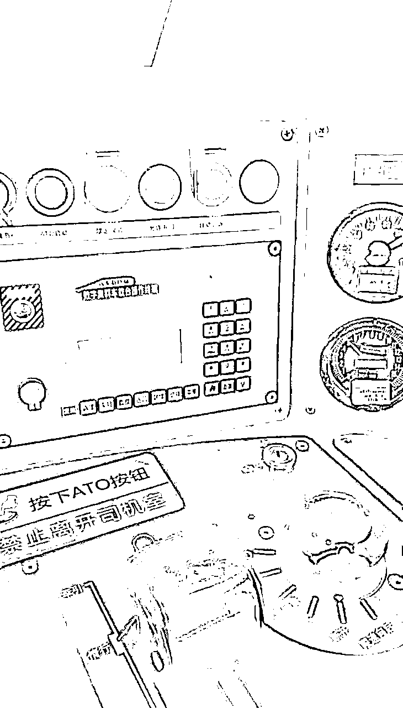

回到老家，日子安稳，但心里总想折腾。于是决定把家里传下来的养蟹生意搬到线上。今天聊聊：这门老行当是否还有空间？传统口碑和线上流量怎么融合？

我从小看家里养蟹，亲戚们赚到钱后一个带一个，全都入了行。在本地，提到养蟹技术，我们家值得被说道。

这行靠复购。不能为了多赚几个钱就在质量上动手脚。蟹要一只只过手，足斤足两，膏肥黄满，让客户有超预期体验。我的复购客户粗算下来超过九成。

刚起步时，断脚的、小个的蟹不值钱，我便送人或者低价清掉。客户觉得实在，后来就会主动买礼盒。没有利他的心态，没有主动拓客的意识，项目很难跑起来。

直接给鱼不如教人下网；讲方法比给答案更有用。下面说说河蟹项目能不能入、怎么从零起步，也把一线养蟹的真实体会和混圈子的收获一并倒出来。

## 一、传承与破局：从蟹塘到屏幕

我叫炎彬，姓陈，1995年生，🛰️名也直接用这两个字。为什么用真名？一是网上用真实身份更踏实；二是以前用网名，加好友总要做自我介绍，麻烦，索性换了。

家里养蟹，大姨父、表舅、几位叔伯都在做，整个区域已经连成一片产业带。

但我注意到，养蟹主力普遍岁数大了，小年轻吃不下这份苦；就算吃下苦，也可能扛不住行情压力，几亩塘口死蟹就是大窟窿。同辈亲戚里，真正守塘的没几个，多数人都去做实体生意或直播带货。

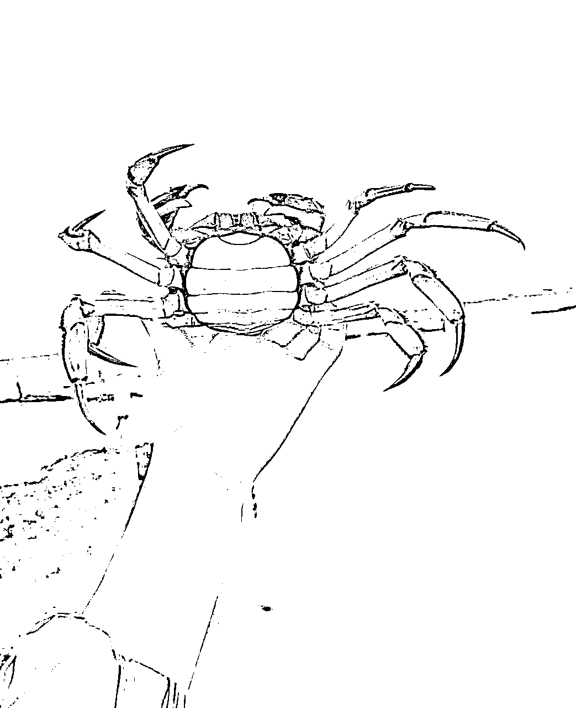

我是标准的蟹塘二代。最早是我大姨父在长荡片区养蟹，后来带出一串亲戚。如今他还做冷库和食材批发。

很多人好奇他为什么愿意教这么多徒弟。有一次喝酒，他跟我说了心里话：“养蟹这件事，你不教，人家也会去别处学。投入不是小数目，有时候要押上全部身家。他来找我，就是信我。我把技术都传出去，自己也老了，希望这行能出比我厉害的人。何况我有冷库，冻鱼可以自给，帮了他们，以后他们需要优质饲料，自然还会来找我。”

养蟹讲究荤素混喂。现在很多塘口把虾、蟹、小鱼混养。河蟹长到中后期，主要吃冻鱼，但不能天天喂荤，隔几天搭配东北黏玉米和甜南瓜，轮换着喂。这样养出来的蟹，蒸透后肉带甜味，不需要蘸醋，黄和膏都够肥美。

投喂舍得花钱，营养跟上了，蟹才能达到顶膏出货的标准。大姨父自己做冷库，省了成本，还能向周边养殖户卖冻鱼赚些外快。

我家的蟹出货晚，老主顾常常等得着急。但品质不过关，我不会让它上市。这背后的思路很简单：不贪快钱，只靠口碑慢慢攒客户。

有人问我，为什么在体制内还要帮家里卖蟹？其实就一句话：看父辈太辛苦，作为家里男人，想搭把手。每年蟹季，父亲和长辈凌晨就去档口选蟹。有的铺子用一把秤，有的用两杆秤，一颗一颗地挑，普通货里选高规格，高规格里再选顶膏。

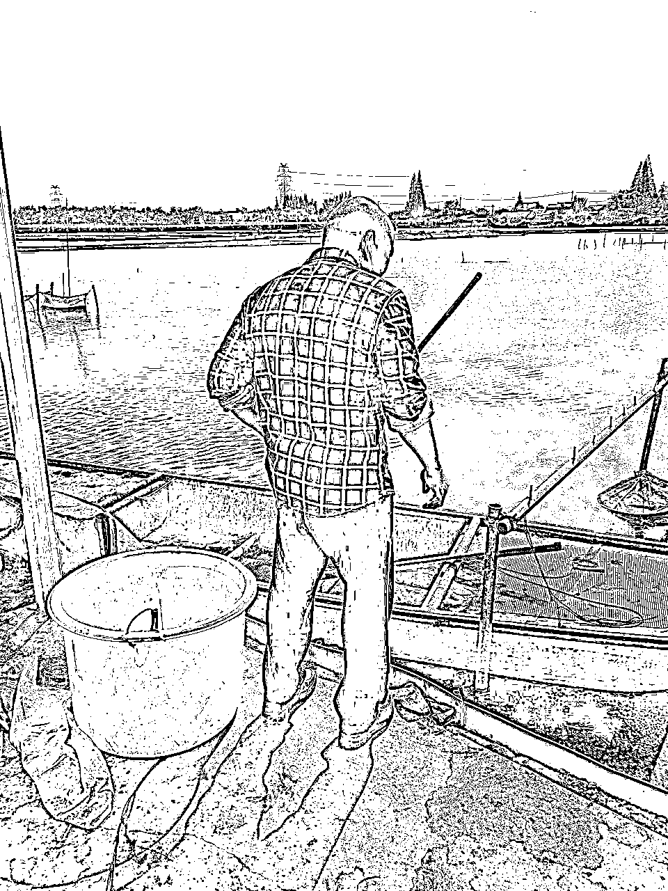

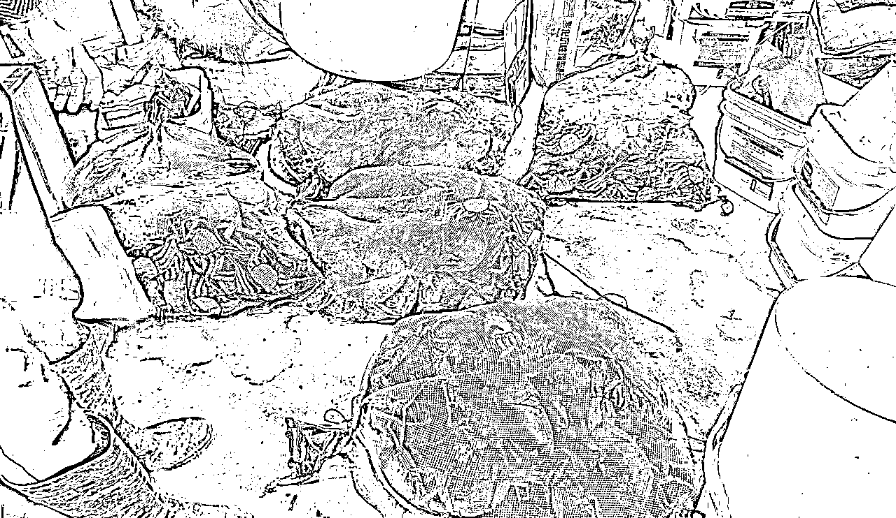

我跟着父亲跑过无数趟集市。傍晚先拣普通货，后半夜才挑高规格，凌晨两点是最高峰，那种疲劳真不是常人能扛。以为忙完能补觉？错了。第二天塘口还有一堆杂事，塌方、增氧、喂食都等着处理，养蟹容不下半分大意。

我也不忍心看父亲这么熬。年轻时在冬夜里跑市场，尤其是入冬后的北风，加上过度透支，我落下了腿痛的毛病，天一冷就犯，自嘲叫“寒腿”。

凌晨的蟹市，吵吵嚷嚷，灯火通明，也混杂着寒冷与疲劳留下的酸痛。去年12月某天凌晨3点，我在档口困到想放弃，一个人灌了一整瓶低度白酒。

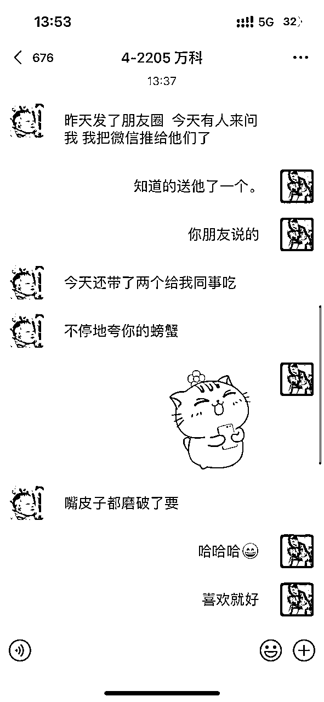

但随后收到一条客户好评，使命感又回来了。能让信任我的人吃到顶好的蟹，受点罪也值。所以这件事，我依然想一直做下去。

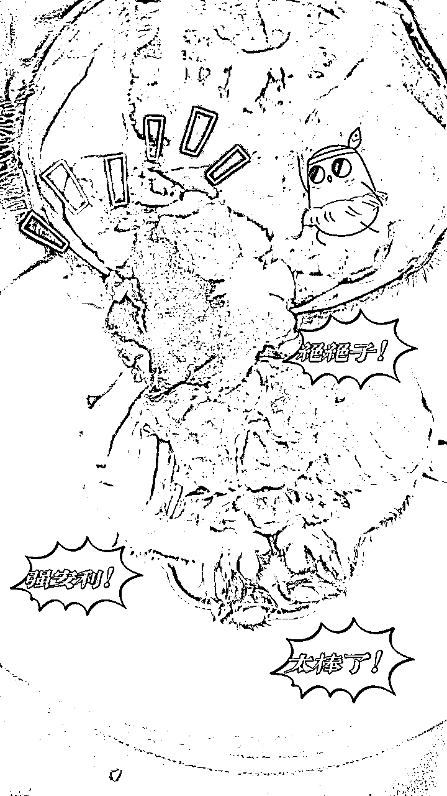

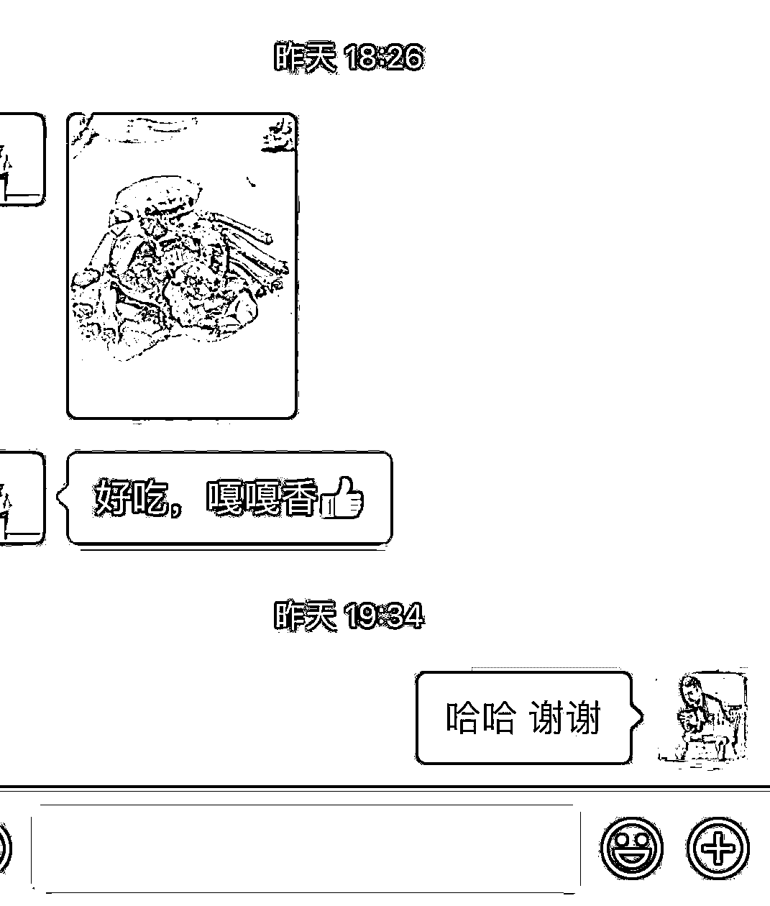

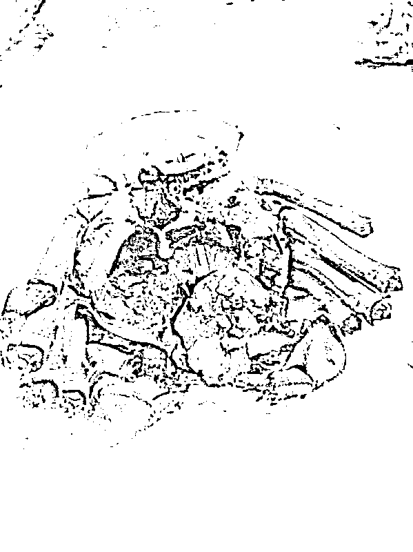

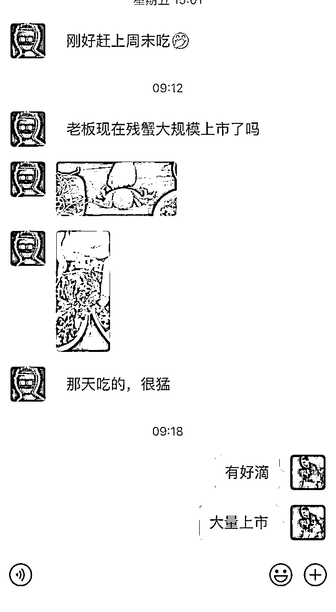

我舍不得让父亲再这么拼命。我岁数不大，再苦也能扛，可看着长辈们岁数大了还在硬扛，鼻子总会发酸。

以前看收货商按斤收、按只卖，中间的利润很诱人，我也眼馋。于是试着在社交平台帮父亲卖蟹，慢慢积累了一批客人，现在九成都是复购。因为我不爱抛头露面，吸引来的大多是老熟人，挺不好意思。

平时刻蟹、洗蟹，我从不戴手套。讲真，指纹都快磨掉了，手也常被蟹钳夹破。

为了让家族塘口有更好的出路，我正努力把单子转到线上，少跑几趟档口，让蟹从塘口直接到餐桌。这样父亲不用那么累，客户能拿到更实在的价格，我也能确保每只蟹都是精挑细选，算是一举多得。

近两年，线上客人明显变多。感谢大家照顾，让我对经营蟹塘更有信心。

## 二、赛道与机会：小白怎么从零到一

坦白讲，现在才进入河蟹这一行，确实有些晚。不过也并不是完全没有机会。我把自己跑通的路子整理一遍，供参考。

凡事起步最难。开局走对，后面就会顺很多。

最上游是养蟹，但风险高、强度大，不建议新手直接下场。没有老手带路，很容易赔光老本。现在养殖技术也在进步，很多塘口实现了半机械化管理，更有实力的基地已经全流程可视。

每一口塘喂了多少、还缺多少，自动巡航投喂设备一天飞几趟、每片区域投多少，数据都清清楚楚。前期投入高，但有政策补贴，所以愿意尝试的年轻人不少。这类智慧化农场依托物联网，曝光率高，也更容易接住优质大单。

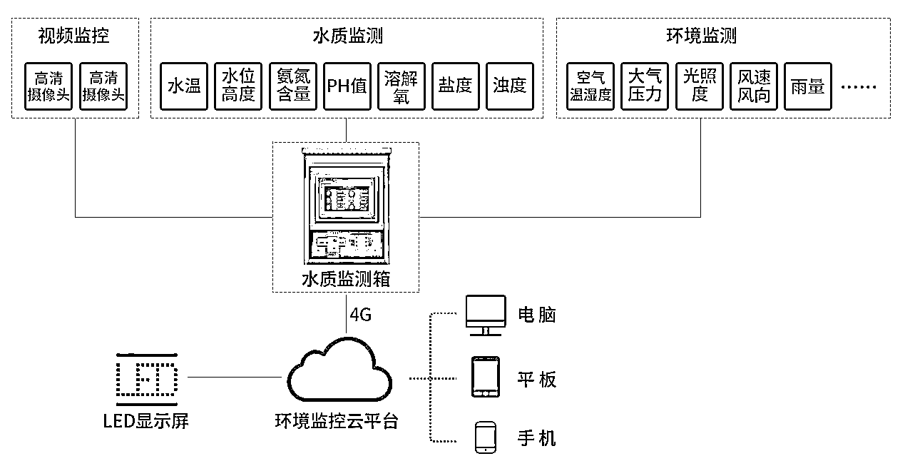

养蟹这条路太重，不如走一条轻一点的路：做流通商，收蟹转卖，赚中间利润。下面按环节拆解。

**1. 收蟹**
蟹季可以跑集散市场，也可以直接找蟹农收。收货时看规格、过秤、按斤算钱。
集散市场的节奏是：傍晚先走普通货，后半夜才开始选高规格，高规格里还能继续挑顶膏。被挑中的优级蟹不会在集市上流通，早被人订走；市面上流通的，基本是普通货和低等品。
农历八月十五前后抢蟹最凶，价格也最贵。收货商有时会为了一袋优级蟹争得不可开交。那时物以稀为贵，有渠道的话，转手价能翻好几倍。

中午前后就别去赶集了，好货早就被扫空。半夜到档口，跟老板熟的话还能给你留货。
本地主要的集散地，有常州当地的大型批发市场，兴化的河蟹集散中心，以及南京固城片区交易场（原来在高淳老街，已经搬到新址）。
如果你认识靠谱的养殖户，可以直接谈合作：需要什么规格，提前一晚让蟹农下笼、分好规格。也可以用小船笼把蟹泡在塘里吐水，去掉土腥味；收回来放进过渡池养一夜再发。

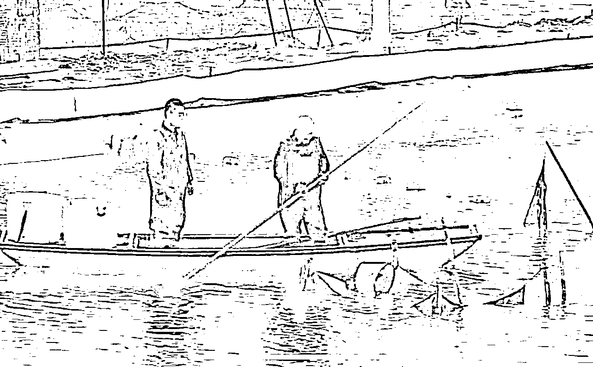

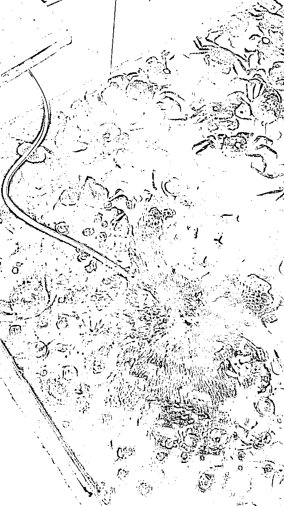

刚入行的人，别碰九月节日档的订单。那时候有单不一定有货，看走眼还会被投诉。不少人带着期待入局，最后灰头土脸退场。等10月河蟹大量上市后再做，风险会小很多。
母蟹大量上市在国庆以后，11月是公蟹的好时机，母蟹也进入成熟期。想提前卡位，可以用兑换券。

**2. 蟹券预售**
河蟹真正放量是10月，但9月送礼需求很旺。我一般在9月中段开始卖现货，这时候必须把质量关把得更严。
你还可以做一个提货券系统，让客户自主兑换。市面上兑换券有效期一般是两年，我设置的规则是长期有效。买你的券是出于信任，没必要用规则卡住老主顾。

找技术服务商做系统时，要问清楚是否有独立部署，数据安不安全，别贪便宜。券面不用太花哨，简洁好用就行。最好找设计人员做原创，或者购买版权素材。网图再好看也不能乱用，当心侵权。其实纯色底加一只蟹也很耐看，客户更在意的是你家的蟹够不够好。

礼盒和铁盒的独特性也要做出来。等跑通0到1、有了利润，可以上镭雕、UV打样等定制服务，让品牌再进阶。但前期别急着重投入，先沉淀基础体验。

**3. 发货与物流**
线上卖蟹需要食品销售许可；如果做醉蟹或其他加工产品，还需要额外资质。正规做法是办一个工商登记或注册公司，成本几百块。
私域发货很简单：绑好的蟹放进保温泡沫盒，加冰袋、冰瓶，再装进外盒，交给顺丰寄出。远一点用顺丰的航空件，通常签约月结；也可以办区域储值卡，一次充5万、10万，平台会给赠送金额抵扣运费。别嫌充值多，远距离一单往往要80元起，空运时效快，价格自然高。

外盒、保温盒、绑蟹的草绳、品蟹小工具、老牌蟹醋，在集散市场都能进货。很多流通商就是靠倒腾这些辅料赚钱。生意的本质就是这样：要么自己生产销售，要么在流通里赚一层差价。

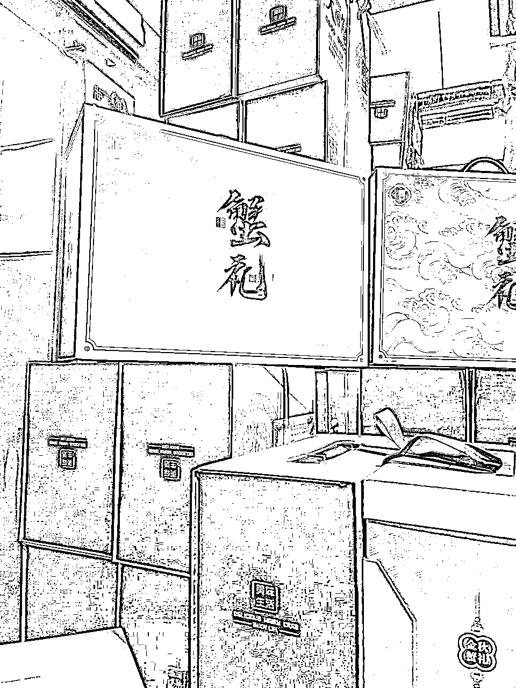

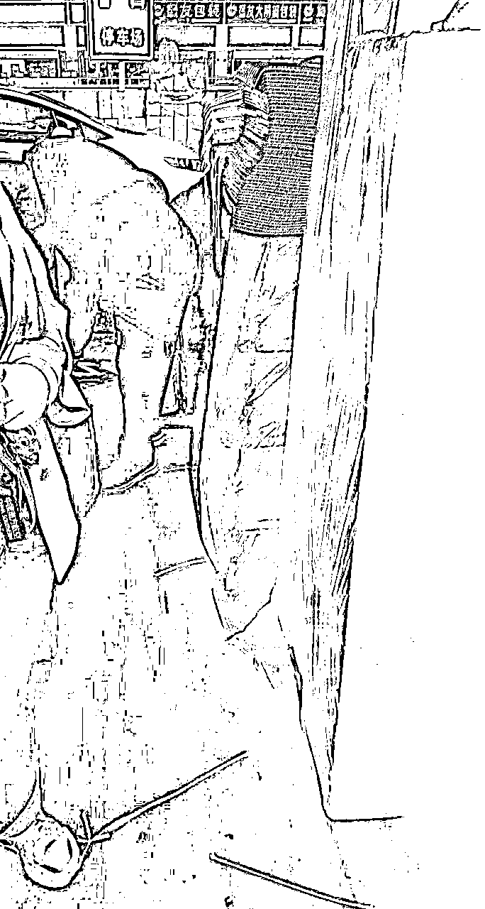

我们这边的礼盒大多从义乌采购。每个螃蟹集散市场都有通用外盒和保温盒，比如南京固城片区交易场，上二楼就买得齐；一楼是卖蟹和物流发货的区域。等我们进入蟹季，北方已经过季，普通货和低质蟹会用大车运往北方消化。

想让礼盒更有面子，可以放品蟹小工具、湿纸巾、祝福卡、产地追溯卡等。今年我还在想，把江苏河蟹和发源于盐城的掼蛋文化结合，做成更有社交属性的伴手礼。

**4. 协会授权**
圈内人常把这步叫“入场费”，本质是拿官方背书。比如阳澄产区有阳澄湖协会，长荡片区有长荡湖协会，固城片区有固城湖协会，各地都有完整的会长、副会长、会员体系。

交了会费，就能用官方设计好的外盒，或者在自己的包装上贴官方标识。预算少可以贴水晶标，预算足就找工厂定制。
入会费用不算高，长荡、固城几千块能办下来，阳澄产区要上万。拿到阳澄的授权，就相当于成了官方认可的合规蟹，身份和底气都不一样。

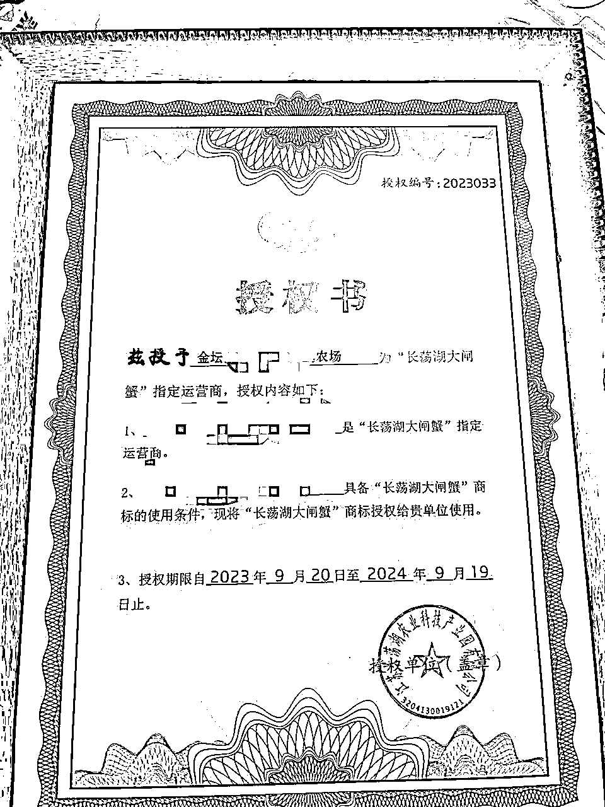

**5. 品牌注册**
模式跑通后，可以注册一个自有品牌。河蟹商标归在第31类，找代办机构大约500元。然后把心思放在包装上，但质量永远在第一位，不能本末倒置。

品牌做起来之后，就能撬动大企业买家，甚至一年握十几个重量级客户，年入百万是有可能的。
客户信任和品牌忠诚度积累起来，流量和分销会自然增长。不用单打独斗，试着开放给想分销的人。但分销只是加分项，不能指望它救急。
只要产品质量稳定，分钱机制、售后客诉都成熟，分销的人没有后顾之忧，自然会主动推，形成良性循环。

当然，这些是0到1之后的事。做项目最重要的是先干起来。认知重要，行动更重要。试错成本不可惜，反复错过才可惜。

**6. 小结**
如果不主动链接圈友，不参加实战项目，不敢尝试新玩法，也没有持续迭代的耐心，那再高的认知也只是空转。
我进入这个社区之前，也交过不少学费。进来之后，像打开了新世界——就算大环境不好，依然有很多机会。
线下见面时，大家聊得最多的就是机会、发展和资源互换。圈子里牛人密度越高，做成事的概率也就越大。
要么跟定一位大哥鞍前马后，要么自己不停进阶人以群分。

## 三、圈子的能量：把蟹卖爆更要把事做成

每一期实战活动和线下聚会，我基本都报名。光看不练没用，只有亲自下水，才能拿到一手信息，才能把别人的经验变成自己的。
这就像上学时做数学题，一道题可以有不同的解法；语文阅读也一样，没有标准路径，关键是你能不能用正确的方式答对。

实战的过程有压力也有动力。只要认真、用心、踏实去做，意料之中和想象不到的收获都会出现。
我是在一次短视频实战中，遇到一位做个人IP的圈友。他一直没有找到适合自己的带货品，跟我聊完后决定帮我卖蟹。坦白讲，以前从没招过代理，这次算是我们一起迈出的一步。

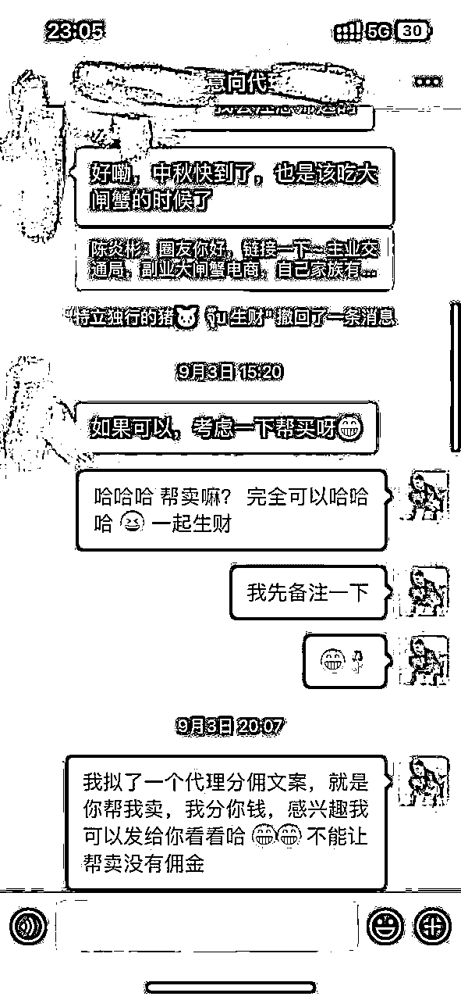

交付的时候，问题还真不少。最明显的是，很多人对河蟹知识了解太少。有人觉得农历八月十五和国庆就该吃蟹，可最佳品尝季要等到10月中段以后。
苏北产区的蟹熟得早，兴化、泰兴一带尤其明显；气候不同，成熟期也不一样。母蟹的黄金赏味在10月中段之后，而且个头越大越晚熟；公蟹要等到入冬北风刮起来才最肥，这群人被叫做“公蟹爱好者”。
广东那边11月就基本吃完蟹了。所以八月十五和国庆假期有人找我买蟹送人，我一般劝他们买兑换券。客户实在着急，我就临时从苏北调货，因为苏南的蟹就是比北方晚熟。

我卖蟹有一条底线：品质不够就不发。前期只做纯母蟹礼盒，后期才把公蟹母蟹组盒卖。
渠道伙伴对产品不熟，心里没底，我就让他们把问题丢到群里；不好意思公开问的，私聊我也行。我把知识挨个拆开，讲明白为止。

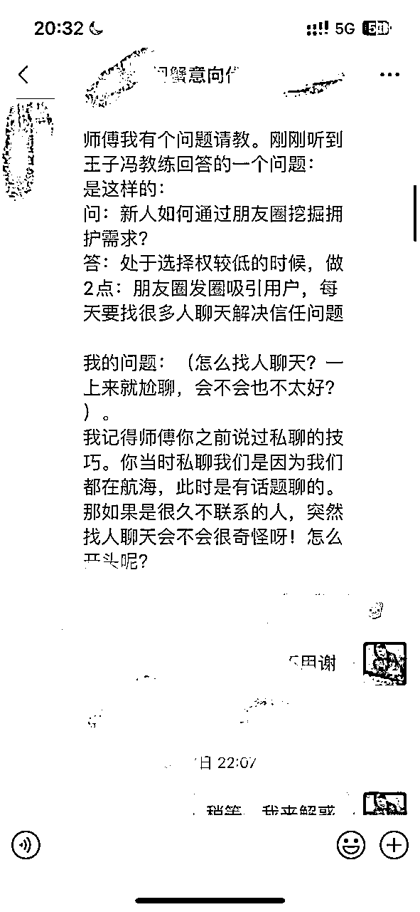

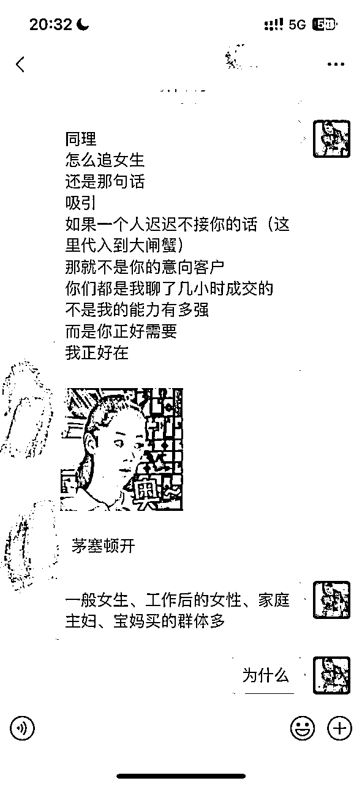

这和实战营的逻辑一样：很多问题靠想象无解，非得下场去做，亲手试错，才能长进。

这个社区就像一堆散落的拼图碎片，有心人把它拼起来，会得到一张地图；地图尽头，藏着真正的宝藏。

跟在我身边做代理的这段时间里，我发现大家刚一开始推大闸蟹，朋友圈的熟人都会觉得很突兀。想拿到首单，就得收起架子主动去触达客户，脸皮厚度直接决定成单率。

成交只是一个起点。要真正站在购买者视角去揣摩需求，才能把对方的真实痛点解决掉。用真诚去换取信任，关系才算真正立住。

我反复跟团队讲，生意不是冲一时，是要做长线。口碑是复购的根基。今年客户在你这里买了，吃着满意，价格在精品里算友好，明年大概率还会回来。一旦今年为了冲销量动了手脚、缩水品质，看似赚了快钱，实际上人品和人脉都在贬值。

做生意有没有万能的诀窍，我不敢说。我没有系统学过生意经，我是体制内出来的。体制内的潜规则就是别去当恶人，今天的同事明天可能还是同事，有锅有错我一般都先扛下来，看起来吃亏，时间长了会被尊重。当然体制内也别做老好人，该划清界限的时候必须让对方看到你的分寸感。

总结起来，我也没有什么高深的生意经，我只坚持做人的底线不变。尊重竞争对手，帮扶弱势群体，保持距离远离小人。做人保持一身正气，大概就是我对经营的理解。

看到这里，可能有人会觉得出单原来这么简单，副业搞点零花钱挺香的。先别急，我泼点冷水。

能持续出单的代理，核心是心态足够坚定。私聊十个人，聊很久被拒是常态，有委婉拒绝也有直接拒绝，这不代表你不够努力。

根源还是信任缺口。现在同质产品太多，凭什么客户要从你这里买大闸蟹？靠颜值吗？网上好评可以刷，质量看起来都一样。

这时候就看你的圈层资源和销售话术了。第一层信任来自人际关系和内容输出，第二层信任才落到产品本身。

所以该讲的必须讲透。比如网络上常见的规格到底是什么样的，绑的是绳子还是香草，湿绳会吸多少水，香草绑扎的利弊是什么，我们的差异化在哪，都要用专业知识讲清楚。

很多人做了几个月几年就自命为高手了。圈内有个说法是三年入行，五年明白，十年才算翘楚。

每个人的长处不同，我不会强行规定打法。我会放手让你自己选赛道，私域、视频号、📕、抖音都可以。下面这位代理在📕上的表现数据不错。

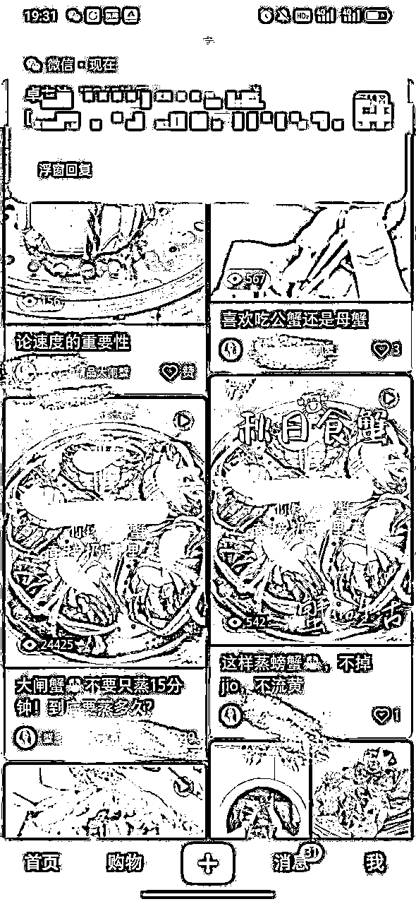

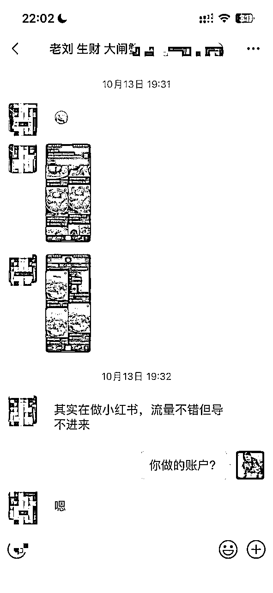

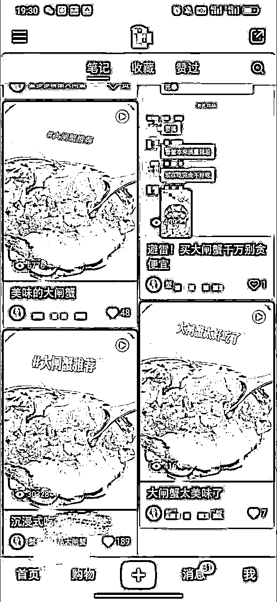

后来我参加📕航海项目，才知道加粉和建群的方法很多。大家可以多参加赚钱官方组织的航海活动。

在实践中沉淀出自己的方法论。就算后面不做大闸蟹了，引流来的客户也能放在快团团做商品团购，只要品质过关口碑做好，生意不会差。

持续学习专业知识才能把产品讲明白，才能持续获客成交。不要想着去拼多多拿低价货赚差价。要搞清楚拼多多的货源逻辑，你的核心竞争力是什么，你的优势是什么。

圈子决定高度，希望大家都能在赚钱这个大家庭里有所收获！

# 四、螃蟹赚钱，不断迭代

目前大闸蟹主要靠线上平台销售。我打算长期深耕这个副业，帮家里卖蟹。期间我办理了食品经营许可证、食品生产许可证、熟加工工厂资质、熟食食品许可证，还投资了一家熟食深加工工厂。

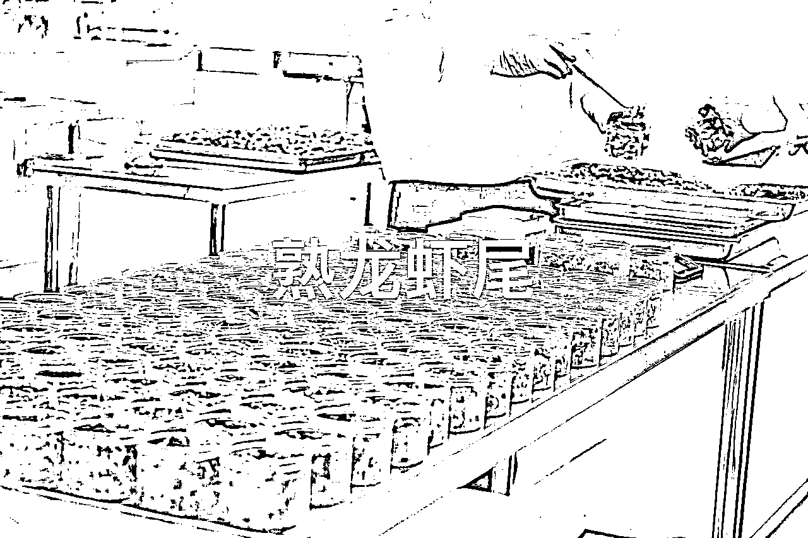

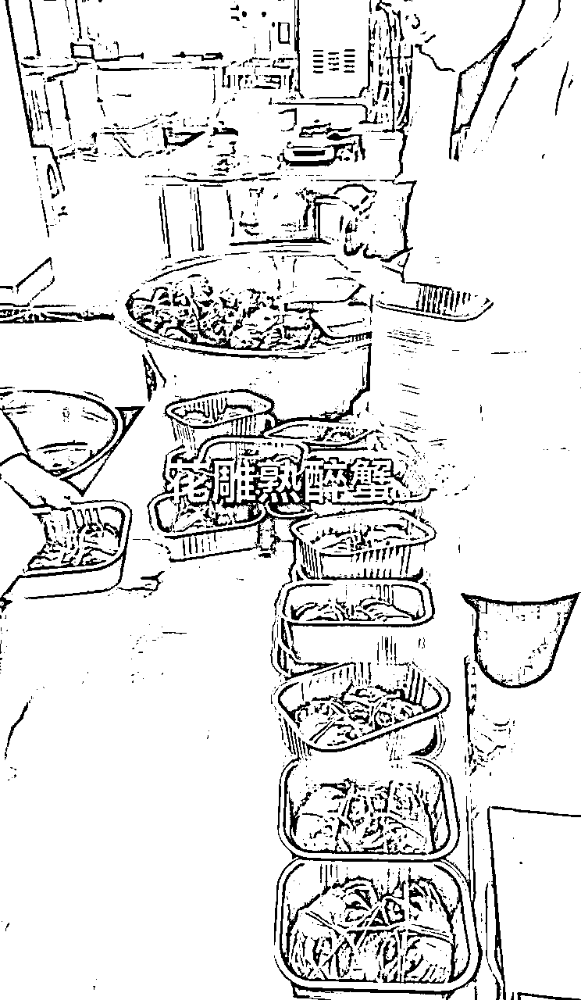

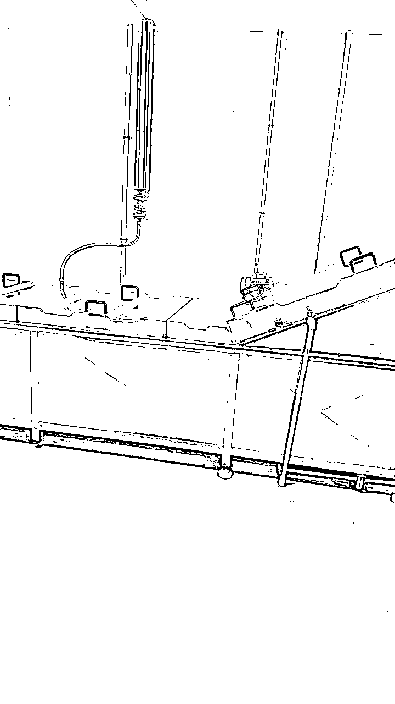

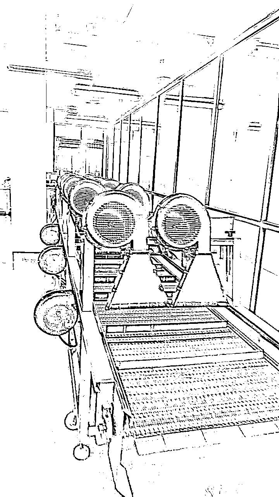

想办营业执照的，可以自己去市场监督管理局办理，流程很方便成本也不高。有执照后就能在官网免费申请食品证，再去市场监督管理局领回。

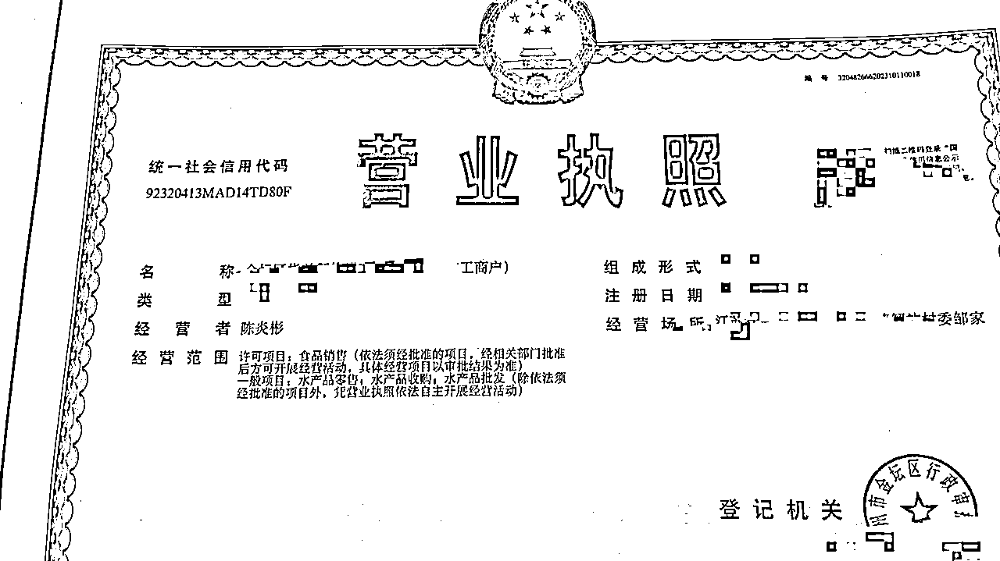

按官网步骤走就行。一开始我也不熟练，后来我经常跑市场监督管理局，给办证同事带水果、请奶茶，口头上叫一声美女，人家主动加我🛰️，办事效率就上来了，挺不好意思的。

申请食品许可证有几个要点。主体类型选销售，经营范围选销售，从业人员健康证必须齐全，否则申请不过。要上传店内布局图。没有实体店也可以申请，做互联网大闸蟹和醉蟹销售必须用到营业执照和食品证。你可以手绘一张简单的布局图，上传时也可以去同行店里拍照上传。

营业执照不需要找代办，自己办更省钱。不想麻烦可以找代办，自己办的话找个场地就行，最好是乡下绿本房产，直接去市场监督管理局申请。

不过场地必须是绿本，乡下私房、自建房也算。办执照需要村委会盖章，市场监督管理局会出具申请材料，涉及拆迁补偿等事宜。村委会一般不会随便盖章，具体情况比较复杂，但只要村委这关过了，市场监督管理局那边基本就顺畅了。

关键是和市场监督管理局的工作人员沟通好，他们心情舒畅，就会一手帮你搞定。

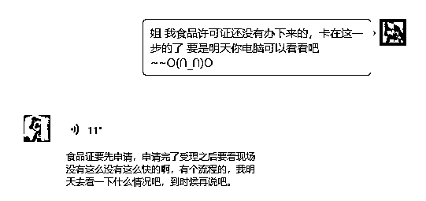

办完后对方还主动发🛰️问我是否还有困难，我说都解决了，她还想帮我推销大闸蟹。社牛的人走到哪都能开局面。

我计划长期深耕这个赛道。家族现在是养殖为主，我想把我们的品牌口碑做出来。利他即利己，我会在擅长的领域毫无保留地分享，有任何问题都可以来问我。

我清楚赚快钱容易，但要打造一个持续赚钱的IP，就需要源源不断的口碑。所以我保证每一只蟹都是足斤足两，都是我亲自挑选的精品。

我也相信未来是个人IP加私域的时代。大家都会比价比质，我先站出来把自己亮出来，我立个目标一年后视频号完成个人IP认证。

现在也在尝试抖音和视频号直播，闲鱼和📕获客，商家资质都已认证。这些资质我也可以免费帮忙注册，不会就来问我。龙哥老师说过，极致的利他就是利己。

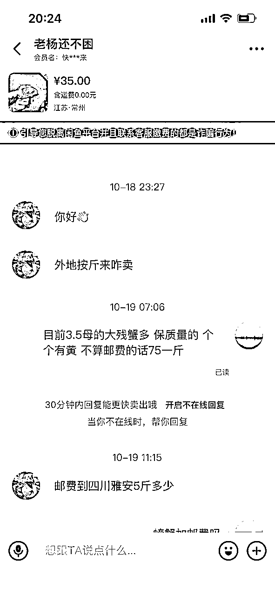

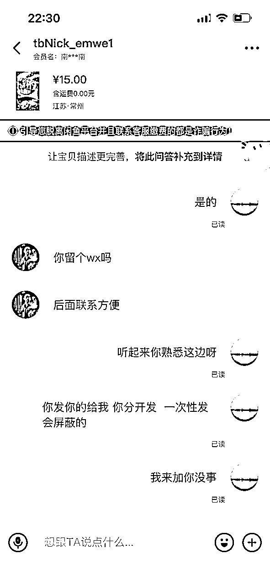

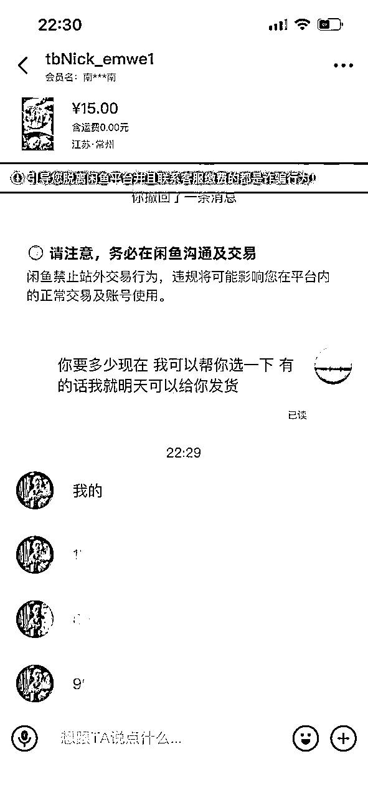

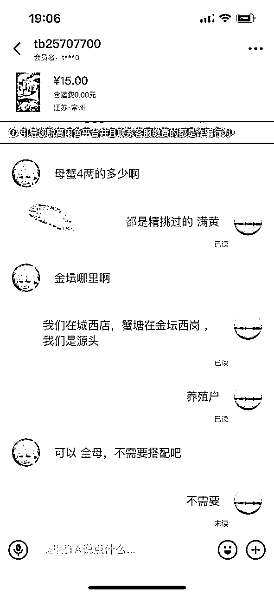

我也在打造自己的品牌，珍惜羽毛。如今价格透明化，套路很多，讲诚信的商家才能长久，不诚信很难生存。

做私域电商可以借助小程序销售，小程序能放图文视频，客户直接下单。我自己就是用的小程序。比写程序简单太多，相信大家都能学会。

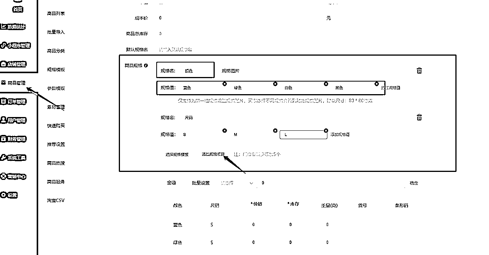

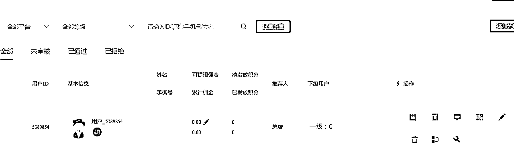

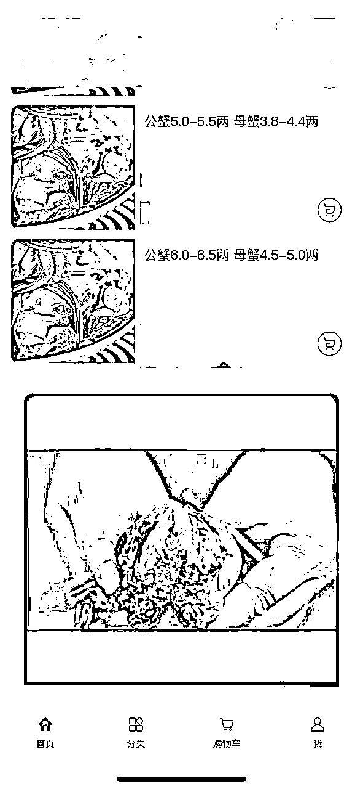

自己做小程序腾讯会收300元认证费，然后自行设计，还能设置分销和佣金，很方便。学会之后就算不卖蟹了，也能帮别人搭建小程序。

建立影响力，我在常州金坛已经有一定声量，但我清楚靠个人影响力走出去是不够的。

需要一群伙伴一起赚钱，我要学会分钱，像一个董事会一样给股东分红。我的定位就是聚财聚人、做好分蛋糕的人。钱聚人散，钱散人聚，道理如此。

我父辈和爷爷辈还停留在辛苦养蟹塘的阶段，这没有错，但不走出去看看外面的世界，不拥抱变化，很难实现阶层突破和圈层升级。这也是我今年加入赚钱的最大体会。

今年我想出去跑市场，窝在一个地方视野就会受限，大局观就会失误。我带的代理都是因材施教。

有的代理比较沉稳，我就建议他每天发朋友圈做被动获客。有的活泼外向，我就建议她主动拉群，再招募代理，她就成了代中代。有的想法很多，想做视频号、想做抖音……

这时我就建议先选一个入口入局，精力有限，然后持续迭代。

很多代理都出了成绩，这让我很欣慰。

一个人的力量有限，以前张哥也说过，一个人走得快，一群志同道合的人走得远。对新知识我也在不断吸收能量，创新、迭代、突破。

# 五、相当有趣，冷门知识

螃蟹的黄金期只有短短几个月。因为螃蟹寓意好：富甲天下、八方招财、富得流油、鸿运当头、纵横天下，所以是送礼首选之一。

之前赚钱文章教过大家如何选蟹，其实串红心的螃蟹也可能看走眼，具体什么时候不一定，养殖户才知道门道。

海贩子不懂，扒开中间有黑线，这种蟹品质不一定好，吃起来可能发苦或者蟹黄发绿。

我们长荡湖的蟹通常叫苏南蟹，也就是中华绒螯蟹。有专家指出，无论苏北蟹、苏南蟹、黄河口蟹、盘锦蟹，本质都是中华绒螯蟹，只是生长环境不同。北方寒冷，成熟偏早。

8月份苏南蟹基本还没上市，这时山东东营黄河口蟹会提前上市，卖到10月。

9月到11月是全年蟹上市品种最多、数量最多、品质最好的阶段，就是“九雌十雄”。

9月气温偏冷的地方蟹上市稍早，比如泰州兴化、溱湖、江苏高淳、安徽当涂、江苏太湖、湖北洪湖、山东微山湖等。

10月到11月，大名鼎鼎的阳澄湖蟹、上海崇明蟹、松江蟹集中上市，我们江苏金坛的长荡湖蟹也在此时上市。

苏南蟹母蟹最佳品尝期是10月中旬，公蟹最佳品尝期是11月。正如郁达夫所说“西北风未起，蟹也不曾肥”。

还有许多冷知识，不是几年能学会的。比如螃蟹也会胃胀气、消化不良，这个够冷吧。

大闸蟹也会得肠炎，得了肠炎的蟹行动迟缓、体色发白，喂养时没食欲，口中还会吐黄水。

现在治疗主要用中药材，也有更好办法但尚未得到专家证实。

养殖户知道这些问题后，都会想办法解决，有兴趣搞养殖的赚钱朋友我可以免费教。

其实螃蟹越到后期越容易死亡，特别是大蟹。去年我家母蟹上市前死了两块塘，蟹塘一旦出现非自然死亡，往往就是成批死亡。

我父辈那时三两半的母蟹就很大了，现在很多都是四两以上的大母蟹，更有今年用小苗也能长到三两半。

说明蟹苗品质提升了，喂养也改善了，养殖户舍得投入。吃的都是新鲜鱼虾、大鱼块、香甜南瓜、东北玉米，这蟹能长得不好吗？

蟹塘里的南瓜吃起来特别香甜，是给大闸蟹补充营养的蔬菜之一。

消费者对新鲜度、口感、品质要求高。只有优质产品才能在市场竞争中脱颖而出。

秋天去产蟹地游玩，路边很多贩子卖蟹，打着自产自销旗号。这时要注意，你买的四两蟹可能只有三两甚至更低。

网上的普货也一样，严重的缺斤少两。很多人不信蟹塘价格比网上还低，和网上比价格。

套路很多，超35规格、46规格、38规格、49规格、50规格，你要相信源头价格如果比网上还高，那说明什么，自己体会。我不砸别人的盘子。

快递蟹的技巧：放冰袋，一般放两块，用空矿泉水瓶灌水冷冻后放入保温袋，泡沫箱密封好。在密封低温环境里，大闸蟹新陈代谢会降低，进入类似冬眠状态，能保持活蹦乱跳。

大闸蟹基本只能用顺丰大闸蟹专递，全国大部分地区次日达。偏远地区走空运，快递费很贵。比如从江苏金坛寄到广东一盒要五六十，寄到哈尔滨要七八十。

有的地址邮政反而更快。

硬性成本这么高，你可以想想网上所谓“199元包邮”的蟹质量如何。

现在都是大蟹多，蟹苗品质好，两点五两的都少。

你去门店买蟹，通常按只卖，规格给你小的，他赚得多。你去蟹农那买，按斤来，规格会给大的。十几个不是很多，蟹农也不会太操心。我也不愿意弄，不过有人给了我五百让我捞一网兜，捞到七个有三个四两以上的母蟹，其他中等，我也愿意。

挑选肥蟹的方法：捏起来厚实，拿在手里掂一掂，沉重坠手的，就是肥蟹。

看肚脐也能判断肥美程度，最准还是扒开看。母蟹肥美俗称“谷起”或“鼓起”，公蟹肥美俗称“挂红嘴”或“红印”。

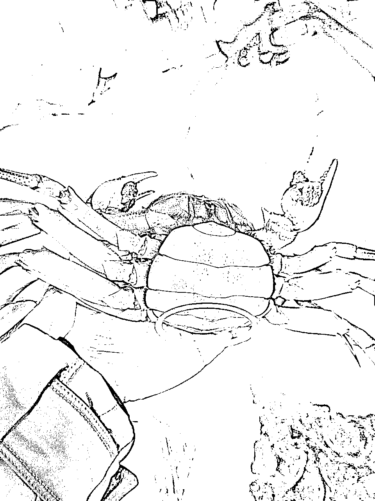

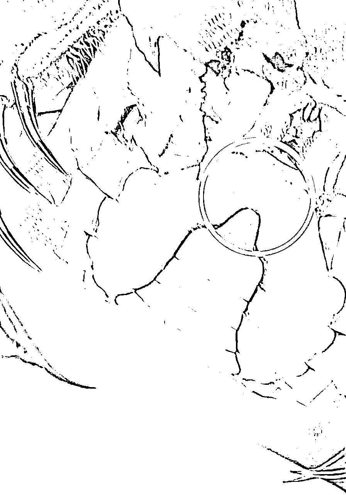

醉蟹分生醉和熟醉。不同地区口味不同，浙江喜欢生醉，内陆喜欢熟醉。

醉蟹在江南很流行，用螃蟹加米酒香料精盐醉制，咸鲜适中，芳香无腥，蟹味鲜美。

我今年投资的熟加工工厂也在做熟醉蟹和熟龙虾尾，熟醉蟹也可以用六月黄做原料，顺丰冷链发货。

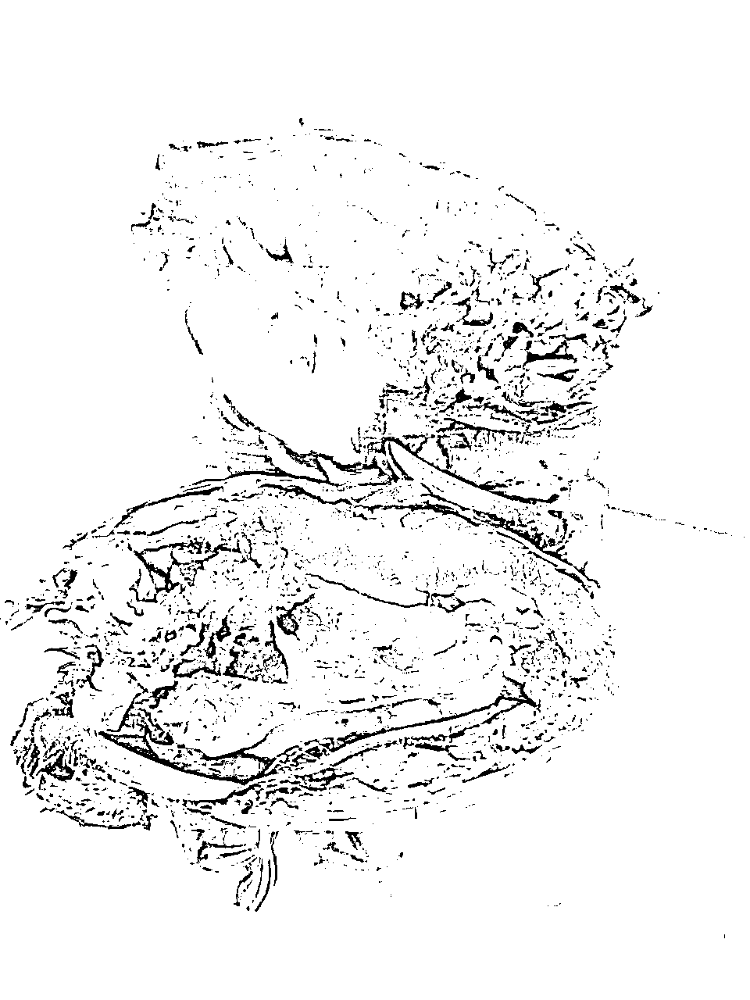

从健康角度，避免吃螃蟹感染寄生虫，就要充分加热。不管虫体还是虫卵，高温下都存活不了，只要煮熟煮透就放心吃。

大闸蟹捕捞后要放进暂养池，目的是让它吐掉肚子里的脏东西。不吐的话吃起来有泥腥味。好的大闸蟹不是抓上来直接发快递的，而是暂养池里一只只挑选出来的。

吃蟹要应时。母蟹比公蟹先熟，个头小的比大的先熟。所以九月下旬刚上市，建议先吃两点五两、三两的小母蟹。

后面再慢慢吃更大的，等国庆后、寒露时节，公蟹可以吃了。前期公蟹膏少，不够粘牙，到十一月就软糯得不像话了，就是老话“西北风未起，蟹也不曾肥”。

做了蟹生意才知道，物美价廉不适用于大闸蟹。收购商想在养得好的养殖户那收购好蟹，必须给出高于市场的好价格，一分钱一分货，不能玩虚的。

抓大闸蟹一般是夜里抓。前期蟹刚上市要下地笼，后期成熟了晚上会爬满岸边，直接捡就行。

不煮熟的螃蟹千万别吃，吃了很有可能要去医院急诊。

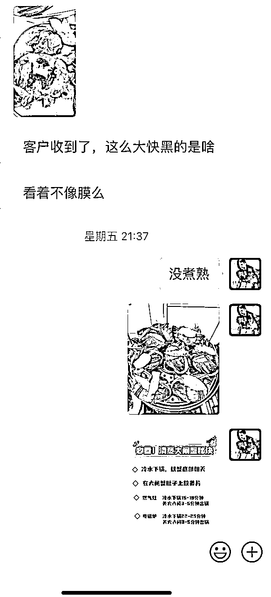

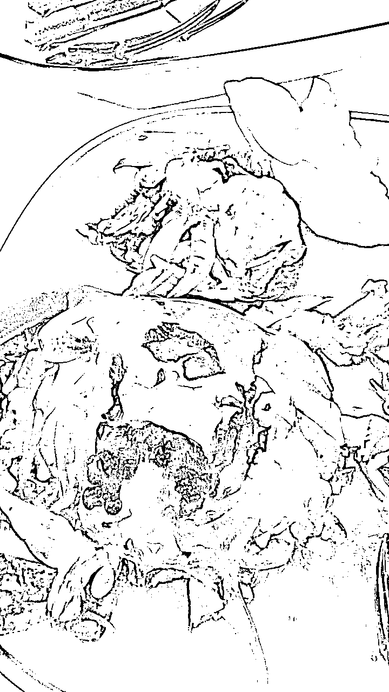

想吃原汁原味，还是清蒸最好。古人说“世间好味，利在孤行”，就是烹饪时什么都不要加。

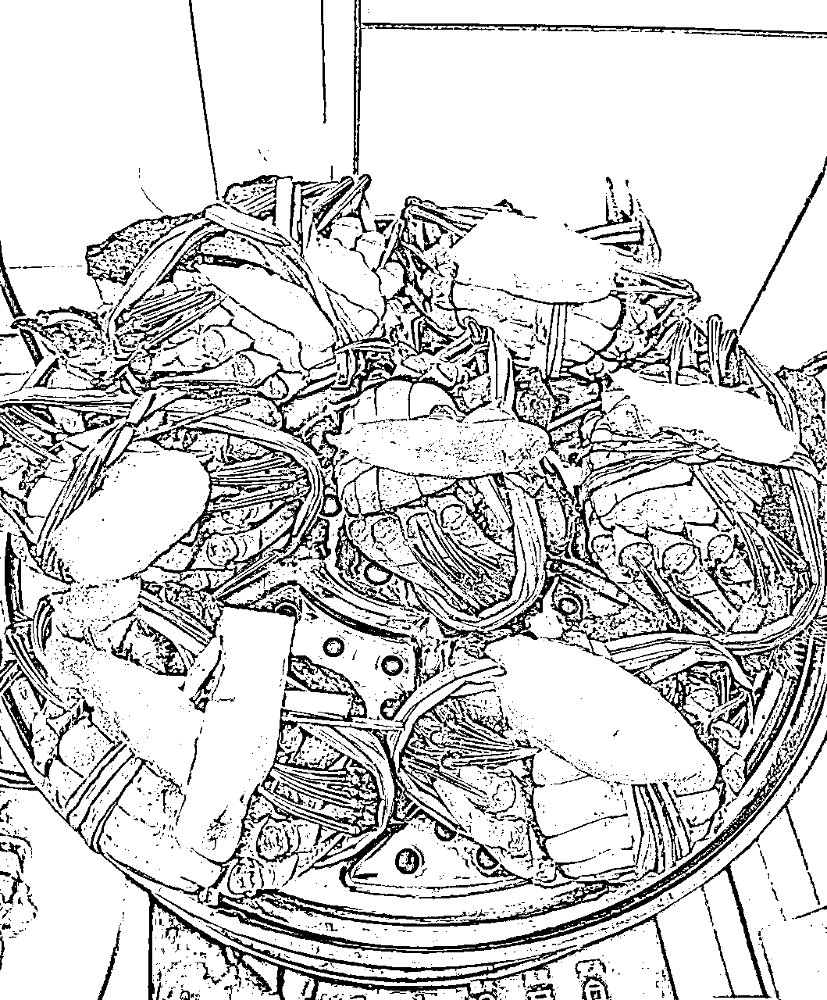

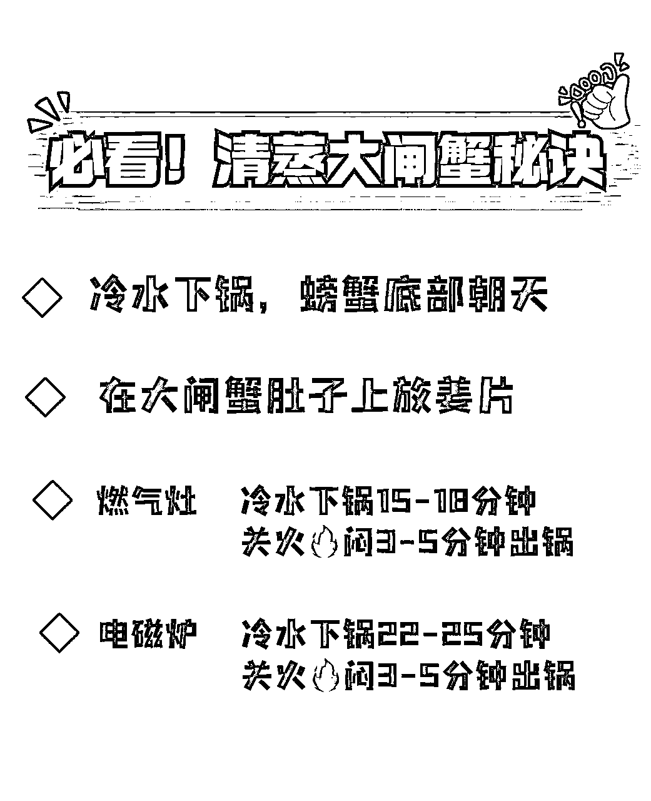

真正好吃的大闸蟹吃起来是香甜清香，特别鲜。如果吃到这样的蟹恭喜你，如果没吃到，可以试试我挑选的精品蟹。

有时候刚收到的蟹看起来一动不动，别慌。它可能是旅途劳累被冰袋冻得暂时休眠。解开绑扎的草，用水冲一下眼睛，它又活蹦乱跳了。

还有个冷知识，公蟹塘和母蟹塘是分开养殖的，所以清塘是亩亩清。十月上母蟹，十一月上公蟹，公母搭配卖。

很多人说网上才一百九十九包邮，每次听到这话我都想反驳，但又觉得没必要和顾客解释太多，专业的细节不是一两句话能说清的。

简单说下，十五年前金坛养殖户才个位数，技术参差不齐。经过十多年迭代，现在技术都还行，也舍得投入成本。螃蟹要补充丰富蛋白质，荤素搭配才能肥得流油。选蟹苗时就要选充满活力的。

但这些年又出现一批新养殖户，上市时货多，质量参差不齐。有的蟹看着大，其实很空，很难吃。

养大闸蟹就像青春期补充营养，青春期要长高长肉就要吃有营养的。你喂蟹不懂生长周期，舍不得喂，选小蟹苗，上市能肥吗。和海贩子长期合作的养殖户，直接在精品里选穿心红的好质量。

# 六、相互合作，共同前行

项目核心是货源和质量，还有个关键点是急单。你这没货就要去同行那调货。因为大闸蟹不是说要就有，前期要下笼、下网才有货，而且前期大蟹很少。十月卖母蟹，前段时间我也遇到这个问题。

客户要六两的大闸蟹，当天中午找我，我店里不可能有。大蟹比小蟹更容易死，前期死亡率更高，死了就是人民币。所以一般大店才敢前期屯点货，客户又急。

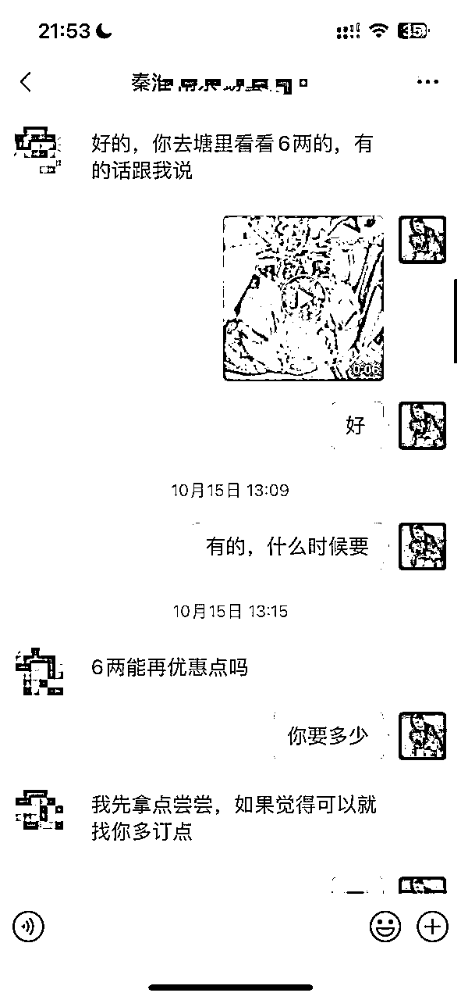
我当时去别的蟹塘也来不及，就去问同行门店有没有，进货价一看，涨十五二十一斤也可以，一般涨五到十元一斤，因为他大蟹也有客户要，就涨多一些。

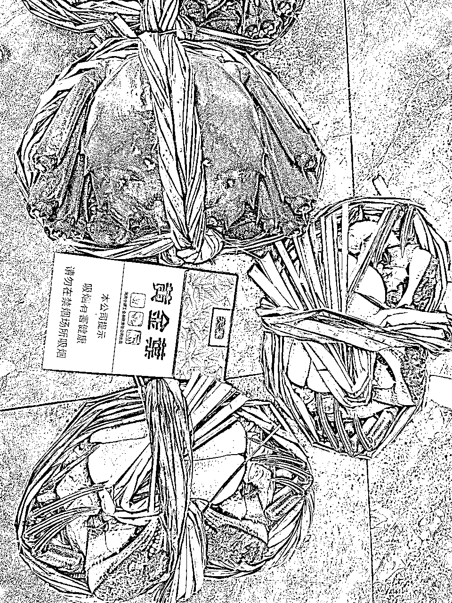

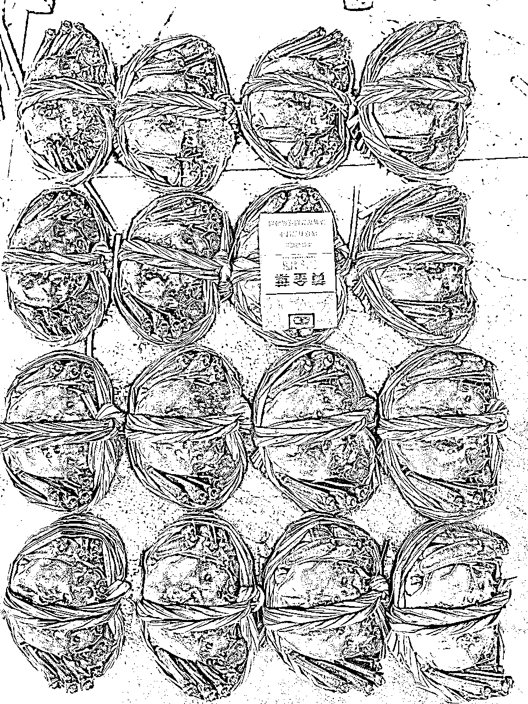

大闸蟹那身“麻花绑”，其实就是用香草捆出来的，看着像“大草结”，拎去送礼也很有排场。草本身就该是这个色儿。要是你收到的蟹，绑绳用的草泛着灰，那八成是去年的陈草，不讲究了。

至于蟹好不好，光看皮毛真不够，懂行的人上手一摸一捏，就能判断是不是满黄的好货。真正的好蟹，连醋都不用蘸，入口自带清甜，那才是真鲜。

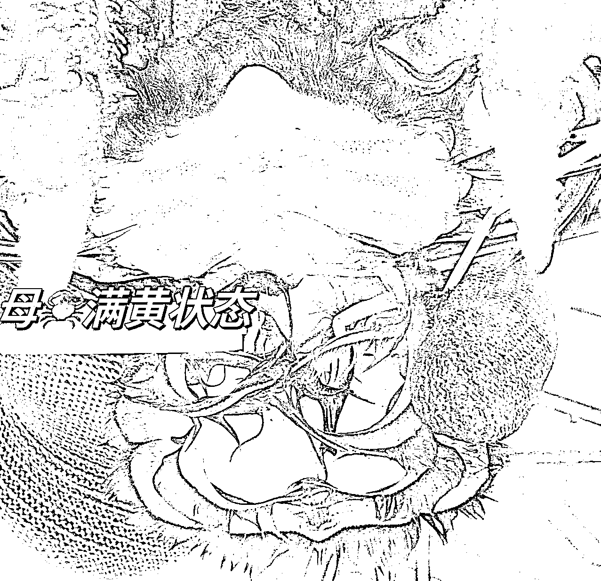

外行看热闹，内行看门道。像我们这种养殖户，一眼扫过去就知道谁家的蟹能打。这几年踩过的坑不少，都是拿教训换出来的。

别人教你一百遍都不一定记得住，自己跌一跤比什么都管用——这些学费，都是眼泪攒出来的。

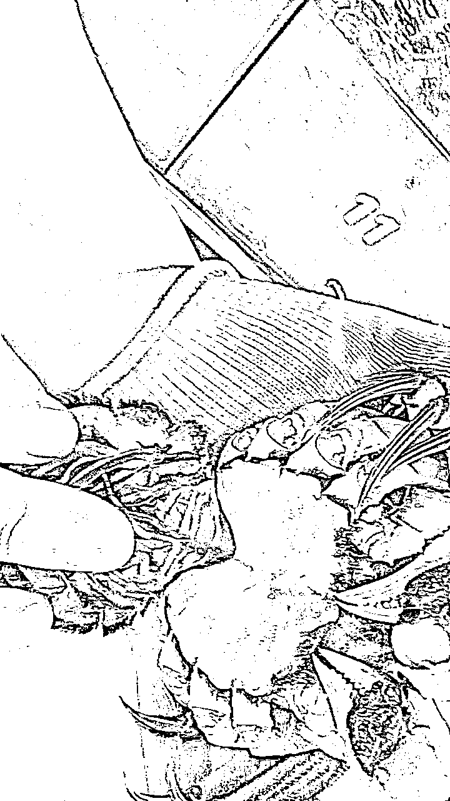

跟同行打交道，别整那些花里胡哨的说辞，直接谈分成、谈点数，利润多少摆台面上，干干脆脆。

前几年有家品牌找小杨哥带货，网单是接了不少，但价格压低，中间商还得一层层分润。精品蟹就那么些，你这么大的盘子，利润压那么薄，最后人家凭什么把好蟹给你？一分钱一分货，这是铁律。结果满屏差评，口碑一年就砸了。

想做大生意，团队是必须的。可有了单子，手里没硬货，那才真叫急死人。我们养殖户稍微从容点，一边走批发一边做礼盒，毕竟水面太大，不上市场根本走不完这个量。

# 七、经验之谈，感谢赚钱之路

做一件事，想成了就得从头撑到尾。三天打鱼两天晒网，永远出不来结果。实实在在干，一门心思钻，才是正解。

真心换真心，真情换真情。做到货“真”——真好吃、真满意、真心值；做到价“实”——规格足、做人实、螃蟹也实。生意才能一直做下去。

想清楚要做哪门生意，先问自己手里有什么资源，能不能变现。没有好资源，就多出门走走，学会跟人合作，但别把自己累垮了。

人生不如意是常态。男人倒下了，拍掉灰继续往前走。流过血，淌过汗，可能还掉过几滴“没出息”的泪——真不算什么。知足常乐，拥有时懂得珍惜，失去了也别太纠结，只有不断往前、磨砺，才活成一个真正的男人。

每个阶段都有各自的迷茫。上学时愁毕业、愁出路，出了社会又愁赚钱、愁晋升。每个年纪都有那个年纪的难题，怎么和同事处好关系，怎么搞定供应商，怎么维护客户，都是大课题。

但我想说的是，光想都是问题，动手去做，一步一步走，答案自然就浮出来。别动不动就换赛道，把自己的本事打磨到位，好产品自然能出来。

如果暂时没方向，就在龙哥盟里找个标杆，跟上，认真学，一直跟下去，结果差不了。也很期待和大家建立深度链接，思想碰撞一下，擦点新火花出来。

引流这步，是商业里真正关键的一环。

所有平台都会经历爆发式增长，随之进入规范期。增长期里各种业态都冒出来了，甚至包括一些不靠谱的，平台需要“虹吸”商家和用户，等成气候了再筛选。所以想要长期立住，建立影响力很重要——这相当于占一个生态位。哪怕在小圈子里站稳，个人IP也会不断产生复利，像涟漪一样对外扩散。

真正的正反馈，都是下场实践得来的。在一个领域持续深耕，反复试错、复盘、反馈，别来回跳，时间拉长，概率自然站在你这边。

多参加龙哥盟的航海活动。我以前总觉得认知到了位就能赚钱，实际上在屏幕上看再多都是纸上谈兵。真正下场去做，遇到问题、解决问题，把项目从0到1、从1到10跑通，你才会明白：实践才是赚到钱的根本原因，而认知只是让人少交点学费而已。

今天就先分享到这儿，后面我会陆续补充进来。我打算把一篇文章反复打磨，就像一个行业持续迭代、不断精进那样。

希望文字能越写越顺，越来越通，就像做服务的把体验越做越好，让每一位客户都感受到变化。谢谢赚钱，谢谢各位耐心阅读，再次感谢。