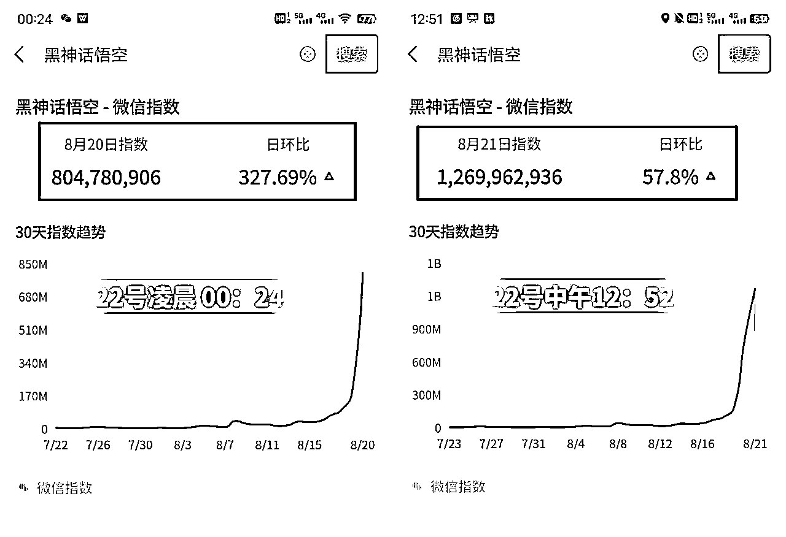
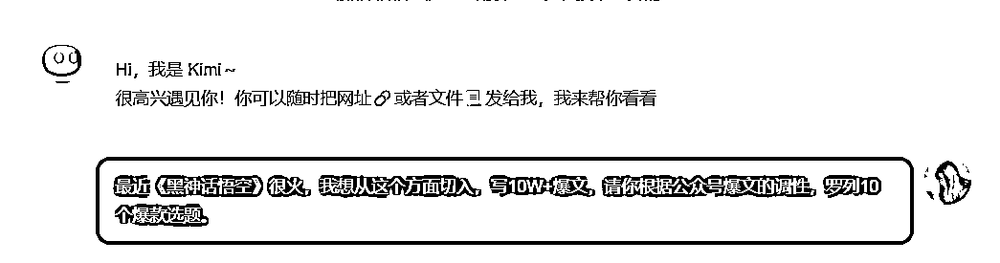
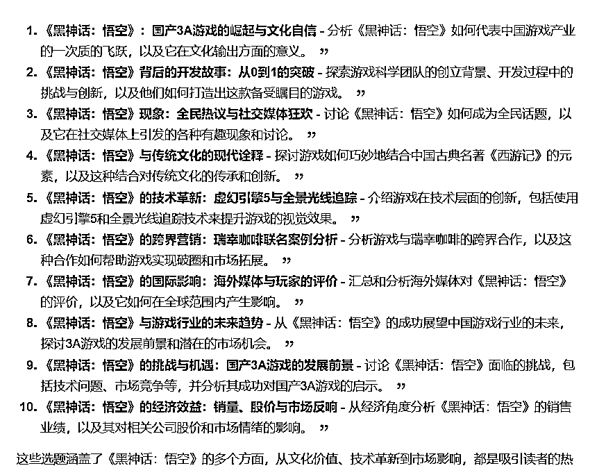
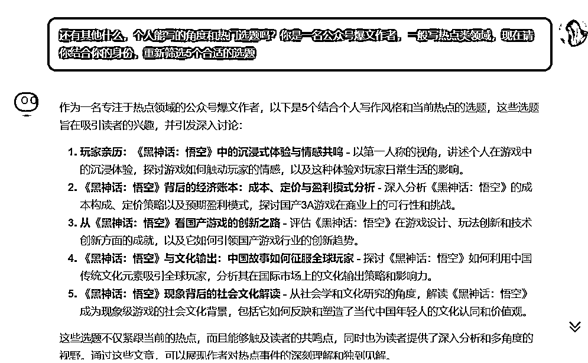
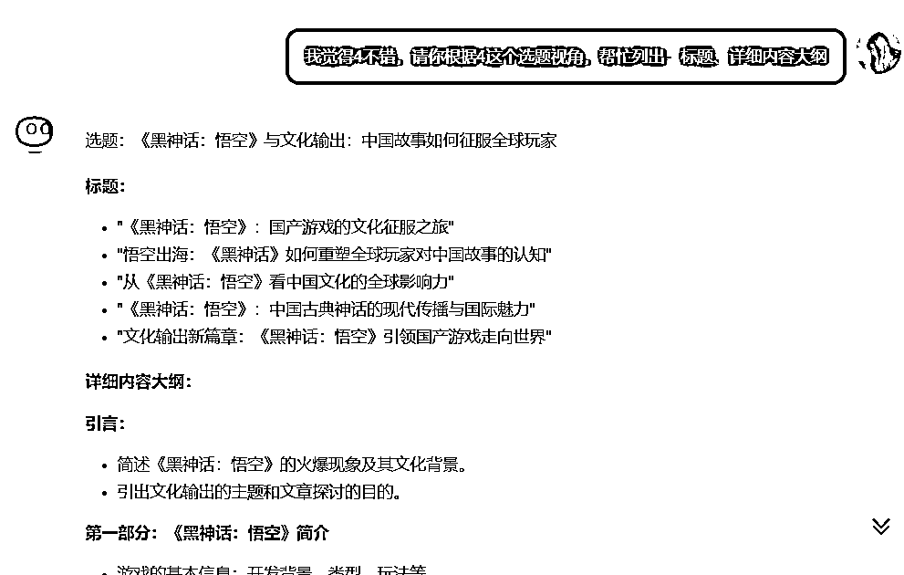
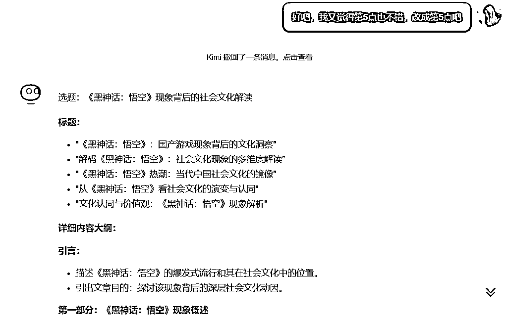
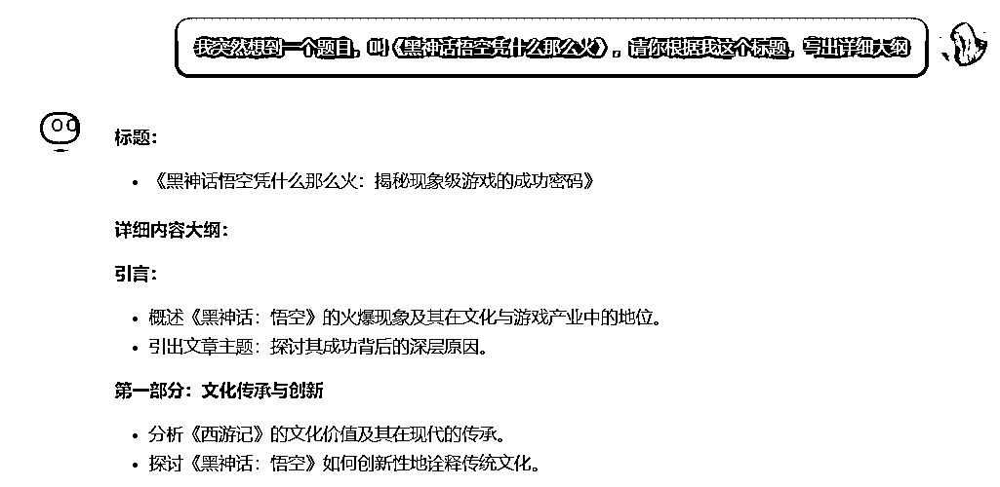
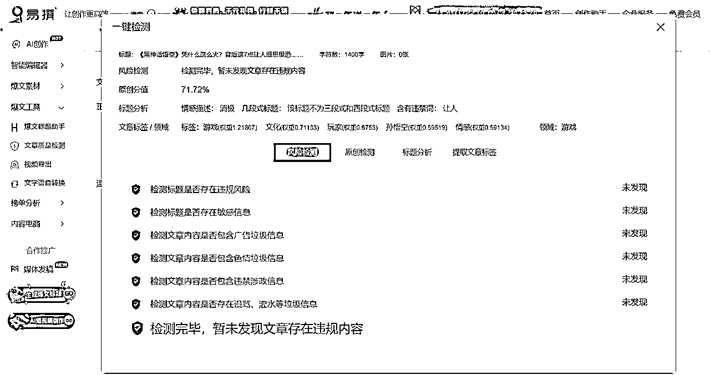

# 5分钟成文？我用Kimi撸了一篇《黑神话：悟空》爆文，连对话都摆给你看

我是安七，毕业刚满一年，主攻AI+写作，靠公众号爆文做了双百万的盘子。

这两天，《黑神话：悟空》的热度有多吓人，不用我多说了吧？从游戏圈子一路烧到朋友圈，连我家长辈都在聊。做热点号、游戏号的圈友应该都闻到了味道——这就是一个典型的“异常值”，谁先上车谁吃肉。

先看一组微信指数，这波数据飙升简直离谱：

眼看着流量密码就在眼前，不少人却卡在了第一步：知道它火，但不知道从哪下笔。我也一样，前两天专门把自己当成纯小白，拿Kimi跑了一遍全流程，结果意外顺滑。今天就把我的调教思路和完整对话拆给你，想蹭热点的圈友可以直接抄作业。

## 第一步：让Kimi帮你找选题

打开Kimi，直接丢给它这个需求：最近《黑神话：悟空》热度很高，我想从它身上挖一篇10W+公众号爆文，请按爆文调性给我列10个选题。

它给了10个方向，整体能看，但我作为新手有点下不去手——要么太宏大，要么不好写。于是我又补了一句，让它代入身份重来：你现在是专门写热点领域的公众号爆文作者，重新筛选5个更适合个人写、容易出效果的角度。

你别说，给完身份设定之后，它的思路立刻收窄了，不再满天发散，给出的方向实操性也强了不少。

## 第二步：定好选题，让Kimi生成大纲

从它给的5个方向里挑一个最顺手的，继续推进。

它给了一个围绕“文化输出”方向的完整框架，顺手还拟了好几个标题候选，既有走宏大叙事的，也有偏故事表达的。正文则分七个部分展开：从游戏简介与文化背景，到传统文化元素的现代诠释、全球玩家的反馈、文化输出策略，再到国产游戏国际化路径、社会影响和未来挑战，最后还给了附录建议，拿来做长文骨架绰绰有余。

后来我临时变卦，让它换个选题再出框架，它也照样接得住。

当然，如果它给的标题和大纲不合你胃口，也有办法：你直接丢给它一个自拟标题，让它照这个重新出大纲。

## 第三步：按“身份+标题+要求”走口令，直接出原创文

大纲没问题之后，我开始让它正式成文。口令核心就三样：账号风格身份、爆点标题、硬性要求。

我给它设定的身份是：擅长捕捉热点、文笔犀利又不失温度的公众号作者；标题直接用了《黑神话悟空》凭什么这么火？背后这7点让人细思极恐……；要求则是口语化、通俗易懂、观点明确，数据要新要准，不确定就联网搜，千万别写水话。

它第一版确实有点单薄，我嫌内容太少，让它每段扩写200字左右、由浅入深、让人觉得读完真有收获。它马上迭代出一版更饱满的内容，整篇文章从文化认同的觉醒、硬核技术实力、情感叙事、营销节奏、海外破圈、社会反应、持续创新七个角度层层递进，逻辑完整。写完之后我随手扔进易撰查了一遍，原创度和合规性都OK，改改就能发。

后面我又换了个更“上头”的标题思路——无脑骂《黑神话：悟空》的人，真垃圾，还是按同一套流程：自己给标题→让Kimi生成大纲→再按口令成文。它照样接得住，输出一篇立场鲜明的稿子，大方向很明确：无脑黑不可取，理性批评才是对国产游戏和创作者最基本的尊重。

当然，AI味多少还是有一点。但你要知道，真人从找角度、列大纲到码2000字，没个一两小时下不来。Kimi几分钟就给你把地基打好了，剩下的润色和提味，自己上手就行。说到底，AI只是趁手的工具，能辅助出稿，但别指望它全程包办；把它用好，它就是一柄利器。

## 说点真实体验

团队在跑AI+公众号爆文矩阵时，工具和口令一样重要。我们平时写文主要在文心一言和Kimi之间切换，日常主力是文心一言，其次才是Kimi，但真碰上热点写作，我反而会先开Kimi——它的理解力和对话感明显更好，也不用来回折腾网络，国外工具再香，我还是想支持国货。

所以最近养成了一个习惯：捕捉到热点后，打开Kimi——让它结合热点给选题——确定选题后打磨标题和大纲——按大纲+口令一次性成文——最后人工润色。整套闭环跑顺，一篇能发的稿子基本就稳稳落地了。

在AI时代，会用工具的人，一定比不会用工具的人走得更远。

## 其他系列

这是“AI公众号爆文系列”的第5篇，主题是AI调教。

前4篇分别是：
- 故事篇：我是如何链接贵人、找到AI公众号爆文方向的？
- 战略篇：坦白局——公众号爆文还值得做吗？
- 数据篇：04年大二助理，历时一年，从小白到平均3天一篇10W+爆文机……
- 领域推荐篇：24年8月，有什么还不错的小众领域？

想看什么，评论区尽管提。觉得这篇有用，也记得点个赞，后续我多拆这类调教教程。

我是安七，下期再见。