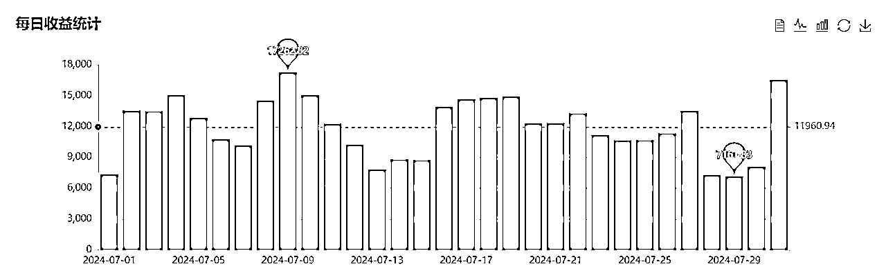
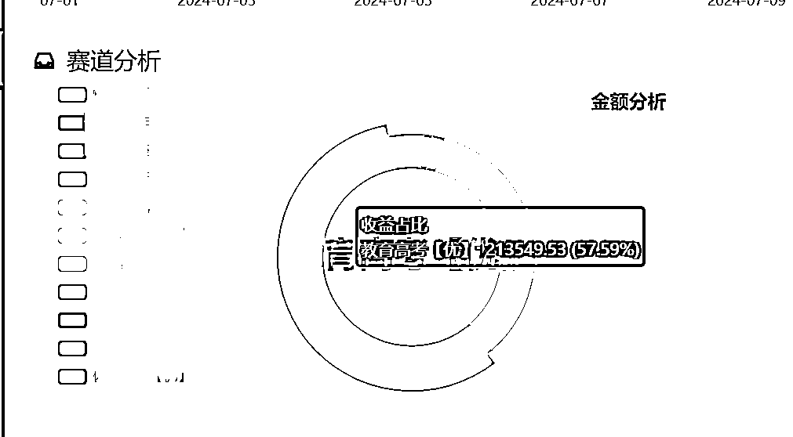

# 👸号流量主7月营收36w复盘：踩过的坑，比赚到的钱更值钱

> 很多人问我，👸号矩阵现在还能不能做？我的答案是：能，但别用蛮力。

这两个月，说实话，太难了。四五月份对做👸号矩阵的人来说，几乎是“至暗时刻”，流量跌到谷底，身边不少同行直接换了赛道。但我这个人认死理，总觉得还有转机，毕竟每年上半年过了3月都会有一段难熬的时期，熬过去就好了。

果然，6月流量开始回暖。我立刻加码，账号规模从300多个一路扩到600多个，到了7月底，已经接近900个。期间还担任了6月👸号航海的教练。早前跟赚钱官方的叮叮聊的时候，我就判断：教育赛道和影视赛道大概率会在6月迎来机会。教育是因为高考，每年固定热点；影视是因为《庆余年2》等热播剧集中上线，热度必然拉满。

以下所有数据都是我自己的真实记录，不掺水分，也不做任何指导，纯粹是复盘分享。

## 做得好的地方

最大的感悟就一句话：赛道定生死。以前我也一直提醒自己，要选周期性赛道，要靠刷“看一看”去捕捉新机会。我们铺了不少赛道，但结果特别扎眼——教育赛道只占账号总数的12%，却贡献了57%的收益。

反观某些赛道，之前收益还行，7月直接拉胯。

这就像电商选品一样：选对了品，事半功倍；选错了品，天天白忙。👸号爆文项目，赛道就是那个“品”。很多时候，不是不努力，而是努力用错了时间、用错了方向，结果天差地别。

6月还赶上姜萍事件，热度持续了大概10天，给教育赛道又添了一把火。我们铺了大量相关文章，这个热点单拎出来就带来了至少3w的收益。后来全网限流，这事就翻篇了。那阵子，我们账号经常霸榜次幂数据的单领域前几名，甚至前几都是我们的。

不过说实话，教育赛道现在的流量已经严重缩水，几乎腰斩。毕竟奥运正在办，大家的注意力都被赛事吸走了，而且教育圈也没啥新鲜话题，除了个别师德负面新闻——这种风险内容，我们基本不碰。

教育赛道超出预期，其他几个赛道表现还算平稳，都在预估范围内，就不一一说了。

## 踩过的坑

6月看到文案赛道很火，很多小号发几天就篇篇10w+。我研究了一阵子生成方法，直接上了快100个号，干了半个月，结果能起来的号极少，一个爆款都没有。后来才明白，内容早就饱和了。那些爆的小号，全是4月5月就提前布局的。

原来我们四五月份惨成那样，别人在文案赛道闷声发大财。

流量不会消失，只会转移。

半个月白费后，我果断放弃，把这批号全部转去其他赛道。还好转得快，换赛道后也有号跑出来了，总算没亏太多。

后来打听到，文案赛道里不少是“大号带小号”或“老号迁移”的模式，本来就有粉丝基础，起号当然快。纯自然流的新号，后面几乎没机会了。

第二个坑是影评赛道。虽然我预测《庆余年2》会火，但没想到这剧播得那么快，一个月不到就完结了。剧一完，热度迅速降温。正常来说应该去研究一下播放周期的节奏，但我完全凭旧经验想当然——认为电视剧都得播很久。结果，提示词研究了一堆，号也上了，收益却少得可怜。

第三个坑是策略问题。六七月份明明有几个赛道表现不错，我居然还想着去开拓新赛道。现在回头看，这就是既浪费时间又错失流量。正确的做法应该是：既然知道哪些赛道有肉，就该集中火力多铺号、多薅，而不是拿号去试一个未知的赛道，白白浪费资源。

## 写在最后

看到月营收36w，我知道有人会质疑，有人会眼红，有人觉得运营900多个号是天方夜谭，也有人对AI写文嗤之以鼻，觉得上不了台面。

我们写文章用的是Claude，具体怎么做到3分钟产出一篇原创，6月航海里有详细教程。提效用的是影刀，同样在航海里做过拆解。👸号爆文目前还在红利期，有精力真的可以去试试，航海里各位教练总结的经验足够用了。

送自己一句话：项目不是学出来的，是做出来的。

往期干货整理好了，需要的自取：

👸号爆文的底层逻辑，实操干货，重新认识👸号：https://t.zsxq.com/GDhx1

👸号标题数据采集工具：https://t.zsxq.com/WBcri

入赚钱1年，实现👸号爆文年入100w，超详细从0-10分享，万字长文：https://t.zsxq.com/ZPqOF

文案号，如何快速生成精美文章，一秒1000篇，附工具：https://t.zsxq.com/5oHUy

