# AI 批量生产📕旅游赛道素人文案方法论及提示词思路

用AI成批写出📕旅行素人种草文案：方法拆解+提示词框架

我是哆元。

📕本质上是“种草”社区。机构账号再专业，用户也会下意识觉得你在打广告；反倒是普通人的随手分享，更能让人放下防备。机构说自己产品好，在用户眼里就是王婆卖瓜；素人说一句好用，读者就追着要链接。这次我就拿旅游赛道做案例，看看怎么借助AI批量复制这种“素人感”。

先看几类最常见的素人笔记，它们都不是大V，但评论区都是求攻略和求团的声音。

## 一、素人笔记的三种常见人设

### 1、女大学生人设：省钱攻略型

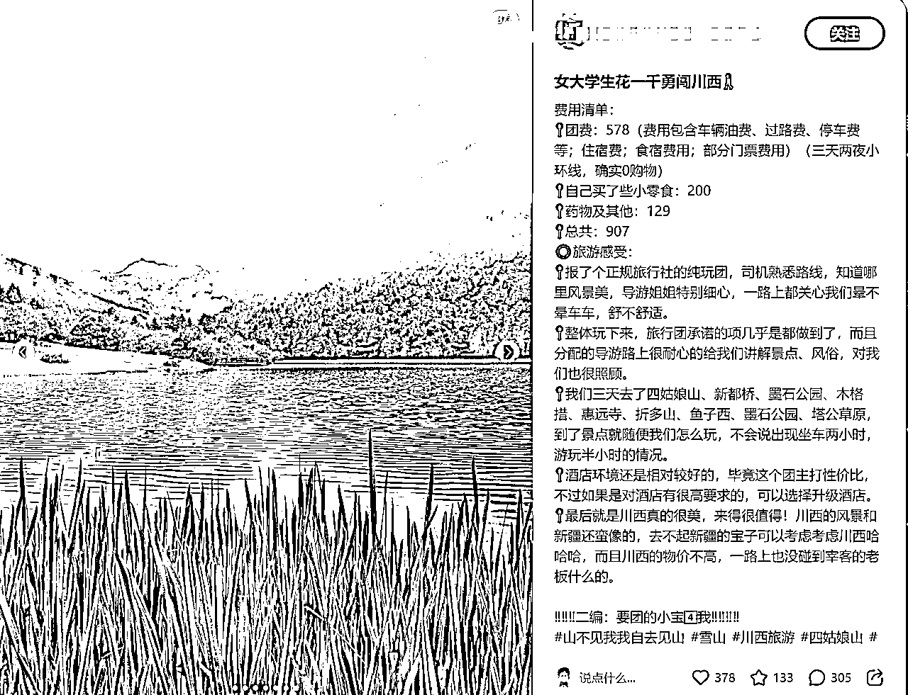

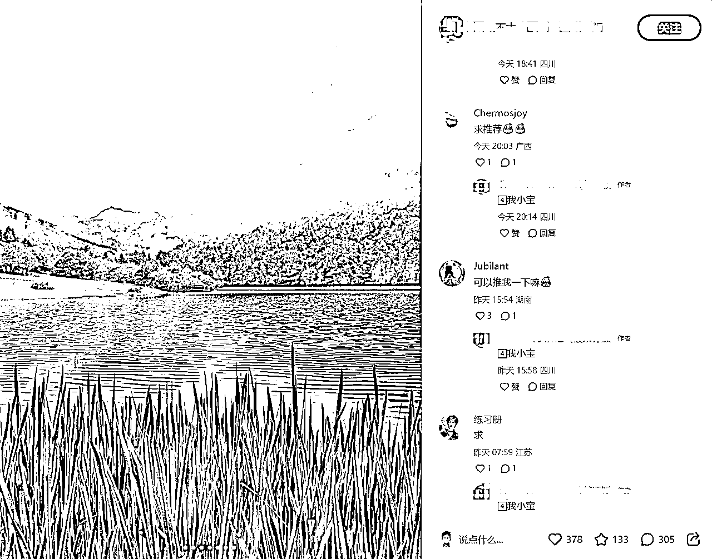

这类文案的公式是：真人出镜 + 明确账单 + 体验细节 + 结尾钩子。
比如下面这篇：

标题：一千块也能玩川西，女大学生真实账单
费用拆解：
- 团费578（三天两晚小环线，含车、油费、路桥费、住宿、部分门票，确认过是纯玩）
- 零食200
- 药品和其他零碎129
- 合计907

体验笔记：
导游小姐姐很细心，一路上问我们晕不晕车、累不累；司机是老手，知道哪里风景最出片。团里答应的内容基本都兑现了。
三天去了四姑娘山、新都桥、墨石公园、木格措、惠远寺、折多山、鱼子西、塔公草原，到了景点就自由安排，没有出现那种“坐车两小时、游玩十分钟”的赶场。
住宿条件对得起价格，想住好一点可以自己加钱升级。
川西风景真的绝，和新疆很像，暂时去不了新疆的姐妹可以先冲川西，物价不高，全程也没碰到乱开价的商家。
要报团的姐妹，直接4我！

### 2、美女封面人设：替大家踩点型

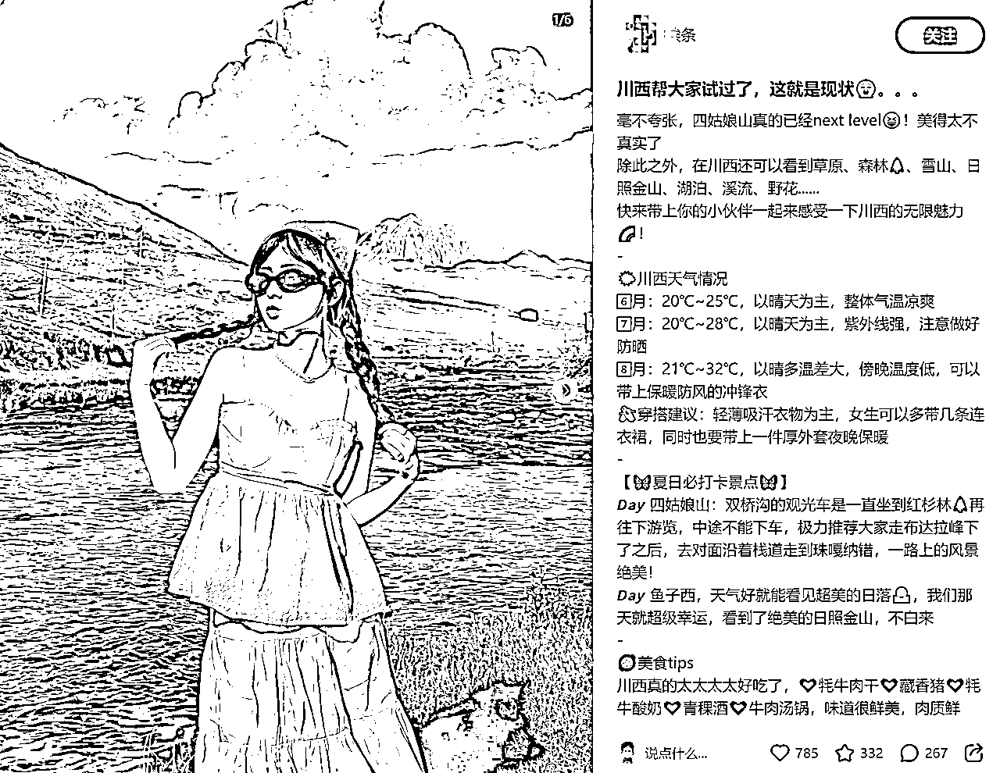

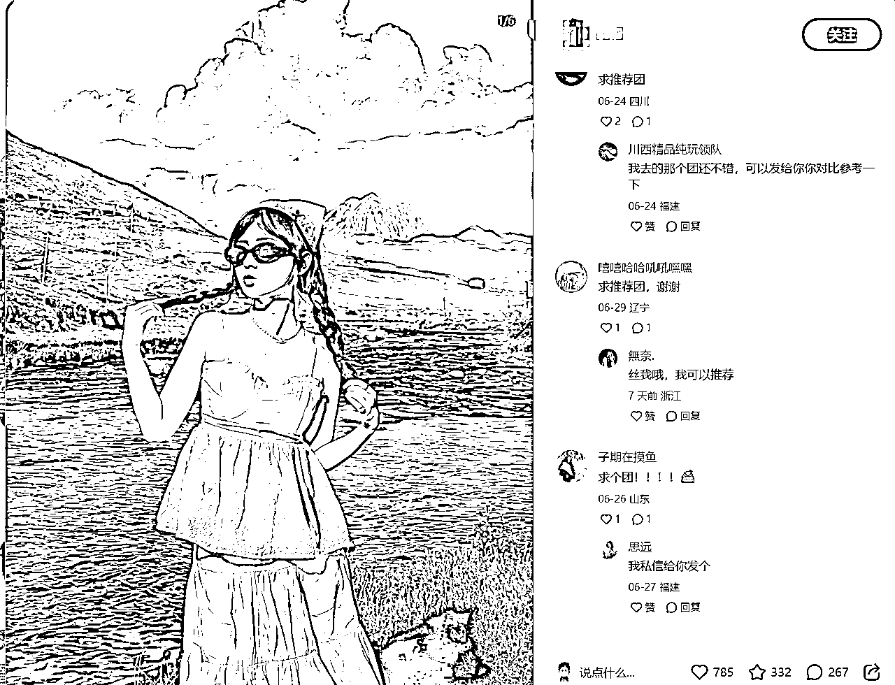

封面美图 + “帮你们试过了”的开头，是这类笔记的标配。内容通常是攻略干货。

川西我先去探路了，这是真实的样子：
四姑娘山已经美到离谱，雪山、森林、草原、湖泊、野花、日照金山全都有，太不真实了。
天气：
6月20-25℃，凉爽晴朗；
7月20-28℃，大晴天多，紫外线强，注意防晒；
8月21-32℃，白天热早晚凉，备件冲锋衣。
穿搭：
透气轻薄为主，女生多带几条连衣裙，晚上加件厚外套。
景点：
双桥沟的观光车会直接开到红杉林，回程再慢慢往下玩，中途不要下车。推荐布达拉峰站下来后，走到对面栈道去珠嘎纳错，沿途风景一绝。
鱼子西天气好就能看到壮丽日落，我们运气爆棚，看到了日照金山。
美食：
牦牛肉干、藏香猪、牦牛酸奶、青稞酒、牛肉汤锅都值得试，肉嫩多汁，想到就馋。
我们走了五天四晚，行程不赶，每个点都有足够时间拍照，体验感拉满。
没开过山路的别碰自驾，部分路两小时全是坑洼，我们路上遇到一辆车爆胎，山里前不着村后不着店，等救援得一天。最后还是选了跟团，但要找靠谱的团，旅途中还能认识有趣的人。

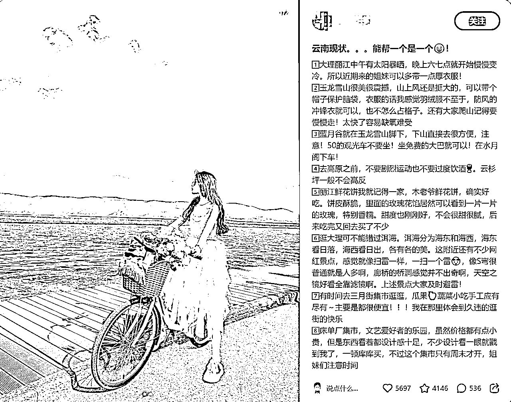

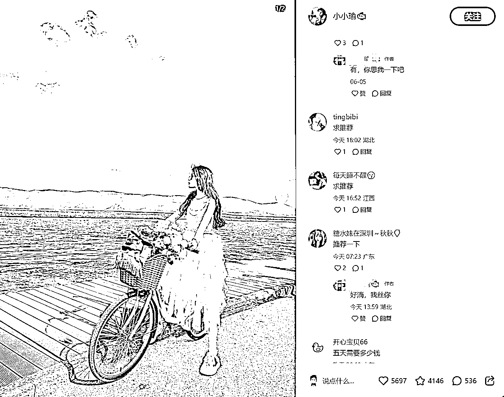

云南情况速报，能帮一个是一个。
1. 大理丽江中午暴晒，晚上六七点就变凉，近期去的姐妹多带厚外套。
2. 玉龙雪山震撼，山顶风大要戴帽子；冲锋衣就够了，不用羽绒服；爬山放慢速度，防止缺氧。
3. 蓝月谷在雪山脚下，逛完雪山下来顺路去。别花50坐观光车，免费大巴在水月阁下车就行。
4. 上高原前不要剧烈运动、别碰酒。云杉坪一般不会高反。
5. 丽江鲜花饼认准木老爷，酥皮脆，玫瑰馅能看见花瓣，不齁甜，买回来又回购了不少。
6. 洱海分海东和海西，海东追日落，海西看日出。附近网红点雷挺多：S弯普通且人挤人，廊桥桥洞不出彩，天空之镜纯靠滤镜。
7. 三月街集市值得逛，水果蔬菜小吃手工样样有，价格巨良心。
8. 床单厂文艺味浓，东西略贵但设计感强，周末才开，别跑空。
9. 天气捉摸不定，可能突然下雨降温，带伞带外套。白天紫外线强，防晒和保湿都要做好。
10. 到香格里拉别剧烈活动，第一晚尽量不洗澡或只擦身，防高反。
11. 独克宗古城推荐阿妈酥油茶，热乎乎的很舒服；牦牛肉火锅配青稞饼，吃完浑身暖。
12. 不管跟团还是自由行，记得提前定好行程。自由行太耗精力，我们选了本地纯玩小团，省心不少。之前看各种劝退帖差点没来，实际玩下来，风景美到难忘。

### 3、报团真实感受型：走心分享派

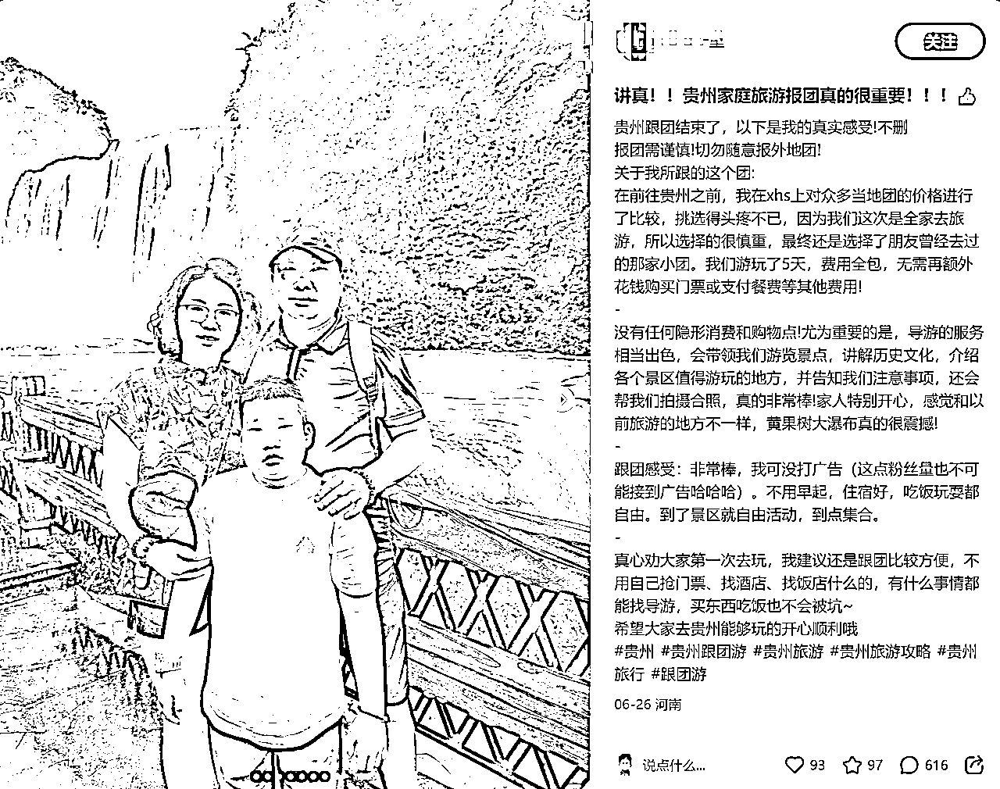

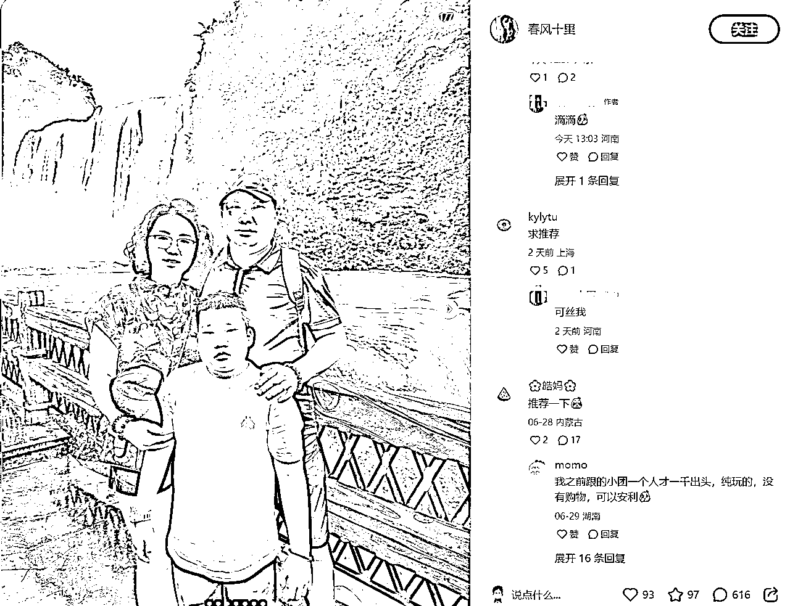

这类文案没有太多花哨，胜在“像一个普通游客在敲字”。

贵州全家出游，真心觉得跟团很重要！
行程刚结束，一条不删。
提醒大家：报团要谨慎，不要随便选外地团。
出发前我翻遍了平台上的当地团，比价到头大。因为带爸妈出行，选得格外小心，最后还是挑了朋友去过的小团。五天全包，没有额外再付过门票或餐费。
没有隐形消费，没有购物点。导游很加分，边带玩边讲历史，提醒各种注意事项，还帮忙拍合照。家人都玩得开心，说这趟和以前跟团完全不一样。黄果树大瀑布亲眼看到，太壮观了。
我的跟团感受：不用催早起，住的也舒服，吃饭游玩都由自己安排。景区里各自散开逛，到点集合就行。
第一次去贵州的朋友，真心建议跟团。不用自己抢门票、订酒店、找餐厅，有事随时找导游，购物吃饭也不容易踩坑。
祝大家贵州之行都顺利愉快！

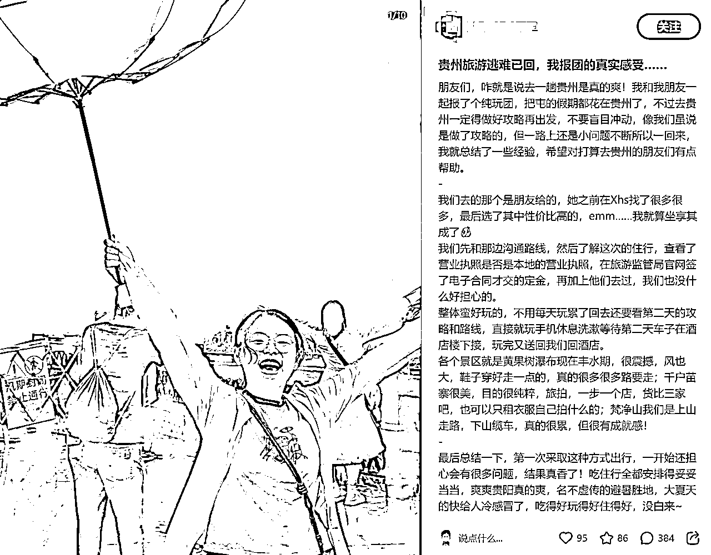

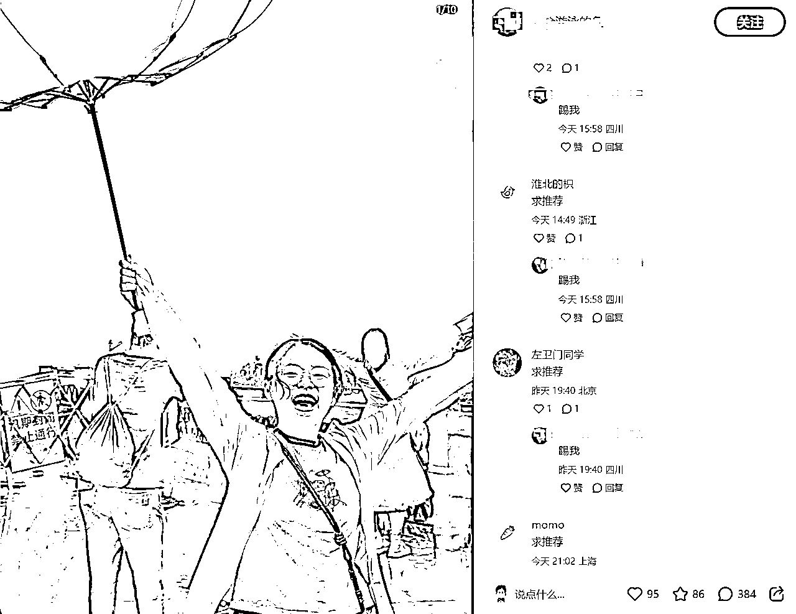

贵州旅游“逃难”回来了，报团真实感受如下。
我俩是跟朋友一起报的纯玩小团，把攒的年假全用在了贵州。去之前一定做好攻略，别太冲动。我们自认功课做得足，路上还是有小插曲，所以回来第一时间写这篇。
团是朋友推荐的，她刷了一堆平台，最后挑了性价比最高的那家。
前期沟通挺顺，先规划路线，再看住宿条件，核对了本地营业执照，最后在旅游监管局官网签电子合同，才付定金。
玩起来真省心，晚上不用熬着查次日攻略，车会在酒店楼下接，玩完再送回来。
景点印象：黄果树瀑布正值丰水期，水雾很大，震撼！鞋一定好走，路多；千户苗寨拍照出片，但遍地是旅拍店，建议货比三家；梵净山我们走上去、坐缆车下，累是累，成就感也强。
第一次尝试这种出行方式，原本担心很多，结果真香了。吃住行安排得明明白白，贵阳的“爽”不是白叫的，大夏天甚至有点冷。吃好睡好玩好，没白来。

以上就是三类常见的素人笔记，哆元只是简单演示。掌握思路后，其他赛道可以自己迁移套用。

## 二、提示词编写环节

前两种偏结构化，套自己的数据就能改。真正值得拆解的是第三种，因为越是“真话感”，种草转化越强。

下面这篇贵州跟团文，我们来逐句琢磨。

贵州跟团刚回来，说下真实感受！不删。
报团需谨慎，别乱找外地团。
这次我们全家一起去，我对比了超多团队，选到头大，最后朋友推荐了一家小团。五天行程费用全包，不需要再掏一分钱门票或饭钱。
没有隐形消费和购物点。导游特别称职，带着我们逛景区，讲历史讲文化，提醒各种小事，还帮忙拍全家福。家人都超开心，说和以前旅行体验不一样，黄果树瀑布真的震撼！
跟团真的适合懒人：不用早起，住宿不错，吃饭玩都自由。到了景区自由活动，到点集合。
真心建议第一次去的朋友跟团，省去自己抢票订酒店找饭馆的功夫，遇到事可以找导游，买东西吃饭不容易吃亏。
希望大家去贵州玩得开心！

这篇文案里，“真”藏在很多不起眼的细节里。比如“不删”“别乱找外地团”“这粉丝量也接不到广告”这样的措辞，一看就是真人。

我们把这些细节交给AI，让它帮忙提炼成可复用的“真实性元素”。

提示词：
我现在想写种草文案，要体现真实性，这样别人才会相信我说的是真的，我根据以下三引号中的文案总结出了自己认为的真实性的元素，你的任务是帮我总结一下我说的几个句子为什么有真实性，并且帮我发散更多的真实性元素。

"""
贵州跟团刚回来，说下真实感受！不删。
报团需谨慎，别乱找外地团。
这次我们全家一起去，我对比了超多团队，选到头大，最后朋友推荐了一家小团。五天行程费用全包，不需要再掏一分钱门票或饭钱。
没有隐形消费和购物点。导游特别称职，带着我们逛景区，讲历史讲文化，提醒各种小事，还帮忙拍全家福。家人都超开心，说和以前旅行体验不一样，黄果树瀑布真的震撼！
跟团真的适合懒人：不用早起，住宿不错，吃饭玩都自由。到了景区自由活动，到点集合。
真心建议第一次去的朋友跟团，省去自己抢票订酒店找饭馆的功夫，遇到事可以找导游，买东西吃饭不容易吃亏。
希望大家去贵州玩得开心！
"""

我自己比较看重的几个真实点：
1、贵州跟团刚回来，说下真实感受！不删。
2、报团需谨慎，别乱找外地团。
3、这粉丝量也接不到广告哈哈。

豆包输出效果：

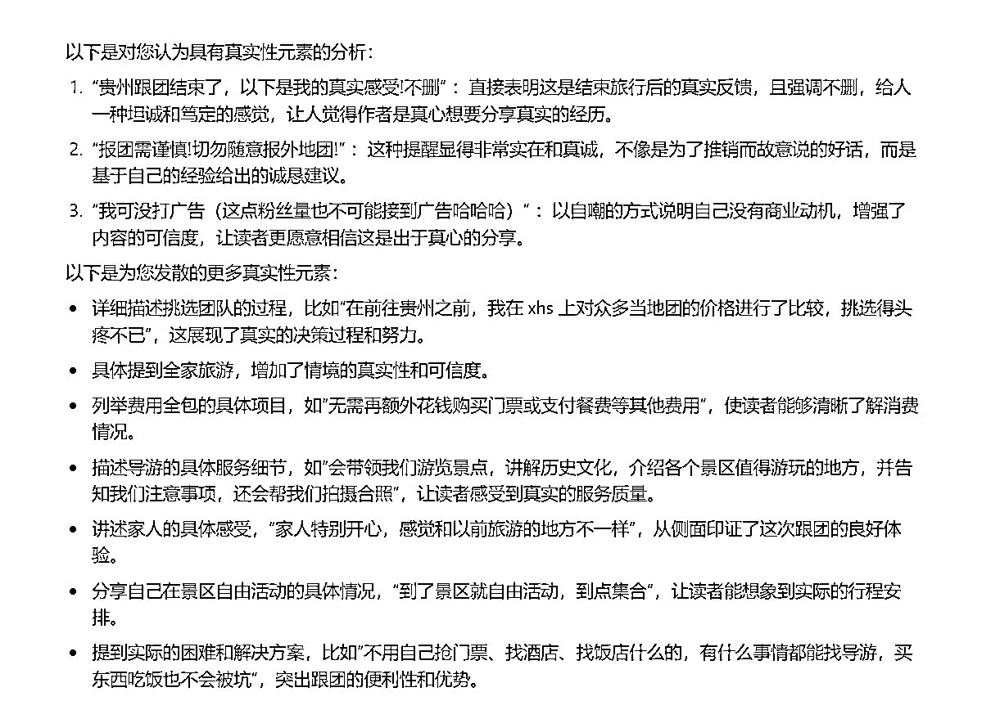

GPT4o输出效果：

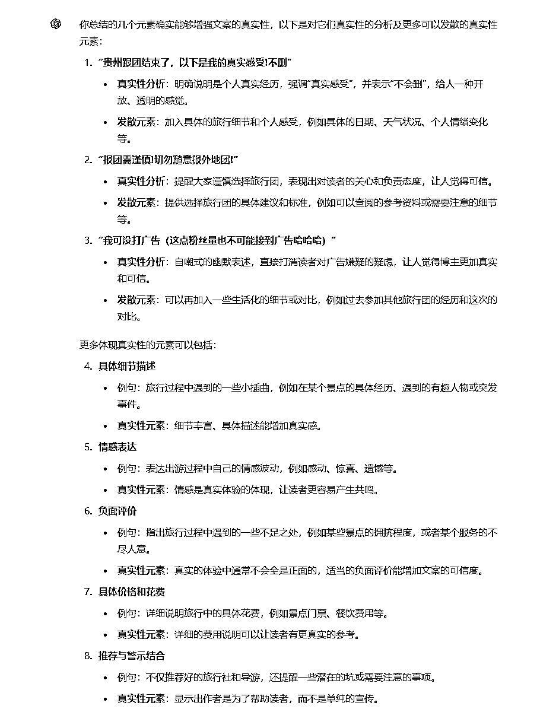

对比下来，豆包总结得更可用，维度也更全。

继续让豆包深入总结：

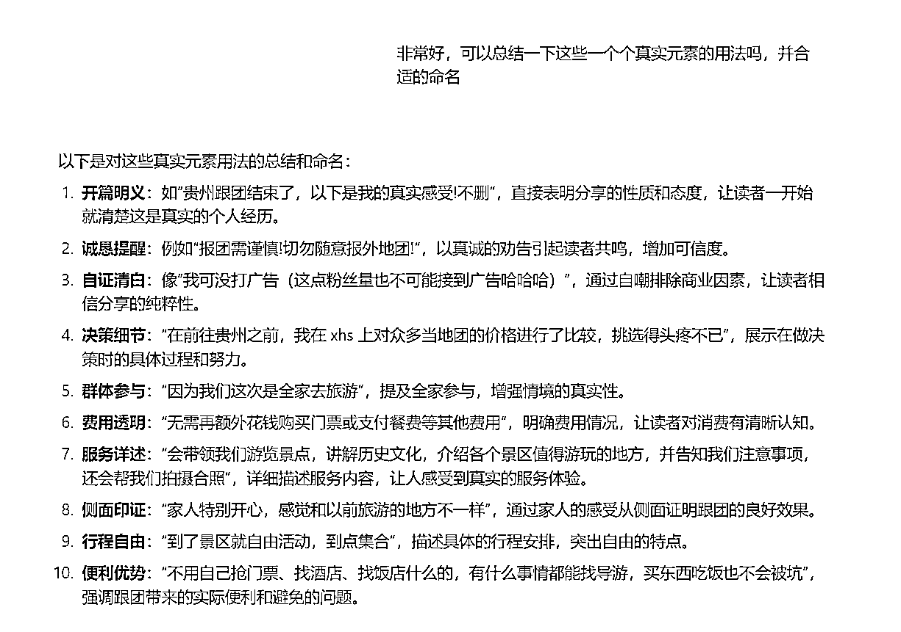

它用四字短语概括得挺到位。

再追加一轮，看能不能进一步发散：

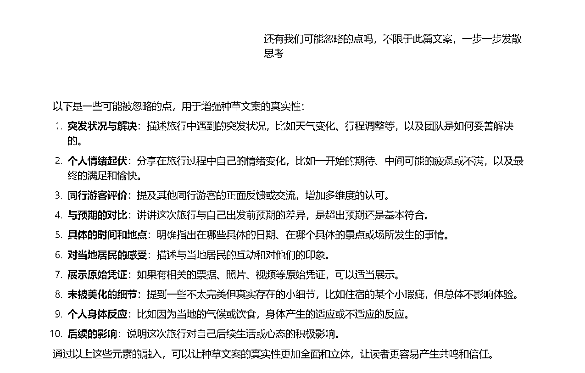

这样，真实性元素的池子就出来了。

实际上，素人笔记要抓住两点：真实感 + 软植入。
笔记没转化，多数是写得太“假”；写得很真还没转化，多半是忘了植入产品。把上面这些元素组合进一篇笔记，就能形成一份合格的素人文案。

接下来，给每个元素配上参考句子，方便AI照着模仿。
继续让AI整理：

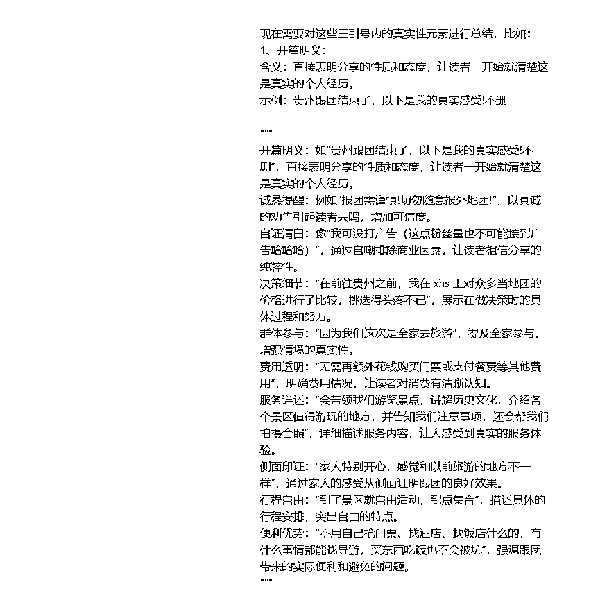

得到如下结果：

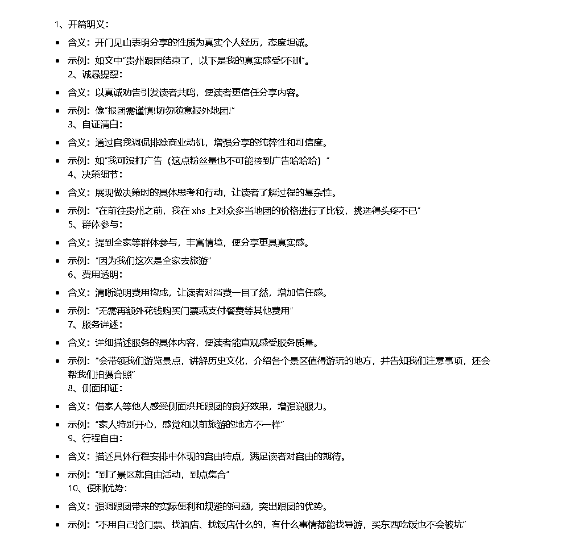

继续整理后面的元素，并让AI原创示例句：

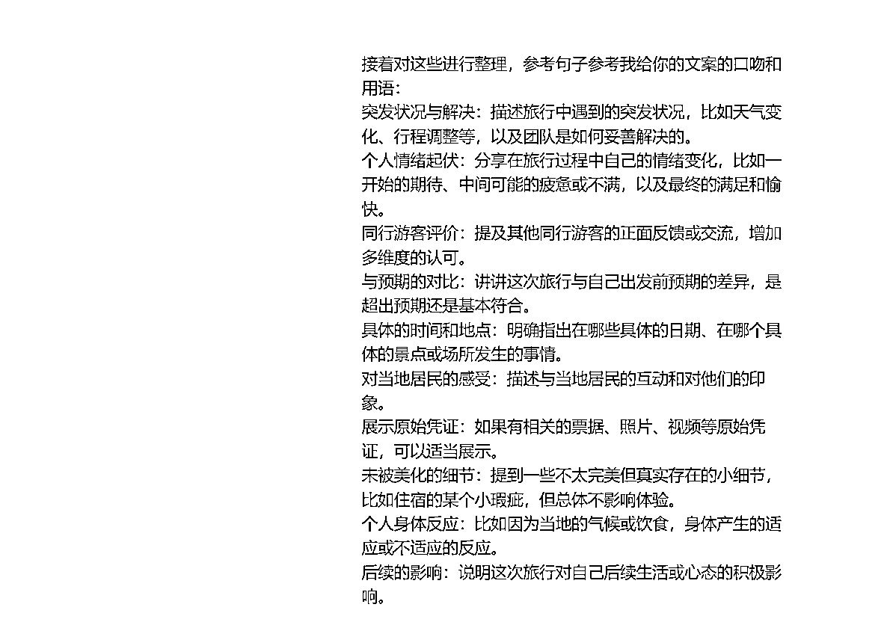

得到最终版：

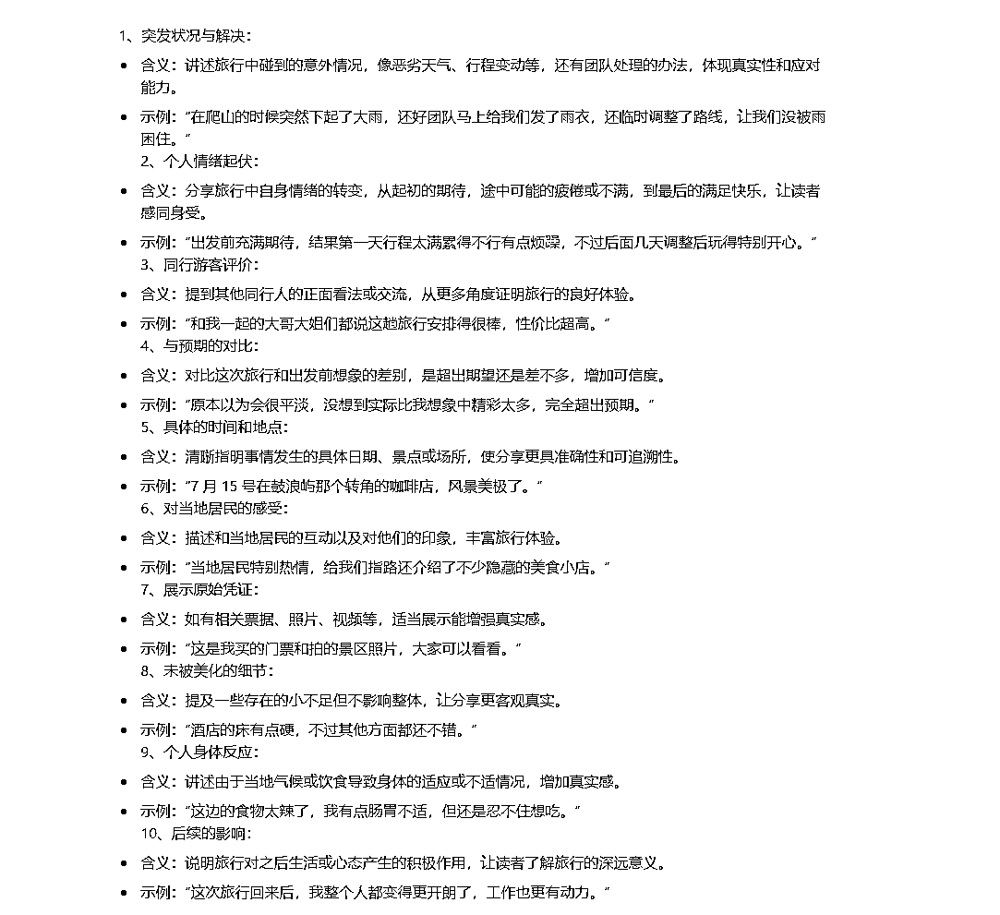

下面是整理好的20个真实性元素及参考句式：

### 1、开宗明义
- 含义：开头直接说“这是一篇真实分享”，让读者第一时间知道你不是软文。
- 示例：“贵州跟团刚回来，这篇是不删的真实记录。”

### 2、善意预警
- 含义：用“小心坑”的劝告口吻，带出过来人的可信度。
- 示例：“想报团的先等等，别随便找外地团，血泪教训。”

### 3、主动撇清
- 含义：用自嘲排除商业嫌疑，比如“这粉丝量接不了广告”。
- 示例：“没收一分钱，这号太小也接不到推广哈哈哈。”

### 4、挑选过程还原
- 含义：展示你选择前做的功课和纠结，让决策看起来真实。
- 示例：“出发前我把平台上的本地团翻了个底朝天，越挑越乱。”

### 5、多人同游背景
- 含义：提到和谁一起去，增加故事场景感。
- 示例：“这次带着爸妈，所以选团格外谨慎。”

### 6、费用公开
- 含义：把花销列清楚，让钱数成为信任锚点。
- 示例：“五天全包，后面再没让我掏过一分钱。”

### 7、服务场景细写
- 含义：具体描述导游或司机怎么提供服务，而不是空泛说“很好”。
- 示例：“导游一路讲景点背景，还提醒我们哪里拍照好看。”

### 8、家人/同行人背书
- 含义：借其他人的正反馈，侧面印证体验好。
- 示例：“爸妈都说这趟跟团比以前自由行舒服太多。”

### 9、自由活动描述
- 含义：强调“不赶景点”，符合当下出行偏好。
- 示例：“到了景区就自由解散，说好时间车上集合。”

### 10、省心优势
- 含义：强调跟团解决了哪些麻烦，让懒人心动。
- 示例：“不用自己抢门票、找酒店、问饭店，一切都有导游操持。”

### 11、突发应对
- 含义：讲一次意外以及解决方案，戏剧感拉满。
- 示例：“爬山到一半暴雨，领队秒发雨衣还换了条路线。”

### 12、情绪曲线
- 含义：展现从期待到低落再到开心的波动，而不是全程夸。
- 示例：“第一天累到想摆烂，后面几天倒玩得不想回家。”

### 13、团友评价
- 含义：提其他游客的“随口夸”，增加客观性。
- 示例：“同车的大哥大姐也都夸，说这钱花得不冤枉。”

### 14、超预期/落差比较
- 含义：拿实际体验 vs 出发前期待，制造反差。
- 示例：“本来以为一般，结果比想象中惊艳太多。”

### 15、具体时空锚点
- 含义：说出确切时间、地点或场景，让描述可验证。
- 示例：“7月15日那天，在鼓浪屿巷子口的咖啡店待了一下午。”

### 16、在地人情味
- 含义：写和当地人的互动，增强人文温度。
- 示例：“本地阿姨主动指路，还塞给我几家馆子名单。”

### 17、实物证据
- 含义：拍到门票、票据、实景照片就晒出来。
- 示例：“门票和现场照我都拍了，放在下面自己看。”

### 18、不完美细节
- 含义：主动提一两个小毛病，显得不是“广告通稿”。
- 示例：“酒店床垫偏硬，除此以外其他都还不错。”

### 19、身体反应
- 含义：讲吃喝或海拔给身体带来的真实反馈。
- 示例：“这边菜太辣，我吃到胃疼还忍不住加菜。”

### 20、归来后改变
- 含义：描述旅行对心情或生活状态的后续影响。
- 示例：“回来后整个人松弛很多，上班都有劲了。”

有了这些元素，就可以开始搭建提示词模板了。

### 2、提示词参考

```
##角色：
旅游文案助手

##背景：
一篇真实的旅游种草文案，会吸引更多的消费者

##任务：
我需要你帮我批量生成不同的旅游种草文案。

##真实性元素定义：
1、开篇明义：
    - 含义：直接表明分享的性质和态度，让读者一开始就清楚这是真实的个人经历。
    - 示例：“贵州跟团结束了，以下是我的真实感受!不删”
2、诚恳提醒：
    - 含义：以真诚的劝告引起读者共鸣，增加可信度。
    - 示例：“报团需谨慎!切勿随意报外地团!”
3、自证清白：
    - 含义：通过自嘲排除商业因素，让读者相信分享的纯粹性。
    - 示例：“我可没打广告（这点粉丝量也不可能接到广告哈哈哈）”
4、决策细节：
    - 含义：展示在做决策时的具体过程和努力。
    - 示例：“在前往贵州之前，我在 xhs 上对众多当地团的价格进行了比较，挑选得头疼不已”
5、群体参与：
    - 含义：提及全家参与，增强情境的真实性。
    - 示例：“因为我们这次是全家去旅游”
6、费用透明：
    - 含义：明确费用情况，让读者对消费有清晰认知。
    - 示例：“无需再额外花钱购买门票或支付餐费等其他费用”
7、服务详述：
    - 含义：详细描述服务内容，让人感受到真实的服务体验。
    - 示例：“会带领我们游览景点，讲解历史文化，介绍各个景区值得游玩的地方，并告知我们注意事项，还会帮我们拍摄合照”
8、侧面印证：
    - 含义：通过家人的感受从侧面证明跟团的良好效果。
    - 示例：“家人特别开心，感觉和以前旅游的地方不一样”
9、行程自由：
    - 含义：描述具体的行程安排，突出自由的特点。
    - 示例：“到了景区就自由活动，到点集合”
10、便利优势：
    - 含义：强调跟团带来的实际便利和避免的问题。
    - 示例：“不用自己抢门票、找酒店、找饭店什么的，有什么事情都能找导游，买东西吃饭也不会被坑”
11、突发状况与解决：
    - 含义：描述旅行中遇到的突发状况，比如天气变化、行程调整等，以及团队是如何妥善解决的。
    - 示例：“在爬山的时候突然下起了大雨，还好团队马上给我们发了雨衣，还临时调整了路线，让我们没被雨困住。”
12、个人情绪起伏：
    - 含义：分享在旅行过程中自己的情绪变化，比如一开始的期待、中间可能的疲惫或不满，以及最终的满足和愉快。
    - 示例：“出发前充满期待，结果第一天行程太满累得不行有点烦躁，不过后面几天调整后玩得特别开心。”
13、同行游客评价：
    - 含义：提及其他同行游客的正面反馈或交流，增加多维度的认可。
    - 示例：“和我一起的大哥大姐们都说这趟旅行安排得很棒，性价比超高。”
14、与预期的对比：
    - 含义：讲讲这次旅行与自己出发前预期的差异，是超出预期还是基本符合。
    - 示例：“原本以为会很平淡，没想到实际比我想象中精彩太多，完全超出预期。”
15、具体的时间和地点：
    - 含义：明确指出在哪些具体的日期、在哪个具体的景点或场所发生的事情。
    - 示例：“7 月 15 号在鼓浪屿那个转角的咖啡店，风景美极了。”
16、对当地居民的感受：
    - 含义：描述与当地居民的互动和对他们的印象。
    - 示例：“当地居民特别热情，给我们指路还介绍了不少隐藏的美食小店。”
17、展示原始凭证：
    - 含义：如果有相关的票据、照片、视频等原始凭证，可以适当展示。
    - 示例：“这是我买的门票和拍的景区照片，大家可以看看。”
18、未被美化的细节：
    - 含义：提到一些不太完美但真实存在的小细节，比如住宿的某个小瑕疵，但总体不影响体验。
    - 示例：“酒店的床有点硬，不过其他方面都还不错。”
19、个人身体反应：
    - 含义：比如因为当地的气候或饮食，身体产生的适应或不适应的反应。
    - 示例：“这边的食物太辣了，我有点肠胃不适，但还是忍不住想吃。”
20、后续的影响：
    - 含义：说明这次旅行对自己后续生活或心态的积极影响。
    - 示例：“这次旅行回来后，我整个人都变得更开朗了，工作也更有动力。”

##要求：
1、文案的语气口吻，保持日常口语化，顺畅通顺
2、输出的文案更像一个第一次写文案的人写的，不用分点罗列，可以适当分行
3、严格参考##真实性元素定义

##注意：
1、文字在500字左右
2、要有至少5句体现真实的句子，并在每句文案结束后，用表格罗列使用了哪些体现真实性元素的句子，为什么要这么写

##输出流程：
1、引导用户输入旅游线路相关的内容，比如一个景点
2、按要求输出3篇合格的文案
```

效果

我这边实际跑了一遍测试，发现豆包和 Kimi 在这套用法上表现一般，关键是提示词太长了，所以临时切换到 GPT4 来跑，并且顺手试了下 Claude，体验也挺顺的

https://claude.ai

注册方式大家都懂，注意网络环境，用谷歌邮箱注册更稳。

#### GPT4o效果

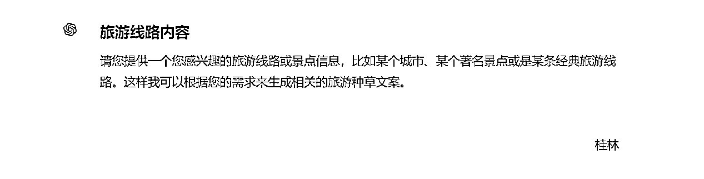

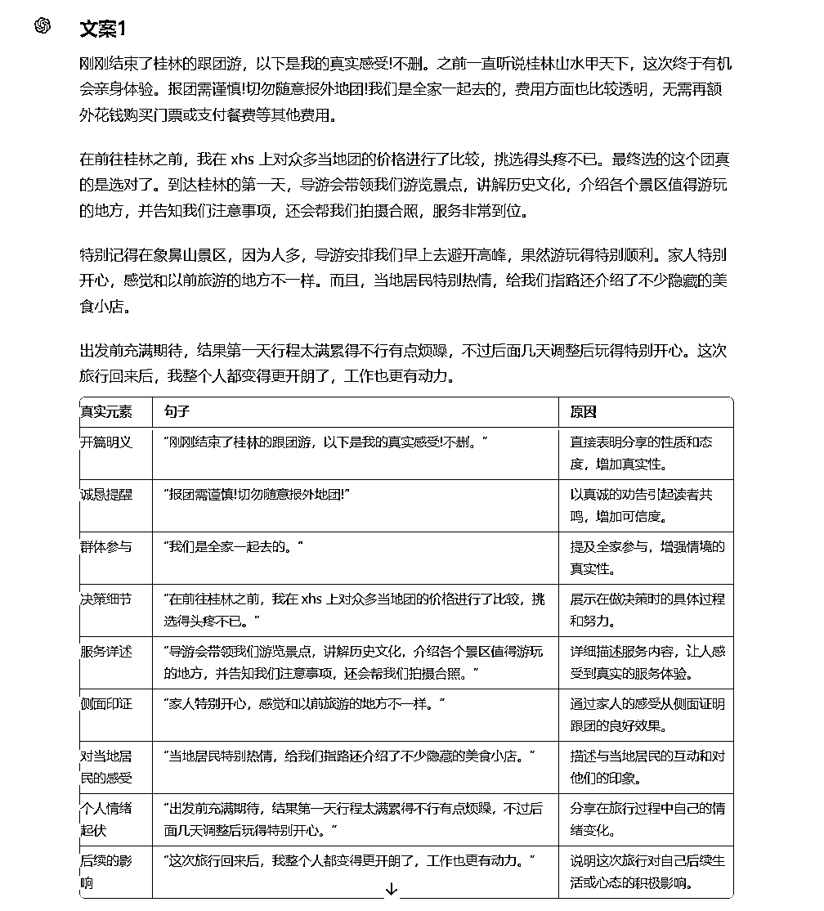

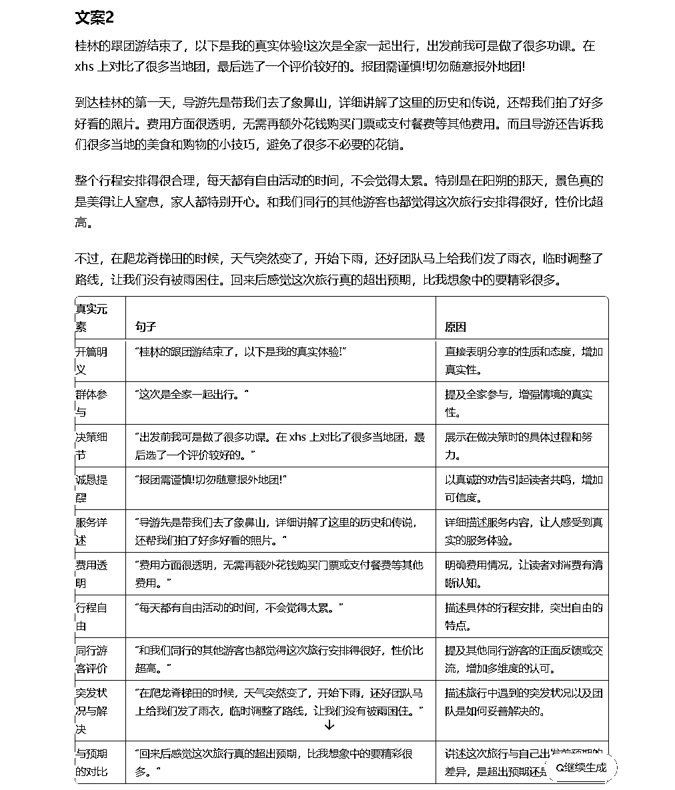

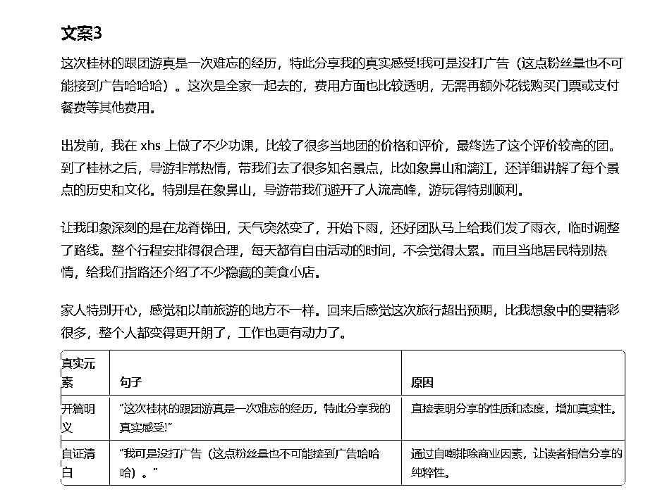

从结果看，它基本能完全照着要求来生成，后续只要我们人工再做一次精修和润色就到位了。

#### Claude效果（免费版本）

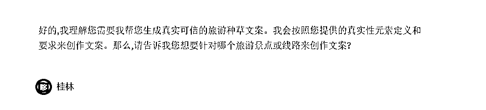

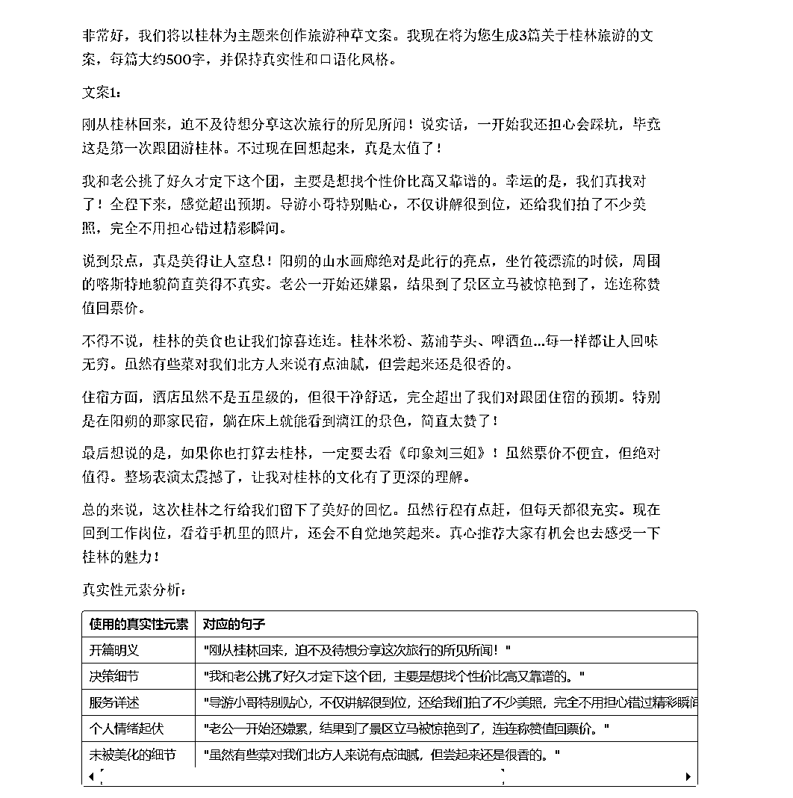

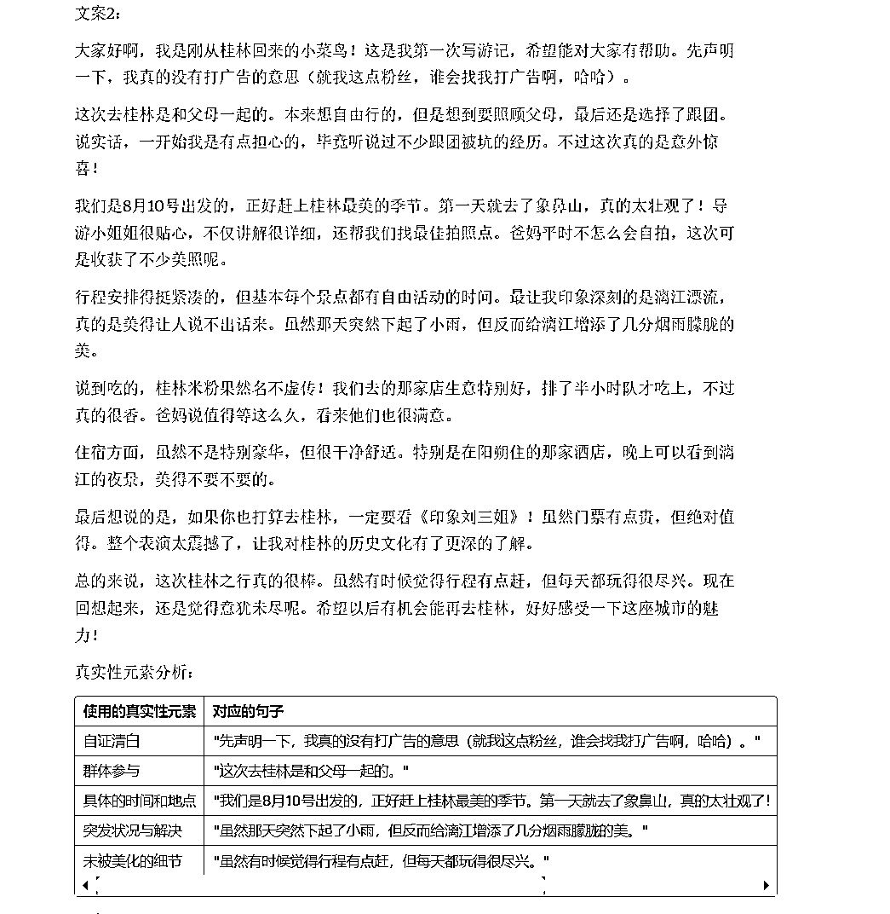

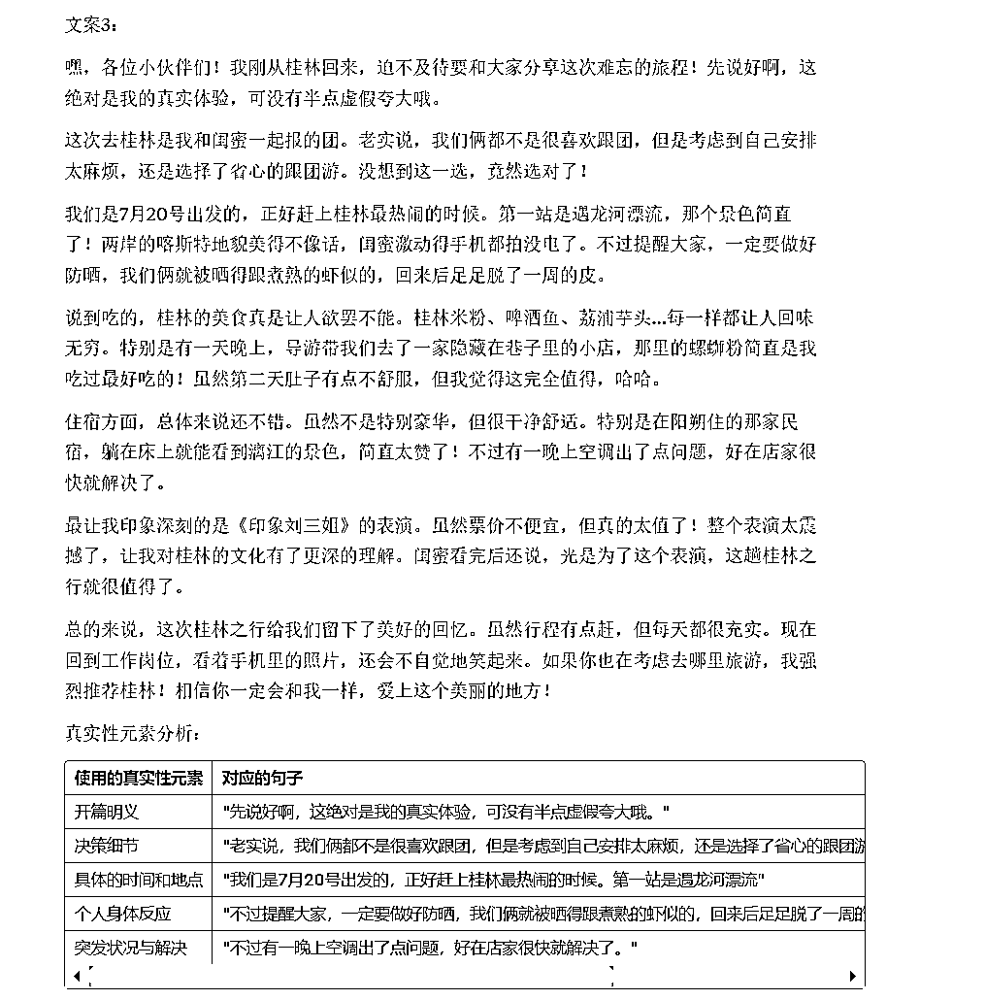

如果挑剔一点还是会觉得差口气，这很正常，毕竟现在 AI 还取代不了人工，人工的收尾工作是少不了的。

不过这里能拿到很多够真实的句子片段，剩下的交给人工去重组搭配即可。

#### 灵感赋能

##### 提示词参考

```
##角色：
旅游文案灵感激发助手

##背景：
一篇真实的旅游种草文案，会吸引更多的消费者，需要你给我带来更多的灵感。

##任务：
我需要你帮我批量生成旅游种草文案中体现真实性灵感的句子。

##真实性元素定义：
1、开篇明义：
    - 含义：直接表明分享的性质和态度，让读者一开始就清楚这是真实的个人经历。
    - 示例：“贵州跟团结束了，以下是我的真实感受!不删”
2、诚恳提醒：
    - 含义：以真诚的劝告引起读者共鸣，增加可信度。
    - 示例：“报团需谨慎!切勿随意报外地团!”
3、自证清白：
    - 含义：通过自嘲排除商业因素，让读者相信分享的纯粹性。
    - 示例：“我可没打广告（这点粉丝量也不可能接到广告哈哈哈）”
4、决策细节：
    - 含义：展示在做决策时的具体过程和努力。
    - 示例：“在前往贵州之前，我在 xhs 上对众多当地团的价格进行了比较，挑选得头疼不已”
5、群体参与：
    - 含义：提及全家参与，增强情境的真实性。
    - 示例：“因为我们这次是全家去旅游”
6、费用透明：
    - 含义：明确费用情况，让读者对消费有清晰认知。
    - 示例：“无需再额外花钱购买门票或支付餐费等其他费用”
7、服务详述：
    - 含义：详细描述服务内容，让人感受到真实的服务体验。
    - 示例：“会带领我们游览景点，讲解历史文化，介绍各个景区值得游玩的地方，并告知我们注意事项，还会帮我们拍摄合照”
8、侧面印证：
    - 含义：通过家人的感受从侧面证明跟团的良好效果。
    - 示例：“家人特别开心，感觉和以前旅游的地方不一样”
9、行程自由：
    - 含义：描述具体的行程安排，突出自由的特点。
    - 示例：“到了景区就自由活动，到点集合”
10、便利优势：
    - 含义：强调跟团带来的实际便利和避免的问题。
    - 示例：“不用自己抢门票、找酒店、找饭店什么的，有什么事情都能找导游，买东西吃饭也不会被坑”
11、突发状况与解决：
    - 含义：描述旅行中遇到的突发状况，比如天气变化、行程调整等，以及团队是如何妥善解决的。
    - 示例：“在爬山的时候突然下起了大雨，还好团队马上给我们发了雨衣，还临时调整了路线，让我们没被雨困住。”
12、个人情绪起伏：
    - 含义：分享在旅行过程中自己的情绪变化，比如一开始的期待、中间可能的疲惫或不满，以及最终的满足和愉快。
    - 示例：“出发前充满期待，结果第一天行程太满累得不行有点烦躁，不过后面几天调整后玩得特别开心。”
13、同行游客评价：
    - 含义：提及其他同行游客的正面反馈或交流，增加多维度的认可。
    - 示例：“和我一起的大哥大姐们都说这趟旅行安排得很棒，性价比超高。”
14、与预期的对比：
    - 含义：讲讲这次旅行与自己出发前预期的差异，是超出预期还是基本符合。
    - 示例：“原本以为会很平淡，没想到实际比我想象中精彩太多，完全超出预期。”
15、具体的时间和地点：
    - 含义：明确指出在哪些具体的日期、在哪个具体的景点或场所发生的事情。
    - 示例：“7 月 15 号在鼓浪屿那个转角的咖啡店，风景美极了。”
16、对当地居民的感受：
    - 含义：描述与当地居民的互动和对他们的印象。
    - 示例：“当地居民特别热情，给我们指路还介绍了不少隐藏的美食小店。”
17、展示原始凭证：
    - 含义：如果有相关的票据、照片、视频等原始凭证，可以适当展示。
    - 示例：“这是我买的门票和拍的景区照片，大家可以看看。”
18、未被美化的细节：
    - 含义：提到一些不太完美但真实存在的小细节，比如住宿的某个小瑕疵，但总体不影响体验。
    - 示例：“酒店的床有点硬，不过其他方面都还不错。”
19、个人身体反应：
    - 含义：比如因为当地的气候或饮食，身体产生的适应或不适应的反应。
    - 示例：“这边的食物太辣了，我有点肠胃不适，但还是忍不住想吃。”
20、后续的影响：
    - 含义：说明这次旅行对自己后续生活或心态的积极影响。
    - 示例：“这次旅行回来后，我整个人都变得更开朗了，工作也更有动力。”

##要求：
1、只需要生成每个真实性元素的句子
2、句子文案的语气口吻，保持日常口语化，顺畅通顺

##输出格式：
以表格的形式合理输出

##输出流程：
1、引导用户输入旅游线路相关的内容，比如一个景点
2、按要求每个真实性元素各生成3句

##注意：
看到用户提供景点相关信息后再输出
```

###### GPT4效果

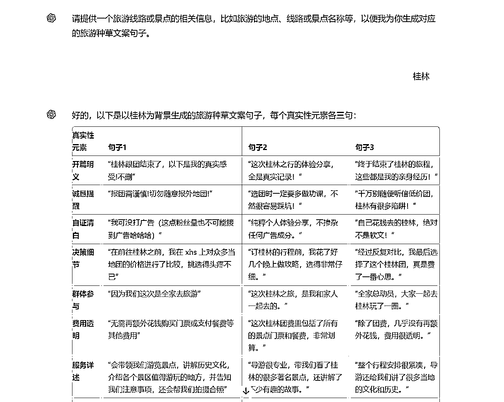

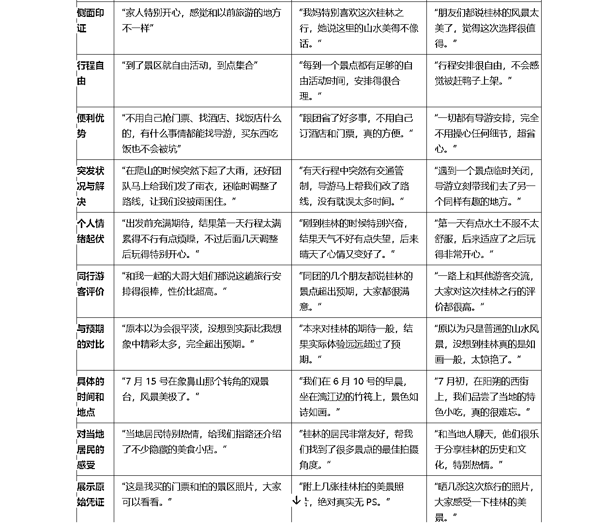

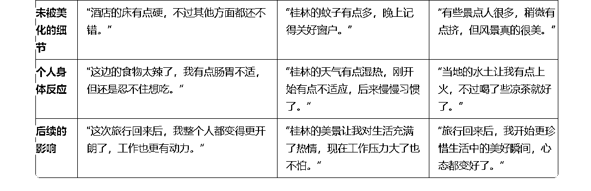

效果已经算能用了，再把它做成 GPTs 之后调用就更方便了。

###### Claude效果

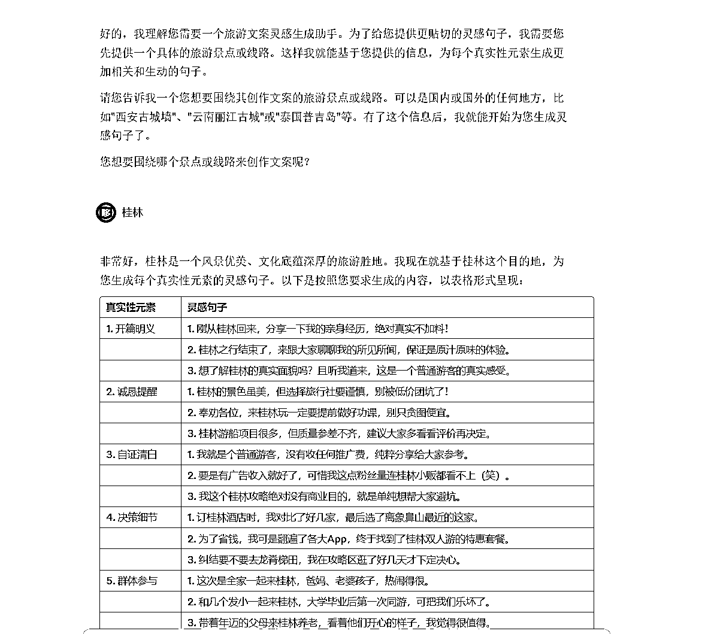

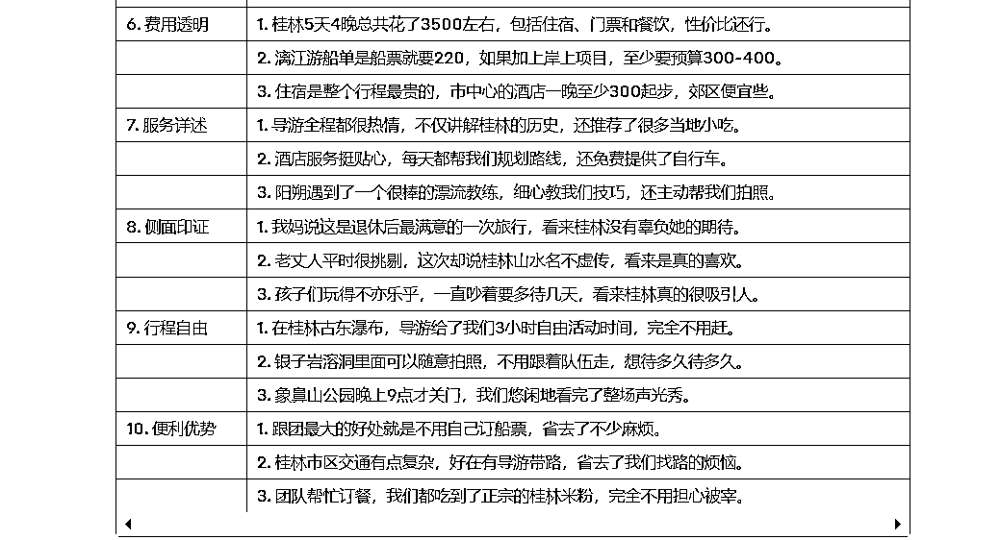

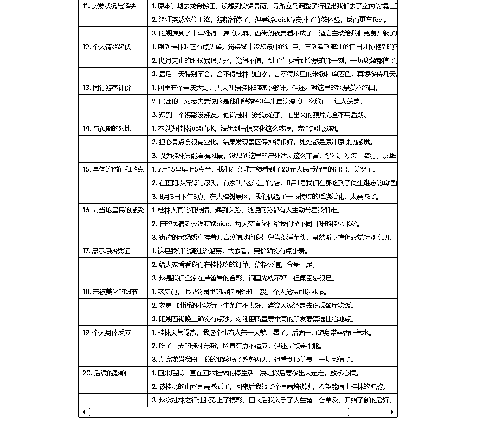

灵感供给量同样很可观。

到这一步，这个需求基本就算跑通了。哪怕你不指望 AI 一次性写完成稿，也能靠它拿到大量可用的点子。不得不说 AI 顶多就是一个强大的灵感发动机，而且你会发现，我整篇分享里其实是混用了好几款模型的。

像提示词里比较核心的真实性素材，最初就是靠豆包先整理出来的。后面它在完整测试里表现不佳，但前期贡献不可小觑。

所以别把自己绑死在单一工具上，我的习惯是开机就同时打开几家模型，各自跑一遍横向对比，这样最容易筛出最优解。

最终成稿肯定还是要返工优化，不存在满分文案，人写也一样。但 AI 能大幅压缩灵感收集和初稿时间，这就已经很值了。

以上只是挑了一个赛道举例，希望能给你一些思路，素人文案的玩法远不止于此。

OK，我是哆元，专注 AI+📕，深耕📕引流方法与各类写作提示词的打磨。