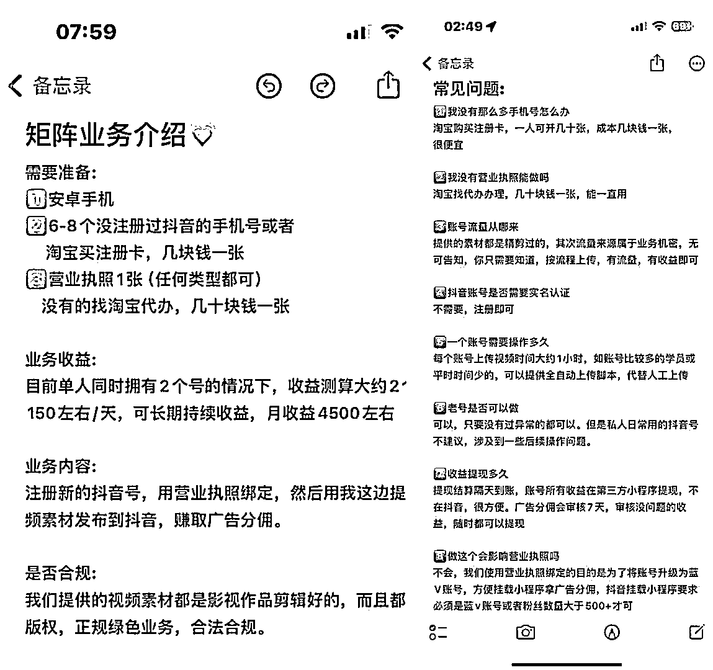
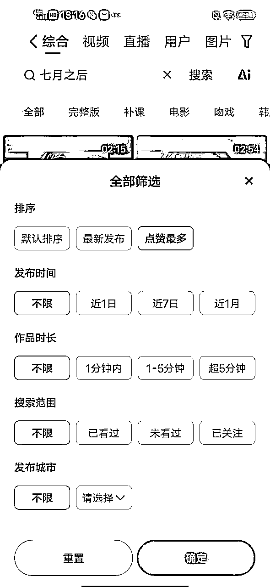
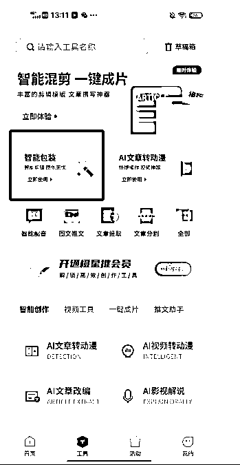
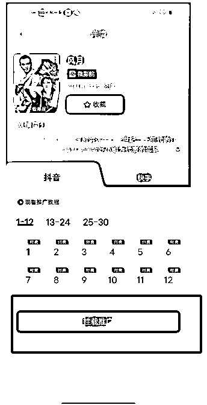

# 抖音矩阵掘金？拆开看其实就是个影视带货的老套路

> 来源：[https://bv4kqmk3tll.feishu.cn/docx/PRkqdBynfogcQ1xFd2ycrwMxnrc](https://bv4kqmk3tll.feishu.cn/docx/PRkqdBynfogcQ1xFd2ycrwMxnrc)

先简单自我介绍一下，我是小龙，目前在读计算机专业，处于实习期。一直对社群运营、个人IP打造这类东西挺上心的。

我大概14岁的时候无意间接触了卡盟，自己搭了个平台上去玩，日活一度冲到四千多，一周也能落个六千块左右。

16岁进了猫头鹰那个圈子，自学易语言，建了个线报付费群，一个月88块，最后付费人数破千。

18岁去阿里实习，当过小组组长，还拿了实习竞赛的第一。

20岁开始做校园方向的项目，把学生资源整合起来，手里沉淀了二十万以上的联系人。

21岁开始琢磨流量变现和管道式转化，单月最高做到了十万以上的流水。

今天聊的这个项目，就是最近在市场上被炒得很火的抖音矩阵掘金。

# 一、这个项目到底在卖什么

“抖音矩阵掘金”听起来很高大上，带上抖音俩字很容易让人觉得稳赚不赔，毕竟抖音的日活体量摆在那。

外面流传的宣传图基本长这样：

目前市面上的打包教程报价已经抬到1088元了。

但你真正拿到手，会发现本质就是短剧和影视剧的推广分销。

变现就两条路：

一条是靠视频播放量的广告分成拿钱；
另一条是靠引导用户付费看片，你赚分销佣金。

# 二、开干前需要准备什么

设备：安卓或者苹果手机都能用，没特殊要求。
抖音号：可以办理张副卡，或者办个5元月租的卡去注册，成本很低。
营业执照：自己去办也可以，淘宝上代办更省事，几十块搞定，经营范围随便填。

这里解释下为什么要企业资质。抖音的个人号想要挂载小程序是有粉丝门槛的，但企业号可以零门槛挂载。办理完营业执照开通企业号后，你再去设置员工号，挂载功能就能直接用。

# 三、具体怎么操作

第一步，去应用商店下载并注册登录「橙星推」。

第二步，在平台里挑选你想推的影视资源。

第三步，打开快手，搜索你选好的剧名，比如我举例【七月之后】。

把点赞量最高的作品筛出来，用去水印工具下载下来。

第四步，做个简单的二次包装。可以用AI自动剪辑，抽帧增帧处理一下，让视频看起来更像原创。

处理完直接回到抖音，选择作品发布并挂载小程序即可。

整体流程真的不复杂，唯一稍微麻烦点的是营业执照这一步，其余的都是小事。

# 四、最后说点实话

我自己实测过，确实能跑起来。很适合工作室批量去做，3个号同时运作，每天保底150块左右，遇到爆款一天就是四位数的收入。

完全可以当成一个副业来做。外面卖1088，本质就是卖信息差。

营业执照几十块淘宝就能搞定，感兴趣的自己去试试。有问题随时来找我聊。