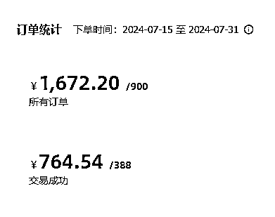
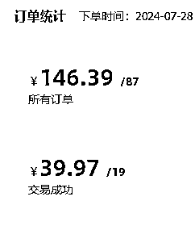
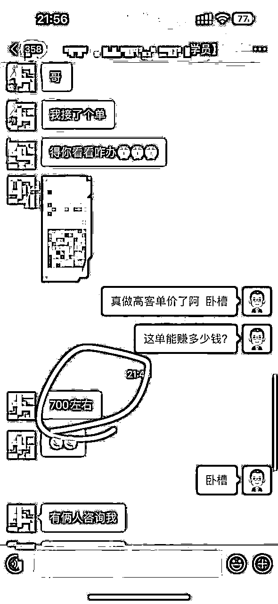
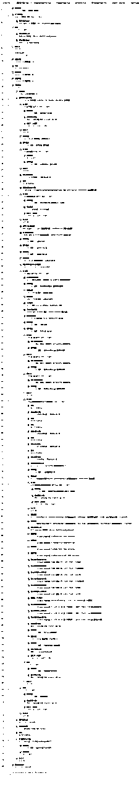
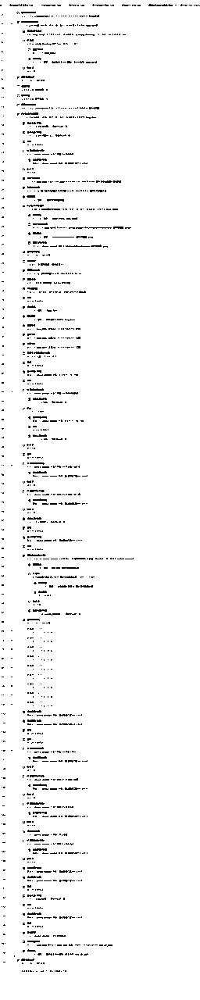
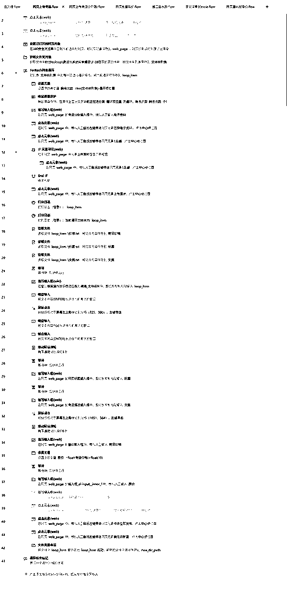
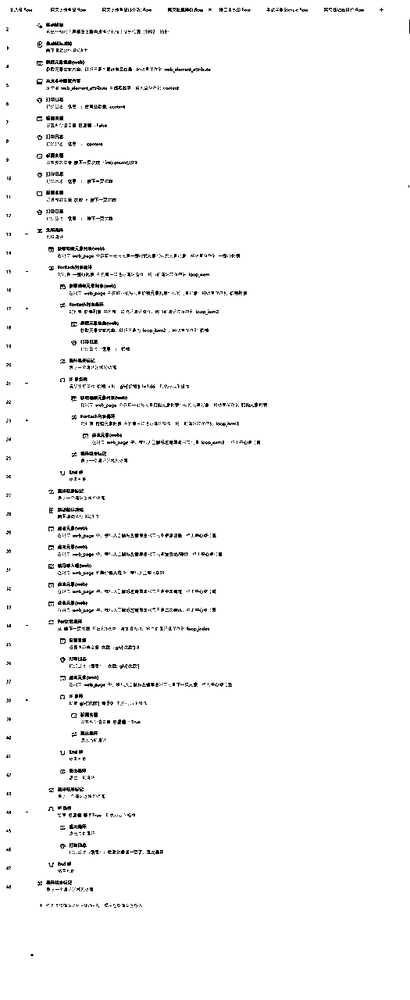
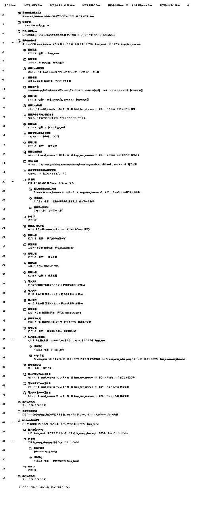
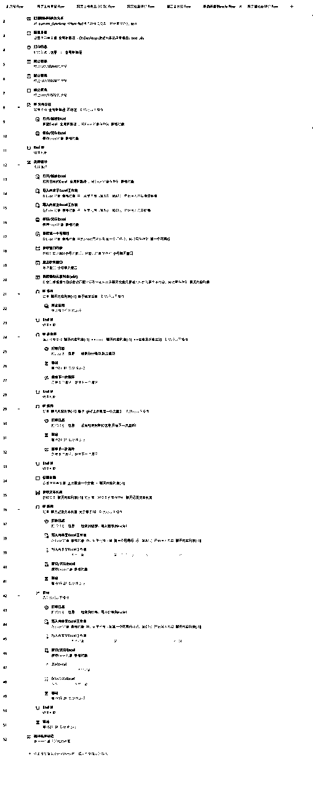

# 用影刀RPA把闲鱼虚拟项目效率拉满的实操拆解

# 开场白

嗨，我是锦城随笔。

最近在实操一个虚拟类项目，首选的阵地是闲鱼。跑下来大概45天左右，现在日均收益稳定过百。

把近15天的表现摊开看：

日均在100元上下，峰值一天冲到146元。

乍一看收益平平无奇，但投入的时间真的很少。真正需要我盯着做的，每天压根不到一小时。

核心在于全套流程都被脚本接管了。

从最初的半自动化，到现在几乎无人值守，迭代了好几版才成型。

目前在运作中，主要在用这几类自动化流程：

1. 采集类：既有关键词搜索抓取，也有同行主页爆款的批量抓取。
2. 去水印处理：调用接口去水印，同时自动提取原图的标题和描述，处理速度很快。
3. 上架类：包含网页端的商品上传和手机App端的发布上传。
4. 降价类：涵盖闲鱼管家网页批量降价和手机App端批量降价。
5. 辅助类：不常用但偶尔会用到的自动签到领任务、微信监听手动采集等。

以上所有流程都是基于影刀RPA搭建的。影刀的项目文件只能自用，不支持外传。

如果你也在用影刀遇到卡点，欢迎一起交流。

下面我会把近期迭代好的脚本清单放到文末，直接照着搭就能用。

集齐这套组合，基本就能做到躺着跑。

* * *

前段时间跟一位朋友聊虚拟项目思路，还帮他调了脚本一起测试。

结果他用一个账号跑高客单品，当天就成交了，单笔净利润700+。

* * *

刚开始入局的前十天，我是纯手搓：手动搜、手动去水印、手动上架。很快就发现这样根本玩不转。

现在跑了四十天左右，整个链路基本自动化了，每天的重心就是复盘和微调。

下面挑几个有代表性的流程给大家过一遍：

# 一. 流程演示

## 1. 调用接口给闲鱼商品去水印并同步抓取标题文案

## 2. 微信端监听到的闲鱼链接自动采集并写入Excel

## 3. 其他脚本的演示可以回看我之前的笔记，里面都有完整录屏

# 二. 直接抄作业

## 1. 手机端关键词批量采集脚本

## 2. 手机端抓取同行主页爆款脚本

## 3. 闲鱼手机端自动发布商品脚本

## 4. 网页闲鱼管家批量上传商品脚本

## 5. 网页端批量降价脚本

## 6. 对接API接口实现去水印并获取标题文案脚本

## 7. 微信监听采集并导出到Excel文档脚本

# 三. 最后说两句

这套方法论不止能用在闲鱼上，小红书同样适用，甚至我觉得小红书的上限会更高一些。

希望这套组合拳能帮你把闲鱼虚拟项目做起来，日日有进账。

对影刀RPA感兴趣或者想一起学习的，随时找我聊，我能说的都会说。