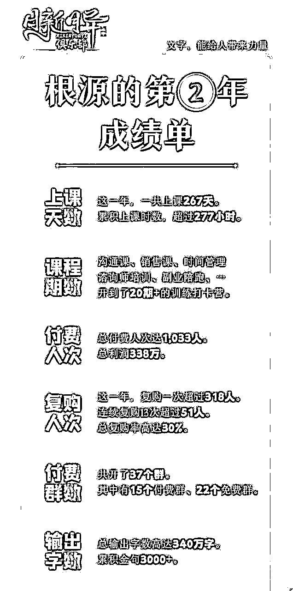
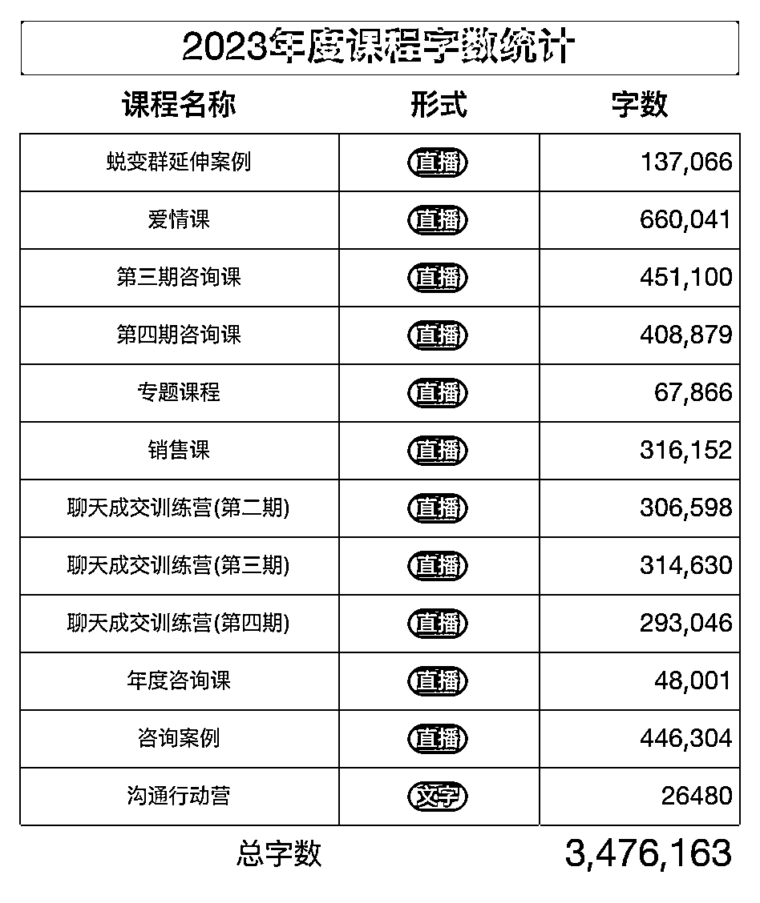
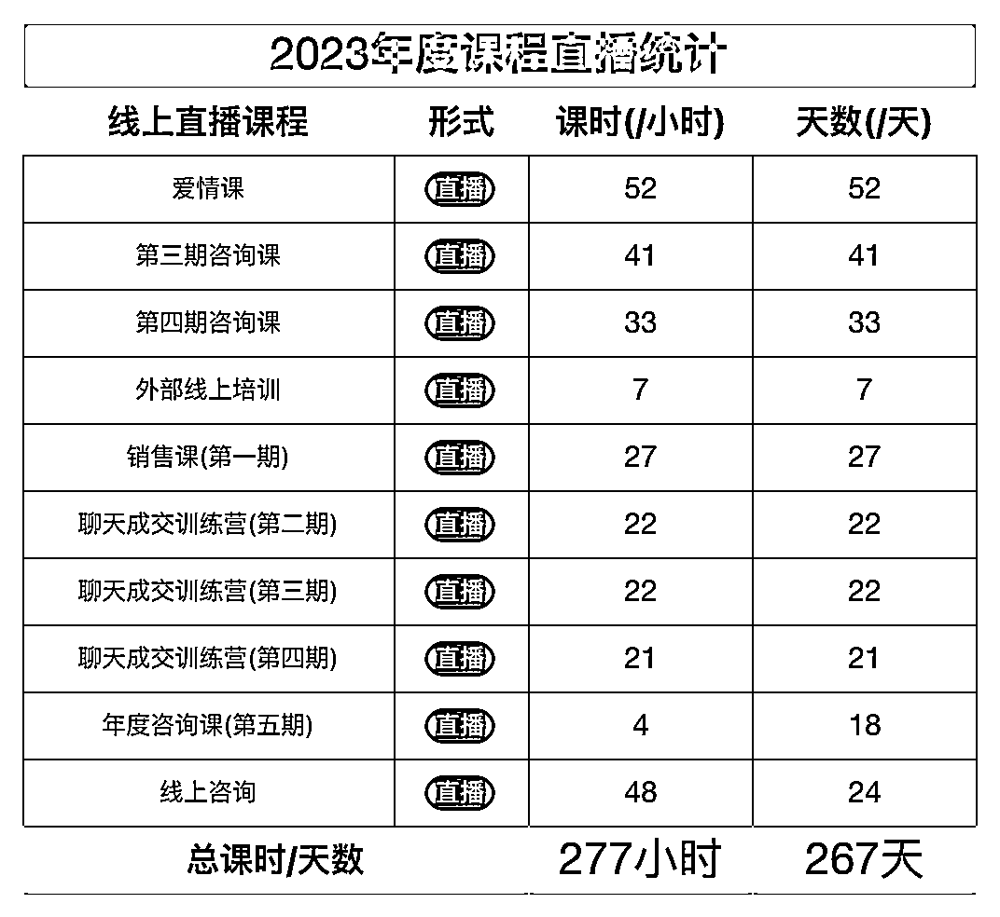
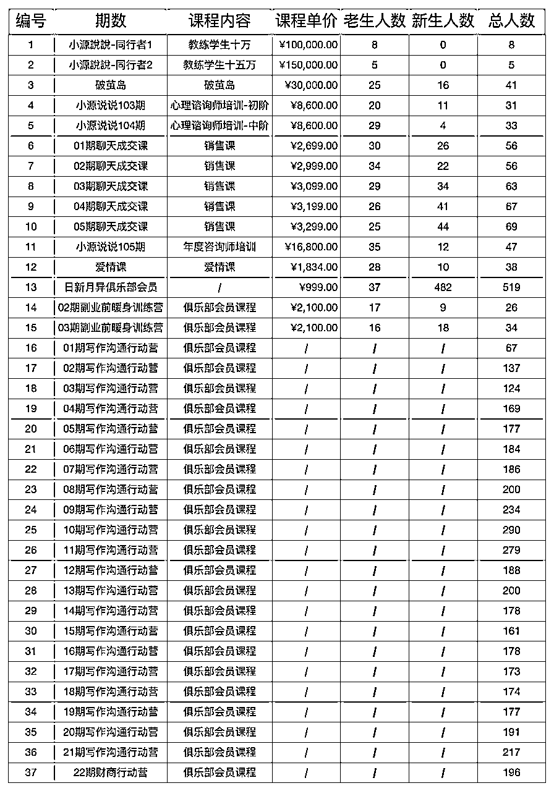
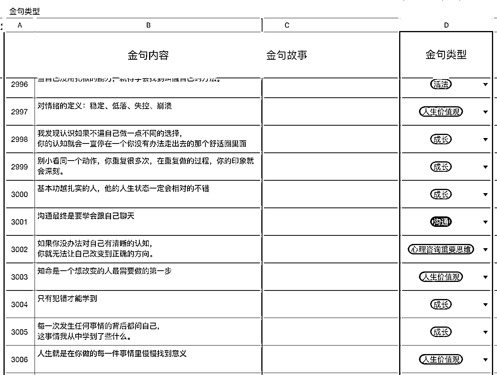
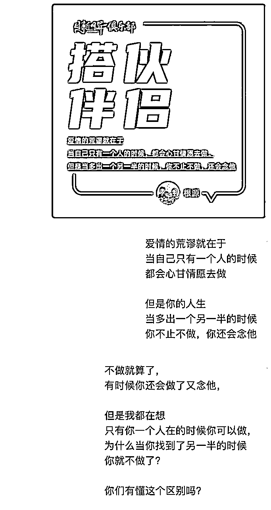
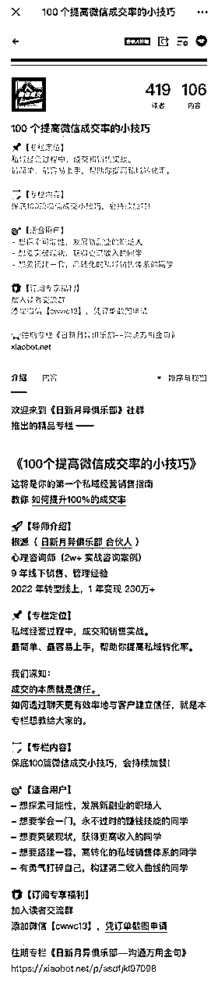
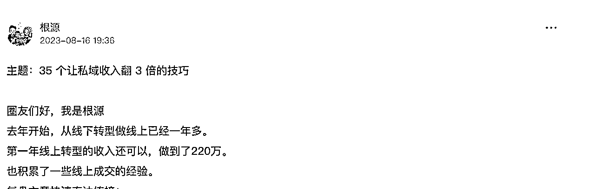
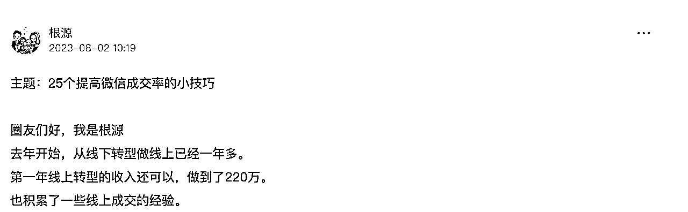

# 从传统行业转型第2年，我靠这三步守住了百万利润

圈友们好，我是龙哥。在知识付费和私域运营这个圈子，我已经待了两年半。这两年跟明白老师、陈雪一起做日新月异俱乐部，成绩一直挺稳，年利润基本维持在七位数，会员成长数据和复购率也都不错。去年我给自己做了个复盘，说实话，对那一年的效率和成果，我是满意的。

趁着复盘的契机，我也认真想了一件事：过去一年到底哪些动作是对的？这些动作能不能复制，能不能持续带来更大的结果？也就是把偶然做对的事，变成可重复、可放大的方法论。希望我的经验，能给正在看文章的圈友一点启发。欢迎看完一起聊。

## 第一年：死磕两件事，把影响力滚起来

刚做知识付费那会儿，我给自己定了几个目标。第一个就是必须持续做点什么——上课也好，写👸号也好，发📕也好（当然我当时主要就是写👸号和持续上课）。因为只要你持续做一件事，就能在一部分固定人群里建立影响力。这些影响力最终会变成实打实的数据：报名人数、课程期数、收入……这些数据能向更多人证明：你不光说得好，别人也觉得好，而且你有拿得出手的成绩。

去年对我来说最重要的两个数据：

### 内容字数持续增加

第一个是内容更新的字数。字数直接决定了我的内容沉淀有多少。如果沉淀不够，人一多就会觉得：这老师好像没什么东西啊，产品也没几个，内容也不丰富。所以去年一年，我一直在持续上课、持续写内容。下面是这一年累计的输出字数和总上课时长。

### 开课期数持续增加

第二个是开课的期数。

期数的价值在于：假设有人一月份报名了第一期沟通课，接着好几个月没动静，到了第八个月我突然找他，说沟通课已经开到第九期了，他会怎么想？他一定会觉得：这老师从年初到现在一直在讲课，看来是靠谱的，要不他的进阶课我也试试？而且期数多，代表我得不断迭代内容，因为每一期都要有新东西或者优化旧内容。另外，期数多，我就能不断出新海报、找新理由，让新朋友知道：这个课能开这么多期，说明受众基础真的不错。所以，字数、内容影响力、期数，就是我去年给自己定下的两个最重要的目标。这两块，去年完成得还不错。

## 第一年的沉淀，让第二年轻松很多

回头看，第一年做得最对的事，就是大量积累内容、尝试开各种不同类型的课。因为第一年创新和积累足够多，第二年我根本不用搞太多新想法，只需要往深里做就行。

- 聊天记录变成实战案例：去年我尝试把聊天记录存下来做成课件，当时只是无心插柳，今年它居然变成了完整课程，变成了一套字数很足的课件，既能独立使用，又能迭代——比如开个中阶课或番外篇。
- 金句生成课程：去年上了那么多课，直播加文字，让主编帮忙总结金句，结果一总结发现超过3000句。

这意味着，每一句金句都可以独立成一堂课，或者配合当时的场景再解释一遍，又是一堂课。

- 课程内容变成社群早报：爱情课、时间管理课的文字内容，稍微整理一下，比如1000字压成500字。

今年转型做俱乐部时，每天早报播个三五分钟，这些内容就变成了社群的交付环节，完全没有额外花时间，只是把去年的东西迭代了一下——改改文字、调调内容、优化图片，或者干脆组合成一个新东西。对于新朋友来说，这些内容特别丰富，就像小报童

再比如重新整理修改后发到赚钱，还有机会被加精。

这些沉淀内容经过精修迭代，我拿到了六篇精华。

所以，沉淀和积累内容特别重要。字数足够多，变化形式就足够多：文字可以变图片，图片可以变音频，音频可以变视频……内容本质上还是同一个，只是换了呈现方式。可如果底层内容不够多，就做不出这么多变化。第一年沉淀好了，第二年就会非常轻松。

也因此，今年我的课程创新只占30%，剩下70%都是对过去内容的深入挖掘和迭代。过去跟私域运营、沟通相关的内容，单独提炼标题、重新编排，马上就能打包成一个小报童新产品，比如“50条🛰️聊天小技巧”“50个让业绩翻倍的私域运营方法”。这些全都来自第一年的内容沉淀。第一年积累得够好，第二年想变化时就会非常从容。

## 第二年：两个核心目标

到了第二年年初，我问自己：今年该完成什么目标？当初我给自己定了三年扎根期，最短也得在这个行业认真干三年，才考虑倍增。所以第二年我没定倍增目标，而是定了两个：

**第一，持续提升课程价格**。从最初131块，到第二年要让初始价格变成999元，达到三位数顶格。因为当我的基本产品卖到999，愿意付钱的人质量一定更高。哪怕人数少一些，100多跟900多差了8倍，人数就算减少1/8，营收依然不变。

**第二，从个人作战变成团队协作**。我太清楚一个人做事有瓶颈了。想让事业和收入稳定增长，必须有稳定且共识度高的团队。我过去带过团队，知道基本功多重要，所以第二年要把团队这块打扎实。

### 涨价：最高效的用户筛选

去年我的产品最低价是131.4，今年年初初始价涨到了999。涨价时我也有过担忧：以前付过费的人会不会不来了？后来发现，真的不是这样。

涨价本身就是一种筛选群体、筛选信任度的最好方式。它能把原来大流量里的高意愿用户精细化地挑出来。更有趣的是，涨价后真正愿意买的人，反而不是过去那批只付100多块的学员，而是你不断认识的新朋友。因为过去产品便宜，吸引来的人多半只有付100到200块的能力；随着我的知识储备提升、质感提高，越来越多能付300、500的人对我感兴趣，涨价后，能付900多的人也被吸引过来了。在我看来，100多、500多、900多，背后完全是不同的人群。涨价后，我接触到的付费用户质量明显提高，总量只少了大概20%。随着报名越来越稳定，那个担忧也就慢慢消失了。

涨价时，别太纠结老用户流失。与其去激活那些能力有限的旧用户，不如用更多新内容、新宣发去吸引新用户。我做了一个取舍：不花死力气去激活每个旧人，而是把40%时间用来服务旧人，60%时间用来找新人。我每天都会私聊那些过去在群里很活跃的旧人，不是群发，是一对一聊。同时持续引入新人。去年🛰️好友只增了1000多人，今年也是1000多人，总量没变。可付费人次竟然跟去年一样多——价格涨了，报名人数还一样，收入自然提高了。所以涨价这个决定，确实很值。

### 团队协作：降本提效才是关键

江湖上一直有句话：千万别找合伙人，因为最后大多没好下场。我认同，但我也在想：一个人肯定做不大，也走不远。想让体系全面运作，让赚钱更稳定、更多，必然要靠团队。但团队又容易因为利益、价值观不合而散伙。我也经历过——做着做着赚钱变少，然后慢慢拆伙。这次我给自己定了三年目标，依然想做团队，但不想再犯过去的错误，希望能做到人财两得——关系更稳固，钱也赚到了，大家都能均富。

为什么一定要团队？因为事业要往前走，就得降本提效。我有长期带团队的经验，知道提效有两个关键：一是适当放权，二是让擅长的人去做擅长的事。比如我的公域能力不强，就让明白老师来做；我在女性群体里的影响力远不如陈雪，这块就交给陈雪；我的档案编辑能力不行，就交给伟哥（行政大总管合伙人）。

团队协作通常有两条路：

- **投入同样时间，产出翻倍**：去年赚100多万，今年用同样10小时，能不能赚到200万？
- **产出不变，时间减半**：去年每天工作10小时，今年能不能每天只做5-6小时、收入不变？这样投入产出比也是提升的。

年初时，其实我没有把握第二年能收入倍增。我心里更倾向于收入至少跟第一年持平。因为我知道基础不稳时太快追求翻倍容易出问题，也不可持续。而且我本来就不擅长用很短时间实现业绩利润翻倍。所以我更想做到：时间降低，收入跟去年持平。只要收入能维持，对我已经是里程碑了。因为过去做项目，最难的就是第二年、第三年能不能维持。第四年才想翻倍。维持本身也是一种很强的能力。时代在变，赚钱更难，但我的收入没有下降，这已经是显著的进步。

所以，把目标定为降低工作时间、维持收入，意味着我不能继续单打独斗，必须培养信得过的人一起做项目。

### 从个人到团队，效率提升多少？

以前我的主编只需要做文案编辑，把上课内容转成文字，每个群还要有人运营，我的提问也要转成文字。当我把工作从打字变成语音，效率瞬间提升两到三倍。打字每分钟150到200字，语音每分钟能说400到500字。而且用语音后，我可以摆脱电脑——电脑打字快但没法直接语音，手机反而更适合语音输入。加上主编团队负责整理输出内容，我的整体效率就上来了。以前一天工作10到12小时，现在因为用语音回答问题和上课，今年直播课变多了，高单价训练营多了，讲课和答疑效率提升最大。今年更新总内容比去年多了一百多万字（今年约330万字），但每天工作时间比去年少了快5小时。去年每周工作六天；今年每周只工作四天。

这个成长是我去年最大的正反馈。它让我明白：工作是为了更好的生活，而不是为了赚钱搞得越来越累。我见过太多咨询者，想着努力工作让生活变好，结果时间一长，人生只剩下工作，没时间陪孩子、陪家人、陪老婆，也没时间出去玩，能量越来越低。到底是工作支配生活，还是生活支配工作？是梦想支配工作，还是工作支配梦想？这完全是两种状态。如果只顾着赚钱，赚得多了，生活质量却没有任何提升，那也是白忙一场。

我曾经很笃定地认为，我过去做项目的底层逻辑是错的，而且是根子上就不对。

当项目越做越大，我的状态就越糟。时间被填满，烦躁感跟着上升，身体开始报警，生活圈子也变得紧绷压抑。我每天都在怕，明天会不会什么都没了。这种预期让我喘不过气。

于是我逼着自己换个玩法：不靠堆时间去换产出，而是把效率真正提上来。把原本每天10个小时的工作量，压缩到6个小时、甚至5个小时；把一周六天的工作节奏，降到五天。去年我直接把课表改了，周五晚上我最不想上课，索性问自己：能不能再砍一天？最后我只上四天，休三天。

大多数学员正好需要这三天的空档去消化、去学习。这个调整让我的状态比第一年轻松太多。效率的提升并不是加码，而是减法，时间变少了，成绩却没变。这是我去年对自己最大的肯定。

* * *

### 先定人，再谈事

过去我都是项目先行，再去找人配合。只要项目不在了，这段关系基本就结束了。我后来发现，很多人的工作伙伴和朋友圈是分开的，但我觉得这不合理。工作伙伴跟你相处的时间最长、了解最深，如果这个人既是同事又是朋友，关系自然会更牢。

所以我反过来了：先选人，再选项目。我想先从身边熟悉的人开始，而最容易筛选的地方，就是我的学员和学生。

这批人相互信任的基础本来就高。合作的筛选是双向的，我也在通过输出让自己被看见。我有的价值不只是干货分享，更在于行动力、过往的实操成绩，以及一套清晰的价值观，还有对关系的维护和经营。

在过去一年的授课里，能留下的学生有两种。一种是本身就很优秀，我们因价值观相近而聚在一起，我会邀请他们先多连接、共同探索。关系是平等的，我可以教他部分独特的学问。另一种是刚出社会的年轻人，需要一个老师带。我会选择有潜力、有好习惯的他们，让他们跟着上课、写作业、打卡，用行为来检验是否可托付。

我的关注点很明确，只要人出现，我就会持续观察。

* * *

### 选对人，事才可能成

今年我最核心的诉求是找到可信赖的合伙人和工作人员。我把工作人员都称作学生，因为筛选标准更严格。我一直相信选对人才能做对事。事对人不对，再好的方向也会被拖垮，最后掉进人际关系的泥潭。

我把这种麻烦叫做“人和”。人和一出问题，进度就会被严重拖慢。

今年团队还算顺利，因为去年我就开始有意识地找、筛、培养人。从最基础的主编角色开始，每期课程结束后我都会在群里邀请学员帮忙整理上课档案。视频课、语音答疑最后都要转成文字并做重点梳理，如果都我来做，时间根本不够。于是主编这个雏形就诞生了。听起来体面，每期我都问有没有人愿意担任主编。去年积累下来，最后留下来的好主编，都成了我的学生、我的同行者。

其中有一群给我付六位数学费的教练客户，价格还在不断上涨。他们为关系买单。

* * *

### 特质优先于能力

这个筛选过程中我提炼出一个判断：特质比能力更重要。

有人写得好，做事快，很聪明，却总说“做不到”，交付永远迟到。这种人我不会选。我更看重价值观是否稳定、个人习惯是否自律、态度是否可靠。

* * *

### 别用上班族的机制养团队

我过去做项目就没用过纯雇佣逻辑。给固定5000、6000的月薪，让人打卡交差，最后做出来的质感也就是上班族的质感。思维就卡在“把事做完就行”。

真正能把副业、自由职业、创业做起来的人，脑子里想的不是交差，而是“怎么把这件事做得不一样，80分能到100分”。

所以我从一开始就没打算用员工机制。我想要的是合伙、共事的关系。

我从学生里找同行者。他们本身有主业，我是他们的教练兼顾问。他们手上可能有自己的项目，任何问题都会来找我。我只从这个池子里选人来一起做事，哪怕是整理文档、整理课程内容、运营群组这些基础活。

能承担这个角色的人，需要付出代价。他们心态是“跟着老师能学到东西”，而不是“把活干完拿底薪”。心态一变，整个协作质量就变了。

去年这一波操作，让今年团队的共识度、执行效率和内容品质都保持在稳定区间。我的角色更像老师和培训者，而不是老板。上下级味道淡了，人反而更愿意投入。

* * *

### 边做事边培养副业能力

主编的成本模式也很不一样。我没有固定支出，只有产生收入才分润。做得多拿得多，没有上限。第二年他们收入还是不高，因为主编本身产值有限。所以我开始系统训练他们销售和沟通能力。

他们的主业不能丢，不能全职跟我干。一个人如果能力不足就全职绑定，压力会把人压垮。贫穷驱动只适合少数人。我要求他们保留一份自己的工作，用业余时间做我这边的事。

我给的是高强度的训练，不是单纯赚钱。时间管理、销售沟通、情绪管理、写作，这些都是未来做副业必备的基础。如果基本功不扎实，再好的项目也做不起来。

于是去年浮动的主编，到了今年变成固定主编，而且只从付高价的客户群体里筛选。信任感、培训产值、团队稳定性都因此被锁定。社群需要的各种交付都能高品质产出，彼此信任很高。我更像指导者而非管理者，这种关系更松，也更可持续。

* * *

# 日新月异俱乐部：两个目标的合流

2023年上半年我还是单打独斗。后来开始固定每周线下见面明白老师和陈雪。我们是师生关系，也在某些学问上能互相教学。交流下来发现价值观高度重合，吸引的群体也类似。

从六月开始，我不以个人名义交付了。我们三人决定做一个年度陪伴型俱乐部。各自擅长的能力互补不冲突，磨合了两三个月，最终在年终联合品牌上线。我们三人的品牌暂时收起，共同打造一个打磨人生基本功的俱乐部。

* * *

## 合伙先要把共识谈透

之前做过很多项目，我发现合伙最难的是开局共识，尤其是分润结构。因为我们是从好关系才开始合作，一开始对分润就很顺。方案一提，大家就点头同意了。

真正花时间的是分工。我们三人的流量池完全不同：我擅长私域高客单转化，明白老师擅长公域，陈雪也有她的公域。初期流量不愁，难的是在同一个俱乐部里各司其职。

我给正在考虑合伙的人一个建议：给自己一年到两年筛选合伙人。无论是师生还是同学，多磨合。真正合作时争端会少很多。你也能找到真正互补的人，而不是同质化的两个人一起做高客单、私域、引流全重复，最后发现没人统筹、没人做长期战略。

合作至少要一年验证，彼此能学习，圈子里有共同共识，再谈项目。最重要的是找到共同的价值观，比如我们更在意交付质量而非单纯赚钱。

* * *

## 在商业化与“对的事”之间找平衡

日新月异俱乐部外界看起来是个新品牌，市场上少见。我们靠各自圈子招生引流，每周对外宣发，每天群里稳定分享，有早报、晚课、周三说明会、百问百答。慢慢迭代，力求贴合市场又不偏离初心。

坦白说，这个俱乐部做的是全面基本功提升，商业价值并不显性。当下市场都在教怎么快速赚钱、起号、做爆款。我们的坚持是：一个人的基本功不稳，就承接不住好机会。

基本功包括关系经营、沟通、销售、写作、时间管理、情绪管理、财商。这些没打牢，项目再好，一个月只能赚一万的人还是只能赚一万。

我们三人开局就认同这点。但“基本功”是非主流商业模式，市场教育成本高。初期我们没追求爆发，只想招一两百人，慢慢带着他们训练。

去年最拧巴的就是商业模式和价值观的取舍。要不要开一个变现课去引流？开会时每次都想试试，最后都被内在理智拉回。我们决定不为商业化改变节奏和打法。不教怎么赚钱，只教具备赚钱的能力。因为带人赚钱的口号后遗症很大，赚不到钱就会来找你麻烦。而赚钱更多是眼界和格局的问题，不是听课就能解决的。

我们最终没变线，也没因为短期收益改变方向。这是我去年觉得最重要的一件事。

* * *

## 品牌合并后最大的挑战是激活存量

年终我们正式从各自品牌转为联合品牌日新月异俱乐部后，一个现实问题摆在面前：如何让老客户知道我们要一起做一件新事，而不是因为原来的事做不好了。

激活存量、让旧用户信任新身份，成为接下来最关键的工作。

这次的事，反倒让我们有了一个再次开门的理由：一直关注、但还没走进来的人，可以趁这个机会加入日新月俱乐部。

我一直有个很朴素的看法：没有付出代价的学习，或者一毛钱不花就进群，通常很难被真正珍惜。所以哪怕我们想做更新、想做迭代，我也不会用“免费发放福利”的方式来吸引人。当初邀请老会员升级时，我们给的就是一张半价优惠券：只要愿意继续支持，用五折的价格就能升级成新版俱乐部的正式会员。

为了通知老朋友，我们把旧名单重新整理了一遍，然后明白老师、陈雪和我分头行动，不用群发公告，而是用一个又老又笨但很靠谱的方法：一个一个私聊。这个过程花了将近两个月。坦白说，第一波效果并不理想，第一个群只拉了一百六十多人。一是因为那年临近年底，很多人觉得之前的钱还没消耗完，为什么又要再掏一笔？二来对升级后的内容心里没底。不过我们并没有慌。一来我们本来就不是动作激进的人，二来规则也还没打磨成熟。既然俱乐部从一开始就设定至少做三年，就没必要逼着第一个月爆发。慢慢来，把内容做丰富，等价值厚了，观望的人自然会回来。何况人少的时候，恰恰是把规则想清楚的最好时机。

当时还有一个拧巴的地方：我们的交付模式很重，短期内很难快速吸引大批人。可我们很清楚，这种学习方式才是真正有效的。我们教的不是“速成技巧”，而是自己成长路上长期验证过的东西。成长本来就没有捷径，需要时间积累，所以初期用户不多，我们完全接受。

我们也对“花了钱就要有收获”这件事特别认真。既然收了钱，就一定要让大家真的拿到东西。所以我们没有在学员付完款后丢出几十万字，而是把内容拆成每天一点点，像吃饭一样，一天一碗。于是有了每天的晨间播报，五到十分钟，主题从销售、时间管理、爱情、写作到财商，周一到周五轮换。晚间还有主题课，一个主题连续讲五天，内容足够循环一整年而不重复。

每月还有十四天打卡。一开始只是练单项能力，比如写作、沟通、财商。后来我们意识到，单一能力在这个时代越来越容易被淘汰。过去，只要编程够强，或者沟通够强，就可能撑起一摊事；现在不一样了，需要的是复合式能力。会写作，还要会运营私域；会沟通，还要会成交。于是我们把打卡改成组合式训练：写完文章后，还要主动发给身边朋友看，请对方给意见，这就是“写作+沟通”的训练；发完内容后，还要继续做转化和运营，这就是“内容+私域”的训练。一年十二个月，正好十二组主题。

为什么坚持这种“慢功夫”？因为真正的改变，不是靠一次轰轰烈烈的活动促成的。一两次活动最多让人产生短暂激情，却很难带着人持续往前走。挡在成长路上的最大元凶，其实是习惯。一个人习惯了暴饮暴食，参加七天禅修营，每天吃素、三餐规律，回来就能改掉一辈子的习惯吗？很难。学习也一样。我自己的咨询师培训，最早是一到三个月，后来改成一年，每天固定给十几二十分钟的课程影片，后期再加直播。聊天成交训练营固定在每天晚上九点到十点讲课，一期结束马上开下一期，而且每一期都重新讲，不用录播糊弄。这样做确实很重，但只要收了钱，那个时间段我就必须在场。好处是，时间一到，学员自然知道该上课了。一年、两年跟下来，不少人真的发现自己的思维和做事方式变了。

这种改变，我把它叫做“细润无声的改变”。它和市场喜欢的“立刻见效”完全不是一回事。可方法本身从来不是核心。📕、百度上干货到处都是，但赚钱的人为什么依然是少数？因为技术能不能用出来，取决于使用者的习惯和状态。给你再好的机器，习惯不对也白搭。所以我们分享的是自己真实的生活模式：每一天怎么工作，怎么积累，怎么把习惯一点点养好。明白老师、陈雪也把各自的生活模式带进社群。同频的人多了，社群里的杂音自然就少。更重要的是，这些事本来就是我们每天在做的事，交付起来就像喝水吃饭一样自然，因为没压力，内容反而能源源不断地产出，工作与生活也慢慢找到了平衡。这是做俱乐部最让我们骄傲的地方。

再说产品体系。想让社群服务更多人，必须有一套完整的价格梯度。我们是这么设计的：最基础的是999元的日新月俱乐部会员，以文字交付为主，有文字课程和每月一期的行动营，但不做直播。往上是几千块的训练营，比如从三千多起步、每期都会涨价的聊天成交训练营，这一档必须是现场直播，不是录播，课程会更深入，比如销售、写作变现、时间管理、爱情经营、情绪管理，并且能现场互动答疑。再往上是平衡人生年度训练营，相当于把俱乐部五大系列主题的中阶课程打包，让学员用一整年去学习和复训。最顶端是六位数的终身教练服务，也就是我常说的“同行者”，他们可以随时私下找我咨询，我也会给他们做更深度的培训。

价格阶梯之外，交付规则更要清晰。999元会员可以在群里随时提问，但我们只在群里解答，不想暴露身份可以匿名。如果有人私信我说“老师，我这个问题比较隐私，能不能私下解答”，我会认真解释：私下解答会被归类为一对一咨询，我的对外咨询一小时收费三千块；如果你能接受这个标准，我们可以聊，如果不能，那就在群里提问，我帮你匿名。这样看起来有点不近人情，可规则越清楚，大家越能接受。最怕的是今天破例一次，明天通融一次，最后高付费的人觉得自己和低付费的人享受的服务没差别，低付费的人也不再想往上走。一小时三千块的咨询如果被免费消耗，那这个人这辈子都不会再为咨询付费。所以每一档价格对应什么服务，一定要明明白白，如果一开始不定好，后面会非常麻烦。规则越鲜明，交付者的价值感就越强，也才有更多时间服务那些真正愿意长期投入的人。

社群人数也要有边界。我提过一个观点：群越大，越难称得上私域。我们从七月开始正式运营，到十月中旬才勉强拉满一个两百人左右的群。为了管理起来更轻松，第一个群满260人就不再进人，而是直接开第二个群。到了接近年底，第一个260人的群才真正满员。那时候训练营还在持续开，老会员可以享受优惠，明白老师负责会员群拉新，我负责群内转化。

最后聊聊招生。每周三晚上八点到九点，我们会做一次固定的俱乐部说明会。这个思路来自过去做直销时的事业说明会：每周邀约新人，现场听完觉得合适就加入。我们也是这样，每周三开讲前，用六天时间把人拉进临时群，不管进来的是十几个还是三十几个，周三都照常进行。一开始是文字讲解，每开一次就调整一次内容，后来又从文字升级成直播，但效果都不算理想。于是我们换了个思路，不再费力解释俱乐部是什么，而是把说明会变成会员问答专场。每周三的直播问答，会员需要提前预约，它既是对内福利，也是对外窗口，新朋友听到的正好是会员在项目、赚钱、爱情、情绪等真实问题上的答疑。这比任何广告都有说服力。

这些就是我们在社群、交付、产品和规则上踩过的路。希望这些真实心得，能给同样在做社群的人一些参考。

一个会员提出的问题，往往不只是他一个人的问题。同一个卡点，背后可能站着好几个同样困惑的人。所以，当我认真回答某个具体提问时，其实也是在帮一大群没开口的人梳理思路。我们后来把这件事做成了一种固定的直播形式——百问百答。

起初，这个形式只是为了让内部会员更愿意参与。每场直播只要开起来，在线人数基本能过百，现场氛围也不算冷清。于是我们把说明会一步步改版：先是从纯文字改成直播，再后来干脆不单独做说明会了——每周三原本对外的说明会时间，直接变成了会员直播答疑日。对内，这算加了一份会员福利；对外，外部学员也能透过一场场真实的问答互动，更直观地感受到俱乐部的价值观和内容水准。整整花了四个月，把内容和直播方式反复打磨，最终定型成这种问答模式。

回头看，一个小社群想要稳定增长，最怕的就是停止迭代。我们必须持续想：还有什么新动作可以做？还有没有更有效的方式？然后靠数据去验证效果。如果某个方法试了没什么用，就不能在原路上硬熬。因为熬久了，我们自己会累，外面的人也会累。尤其在引流流量不算大的时候，我们更得把精力放在如何转化上。

后半年的思路，其实就是把固定行为重复做，把会员的固定运营抓好。

第一，早报到、晚课、百问百答都继续跑，对外的说明会也没停，四位数的训练营照常开，内部会员福利也在不断叠加。

第二，我们从原本固定的服务里，增加了押金打卡的玩法。围绕不同主题做训练，比如副业热身营，专门帮人看清做副业前有哪些准备工作没到位，副业就很难起步；还有赚钱小课营、沟通进阶营。这类小课我们会持续尝试，但不会免费开放，会员价一般就是39块、59块，或者用押金形式参与。

为什么坚持不收免费？原因很简单：一旦一个东西变成免费进群，大家一定不会珍惜。所以我宁可收小钱，宁可进群的人少一点，也不愿意让人抱着“反正免费，没那么重要”的心态进来，最后群变成死群。所有新增的动作，要么带押金，要么带付费——这是我们后半年一直在重复做的事。

也正因为课程体系铺得足够开，从三位数、四位数、五位数到六位数的产品都有，最高还有20万的教练服务，高客单价的转化数据还算拿得出手。到了年底，三位主要合伙人的营收基本都做到了七位数。对我们来说，最开心的不只是赚到了钱，而是第二年转型时整体成绩没有下滑，赚的钱也没有变少。这种正反馈，比什么激励都管用。

比收入更让我在意的，其实是另一件事：工作和生活的平衡。

我做过咨询师，也带过大团队，发现团队越大、时间越少，是一个几乎绕不开的困境。我见过不少很优秀的老板，公司规模不小，但谈起生活，眼睛里全是疲惫：半夜才回到家，周末终于有空陪家人却已经累得不想说话，和孩子没什么交流，和伴侣也很难好好聊上几句。

我后来想明白，这本质上是一种习惯的问题。如果一个人习惯了每天工作12个小时，十年之后他大概率还是每天工作12个小时。因为他已经习惯把所有时间都花在工作上，也习惯了不跟伴侣沟通、不陪孩子、不好好享受生活。很多人拼命工作，原本是为了维持好的生活；但结果是，工作越做越好，生活反而被压得越来越紧，甚至动弹不得。

所以后来我一直刻意做配比：怎么安排工作时间才能提高效率，同时又不让生活被压缩？这其实就是一种能量管理。因为你把时间放在哪里，你的客户和学员就会怎么看待你、怎么使用你。

我现在的工作节奏大概是这样的：

早上8点半到9点之间正式开工，一口气工作到中午12点。下午基本不排工作——吃饭、运动、接孩子、做饭，等这些事情都处理完，往往已经晚上7点了。晚上7点到10点，才进入第二段工作时间，用来讲课和处理白天的消息。

周末我几乎不工作，也不太回消息。偶尔会跟自己圈子里的同行者互动一下，但会员群、训练营的信息，我基本不会去看。

这个节奏刚定下来的时候，也有人不适应：“老师，我下午两点找你，你怎么不回消息？你是不是不在乎这个群？”但过了一个月、两个月，每次他问，我都会耐心说一遍：对不起，下午我在运动，或者在陪孩子；白天发来的消息，一般晚上7点会统一回复；如果是晚上11点发来，我可能不会回，因为那个时间我要陪老婆，第二天再处理。

同样的话多说几次之后，付费学员反而慢慢理解了这种模式。他们不会觉得我服务不到位，反而会觉得：这个老师的生活状态真不错，我也想活成他那样。晚上消息回得慢，他们也知道我不是故意不看，而是真的在做别的事。

这样分配时间最大的好处是：工作就是工作，生活就是生活，两边不互相打扰。当然偶尔也会有意外，比如真的有人找到我说“这件事特别重要，能不能破例先回复一下”，那我肯定会回，毕竟是急事。但这样的时刻少之又少，只能算个案。

我把这种方法称为“固定时间做固定的事”。

一个人想要保持好的能量和情绪，最好的方式就是在固定时间做固定的事。你的付费用户也会因此知道什么时候能找到你，不会在心里嘀咕你服务不周。要是有人非要求秒回不可，那他可能本来就不适合待在这个社群里。

我始终相信：生活过得不精彩，工作凭什么精彩？一个人每天活得压抑、情绪低落，就不可能给出真正好的交付。去年我在工作与生活的平衡上做得最正确的一个决定，就是刻意调配自己的时间，并且逼自己在某些时间段里不工作——哪怕下午手机弹出了消息，我也看，刷到📕上好玩的内容，刷刷短视频，但绝不回信息。我很清楚：这个时间不属于回消息。

当你能把时间这样刻意守住，整个人就会维持在一个相对平衡的状态里。

---

我是根源，龙哥盟第四期圈友，一个有2w+实战案例的心理咨询师，有12年线下销售与团队管理经验，2022年开始转向线上，做知识付费项目。

这些年陆续写过不少实战文章，如果你感兴趣，可以按年份挑着读：

**2021年**  
▶ 《直觉式萨克斯 透过社群成功变现146万》精华 https://t.zsxq.com/116B1bcYc  
▶ 《73项被动收入打造》 https://t.zsxq.com/11EHjTH0P  
▶ 《杭州夜话02场，夜话官复盘》 https://t.zsxq.com/19IkX4UMl  
▶ 《年入百万，团队从20人到4万人》 https://t.zsxq.com/19JYt77hL  
▶ 《主题：如何更有效的链接见面会认识的圈友》 https://t.zsxq.com/19VY2LWg4  

**2022年**  
▶ 《互联网小白，第 1 次做线上产品，7 天赚回 10 倍门票》 https://t.zsxq.com/11ooZZbM7  
▶ 《把捣乱分子『逆势』转成爱用者的好方式》 https://t.zsxq.com/19lipLhJ5  
▶ 《好的内容，是目前依旧没退旧流行的变现方式》 https://t.zsxq.com/19BLMAYw1  
▶ 《明白老师的一个启发，让我从100天日耕的过程赚了30W+》 https://t.zsxq.com/19BgNoxfi  

**2023年**  
▶ 《私域的意义不是管理，而是经营》 https://t.zsxq.com/19WEsfSq1  
▶ 《9年传统行业 1 年时间，从一无所有，到年入 200 万》精华 https://t.zsxq.com/10nmEr1cA  
▶ 《25个提高🛰️成交率的小技巧》精华 https://t.zsxq.com/11AgRW24F  
▶ 《35 个让私域收入翻 3 倍的技巧》精华 https://t.zsxq.com/11FmV2aqZ  
▶ 《续篇 - 25个提高🛰️成交率的小技巧（26 - 50）》精华 https://t.zsxq.com/13yRbmUwo  
▶ 《私域话题：涨价之后，如何回复以及留住客户？》 https://t.zsxq.com/11UJk9HxQ  
▶ 《成为自由职业者的20个必备特质》精华 https://t.zsxq.com/14XTxhh15  
▶ 《36个让私域成交率翻倍的实战指南！》 https://t.zsxq.com/17zSrYzvk  
▶ 《产品线有引流体系，如何通过沟通促成升单？》精华 https://t.zsxq.com/17ocUJEFA  
▶ 《知识付费赛道，如何透过处理『反对问题』，增加用户粘性和复购率？》 https://t.zsxq.com/181fSc5rv  

**2024年**  
▶ 《第一次尝试「问答群形式」的公域往私域转化，7天变现11万》精华 https://t.zsxq.com/18gBXlWxE  
▶ 《线上新手，我是如何用一套固定流程，累计成交 300 万高价产品？》 https://t.zsxq.com/18IWgDiXo  
▶ 《私域话题-如何在客户咨询过程中，透过三个步骤提高2倍成交率？》精华 https://t.zsxq.com/196Ad34aR  
▶ 《私域的十倍增长话题：不同信任程度的客户，如何提升成交率？》 https://t.zsxq.com/YKHGT  
▶ 《为什么都是做副业，我能第一年就达到七位数？》精华 https://t.zsxq.com/APodD  
▶ 《写作赛道，如何使用「算账思维」精准地评估产出？》 https://t.zsxq.com/ymcEE  
▶ 《私域+知识付费话题：如何通过增加合理的触达次数，提升2倍以上成交率？》 https://t.zsxq.com/elSxU  

多亏加入龙哥盟，让我少走了很多弯路，也积累了一些经验和心得。如果圈友想进一步交流，欢迎加我🛰️「AF54094」聊一聊。

▲
也可以扫码找到我~