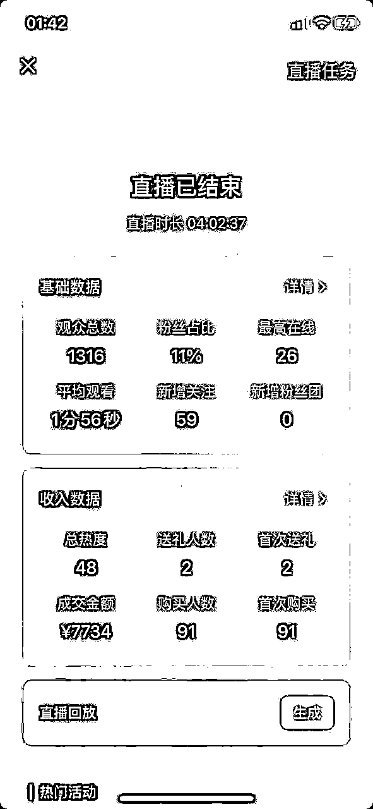
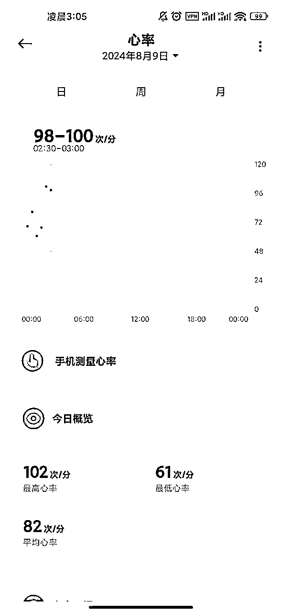
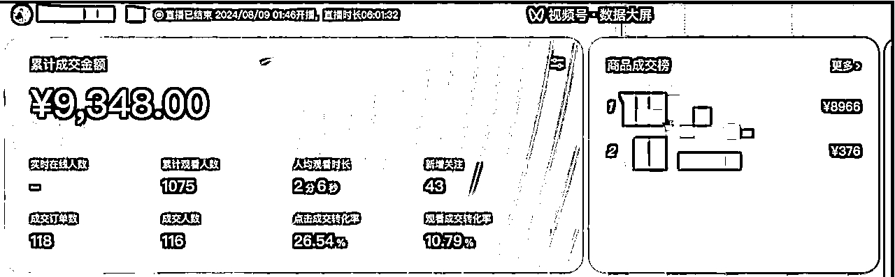
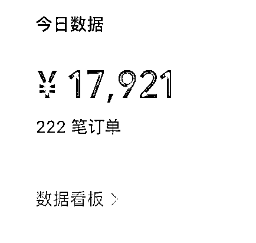

# 视频号口播航海，新手第一次爆单1.8GMV，我是如何接住这波流量

最近视频号口播第二期航海快收官了，我想赶在最后，把上周四那场“意外爆单”完整记录下来。事情过去几天了，但回想起来还是有点上头。

先交代下背景：我是清水，今年4月才加入赚钱，全职奶爸一枚，裸辞后一直在找适合自己的方向。之前参加过📕店铺、📕达人、视频号带货长航海，都从0做到了1，成功下了船。但说实话，零零散散出几单，我觉得那不算真正的0-1。真正的0-1，是你突然迎来一次爆发、一次爆单——那才是一个项目真正让人上头、也真正能赚到钱的打开方式。毕竟，谁来赚钱不是为了搞钱呢？

下面进入正题，讲讲那天的全流程。

我走的是历史书籍这条线，具体哪个品就不报了，因为还在带。当时针对这个品，我录了三条带货视频，周三发了一条，周四又发了一条。

周四晚上8点，我刚从外面回到家，习惯性看了一眼后台，发现周三发的那条视频播放量到了6000。这个数字在航海里其实算不上多高，但我注意到一个细节——每分钟互动数超过了2次，点赞和喜欢一直在持续进来。我盯了一会儿数据，做了一个至今为止最果断的决定：马上开播。

说实话，开播前我完全没有任何准备。设备就是电脑加手机，电源备好，手机支架架上，还顺手找了个散热的东西——幸好找了，苹果手机播到第3个小时差点热爆，我赶紧从冰箱里翻出冰袋给它降温。灯光方面，因为平时录视频都是白天，客厅光线够亮，当天晚上就直接把所有东西搬到餐桌上了。话术呢？完全没准备，临时跑到一个正在卖书的直播间，看了两分钟，扒了一段我现在回看都觉得很烂的话术，大概就是：

“欢迎直播间的家人们，第一次来的家人可以点点关注、点点赞，刚刚视频里的那本书，确实觉得书不错，可以拍一下，都是包邮到家，现在是北京时间几点几分，对那段历史感兴趣的可以带一本回家。”

是不是挺寒碜的？但就是这么烂的话术，书还是能卖出去。更离谱的是，我连样品都没有。

当晚21:30，手忙脚乱地就开播了。刚开始真的很尴尬，毕竟第一次做直播，幸好平时录口播还能让我稍微稳住一点，不至于太慌。开播后我就一直在那自言自语，电脑端打开直播大盘，同时把商品挂上，看看有没有人进来。有人进来就多聊两句。就这么硬讲了一个多小时，居然卖了几百块，我当时心里还挺美，想着卖到1000就收摊。

但这里我犯了一个致命错误：商品上架后我一直没点“商品讲解”，导致商品不会出现在直播界面上，观众必须点进红色购物袋再手动点商品才能购买。也就是说，前面整整两个小时，我一直在引导用户去点购物袋、再点商品下单，这明显会拉低转化。但即使是这样，直播间还是陆陆续续有人在下单。如果一开始我就点了讲解，那天GMV至少能再多几千块。

发现这个问题后我立刻调整，果然马上就有人接连下单。

开播后2到3个小时，我整个人进入了一种亢奋状态。从一开始只会念那段干巴巴的话术，到慢慢能用自己的理解去讲书里的内容，也渐渐能跟直播间的人互动起来。这时候GMV已经跑到五六千的区间了。而我那条爆了的视频，也悄无声息地冲到了10万播放量。

真的，短视频和直播是可以双频共振的，这一点我完全没想到。

3小时后，人开始累了，又渴又饿又想上厕所又不敢走开，但后段反而轻松了一些，我甚至开始边播边喝水吃点东西。最搞笑的是，每次我跟观众说“主播播太久了、嗓子哑了、要下播了”，就咔咔有人下单，太有意思了。

到第4个小时，我是真撑不住了。航海3群的家人们可能还记得我当时疯狂找人代播的样子。这次带的品佣金不高，代播夜间要50块一小时，说实话我犹豫了一下，但咬咬牙还是上了——不管凌晨是赔是赚，先把流程跑通再说。就这样，我下播了。

这是我的成绩单，4个小时的。😂

下播后时间来到凌晨两点。我看了一眼代播姐姐，上播没一会儿就出了几百块，心想这下稳了。我马上整理了一下接下来要做什么，参考群里圈友的建议，剪了7条原视频去重的视频，准备凌晨4点发出去，补一下视频流量。其实这是百货打品的玩法，后来鹏师在群里说了，并没有“补视频”这回事。

因为怕打扰家人休息，我没回房间，就在沙发上躺下了。但根本睡不着。脑子一直在过刚才直播的各个环节：哪里没做好，现在播得怎么样，明天会怎样。一直到凌晨3点，心率都在突突突地跳。

中间我强行做腹式呼吸平复心情，总算眯了一会儿。凌晨5点起床把视频补发了，这时候GMV已经跑到3000多，我想着代播费稳了，就让代播姐姐继续播。实在太困，又回去睡了一个半小时。

6点半醒来一看，补发的视频也跑了2000左右，多少有点用，但不多。关键是——那条爆了的视频被人投诉了。

因为我原视频里用了一部分书籍画面，没想到被原作者发现了。说实话当时有点慌，时间太早，连问人都找不到。投诉可以选择申诉，也可以直接承认违规，但这东西我不敢乱点，因为直播当时跑得很好，在线人数基本保持在20人左右。

一直到7点半，投诉没处理，被判了成立。2个小时的处理时间，对我来说完全是懵的状态。生效之后，视频就看不到了。

直播间流量的主要入口——短视频流量，瞬间就没了。虽然还有推荐流能进人，但完全不精准。又播了十几分钟，GMV不动了，在线也没了。下播。我的爆单之旅到此结束。

后来合计了一下，这次从开播到下播，一共播了整整10个小时，直播加橱窗合计1.8万GMV。之后零星还出了点单，在其他账号上也有。

现在冷静下来复盘，问题确实不少。

第一个，也是最重要的问题——违规。我自己清楚，确实用了人家的视频，虽然只露了手和字，但这个没办法洗。但当时如果我选择“有异议”多拉扯一下，说不定直播还能多跑一段时间，那可都是钱啊。

第二个，开始没点商品讲解，导致购买流程变长，损失了不少GMV。

第三个，直播话术完全没体系。没有塑品、没有逼单，节奏全靠临场发挥。这块后续得好好精进。

第四个，视频爆了，说实话有运气成分。后来回看那条视频，确实拍得还行，但我对爆款感知还是比较弱，目前还是以量取胜的逻辑。

第五个，肯定还有不少问题是我一下子想不全的，要是圈友们有看出来，欢迎来跟我聊聊。

再说说反思总结：

第一，后面发视频一定要尽量降低违规风险，文案、画面、素材来源都要注意。如果没有这次违规，我有信心至少跑到中万。

第二，直播流程还是不熟练，第一次手忙脚乱全在自嗨，但有了这次打底，下次应该会从容很多。

第三，带货视频跑到6000播放、每分钟1到2个互动的时候，一定要果断尝试开播。数据低也可以试，有流量视频更应该试。

第四，在有产出的情况下，不要怕花钱，一定要找代播。一个人是熬不住的，有机会就要抓紧放大。

第五，书籍带货本质还是走长期运营逻辑，跟百货不太一样。我没想到这次居然能通过直播在短时间内卖出这么多，也算意外惊喜。

第六，虽然粉丝数还没过1000，但违规的处罚目前看下来，也就是视频下架，账号状态正常。之前一直担心会被限流，最近发了几条视频都有四千多播放，总算放下心来了——账号没废就还能打。

这次梦幻般的爆单经历到这里就结束了。作为视频号口播小白、赚钱新人，能有这么一次机会，真的让我对这个项目多了一份实打实的信心。虽然佣金其实没有达到我的预期，但这是裸辞三个月后，我靠自己的努力挣到的第一笔还算可观的收入。

希望各位圈友都能拿到自己的结果。有任何问题都可以来问我，知无不言。

那就这样，我们下次爆单见啦！