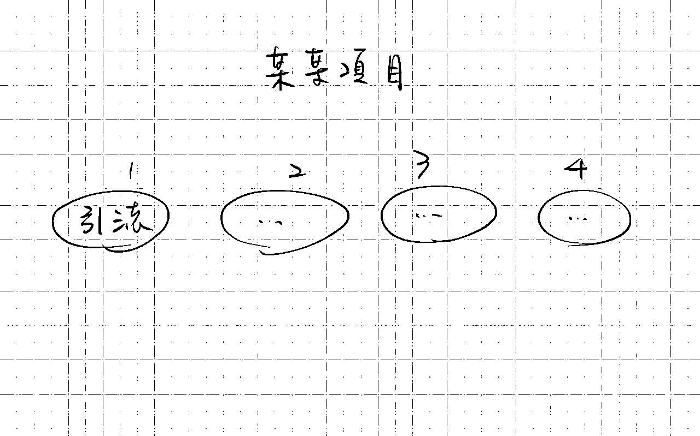
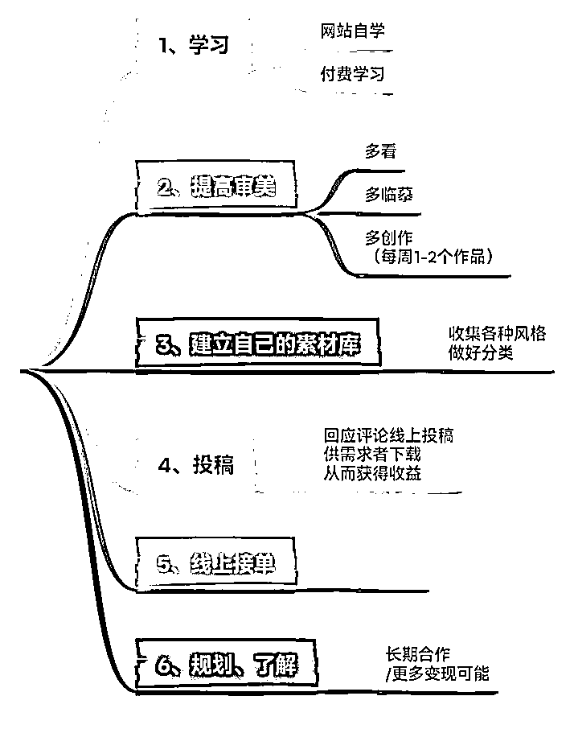
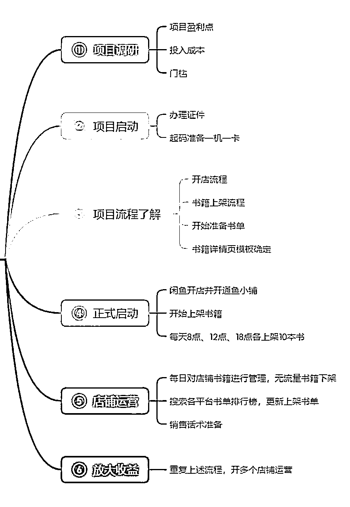

# 《我做副业能一直变现，靠的不是能力，是这 13 个认知顺序》

全文共：18,142 字

预计阅读时间：12.12 分钟

大家好，我是根源。

现在在知识付费和私域运营这条线已经深耕两三年了。

过去一年多，跟明白老师以及陈雪一起运营俱乐部，整体表现都很稳定，会员净增和复购数据也都不错。

今天还是围绕副业这个话题聊。

在我看来，赚钱的本质其实是认知。

认知和格局越高，赚钱就越轻松。

而认知的高低，本质上体现在思考的先后顺序和执行的先后顺序上。

高手为什么能把项目做成、赚得更多？

因为他们清楚：这个项目我要怎么想、怎么排优先级、怎么一步步推进，才能把成功率拉满。

我自己做了 12 年的自由职业，尝试过很多副业方向。

做下来会发现，赚钱的底层逻辑是通的。

这篇文章就把我启动新项目的底层思路拆出来，结合过往经验分享给关注副业的圈友。

如果有启发，欢迎一起讨论。

* * *

# 副业能不能赚到钱，核心不在能力，在认知顺序

12 年前我的老师就跟我说过一句话：

### 赚钱和能力的关系没有那么大，能力只决定你能不能赚到钱，但能赚多少，取决于认知。

认知不到位，收入就很难突破。

这句话我当时是完全不信的。

我总觉得赚钱就是拼能力，怎么会是认知？

什么是认知？什么是格局？当时我一直卡在这两个词上。

后来折腾了很多年才慢慢明白，赚钱真的不是能力打天下，而是认知决定天花板。

那么认知到底是什么？

### 认知就是对做法和想法进行排序。

举个例子，很多人来问我：

老师我想做副业，你帮我选一个合适的方向吧。

在我这里，这个问题本身就是错位了。

一个没有经验、对变现不熟悉的人，最不该做的就是自己去选方向。

你该做的是找一个已经跑通的人，直接照着他的方法做，并且全程不掰扯、不抱怨。

普通人的想法是：我要找一个我喜欢的副业。

更成熟的认知是：找一个能带我的人，让他直接告诉我做什么，我就乖乖做。

这两种思路的顺序完全不一样。

一个新手凭空去挑副业，就像不会打篮球的人去挑球鞋、不会跑步的人去挑跑鞋一样，根本挑不对。

所以认知的高低，直接决定了你的行动顺序和思维顺序。

副业做得顺不顺，关键就看你执行的先后顺序对不对。

逻辑很重要，但顺序更重要，因为逻辑本身就是一种排序。

用对了顺序，项目事半功倍。

怎么规划顺序？怎么让顺序清晰？

就是把你要做的项目做一次顺序拆解。

先把大模块列出来，可以是五步、十步，想到多少写多少。

关键是越清晰越细越好。

* * *

# 重新梳理副业的流程顺序

逻辑是顺序，顺序决定效率。

别小看把事情排好顺序，能省掉你大量试错成本。

但具体怎么排？怎么排才算清晰？

⭕️ 第一步，先做顺序排列

把手上正在做的项目或准备启动的项目，列出一个执行顺序。

这个排列一定要『图像化』。

先把大框架画出来，细节可以后补。

就像下面这张手绘图一样：

先把模块放上去，模块清晰了，才能判断这个顺序合不合理。

⭕️ 第二步，拆成大模块

可以是五步、十步，视项目而定。

原则是越具体越好。

* * *

# 用手绘流程图看清项目全貌

这是我在网上随便找的一个副业案例，帮别人做PPT。

项目不大但市场稳定。

我把它拆了下，一共六个环节：

1、学习
2、提升审美
3、建立素材库
4、投稿
5、线上接单
6、规划与了解

六个步骤，对应六个先后点。

手绘完后我会再转成导图，让流程更直观。

可视化之后，能立刻看出：现在的排序会不会卡住变现？会不会影响扩张？

也能在观察中做调整，比如加步骤、换顺序、删冗余。

举例来说：

是先提升审美再建素材库，还是反过来？
是先投稿还是先学习？

这个过程中的缺口在哪里，才会导致变现受阻。

* * *

# 想赚钱，先补足关键能力缺口

流程排好后，下一步就是评估执行力。

想真正落地变现，你缺哪些能力？下一步该补什么？

优先从大框架里找自己的短板。

最省钱的做法不是一上来就花钱报课，而是先找免费的优质文章、精华帖，把能自学的内容先吃透。

副业初期，大部分技能不需要学得很深。市面上现成的免费资料，已经能解决 90% 以上的问题。

除非是编程这种高度专业的方向。

做副业本质是做小生意，必须算成本。

不算成本就做生意，基本赚不到钱。

* * *

# 用正确的顺序经营项目，比拼能力更重要

我做项目能不能成，关键不是我有多强，而是我能不能用对顺序把它做起来。

顺序对了，项目很容易快速回血。

顺序错了，拖半年也赚不到钱，甚至倒贴。

所以我很看重一个项目该怎么排优先级来运营。

## 新项目最好的启动方式：找结果的人直接抄

之前一个学员梳理咸鱼二手书的项目，我就拿它举例。

学员的第一个优先级写的是项目调研，分成盈利点、投入成本、门槛三块。

如果是我，我不会把调研放在最前面。

现实是，你之所以想做这个项目，一定是看到了某个帖子、某个做得好的案例，或者你觉得这个模式能跑通。

只要有一个人能做成功，说明逻辑是通的。

那我第一个动作就不会是调研，我会直接找这个成功案例，然后全程模仿。

找到一个有真实结果的人，他的帖子里通常已经有一套完整的操作顺序，我就照抄。

他的顺序是1到7，我就1到7，一步不错。

这样，项目调研的问题在模仿的过程中自然就被解决了。

### 所以我的第一优先级永远是：模仿谁、跟随谁、照着哪篇帖子做。

## 模仿时同步盘点能力，做好时间排布

模仿不是傻抄。

我会把模仿对象的流程全部写下来，然后评估：哪些我能做、哪些做不到、哪些需要提前准备。

流程清晰后，就能算出回本周期、需要投入多少钱、什么证件需要提前申请。

比如做饭，最先要确定今天吃什么，然后看冰箱缺什么、厨房缺什么，提前去买。

外卖要 40 分钟，那我就先下单；炖汤要一个半小时、煮饭要 40 分钟，那我就先开炖汤再煮饭。

同理，咸鱼二手书里如果有需要办理证件的环节，那我就先把耗时最长、最关键的行政流程放最前面。

* 第一阶段：模仿
* 第二阶段：把模仿对象的步骤一条条列出来
* 第三阶段：给每个步骤做时间表，排优先级

列完时间表，你就能判断什么时候能变现、什么时候能完成准备、什么时候该补能力。

这样才知道要补什么、准备多少钱、花多少时间。

认知才真正清晰。

## 前期听话照做，是获得正反馈的捷径

假设学员已经照着某个成功帖子把流程整理出来了。

这时候我要做的，是在每个环节后面加上我的目标和成本：

1.  项目盈利点后面写：我打算赚多少钱
2.  投入成本后面写：我实际要投多少钱
3.  门槛后面写：我需要具备什么能力才能达标

整张表变成我评估缺口的工具，而不是操作说明。

然后看开店流程、上架流程，哪些环节现在做会卡住？需要多少时间？开小铺需要什么资质？资质申请要多久？

把所有时间节点和阶段性目标都拆细，你才知道第一步该干什么。

第一步一定是那个最繁琐、最耗时的事。

这时候判断标准已经不是能不能做，而是怎么做能更快变现、更快拿到正反馈。

有正反馈，人就会更有劲、更有信心。

总结下来，

⭕️ 流程一：先找到一个对标人物或对标文章，完全照着他的流程做。
⭕️ 流程二：把对方的流程全部复制下来，并在每个细节上写清目标、时间、准备事项、缺口补齐方案。同时算清要投入多少钱、进多少货、准备多少资料、办多少证。
⭕️ 流程三：完全照抄，前两个月不要乱问。用自己的理解去执行。项目需要自己走一遍试错，你才知道门道和细节。就像销售，要谈够 100个人才知道成交是怎么回事。聊了 3 个被拒、10 个没成交，老师说破嘴也没有用。

这三个步骤的核心提醒是：

### 在完全照抄的阶段，不要有自己的声音。

有自己的声音，进度一定会被拖慢。

除非你在该领域已经有过两三万以上的盈利成绩，你的判断才可能靠谱。

如果是初次尝试副业，就先闭嘴、照做。

这样启动会更轻松、更顺畅。

* * *

# 熟悉平台规则，给自己设定短期目标

再分享一个我自己的经历。

我做副业变现用得很久，后来复盘才发现，差的就是两个思维：熟悉平台规则、给自己设定阶段性目标。

## 熟悉平台规则，才能借力

我离开体制内后的第一份工作是直销。

当时体系很简单：卖产品或卖会籍。

一开始我对公司的规则完全不了解，不知道有没有价值。

老师只说想做就得先买套装，大概两千块以内。那笔钱对当时的我很重。

买完用着用着，老师突然点醒我：

要把事业做好，必须先搞清楚这个项目、这个平台的赚钱规则和制度规则。

就像现在加入龙哥盟：认真写文章、写得好能得精华，得精华有龙珠，龙珠能放微信号，就会有人主动来找你，认识更好的人、拿到更多机会。

这就是平台的隐性规则，不在公告里写，但大家都按这个在玩。

做任何项目前，先把规则吃透。

规则理解越清晰，按规则走就越稳。

很多高手都说顺应平台。

平台扶持视频号，就把视频号做好；平台不让放微信号，就别放。

### 研究项目规则，是启动前要花最多时间的事。

当时我没认真研究规则，但老师研究过了。

她没告诉我规则是什么，只告诉我该做什么。

这就是跟着一个高手的好处，能帮你省掉大量理解规则的时间。

所以我的第一点收获是有个人帮我搞懂规则。

## 给自己设定阶段性目标

接着老师帮我定了时间表，这点太关键了。

当时目标很明确：推荐 8 个人拿到总监。

老师说 2 月 20 号开始，月底前没完成 8 个就不带我了，说我没有天赋。

第一个月目标就是必须完成 8 个推荐。

方向一明确，我就不胡思乱想了。

虽然能力不足，但我知道要做什么。

当天看日历，离月底只剩 8 天...

很多人以为副业做不起来，是因为不够努力、方法不对，或者是运气不好。其实，真正拉开差距的，是一些看似不起眼的底层认知。

今天这篇文章，我想把这些东西掰开揉碎，一次讲透。如果你正打算开启副业，或者已经在做但卡在瓶颈期，建议耐心看完。

**一、别把目标定得太远，盯住眼前两周**

那时候我刚学完一个项目，老师讲完没两天就赶上周末，掐指一算，真正能用的时间只剩下六天。紧张是真的紧张，但心里一点都不慌，因为我对要做什么、要做到什么程度，心里清清楚楚。

这里有个很实在的建议：如果你打算做一个项目，别一上来就喊“三个月我要赚五千”“半年我要做到什么什么成绩”——这种目标太模糊了，模糊到你自己都不知道该从哪儿下手。

真正有效的目标，得满足两个条件：**时间短，数字清晰**。

什么叫短？最好控制在两周之内。什么叫清晰？直接说“我要在这个平台上赚到一千块”，甚至赚到五千块，都比“我要把项目做好”要具体得多。目标一明确，你的行动路径就会跟着清晰。

说白了，目标不是用来励志的，是用来落地的。你要是把一个目标定了之后，自己听完都觉得“这项目不过如此”，那这目标就是失败的。正确的感受应该是：心跳加速，觉得有点挑战，但不是那种让人想放弃的程度。

**二、赚钱很困难，你要先认这一点**

太多人把赚钱这件事想得太轻巧了。看到一篇分享帖，觉得照做也能赚到同样的收入。但事实上，赚钱本身就是一件极难的事——你想想上班族，每天起早贪黑，准时打卡，加班是家常便饭，辛辛苦苦一个月才等到发工资那天。这就是赚钱的真相：复杂、枯燥、高门槛。

但多少人一看完文章，就觉得自己也能行？不是方法不对，是因为从心底里就把赚钱给看扁了。

一旦你承认“赚钱不容易”，你才会把每一个环节都认真对待，不轻易开始，也不轻易放弃。相反，那些把“赚钱就是玩玩”挂嘴边的人，多半是自己已经赚过大钱、有底气的。你如果也信了“随便玩玩就能赚钱”，那在刚开始的副业路上，大概率连一分钱都赚不到。

**三、你今天对待小钱的态度，决定了你的赚钱潜力**

还有一个很少有人提过的点：对待小钱的态度。

你做副业，一开始卖的产品大概率是几十块钱的小东西——39元的分享群、99元的陪伴群、25元的小商品。可问题来了：你自己卖的时候，觉得客户怎么不积极、群里怎么不活跃？但你有没有想过，你买别人东西的时候，也是这种态度？觉得39块不是钱，99块不值得认真对待。

我第一次付费学习的时候，花了299元。对当时的我来说，这是三天的饭钱，是一笔不小的数目。正因为花得心疼，我学得格外认真，内容逐字记、重点整理，连一个9.9元的群都会拼了命地完成每一项任务。

这件事让我明白了一个道理：**当你真正尊重每一笔花出去的钱时，你才会吸引来同样尊重钱的人。** 你敷衍地花小钱，就会得到一个敷衍的结果；你认真地对待小钱，钱也会认真地回到你身边。

**四、三个月不换方法，才有资格说“不适合”**

我们学一样新东西，总想马上见效。投球姿势学不对，就觉得姿势有问题；话术讲完客户不成交，就觉得话术没用。可是你有没有想过：不是方法不对，是你练的次数还不够。

我当时在公司学销售，老师给了一套300字的逐字稿。要我背下来可以，但让我见客户时一字不漏地讲出来，简直要了我的命。讲了几次没成交，我就质疑方法有问题。结果老师说：先讲满三个月再说。

前一个月，客户面无表情；第二个月，慢慢有人多问两句；第三个月，客户真的开始感兴趣了。神奇的不是话术变了，而是我的语调、节奏、表情全都在重复中磨了出来。同样的话术，因为熟练度的不同，效果天差地别。

所以，学一个新项目或新方法，给自己设一个最低期限——三个月，甚至半年。这条路只能自己走，别人的成功经验，你光看不练，永远拿不到同样的结果。

**五、固定时间做固定的事，副业才可能做得好**

你会不会给自己每天挪出固定的两小时来做副业？晚上9点到11点，到了就必须放下其他事，专心做这一件事？

我印象很深的是以前跟着老师做事，她每天早上五点起床，运动、看书、做规划，二十年如一日。她的生活节奏几乎是刻在骨子里的，也正是这种节奏，支撑她同时把主业和副业都做成全国第一。

很多人没有的正是这个：**到点就干，雷打不动**。上班打卡你从不迟到，做副业却总是“看心情”。时间一固定，你会开始重视这件事，把它当作分内之事来对待，而不是可有可无的消遣。副业能不能成，往往从一开始能否养成这个习惯就注定了。

**六、复盘一定要找你身边最厉害的那个人**

最后一个很关键的习惯：复盘。

我的复盘不是在电脑前自己默默写总结，更不是跟同事、朋友互相鼓鼓劲。真正的复盘，一定要跟比自己高一个段位的人一起做。

那时候我跟老师每次见完客户上车，她开口第一句就是：“你今天学到了什么？”一天下来，被问至少十次。每次我都得说出一个具体的东西，这逼着我在每件事里找总结、找差距。

跟同样水平的人复盘，你收获的无非是共鸣；跟更高水平的人复盘，你才能看到自己看不到的盲区。那个愿意为你指路的人，可能是你付费的导师，也可能是你信任的圈子里一位经验丰富的前辈。找到他，定期聊一聊，别一个人埋头苦干。

---

如果你正在做副业，试着对照这六条：

1. 目标有没有压缩到两周？有没有明确数字？
2. 有没有从内心意识到赚钱是一件辛苦的事？
3. 对待每一笔小钱，是尊重的还是随意的？
4. 碰到困难时，有没有坚持方法三个月以上？
5. 每天晚上能不能固定留出两小时给副业？
6. 身边有没有一个比你厉害的人在陪你一起复盘？

把这几件事想明白、做到位，你的副业不说突飞猛进，但至少会走上一条真正健康、长期的路。

赚钱的路没有捷径，可每一步都走扎实，就是最快的路。

**副业增长，从来不是靠“多做一点”，而是靠想对顺序**

先说说复盘。

在早年的业务习惯里，复盘几乎都是“热乎”的。
上午见了一个客户，见完马上复盘；下午见两位客户，结束后又复盘；晚上团队开完会，还有一轮复盘。
一天下来，复盘可能接连发生好几次。

那时候的复盘方式很轻，基本靠问答：老师提问题，我来回答；或者是边回听录音，边对照着找问题。
正因为次数多，每一件事结束后我都能立刻意识到：“刚才这里没做好”“刚才那句话欠妥”。
而且人刚谈完客户，记忆最清晰，老师只要问到细节，我马上能接上话；做过复盘之后，这件事的印象会更深。

如果现在你想让副业稳步增长，不问快慢，那至少得先回答这两个问题：

第一，能不能把复盘固定在每两三天一次？一周最少保住两三次，这是底线。
第二，你身边有没有人能帮你复盘？
要是你发现身边找不到一个比你水平更高的人来给你指问题，那副业的增长大概率会很慢——因为你调整的速度太慢了。

算一笔账：每天复盘一次，一周就等于有7次修正和进步的机会；一周只复盘3次，一星期只有3次进步机会；要是每天复盘2次，那一周就多到14次。
所以复盘的关键，不在于工具和方法，而在于你身边有没有一个随时能“拉着你回看战场”的人。

---

再聊一个特别有意思的话题：金钱观（这是整套顺序里的第十一个主题）。

2014年我做投资，赚到了人生第一桶金。那段时间行情不差，一个月的收益经常能到六位数。
当时我是团队长，要负责上课，课程分两类。
一类叫技术课，教大家怎么操作软件、怎么判断下单时机、怎么把指标看明白，本质是“怎么赚钱”。
另一类叫风险管理课，聊的是“为什么同一堂课、同一个项目、同一个货币品种，总有人赚得到钱，有人却亏？”以及“为什么大家下班时间差不多，有的赚钱有的赚不到？”更关键的是：为什么同样赚到了钱，有些人可以把利润留住，有些人过几天就花掉了？

那时的操作策略和软件，稳定一点，一个月产出8到10个点并不难；趋势来了，一个月拿20个点也有过。
班里有个95后年轻人，投入1万美金，当时折合人民币大约7万块。只用了两个星期，他就赚回1万美金——同样是差不多7万人民币，等于一个月翻倍。
他日常开销不高，一个月估摸着也就花5000块人民币。多赚了7万，按常理应该能存下来，可半个月后，这笔钱全被他花光了。

我很不解。后来在课堂里讲到一个词：你知不知道你赚这笔钱是为了什么？
就好像打仗的时候，人总得有个“到底图什么”的答案。如果没有，仗打着打着就会空虚，人会失去方向。

那堂课有位组员的妈妈也在，我问她：“如果一个月突然多出7万块钱，您会怎么安排？”
她说：“当然先存起来呀。该买的尿不湿要买，孩子学费、衣服、兴趣班的钱留好，剩下的也存着，万一以后有急用呢？”

我又问那位95后年轻人：“如果你以后每个月都多7万，你会拿来干嘛？”
他想了想：“吃点好的、玩点好玩的、住好一点的酒店、买点喜欢的东西……大概就这样吧。”

两种回答没有对错，但结果完全不一样。
当一个人缺少管理大额金钱的经验时，钱突然到账，反而会让他不知道该拿它怎么办——“这钱放在手里，到底该怎么办？”

副业想做成，必须提前想明白一件事：副业赚来的钱，你究竟要拿去做什么？
没有目标的人，哪怕一下赚好几万，也会在一个月内以不同方式流出去：要么玩乐花掉，要么买课学这学那，总之，钱总有办法离开他。

回头看，那些被运气眷顾赚来的钱，最后常常又被“实力”一点点送回原点。
所以，这个板块请你认真思考三个问题：
你想通过副业赚到多少钱？
这笔钱赚到后，会流向什么地方？
你打算怎么处置它？

---

第三个思维，我认为是所有思维里最重要的一个：不干会死。

大多数人做副业，要么是因为主业的钱不够花，要么是有个目标只能靠副业达成。但请再往下问一层：你有没有一个“如果完成不了就活不下去”的理由？
听起来夸张，可你得有一个“不得不”的动机。

举个例子：
没孩子之前，我一个月开销8000元，工资8500元，生活刚好平衡。
有孩子之后，开销涨到10000元，工资却还是8500元。也就是说，每个月固定透支1500元。
这就叫“不得不”。

当人被推到这种缺口上时，副业往往做得比旁人更扎实。因为你是带着明确目的去做的，而不是先干了再慢慢找方向。
大多数人只把副业当成人生里的“加分项”，不是必选项，有它没它，生活并没两样。
但我始终相信：一个“不得不”的理由，远远比你具备多少能力、专业有多强更重要。
因为做一件事的动力，直接决定了执行速度、效率，以及最后能不能完成。

这个思维很短，却是全篇最该记住的一句。

---

最后，聊聊认知和顺序。

我老师曾告诉我：普通工资，靠能力和专业就够；可工资之外的更高收入，光靠这些远远不够，还需要更清晰的认知。
他还说，赚钱从来不易。想赚得更多，每一步都得小心翼翼，走错一步就可能回不去。
我越来越理解这句话：稳稳地赚钱，先要有稳稳的认知。
认知正了，步骤才会有正确的顺序。

就像炒菜。
一盘青菜，正确的顺序大概是：切蒜头、洗菜切菜、热锅、倒油、下菜、加一点水盖上锅盖闷一闷、放盐、翻炒出锅。
如果你一开始就撒盐，再开火，然后才去切蒜头——事情也不是没做，但顺序一乱，菜的味道就全变了。

赚钱也一样，尤其是副业。
正确的认知，会给你正确的步骤；顺序对了，照着顺序往前走，效率自然就高了。
这篇内容讲的其实不是具体做法，而是一种做事顺序，以及看待事情的认知和习惯。
比起追求“新方法”，我更建议你选“正确方法”。
所谓正确方法，并不需要你每次都从零思考，而是在看过许多方法之后，先停下来想清楚：究竟哪种顺序更好、更稳？把它们总结出来，再执行，项目往往更容易做成。

整个过程里，最不好控制的变量，其实是“主观”。
主观很可怕，因为你可能明知道正确的路，却偏不走。
如果能把主观因素拿掉，认知正确、方向正确，龙哥盟里那么多副业项目，只要顺序走对，赚钱的难度真的不算高。
我自己也试过其中一些，收到了不错的正向反馈。
就祝大家：赚钱路上，顺序走对，步步走稳，一起赚到钱，也一起过上好生活。

---

最后简单介绍一下我自己：
我是根源，龙哥盟第四期圈友。
心理咨询师出身，积累了两万多个实战案例；还有12年线下销售与团队管理经验。2022年起转型线上，专注知识付费领域。
感谢你读到这一行，欢迎翻看下面这些历史文章：

【2021年文章】（精华x1）
1. 精华《直觉式萨克斯 透过社群成功变现146万》 https://t.zsxq.com/116B1bcYc
2. 《73项被动收入打造》 https://t.zsxq.com/11EHjTH0P
3. 《杭州夜话02场，夜话官复盘》 https://t.zsxq.com/19IkX4UMl
4. 《年入百万，团队从20人到4万人》 https://t.zsxq.com/19JYt77hL
5. 《主题：如何更有效的链接见面会认识的圈友》 https://t.zsxq.com/19VY2LWg4

【2022年文章】
1. 《互联网小白，第 1 次做线上产品，7 天赚回 10 倍门票》 https://t.zsxq.com/11ooZZbM7
2. 《把捣乱分子『逆势』转成爱用者的好方式》 https://t.zsxq.com/19lipLhJ5
3. 《 好的内容，是目前依旧没退旧流行的变现方式 》 https://t.zsxq.com/19BLMAYw1
4. 《明白老师的一个启发，让我从100天日耕的过程赚了30W+》 https://t.zsxq.com/19BgNoxfi

【2023年文章】（精华x6）
1. 《私域的意义不是管理，而是经营》 https://t.zsxq.com/19WEsfSq1
2. 精华《9年传统行业 1 年时间，从一无所有，到年入 200 万》 https://t.zsxq.com/10nmEr1cA
3. 精华《25个提高微信成交率的小技巧》 https://t.zsxq.com/11AgRW24F
4. 精华《35 个让私域收入翻 3 倍的技巧》 https://t.zsxq.com/11FmV2aqZ
5. 精华《续篇 - 25个提高微信成交率的小技巧（26 - 50）》 https://t.zsxq.com/13yRbmUwo
6. 《 私域话题：涨价之后，如何回复以及留住客户？》 https://t.zsxq.com/11UJk9HxQ
7. 精华《成为自由职业者的20个必备特质 》 https://t.zsxq.com/14XTxhh15
8. 《 36个让私域成交率翻倍的实战指南！ 》 https://t.zsxq.com/17zSrYzvk
9. 精华《产品线有引流体系，如何通过沟通促成升单？》 https://t.zsxq.com/17ocUJEFA
10. 《知识付费赛道，如何透过处理『反对问题』，增加用户粘性和复购率？》 https://t.zsxq.com/181fSc5rv

【2024年文章】（精华x3）
1. 精华《第一次尝试「问答群形式」的公域往私域转化，7天变现11万》 https://t.zsxq.com/18gBXlWxE
2. 《 线上新手，我是如何用一套固定流程，累计成交 300 万高价产品？ 》 https://t.zsxq.com/18IWgDiXo
3. 精华《 私域话题-如何在客户咨询过程中，透过三个步骤提高2倍成交率？ 》 https://t.zsxq.com/196Ad34aR
4. 《私域的十倍增长话题：不同信任程度的客户，如何提升成交率？》 https://t.zsxq.com/YKHGT
5. 精华《 为什么都是做副业，我能第一年就达到七位数？ 》 https://t.zsxq.com/APodD
6. 《 写作赛道，如何使用「算账思维」精准地评估产出？》 https://t.zsxq.com/ymcEE
7. 《 私域+知识付费话题：如何通过增加合理的触达次数，提升2倍以上成交率？》 https://t.zsxq.com/elSxU
8. 《9年传统行业转型第2年，如何维持百万利润》 https://t.zsxq.com/61VlK
9. 《把副业做到超过主业收入，你必须得知道的20件事！》 https://t.zsxq.com/bkbd1

这篇文章看到这里，想必你也已经花了不少时间。
如果其中某句话能帮你在副业路上少走半步，就算值了。

赚钱加油。